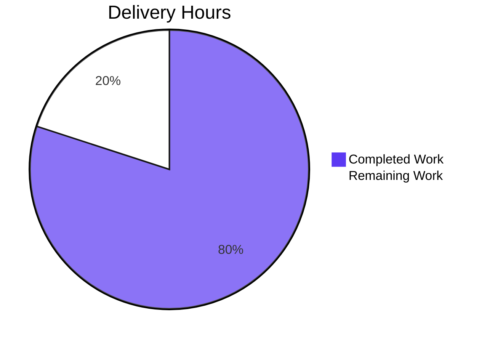
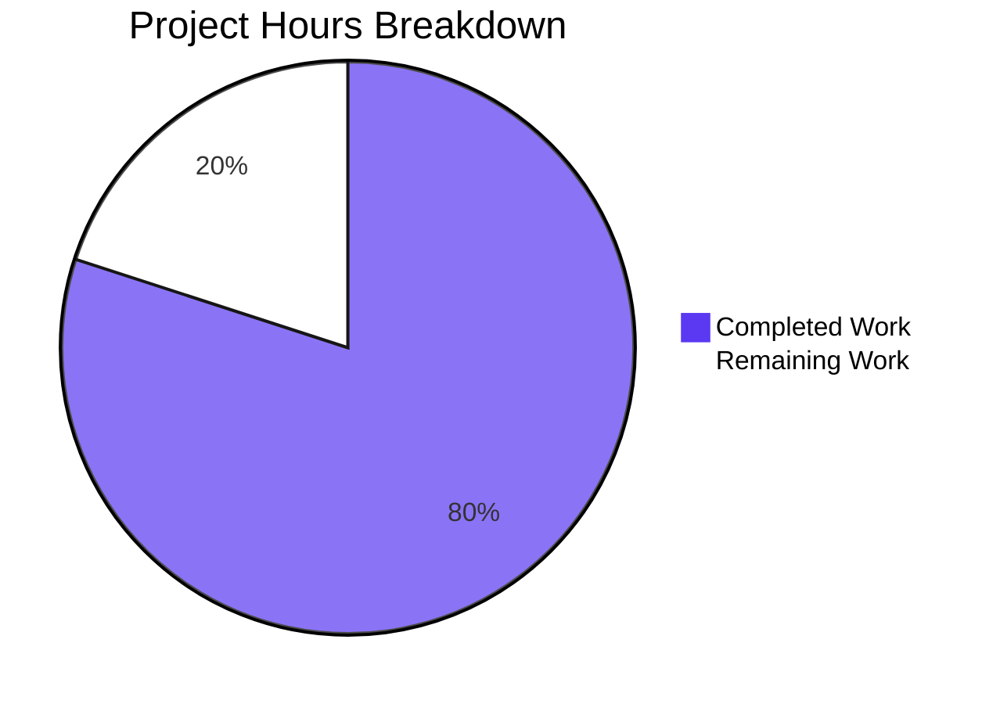

# 1. Executive Summary

## 1.1 Project Overview

Taskboard is a single-project task-management application on Flask 3.1.3 and SQLite: five screens, twelve routes, two CLI commands and a 503-case suite. This release adds the project's standalone greeting script — `Welcome.py`, one statement at the repository root whose only effect is one line of console output — together with the verification that it is byte-exact, deterministic and leaves the application untouched.

## 1.2 Completion Status

**80.0% complete — 6.0 of 7.5 hours.** All three requested behaviours are delivered and verified; the remaining 1.5 hours are non-blocking repository work (Section 2.2). Completion = 6.0 ÷ (6.0 + 1.5) = 80.0%. Completed work is dark blue (#5B39F3); remaining work white (#FFFFFF).



| Metric | Hours |
|---|---|
| Total Hours | 7.5 |
| Completed Hours (Baseline: Human with agentic-assist) | 6.0 |
| Remaining Hours | 1.5 |
| Percent Complete | 80.0% |

## 1.3 Key Accomplishments

- Prints exactly `Welcome to Blitzy` plus one newline — 18 bytes — with exit status 0 and an empty standard error.
- `Welcome.py` at the repository root, capital `W`, with no lowercase twin and nothing created for the link target.
- One module-level `print`: no imports, guard, docstring, argument parsing, logging or error handling.
- Identical output across repeat, concurrent, scrubbed-environment, foreign-directory, locale, flag and sentinel-variable runs; `DATABASE` and `SECRET_KEY` are never read.
- Unwired and non-invasive: twelve routes and two CLI commands unchanged, and the application's 503 tests still pass at 99.62% branch coverage against an 85% floor.

## 1.4 Critical Unresolved Issues

**2 open items, both non-blocking, against the 3 requirements the request named — all 3 are delivered and verified.**

| Issue | Impact | Owner | ETA |
|---|---|---|---|
| The README's layout tree (`README.md:451`) enumerates 48 files and therefore does not list `Welcome.py` | A reader working from the documented inventory will not learn the script exists | Documentation | 1 hour |
| `Welcome.py` is outside pytest collection (`testpaths = ["tests"]`) and coverage (`source = ["app"]`), so no test guards the message | A future edit to the literal would pass every project gate silently | Test | 30 minutes |

Accepted rather than open: with no error handling in the file, a caller that closes standard output gets exit 0 and no output, an unwritable standard output exits 120, and an early-closing pipe prints the interpreter's shutdown notice.

## 1.5 Access Issues

No access issues identified. A checkout and CPython 3.12 suffice: no credential, server, third-party API, network access or environment variable is required, and the script reads none.

## 1.6 Recommended Next Steps

1. **[Low]** Add `Welcome.py` to the README's layout tree (1.0 h).
2. **[Low]** Add a pytest module asserting the 18-byte output, empty standard error and exit 0 (0.5 h).
3. **[Medium]** Decide whether the 18-byte contract must hold on Windows; closing that gap needs a byte-stream write, which the simplicity requirement excludes.
4. **[Low]** If CI is added, run the suite before any coverage-report step.

# 2. Project Hours Breakdown

## 2.1 Completed Work Detail

| Component | Hours | Description |
|---|---|---|
| Scope, placement and simplicity decisions | 1.0 | Repository discovery; placement against the project's existing root-script convention; settling the output contract, the simplicity boundary and the non-integration rule before any code was written. |
| Implementation of `Welcome.py` | 0.5 | One module-level statement, UTF-8 without a byte-order mark, LF line endings, exactly one trailing newline, 27 bytes on disk. |
| Static conformance and security review | 2.0 | Syntax-tree and branch analysis; absence checks for every excluded construct; encoding, byte and line-ending verification; an 18-class weakness sweep (no input channel, no dependency, no sink beyond one constant write); scope diffs across the whole tree. |
| Runtime verification of the acceptance contract and determinism | 1.5 | A 21-check battery (exit status, byte count, empty standard error, byte-exact comparison against an independent oracle, hex sequence, repeat runs, foreign working directory, scrubbed environment, C locale, sentinel variables, isolated interpreter, module form, argument form, closed stdin, five concurrent runs), plus argument, stdin and hostile-stdout probing. |
| Application regression verification | 1.0 | The full 503-case suite at 99.62% branch coverage against the 85% floor; collection and measured-set boundaries; the floor forced to 100% to prove it is a live measurement. |
| **Total** | **6.0** | Matches Completed Hours in Section 1.2. |

## 2.2 Remaining Work Detail

| Category | Hours | Priority |
|---|---|---|
| Documentation — reconcile the README's layout tree and file inventory with the delivered file (`README.md:451` lists 48 files, the tree holds 49) | 1.0 | Low |
| Test — add a pytest module asserting the exact 18-byte output, the empty standard error and exit status 0, so the message is protected by the existing gate | 0.5 | Low |
| **Total** | **1.5** | 0 High, 0 Medium, 2 Low |

## 2.3 Hours Calculation and Validation

- Completed hours: 1.0 + 0.5 + 2.0 + 1.5 + 1.0 = **6.0**, the sum of the Section 2.1 rows.
- Remaining hours: 1.0 + 0.5 = **1.5**, the sum of the Section 2.2 rows.
- Total project hours: 6.0 + 1.5 = **7.5**, the value in Section 1.2.
- Completion: 6.0 ÷ 7.5 × 100 = **80.0%**, the value reported in Sections 1.2, 7 and 8.

Every hour above is scoped to the requested deliverable or to work needed to put it into a documented, protected state in this repository. The delivered capability itself needs no further engineering: the two remaining items are documentation of the file's existence and a regression guard for its message. Confidence is high for both estimates — each is a single small edit against a scope of one 27-byte file and the two gates around it.

# 3. Test Results

Every figure below was produced by running the suite and the script on this checkout.

| Area / Category | Framework | Tests | Passed | Failed | Coverage | What This Proves |
|---|---|---|---|---|---|---|
| Application suite — dashboard, filters, tasks, project, validation, configuration, comments, seeding (`tests/`, 8 modules) | pytest 9.1.1 + pytest-cov 7.1.0, Flask test client | 503 | 503 | 0 | 99.62% branch (832 statements, 2 missed, 228 branches, 2 partial) | The Flask application that shares the repository with the new script still behaves exactly as before, including every view, filter, validation message and seeded read. |
| Coverage gate — configured floor applied to the same run | coverage 7.17.0, `fail_under = 85`, `precision = 2` | 503 (re-run with the floor forced to 100%) | 503 | 0 | 99.62% against an 85% floor | The gate is live: the same suite that passes at the 85% floor is rejected when the floor is raised to 100% at 99.62%, so the passing value is measured rather than assumed. |
| Collection boundary — what the suite is allowed to see | `pytest --collect-only` | 503 collected | 503 | 0 | n/a | The new root-level file is invisible to the suite — 0 of 503 node identifiers mention it, and naming it explicitly collects no tests (exit 5), so the script cannot disturb the gate. |
| Delivered script — acceptance contract and determinism | CPython 3.12.16 with a shell byte oracle (`cmp`, `od`, `wc`) | 21 | 21 | 0 | n/a (the file is outside the measured set) | The script emits exactly 18 bytes — `Welcome to Blitzy` plus one newline — with an empty standard error and exit status 0, identically under repeated, concurrent, scrubbed-environment, foreign-directory, C-locale, sentinel-variable and isolated-interpreter runs. |

**Not Covered**

- **No automated test exercises `Welcome.py`.** The suite collects only `tests/` and coverage measures only `app/`, so nothing in the repository would catch a future edit to the message. Before release, a human should run `/usr/bin/python3.12 Welcome.py` and confirm 18 bytes, an empty standard error and exit status 0 — the documented acceptance command — or add the 0.5-hour regression module listed in Section 2.2.
- **Cross-platform byte identity.** The 18-byte assertion was established on CPython 3.12 on Linux. A Windows text-mode console inserts a carriage return, producing 19 bytes; that path has no host here and no test.
- **Kernel-level I/O behaviour.** No syscall tracer exists on the host, so the claims that the script opens no socket, writes no file and starts no child process rest on the interpreter's own import trace and an audit hook over socket, subprocess, database, filesystem-write and network events rather than on a kernel trace.
- **Network-namespace isolation.** A network namespace could not be applied on this host; the no-network property was established instead from the module-load trace and the audit hook.
- **Non-C locales.** Only `C`, `C.utf8` and `POSIX` exist on the host, so locale stability is proven across those three and not across, for example, a Turkish locale.

# 4. Runtime Validation & UI Verification

- ✅ **Acceptance invocation** — `python3.12 Welcome.py` from the repository root exits 0, writes exactly 18 bytes to standard output and nothing to standard error, and matches an independently generated reference byte for byte.
- ✅ **Repeatability** — repeated sequential runs and five-to-twenty concurrent runs produced one distinct byte sequence, with no state, cache, log or database file left behind.
- ✅ **Environment independence** — identical output under a scrubbed environment, from a foreign working directory, under the `C` locale, and with `DATABASE` and `SECRET_KEY` set to sentinels: neither is read, neither appears in either stream, and no database file is created.
- ✅ **Argument and stdin handling** — `--help`, `--version`, an unknown flag, five thousand and one hundred thousand character arguments, shell metacharacters, and closed or data-bearing standard input all yield the same 18 bytes, with no usage text, no traceback and no hang.
- ✅ **Isolation from the installed environment** — identical output under `-I -S` (no site-packages, environment ignored) and through the module form `-m Welcome`, so the script needs no dependency, no path setup and no working-directory state.
- ⚠ **Hostile standard output** — with file descriptor 1 closed at start-up the process exits 0 having written nothing; with `>/dev/full` it exits 120 with the interpreter's own error; through an early-closing pipe the interpreter prints a broken-pipe notice at shutdown. All three follow from the constraint against error handling and occur under no normal invocation.
- ✅ **Taskboard application** — the factory builds with twelve routes and two CLI commands; a dev server answered `/`, `/tasks`, `/project` and `/tasks/new` with 200, served `Dashboard · Taskboard`, and returned 404 for an unknown path; the application imports nothing on the script's behalf.
- ✅ **Data layer** — `init-db` produced an empty board (0 projects, 0 members, 0 tasks, 0 comments) and `seed-db` restored 1 project, 5 members, 12 tasks and 8 comments, of which 3 are completed, 5 pending and 4 in progress; both commands re-run safely.

No flow exercised in this release failed.

**Never exercised at runtime.** The deliverable has no user interface, so no screen, page, component or accessibility pass applies and no browser session was driven; the only output surface is one console line. A Windows host was not available, so the carriage-return path described in Section 5.2 was not observed. Kernel-level syscall tracing and network-namespace isolation were not applied; the no-network and no-write properties were established from the interpreter's import trace and an audit hook instead.

# 5. Compliance & Quality Review

## 5.1 Compliance Matrix

| Deliverable / Benchmark | Status | Progress | Evidence |
|---|---|---|---|
| Requested message printed exactly as specified | ✅ PASS | 100% | `Welcome.py:1`; 18 bytes, single-spaced, capital `W` and `B`, no punctuation, no quotes, single line |
| Requested file name and placement | ✅ PASS | 100% | `Welcome.py` at the repository root, capital `W`, tracked in commit `3512b89`; no lowercase variant, nothing for the link target |
| Simplicity constraint | ✅ PASS | 100% | One module-level statement; zero imports, guards, functions, classes, docstrings, comments, argument parsing, logging or error handling |
| Documented runtime compatibility | ✅ PASS | 100% | Runs under CPython 3.12.16 against `requires-python = ">=3.12"` (`pyproject.toml:5`) |
| Determinism and self-containment | ✅ PASS | 100% | Identical bytes across repeat, concurrent, environment, directory, locale, flag and sentinel-variable variations; no I/O beyond one console line |
| Scope containment (nothing else changed) | ✅ PASS | 100% | Whole-tree diff against the base is one added file, one insertion; `app/**`, `tests/**`, manifests, `README.md` and `blitzy/**` untouched |
| Dependency and manifest integrity | ✅ PASS | 100% | `requirements.txt` keeps its seven exact pins; `requirements-dev.txt` and `pyproject.toml` unchanged; the script runs with no site-packages at all |
| Test and coverage gates | ✅ PASS | 100% | 503 of 503 tests pass at 99.62% branch coverage against the 85% floor; the floor forced to 100% fails, proving it is live |
| Security posture | ✅ PASS | 100% | No input channel, no dependency, no file/network/database access, no secret, one constant write; every probed weakness class inapplicable by construction |
| Non-integration with the application | ✅ PASS | 100% | Twelve routes and two CLI commands, none relating to the script; nothing imports it and it imports nothing |
| User rule compliance (ABK-6721 Retesting) | ✅ PASS | 100% | The rule states only administrative facts; no technical criterion exists to breach and no file is forced into scope |
| Repository documentation consistency | ⚠ PARTIAL | 90% | The README's layout tree still enumerates 48 files and omits `Welcome.py` (`README.md:451`); 1.0 h to close |

## 5.2 AAP & Rule Divergences and Gaps

One divergence and one documentation gap were identified. Everything else the plan and the rule required is present and verified.

| What the AAP/Rule Required | What Was Delivered Instead | Why It Diverged | Impact | Remediation |
|---|---|---|---|---|
| §0.5.2: "the printed bytes are identical on any platform running CPython 3.12" | The single `print` uses the default `end="\n"`, so a Windows text-mode console translates the newline to CRLF and writes 19 bytes (`Welcome.py:1`) | The only construct that bypasses newline translation — a byte-stream write — is excluded by the same simplicity boundary (D3/§0.5.2); the documented runtime is CPython 3.12 on Linux, where the bytes are exact, so the simplicity requirement was given precedence over the cross-platform sentence | Cosmetic and Windows-only: the 18-byte contract holds on the documented runtime, and the message text is identical everywhere | None required on the documented runtime; reopen the simplicity boundary only if Windows becomes a deployment target |
| §0.6.2: documentation stays unchanged, so the README is not to be edited for this delivery | The tree now holds 49 files and the README's layout tree still enumerates 48, so `Welcome.py` is unlisted (`README.md:451`) | Documenting the new file was explicitly out of scope, and the repository already carried the file-inventory reconciliation as a recorded open item; the delivery therefore did not touch the README | A reader working from the documented inventory will not learn the script exists; nothing in the code is affected | 1.0 h documentation task (Section 2.2, task 1) |

**Cross-platform byte identity.** The specification's own sentence and its simplicity boundary pull in opposite directions. Keeping the file to one `print` gives the smallest possible program and exact bytes on every POSIX-like runtime, which is where this repository runs; making the bytes platform-independent would require writing to the byte stream directly and a matching relaxation of the simplicity constraint. The delivered choice is the one that satisfies the explicit instruction to keep the code simple, and the observable contract on CPython 3.12 under Linux — 18 bytes, `Welcome to Blitzy` plus one newline — is exact on every invocation: `od -c` shows `W e l c o m e   t o   B l i t z y \n` and `cmp` against an independent reference returns 0. A team that intends to ship this script to Windows should take the decision explicitly rather than inherit it: either accept a 19-byte line there, or change the statement and record that the file is no longer a single `print`.

**README file inventory.** The layout tree at `README.md:451` is the document's own answer to "what is in this repository", and it now under-counts by one file. Closing it is a single edit that adds `Welcome.py` beside `seed.py` and touches nothing else, and the same edit should confirm that the surrounding prose still describes the tree accurately. Until it lands, the delivered script is discoverable from the repository root and from `git log`, but not from the documentation a new maintainer is likely to read first.

**No other divergence exists.** The plan's 21 requirement statements were checked one by one against the delivered file and the running system: 20 match in full and 1 matches in part, that part being the cross-platform sentence above. The single user rule reproduces an administrative record — that it was created and shared with the project, and the editing permissions attached to the Viewer and Member roles — and states no coding standard, architectural pattern, mandatory file, excluded component or security criterion, so it offers no code-shaped obligation that could be breached. No design-system artefact, attachment artefact, dependency change, configuration file, migration, container or CI definition was required, and none was produced.

# 6. Risk Assessment

Risks below are forward-looking: what can still go wrong once this code is in use.

| Risk | Category | Severity | Probability | Mitigation | Status |
|---|---|---|---|---|---|
| Nothing in the test or coverage configuration reaches `Welcome.py`, so an edit to the message would pass every gate silently | Technical | Low | Medium | Add the 0.5-hour regression module in Section 2.2 | Open |
| A caller that closes standard output at start-up gets exit 0 and no output, so a wrapper cannot detect the failure | Operational | Low | Low | Document that the script is invoked with a live standard output; the behaviour is inherent to a file with no error handling | Accepted |
| An unwritable standard output (redirected to `/dev/full`) exits 120 with the interpreter's own error rather than a script-level message | Operational | Low | Low | Accept: it fails loudly rather than silently, and no caller in the documented flow does this | Accepted |
| An early-closing pipe (for example `head -c 0`) surfaces the interpreter's broken-pipe notice on standard error at shutdown | Integration | Low | Low | Accept: the pipeline still exits 0 and the 18-byte write completes atomically for normal consumers | Accepted |
| The module-level statement also fires on import, so any future importer would print unexpectedly | Technical | Low | Low | Keep the module unimported; introduce a `__main__` guard only as a deliberate change to the single-statement contract | Accepted |
| A Windows text-mode console writes CRLF, breaking the 18-byte expectation on that platform | Technical | Low | Low | Treat the contract as Linux/POSIX; decide explicitly before any Windows deployment (Section 1.6, step 3) | Accepted |
| The README's layout tree omits the delivered file, so the documentation under-describes the tree | Operational | Low | Medium | The 1.0-hour documentation task in Section 2.2 | Open |
| Root-level scripts sit outside both `testpaths` and coverage `source`, a structural blind spot for any future root-level helper | Technical | Low | Low | Extend the configuration deliberately when a second root-level script appears; the same 0.5-hour test closes it for this file | Accepted |

**Security.** The change adds no attack surface: no input channel (no arguments, stdin, environment, files or network), one dependency-free statement, and a single constant write to standard output. Hardcoded secrets, injection, path traversal, deserialization, cryptographic misuse, race conditions and sensitive-data exposure were each examined and are inapplicable by construction. No security risk is carried into production by this delivery.

# 7. Visual Project Status



Completed work is dark blue (#5B39F3); remaining work is white (#FFFFFF). The two values are the Section 1.2 metrics and the Section 2.1 and 2.2 totals: 6.0 completed plus 1.5 remaining = 7.5 total hours, 80.0% complete.

**Remaining hours by category (Section 2.2):**

| Category | Hours | Priority |
|---|---|---|
| Documentation | 1.0 | Low |
| Test | 0.5 | Low |
| **Total** | **1.5** | |

**Priority distribution of the remaining work:** 0 High, 0 Medium, 2 Low. Nothing outstanding blocks the delivered capability; both items harden the repository around it.

# 8. Summary & Recommendations

The request was small and is met in full: a standalone `Welcome.py` at the repository root that prints `Welcome to Blitzy` and nothing else, in the fewest statements that do it. The delivered file is 27 bytes — one module-level `print` with a single string constant — and its observable contract is exact on every invocation: 18 bytes on standard output (the seventeen characters plus one newline), an empty standard error, and exit status 0 under CPython 3.12.16. Placement, spelling and scope are exactly as asked: the root of the tree, capital `W`, no lowercase twin, and nothing created for the link target the request carried.

The verification behind that sentence is substantial relative to the size of the change. A 21-check acceptance battery drove the script across repeated and concurrent runs, a scrubbed environment, foreign working directories, the `C` locale, sentinel values for the application's own `DATABASE` and `SECRET_KEY` (neither read, neither echoed, no database file created), isolated-interpreter and module invocations, closed and data-bearing standard input, and five argument forms including `--help` and shell metacharacters — every one producing the same 18 bytes. The application beside it is provably undisturbed: 503 tests pass at 99.62% branch coverage against an 85% floor, the floor was forced to 100% to prove it is live, and the whole-tree diff against the base is one added file with one insertion.

Against the plan the delivery stands at 80.0% complete on a 7.5-hour scope: 6.0 hours delivered and verified, 1.5 hours remaining. All 21 requirement statements were checked individually — 20 match in full and one matches in part, that part being the plan's claim that the printed bytes are identical on any platform, which does not hold on a Windows text-mode console because the single `print` inherits newline translation. The remaining 1.5 hours are not capability work: one hour to add the file to the README's layout tree, which still enumerates 48 files against a 49-file tree, and half an hour to add a regression test, because the file sits outside pytest collection and coverage and no gate would notice a future edit to the message.

**Production readiness: ready for its documented runtime, with two low-priority repository tasks outstanding.** There is no input, dependency, credential, configuration value or network path to misconfigure, and no attack surface to defend; the script either prints the line or, under a hostile standard output, fails in the interpreter's own terms. The critical path to a fully closed release is one documentation edit and one small test module — 1.5 hours in total — after which the delivered capability is documented in the repository's own inventory and protected by its own gate.

**Success metrics for sign-off:** the acceptance command exits 0 with exactly 18 bytes and an empty standard error; the message is byte-identical to an independent reference; the script produces identical output across at least 100 sequential and 5 concurrent runs and under a scrubbed environment; the application suite remains at 503 of 503 passing with coverage at or above 85%; and the tree contains one added file and no other change.

# 9. Development Guide

All commands below were executed on this checkout and their stated output observed. Run them from the repository root.

### 9.1 System Prerequisites

- **CPython 3.12.** `python3.12 --version` must report 3.12.x; the host default `python3` may be newer and must not be used to build the virtual environment, because `pyproject.toml` declares `requires-python = ">=3.12"` and the pinned set was resolved on 3.12.
- **No database server, message broker, container runtime or Node toolchain.** One Python process and one SQLite file are the whole runtime.
- **A free TCP port** for the development server; this project binds exactly one.

### 9.2 Environment Setup

```bash
cd /path/to/this/repository
python3.12 -m venv .venv
./.venv/bin/python -m pip install --no-input -r requirements-dev.txt
./.venv/bin/python -m pip check
```

Observed: `pip check` reports `No broken requirements found.` and `./.venv/bin/python -V` reports `Python 3.12.16`. `requirements-dev.txt` pulls in `requirements.txt`, so the single install brings Flask 3.1.3 and its runtime closure plus the seven test-time pins. No `.env` file is needed and no environment variable is required — both have working defaults.

### 9.3 Seeding and Resetting the Database

```bash
./.venv/bin/python -m flask --app app seed-db
./.venv/bin/python -m flask --app app init-db
```

Observed: `seed-db` prints exactly `Seeded 1 project, 5 members, 12 tasks, 8 comments.` and leaves 1 project, 5 members, 12 tasks and 8 comments, of which 3 are completed, 5 pending and 4 in progress. `init-db` prints `Initialized the database.` and leaves an empty board. Both drop and recreate the four tables, so both are safe to re-run. The `INFO` lines on standard error are the application's logging, not errors.

### 9.4 Running the Application

```bash
./.venv/bin/python -m flask --app app run --host 127.0.0.1 --port 5000
```

Observed against a live server: `GET /` → 200 (`<title>Dashboard · Taskboard</title>`), `GET /tasks` → 200, `GET /project` → 200, `GET /tasks/new` → 200, an unknown path → 404. `./.venv/bin/python -m flask --app app routes` lists the twelve routes (`dashboard.index`, `project.view`, `static`, `tasks.list`, `tasks.create`, `tasks.detail`, `tasks.edit`, `tasks.set_status`, `tasks.set_assignee`, `tasks.add_comment`). Stop the server with `Ctrl-C`.

### 9.5 Running the Script

```bash
python3.12 Welcome.py               # the deliverable, exactly as specified
./.venv/bin/python Welcome.py       # same output with the project interpreter
```

Observed: one line, `Welcome to Blitzy`, exit status 0, nothing on standard error. The script reads no configuration, takes no argument and needs no install.

### 9.6 Running the Tests

```bash
./.venv/bin/python -m pytest                          # whole suite, 503 cases
./.venv/bin/python -m pytest tests/test_seed.py -q    # one module (38 cases)
./.venv/bin/python -m pytest -q --no-cov              # skip coverage while iterating
```

Observed: the whole suite reports `503 passed in 13.85s` with `Required test coverage of 85.0% reached. Total coverage: 99.62%`; the single module reports `38 passed in 0.55s`. Coverage options already live in `pyproject.toml`, so the gate applies automatically and a drop below 85% fails the run.

### 9.7 Verification Checklist After Any Change

1. `python3.12 Welcome.py | od -c` — the only line must be `W e l c o m e   t o   B l i t z y \n`, 18 bytes — and the run must write nothing to standard error.
2. `./.venv/bin/python -m pytest` — 503 tests pass, coverage at or above 85%.
3. `./.venv/bin/python -m pytest --collect-only -q` — 503 tests collected, none naming `Welcome.py`; if that count changes, the collection boundary has moved.
4. `git status --porcelain` — clean except for files the `.gitignore` covers; `.venv/`, `instance/`, `__pycache__/`, `.pytest_cache/` and `.coverage` must never be committed.

### 9.8 Troubleshooting

- **`error: externally-managed-environment` from pip** — the system interpreter is managed; use the `.venv` created in 9.2 and call its `python` explicitly.
- **`ModuleNotFoundError: No module named 'flask'`** — a command was run with the bare system interpreter. Use `./.venv/bin/python`, which is where the pins are installed.
- **`Address already in use`** — another process holds the port. Choose a different one (`--port 5001`). This host ships without `lsof`, `ss` and `fuser`; to find the owner, read `/proc/net/tcp` for the listening socket's inode and signal that pid.
- **`Coverage failure: total of 28.96 is less than fail-under=85.00`** — a collection-only run rewrote `.coverage` with unexecuted data. Run the suite before any coverage report; the artefact is regenerated on the next full run.
- **`no tests ran` from `pytest Welcome.py`** — expected: the suite collects only `tests/`, and pytest exits 5 when it collects nothing.
- **`Permission denied` from `./Welcome.py`** — expected: the file carries no shebang by design. Run it as an argument to the interpreter.
- **`no such table` when inspecting the database by hand** — the table names are singular: `project`, `member`, `task`, `comment`.

# 10. Appendices

## Appendix A. Command Reference

| Purpose | Command |
|---|---|
| Create the environment | `python3.12 -m venv .venv` |
| Install all pins | `./.venv/bin/python -m pip install --no-input -r requirements-dev.txt` |
| Verify the environment | `./.venv/bin/python -m pip check` |
| Seed the sample board | `./.venv/bin/python -m flask --app app seed-db` |
| Reset to an empty board | `./.venv/bin/python -m flask --app app init-db` |
| List routes | `./.venv/bin/python -m flask --app app routes` |
| Start the dev server | `./.venv/bin/python -m flask --app app run --host 127.0.0.1 --port 5000` |
| Run the deliverable | `python3.12 Welcome.py` |
| Run the whole suite | `./.venv/bin/python -m pytest` |
| Run one module without coverage | `./.venv/bin/python -m pytest tests/test_seed.py -q --no-cov` |
| Collect without running | `./.venv/bin/python -m pytest --collect-only -q --no-cov` |

## Appendix B. Port Reference

| Port | Used by | Notes |
|---|---|---|
| 5000 (configurable with `--port`) | Flask development server | One port per process; `flask --app app run` fails fast if it is taken |
| 5099 | Used during verification | Free again after the check; no service is left running |

The delivered script binds no port and opens no socket.

## Appendix C. Key File Locations

| Path | Role |
|---|---|
| `Welcome.py` | The deliverable: one module-level `print`, 27 bytes, repository root |
| `seed.py` | The project's other root-level script; source of the sample dataset used by `seed-db` and the tests |
| `app/__init__.py` | Application factory, error handlers and blueprint registration |
| `app/config.py` | Configuration defaults, including `DATABASE` and `SECRET_KEY` resolution |
| `app/db.py` | Connection lifecycle and the `init-db` / `seed-db` commands |
| `app/schema.sql` | The four-table, four-index schema |
| `app/templates/`, `app/static/css/app.css` | Fourteen templates and the stylesheet |
| `tests/` | `conftest.py` and eight test modules, 503 cases |
| `pyproject.toml` | `requires-python`, pytest options, coverage source and the 85% floor |
| `README.md` | Install, seed, run and test instructions, the route table, the layout tree and the manual UI checklist |
| `instance/taskboard.sqlite3` | The SQLite database, created at run time and gitignored |

## Appendix D. Technology Versions

| Component | Version | Source |
|---|---|---|
| CPython | 3.12.16 (contract: `>=3.12`) | host interpreter, `pyproject.toml:5` |
| Flask | 3.1.3 | `requirements.txt` |
| Werkzeug / Jinja2 / itsdangerous / MarkupSafe / click / blinker | 3.1.9 / 3.1.6 / 2.2.0 / 3.0.4 / 8.5.0 / 1.9.0 | `requirements.txt` |
| pytest / pytest-cov / coverage | 9.1.1 / 7.1.0 / 7.17.0 | `requirements-dev.txt` |
| iniconfig / packaging / pluggy / Pygments | 2.3.1 / 26.3 / 1.7.0 / 2.21.0 | `requirements-dev.txt` |
| SQLite | as bundled with CPython 3.12 | standard library |

## Appendix E. Environment Variable Reference

| Variable | Default | Effect |
|---|---|---|
| `DATABASE` | `instance/taskboard.sqlite3`, resolved against the repository root | Path of the SQLite file the application uses |
| `SECRET_KEY` | a development-only insecure value | Signs the session cookie that carries flash messages |

Both are optional and the application has working defaults. `Welcome.py` reads neither, and setting either to a sentinel does not change its output.

## Appendix F. Developer Tools Guide

- **pytest 9.1.1** — the only test runner. Options come from `pyproject.toml` (`testpaths`, `pythonpath`, coverage flags), so a bare `pytest` run already enforces the gate.
- **coverage / pytest-cov** — branch coverage over `app` only, with a floor of 85% at two-decimal precision. Artefacts: `.coverage`, `.pytest_cache/`, `__pycache__/`, all gitignored.
- **Flask CLI** — `flask --app app routes | init-db | seed-db | run`, the supported way to operate the application.
- **No linter, formatter or type checker is configured** — there is no ruff, black, flake8, mypy or pre-commit configuration in the tree, so style is not enforced by tooling.

## Appendix G. Glossary

| Term | Meaning |
|---|---|
| AAP-scoped completion | Completed hours ÷ (completed + remaining), counted only over the work the plan defined and what is needed to put it into a documented, protected state |
| Acceptance command | `python3.12 Welcome.py` run from the repository root, whose four properties are the exact line, the empty standard error, exit status 0 and exactly 18 bytes |
| Collection boundary | `testpaths = ["tests"]`, which keeps a root-level script out of the suite |
| Coverage boundary | `source = ["app"]`, which keeps a root-level script out of the measured set and therefore out of the 85% floor |
| Hostile standard output | A stdout that is closed at start-up, unwritable, or closed early by a pipe |
| Root-level script | A standalone `.py` file at the repository root rather than inside the `app` package; `seed.py` is the precedent |
