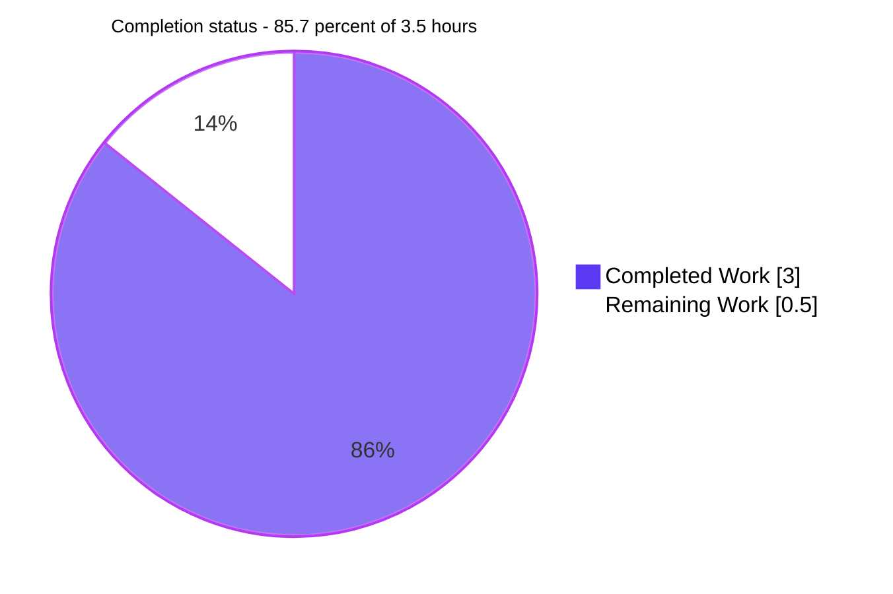
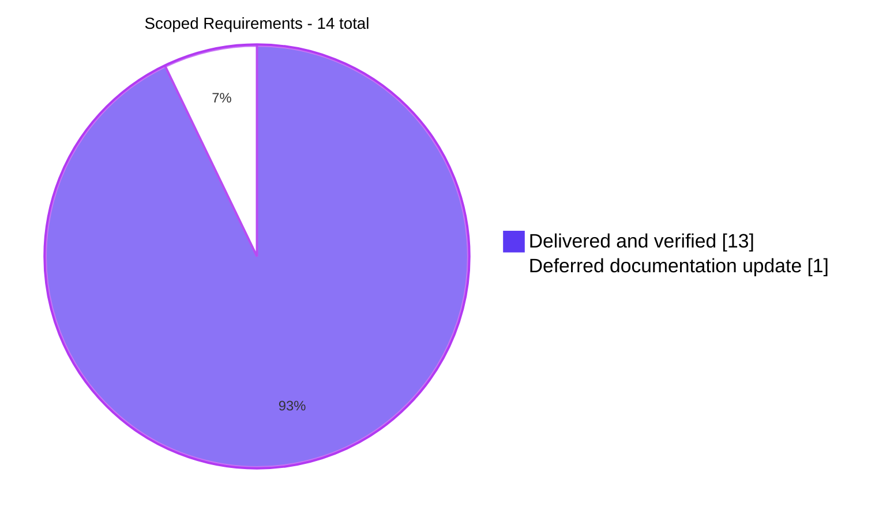

# 1. Executive Summary

This summary states what the work delivered, what was exercised to prove it, and what remains open.

## 1.1 Project Overview

Taskboard is a Flask 3.1, server-rendered task board on SQLite — one project, five members, twelve tasks, twelve HTML endpoints. This work adds a second root-level entry point, `Welcome.py`, whose entire content is one statement: `print("Welcome to Blitzy")`. It targets any developer who needs that line on standard output by naming the interpreter, on the documented CPython 3.12 toolchain, with nothing installed. The scope is one created file of 27 bytes, with no change to the application, its templates, its tests or its gates.

## 1.2 Completion Status

**3.0 of the 3.5 hours this scope comprises are complete — 85.7%.** Thirteen of the fourteen requirements are delivered and verified; the remaining half hour is the deferred documentation update in Section 5.2. Completed = Dark Blue `#5B39F3`, Remaining = White `#FFFFFF`; 3.0 ÷ 3.5 × 100 = 85.71%.



| Metric | Hours |
|---|---|
| Total Hours | 3.5 |
| Completed Hours (AI + Manual) | 3.0 |
| Remaining Hours | 0.5 |
| AAP-Scoped Completion | 85.7% |

## 1.3 Key Accomplishments

- `Welcome.py` writes exactly `Welcome to Blitzy` plus one newline — 18 bytes, exit 0, empty stderr.
- Source shape: 27 bytes, ASCII, one terminating newline, one module-level `print` call, no import, guard, shebang or docstring (commit `05b74e8`).
- 22 runtime cases — four interpreters, hostile arguments, empty environment, closed and piped streams, sequential and parallel runs — all byte-identical.
- The board's 503-test suite passes at 99.62% against its 85% floor, with the new file neither collected nor measured.
- One file and one line added; every other path is byte-identical, and the board still answers as documented.

## 1.4 Critical Unresolved Issues

Two of the fourteen scoped requirements carry an open item; neither blocks release of the script.

| Issue | Impact | Owner | ETA |
|---|---|---|---|
| Published file inventories do not list `Welcome.py` — the `README.md` project-layout tree (lines 418-457) and the in-repo project documentation both hold zero references | A reader of the documentation alone will not learn the script exists | Repository owner | 0.5h |
| No committed test and no committed gate covers `Welcome.py`; its byte contract is proven by manual runs only | A future edit could change the emitted bytes with no failing check | Repository owner (optional) | 1.0h |

## 1.5 Access Issues

No access issues identified. Everything runs from a local checkout: no credential, third-party API, broker, container runtime or network service is involved, and the one setting the board reads, `SECRET_KEY`, has a working development default in `app/config.py`.

## 1.6 Recommended Next Steps

1. **[Medium]** List `Welcome.py` in the `README.md` project-layout tree, in the in-repo documentation's file listing and in its byte-compile command (0.5h).
2. **[Low]** Commit a regression test covering the 27-byte source and the 18-byte stream (1.0h).
3. **[Low]** Record the platform stance for the emitted bytes before any Windows use (0.5h).
4. **[Medium]** Add CI running the suite and a tree-wide byte-compile (3.0h).
5. **[Low]** Decide whether the board stays loopback-only; if shared, replace the `SECRET_KEY` fallback, serve behind a WSGI server and add accounts plus CSRF protection (8.0h).

# 2. Project Hours Breakdown

Completed work totals 3.0 hours; remaining work totals 0.5 hours; the two sum to the 3.5 Total Hours in Section 1.2 and the values plotted in Section 7.

## 2.1 Completed Work Detail

| Component | Hours | Description |
|---|---|---|
| Welcome.py deliverable — source, name and placement | 0.5 | One module-level `print("Welcome to Blitzy")` created at the repository root under the exact capital-W filename, 27 bytes, with none of the supporting constructs the simplicity constraint excludes (`Welcome.py`). |
| Acceptance run and byte-level output verification | 0.5 | Documented command run from the repository root; stdout compared byte-for-byte with the expected 18 bytes, plus line count, exit status and stderr size (`Welcome.py`). |
| Runtime invariance matrix | 1.0 | 22 cases: CPython 3.12.16, 3.13.13 and 3.14.7 invocations, junk and unicode arguments, empty environment, locale and encoding overrides, closed stdin, piped stdout, foreign working directory, five sequential and ten parallel runs, and a side-effect scan proving a run creates no file, directory or bytecode. |
| Static source-shape and gate verification | 0.5 | AST and byte census, absence probes for every excluded construct, the pytest collection and coverage boundary, a silent tree-wide byte-compile, and zero-diff confirmation on every pre-existing path. |
| Board regression confirmation | 0.5 | 503-test suite at 99.62% against the 85% floor; dashboard metrics 12/3/5/4; 12-row task list with 3/5/4 status filters; task create, status, assignment and comment writes; validation and 404 paths. |
| **Total** | **3.0** | Equals Completed Hours in Section 1.2. |

## 2.2 Remaining Work Detail

| Category | Hours | Priority |
|---|---|---|
| Documentation inventory update — add `Welcome.py` to the `README.md` project-layout tree and to the in-repo project documentation's file listing, and name it in that document's byte-compile command | 0.5 | Medium |
| **Total** | **0.5** | Equals Remaining Hours in Section 1.2 and the "Remaining Work" value in Section 7. |

No deployment hours remain: the script runs directly from the source tree, and the repository has no build, container, pipeline or release process to configure. The optional hardening items listed in Section 1.6 — a committed regression test, a recorded platform stance, CI, and deployment hardening for the board — sit outside this scope and are therefore not counted in these hours.

## 2.3 Hours Methodology and Confidence

Hours are measured, not extrapolated. Each completed line in Section 2.1 corresponds to work that produced observable evidence in this checkout: a 27-byte file, a 22-case runtime matrix, 503 executed tests, and a diff of one file and one line. Verification effort dominates because the deliverable itself is a single statement — the cost is in proving the byte contract holds across invocation forms and in proving nothing else in the repository moved.

| Estimate | Basis | Confidence |
|---|---|---|
| Deliverable 0.5h | 27 bytes, one statement, no supporting constructs (`Welcome.py`) | High |
| Acceptance and byte verification 0.5h | One command, byte comparison, three count assertions | High |
| Runtime matrix 1.0h | 22 executed cases across four interpreter entries and six environment classes | High |
| Static shape and gate verification 0.5h | AST and byte census, absence probes, collection boundary, byte-compile, path-by-path diff | High |
| Board regression 0.5h | 503 tests in one gate run plus nine HTTP-flow checks | High |
| Documentation update 0.5h | Two files to amend: `README.md` project-layout tree and the in-repo project documentation listing | High |

# 3. Test Results

Every figure below was observed in this checkout: the suite run `./.venv/bin/python -m pytest` (503 passed, 0 failed, exit 0, `TOTAL 832 statements / 228 branches, 99.62%`, "Required test coverage of 85.0% reached"), the per-module runs behind the category counts, the 22-case runtime matrix, and the source census.

| Area / Category | Framework | Tests | Passed | Failed | Coverage | What This Proves |
|---|---|---|---|---|---|---|
| Task lifecycle — list, create, detail, edit, status change, assignment, comments (`tests/test_tasks.py`, `tests/test_comments.py`) | pytest 9.1.1 | 148 | 148 | 0 | `app/blueprints/tasks.py` 100%, `app/services/tasks.py` 100%, `app/services/comments.py` 100% | Every task and comment endpoint answers as the contract states: 302 on a successful write, 200 re-render on rejectable input, 400 on a value outside a closed set, 404 on an unknown id. |
| Form validation and filter parsing (`tests/test_validation.py`) | pytest 9.1.1 | 141 | 141 | 0 | `app/validation.py` 100% | Each field rule and each message holds, and a rejected post writes nothing. |
| Task filtering and template filters (`tests/test_filters.py`) | pytest 9.1.1 | 107 | 107 | 0 | `app/templating.py` 100% | The three list filters select the documented rows, and date, status and deadline rendering is correct at the boundaries. |
| Seed dataset and CLI commands (`tests/test_seed.py`) | pytest 9.1.1 | 38 | 38 | 0 | `app/db.py` 97.40% (`seed.py` sits outside the measured source) | `init-db` and `seed-db` produce the documented board — 1 project, 5 members, 12 tasks, 8 comments — and re-running the loader is idempotent. |
| Dashboard, project screen and configuration (`tests/test_dashboard.py`, `tests/test_project.py`, `tests/test_config.py`) | pytest 9.1.1 | 69 | 69 | 0 | `app/blueprints/dashboard.py` 100%, `app/blueprints/project.py` 100%, `app/config.py` 100%, `app/services/members.py` 90.91% | The four metric cards, the project read/edit pair and the `DATABASE`/`SECRET_KEY` resolution behave as specified, including the empty-database state. |
| **Repository suite total** | pytest 9.1.1 + pytest-cov 7.1.0 | **503** | **503** | **0** | **99.62%** overall, 85% floor | The delivered board meets its documented contract and its configured coverage gate. |
| Deliverable output contract (`Welcome.py`) | CPython 3.12.16 runtime harness | 22 | 22 | 0 | not measured — the file is outside the suite's coverage source | Every documented and adjacent invocation writes exactly the 18-byte line, exits 0 and writes nothing to stderr. |
| Deliverable source shape (`Welcome.py`) | CPython `ast` and byte census | 9 | 9 | 0 | not applicable | The file is one statement of 27 bytes: no import, no guard, no shebang, no docstring, no annotation, no executable bit, and no other file in the tree references it. |

**Not Covered**

- **No committed test exercises `Welcome.py`.** Its stdout contract is proven by the 22-case runtime matrix and the source census, not by a test in `tests/`. Nothing in the repository's gate would fail if a future edit changed the emitted bytes; `tests/test_welcome.py` does not exist and the file is outside `testpaths` and outside the coverage `source`.
- **No gate byte-compiles it.** The repository's documented syntax check names `app tests seed.py`; running that same check with `Welcome.py` appended compiles silently, but nothing committed does so.
- **Interpreter coverage stops at CPython.** 3.12.16, 3.13.13 and 3.14.7 were exercised; CPython versions below 3.12 and other implementations (PyPy, GraalPy) were not.
- **Non-POSIX byte output is untested.** On Windows, CPython's text-mode stdout translates the final newline, so the stream there would be 19 bytes; acceptance is defined on this host only.
- **The early-closing-stdout path is not covered by a test.** A consumer that closes its end first produces a `BrokenPipeError` traceback and exit 1; the behaviour is stock CPython — a `-c 'print(...)'` control reproduces it identically — and is unhandled by design.
- **The board's pages were verified over HTTP, not in a browser.** No layout, CSS-rendering, keyboard or screen-reader pass, and no JavaScript exists to exercise.

# 4. Runtime Validation & UI Verification

The board's pages and write flows were driven over HTTP against a running server; the script's whole user-visible surface is its own stdout, measured at byte level.

- ✅ **Deliverable invocation** — `./.venv/bin/python Welcome.py` run from the repository root writes 18 bytes (`Welcome to Blitzy` plus one newline), exits 0, leaves stderr empty, and is byte-identical to the expected stream via `cmp`.
- ✅ **Interpreter invariance** — CPython 3.12.16, 3.13.13 and 3.14.7 each produce the identical 18 bytes with exit 0.
- ✅ **Input and environment invariance** — junk and unicode arguments, an empty environment, `LC_ALL`/`LANG`/`PYTHONIOENCODING` overrides, `-I -S`, closed stdin, `/dev/null` stdin, piped stdout, the script fed on stdin, and an absolute path from a foreign working directory all yield the same stream.
- ✅ **Determinism, concurrency and side effects** — five sequential runs total 90 bytes over 5 lines and ten parallel runs are identical; a run creates no file, directory, bytecode cache entry or store write (`find -newer` returns nothing).
- ✅ **Board start-up** — `flask --app app run --host 127.0.0.1 --port 18457` served immediately after `seed-db`, and stopping it left the checkout clean.
- ✅ **Dashboard `GET /`** — 200 with 12 Total, 3 Completed, 5 Pending, 4 In progress, plus the seeded project panel (Website Redesign, 2 Nov 2026 to 31 Dec 2026).
- ✅ **Task list, detail and filters** — `GET /tasks` 200 with 12 distinct task rows; `?status=completed` 3, `?status=pending` 5, `?status=in_progress` 4; `GET /tasks/1` 200.
- ✅ **Write flows** — create answered 302 to the new detail page and the dashboard moved to 13 total / 6 pending; a status change answered 302, the detail page then showed the new status and the dashboard moved to 4 completed / 5 pending; assignment answered 302; a comment answered 302 and rendered on the next read.
- ✅ **Error and validation paths** — unknown member id 400, invalid status value 400, empty task title and empty comment body re-render at 200 with the offending field marked invalid, unknown task id 404, static CSS 200.
- ⚠️ **Not exercised at runtime** — no browser pass over any page, so layout, CSS rendering, keyboard navigation and screen-reader behaviour are unverified; no Windows or non-POSIX run of the script; no load, concurrency or performance measurement of the board.

# 5. Compliance & Quality Review

Status reflects the state of the repository now.

## 5.1 Compliance Matrix

| # | Deliverable / requirement | Benchmark | Status | Progress | Evidence |
|---|---|---|---|---|---|
| 1 | Exact filename and placement | Name and location as specified, capital `W`, repository root | ✅ Pass | 100% | `git ls-files -s` → `100644 … Welcome.py`; only `./Welcome.py` matches `*welcome*` |
| 2 | Byte-exact source | 27 bytes, ASCII, one terminating newline, no trailing blank line | ✅ Pass | 100% | `wc -c` 27, `od -c` ends `) \n`, `repr` `b'print("Welcome to Blitzy")\n'` |
| 3 | Simplicity constraint | One module-level statement; no import, guard, shebang, docstring, annotation, argument or environment access, error handling | ✅ Pass | 100% | AST has one `Expr`/`Call`/`Constant`; 0 imports, `get_docstring` None, no `#!`, mode `100644` |
| 4 | Output mechanism | Built-in `print`, one call, one literal, default line ending | ✅ Pass | 100% | AST `keywords == []`, one `Constant` argument, single call |
| 5 | Stdout contract | Exactly `Welcome to Blitzy` + one newline = 18 bytes / 1 line, capitals and single spaces exact, no quotes, no period | ✅ Pass | 100% | `cmp` byte-identical; `wc -c` 18, `wc -l` 1; character assertions on the stream |
| 6 | Exit and stderr contract | Exit status 0, empty stderr | ✅ Pass | 100% | Exit 0 and 0-byte stderr across all 22 runtime cases |
| 7 | Dependency and environment footprint | Standard library only; nothing installed; no environment required | ✅ Pass | 100% | 0 imports; identical output under `env -i`, `-I -S` and denied networking |
| 8 | Syntax validity and portability | Compiles silently; no version-specific syntax | ✅ Pass | 100% | `compileall -q app tests seed.py Welcome.py` silent, exit 0; identical bytes on CPython 3.12.16, 3.13.13, 3.14.7 |
| 9 | Repository containment | One file created, one line added, nothing else touched | ✅ Pass | 100% | `git diff --name-status 1332aea..HEAD` → `A Welcome.py`; 0 diff lines on every other path |
| 10 | Gate integrity | Suite green at the configured coverage floor; new file outside its scope | ✅ Pass | 100% | 503 passed, 0 failed, 99.62% coverage, 85% floor reached; 0 collection references to the file |
| 11 | Scope discipline | No test module, gate, manifest, CI, packaging or documentation change added | ✅ Pass | 100% | No `tests/test_welcome.py`; no CI/lint/type config exists or was added; manifests unchanged |
| 12 | Documentation currency | Published inventories name the new file | ❌ Not met | 0% | 0 occurrences of "Welcome" in `README.md` and the in-repo project documentation; see Section 5.2 |

## 5.2 AAP & Rule Divergences and Gaps

No unsanctioned divergence from the Agent Action Plan was identified: every requirement that calls for code or verification was delivered as written, and every construct the plan excluded is absent. No user-specified rules were supplied for this project, so there was no rule to depart from. The two entries below are gaps the plan itself recorded and accepted, not departures from it; they are recorded here because the reader acts on each one.

| What the AAP/Rule Required | What Was Delivered Instead | Why It Diverged | Impact | Remediation |
|---|---|---|---|---|
| Documentation stays untouched in this scope; the plan records that the published file inventories will not mention `Welcome.py` "until someone updates them on purpose" (section 0.7.4). | No documentation edit. The `README.md` project-layout tree (lines 418-457) lists `seed.py`, `tests/`, the requirements files, `pyproject.toml`, `README.md` and `.gitignore` but not `Welcome.py`; the in-repo project documentation holds no reference either. | The request named one file and asked for simplicity; documentation was outside the agreed scope, and the consequence was recorded in the plan rather than left implicit. **Sanctioned** by that recorded decision. | A reader of the documentation alone will not learn the script exists, which slows onboarding and handover. Nothing in the code is affected. | 0.5h, Medium — counted as remaining work in Section 2.2: add the file to the README tree, to the in-repo documentation's file listing, and to its byte-compile command. |
| No companion test module, and no change to gates: coverage measures `source = ["app"]` only, so no gate needs a test for the script (sections 0.3.2, 0.9.3). | No `tests/test_welcome.py`. The script sits outside `testpaths = ["tests"]` and outside the coverage source, and the documented byte-compile check names `app tests seed.py` without it. | The script imports nothing, the suite's coverage source is the application, and the simplicity constraint excluded supporting files — so no configured gate requires or would measure a test for it. **Sanctioned** by that recorded decision. | Silent-regression risk: a future edit could change the emitted bytes with no failing check; the contract is proven by manual runs only. | Optional 1.0h, Low — commit a regression test and add the file to the byte-compile command. Not counted in Section 2.2, because the agreed scope excluded both. |

**Documentation inventory lag.** The gap is two files deep and easy to close. The `README.md` project-layout tree is the canonical map of the repository (lines 418-457), and it enumerates every other root-level file with a one-line purpose comment; `Welcome.py` is simply absent from that map, and `grep -c Welcome README.md` returns 0. The in-repo project documentation is silent to the same degree. Meanwhile the tree itself is unambiguous — `ls -1 *.py` shows exactly `Welcome.py` and `seed.py`, and the commit `05b74e8` adds the file with one line. The owner's decision is whether the published inventory should list a convenience script at all; if it should, the edit is a one-line comment in the tree plus a sentence in the documentation, and 0.5 hours covers both.

**No committed coverage of the script.** Its byte contract rests on the 22-case runtime matrix recorded in Section 3, not on a test that a future change would have to satisfy. That is consistent with how the file was scoped — the suite's coverage source is `app`, the file is outside `testpaths`, and the repository's documented syntax check names only `app tests seed.py` — but it means the 18-byte stdout contract has no automatic defender. A nine-line test module asserting the 27-byte source and the 18-byte stream with exit 0 and empty stderr would close it, and appending the file to the documented byte-compile command would catch a syntax break. The owner's decision is whether the convenience script is worth that permanent test surface.

# 6. Risk Assessment

| Risk | Category | Severity | Probability | Mitigation | Status |
|---|---|---|---|---|---|
| No committed test or gate covers `Welcome.py`, so an edit could change the emitted bytes with nothing failing | Technical | Low | Medium | Add a regression test asserting the 27-byte source and 18-byte stream, and name the file in the documented byte-compile command (1.0h); until then the contract rests on manual runs | Open (accepted) |
| The repository has no CI, linter, type checker or security scanner; a style or syntax regression anywhere in the tree is caught only by a local suite run | Technical | Medium | Medium | Add a CI job running `./.venv/bin/python -m pytest` and a tree-wide `compileall` (3.0h) | Open |
| The checkout volume is case-insensitive, so a future lowercase reference to the script passes locally and fails on a case-sensitive filesystem | Technical | Low | Low | Always reference the capital-W path; no lowercase reference exists in the tree today | Open (informational) |
| CPython's text-mode stdout translates the final newline on Windows, so the emitted stream would be 19 bytes there rather than the 18 bytes accepted here | Integration | Low | Medium if ported | Record the platform stance; if byte equality on Windows is required, write the bytes explicitly instead of relying on `print` | Open |
| The board has no accounts, authorization or CSRF tokens, signs its session cookie with a development `SECRET_KEY` fallback in `app/config.py`, and is served by the Flask development server | Security | High if exposed | Low under documented use | Keep the loopback binding, replace the `SECRET_KEY` default from the environment, serve behind a production WSGI server, and add accounts plus CSRF protection before any shared deployment (8.0h) | Open |
| One SQLite file with one connection per request and no migration tooling; schema changes rely on re-applying `app/schema.sql` | Operational | Medium | Medium at multi-user scale | Adequate at single-user scale; introduce a migration path before concurrent multi-user use | Open |
| A stdout consumer that closes its end first produces a `BrokenPipeError` traceback and exit 1 | Operational | Low | Low | Unhandled by design and identical to stock CPython behaviour; only relevant if the line is placed in a pipeline whose reader exits early | Accepted |
| Published inventories lag the tree by one file, so documentation readers do not learn the script exists | Operational | Low | High — currently true | 0.5h documentation update, counted in Section 2.2 | Open (scheduled) |

# 7. Visual Project Status

Completed = Dark Blue `#5B39F3`; Remaining = White `#FFFFFF` with a violet-black outline so the slice stays visible on a white page.




Remaining work by priority (Section 2.2): **Medium 0.5h** — the documentation inventory update. No High-priority work remains. Optional items outside the counted scope, listed in Section 1.6 and Section 5.2, would add 1.5h at Low priority (regression test, platform stance) plus 3.0h of repository-level CI work if the owner elects to do them.

# 8. Summary & Recommendations

**What was delivered.** The request was a simple Python script that prints `Welcome to Blitzy`, stored in `Welcome.py`. The repository now holds exactly that: a 27-byte file at its root whose whole content is one module-level call, with no import, no guard, no shebang, no argument handling, no dependency and no configuration to manage. Commit `05b74e8` adds one file and one line; the other 48 tracked files, the seed dataset, the templates, the schema and every gate configuration are byte-identical to their previous state, so the change is additive in the strict sense rather than merely described as such.

**What was exercised to prove it.** The source was verified at byte level — 27 bytes, ASCII, one terminating newline, one `Expr`/`Call`/`Constant` in the parse tree — and the behaviour at runtime with a 22-case matrix: the documented invocation on CPython 3.12.16 plus 3.13.13 and 3.14.7, junk and unicode arguments, an empty environment, locale and encoding overrides, isolated `-I -S`, closed and piped stdin and stdout, a foreign working directory, five sequential and ten parallel runs. Every case produced the identical 18 bytes, exit 0, empty stderr, and no file, directory or bytecode artefact. Around it, the board's 503-test suite passes at 99.62% coverage against its 85% floor with the new file neither collected nor measured, and the board itself was driven through its twelve endpoints — dashboard metrics 12/3/5/4, a 12-row task list with 3/5/4 status filters, create, status, assignment and comment writes, and the 400/404/validation rejections.

**What remains open.** One deferred documentation update (0.5h) and one deliberate coverage gap: nothing committed tests or byte-compiles the script, so its byte contract is defended by manual runs rather than by a gate. Both were recorded decisions in the agreed scope rather than oversights, and both are cheap to close. Two optional items follow from them — a nine-line regression test and a recorded platform stance for the Windows newline translation — and neither changes the delivered behaviour.

**Critical path to production.** For the script itself there is no deployment step: it runs from the source tree and needs nothing installed. The only step before sign-off is the documentation update that puts the file on the repository map. For the board the picture is different and unchanged by this work: it is a loopback-only single-user application with no accounts, no authorization, no CSRF tokens and a development `SECRET_KEY` fallback, served by the Flask development server. Sharing it beyond the local machine would first need a pipeline that runs the suite and a tree-wide byte-compile, then a production WSGI server, an environment-supplied `SECRET_KEY` and an authentication layer.

**Assessment: 85.7% of the scoped hours delivered, no blocking defect, ready for sign-off once the documentation inventory names the file.** Nothing in the delivered capability is partial: the script produces exactly the bytes the request specified on every invocation form exercised, and the application around it is unchanged and green.

| Success metric | Value |
|---|---|
| AAP-scoped completion | 85.7% (3.0h of 3.5h) |
| Requirements delivered and verified | 13 of 14 |
| Repository test suite | 503 passed, 0 failed, 99.62% coverage (85% floor) |
| Deliverable runtime cases | 22 of 22 passed, byte-identical output |
| Open items | 2 (documentation inventory, optional regression coverage) |
| Unsanctioned divergences | 0 |
| Release-blocking risks | 0 |

# 9. Development Guide

Every command below was run in this checkout and its output is the output stated.

## Prerequisites

- **CPython 3.12** — `pyproject.toml:5` declares `requires-python = ">=3.12"`; the tested interpreter is CPython 3.12.16 (Homebrew `python@3.12`, on `PATH` as `python3.12`). The host's bare `python3` is a different minor version, so name the interpreter explicitly.
- A POSIX shell and `git`. **Nothing else**: no database server (SQLite comes from the standard library), no message broker, no container runtime, no JavaScript toolchain, no credential and no network access.

## Environment setup

```bash
cd <repository root>
python3.12 -m venv .venv
./.venv/bin/python -V                     # Python 3.12.16
```

`venv` creation succeeds here without workarounds. If a host ever fails at its `ensurepip` step, `README.md:88-99` documents a `--target` install fallback.

**Always spell the interpreter**: `./.venv/bin/python -m pytest`, never a bare `pytest`. A bare `pytest` can resolve to a different virtualenv on this host that lacks `pytest-cov` and fails with `unrecognized arguments: --cov=app --cov-branch --cov-report=term-missing` (exit 4).

## Dependency installation

```bash
./.venv/bin/python -m pip install -r requirements-dev.txt
./.venv/bin/python -m pip check           # No broken requirements found.
```

| Package | Version | Package | Version |
|---|---|---|---|
| Flask | 3.1.3 | pytest | 9.1.1 |
| Werkzeug | 3.1.9 | pytest-cov | 7.1.0 |
| Jinja2 | 3.1.6 | coverage | 7.17.0 |
| itsdangerous | 2.2.0 | iniconfig | 2.3.1 |
| MarkupSafe | 3.0.4 | packaging | 26.3 |
| click | 8.5.0 | pluggy | 1.7.0 |
| blinker | 1.9.0 | Pygments | 2.21.0 |

## Configuration

Two optional settings, both with working defaults; no `.env` file exists or is needed.

```bash
export DATABASE=/absolute/path/inside/your/checkout/board.sqlite3   # default: instance/taskboard.sqlite3
export SECRET_KEY='a-long-random-value'                             # default: development fallback in app/config.py
```

`DATABASE` is resolved against the repository root and its folder and schema are created automatically. The database is disposable and gitignored.

## Database initialisation

```bash
./.venv/bin/python -m flask --app app init-db    # Initialized the database.
./.venv/bin/python -m flask --app app seed-db    # Seeded 1 project, 5 members, 12 tasks, 8 comments.
```

`seed-db` drops the four tables, re-applies `app/schema.sql` and reloads the sample board. Use it to restore the documented board — 1 project, 5 members, 12 tasks, 8 comments; 3 completed, 5 pending, 4 in progress — after any manual play.

## Application startup

```bash
./.venv/bin/python -m flask --app app run --host 127.0.0.1 --port 18457
#  * Running on http://127.0.0.1:18457
```

The development server binds loopback only. Give each concurrent checkout its own port — a block of ten per clone, `18000 + 10 × clone index` — and stop the server when finished. `./.venv/bin/python -m flask --app app routes` lists eleven URL rules serving twelve method-and-path shapes.

## Verification steps

```bash
curl -s -o /dev/null -w '%{http_code}\n' http://127.0.0.1:18457/            # 200
curl -s http://127.0.0.1:18457/ | grep -oE '<strong>[0-9]+</strong><span>[^<]*</span>'
# 12 Total tasks · 3 Completed · 5 Pending · 4 In progress
curl -s http://127.0.0.1:18457/tasks | grep -oE 'href="/tasks/[0-9]+"' | sort -u | wc -l   # 12
curl -s -o /dev/null -w '%{http_code}\n' http://127.0.0.1:18457/tasks/9999  # 404
curl -s -o /dev/null -w '%{http_code}\n' http://127.0.0.1:18457/static/css/app.css        # 200
```

## The script

```bash
./.venv/bin/python Welcome.py             # prints: Welcome to Blitzy
./.venv/bin/python Welcome.py | wc -c     # 18
./.venv/bin/python Welcome.py | wc -l     # 1
./.venv/bin/python Welcome.py | od -c     # … y \n   — one terminating newline, nothing else
```

## Test

```bash
./.venv/bin/python -m pytest                                        # 503 passed, TOTAL 99.62%, 85% floor reached
./.venv/bin/python -m pytest tests/test_tasks.py -q --no-cov        # single module while iterating
./.venv/bin/python -m compileall -q app tests seed.py Welcome.py    # silent, exit 0
```

The coverage floor (`fail_under = 85`, two-decimal precision) and `addopts` in `pyproject.toml` are the gate: run the whole-package command before finishing a change, and use `--no-cov` only in the iteration loop. The repository configures no linter, formatter, type checker or security scanner, so the suite and the byte-compile are the only static gates.

## Example usage

```bash
# create a task — answers 302 to the new detail page
curl -s -o /dev/null -w '%{http_code} %{redirect_url}\n' -X POST http://127.0.0.1:18457/tasks \
  --data-urlencode 'title=Write the release note' \
  --data-urlencode 'description=Cover the new script.' \
  --data-urlencode 'assignee_id=1' \
  --data-urlencode 'status=pending' \
  --data-urlencode 'deadline=2026-12-15'

# change its status — answers 302, the detail page then shows the new value
curl -s -o /dev/null -w '%{http_code}\n' -X POST http://127.0.0.1:18457/tasks/13/status \
  -d 'status=completed&origin=detail'

# comment on it — answers 302 and renders on the next read
curl -s -o /dev/null -w '%{http_code}\n' -X POST http://127.0.0.1:18457/tasks/1/comments \
  --data-urlencode 'author_id=1' --data-urlencode 'body=Handover verification comment.'
```

## Troubleshooting

| Symptom | Cause | Resolution |
|---|---|---|
| `pytest: error: unrecognized arguments: --cov=app …` (exit 4) | A bare `pytest` resolved to a virtualenv without `pytest-cov` | Run `./.venv/bin/python -m pytest` from the repository root |
| `ModuleNotFoundError: No module named 'flask'` | The interpreter is not the project virtualenv | Prefix every command with `./.venv/bin/python -m` |
| `Required test coverage of 85.0% not reached` | A statement or branch lost coverage | Re-run without `--no-cov` and read the `Missing` column; do not lower `fail_under` |
| Dashboard cards all read 0 | The database is empty | `./.venv/bin/python -m flask --app app seed-db` |
| Counts no longer 12/3/5/4 after manual use | The board was edited through the UI | Re-run `seed-db`; the dataset is disposable |
| `OSError: [Errno 48] Address already in use` | Another server holds the port | Pick another port from your checkout's block |
| `curl: (7) Failed to connect` | The server is not running, or on a different port | Start it with `--host 127.0.0.1 --port <port>` and check `lsof -i :<port>` |
| Byte count is 19, not 18 | stdout was captured through a terminal, whose driver rewrites the newline as CRLF | Capture to a file or a pipe: `./.venv/bin/python Welcome.py > out.txt` |
| `BrokenPipeError` at `Welcome.py` line 1 | The consumer closed stdout before the write — stock CPython behaviour | Nothing to repair: any reader that consumes the stream receives all 18 bytes |
| `compileall` does not cover the script | The documented command lists `app tests seed.py` only | Append the file when you want it covered: `… app tests seed.py Welcome.py` |

# 10. Appendices

## A. Command Reference

| Command (run from the repository root) | Purpose | Expected output |
|---|---|---|
| `python3.12 -m venv .venv` | Create the project virtualenv | silent |
| `./.venv/bin/python -m pip install -r requirements-dev.txt` | Install the pinned toolchain | package list ending with the pins in Section 9 |
| `./.venv/bin/python -m pip check` | Verify dependency consistency | `No broken requirements found.` |
| `./.venv/bin/python -m flask --app app init-db` | Apply the schema | `Initialized the database.` |
| `./.venv/bin/python -m flask --app app seed-db` | Reload the sample board | `Seeded 1 project, 5 members, 12 tasks, 8 comments.` |
| `./.venv/bin/python -m flask --app app routes` | List the URL map | eleven rules / twelve method-and-path shapes |
| `./.venv/bin/python -m flask --app app run --host 127.0.0.1 --port 18457` | Serve the board on loopback | `* Running on http://127.0.0.1:18457` |
| `./.venv/bin/python -m pytest` | Whole-package gate with coverage | `503 passed`, `TOTAL … 99.62%`, floor reached |
| `./.venv/bin/python -m pytest tests/test_tasks.py -q --no-cov` | Single module while iterating | `130 passed` |
| `./.venv/bin/python -m compileall -q app tests seed.py Welcome.py` | Byte-compile the tree | silent, exit 0 |
| `./.venv/bin/python Welcome.py` | Run the script | `Welcome to Blitzy` |
| `./.venv/bin/python Welcome.py \| od -c` | Inspect the emitted bytes | stream ends `y \n` (18 bytes) |

## B. Port Reference

| Port | Use | Notes |
|---|---|---|
| 18457 | The board's development server in this checkout | Loopback only (`--host 127.0.0.1`); the project binds exactly one TCP port |
| 18000-18649 | The block reserved for concurrent checkouts | Ten ports per clone: `18000 + 10 × clone index` |

No other port is opened by the script, the suite or the board: the tests drive the application through Flask's test client and open no listener.

## C. Key File Locations

| Path | Contents |
|---|---|
| `Welcome.py` | The delivered script: one `print` call, 27 bytes |
| `app/__init__.py` | `create_app()`: configuration, instance folder, schema bootstrap, blueprint registration, `init-db`/`seed-db`, 400/404/500 handlers |
| `app/config.py` | Defaults, `DATABASE` and `SECRET_KEY` resolution, session-cookie flags |
| `app/db.py` | One connection per request, schema application, the seed command |
| `app/schema.sql` | DDL for `project`, `member`, `task`, `comment` plus four indexes |
| `app/validation.py` | Every field rule, filter rule and error message |
| `app/services/` | Business rules: projects, members, tasks, comments, metrics |
| `app/blueprints/` | The twelve contract endpoints over eleven URL rules |
| `app/templates/`, `app/static/css/app.css` | Page shell, pages, partials, error pages, stylesheet |
| `seed.py` | `SAMPLE_DATA` and `seed_database()` |
| `tests/` | `conftest.py` plus eight test modules, 503 tests |
| `pyproject.toml` | Runtime floor, pytest options, the 85% coverage gate |
| `README.md` | Operator documentation, including the project-layout tree at lines 418-457 |
| `instance/taskboard.sqlite3` | The disposable, gitignored SQLite database |

## D. Technology Versions

| Component | Version | Source |
|---|---|---|
| CPython | 3.12.16 (floor `>=3.12`) | `./.venv/bin/python -V`; `pyproject.toml:5` |
| Flask | 3.1.3 | `requirements.txt` |
| Werkzeug | 3.1.9 | `requirements.txt` |
| Jinja2 | 3.1.6 | `requirements.txt` |
| pytest / pytest-cov / coverage | 9.1.1 / 7.1.0 / 7.17.0 | `requirements-dev.txt` |
| SQLite | standard library (3.54.1 on this host) | `app/db.py` |
| Front end | Server-rendered HTML and one stylesheet; no JavaScript, no bundler | `app/templates/`, `app/static/css/app.css` |

## E. Environment Variable Reference

| Variable | Required | Default | Purpose |
|---|---|---|---|
| `DATABASE` | No | `instance/taskboard.sqlite3`, resolved against the repository root | SQLite file path; its folder and schema are created automatically |
| `SECRET_KEY` | No | Development fallback in `app/config.py` | Signs the session cookie that carries flash messages; set a real value before any shared deployment |

No credential, API key or third-party secret is read anywhere in the repository.

## F. Developer Tools Guide

| Tool | Use here |
|---|---|
| `pytest` (`./.venv/bin/python -m pytest`) | The gate: 503 tests, coverage floor 85% with two-decimal precision from `pyproject.toml` |
| `pytest-cov` / `coverage` | Applied through `addopts`; `--no-cov` disables it for the iteration loop only |
| Flask CLI (`flask --app app …`) | `routes`, `init-db`, `seed-db`, `run` |
| `compileall` | Fastest whole-tree syntax check; prints nothing on success |
| `sqlite3` or the standard-library module | Inspect `instance/taskboard.sqlite3`; tables are `project`, `member`, `task`, `comment` |
| `curl` | Drive any endpoint; the contract is HTML in and HTML out |
| `git`, `cmp`, `wc`, `od` | Confirm the change set and the script's exact bytes |

The repository configures no linter, formatter, type checker, security scanner or pipeline, so no tool beyond the above is wired in.

## G. Glossary

| Term | Meaning |
|---|---|
| **Byte contract** | The exact 18-byte stream the script writes: `Welcome to Blitzy` plus one newline |
| **Coverage floor** | The 85% total-coverage threshold in `pyproject.toml` that makes the suite exit non-zero when unmet |
| **Gate** | A command whose non-zero exit blocks a change; here the pytest run with coverage and the byte-compile |
| **Metric card** | One of the dashboard's four count tiles: total, completed, pending, in progress |
| **Quick action** | A one-field form on a task that writes immediately: status change, assignment |
| **Seed dataset** | The sample board `seed.py` loads: 1 project, 5 members, 12 tasks, 8 comments |
| **Status set** | The closed set a task status may take: `pending`, `in_progress`, `completed` |
| **Test client** | Flask's in-process request driver, which the suite uses instead of a live server |
