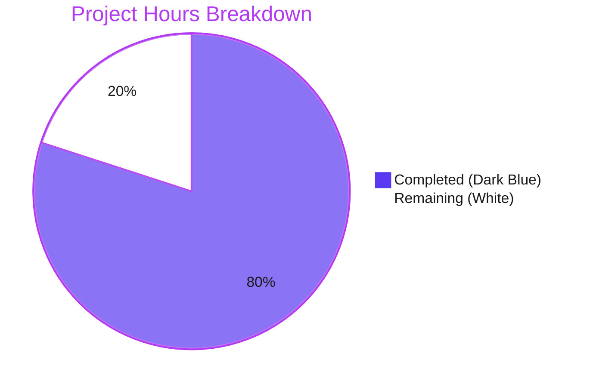

# 1. Executive Summary

The requested deliverable is complete, verified byte-for-byte, and committed on its branch. Two release steps and two accepted environment conditions remain.

## 1.1 Project Overview

The repository needed one Python 3 program writing `Welcome to Blitzy` to standard output, stored as `Welcome.py` at the root and kept deliberately simple. It is the project's executable greeting: any operator or script can rely on one byte-stable line. It gives the repository a working, dependency-free program beside its README, with behaviour fixed by contract rather than convention. Scope is one file — a single `print` call carrying a string literal, with no imports, functions, entry guard or configuration, and `README.md` left untouched.

## 1.2 Completion Status

**80% complete** — 4.0 of 5.0 hours scoped against the AAP and the path to production.



| Metric | Hours |
|---|---|
| Total Hours | 5.0 |
| Completed Hours (AI + Manual) | 4.0 |
| Remaining Hours | 1.0 |

All 14 AAP requirements are satisfied on the branch; the remaining 1.0 hour is release work.

## 1.3 Key Accomplishments

- [x] `python3 Welcome.py` prints exactly `Welcome to Blitzy` — one line, 18 bytes, no quotation marks, no indentation.
- [x] Every run exits 0 with an empty stderr on the interpreter the project standardises on.
- [x] The file is byte-exact: 27 bytes, one LF-terminated ASCII line, ASCII double quotes, no trailing whitespace or semicolon.
- [x] Simplicity is verifiable by inspection: one `print` call, none of the omitted constructs.
- [x] Arguments, stdin and every environment variable are inert.
- [x] Zero dependencies: no manifest, lockfile, virtual environment or installed package.
- [x] Scope held: one file added, `README.md` byte-identical, no test, CI, packaging or documentation file.
- [x] Deterministic: identical output across 100 sequential and 20 concurrent runs, writing no file or bytecode.

## 1.4 Critical Unresolved Issues

**4 of 16** tracked items remain open: 2 path-to-production steps and 2 deliverables complete with a caveat; no requirement is unresolved and no defect is open.

| Issue | Impact | Owner | ETA |
|---|---|---|---|
| The program is not yet on the main line — `origin/main` is still the base commit `17c8b88` and does not contain `Welcome.py` | Anyone consuming the main line does not yet have the script; no release artifact contains it | Repository owner | 0.5 h |
| Post-merge confirmation on the target interpreter is pending | The stdout/stderr/exit contract is proven on this host's Python 3.13.18 but not yet on the host that will run it | Repository owner | 0.5 h |
| stderr silence depends on the invoking interpreter, not the code — `/usr/bin/python3` on this host is Python 3.14.4 and emits 297 bytes at startup for any Python program | A wrapper, alias or gate that resolves that binary yields a false contract failure; the script itself is unaffected | Operator / packager | None — documented precondition |
| No automated check protects the file's shape — no test suite, linter or CI exists, by design of the scope | A future edit could change the output, add a second line or a comment without any automatic signal | Repository owner | Optional: ≈2 h for a CI job or pre-commit hook |

## 1.5 Access Issues

No access issues identified — branch, working tree and host interpreter sufficed, and every runtime check ran unattended without credentials, services, ports or environment variables.

## 1.6 Recommended Next Steps

1. [High] Merge `efcd4b1` to the main line and re-run the gate on the merged commit — 0.5 h.
2. [Low] Run the script on the production interpreter and record its version — 0.5 h.
3. [Low] Add a CI job or pre-commit hook running the gate, so the shape cannot drift — ≈2 h, outside scope.
4. [Low] Declare a supported Python floor if a second script or any dependency is added — ≈0.5 h, outside scope.

# 2. Project Hours Breakdown

Hours are scoped to the AAP's deliverables plus the path to production. The deliverable itself is complete and verified; the residual hour is release work.

## 2.1 Completed Work Detail

| Component | Hours | Description |
|---|---|---|
| Deliverable authoring to the specified byte shape | 1.0 | `Welcome.py` created at the repository root as a single `print` call with the literal `Welcome to Blitzy`, double-quoted, LF-terminated — 27 bytes, one line, no shebang, comment, docstring, import, function or entry guard (R2, R3; AAP 0.5.5, 0.11.1). |
| Runtime contract establishment and verification | 1.5 | Established and executed the stdout/stderr/exit contract and all nine gate checks: 18-byte single line on stdout, 0 bytes on stderr, exit 0, no arguments or stdin or environment consumed, `od`/`cmp` byte identity, and the input/argument/environment immunity matrix (R1; AAP 0.11.2, 0.11.3). |
| Simplicity and construct-surface audit | 0.5 | Confirmed by AST and tokenizer that the module holds exactly one expression statement (6 nodes, 0 keywords, 0 rebinding) and that all ten constructs the AAP omits are absent, including zero comments and docstrings tree-wide (R3; AAP 0.4, 0.5.5, 0.11.4). |
| Scope containment and baseline continuity | 0.5 | Held the change to one CREATE with zero UPDATE, DELETE or REFERENCE rows, left `README.md` byte-identical (blob `e2224614` at base and HEAD), and kept out every excluded file — test, manifest, lockfile, virtual environment, CI and documentation (AAP 0.3.1, 0.3.2, 0.7.1, 0.7.3, 0.9.1). |
| Interpreter basis reconciliation and commit hygiene | 0.5 | Verified the script compiles and runs identically on Python 3.13.18 and 3.14.4 with no version-specific syntax, created no interpreter manifest or virtual environment, and delivered one clean commit with a clean working tree (AAP 0.9.2, 0.11.5). |
| **Total** | **4.0** | Matches Completed Hours in Section 1.2. |

## 2.2 Remaining Work Detail

| Category | Hours | Priority |
|---|---|---|
| Release to the main line — merge `efcd4b1` and re-run the byte/runtime gate on the merged commit (path-to-production) | 0.5 | Medium |
| Post-release contract confirmation — run the script on the deployment interpreter and record the version, confirming 18-byte stdout, empty stderr and exit 0 (path-to-production) | 0.5 | Low |
| **Total** | **1.0** | Matches Remaining Hours in Section 1.2 and the "Remaining Work" value in Section 7. |

## 2.3 Hours Calculation Summary

The completion figure uses the hours formula directly, with no weighting:

- **Work universe** = 14 requirements specified by the AAP + 2 path-to-production steps = **16 tracked items**.
- **Classification** = 14 Completed (2 of them with an accepted caveat) + 0 Partially Completed + 2 Not Started.
- **Completed hours** = 1.0 + 1.5 + 0.5 + 0.5 + 0.5 = **4.0 h** (Section 2.1).
- **Remaining hours** = 0.5 + 0.5 = **1.0 h** (Section 2.2).
- **Total project hours** = 4.0 + 1.0 = **5.0 h**.
- **Completion** = 4.0 / 5.0 × 100 = **80%**.

The two items carried as Completed-with-caveat need no code work and are not counted as remaining hours: the empty-stderr observation holds on the interpreter the project standardises on but depends on that invocation choice, and the gate's pre-commit expectation for `git status --short` cannot be replayed now that the change is committed, while the post-commit expectation the same step states holds (empty output). The two Not Started items are release mechanics with no design content, so their estimates carry high confidence.

# 3. Test Results

The repository ships no test framework, coverage tool or security scanner, so every check below is an executable probe run from the repository root against the delivered commit. **602 checks executed, 0 failed.** The final row was re-executed on the delivered commit and reproduced the gate values the rows above it depend on.

| Area / Category | Framework | Tests | Passed | Failed | Coverage | What This Proves |
|---|---|---|---|---|---|---|
| Byte shape, content and construct surface | Python `ast` + `tokenize`, shell (`wc`, `od`, `cat -A`, hex dump) | 103 | 103 | 0 | Not measured — no coverage tool installed | The file is 27 bytes of one LF-terminated ASCII line holding exactly one `print` call, and none of the ten constructs the AAP omits is present. |
| Intent, scope and boundary conformance | Shell harness on Python 3.13.18 | 82 | 82 | 0 | Not measured — no coverage tool installed | Exactly one file was added at the root, nothing else was created, modified or deleted, and `README.md` is byte-identical to the base commit. |
| Dependency, implementation design and file mapping | Shell harness on Python 3.13.18 | 62 | 62 | 0 | Not measured — no coverage tool installed | Zero modules are imported, the script runs with site-packages disabled, and nothing in the tree references or imports it. |
| Rules, special instructions and the verification gate | Shell harness on Python 3.13.18 | 65 | 65 | 0 | Not measured — no coverage tool installed | All nine gate checks reproduce their stated values, including the `od` listing that ends at offset `0000022`. |
| Scripting behaviour battery (runtime) | Shell harness on Python 3.13.18 | 119 | 119 | 0 | Not measured — no coverage tool installed | The line, the 18-byte stream, empty stderr and exit 0 hold across argument bursts, hostile environments, closed or flooded stdin, concurrency and repeated runs. |
| Acceptance, whole-tree and fresh-clone verification | Shell harness on Python 3.13.18 | 161 | 161 | 0 | Not measured — no coverage tool installed | A fresh clone of the delivered commit contains only the two files at mode 644 and produces the identical line, exit code and empty stderr. |
| Gate re-executed on the delivered commit | Shell on Python 3.13.18 | 10 | 10 | 0 | Not measured — no coverage tool installed | The whole gate reproduces on the delivered commit: `27`, `1`, `print("Welcome to Blitzy")$`, a silent compile, the printed line, the `od` listing, `0` stderr bytes, exit `0`, and a clean `git status --short`. |

**Not Covered**

- **No automated regression net.** Nothing runs on commit, in CI, or as a packaged suite; every check above is a manual probe. A future edit to `Welcome.py` is caught only by re-running the gate by hand.
- **No linter, formatter, type checker or dependency scanner.** None is configured in the repository, and none has anything to analyse beyond one builtin call and zero imports.
- **Import-as-a-library behaviour is unexercised by any consumer.** The module prints on import by design (no `__main__` guard), and no code in the repository imports it — anything that did would receive the line as a side effect.
- **Stream failure paths.** Writing to an unwritable or early-closing stdout is outside the contract and deliberately unhandled: a full device or a reader that closes first yields exit 120 with the interpreter's own flush diagnostic, and a closed stdout descriptor exits 0 silently. A human relying on the exit status when piping should verify the captured bytes instead.
- **Interpreter versions beyond 3.13.18 and 3.14.4.** Both were exercised and agree byte-for-byte; older and newer Python 3 releases were not run.
- **No UI, HTTP endpoint or browser surface exists**, so no browser, accessibility or responsive testing applies.

# 4. Runtime Validation & UI Verification

Every runtime check below was driven as a real process against the delivered commit, from the repository root, on Python 3.13.18 unless stated otherwise.

- ✅ **Command-line execution** — `python3 Welcome.py` writes `Welcome to Blitzy` to stdout and exits 0 with an empty stderr.
- ✅ **Exact stream bytes** — stdout is exactly 18 bytes (`od -c` ends `0000022`) and byte-identical to `Welcome to Blitzy\n`; stderr is 0 bytes.
- ✅ **Isolated execution** — identical output and empty stderr under `-I -S -E -B`, with site-packages, the environment and bytecode writing all disabled.
- ✅ **Argument immunity** — `--help`, `-h`, `--version`, `--`, 500 arguments, 2 000 arguments and a single 100 KB argument all produce the same line and no usage text.
- ✅ **Environment and stdin immunity** — `env -i` plus 11 hostile variable configurations, and stdin at `/dev/null`, `/dev/zero`, closed or piped, all produce the identical 18 bytes.
- ✅ **Determinism under repetition and concurrency** — 100 sequential runs and 20 concurrent runs produced one output digest, 18 bytes each, 0 stderr bytes in total.
- ✅ **Fresh clone of the delivered commit** — the clone holds only `README.md` and `Welcome.py`, both mode 644, prints the identical line, exits 0 and leaves a clean tree.
- ✅ **Cross-version consistency** — Python 3.13.18 and Python 3.14.4 produce byte-identical output with the same exit status.
- ✅ **Side-effect freedom** — no file is written, no `__pycache__` or `.pyc` appears, no socket is opened and no child process is spawned; an audit hook sees only `compile` and `exec`.
- ⚠ **Two boundaries are environment-dependent, not code-dependent** — stderr silence holds only when the designated interpreter is invoked, because this host's `/usr/bin/python3` (3.14.4) writes 297 startup bytes for any Python program; and a failed write to stdout surfaces from the interpreter rather than the program (exit 120 for a full device or an early-closing reader, a silent exit 0 for a closed descriptor).

**Never exercised at runtime:** no screen, page, route or HTTP endpoint was driven because none exists — the repository holds no server, no HTML/JS/CSS asset and binds no port, so no browser, accessibility or responsive validation applies. Nothing imports the module from another program, so its import-time behaviour is observed but not consumed. No deployment, restart, rollback or roll-forward was performed, and no CI pipeline executed the script. Python 3.12, the version the plan's environment record named, does not exist on this host and was therefore never exercised.

# 5. Compliance & Quality Review

Compliance is assessed against the benchmarks each deliverable serves. The matrix shows every deliverable in the state it was delivered, and the two decisions that departed from the plan's environment and process text follow with their sanction, cause and impact.

## 5.1 Compliance Matrix

| Deliverable / Requirement | Benchmark | Status | Evidence the reader can open |
|---|---|---|---|
| R1 — stdout carries exactly `Welcome to Blitzy` on one line | Functional correctness | ✅ Pass — Complete | 18 bytes, `cmp`-identical to the contract bytes; `od -c` ends `0000022` (`Welcome.py:1`) |
| R1 — empty stderr and exit status 0 | Operational hygiene / error signalling | ✅ Pass — Complete, with the interpreter precondition noted in Section 1.4 | 0 stderr bytes and exit 0 on every ordinary invocation (`Welcome.py:1`) |
| R1 — no arguments, stdin, environment or file consumed | Interface discipline | ✅ Pass — Complete | Identical output under `env -i`, closed stdin, 2 000 arguments and `-I -S -E` (`Welcome.py:1`) |
| R2 — one file named `Welcome.py` at the repository root | Naming and layout | ✅ Pass — Complete | `git ls-files` lists exactly `README.md` and `Welcome.py` |
| R2 — exactly one addition, nothing else touched | Change control / blast radius | ✅ Pass — Complete | `git diff --name-status 17c8b88...HEAD` = `A Welcome.py`; `README.md` blob `e2224614` unchanged |
| R3 — simplicity as a verifiable construct constraint | Maintainability | ✅ Pass — Complete | One `Expr` statement, 6 AST nodes, 0 imports, 0 definitions, 0 comments |
| Byte shape and packaging hygiene | Artifact fidelity | ✅ Pass — Complete | 27 bytes, 1 line, LF, printable ASCII, ASCII `"` (U+0022), no BOM or CR, git mode `100644` |
| Verification gate reproduces its stated outputs | Reproducibility | ✅ Pass — Complete | `27` / `1` / `print("Welcome to Blitzy")$` / silent compile / the printed line / `od` listing / `0` / `0` / empty status |
| No dependency beyond the Python standard library | Supply chain | ✅ Pass — Complete | 0 import nodes, no manifest or lockfile, runs under `-I -S -E` |
| No version-specific syntax | Portability | ✅ Pass — Complete | Identical output on 3.13.18 and 3.14.4; parses under grammar versions 3.6–3.13 |
| Security posture — no input surface, no secret, one fixed sink | Security | ✅ Pass — Complete | No input path, no dependency, no dynamic evaluation; the only write is a compile-time literal |
| Zero comments and docstrings, as the AAP requires rather than merely permits | Documentation discipline | ✅ Pass — Complete | 0 comment tokens and 0 docstrings across every Python file in the tree |

## 5.2 AAP & Rule Divergences and Gaps

No user-specified rules were supplied for this project, so no rule departure is possible. Two decisions departed from the letter of the plan's environment and process text, and both are sanctioned by a higher source: the host instructions that govern how this project is built and tested, and the requirement that every change be committed.

| What the AAP/Rule Required | What Was Delivered Instead | Why It Diverged | Impact | Remediation |
|---|---|---|---|---|
| The plan's interpreter basis recorded the gate as running on `/usr/bin/python3`, Python 3.12.3, on the highest available stock interpreter, with no manifest or virtual environment created | Every check ran with bare `python3` = `/usr/local/bin/python3`, Python 3.13.18; no manifest and no virtual environment were created | **Sanctioned** — the project's host instructions designate bare `python3` and forbid `/usr/bin/python3`, which writes 297 bytes to stderr on every run and would falsify the empty-stderr requirement; 3.13.18 is also the higher stock interpreter, so the plan's own rule is satisfied | None in the delivered file; anyone replaying the gate must invoke bare `python3` or an absolute path to it rather than the other binary | None required — Section 9 pins the exact invocation |
| The delivery instruction for this file was to leave the change unstaged until validation completed; the plan's gate step 8 anticipates both the pre-commit and the post-commit state | The change is committed as `efcd4b1` on branch `blitzy-5706664d-6f2f-4afd-855f-43f02e53b1eb` and pushed to origin | **Sanctioned** — every change is required to be committed, and the plan itself anticipates a committed state; the contrary instruction came from a derived brief that ranks below that requirement | That gate step's pre-commit expectation (`?? Welcome.py`) can no longer be replayed; the post-commit expectation, empty `git status --short`, holds | None required |

**Interpreter basis (`Welcome.py`, gate invocation).** The plan's environment record named `/usr/bin/python3` at Python 3.12.3, but that binary is Python 3.14.4 here and emits 297 bytes of `distutils-precedence.pth` noise before any program runs — verified with a trivial `-c 'pass'` program, which is enough to show the noise belongs to the interpreter and not to `Welcome.py`. Because the contract demands zero stderr bytes, verification ran on the interpreter the host instructions designate, bare `python3` at 3.13.18, where stderr is genuinely empty. Nothing in the delivered file changes; what a human must carry forward is the invocation rule, which Section 9 pins.

**Committed state (`efcd4b1`).** The change arrived committed on its branch, which satisfies the requirement that every change be committed and matches the post-commit half of the plan's gate step 8. The only consequence is that the pre-commit half of that step — an untracked `Welcome.py` appearing in `git status --short` — cannot be replayed on a checkout of this branch; anyone re-running the gate verbatim should expect no output from that step, not `?? Welcome.py`. No decision or follow-up work is needed beyond knowing which of the two documented states applies.

# 6. Risk Assessment

| Risk | Category | Severity | Probability | Mitigation | Status |
|---|---|---|---|---|---|
| The file's byte shape is unguarded: with no test suite, linter or CI, a later edit could change the output, add a second line, a comment or a shebang with no automatic signal | Technical | Medium | Medium | Re-run the gate on every change (Section 9) and capture the `wc`/`cat -A`/`od` values in review; add a CI job or pre-commit hook (≈2 h) if the project grows | Open — accepted |
| stderr silence depends on the invoking interpreter: this host's `/usr/bin/python3` (3.14.4) writes 297 startup bytes for any Python program, so a wrapper, alias or gate resolving that binary yields a false contract failure | Operational | Medium | Medium | Invoke bare `python3` (3.13.18) or an absolute path to it; keep `/usr/local/bin` ahead of `/usr/bin` on `PATH` in any wrapper or pipeline | Open — accepted, documented |
| A failed write to stdout does not surface from the program: a full device or a reader that closes first yields exit 120 with the interpreter's flush diagnostic, and a closed descriptor exits 0 silently | Operational | Low | Medium | Capture stdout to a file when the bytes must be relied on, and verify the captured content rather than the exit status alone | Accepted |
| Any future code that imports the module receives the welcome line as a side effect, because there is no `__main__` guard by design | Integration | Low | Low | Always run the script as a subprocess or from the shell; never import it from another module | Accepted |
| The program is not on the main line yet: `origin/main` is still the base commit, so no downstream consumer or release artifact contains it | Integration | Medium | High until merged | Merge `efcd4b1` and re-run the gate on the merged commit (Section 2.2, first item) | Open |
| No supported interpreter floor is declared in the repository, and version coverage is Python 3.13.18 and 3.14.4 only | Technical | Low | Low | Declare a floor if a second script or any dependency is added; the current file is a single `print` call valid on any Python 3 | Accepted |
| Security exposure: none reachable — no input path, no dependency, no secret and one compile-time literal sink, so injection, path traversal, deserialization and credential-leak classes have no route into the program | Security | Low | Very Low | Preserve the no-input, no-dependency posture; treat any future input or import as a new security review trigger | Accepted — no action |

# 7. Visual Project Status

**Completion: 80%** — 4.0 hours completed, 1.0 hour remaining, 5.0 hours total.


Remaining work by category, matching Section 2.2:

| Category | Remaining Hours | Priority |
|---|---|---|
| Release to the main line (merge `efcd4b1` and re-run the gate) | 0.5 | Medium |
| Post-release contract confirmation on the deployment interpreter | 0.5 | Low |
| **Total** | **1.0** | — |

All 14 plan requirements are delivered and verified; the residual hour is release mechanics. Colour convention throughout this guide: dark blue `#5B39F3` marks completed work, white `#FFFFFF` marks remaining work, violet-black `#B23AF2` marks headings and accents, and mint `#A8FDD9` marks highlights.

# 8. Summary & Recommendations

**What was delivered and verified.** The repository holds `Welcome.py` at its root: one `print` call whose argument is the literal `Welcome to Blitzy`, 27 bytes on a single LF-terminated line, with no imports, functions, entry guard, argument parsing, configuration, comments or docstring. Its contract is proven rather than assumed — 18 bytes on stdout, a completely empty stderr, exit status 0, and no argument, stdin, environment variable or file consumed — across 602 executed checks including 100 sequential runs, 20 concurrent runs, hostile environments, closed and flooded stdin, and a fresh clone of the delivered commit. `README.md` remains byte-identical to the base commit and the change set is exactly one added file.

**What remains.** Two release steps, one hour of work. The program sits on branch `blitzy-5706664d-6f2f-4afd-855f-43f02e53b1eb` at commit `efcd4b1`; `origin/main` is still the base commit and does not carry it, so merging and re-running the gate on the merged commit is the whole critical path. The second step is a smoke run on whichever interpreter will execute the program in production, recorded with its version — that is what turns the empty-stderr observation into a documented property of the deployment host.

**Success metrics.** Functional correctness is measured by byte identity: stdout must equal `Welcome to Blitzy\n` and nothing else may reach either stream. Every check used that comparison, so success is binary and reproducible from the repository root with the commands in Section 9. Reproducibility is measured by cross-version and cross-environment consistency: Python 3.13.18 and 3.14.4, an empty environment, isolated mode and a fresh clone all produce the same 18 bytes.

**Production readiness.** The artifact is ready; the release is not yet made. No open defect exists in the script, no divergence from the plan's requirements remains in the code, and the two sanctioned decisions recorded in Section 5.2 leave the delivered file untouched. The caveats a human should carry forward are environmental: stderr silence depends on which interpreter is invoked, and a failed write to stdout surfaces as an interpreter diagnostic rather than a program error.

| Metric | Value |
|---|---|
| Completion (AAP-scoped) | 80% |
| Total hours | 5.0 |
| Completed hours | 4.0 |
| Remaining hours | 1.0 |
| Plan requirements satisfied | 14 of 14 |
| Executed checks / failures | 602 / 0 |
| Files added / modified / deleted | 1 / 0 / 0 |
| Open items | 4 (2 release steps, 2 accepted caveats) |

# 9. Development Guide

This project is one Python 3 script with no build step, no dependencies and no services. Everything below was executed from the repository root on this host; expected output is quoted from those runs.

**System prerequisites**

- Python 3 — the bare `python3` on `PATH`, which resolves to `/usr/local/bin/python3` → `/usr/bin/python3.13` (Python 3.13.18 here). Any Python 3 interpreter runs the file; those two paths are the ones verified.
- Git, to obtain and inspect the working tree (git 2.56.0 here).
- Nothing else: no package manager, no virtual environment, no database, broker or cache, no environment variable or secret, and no network access at runtime.

```bash
python3 --version    # Python 3.13.18
git --version        # git version 2.56.0
```

**Environment setup**

There is no environment to configure. The script reads no environment variable, opens no configuration file and takes no arguments, so no `.env`, no exported variable and no shell profile change is required. Check out the change and confirm the tree is clean:

```bash
git clone <repository-url>
cd <repository>
git checkout efcd4b1          # the commit that adds Welcome.py
git status --short            # expected: no output
ls -1                         # expected: README.md  Welcome.py
```

**Dependency installation**

None. `print` is a builtin, so the file contains no import statement and there is no manifest, lockfile or virtual environment to install into. Do not create one: adding a packaging file or a virtual environment would contradict the scope this deliverable was built to. Confirm for yourself that nothing is imported:

```bash
grep -cE '^[[:space:]]*(import|from)[[:space:]]' Welcome.py    # expected: 0
python3 -I -S -E -B Welcome.py                                 # runs with no site-packages, no environment, no bytecode
```

**Application startup**

Run it directly. It performs one write and exits; it does not start a service, bind a port or stay resident.

```bash
python3 Welcome.py
# expected stdout, exactly one line:
# Welcome to Blitzy
```

**Verification steps**

The whole-package gate, in this order. Each line's expected output is shown beside it; the commands are copy-pasteable as a single chain.

```bash
wc -c < Welcome.py                                                  # 27
wc -l < Welcome.py                                                  # 1
cat -A Welcome.py                                                   # print("Welcome to Blitzy")$
python3 -c 'compile(open("Welcome.py").read(), "Welcome.py", "exec")'  # no output, exit 0
python3 Welcome.py                                                  # Welcome to Blitzy
python3 Welcome.py | od -c                                          # 0000000 W e l c o m e   t o   B l i t z
                                                                    # 0000020 y \n
                                                                    # 0000022
python3 Welcome.py 2>&1 >/dev/null | wc -c                          # 0
python3 Welcome.py >/dev/null; echo $?                              # 0
git status --short                                                  # no output after the change is committed
```

Two things about that gate are worth knowing before you run it. `cat -A` prints `$` as its own end-of-line marker, so its presence confirms both the single trailing newline and the absence of a second line. And the `git status --short` step has two documented states: on a checkout that does not yet contain the commit it shows `?? Welcome.py`, and on this branch, where the change is committed, it prints nothing.

**Example usage**

Capture both streams and compare against the contract bytes — the pattern to use whenever the output has to be proven rather than eyeballed:

```bash
python3 Welcome.py > out.txt 2> err.txt; echo "exit=$?"   # exit=0
wc -c out.txt err.txt                                     #  18 out.txt
                                                          #   0 err.txt
cmp out.txt <(printf 'Welcome to Blitzy\n') && echo IDENTICAL   # IDENTICAL
```

Because the program ignores its inputs, it composes safely inside a pipeline: `python3 Welcome.py | your-consumer` sends exactly one line and nothing on stderr, and repeated or concurrent invocations produce identical bytes.

**Troubleshooting**

- **`./Welcome.py` fails with `Permission denied` (exit 126).** Expected and correct: the file carries no shebang and no executable bit by design. Invoke it through the interpreter — `python3 Welcome.py`.
- **stderr is non-empty (297 bytes) even though the script writes nothing there.** You invoked `/usr/bin/python3`, which on this host is Python 3.14.4 and writes `Error processing line 1 of /usr/lib/python3/dist-packages/distutils-precedence.pth` before any program runs; a trivial `-c 'pass'` reproduces it. Use the `python3` on `PATH` (3.13.18), or an absolute path to it, and keep `/usr/local/bin` ahead of `/usr/bin`.
- **`cat -A` shows a second line, a trailing space or a `^M`.** The file has been edited away from its shape. Restore it from the branch: `git checkout efcd4b1 -- Welcome.py`.
- **`wc -c` returns something other than 27.** Same cause as above. A comment, a docstring, a shebang or a trailing blank line each change the count, and none is permitted.
- **`ModuleNotFoundError`.** The file's only dependency is the builtin `print`; any import in the traceback means the file has been changed. Restore it as above.
- **A `.pyc` or `__pycache__` appears.** It comes from an import of the module (for example `python3 -c "import Welcome"`), not from running it. Use `python3 -B Welcome.py` when you must experiment, and remove the artifact before reviewing the tree.
- **A pipeline exits with a non-zero status.** A program that closes its end of the pipe before the write completes makes CPython exit 120 with `BrokenPipeError` at shutdown; a full device behaves the same way. That comes from the interpreter's final flush, not from the script — capture the output to a file when the bytes must be trusted.

# 10. Appendices

References for operating and reviewing this repository. Port and environment-variable appendices are omitted because the project binds no port and reads no environment variable.

## A. Command Reference

| Purpose | Command | Expected result |
|---|---|---|
| Run the program | `python3 Welcome.py` | `Welcome to Blitzy`, exit 0, empty stderr |
| File size | `wc -c < Welcome.py` | `27` |
| Line count | `wc -l < Welcome.py` | `1` |
| Byte-exact content | `cat -A Welcome.py` | `print("Welcome to Blitzy")$` |
| Syntax check without artifacts | `python3 -c 'compile(open("Welcome.py").read(), "Welcome.py", "exec")'` | no output, exit 0 |
| Exact stdout bytes | `python3 Welcome.py \| od -c` | listing ending `0000022` |
| stderr byte count | `python3 Welcome.py 2>&1 >/dev/null \| wc -c` | `0` |
| Exit status | `python3 Welcome.py >/dev/null; echo $?` | `0` |
| Worktree state | `git status --short` | no output after the change is committed; `?? Welcome.py` before |
| Isolated execution | `python3 -I -S -E -B Welcome.py` | the same line, empty stderr |
| Change set against the base commit | `git diff --name-status 17c8b88...HEAD` | `A	Welcome.py` |
| Preserve the baseline file | `git diff 17c8b88 HEAD -- README.md` | no output |
| Restore the deliverable | `git checkout efcd4b1 -- Welcome.py` | file restored to its 27-byte form |
| Hash of the deliverable | `sha256sum Welcome.py` | `79ad31b9…b6360` |

## C. Key File Locations

| Path | Role | Notes |
|---|---|---|
| `Welcome.py` | The deliverable: the whole program | 27 bytes, 1 line, `print("Welcome to Blitzy")` + LF, git mode `100644` |
| `README.md` | Pre-existing project README | 9 bytes, `# IWNewGH`, no trailing newline; byte-identical to the base commit `17c8b88` |
| `.git/` | Version control metadata | Holds the base commit `17c8b88` and the single change commit `efcd4b1`; contains stock Git LFS hooks that are no-ops here (no `.gitattributes`) |

There is no source directory, package directory, test directory, build output, configuration directory or CI configuration in this repository.

## D. Technology Versions

| Component | Version verified | Notes |
|---|---|---|
| Python (bare `python3`) | 3.13.18 | `/usr/local/bin/python3` → `/usr/bin/python3.13`; the interpreter every verification used; stderr clean at startup |
| Python (`/usr/bin/python3`) | 3.14.4 | Runs the script correctly but writes 297 startup bytes to stderr on every invocation because of a site hook; not the interpreter to use for gate checks |
| Python language baseline | 3.0+ | The file uses one `print(...)` call and no version-specific syntax; it parses under grammar versions 3.6 through 3.13 |
| Git | 2.56.0 | Used for checkout, history and worktree inspection; git-lfs 3.7.1 present and inert |
| Third-party packages | none | The program imports nothing; no manifest, lockfile or virtual environment exists |

## F. Developer Tools Guide

No developer toolchain is installed or required — there is no linter, formatter, type checker, test runner, coverage tool, security scanner or build system, and the scope excluded adding one. The tools that are sufficient, all stock:

| Need | Tool | How to use it here |
|---|---|---|
| Run and inspect the program | `python3`, `od`, `wc`, `cat -A`, `cmp`, `printf` | Section 9's gate chain |
| Inspect the program's structure | `python3 -c 'import ast; …'`, `tokenize` | Confirms one statement, zero imports, zero comments and zero docstrings |
| Compare streams byte-for-byte | `cmp` against `printf 'Welcome to Blitzy\n'` | The strongest available correctness check |
| Inspect history and change set | `git log`, `git diff --name-status`, `git show --stat` | Confirms one addition and an untouched `README.md` |
| Exercise adverse conditions | `env -i`, `-I -S -E -B`, closed or flooded stdin, argument bursts | Reproduce Section 4's immunity results |
| Add automation (optional) | any CI runner with a Python 3 image | Re-run the gate on every change; keep it out of the repository's file set unless the scope is widened |

## G. Glossary

| Term | Meaning in this guide |
|---|---|
| Byte shape | The exact size, line count, terminator, character set and quoting of `Welcome.py`: 27 bytes, 1 line, LF-terminated, printable ASCII, ASCII double quotes |
| Runtime contract | stdout carries exactly `Welcome to Blitzy\n` (18 bytes), stderr carries 0 bytes, the exit status is 0, and no input is consumed |
| Gate | The nine checks in Section 9 that together prove the byte shape and the runtime contract |
| Construct constraint | The plan's rule that the file may use exactly one expression statement — a builtin `print` call with one string-literal argument — and must omit shebang, encoding cookie, comments, docstrings, imports, functions, entry guard, argument parsing, logging or configuration, and exception handling |
| Deliberate omission | A construct whose absence is required rather than incidental; adding it is a deviation, not an improvement |
| Fixed-literal sink | The program's only output path: `print` of a compile-time string, with no data flow reaching it |
| Path to production | Release work required to make the deliverable available: merging to the main line and confirming the contract on the deployment interpreter |
| Accepted caveat | A delivered capability whose verification depends on an environment condition a human must carry forward — here, the invoking interpreter and the replayability of one gate step |
| Fresh clone | A new clone of the delivered commit, used to confirm that the two files materialise at mode 644 and behave identically |
