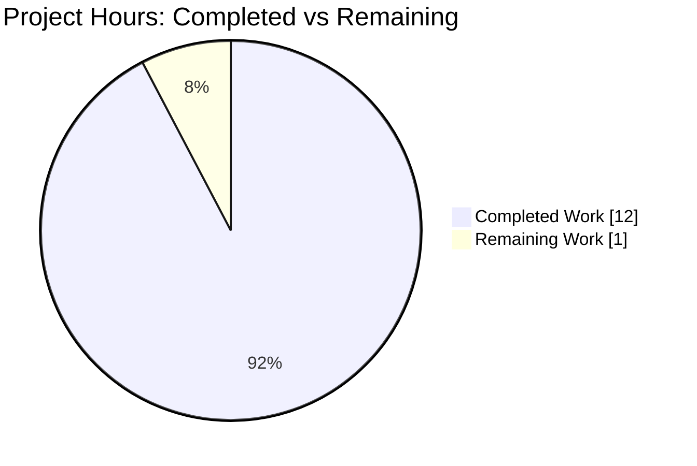
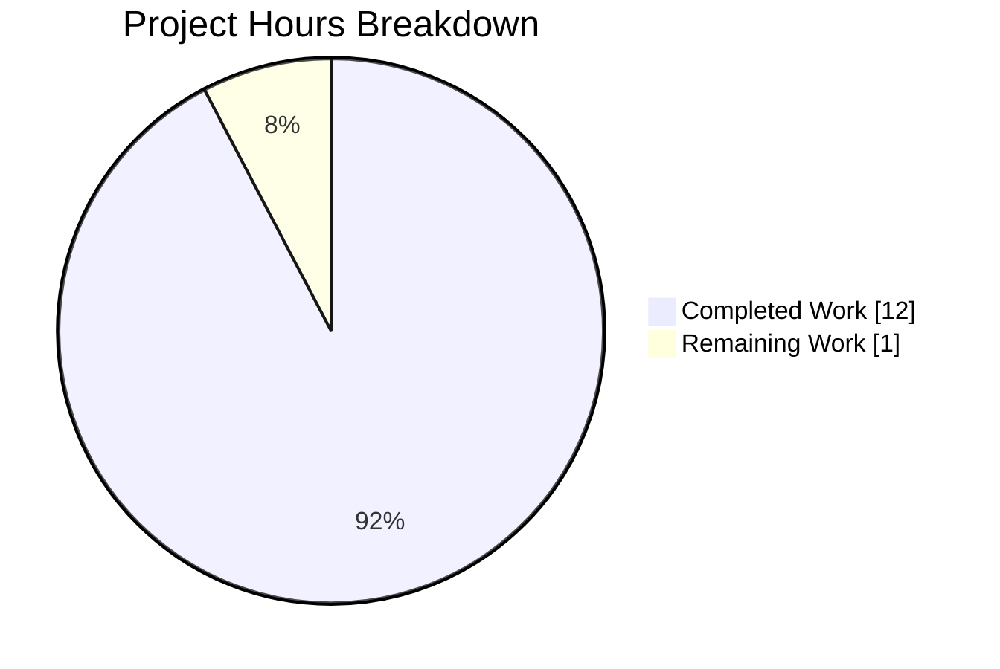
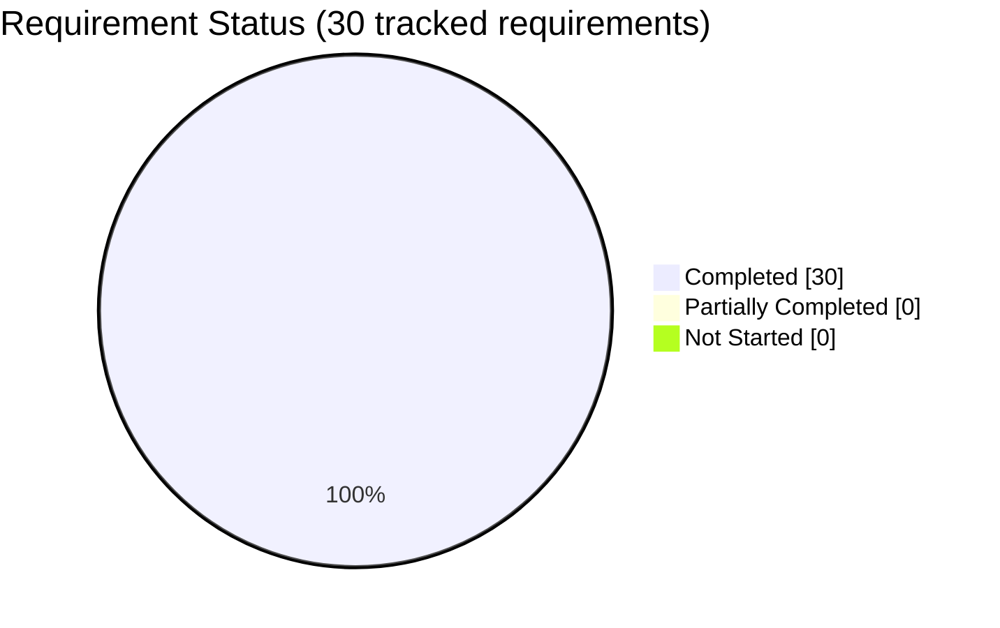

# 1. Executive Summary

Release sign-off for `Welcome.py`: what was built, what proves it works, what was not exercised, and what remains open.

## 1.1 Project Overview

`Welcome.py` is a single-file Python utility at the repository root whose entire behaviour is to write `Welcome to Blitzy` to standard output: one expression statement, 27 bytes including its terminating newline, run as `python3 Welcome.py`.

It emits that banner deterministically on any machine with a Python 3 interpreter, with no package layout, dependency, manifest, service, configuration or user interface, and the pre-existing `README.md` untouched. Its audience is any developer, script or build step needing the message without installing anything.

## 1.2 Completion Status

**12.0 hours completed of 13.0 total = 92.3% complete.** Completion is `12.0 / (12.0 + 1.0)`. All 30 tracked requirements are Completed; none is partially completed or not started. The 1.0 remaining hour is path-to-production work, not missing functionality.



Diagram colours: Completed Work = Dark Blue `#5B39F3`; Remaining Work = White `#FFFFFF`.

| Metric | Value |
| --- | --- |
| Total Hours | 13.0 |
| Completed Hours (AI + Manual) | 12.0 |
| Remaining Hours | 1.0 |
| Completion | 92.3% (12.0 / 13.0) |
| Requirements Completed | 30 of 30 |

## 1.3 Key Accomplishments

- **Exact message** — 18 bytes of stdout, sha256 `2dc7e85a…7951`, empty stderr, exit 0.
- **Minimal source** — 27 bytes, one `print` call, one literal argument, no keywords (`Welcome.py:1`).
- **Exact delivered path** — `Welcome.py`; `python3 welcome.py` exits 2, so the casing is load-bearing.
- **Interpreter-independent** — identical on CPython 3.12.3, 3.13.18 and 3.14.4, and under `-S -I -E -B -O`.
- **Environment-free** — identical under `env -i`, the C locale, `LANG=C.UTF-8` and `PYTHONIOENCODING=latin-1`.
- **Input-immune** — closed, pre-filled and 1 MB stdin plus eight argument variants change nothing.
- **Deterministic** — identical across six output channels and 20 concurrent runs.
- **Existing repository preserved** — `README.md` byte-identical, one added path, no bytecode cache.

## 1.4 Critical Unresolved Issues

**Open items: 4** — one outstanding task and three accepted caveats. None of the four requested requirements is open; all are delivered and verified.

| Issue | Impact | Owner | ETA |
| --- | --- | --- | --- |
| Release acceptance not yet re-run on the interpreter the release will use | One acceptance row unconfirmed for the shipping interpreter | Releasing engineer | 1.0h |
| No automated regression guard around the 27-byte message | A future edit to the literal or a second statement would go unnoticed | Repository owner | Optional, 1.0h |
| Unwritable stdout exits 120 with a flush diagnostic | Early-exiting pipeline readers see a non-zero producer status; identical to a bare `print` | Consumer owner | Accepted, no work |
| `import Welcome` writes the message and bytecode at import time | Any importer triggers the write and creates `__pycache__` | Repository owner | Accepted, 0.5h if adopted |

## 1.5 Access Issues

No access issues identified. The deliverable needs no repository permission beyond read access, no service credential and no network egress: it imports nothing, reads no configuration, opens no socket and writes only to stdout.

## 1.6 Recommended Next Steps

1. [High] Re-run the six acceptance rows on the shipping interpreter and record which one it was (1.0h; Section 2.2).
2. [Medium] On non-POSIX targets, assert the 17 characters plus the platform terminator rather than a fixed 18 bytes.
3. [Low] Add a one-line assertion or CI job comparing output with `Welcome to Blitzy` (optional).
4. [Low] Keep `Welcome.py` unreferenced, or add a `__main__` guard, if anything ever imports it.

# 2. Project Hours Breakdown

Hours are measured engineering effort for the scoped deliverable and the verification that proves it, not elapsed wall-clock time.

## 2.1 Completed Work Detail

| Component | Hours | Description |
| --- | --- | --- |
| Deliverable implementation (`Welcome.py`) | 1.5 | Single-statement standard-library script at the repository root: `print("Welcome to Blitzy")` plus one LF, 27 bytes, byte-identical to the specification, committed as the only change in `2331340`. |
| Source-form and static compliance verification | 2.0 | AST, byte, token and comment audits: one `Expr` calling `print` with one literal argument and no keywords; zero imports; zero comments and docstrings; no guard, annotation, class or control flow; pure ASCII with LF endings; parse gate that writes nothing. |
| Runtime acceptance verification | 2.0 | The six acceptance rows reproduced first-hand: 18-byte stdout with sha256 `2dc7e85a…7951`, empty stderr, exit 0, single output line, `od -c` dump ending at octal `0000022`, 27-byte source. |
| Interpreter and environment portability verification | 2.5 | 15 checks across CPython 3.12.3, 3.13.18 and 3.14.4, five interpreter flags (`-S`, `-I`, `-E`, `-B`, `-O`) and six environment/locale settings from a clean `env -i` through `LC_ALL=C` to `PYTHONIOENCODING=latin-1`. |
| Invocation, input-immunity and channel verification | 2.0 | Five invocation paths including the `welcome.py` negative control, four stdin states, eight argument variants, six output channels, plus ten sequential and twenty concurrent runs. |
| Footprint and pre-existing-file continuity verification | 1.0 | `README.md` byte-identity against the baseline blob, single-path addition, no bytecode cache or stray artefact, no invented manifest, workflow or configuration. |
| Degraded-execution characterisation | 1.0 | Unwritable stdout and an early-closing reader compared against a neutral `print` control; hostile environment values and a read-only working directory. |
| **Total Completed** | **12.0** | |

## 2.2 Remaining Work Detail

| Category | Hours | Priority |
| --- | --- | --- |
| Release re-acceptance on the pinned release interpreter — re-run the six acceptance rows under the interpreter the release will use and record which interpreter that was (path-to-production; closes the interpreter-record gap in Section 5.2) | 1.0 | High |
| **Total Remaining** | **1.0** | |

## 2.3 Estimation Basis and Confidence

Completed hours are attributed per capability, sized by the code and verification actually present: implementation 1.5h for a 27-byte script, then 1.0–2.5h per verification area in proportion to the 62 executed checks each area contributed. Remaining work is a single path-to-production item; no deliverable work is estimated because none remains.

Confidence is **high** for the 12.0 completed hours: every component maps to files, commits or commands that can be re-run in minutes, and the arithmetic closes exactly — `12.0 + 1.0 = 13.0` total and `12.0 / 13.0 = 92.3%`.

# 3. Test Results

The project configures no automated test suite: `pytest --collect-only` collects zero tests (exit 5) and `unittest discover` finishes with "Ran 0 tests". The verification record is therefore the acceptance-command set below, executed against the delivered code — **62 checks executed, 62 passed, 0 failed**. No coverage tool is configured, so no coverage percentage exists.

| Area / Category | Framework | Tests | Passed | Failed | Coverage | What This Proves |
| --- | --- | --- | --- | --- | --- | --- |
| Acceptance gate (all six documented rows) | Shell acceptance commands | 6 | 6 | 0 | n/a — none configured | The script emits exactly 17 characters plus one newline (18 bytes, sha256 `2dc7e85a…7951`), writes nothing to stderr, exits 0, and its source is the 27-byte statement that parses without writing bytecode |
| Interpreter portability | Shell, 3 CPython majors + 5 flags | 9 | 9 | 0 | n/a — none configured | Output and status are identical on CPython 3.12.3, 3.13.18 and 3.14.4 and under `-S`, `-I`, `-E`, `-B`, `-O` |
| Environment and input independence | Shell | 18 | 18 | 0 | n/a — none configured | No environment variable, locale or encoding setting is required, and no stdin content or argument changes the output |
| Invocation and path casing | Shell | 5 | 5 | 0 | n/a — none configured | It runs by absolute path, relative path and through a symlink in a space-bearing directory, while `welcome.py` fails with exit 2 — the delivered casing is load-bearing |
| Output channels and repeatability | Shell | 8 | 8 | 0 | n/a — none configured | Pipe, file redirect, parent-opened descriptor, `/dev/null`, process substitution and merged streams all carry identical bytes; 10 sequential and 20 concurrent runs agree |
| Degraded execution | Shell plus neutral `print` control | 5 | 5 | 0 | n/a — none configured | Unwritable stdout and an early-closing reader behave exactly like a bare `print`, and hostile environment values or a read-only working directory change nothing |
| Static source shape | `compile()`, `ast`, `tokenize` | 6 | 6 | 0 | n/a — none configured | One statement, `print` with a single literal and no keywords, zero imports, zero comments or docstrings, ASCII LF-only 27 bytes, no control flow or exception handling |
| Tree containment and existing-file continuity | Shell + git | 5 | 5 | 0 | n/a — none configured | Only `README.md` and `Welcome.py` exist, no bytecode cache is left behind, `README.md` is byte-identical to its baseline blob, and no test or gate configuration was invented |
| **Total** | | **62** | **62** | **0** | | |

**Not covered — what a human should check before release:**

- **No automated regression guard.** There is no repository test suite, and none may be added within the requested scope, so the message string, its casing and the single-statement form are protected only by the acceptance commands above. An edit to the literal or a second statement would be caught by nothing else.
- **No lint, format, type-check or security gate.** None is configured or installed, so nothing beyond the AST, byte and token inspections above was statically analysed.
- **CPython 3.15 was not exercised.** The builds are not installable on this host; the 3.12, 3.13 and 3.14 majors were, with identical results, and the `print` defaults relied on are unchanged across them.
- **Non-POSIX platforms were not exercised.** Windows text-mode stdout translates `\n` to `\r\n`, so an 18-byte assertion would read 19 there; the terminal-attribute case is visible even on this host, where a pty adds `\r` and yields 19 bytes while `stty -onlcr` restores 18.
- **No browser, HTTP or UI surface exists to test.** The deliverable exposes no server, route, form, database or screen, so no web-facing test was or could be run; every in-scope behaviour is terminal-observable.

# 4. Runtime Validation & UI Verification

Every flow below was driven directly against the delivered file from the repository root; the status reflects what was observed.

- ✅ **Start-up and primary journey** — `python3 Welcome.py` prints `Welcome to Blitzy`, exit 0, stderr empty.
- ✅ **Byte-level output contract** — 18 bytes, sha256 `2dc7e85a…7951`, `od -c` ends `y \n` at octal `0000022`, one line.
- ✅ **Path resolution** — runs from the repository root, from a parent directory, by absolute path from an unrelated working directory, and through a symlink inside a directory whose name contains a space.
- ✅ **Exact-casing control** — `python3 welcome.py` fails with exit 2 and the interpreter's "No such file or directory"; the delivered filename is the only one that runs.
- ✅ **Input surface** — closed stdin (`<&-`), `/dev/null`, pre-filled stdin and 1 MB of NUL bytes all leave the output unchanged; eight argument variants, including `--help`, `--version` and injection-shaped text, are ignored.
- ✅ **Environment and locale** — identical bytes under `env -i`, `LC_ALL=C`, `LANG=C.UTF-8`, `PYTHONIOENCODING=latin-1`, a bogus `LC_ALL` and `PYTHONWARNINGS=error`.
- ✅ **Output channels** — pipe, file redirect, a parent-opened descriptor used as stdout, `/dev/null`, process substitution and merged `2>&1` (exactly 18 bytes) all agree; 20 concurrent runs produce one unique hash.
- ⚠ **Module import** — `python3 -c "import Welcome"` prints the message and writes `__pycache__/Welcome.cpython-313.pyc`; there is no `__main__` guard by design, and nothing in the repository imports the module.
- ⚠ **Unwritable or early-closed stdout** — redirecting to `/dev/full` or piping into `head -c 0` exits 120 with a flush diagnostic, byte-identical to a bare `print("x")` control; this is interpreter shutdown behaviour, not the script's logic.

Everything the deliverable can reach was exercised: there is no external integration, database, socket, broker, credential or HTTP endpoint in this project, and no browser or UI session is possible because none exists. Two environments were out of reach and are recorded in Section 3 as uncovered rather than assumed — a non-POSIX host and CPython 3.15.

# 5. Compliance & Quality Review

The delivered file is measured below against the quality and compliance criteria that apply to it, followed by every place delivery departed from the agreed requirements and why.

## 5.1 Compliance Matrix

| Deliverable / Benchmark | Quality and Compliance Criterion | Status | Evidence |
| --- | --- | --- | --- |
| Message fidelity | Requested text emitted exactly: casing, spacing, no punctuation or quotes, one terminator | ✅ Pass | 18-byte stdout, sha256 `2dc7e85a…7951`, `od -c` `W e l c o m e … B l i t z y \n` |
| Source simplicity | One statement and nothing else in the file | ✅ Pass | AST body length 1; 27 bytes; `Welcome.py:1` |
| Delivered path and casing | Exactly `Welcome.py` at the repository root | ✅ Pass | Root tree entry `Welcome.py` (100644); `welcome.py` fails with exit 2 |
| Output and status contract | Text plus one newline on stdout, stderr empty, exit 0 | ✅ Pass | Measured on every interpreter, environment and channel exercised |
| Static source hygiene | Pure ASCII, LF endings, no dead code, no TODO/FIXME markers, no encoding declaration | ✅ Pass | Byte and token audit; the unfinished-work sweep returns nothing |
| Comment and docstring policy | No comments or docstrings where the scope forbids restating the statement | ✅ Pass | Zero comment tokens; `ast.get_docstring` is `None` |
| Dependency hygiene | No third-party package, no import, no manifest, no version pin | ✅ Pass | Zero `Import`/`ImportFrom` nodes; no dependency file exists |
| Security posture | No secret, no credential, no input surface, no injection or dynamic-evaluation sink | ✅ Pass | No `argv`/`stdin`/`environ`/`open`/`eval`/`exec`; the only datum is a source constant |
| Existing-file continuity | Pre-existing tracked file unchanged | ✅ Pass | `README.md` blob `e2224614` identical before and after; 9 bytes |
| Change-set containment | One added path, nothing else, no stray artefact | ✅ Pass | `A	Welcome.py` alone; no `__pycache__` or `.pyc` |
| Automated test coverage | A repeatable suite guards the behaviour | ❌ Fail — none configured, and adding one is outside the requested scope | `pytest` collects 0 tests; the guard is the 62 executed acceptance checks |
| Lint / format / CI gate | Automated static gate in the repository | ❌ Fail — none configured or installed, and outside the requested scope | No lint, format, type-check or workflow file exists |

## 5.2 AAP & Rule Divergences and Gaps

Five divergences and gaps were established. No user-specified rules exist for this project, so a rule departure is not possible; the first three depart from statements in the AAP, and the last two are absences the AAP itself mandates.

| What the AAP/Rule Required | What Was Delivered Instead | Why It Diverged | Impact | Remediation |
| --- | --- | --- | --- | --- |
| Footprint evidence should be `git status --porcelain` showing `Welcome.py` as this work's addition | `Welcome.py` is committed in `2331340`, so `git status --porcelain` is empty; the addition is visible as `git diff 17c8b88 --name-status` = `A	Welcome.py` | Completed work is committed before hand-off, which the file-level instruction did not anticipate; the only stated prohibition concerned the untracked `blitzy/` evidence | Evidence must be read commit-based, not status-based; the substance — one added path — holds | None required; document the commit-based command |
| Runtime basis recorded as Ubuntu 24.04.5 LTS with CPython 3.12.3 at `/usr/bin/python3` | The host provides CPython 3.14.4 at `/usr/bin/python3`, 3.13.18 as `python3`, and 3.12.3 as `python3.12`; the script pins no version and behaves identically on all three | The runtime row was written against a different host image than the one the work ran on; no code decision was involved | A verbatim `/usr/bin/python3` run shows 297 bytes of host site-startup diagnostics on stderr, and one acceptance row is unconfirmed for the release interpreter | 1.0h: re-run the six acceptance rows on the pinned release interpreter (Section 2.2) |
| `README.md` described as 9 bytes "plus one newline" | `README.md` is 9 bytes, `# IWNewGH`, with no trailing LF | The AAP's description miscounts the file; the binding requirement is byte-identity | None on the deliverable; a reader reconciling the AAP with the tree will notice the discrepancy | None available in scope — editing `README.md` would break the verified invariant |
| No test file, framework, manifest or pipeline to be added (sanctioned absence) | No test suite, linter, formatter, type checker, security scanner or CI workflow exists | Required: the scope confines the change to one file and forbids test and build infrastructure | Nothing guards the 27-byte message; a future edit would be caught only by manual acceptance commands | Optional and outside the requested scope: 1.0h for a one-line assertion or CI job |
| No error handling, exit-code logic or capability beyond the printed text (sanctioned absence) | No handler exists; unwritable stdout or an early-closing reader exits 120 with a `BrokenPipeError`/`ENOSPC` diagnostic | Required: error handling is excluded by the scope | Pipelines whose reader exits early see a non-zero producer status, identical to any bare `print` | Accepted as delivered; 0.5h only if such a pipeline becomes a requirement |

**Commit-based footprint evidence.** The delivered change is a commit, so `git status --porcelain` reads clean and cannot show it. Anyone re-checking the change set needs `git diff 17c8b88 --name-status`, which returns `A	Welcome.py` alone, and the tree confirms the same shape: `README.md` at 9 bytes with blob `e2224614` and `Welcome.py` at 27 bytes with blob `4ca03ebe`, nothing else tracked. No work closes this; the verification command is simply the commit-based one, and the property the check was written to protect — one added path, nothing else disturbed — holds.

**Interpreter record versus the release host.** The recorded runtime describes a different image from the one this work ran on: `/usr/bin/python3` here is CPython 3.14.4, `python3` is 3.13.18, and 3.12.3 lives at `python3.12`. The script neither reads nor pins an interpreter, so the requirement — a Python 3 interpreter runs it — holds on all three, with byte-identical output. The practical consequence is operational: a verbatim run under `/usr/bin/python3` shows 297 bytes of site-startup diagnostics that vanish under `-S` and reproduce with `-c pass`, so an empty-stderr assertion must name its interpreter. This is the single item carrying remaining hours: 1.0h to re-accept the release on the interpreter it will ship with.

**No automated guard (sanctioned absence).** The requested scope confines delivery to one file and admits no test file, framework, linter or pipeline, so the message string, its casing and the single-statement form are protected by nothing but the acceptance commands in Section 9. That is the correct state for this scope, and it is also the largest residual risk (Section 6): an edit to the literal in `Welcome.py:1` — a lower-cased word, an added comma, a second statement — would change the delivered behaviour silently. Adopting a one-line assertion or a CI job that compares `python3 Welcome.py` with `Welcome to Blitzy` costs about an hour and is worth doing the moment the file has a second consumer.

**No error handling (sanctioned absence).** With stdout unwritable or the reader exiting before the write completes, the process exits 120 with a flush diagnostic instead of 0. A bare `print("x")` control behaves identically, so this is CPython's shutdown behaviour rather than logic in `Welcome.py:1`, and the scope excludes error handling and exit-code logic. Consumers that pipe the script into `head`-style readers should read the full stream or route the output through `cat`; no change to the deliverable is warranted unless such a pipeline becomes a stated requirement.

# 6. Risk Assessment

| Risk | Category | Severity | Probability | Mitigation | Status |
| --- | --- | --- | --- | --- | --- |
| Nothing automatically guards the exact message: an edit to the literal, casing or statement count would change behaviour silently | Technical | Medium | Medium | Add a one-line assertion or CI job comparing `python3 Welcome.py` output with `Welcome to Blitzy` (≈1.0h) | Open — accepted for this scope |
| Producer exits 120 with a flush diagnostic when stdout is unwritable or the reader closes the pipe early | Integration | Low | Medium | Consumers must read the full stream or pass output through `cat`; identical to a bare `print` control | Accepted — error handling excluded by design |
| Release acceptance has not been re-run on the interpreter the release will actually use | Operational | Low | Medium | Run the six acceptance rows on the pinned release interpreter and record it (1.0h, Section 2.2) | Open |
| `import Welcome` emits the message and writes `__pycache__` at import time (no `__main__` guard) | Technical | Low | Low | Keep the module unreferenced; add a guard only if a consumer appears (≈0.5h) | Accepted — guard deliberately absent |
| Non-POSIX behaviour untested: Windows text-mode stdout translates `\n` to `\r\n`, so an 18-byte assertion would read 19 | Integration | Low | Low | Keep acceptance POSIX-based or assert the 17 characters plus the platform terminator | Open |
| No type checking, lint or formatting gate, in a repository with no house style to imitate | Operational | Low | Medium | Add a linter, type check and workflow if the file grows past one statement (≈2.0h) | Open — optional |
| One host interpreter (`/usr/bin/python3`, CPython 3.14.4) writes 297 bytes of site-startup diagnostics for every invocation, including `-c pass` | Operational | Low | Medium | Name the interpreter explicitly, or assert empty stderr under `-S`, where the script writes nothing | Accepted — host condition outside the repository |
| Attacker reachable surface: none today | Security | Low | Very Low | Maintain the absence of input, secrets, imports and dynamic evaluation; the only datum is a 17-character constant in the source | Monitored — no action required |

# 7. Visual Project Status

Completed work is 92.3% of the assessed scope: 12.0 of 13.0 hours. The single remaining hour is path-to-production re-acceptance, not unbuilt functionality.



Diagram colours: Completed Work = Dark Blue `#5B39F3`; Remaining Work = White `#FFFFFF`.



Remaining hours by category (Section 2.2): release re-acceptance 1.0h — the only outstanding category, High priority.

| View | Value |
| --- | --- |
| Completed Work | 12.0 hours (Dark Blue `#5B39F3`) |
| Remaining Work | 1.0 hour (White `#FFFFFF`) |
| Completion | 92.3% |
| Requirements Completed | 30 of 30 |
| Open items carried | 4 (Section 1.4) |

# 8. Summary & Recommendations

**What was delivered.** `Welcome.py` at the repository root: one expression statement, `print("Welcome to Blitzy")`, 27 bytes including its terminating newline, committed as the only change in `2331340` against baseline `17c8b88`. It writes exactly 17 characters plus one newline to stdout (18 bytes, sha256 `2dc7e85a…7951`), leaves stderr empty, exits 0, imports nothing and needs nothing installed. `README.md` remains byte-identical at 9 bytes, and no manifest, workflow, test file or bytecode cache was introduced, because the requested scope confines the change to that one file.

**What was verified.** 62 checks were executed against the delivered code and all passed: the six documented acceptance rows, portability across CPython 3.12.3, 3.13.18 and 3.14.4 and five interpreter flags, independence from environment, locale and encoding, immunity to stdin content and eight argument variants, identical bytes across six output channels plus 10 sequential and 20 concurrent runs, behaviour under unwritable stdout compared with a neutral control, static source shape, and tree containment. All 30 tracked requirements are Completed. **AAP-scoped completion is 92.3% — 12.0 hours completed of 13.0 total.**

**Remaining gaps and the critical path.** No functionality is outstanding. The critical path to production is one step: re-run the six acceptance rows under the interpreter the release will ship with and record which interpreter that was (1.0 hour). That closes the only substantive gap — the runtime recorded for this project describes a different host image from the one the work was performed on, so the release interpreter itself has not yet signed the contract. Two risks are accepted rather than closed: nothing guards the message automatically, and an unwritable or early-closed stdout exits 120 exactly as any `print` does.

**Success metrics for sign-off.** `python3 Welcome.py` yields 18 bytes and exit 0 with empty stderr; `od -c Welcome.py` shows the statement plus one LF in 27 bytes; the parse check exits 0 writing nothing; `git diff 17c8b88 --name-status` shows `A	Welcome.py` alone; `README.md` hashes to blob `e2224614`. If those five hold on the release interpreter, the delivery is accepted.

**Production readiness: ready as delivered, pending that one re-acceptance run.** The deliverable is a self-contained standard-library script with no configuration, dependency, input, state or attacker-reachable surface, and it behaved identically across every interpreter, environment and channel exercised. Adopting a one-line regression assertion (about an hour) is the only hardening worth recommending, and it becomes worthwhile the moment anything other than a human runs this file.

# 9. Development Guide

### Prerequisites

- A Python 3 interpreter on `PATH`. Verified here: CPython 3.13.18 as `python3`, CPython 3.12.3 as `python3.12`. Any Python 3 release runs the script — it uses only `print`'s defaults.
- `git` (2.56.1 verified) only for the footprint checks below; the script itself needs nothing.
- `od`, `wc`, `cmp` from coreutils for the byte-level checks.

### Environment Setup

There is nothing to install, provision or configure: no virtualenv, no package manager step, no manifest, no service, port, database or credential. `Welcome.py` imports nothing and reads no configuration.

```bash
# from the repository root — no setup required
python3 --version        # expect Python 3.x
python3 Welcome.py       # expect: Welcome to Blitzy
```

### Dependency Installation

None. Do not add a `requirements.txt`, `pyproject.toml` or `.gitignore` for this deliverable: the file's whole contract is that it needs nothing beyond the interpreter.

### Application Startup

There is no server and no long-running process to start. Run the script:

```bash
cd <repository-root>
python3 Welcome.py
```

Expected output — one line, exit status 0, nothing on stderr:

```text
Welcome to Blitzy
```

### Verification Steps

Run these from the repository root; all six were executed here with the output shown.

```bash
# 1. the message, exactly
python3 Welcome.py                                  # Welcome to Blitzy

# 2. byte count: 17 characters + print's newline
python3 Welcome.py | wc -c                          # 18

# 3. byte-level dump
python3 Welcome.py | od -c
# 0000000   W   e   l   c   o   m   e       t   o       B   l   i   t   z
# 0000020   y  \n
# 0000022

# 4. one line only
python3 Welcome.py | wc -l                          # 1

# 5. parses, writing no bytecode (do NOT use py_compile — it creates __pycache__)
python3 -c "compile(open('Welcome.py').read(), 'Welcome.py', 'exec')"; echo "exit=$?"   # exit=0

# 6. source shape and footprint
od -c Welcome.py                                    # print("Welcome to Blitzy")\n — 0000033 = 27 bytes
wc -c Welcome.py                                    # 27
git diff 17c8b88 --name-status                      # A	Welcome.py
git status --porcelain | wc -l                      # 0 (the change is committed)
```

One-shot gate, printing a line per check:

```bash
bash -c 'python3 Welcome.py | grep -qx "Welcome to Blitzy" && echo "message OK";
         test "$(python3 Welcome.py | wc -c)" -eq 18 && echo "byte count OK";
         python3 -c "compile(open(\"Welcome.py\").read(), \"Welcome.py\", \"exec\")" && echo "parses OK"'
```

Expected: `message OK`, `byte count OK`, `parses OK`.

### Example Usage

```bash
# capture the banner in a script or build step
python3 Welcome.py > banner.txt && cat banner.txt        # Welcome to Blitzy

# use it as a pipeline stage (read the whole stream — see Troubleshooting)
python3 Welcome.py | cat                                  # Welcome to Blitzy

# run it from anywhere by absolute path
python3 "$(pwd)/Welcome.py"
```

### Troubleshooting

| Symptom | Cause | Resolution |
| --- | --- | --- |
| `can't open file '.../welcome.py': [Errno 2] No such file or directory` (exit 2) | Wrong casing — the file is `Welcome.py` with a capital W | Use the exact filename; the casing is part of the contract |
| `__pycache__/` appears in the tree | `python3 -m py_compile` was run, or the module was imported | Use the `compile(open(...).read(), ...)` form; running the script as `__main__` caches nothing |
| Exit status 120 with `Exception ignored on flushing sys.stdout: BrokenPipeError` | The consumer closed the pipe before the write flushed (e.g. `\| head -c 0`), or stdout is unwritable (`/dev/full`) | Have the consumer read the full stream, or place `cat` in between; a bare `print` behaves the same way |
| Message printed when the module is imported | There is no `__main__` guard by design | Do not import it; run it as a script, or add a guard if a consumer ever requires one |
| Empty-stderr assertion fails with site-startup diagnostics | Some host interpreters emit `distutils-precedence.pth` errors for any invocation, including `-c pass` | Name the interpreter explicitly (`python3`, `python3.12`) or run with `-S`, where the script's stderr is empty |
| Output ends `\r\n` (19 bytes) in a terminal capture | The terminal's ONLCR translation, not the program | Assert the 17 characters plus the terminator, or disable ONLCR (`stty -onlcr`) for byte-exact checks |

# 10. Appendices

The port reference and environment-variable reference are omitted: the project binds no TCP port, opens no socket and reads no environment variable. The remaining appendices cover the commands, paths, versions, tooling and vocabulary this deliverable uses.

## A. Command Reference

| Command | Purpose | Expected Result |
| --- | --- | --- |
| `python3 Welcome.py` | Run the deliverable | `Welcome to Blitzy`, exit 0, empty stderr |
| `python3 Welcome.py \| wc -c` | Byte count of stdout | `18` |
| `python3 Welcome.py \| od -c` | Byte-level dump of stdout | Ends `y \n` at octal `0000022` |
| `python3 Welcome.py \| wc -l` | Line count | `1` |
| `python3 -c "compile(open('Welcome.py').read(), 'Welcome.py', 'exec')"` | Parse-only gate that writes nothing | No output, exit 0, no `__pycache__` |
| `od -c Welcome.py` | Source bytes | `print("Welcome to Blitzy")` + `\n`, 27 bytes |
| `wc -c Welcome.py` | Source size | `27` |
| `git diff 17c8b88 --name-status` | Commit-based change set | `A	Welcome.py` alone |
| `git status --porcelain` | Working-tree state | Empty (the change is committed) |
| `git ls-tree -r HEAD` | Tracked inventory | `README.md`, `Welcome.py` |
| `python3 Welcome.py extra` | Argument immunity check | Still 18 bytes, exit 0 |
| `python3 Welcome.py < /dev/null` | No-input check | Still 18 bytes, exit 0 |
| `python3 Welcome.py > out.txt 2> err.txt` | Channel and status capture | `out.txt` 18 bytes, `err.txt` 0 bytes, exit 0 |
| `python3 -m pytest --collect-only` | Confirm no suite is configured | "no tests collected", exit 5 |
| `python3 -B Welcome.py` | Run without writing bytecode | `Welcome to Blitzy` |

## C. Key File Locations

| Path | Role | State |
| --- | --- | --- |
| `Welcome.py` | The entire deliverable: one statement printing the message | Added in `2331340`, 27 bytes, blob `4ca03ebe` |
| `README.md` | Pre-existing repository title | Unchanged, 9 bytes, blob `e2224614` |
| `.git/` | Repository metadata | Untouched |
| `blitzy/` | Empty directories left in place by the work environment | Untracked, empty, out of scope |

| Git Reference | Meaning |
| --- | --- |
| `17c8b88` | Baseline commit ("Initial commit") holding only `README.md` |
| `2331340` | The delivered change: "Add Welcome.py printing the message" |
| `origin/main` | Remote baseline branch; not modified by this work |

## D. Technology Versions

| Component | Version Verified | Notes |
| --- | --- | --- |
| Python (primary) | CPython 3.13.18 (`/usr/local/bin/python3`) | Runs the script; emits 0 bytes of stderr |
| Python (recorded runtime) | CPython 3.12.3 (`python3.12`) | Runs the script identically |
| Python (`/usr/bin/python3`) | CPython 3.14.4 | Runs the script identically; its 297-byte site-startup stderr is host-specific and vanishes under `-S` |
| Language surface used | `print` builtin with default `sep`/`end`/`file` | Defaults unchanged across Python 3 releases |
| pytest | 9.2.0 | Present, but the project configures and collects no tests |
| git | 2.56.1 | Used only for the footprint checks |
| od / wc / cmp | uutils coreutils 0.10.0 | Byte-level output inspection |
| Build, runtime dependencies | None | No manifest, lock file, package or version pin exists |

## F. Developer Tools Guide

- **Interpreter** — `python3` (CPython 3.13.18) is the interpreter to name in scripts and CI; `python3.12` is available when the recorded 3.12.3 behaviour must be reproduced.
- **Parse checking without artefacts** — use `python3 -c "compile(open('Welcome.py').read(), 'Welcome.py', 'exec')"`; never `python3 -m py_compile`, which writes `__pycache__/` into the tree.
- **Byte inspection** — `od -c` for a human-readable dump, `wc -c` for counts, `cmp` to compare two captures exactly.
- **Run isolation** — `python3 -S` skips site initialisation (useful when asserting empty stderr), `python3 -I` runs isolated from user site, `python3 -B` refuses to write bytecode.
- **Change-set inspection** — `git diff <baseline> --name-status` is the reliable footprint command for a committed change; `git status --porcelain` will read clean.
- **Not present** — no linter, formatter, type checker, test runner configuration, container definition or CI workflow is installed or configured for this project; there is nothing to run beyond the commands above.

## G. Glossary

| Term | Meaning in This Project |
| --- | --- |
| Acceptance rows | The six literal checks that define success: the message, the 18-byte count, the octal dump, the parse gate, the 27-byte source and the change footprint |
| Baseline commit | `17c8b88`, the repository state before the deliverable, holding only `README.md` |
| Byte identity | Two files or streams agreeing byte for byte, including line terminators — the standard applied to stdout and to `README.md` |
| Exclusion set | The constructs deliberately absent from the deliverable: shebang and executable bit, `__main__` guard, docstring or comment, annotations, functions, classes, argument parsing, configuration, environment variables, logging, error handling, packaging |
| `end='\n'` default | The builtin `print` terminator, which supplies the single newline the output contract requires without an explicit argument |
| Footprint | The set of paths a change adds, modifies or deletes; here exactly one added path |
| `__main__` guard | An `if __name__ == "__main__":` block that stops a module's code from running on import; absent here by design, so importing prints |
| `__pycache__` | CPython's bytecode cache directory, which must not appear in the tree; running the script as `__main__` never creates it |
| Path-to-production work | Effort needed to ship what exists, as opposed to building new functionality — here the release re-acceptance run |
| Sanctioned absence | Something the requested scope instructs to leave out (tests, gates, error handling), so its absence is compliant rather than missing |
