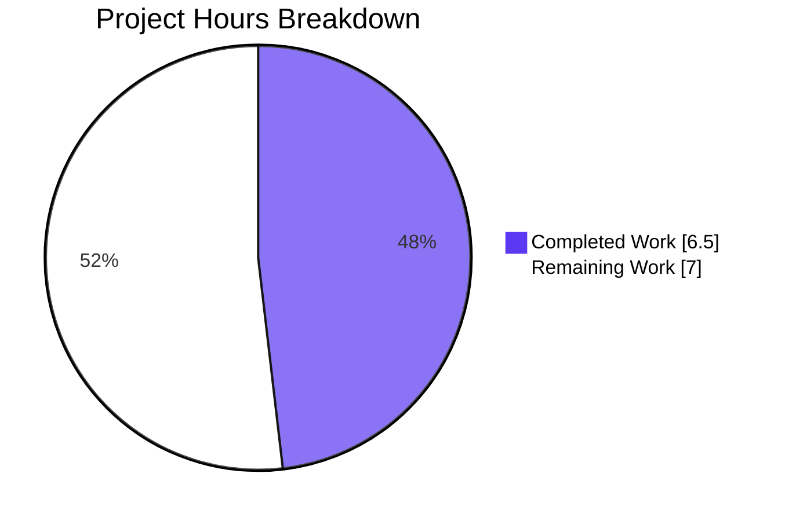

# 1. Executive Summary

## 1.1 Project Overview

Taskboard is a server-rendered Flask 3.1.3 application on one SQLite file: one project, five members, tasks with statuses, assignees, deadlines and comments, four dashboard counts and a filterable task list, served by one Python process with no build step. This change adds the requested standalone script, `Welcome.py` at the repository root: one statement that writes `Welcome to Blitzy` to standard output and exits 0. It imports nothing, is imported by nothing, adds no dependency, and leaves every existing file byte-identical.

## 1.2 Completion Status



**48% complete** — 6.5 hours of 13.5 total, measured only against the work this change was scoped to deliver and the path from it to production. The delivered script is complete and verified; the 7.0 remaining hours are repository-level.

| Metric | Hours |
|---|---|
| Total Hours | 13.5 |
| Completed Hours (Baseline: Human with agentic-assist) | 6.5 |
| Remaining Hours | 7.0 |

## 1.3 Key Accomplishments

- [x] `Welcome.py` delivered as specified: `print("Welcome to Blitzy")`, 27 bytes, one statement, at the repository root (commit `6c4692c`).
- [x] Prints the exact line with one terminator, exit 0 and empty stderr — 8 of 8 executions, one unique output hash.
- [x] Simplicity honoured: no import, function, guard, docstring, argument parsing, error handling or comment.
- [x] Zero dependencies, zero manifest changes, and no wiring in either direction.
- [x] Existing surface byte-identical: 16 application modules, 14 templates, schema, seed script, 8 test modules.
- [x] Gates unmoved: 503 tests still collected, coverage still 99.62% of `app/` against the 85% floor.

## 1.4 Critical Unresolved Issues

**1 of 1 requested deliverables is delivered and verified**; 4 open items remain, none of them in the delivered script, summing to 4 below.

| Issue | Impact | Owner | ETA |
|---|---|---|---|
| Windows test gate is red: 5 path-handling failures in `tests/test_config.py` (1 group, 5 tests) | No green release signal on Windows; a new regression would look like the baseline | Application maintainer | 0.5 day |
| No automated guard on the printed line (1) | An edit to the literal, or a second statement, would be caught by nothing | Maintainer | 0.2 day |
| POSIX byte count never observed (1) | The 18-byte acceptance figure is a platform expectation, not a measurement | QA | 0.2 day |
| `README.md` layout tree omits `Welcome.py` (1) | The documented project layout no longer describes the repository root | Maintainer | 0.1 day |

## 1.5 Access Issues

No access issues identified. No credential, service account, repository permission or third-party API is needed to build, test or run the project: one Python process, one local SQLite file, and a script that runs on a bare interpreter.

## 1.6 Recommended Next Steps

1. **[High]** Fix the two Windows path defects behind the failing tests — `app/config.py:95` and `app/db.py:90` — and re-run the gate (4.0 h).
2. **[Medium]** Add a check that executes the script, compares its decoded output to the expected line and asserts exit 0 (1.5 h).
3. **[Medium]** Confirm the 18-byte LF-terminated line on Linux or in CI (1.0 h).
4. **[Low]** Add `Welcome.py` to the `README.md` project layout tree (0.5 h).

# 2. Project Hours Breakdown

## 2.1 Completed Work Detail

| Component | Hours | Description |
|---|---|---|
| `Welcome.py` deliverable implementation | 1.0 | The new root-level script written to the specification: exact literal `Welcome to Blitzy`, builtin `print` with its newline, pure-ASCII source, one statement, no import, no guard, no docstring. Covers decisions D1–D4 and requirement R4's simplicity constraint. |
| Static conformance verification | 1.5 | Byte- and line-level audit of the tracked blob (27 bytes, single `0x0A`, one statement), AST confirmation of the single `print` call on one literal, the twelve-omission simplicity audit, and the `compileall` byte-compilation check. |
| Runtime verification of the script | 2.0 | Execution across the invocation forms that matter: repeated runs, isolated mode (`-E -s -I`), an unrelated working directory by absolute path, an argument vector including non-ASCII, and an ASCII output encoding — plus stdout/stderr/exit capture and output-hash comparison to prove determinism. |
| Repository-scope verification | 1.5 | Confirmation that the script enters no import graph in either direction, that pytest collection and coverage measurement exclude it, that 503 tests are still collected with coverage at 99.62%, and that both manifests and every other tracked file are unchanged. |
| Deliverable record and commit | 0.5 | The single commit `6c4692c` adding exactly one path, with a message stating what the script does and why no gate moves. |
| **Total** | **6.5** | |

## 2.2 Remaining Work Detail

| Category | Hours | Priority |
|---|---|---|
| Windows test-suite failures: normalise the joined path at `app/config.py:95` and the path formatting at `app/db.py:90`/`:245`, then re-run the affected tests and the full gate | 4.0 | High |
| Automated guard for the printed line: execute the script, compare decoded output to `Welcome to Blitzy`, assert exit 0 and empty stderr | 1.5 | Medium |
| POSIX byte-count verification: run the script on Linux or CI, confirm the 18-byte LF-terminated line, record the platform note | 1.0 | Medium |
| Documentation: add `Welcome.py` to the `README.md` project layout tree | 0.5 | Low |
| **Total** | **7.0** | |

# 3. Test Results

All figures below were produced by running the commands on this project; nothing is inferred from a test file's existence. Framework versions: pytest 9.1.1, pytest-cov 7.1.0, coverage 7.17.0, CPython 3.12.10.

| Area / Category | Framework | Tests | Passed | Failed | Coverage | What This Proves |
|---|---|---|---|---|---|---|
| Application suite — the documented gate (`python -m pytest`) | pytest 9.1.1 + pytest-cov 7.1.0 | 503 collected | 498 | 5 | 99.62% of `app/` (832 statements, 2 missed; 228 branches, 2 partial) against the 85% floor | The twelve-endpoint application's routing, validation, persistence, templating and CLI commands behave as specified, and the change moves neither the collected set nor the coverage total |
| Database-path configuration (`tests/test_config.py`, `-q --no-cov`) | pytest 9.1.1 | 16 | 11 | 5 | not measured in this run | `DATABASE` resolution, the unusable-database message and start-up configuration are exercised; the five failures are Windows separator expectations in `app/config.py:95` and `app/db.py:90` |
| Delivered script — direct execution | no framework (stdout/stderr/exit capture, output hashing) | 8 executions across 6 invocation forms | 8 | 0 | not applicable — outside `source = ["app"]` by configuration | `Welcome.py` prints exactly the requested line, exits 0 and writes nothing to stderr under repeated runs, isolated mode, an unrelated working directory, an argument vector and an ASCII output encoding |
| Byte-compilation | CPython 3.12 `compileall -q` | 3 targets (`app/`, `seed.py`, `Welcome.py`) | 3 | 0 | not applicable | Every delivered and existing module is syntactically valid under the interpreter the project declares |

**Not Covered**

- **The printed line has no automated guard.** pytest never collects `Welcome.py` and coverage never measures it, so an edit to the string, or a second statement, would pass every gate in the repository. This is a deliberate consequence of the simplicity constraint, and it is the reason an automated check is the highest-value test addition.
- **No POSIX observation.** Every result above comes from CPython 3.12.10 on Windows. The LF terminator and the 18-byte line are what a Linux host is expected to produce, not something measured here; on this host the process emits a 19-byte CRLF-terminated line.
- **The Windows path contract is not green.** Five configuration tests fail, so path resolution for a relative `DATABASE` and the exact wording of the unusable-database message are unverified on this platform until `app/config.py:95` and `app/db.py:90` are corrected.
- **No performance, load or concurrency-at-scale testing**, and no security scanner — none is configured in the repository, and the delivered script has no input, network, filesystem or database surface to scan.
- **Interactive UI paths beyond HTTP status and rendered counts** — form submissions, filter combinations and the 400/404/500 pages are exercised by the application suite but were not driven by hand for this change.

# 4. Runtime Validation & UI Verification

The change was driven end to end on this host: the delivered script as a command-line program, the application as a served process, and every route the seeded data supports.

- ✅ **Delivered script** — 8 executions across 6 invocation forms (repeated runs, `-E -s -I`, unrelated working directory by absolute path, argument vector with non-ASCII, ASCII output encoding): exact line printed, exit 0 every time, 0 bytes on stderr, one unique output hash.
- ✅ **Byte-compilation** — `compileall -q app seed.py Welcome.py`: exit 0, no output.
- ✅ **Application start-up** — `flask --app app seed-db` printed `Seeded 1 project, 5 members, 12 tasks, 8 comments.`; `flask --app app run --host 127.0.0.1` served without error.
- ✅ **Dashboard** (`GET /`) — 200, rendering Total 12, Completed 3, Pending 5, In progress 4, each card linking into the filtered task list.
- ✅ **Task list** (`GET /tasks`) — 200 with the seeded rows.
- ✅ **Task creation form** (`GET /tasks/new`) — 200.
- ✅ **Task detail** (`GET /tasks/1`) — 200.
- ✅ **Project screen** (`GET /project`) — 200.
- ⚠ **Test gate** — 498 passed, 5 failed on Windows path assertions, coverage 99.62% against the 85% floor.
- ⚠ **Write paths not driven by hand** — form submissions (create, edit, status, assignee, comment) and combined filters are exercised by the suite but were not exercised interactively for this change.

**Never exercised at runtime.** The delivered script has not been run under a POSIX interpreter, so its LF-terminated 18-byte output is an expectation rather than an observation. No authentication or session flow can be exercised because the application serves every route publicly by design. No browser, screenshot, responsive, hover, focus or accessibility verification applies to the delivered script: its entire output surface is one line on a terminal, and the Taskboard screens were verified by HTTP status and rendered content only.

# 5. Compliance & Quality Review

## 5.1 Compliance Matrix

| Delivery Area | Requirement | Status | Evidence |
|---|---|---|---|
| Deliverable presence and content | One new file at the repository root holding `print("Welcome to Blitzy")` | ✅ **PASS** | `Welcome.py:1`; change set `A Welcome.py`, 1 insertion, 0 deletions (`6c4692c`) |
| Naming and placement | Exact path and casing at the root, outside any package | ✅ **PASS** | `git ls-files` lists the root entry; no other casing variant exists in the tree |
| Simplicity constraint | One statement; none of the twelve constructs the request excluded | ✅ **PASS** | AST: one `Expr` call on one literal, no keywords; no import, function, guard, docstring, `__all__`, argument parsing, error handling, comment, configuration, encoding line, shebang or accompanying test |
| Output content | The exact literal — capital `W`, capital `B`, single spaces, no punctuation | ✅ **PASS** | 17 payload characters reproduced character for character in the captured stdout |
| Line and stream hygiene | One line with one terminator; empty stderr; exit status 0 | ✅ **PASS** | 8 of 8 executions: one line, 0 bytes on stderr, exit 0 |
| Dependency integrity | No package added, updated or removed | ✅ **PASS** | `requirements.txt` and `requirements-dev.txt` byte-identical; `pip check` finds no broken requirements |
| Integration isolation | Nothing imports the script, it imports nothing, and no entry point, hook, CLI command or template references it | ✅ **PASS** | `git grep -i welcome` outside the file returns nothing; the module has zero imports |
| Existing-file integrity | `app/**`, `tests/**`, `seed.py`, `app/schema.sql`, `README.md`, both manifests and `.gitignore` unchanged | ✅ **PASS** | Diff against the pre-change base touches exactly one path |
| Gate isolation | Not collected by pytest, not measured by coverage, coverage floor unmoved | ✅ **PASS** | 503 tests collected with no matching item; 16 `app\*` files measured at 99.62% against the 85% floor |
| Repository test gate | The documented gate passes and exits 0 | ❌ **FAIL** | 503 collected, 498 passed, 5 failed, exit 1 |
| Acceptance byte count | stdout is 18 bytes | ⚠ **PARTIAL** | 19 bytes on this host (CRLF terminator); the 17 characters plus one terminator are exact |
| Documentation consistency | `README.md` describes the repository root as it is | ⚠ **PARTIAL** | The project layout tree (`README.md:416-458`) does not list `Welcome.py` |

## 5.2 AAP & Rule Divergences and Gaps

No user-specified rules were in force for this work, so every divergence below is against the specification the change was built from.

| What the AAP/Rule Required | What Was Delivered Instead | Why It Diverged | Impact | Remediation |
|---|---|---|---|---|
| stdout of exactly `Welcome to Blitzy` plus one newline — 18 bytes, one line, with a byte dump reading `… y \n` | The same single statement; on this host stdout is 19 bytes, `57 65 … 7A 79 0D 0A`, terminated CRLF | The 18-byte figure assumes a POSIX line terminator; the specification's own decisions (output through `print` with its newline only, no `sys.stdout.write`, no `end=`/`sep=`, no stream reconfiguration, no import) forbid every change that would force `0x0A` on Windows | Verification only: content, single line, empty stderr and exit 0 all hold, and a control program with the identical statement emits byte-identical output; a raw byte assertion on Windows would wrongly flag a correct file | No code change. Confirm the 18-byte LF line on Linux/CI (1.0 h) and assert decoded text everywhere else |
| The documented gate reports 503 passed at exit status 0 | 503 collected, 498 passed, 5 failed, exit 1 — five Windows path-separator failures in `tests/test_config.py` | The defects predate this change and sit in `app/**`, which the specification explicitly left untouched (`app/config.py:95`, `app/db.py:90`/`:245`); the 503-passed figure was measured on a POSIX baseline | The gate cannot serve as a green release signal on Windows, and a future regression would be indistinguishable from the baseline without comparing the failing test ids | Fix path normalisation at `app/config.py:95` and path formatting at `app/db.py:90`, then re-run the gate (4.0 h) |

**Byte-for-byte output depends on the platform's line terminator.** The delivered program is the one the request asked for: a single `print` of a fixed literal. CPython's text-mode standard output translates that newline to the platform's terminator, so the same correct file yields an 18-byte LF-terminated line on Linux and a 19-byte CRLF-terminated line here (`Welcome.py:1`). Forcing a POSIX byte count would require reconfiguring the stream, writing bytes directly or passing `end=`/`sep=` — each a departure from the one-statement, `print`-only form the specification fixes. The character content, the single line, the empty stderr and the exit status are all exact; what a reader should change is how the output is asserted, not the output.

**Five failing tests keep the repository gate red.** The failures are in `tests/test_config.py` and exercise application code, not the delivered script: `app/config.py:95` joins a relative `DATABASE` value with `os.path.join`, which retains the `/` inside that value, and `app/db.py:90` formats the unusable-database message with `%r`, which doubles Windows backslashes so the raw path is no longer a substring of the message asserted at `tests/test_config.py:296`. Both are Windows-only, both predate this change, and both sit in modules the work was scoped to leave untouched — so the right treatment was to leave them and record them as open, not to widen the change. Until they are fixed, read the failing test ids rather than the exit status.

# 6. Risk Assessment

| Risk | Category | Severity | Probability | Mitigation | Status |
|---|---|---|---|---|---|
| The test gate exits 1 on Windows because of five pre-existing path failures, so it cannot distinguish a new regression from the baseline | Technical / Operational | High | Certain (present) | Fix `app/config.py:95` and `app/db.py:90`, re-run the gate; until then compare the failing test ids rather than the exit status | Open |
| Byte-level and line-ending assertions are platform- and checkout-dependent: 27 source bytes and 18 output bytes on POSIX versus a CRLF checkout and a 19-byte line on Windows | Technical | Medium | High | Assert the decoded text, read the tracked blob with `git cat-file` rather than the working copy, and record the platform note beside the deliverable | Open |
| Nothing automates the printed literal: no test collects the script, no coverage path measures it, no linter or type checker exists, so an edit would ship unnoticed | Technical (maintainability) | Medium | Medium | Add a check that executes the script and compares its decoded output to `Welcome to Blitzy`, with exit 0 and empty stderr assertions | Open |
| `README.md`'s project layout tree no longer lists every root-level file, so the documented layout does not match the repository | Operational (documentation) | Low | Certain (present) | Add `Welcome.py` (and the existing documentation directory) to the tree | Open |
| POSIX behaviour of the deliverable is unverified — every observation comes from CPython 3.12.10 on Windows | Integration | Low | Medium | Execute the script once on Linux or in CI and record the result | Open |
| Every Taskboard route is public: there is no login, session or authorization layer, so anything that reaches the port can read and modify the board | Security | Medium | Low for the documented loopback-only deployment | Keep the bind on `127.0.0.1` and add authentication before exposing the app beyond the host; the database stays a local file | Accepted (pre-existing, outside this change) |
| A consumer that closes stdout before the write makes the process exit 1 with a traceback naming the script's absolute path | Operational | Low | Low | Do not pipe the script into a consumer that exits early; treat a non-zero exit as the failure signal it is | Accepted (adding error handling would break the one-statement form) |
| The coverage floor sits 14.62 points below the measured total (85 versus 99.62), so a substantial loss of application coverage would still pass | Technical | Low | Low | Raise `fail_under` toward the measured total, or add a per-file floor for the most critical modules | Accepted |

The delivered script itself carries no security, dependency or integration risk: it takes no input, opens no socket or file, calls no external service, adds no package and exposes no attacker-reachable surface.

# 7. Visual Project Status


Completed work is 6.5 hours (dark blue, #5B39F3); remaining work is 7.0 hours (white, #FFFFFF) out of 13.5 total hours — **48% complete**.

| Remaining Work by Priority | Hours |
|---|---|
| High — Windows test-suite failures | 4.0 |
| Medium — automated guard for the printed line | 1.5 |
| Medium — POSIX byte-count verification | 1.0 |
| Low — `README.md` layout entry | 0.5 |
| **Total** | **7.0** |

| Capability | State |
|---|---|
| `Welcome.py` — implementation, content, placement, simplicity, isolation | ✅ Delivered and verified |
| Runtime behaviour — line content, single line, empty stderr, exit 0, determinism | ✅ Verified across 6 invocation forms |
| Repository gate — collection, coverage floor, tests | ❌ Red on Windows (5 pre-existing path failures) |
| Documentation — project layout tree | ⚠ Stale (one root file unlisted) |
| Platform portability — POSIX output | ⚠ Unverified |

# 8. Summary & Recommendations

The change asked for one thing — a simple Python script that prints `Welcome to Blitzy` — and that is what shipped. `Welcome.py` sits at the repository root as a single 27-byte statement, `print("Welcome to Blitzy")`, with no import, no function, no guard, no docstring, no argument parsing and no error handling. It runs directly on CPython 3.12 with no dependency and no installation step, prints the exact literal once, writes nothing to stderr and exits 0; 8 executions across 6 invocation forms produced one unique output hash. Nothing in the application imports it, it imports nothing, pytest never collects it and coverage never measures it, so the 16 application modules, 14 templates, schema, seed module and 8 test modules are byte-identical to before the change.

Measured against the work this change was scoped to deliver and the path from it to production, **6.5 of 13.5 hours are complete — 48%**. The delivered script accounts for all of the completed work and needs nothing further. The remaining 7.0 hours are repository-level: 4.0 hours to fix two Windows path defects that keep the test gate red, 1.5 hours for an automated guard on the printed line, 1.0 hour to confirm the 18-byte LF-terminated output on a POSIX host, and 0.5 hour to bring the documented project layout up to date.

The critical path is short and has one hard dependency: the gate. Five failures in `tests/test_config.py` come from `app/config.py:95`, where a relative `DATABASE` value keeps its `/` through `os.path.join`, and from `app/db.py:90`, where `%r` formats the unusable-database message with doubled backslashes. Both are Windows-only, both pre-date this change, and both were left untouched because the work was scoped to leave the application alone — but until they are corrected, no pipeline can read the suite's exit status as a release signal, and a future regression would look exactly like today's baseline. Fixing them turns the gate green without touching the delivered script.

**Production readiness: the delivered capability is ready; the repository is not yet release-ready as a whole.** The script can be relied on as it stands — deterministic output, clean exit, no side effects, no attack surface, no dependency to track. The recommendation is to close the four remaining items in the order given above, and to keep the release gate read as a set of failing test ids rather than an exit code until the first of them is done.

| Success Metric | Current |
|---|---|
| Requested deliverable delivered and verified | 1 of 1 |
| Executions of the delivered script with exit 0 | 8 of 8 |
| Output hashes across those executions | 1 unique |
| Bytes written to stderr | 0 |
| Files changed outside the deliverable | 0 |
| Tests collected / passed / failed | 503 / 498 / 5 |
| Application coverage against the 85% floor | 99.62% |
| AAP-scoped and path-to-production hours complete | 6.5 of 13.5 (48%) |

# 9. Development Guide

## 9.1 System Prerequisites

- **CPython 3.12.** The project declares `requires-python = ">=3.12"` (`pyproject.toml:5`) and was built and tested here on CPython 3.12.10 at `C:\Python312\python.exe`, also reachable as `py -3.12`. On this Windows host the `python` on `PATH` is a different, newer interpreter — always use `C:\Python312\python.exe` or the project's virtual environment.
- **PowerShell 5.1** (the shell the commands below are written for) and **Git**.
- No Node.js, bundler, container or database server is required: the application is one Python process against one SQLite file, and the delivered script needs nothing beyond the interpreter.

## 9.2 Environment Setup

From the repository root, create the virtual environment once:

```powershell
C:\Python312\python.exe -m venv .venv
.\.venv\Scripts\python.exe --version
```

Expected: `Python 3.12.10`. The `.venv/` directory is gitignored.

## 9.3 Dependency Installation

```powershell
.\.venv\Scripts\python.exe -m pip install --no-input -r requirements-dev.txt
.\.venv\Scripts\python.exe -m pip check
```

`requirements-dev.txt` pulls `requirements.txt` in by reference, so this installs the 7 runtime pins (Flask 3.1.3, Werkzeug 3.1.9, Jinja2 3.1.6, itsdangerous 2.2.0, MarkupSafe 3.0.4, click 8.5.0, blinker 1.9.0) and the 7 test pins (pytest 9.1.1, pytest-cov 7.1.0, coverage 7.17.0, iniconfig 2.3.1, packaging 26.3, pluggy 1.7.0, Pygments 2.21.0). Expected from `pip check`: `No broken requirements found.`

## 9.4 Compilation Check

There is no build step — `pyproject.toml` declares no build system. Byte-compile instead:

```powershell
.\.venv\Scripts\python.exe -m compileall -q app seed.py Welcome.py
```

Expected: no output, exit status 0.

## 9.5 Running the Delivered Script

```powershell
.\.venv\Scripts\python.exe Welcome.py
```

Expected output — one line, `Welcome to Blitzy`, and nothing else:

```text
Welcome to Blitzy
```

Exit status is 0 and stderr is empty. On Windows the line ends CRLF and measures 19 bytes; on Linux or macOS it ends LF and measures 18 bytes. It takes no arguments, reads no input and writes no files.

## 9.6 Running the Test Suite

```powershell
.\.venv\Scripts\python.exe -m pytest
```

Expected: `5 failed, 498 passed`, exit status 1, and a coverage table ending `TOTAL … 99.62%` with `Required test coverage of 85.0% reached.` The five failures are the Windows path assertions in `tests/test_config.py` described in Section 5.2; the collected count is 503.

Useful narrower runs:

```powershell
# one module, without the coverage wrapper
.\.venv\Scripts\python.exe -m pytest tests/test_config.py -q --no-cov

# see which tests fail, by id
.\.venv\Scripts\python.exe -m pytest -q --no-cov -rf

# confirm what is collected (503 tests, none of them the script)
.\.venv\Scripts\python.exe -m pytest --collect-only -q -o addopts=
```

## 9.7 Running the Application

Load the sample data, then serve the app on the loopback interface:

```powershell
.\.venv\Scripts\python.exe -m flask --app app seed-db
.\.venv\Scripts\python.exe -m flask --app app run --host 127.0.0.1 --port 5000
```

`seed-db` prints `Seeded 1 project, 5 members, 12 tasks, 8 comments.` and creates `instance/taskboard.sqlite3`, which is gitignored. The schema is created automatically at start-up when the `task` table is missing, so the app serves empty states even before seeding. `init-db` clears the data and recreates the tables. On a host shared with other work, use a free port instead of 5000 (for example `--port 5079`) and keep the bind on `127.0.0.1`.

## 9.8 Example Usage

With the server running:

```powershell
curl.exe -s -o NUL -w "%{http_code}`n" http://127.0.0.1:5000/
curl.exe -s http://127.0.0.1:5000/ | Select-String -Pattern "Total tasks|Completed|Pending|In progress"
```

Expected: `200`, and the four dashboard counts — Total 12, Completed 3, Pending 5, In progress 4 — each rendered inside a link into the filtered task list. The same check returned 200 for `/tasks`, `/tasks/new`, `/tasks/1` and `/project`.

## 9.9 Troubleshooting

- **`No module named pytest`** — the global interpreter has no test dependencies. Use `.\.venv\Scripts\python.exe -m pytest`; never install into `C:\Python312`.
- **`./.venv/bin/python` not found** — the README's command forms are POSIX. On Windows the interpreter is `.\.venv\Scripts\python.exe`.
- **`flask` not recognised** — invoke it as a module: `.\.venv\Scripts\python.exe -m flask --app app …`.
- **Five failures in `tests/test_config.py`** — the known Windows path defects in `app/config.py:95` and `app/db.py:90`. Compare the failing test ids between runs rather than the exit status.
- **`--collect-only` prints `Required test coverage of 85.0% not reached` yet exits 0** — expected pytest-cov behaviour when no test executes during collection; ignore it.
- **A port is already in use** — choose another port; only one port is bound by the app.
- **The script's output measures 19 bytes** — correct on Windows; the line terminator is CRLF. Assert the text, not the raw byte count.
- **`instance/`, `.coverage`, `.pytest_cache/` appear after running** — all gitignored; `git status --porcelain` should stay empty.
- **The board shows stale or broken data** — delete `instance\taskboard.sqlite3` and run `seed-db` again.

# 10. Appendices

### A. Command Reference

| Purpose | Command (repository root, PowerShell) |
|---|---|
| Create the environment | `C:\Python312\python.exe -m venv .venv` |
| Install dependencies | `.\.venv\Scripts\python.exe -m pip install --no-input -r requirements-dev.txt` |
| Verify the dependency closure | `.\.venv\Scripts\python.exe -m pip check` |
| Byte-compile everything | `.\.venv\Scripts\python.exe -m compileall -q app seed.py Welcome.py` |
| Run the delivered script | `.\.venv\Scripts\python.exe Welcome.py` |
| Run the full suite with coverage | `.\.venv\Scripts\python.exe -m pytest` |
| Run one module without coverage | `.\.venv\Scripts\python.exe -m pytest tests/test_config.py -q --no-cov` |
| List collected tests | `.\.venv\Scripts\python.exe -m pytest --collect-only -q -o addopts=` |
| Load the sample data | `.\.venv\Scripts\python.exe -m flask --app app seed-db` |
| Reset the schema and data | `.\.venv\Scripts\python.exe -m flask --app app init-db` |
| Serve the application | `.\.venv\Scripts\python.exe -m flask --app app run --host 127.0.0.1 --port 5000` |
| Read the coverage total from the last run | `.\.venv\Scripts\python.exe -m coverage report` |
| Inspect the tracked form of the script | `git cat-file -p HEAD:Welcome.py` |

### B. Port Reference

| Port | Purpose |
|---|---|
| 5000 | The documented example port for the development server (single process, loopback only) |
| Any free port (for example 5079) | Use when 5000 is taken; when several checkouts share a host, give each its own port |

No other port is opened. The application binds exactly one port; the delivered script binds none.

### C. Key File Locations

| Path | Purpose |
|---|---|
| `Welcome.py` | The delivered script: one statement, 27 bytes, repository root |
| `app/__init__.py` | Application factory, configuration, schema bootstrap, blueprint registration, CLI commands, error handlers |
| `app/config.py` | Default configuration, `DATABASE` and `SECRET_KEY` lookups, path resolution |
| `app/db.py` | Per-request connection, teardown, schema application, `init-db` and `seed-db` |
| `app/models.py` | `Project`, `Member`, `Task`, `Comment` dataclasses and the status vocabulary |
| `app/validation.py` | Form and filter parsing, every rule and message |
| `app/templating.py` | Jinja filters and globals for dates, statuses, deadlines and links |
| `app/blueprints/` | The twelve route registrations behind the dashboard, task list and project screens |
| `app/services/` | Business rules with parameterised SQL, no HTTP |
| `app/schema.sql` | DDL for `project`, `member`, `task`, `comment` plus four indexes |
| `app/templates/`, `app/static/css/app.css` | 14 templates and the stylesheet |
| `seed.py` | `SAMPLE_DATA` and `seed_database()`, shared by the `seed-db` command and the tests |
| `tests/` | `conftest.py` and 8 test modules, 503 tests |
| `pyproject.toml` | Project metadata, pytest options, coverage source and the 85% floor |
| `requirements.txt`, `requirements-dev.txt` | 7 runtime pins; 7 test pins plus the runtime set by reference |
| `instance/taskboard.sqlite3` | Local SQLite file created at run time; gitignored |

### D. Technology Versions

| Component | Version |
|---|---|
| CPython | 3.12.10 (`requires-python >= 3.12`) |
| Flask | 3.1.3 |
| Werkzeug | 3.1.9 |
| Jinja2 | 3.1.6 |
| itsdangerous | 2.2.0 |
| MarkupSafe | 3.0.4 |
| click | 8.5.0 |
| blinker | 1.9.0 |
| pytest | 9.1.1 |
| pytest-cov | 7.1.0 |
| coverage | 7.17.0 |
| iniconfig / packaging / pluggy / Pygments | 2.3.1 / 26.3 / 1.7.0 / 2.21.0 |
| SQLite | The interpreter's bundled library; one file, WAL mode |

### E. Environment Variable Reference

| Variable | Default | Effect |
|---|---|---|
| `DATABASE` | `instance/taskboard.sqlite3` | Overrides the SQLite file; a relative value is resolved against the repository root |
| `SECRET_KEY` | `dev-only-insecure-secret-key` | Signs the session cookie that carries flash messages; the default is development-only and must be replaced for any shared deployment |
| `FLASK_APP` | not required | Unnecessary here — every command passes `--app app` explicitly |
| `PYTHONIOENCODING` | unset | Setting it to `ascii` still produces the same output from the script; no encoding declaration is needed |

### F. Developer Tools Guide

- **pytest** — the only automated gate. Collection is confined to `tests/` (`testpaths`), so a repository-root module is never collected. `-q`, `--no-cov`, `-rf` and `-k` are all available; the coverage gate is applied by the `addopts` in `pyproject.toml`.
- **coverage** — measured with branch coverage over `app/` only, at 85% `fail_under` with two-decimal precision. The report subcommand reads the last run's data; `--include=<path>` shows what is and is not measured.
- **Flask CLI** — `flask --app app init-db`, `seed-db` and `run` are the only commands exposed. Always invoke it as `python -m flask` inside the virtual environment.
- **git** — `git cat-file -p HEAD:Welcome.py` shows the tracked bytes regardless of local line-ending settings; `git status --porcelain` should stay empty after any run.
- **No linter, formatter, type checker or security scanner is configured.** Style consistency in the application comes from convention, not from a gate.

### G. Glossary

| Term | Meaning |
|---|---|
| AAP | The specification this change was built and assessed against: one new root-level script printing a fixed line |
| Blob | The exact byte sequence git tracks for a file — for `Welcome.py`, 27 bytes ending in a single `0x0A` |
| CRLF / LF | The Windows and POSIX line terminators; the difference explains the 19-versus-18-byte stdout measurement |
| Deliverable | `Welcome.py` and nothing else |
| Gate | The pytest run with its coverage floor, configured in `pyproject.toml` |
| Instance folder | Flask's run-time directory; holds `taskboard.sqlite3` and is gitignored |
| Seed | The sample dataset written by `seed-db`: 1 project, 5 members, 12 tasks, 8 comments |
| Taskboard | The Flask + SQLite application the script sits beside |
