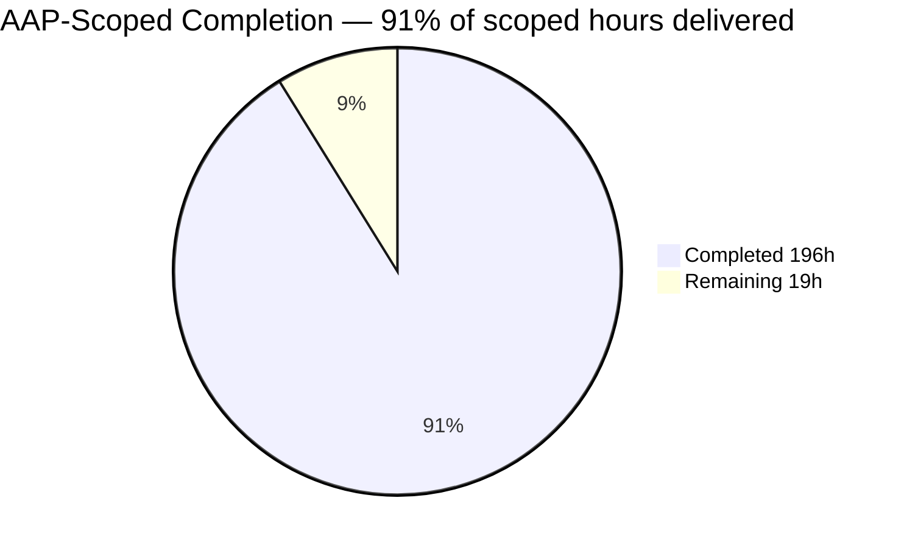
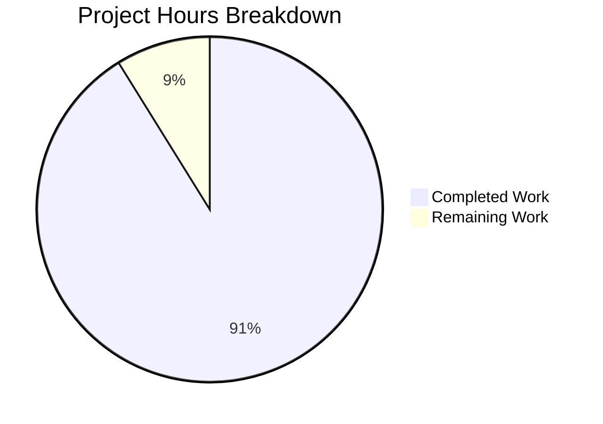
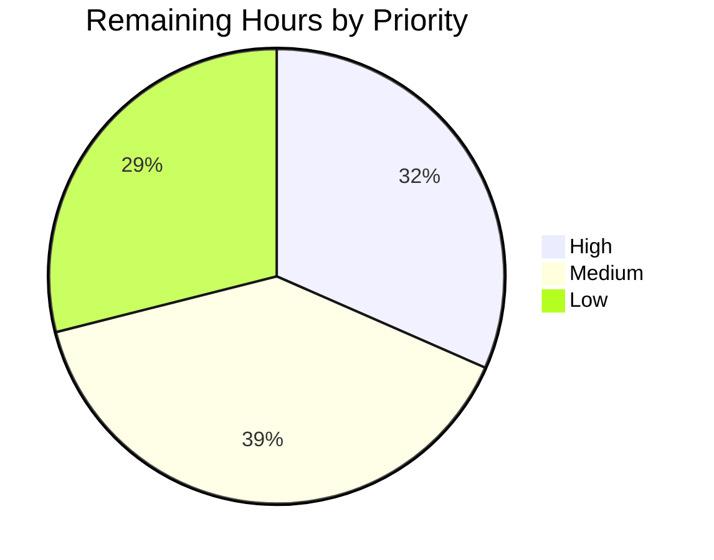

# 1. Executive Summary

## 1.1 Project Overview

The Taskboard is a self-contained Flask 3.1 task-management application for a single project. Tasks are created, assigned, moved through pending, in progress and completed, given date-only deadlines and discussed in comments; a dashboard reports four counts and one editable project record carries the name, description and dates. Every control is verifiable by hand and by suite. It runs as one process on SQLite, with no external service, build step or JavaScript.

## 1.2 Completion Status



| Metric | Hours |
|---|---|
| Total Hours | 215 |
| Completed Hours (AI + Manual) | 196 |
| Remaining Hours | 19 |

**196 hours completed out of 215 total = 91% complete** (196 ÷ 215 × 100 = 91.2%). All 52 scoped requirements are delivered; the 19 remaining hours are robustness and verification gaps on those capabilities plus the decisions four accepted caveats need.

## 1.3 Key Accomplishments

- **Task lifecycle** — twelve endpoints serve create, edit, assign, re-status and comment; 130 cases and a live server.
- **Dashboard** — four per-request counts (12 / 3 / 5 / 4 when seeded); each card links to its rows.
- **Filters** — status, assignee and deadline combined with AND; a 400 names any bad parameter.
- **Sample data** — one idempotent command seeds 1 project, 5 members, 12 tasks, 8 comments.
- **Interface** — one token stylesheet, a 640 px breakpoint, no JavaScript, words beside colour.
- **Failure pages** — 400, 404 and 500 inside the shell, even under a malformed `Host`.
- **Verification** — 503 cases at 99.62% branch coverage against an 85% floor the run enforces.
- **Install** — fourteen exact pins, `pip check` clean, four commands to a populated board.

## 1.4 Critical Unresolved Issues

Nine open items remain against the 52 scoped requirements. Every requirement is delivered; each item is a robustness gap, an accepted caveat or a documentation reconciliation.

| Issue | Impact | Owner | ETA |
|---|---|---|---|
| The task list's result count and its rows are read in two statements | A write landing between the two reads can render a count that disagrees with the table for one request | Backend | 0.5 day |
| A write that waits out the 30-second SQLite busy timeout renders the 500 page | Under external write contention a user action becomes an error page instead of a retry message | Backend | 1 day |
| Two lines remain uncovered: `app/db.py:216` and `app/services/members.py:57` | The 85% floor is met in total, so the run is green while two guards are unexercised | Test | 0.5 day |
| The coverage floor compares the total, not each module | A module can erode to 90.9% while the suite still passes | Test | 1 day |
| Buttons compute to 35.5 px and nav links to 24 px against a 44 px house figure | WCAG 2.2 AA 2.5.8 (24 × 24) is met; a designer review decides whether to enlarge | Design / UI | 1 day |
| The filter bar's form and the twelve per-row status forms carry no accessible name | Screen-reader users meet an unnamed form rather than "Filters" or "Status for …" | Frontend | 0.5 day |
| The plan's text and the README describe three figures the tree no longer matches (Section 5.2, rows 1, 2, 5, 6, 7, 9, 10, 11, 12, 13) | A reader comparing documents to code finds a superset interface, a 47th file and three no-deadline tasks | Docs | 0.5 day |
| The shell's link builder is unverified under a `SCRIPT_NAME` URL prefix | Every documented command serves at the root; a prefix mount is untested | Frontend | 0.5 day |
| Some single-line template markup exceeds the 88-column house width | No linter is configured, so nothing enforces or flags it | Frontend | 0.5 day |

## 1.5 Access Issues

No access issues identified. It reads no credential, calls no third-party service and has no deployment target; both environment variables have working defaults.

## 1.6 Recommended Next Steps

1. **[High]** Close the two write-path gaps: one statement for the list's rows and total, and a retry page instead of the 500 when the lock cannot be taken.
2. **[High]** Cover the two remaining lines and assert the coverage floor per module.
3. **[Medium]** Settle touch targets with a designer: enlarge the controls or record the tokens as the exception.
4. **[Medium]** Reconcile the plan text and README with the delivered interfaces, inventory and dataset.
5. **[Low]** Name the two unnamed form groups, verify a `SCRIPT_NAME` mount, and fit the changed templates to 88 columns.

# 2. Project Hours Breakdown

## 2.1 Completed Work Detail

| Component | Hours | Description |
|---|---|---|
| Foundation — factory, configuration, data access, schema, manifests | 26 | `create_app(test_config)` with instance-relative configuration, the instance folder and automatic schema application; the single connection lifecycle on `g` with `sqlite3.Row`, WAL mode and a 30-second busy timeout; both CLI commands; the four-table, four-index DDL; `pyproject.toml` with the coverage gate, the two pinned manifests and `.gitignore`. |
| Domain rules — parsers, vocabulary, date and status rules | 32 | `app/validation.py` (691 lines): the five parsers, the full message table, member existence resolved once, the closed status set, the deadline format and project-start rules, and the split between a field message and a parameter-naming 400. |
| Task services and presentation helpers | 24 | The twelve service functions with their documented returns, the joined assignee name and comment count, the single grouped metric aggregate plus total, and the four Jinja filters with the deadline-state window shared by the indicator and the filter. |
| Presentation system — tokens, stylesheet, shell, partials | 26 | An 898-line stylesheet with every value on `:root` behind `var()` and exactly one media query; the page shell with current-link marking and the flash region; five partials for the card, filter bar, table, flash and field errors. |
| Five views and three failure pages | 22 | Dashboard, task list, task form, task detail and project screen, each with its own empty states; the 400, 404 and 500 pages rendered inside the shell. |
| HTTP layer — endpoints, redirects, flash, error paths | 20 | The twelve contract endpoints plus the two superset POST rules, POST-redirect-GET with one flash per write, carried list filters rebuilt with `url_for`, and the 400/404/405/500 handlers. |
| Sample dataset and seeding | 7 | `SAMPLE_DATA` and `seed_database(db_path)`: offsets resolved at write time, members referenced by their unique email, insert order following the foreign keys, drop-and-recreate idempotency, and the documented summary line. |
| Test suite — fixtures and eight modules | 33 | 503 cases across 9,134 lines: a per-test temporary database, seeded and unseeded clients, expectations derived from the seed rather than hardcoded, and the full rule, filter, route and failure-page coverage. |
| Documentation — README | 6 | Requirements, install, seed, run and test commands; the twelve-endpoint table; the dataset summary; both environment variables; the interface conventions; the manual UI checklist; the project layout and the security notes. |
| **Total** | **196** | Matches Completed Hours in Section 1.2. |

## 2.2 Remaining Work Detail

| Category | Hours | Priority |
|---|---|---|
| Read the task list's rows and its result count consistently | 2 | High |
| Answer an exhausted SQLite write-lock timeout without the 500 page | 4 | High |
| Cover the two uncovered lines (`app/db.py:216`, `app/services/members.py:57`) | 1.5 | Medium |
| Enforce the coverage floor per module rather than only in total | 3 | Medium |
| Decide and apply touch-target sizing against the 44 px house figure | 3 | Medium |
| Name the filter-bar form and the per-row status forms for assistive technology | 1 | Low |
| Reconcile the plan text and README with the delivered interface, file inventory and dataset (Section 5.2, divergences 1, 2, 5, 6, 7, 9, 10, 11, 12 and 13) | 1 | Low |
| Verify the shell's link builder under a `SCRIPT_NAME` URL prefix | 2 | Low |
| Bring the changed templates' single-line markup inside the 88-column house width | 1.5 | Low |
| **Total** | **19** | 2 High, 3 Medium, 4 Low |

## 2.3 Estimation Basis

Completed hours are counted per component from the files each one owns — 12,070 lines of Python and 14,753 lines in the tree overall — with test effort held at 34% of the 163 hours of non-test work, inside the 30–40% band a suite of this size warrants. Confidence is high for the foundation, domain, HTTP and test components, whose scope is fixed by the plan's file map and whose delivery is measurable; medium for the presentation components, where effort concentrates in layout and accessibility work that the file count understates. Remaining hours are high-confidence for the two High items, which name a specific file and a specific failure mode, and medium for the touch-target item, which may end in a recorded exception rather than a change.

# 3. Test Results

Every figure below was produced by running the suite on this checkout: `./.venv/bin/python -m pytest` → **503 passed, 0 failed, in 24.83 s**, with total branch coverage **99.62%** over `app/` against the **85%** floor configured in `pyproject.toml`, the run reporting "Required test coverage of 85.0% reached". Each module was also run on its own, and its cases all passed independently.

| Area / Category | Framework | Tests | Passed | Failed | Coverage | What This Proves |
|---|---|---|---|---|---|---|
| Dashboard metrics and empty states (`tests/test_dashboard.py`) | pytest 9.1.1 + Flask test client | 25 | 25 | 0 | 100% of `app/services/metrics.py`, `app/blueprints/dashboard.py` | The four counts equal the seeded rows, Total always equals the sum of the three status counts, the cards link to the rows behind them, and both the zero state and the write-through-a-held-lock read render correctly. |
| Task lifecycle and write paths (`tests/test_tasks.py`) | pytest + Flask test client | 130 | 130 | 0 | 100% of `app/blueprints/tasks.py`, `app/services/tasks.py`, `app/models.py` | Create, edit, assign, clear, re-status and read the list and detail work end to end; every rejection re-renders with no row written, and list-origin actions return to the same filters. |
| Comments (`tests/test_comments.py`) | pytest + Flask test client | 18 | 18 | 0 | 100% of `app/services/comments.py` | A comment stores its author and timestamp and renders last, oldest-first ordering holds, and a blank body, an over-long body, a missing author and an unknown task are each refused. |
| Filters, deadline buckets and 400 rejections (`tests/test_filters.py`) | pytest + Flask test client | 107 | 107 | 0 | 100% of `app/services/tasks.py`, `app/templating.py` | Each status, assignee and deadline bucket returns exactly its rows, Overdue excludes completed work, combined filters intersect, and an out-of-set value answers 400 naming the parameter. |
| Validation and member resolution (`tests/test_validation.py`) | pytest, direct unit tests | 141 | 141 | 0 | 100% of `app/validation.py`; 90.9% of `app/services/members.py` | Every rule in the validation table holds with its exact message, lengths and encodings are handled at their bounds, and a value naming no member is refused once rather than three times. |
| Project record (`tests/test_project.py`) | pytest + Flask test client | 28 | 28 | 0 | 100% of `app/blueprints/project.py`, `app/services/projects.py` | The seeded details render, a valid save inserts or updates the single row, and an end date before the start date is rejected with nothing written. |
| Sample dataset, schema bootstrap and CLI (`tests/test_seed.py`) | pytest + in-process Flask CLI runner | 38 | 38 | 0 | 97.4% of `app/db.py` | The dataset still covers all three statuses plus the unassigned and no-deadline cases, seeding is idempotent, and both documented commands leave the database in their stated state. |
| Configuration, startup diagnostics and failure pages (`tests/test_config.py`) | pytest + Flask test client | 16 | 16 | 0 | 100% of `app/config.py`, `app/__init__.py` | The default mapping, the two environment variables, an unusable `DATABASE` arriving as one actionable line, and the 500 page rendering inside the shell with nothing of the exception in it. |
| **Total** | | **503** | **503** | **0** | **99.62% overall** | |

**Not Covered.** The following delivered capabilities are not exercised by any automated test, and a human should check them before release:

- **The write path's exhaustion of the 30-second busy timeout.** A read taken while another connection holds the write lock is covered and passes; a *write* that cannot get the lock at all is not, because the test would have to wait the timeout out. It currently ends in the 500 page.
- **The development server itself.** `flask run` is exercised only by hand; the suite drives the application through Flask's test client, so nothing asserts the server's own start-up, port binding or shutdown.
- **The shell's link builder under a URL prefix.** `app_path` is exercised at the root only; a `SCRIPT_NAME` mount is untested.
- **Rendered appearance, layout and touch-target sizes.** No browser automation exists by design, so badges, deadline states, the 640 px collapse, focus rings and control sizes are verified by the README's manual checklist rather than by a test.
- **The native date control's presentation.** `<input type="date">` renders in the browser's locale; only the values it round-trips are asserted.
- **The seed's read-back invariant.** The guard that raises when the inserted task count differs from `SAMPLE_DATA` cannot be reached by any shipped dataset, which is its purpose.

# 4. Runtime Validation & UI Verification

The flows below were driven against a running server (`./.venv/bin/python -m flask --app app run --host 127.0.0.1 --port 5987`) on a freshly seeded database, and again through the suite's HTTP client. The application has no external integrations — no third-party API, message broker or network service — so the list below is its complete runtime surface.

- ✅ **Start-up and bootstrap** — a fresh database gets its instance folder and schema automatically; `flask --app app init-db` prints "Initialized the database." and `seed-db` prints "Seeded 1 project, 5 members, 12 tasks, 8 comments." on every run, with the row counts unchanged (1 project, 5 members, 12 tasks, 8 comments; 3 completed, 4 in progress, 5 pending).
- ✅ **Dashboard** — `GET /` returns 200 and the cards read 12 / 3 / 5 / 4, Total equalling the sum of the three status counts; each card's link lands on the task list filtered to the rows behind its number.
- ✅ **Task creation and editing** — `POST /tasks` answers 302 to `/tasks/13` with "Task created." on the target page; a post with an empty title and an impossible date answers 200 with "Enter a task title." and "Enter a valid date (YYYY-MM-DD)." beside the fields and writes no row.
- ✅ **Assignment and status changes** — both quick actions answer 302 with their confirmation; a list-origin action returns to `/tasks?status=pending`, filters intact; an id naming no member answers 400 with "assignee_id: Select a team member from the list."
- ✅ **Comments** — `POST /tasks/2/comments` answers 302 and the detail page then shows "Comment added." under `role="status"`, with the comment last and carrying its author and timestamp.
- ✅ **Project record** — `POST /project` answers 302 with "Project details saved." and the details list re-renders the new values; dates read as "1 Nov 2026" and "28 Dec 2026".
- ✅ **Filters** — `?deadline=week` reads "4 of 12 tasks match these filters" with the cells reading Due today, Due in 3 days, Due in 4 days and Due in 6 days; `?status=bogus` answers 400 with "status: Invalid value for filter 'status'."
- ✅ **Failure and edge paths** — `/tasks/9999` and `/tasks/0` answer 404; a `Host` label past the DNS limit answers 400 inside the shell; a GET of a write-only action redirects to the task page instead of a bare 405; a raised service call renders the 500 page inside the shell with no exception text.
- ✅ **Responsive layout** — reviewed at 1440, 1280, 1080, 768, 640 and 375 px: the metric cards stack, the filter controls wrap, the task table's overflow is confined to its own scrolling wrapper, and the document itself never scrolls horizontally at 375 px.
- ⚠ **Never exercised at runtime** — the shell's links under a `SCRIPT_NAME` URL prefix, the development server under sustained external write contention, and the native date control's browser-locale presentation. Each is recorded in Section 3 and, where a human must act, in Section 2.2.

# 5. Compliance & Quality Review

## 5.1 Compliance Matrix

| Deliverable | Requirement reference | Verified status | Indicator |
|---|---|---|---|
| Task creation and editing | Plan FR-1; twelve-endpoint contract | Delivered; 130 task cases and a live create/reject cycle | ✅ Pass |
| Assignment and clearing | Plan FR-2; assignee against the member table | Delivered; both controls, "Unassigned" on both views, 400 on an unknown id | ✅ Pass |
| Status transitions | Plan FR-3; closed three-value set | Delivered; row and detail actions, out-of-set value 400 | ✅ Pass |
| Deadlines and the overdue rule | Plan FR-4; one reference day per request | Delivered; absolute date plus relative word, Overdue excludes completed | ✅ Pass |
| Comments | Plan FR-5; author and body, oldest first | Delivered; 18 cases plus a live post with its confirmation | ✅ Pass |
| Project record | Plan FR-6; single row, end not before start | Delivered; one-statement upsert, rejection with nothing written | ✅ Pass |
| Dashboard metrics | Plan FR-7 and the four definitions | Delivered; 12 / 3 / 5 / 4 with Total = the sum, computed per request | ✅ Pass |
| Filters | Plan FR-8; three filters, AND, 400 on bad values | Delivered; every bucket exact, parameter named on rejection | ✅ Pass |
| Sample data and seeding | Plan FR-9 and the dataset specification | Delivered; the documented line on every run, idempotent, three no-deadline tasks | ✅ Pass |
| Error pages and failure paths | Plan 400/404/500 inside the shell | Delivered; all three rendered in-shell, including under a malformed `Host` | ✅ Pass |
| Interface, tokens and accessibility | Design-system component map; every control labelled | Delivered, with two accepted exceptions: control sizes below the 44 px house figure, and two form groups without an accessible name | ⚠️ Pass with exceptions |
| Test suite and coverage gate | 85% branch coverage over `app/`, enforced by the run | Delivered at 99.62% with the gate reached; the floor compares the total, so per-module erosion is not caught | ⚠️ Pass with a caveat |

## 5.2 AAP & Rule Divergences and Gaps

No user Rules exist for this project, so no Rule divergence is possible and none was identified. The sixteen divergences below are departures from the plan's own text: eleven leave behaviour unchanged, four are sanctioned by the plan's own allowance for them — one of those settling an inconsistency inside the plan's own table — and one changes where a rejected value is displayed without changing what the reviewer sees.

| # | What The AAP/Rule Required | What Was Delivered Instead | Why It Diverged | Impact | Remediation |
|---|---|---|---|---|---|
| 1 | `tasks.list_tasks(filters)` exactly, per the interface table | `list_tasks(filters=None, today: date \| None = None)` — a superset; the documented call still works (`app/services/tasks.py:129-131`) | One evaluation of today per request is required, while a service must not read request state, so the day enters as an argument | None: every documented call behaves as specified | None in code; record the keyword in the plan text (Section 2.2, reconciliation task) |
| 2 | The module's template-facing interface is four Jinja filters | The same four filters plus a `format_deadline` global (`app/templating.py`) | Every deadline rendering must live in that module, and the day count needs a helper the four filters cannot carry | Templates call one extra helper by name | None in code; name the global in the plan text |
| 3 | Error handling at three levels: field messages, 404, 400, 500 | The factory also carries a 405 handler sending a wrong-method read of a task action to that task's page (`app/__init__.py:197`) | The plan describes no 405 page, and widening the route set to avoid the handler would break the twelve-endpoint contract | None: no page, endpoint or shape was added, and every other method mismatch keeps the default 405 | None; optionally record the fourth path in the plan |
| 4 | The submitted values preserved in every field after a rejection | The rejected deadline text is echoed in a description paragraph beside the control (`#deadline-submitted`), not inside it (`app/templates/tasks/form.html:121`) | The same requirement fixes the control as `<input type="date">`, which the HTML platform forbids from holding arbitrary text | The reviewer still sees exactly what they typed, beside the field's own message | None; if the control is ever relaxed to a text input, move the echo into its value |
| 5 | Eight Python files under `tests/` (conftest plus seven modules) | Nine, with `tests/test_config.py` covering `app/config.py` and the start-up diagnostics | The plan requires the diagnostics and the coverage floor but assigns `app/config.py` to no planned module | None: no planned file was deleted, weakened or displaced | Reconcile the file inventory in the plan text |
| 6 | `tests/test_filters.py` is the task-list filter suite | It also carries the four Jinja filters' unit cases, as a delimited section | The file plan is closed, so no templating test module could be added | None: the section is documented in the module and named in the README | Reconcile the inventory |
| 7 | `tests/conftest.py` provides three fixtures on a temporary database | The same three fixtures plus a `MONTH_ABBREVIATIONS` constant | The suite's one statement of the month rule needs one home, and no additional shared module was available | None: the fixtures are unchanged | Reconcile the inventory |
| 8 | `.gitignore` covers the documented ignore set | The same set plus build output and database sidecar rules (`*.sqlite3-wal`, `dist/`, `build/`) | Disposable artefacts must never be committed, and a database named by `DATABASE` may live outside `instance/` | None: nothing the plan named was removed | None |
| 9 | Twelve enumerated service functions | Those twelve plus `total_task_count()` (`app/services/metrics.py:47`) | The list's unfiltered count needs its own `COUNT(*)`, which the four-metric aggregate cannot supply | None: every enumerated signature is unchanged | Reconcile the interface table |
| 10 | Twelve method-and-path shapes in the endpoint contract | The same twelve, plus `POST` accepted on `/tasks/new` and `/tasks/<id>/edit` | A form posting to the path it was rendered from would otherwise answer 405 | None: both documented targets keep working and no documented route or method changed | Reconcile the route table |
| 11 | The dataset has four tasks with no deadline, naming task 12 among them | Three tasks carry none (3, 7 and 11); task 12 is due beyond the coming week (`seed.py:252`) | The section's own enumerated task table four lines above gives task 12 a +10-day deadline; the specific table governs and is internally consistent | None on behaviour: the no-deadline filter returns exactly the three rows that hold no date, and the README states three | Confirm three is the intended dataset and correct the plan's prose |
| 12 | A `--target` install creates no console scripts, so every command runs as `python -m` | The README states such an install writes them into `<target>/bin`, which is not on `PATH` (`README.md:96`) | Measured on the host: the scripts are created but unreachable, which is why the `python -m` conclusion holds | None: both documented command forms and their conclusion are unchanged | Correct the premise in the plan text |
| 13 | The relative wording is "Due in N days" for N from 1 to 6 | At one day the interface reads "Due in 1 days" (`app/templating.py:298`) | Following the requirement's literal form rather than inflecting it | Cosmetic: one grammatically irregular sentence at a single day offset | Decide whether the wording should inflect; one-line change plus its test |
| 14 | The interface uses a closed set of named classes | The set plus one named class, `.quick-actions`, a two-column grid built only from existing spacing tokens | The plan allows a construct the set lacks to become a named class rather than a literal, and two aligned side-by-side forms cannot be expressed with the existing layout classes | One class with one consumer; nothing existing changed | None — sanctioned by the plan's own allowance |
| 15 | The stylesheet declares a fixed token set | Two tokens added, `--control-min` and `--font-mono`, each consumed and documented | The same section requires a missing value to become a token rather than a literal | None: no literal colour, size or spacing was introduced | None — sanctioned by the plan's own allowance |
| 16 | The plan leaves the deadline separator glyph open | The middle dot U+00B7 joins the date and the relative word on both screens | One glyph had to be chosen, and the twelve-row list is the surfacing surface | Cosmetic and consistent across both screens | None — sanctioned; the plan specifies no glyph |

**Divergence 1 — the list service takes the request's reference day.** The plan's interface table fixes the signature, and the shipped one adds an optional keyword, so any caller written against the plan still works and no return value changed. The superset exists because two requirements collide: today must be evaluated once per request, and a service must not touch the request. The evidence a reader can open is `app/services/tasks.py:129-131` beside `app/templating.py`'s per-request reference day and `tests/test_filters.py`'s stepped-clock case. Nothing needs changing in the code; the decision a human owes is whether the plan's text should name the keyword, which Section 2.2 tracks.

**Divergence 2 — a `format_deadline` global beside the four filters.** The plan counts four filters and also requires every deadline rendering to live in one module while the interface shows a day count. A fifth filter would have been the larger departure, so the helper is registered as a Jinja global. `app/templating.py` carries both, and every template that renders a deadline calls the same helper, which is what keeps the list cell and the detail value from disagreeing. No filter name or return value changed; the human decision is only whether the plan should name the global.

**Divergence 3 — a 405 handler in the factory.** The plan enumerates three failure levels and describes no 405 page. Because the quick actions are POST-only, a reviewer who reloads a rejected post's URL would otherwise land on Werkzeug's bare page outside the shell. The handler sends that read to the task page the action belongs to; `app/__init__.py:197` and the tests around it show that every consequence the plan does describe — the twelve endpoints, their methods, the 400/404/500 pages — is untouched. A human may record it as a fourth path in the plan; nothing in the code needs to change.

**Divergence 4 — where a rejected deadline is echoed.** The plan asks for the submitted values preserved in every field and, in the same section, fixes the deadline control as a native date input. The platform will not hold text in that control, so the rejected text is printed in a paragraph bound to the field by `aria-describedby` (`app/templates/tasks/form.html:121`). The reviewer still reads exactly what they typed beside the message explaining why it was refused, and every other field round-trips in place. The decision is only whether that counts as "in the field"; no reviewer-visible behaviour is lost either way.

**Divergence 5 — a ninth test module.** `tests/test_config.py` is the only test that drives `app/config.py` and the start-up diagnostics, which the plan requires but assigns to no planned module. Its presence makes the file inventory one larger than the plan states, and nothing else moved: all forty-six planned paths exist with their stated responsibilities. A human deciding the plan's table is closed can fold its 16 cases into a planned module without changing a single assertion.

**Divergence 11 — three tasks without a deadline, not four.** The plan's prose names four no-deadline tasks including task 12, while its own per-record table four lines above gives task 12 a date ten days out. The delivered `seed.py:252` follows the table, which is internally consistent and which also exercises a date outside the seven-day window that the prose reading would leave unrendered. The visible consequence is that `?deadline=none` returns three rows and the no-deadline state is shown by three tasks rather than four; the README documents the dataset as it runs. A human should confirm three is intended and correct the plan text.

**Divergence 12 — the README's console-script premise.** The plan states that a `--target` install creates no console scripts and uses that to justify running every command as `python -m`. Measured on this host, such an install does write the scripts, into `<target>/bin`, which is not on `PATH` — so the conclusion holds for a different reason, and the README says so. Both of the plan's command forms are still documented, together with the environment note that explains why the plain `python3 -m venv` path needs adapting here. The human action is a one-sentence correction in the plan, not a change in the repository.

# 6. Risk Assessment

Each risk below is forward-looking: what could still go wrong in use, with the mitigation that keeps it contained.

| Risk | Category | Severity | Probability | Mitigation | Status |
|---|---|---|---|---|---|
| The coverage floor compares only the total, so a single module can erode (the shipped span runs from 90.91% to 100%) while every run stays green | Technical | Medium | High | Add a per-module floor assertion and prove it fails on a seeded erosion (Section 2.2) | Open |
| The task list reads its rows and its result count in two statements, so a write landing between them can render a count that disagrees with the table for one request | Technical | Low | Medium | Read both from one statement or one read transaction (Section 2.2) | Open |
| A write that cannot take the SQLite write lock within the 30-second busy timeout is answered by the 500 page | Technical | Medium | Low | Translate the lock error into a page naming the cause and the retry; reads are already protected by WAL and covered by a test | Open |
| The development `SECRET_KEY` fallback is a published literal, so any two instances started without `SECRET_KEY` accept each other's session cookies | Security | Medium | Medium | Set `SECRET_KEY` explicitly for anything beyond a local run; the cookie carries flash text only | Accepted — documented |
| There is no authentication and no CSRF token by design, so every write endpoint is open to anyone who can reach the port | Security | High | Low | Keep the server on `127.0.0.1`, as every documented command does; add accounts and tokens before any shared or networked deployment | Accepted — by design |
| No self-healing: a database deleted or corrupted under a running server yields the 500 page until a restart or a reseed | Operational | Medium | Low | Restart or reseed; the start-up message names the recovery command and the schema is re-applied on the next start | Accepted |
| No pipeline, container, migration path, structured logging or monitoring; the only run mode is the Flask development server | Operational | Medium | High | Add a pipeline, a production WSGI server and a migration path before any shared deployment | Accepted — outside plan scope |
| The native date control renders in the browser's locale while the page prints an unambiguous date, and the shell's link builder is unverified under a `SCRIPT_NAME` prefix | Integration | Low | Medium | Keep the format hint beside the field; exercise a prefix mount before deploying behind one (Section 2.2) | Open |

# 7. Visual Project Status





| View | Value |
|---|---|
| Completed work | 196 hours (91% of 215) |
| Remaining work | 19 hours (9% of 215) |
| Remaining by priority | 6 hours High, 7.5 hours Medium, 5.5 hours Low |
| Remaining by area | 6 hours write-path robustness, 4.5 hours verification and coverage, 4 hours interface and accessibility, 3.5 hours shell and documentation, 1 hour plan reconciliation |

The work is concentrated where a release gate looks first: two High items on the write path account for under a third of the remaining hours, and every remaining item names a file, a failure mode or a measurement rather than a general area.

# 8. Summary & Recommendations

The Taskboard is delivered: **196 of 215 scoped hours, 91%**. All 52 requirements the plan sets are implemented and verified, and 503 automated cases pass at 99.62% branch coverage over `app/` against an 85% floor that the run itself enforces. Twelve HTTP endpoints serve the five write capabilities — create, edit, assign, re-status, comment — and five read screens; a dashboard reports four counts computed per request, so no write can leave a number stale; three filters combine with AND and reject an out-of-set value with a page that names the parameter; and one command seeds a board that exercises every status, the unassigned case and every deadline bucket, with dates relative to the day it runs.

What a reviewer can rely on is the combination of the suite and the running application. Every write path was driven and re-driven: confirmations arrive as a flash on a redirected page, rejections re-render with the submitted values and the parser's own message beside the field, and the quick actions answer a malformed value with a 400 rather than a traceback. The failure surface is complete for the plan's scope — 400, 404 and 500 all render inside the application shell, including under a malformed `Host` header and when a write-only action is read with the wrong method — and the interface carries its meaning in words as well as colour, with no JavaScript anywhere and a single documented 640 px breakpoint.

The remaining 19 hours are not undelivered features. They are the two robustness gaps on the write path — the list's count and rows read in two statements, and an exhausted write-lock timeout surfacing as the 500 page — together with the two missing lines that would let the coverage floor be met per module rather than only in total. Four accepted caveats also need a human decision: control sizes below the 44 px house figure while the design tokens the plan fixes compute them, two form groups without an accessible name, the shell's link builder unverified under a URL prefix, and some single-line template markup past the 88-column width.

The critical path to production is short and specific: settle the two High write-path items, then the coverage assertions, then the touch-target decision. None of them changes a route, a template contract or a test expectation, so they can land independently and in that order. Beyond them, the plan deliberately excluded production posture — accounts, CSRF tokens, a pipeline, a production WSGI server, migrations and monitoring — so any deployment beyond a single loopback-bound reviewer is new scope rather than unfinished work.

Production readiness is therefore: **ready as a local, single-user test application**, and not yet ready as a shared service. The readiness evidence is the seeded board loading correctly with no configuration, both CLI commands idempotent, every screen and both quick actions verified through a live server, and a suite that pins the rules the interface promises. The gaps that matter for a shared deployment are the security posture the plan chose to leave out and the operational scaffolding it chose not to build — both stated plainly above so they are decisions, not surprises.

# 9. Development Guide

### System prerequisites

| Requirement | Version | Notes |
|---|---|---|
| CPython | 3.12.3 | The interpreter this project was built and measured on, reached as `python3.12`. It is an `sh` exec wrapper, not a symlink — do not replace it with one, because a symlinked interpreter writes a wrong `home` into `pyvenv.cfg` and every virtual-environment interpreter then fails with `ModuleNotFoundError: No module named 'encodings'`. |
| SQLite | 3.45.1 | Reached through Python's standard library; nothing to install and no server process. |
| pip | any recent | Used only through the virtual environment. |
| Disk and network | none | No container, database server, broker, queue or VPN is involved, and the application calls no network service. |

The host's own `python3` is 3.13.18 and the `pytest` on `PATH` is a different interpreter's build without the coverage plugin — every command below therefore names `python3.12` or `./.venv/bin/python` explicitly.

### Environment setup and dependency installation

From the repository root:

```bash
python3.12 -m venv .venv
./.venv/bin/python -m pip install -r requirements-dev.txt
```

The second command installs all fourteen pins — Flask 3.1.3, Werkzeug 3.1.9, Jinja2 3.1.6, itsdangerous 2.2.0, MarkupSafe 3.0.4, click 8.5.0 and blinker 1.9.0 at runtime; pytest 9.1.1, pytest-cov 7.1.0, coverage 7.17.0, iniconfig 2.3.1, packaging 26.3, pluggy 1.7.0 and Pygments 2.21.0 for the tests. Verify the environment before going further:

```bash
./.venv/bin/python -V                                   # Python 3.12.3
./.venv/bin/python -m pip check                         # No broken requirements found.
./.venv/bin/python -c "from importlib.metadata import version as v; print(v('flask'), v('pytest'), v('pytest-cov'))"
```

No environment variable has to be set. Both are optional and both have working defaults: `DATABASE` (default `instance/taskboard.sqlite3`, created on first run) and `SECRET_KEY` (a development-only fallback). For a run isolated from any other checkout, give both explicitly:

```bash
export DATABASE="$PWD/instance/taskboard-local.sqlite3"
export SECRET_KEY="dev-local"
```

### Seed the sample data and start the application

There is no build step: the package is imported directly by the Flask CLI.

```bash
./.venv/bin/python -m flask --app app seed-db
# Seeded 1 project, 5 members, 12 tasks, 8 comments.

./.venv/bin/python -m flask --app app run --host 127.0.0.1 --port 5000
# open http://127.0.0.1:5000/
```

`seed-db` drops and recreates the tables, so running it again restores the documented dataset rather than duplicating it — verified by running it twice with identical output and identical row counts. `flask --app app init-db` is the empty-schema variant: it prints `Initialized the database.` and leaves the tables present with no rows, which is how the empty states are reached.

If several checkouts share a host, give each one its own port and database, for example `--port 5040` with `DATABASE=$PWD/instance/taskboard-5040.sqlite3`. Only `127.0.0.1` is used; the server is never bound to an external interface.

### Verification steps

```bash
./.venv/bin/python -m pytest                        # the whole gate: 503 passed, coverage 99.62%
./.venv/bin/python -m pytest tests/test_tasks.py -q --no-cov    # one module while iterating
./.venv/bin/python -m compileall -q app tests seed.py           # byte-compile the tree, silent on success
```

The whole-package run measures branch coverage over `app/` and fails the run below **85%** (`fail_under = 85` in `pyproject.toml`). Do not lower it and do not edit `addopts` to skip coverage; `--no-cov` is for the per-module loop only. A healthy run ends with `Required test coverage of 85.0% reached.` and exits 0.

Then check the application itself with `curl` against the running server:

```bash
curl -s -o /dev/null -w '%{http_code}\n' http://127.0.0.1:5000/                    # 200
curl -s -o /dev/null -w '%{http_code}\n' http://127.0.0.1:5000/tasks               # 200
curl -s -o /dev/null -w '%{http_code}\n' http://127.0.0.1:5000/tasks/9999          # 404
curl -s -o /dev/null -w '%{http_code}\n' 'http://127.0.0.1:5000/tasks?status=nope' # 400
curl -s http://127.0.0.1:5000/ | grep -oE '<strong>[0-9]+</strong>|<span>[A-Za-z ]+</span>' | head -8
```

The dashboard reads `12 / 3 / 5 / 4` (Total tasks, Completed, Pending, In progress) after seeding.

### Example usage

Create a task, confirm the redirect, and read the confirmation from the page it lands on:

```bash
curl -s -o /dev/null -w '%{http_code} -> %{redirect_url}\n' \
  -X POST http://127.0.0.1:5000/tasks \
  -d 'title=Write the release note&description=&assignee_id=2&status=pending&deadline=2026-12-01'
# 302 -> http://127.0.0.1:5000/tasks/13
```

Reject one on purpose and read the message beside the field:

```bash
curl -s -X POST http://127.0.0.1:5000/tasks -d 'title=&status=pending' | grep -oE 'Enter a task title\.'
```

Move a task's status from the list, keeping its filters, then read the filtered list back:

```bash
curl -s -o /dev/null -w '%{http_code} -> %{redirect_url}\n' \
  -X POST http://127.0.0.1:5000/tasks/2/status \
  -d 'status=completed&origin=list&filter_status=pending&filter_assignee=&filter_deadline='
curl -s 'http://127.0.0.1:5000/tasks?deadline=week' | grep -oE '[0-9]+ of [0-9]+ tasks match these filters'
```

Flash messages ride the signed session cookie, so a probe that reads the confirmation must keep the cookie between the POST and the follow-up GET:

```bash
curl -s -c cookie.txt -o /dev/null -X POST http://127.0.0.1:5000/tasks/2/comments -d 'author_id=1&body=Checked.'
curl -s -b cookie.txt http://127.0.0.1:5000/tasks/2 | grep -oE 'Comment added\.'
```

### Troubleshooting

| Symptom | Cause and resolution |
|---|---|
| `pytest: error: unrecognized arguments: --cov=app` or the coverage gate never prints | You ran the `pytest` on `PATH`, which belongs to the host's 3.13 interpreter and has no pytest-cov. Run `./.venv/bin/python -m pytest`. |
| `ModuleNotFoundError: No module named 'encodings'` from `.venv/bin/python` | The virtual environment was created from a symlinked interpreter. Delete `.venv` and recreate it with `python3.12 -m venv .venv`, leaving `python3.12` as the exec wrapper it is. |
| `No such command 'seed-db'` / `Could not locate a Flask application` | The command was run outside the repository root, or `--app app` was omitted. Both CLI commands must see the `app` package on the path; run them from the repository root. |
| The board is empty after seeding | `DATABASE` points at a different file than the one you are serving. Print it with `./.venv/bin/python -c "from app import create_app; print(create_app().config['DATABASE'])"` and pass the same value to both commands. |
| The dashboard is correct but a stale page shows old numbers | Every count is computed per request, so a stale page means a cached response or a different database, never a stored counter. Reload with a hard refresh and re-check `DATABASE`. |
| A single-module run fails on coverage | `addopts` already enables coverage, so a narrow run still evaluates the gate. Add `--no-cov` while iterating and run the full gate before finishing. |
| `flask.__version__` raises an attribute warning | Deprecated in Flask 3.1 and removed in 3.2, and Werkzeug exposes no `__version__`; read versions with `importlib.metadata.version()` instead. |
| `database is locked` under a heavy write load | Writes wait up to 30 seconds for the lock and then answer the 500 page. Stop the competing writer, or give this checkout a database of its own; a single-user board never meets it. |
| An error page renders with no styling | Static assets are only served by the running application; open the pages through the server rather than from the filesystem. |

# 10. Appendices

### A. Command Reference

| Purpose | Command | Expected result |
|---|---|---|
| Create the virtual environment | `python3.12 -m venv .venv` | `.venv/bin/python` is CPython 3.12.3 |
| Install every pin | `./.venv/bin/python -m pip install -r requirements-dev.txt` | exit 0; fourteen packages resolved |
| Check the environment | `./.venv/bin/python -m pip check` | `No broken requirements found.` |
| Apply the empty schema | `./.venv/bin/python -m flask --app app init-db` | `Initialized the database.` |
| Load the sample data | `./.venv/bin/python -m flask --app app seed-db` | `Seeded 1 project, 5 members, 12 tasks, 8 comments.` |
| Run the application | `./.venv/bin/python -m flask --app app run --host 127.0.0.1 --port 5000` | server on `http://127.0.0.1:5000/` |
| Run the whole gate | `./.venv/bin/python -m pytest` | 503 passed, coverage 99.62%, exit 0 |
| Run one module | `./.venv/bin/python -m pytest tests/test_tasks.py -q --no-cov` | that module's cases pass |
| Byte-compile the tree | `./.venv/bin/python -m compileall -q app tests seed.py` | silent, exit 0 |
| Count the tests without running them | `./.venv/bin/python -m pytest --collect-only -q --no-cov` | 503 test ids |

### B. Port Reference

| Port | Used by | Notes |
|---|---|---|
| 5000 | The development server, as documented | Default in the README and in every example above |
| 5000 + 10 × N | The same server for checkout number N on a shared host | A block of ten per checkout; the application never opens a second port |

There are no other listeners. The application opens no socket of its own, has no database server, message broker or cache to connect to, and serves its static assets from the same process. If 5000 is taken, pass `--port` with any free value and keep `DATABASE` distinct per port.

### C. Key File Locations

| Path | What it owns |
|---|---|
| `app/__init__.py` | The application factory: configuration, instance folder, schema bootstrap, blueprint and CLI registration, the 400/404/405/500 handlers |
| `app/config.py` | The default configuration mapping and the database-path resolution |
| `app/db.py` | The only module that opens a connection: per-request lifecycle on `g`, WAL mode, the busy timeout, and both CLI commands |
| `app/schema.sql` | The four tables, their constraints and the four indexes |
| `app/models.py` | The four dataclasses the templates read, the status vocabulary and the display labels |
| `app/validation.py` | Every form, filter and date rule, with the message each rejection prints |
| `app/templating.py` | The four Jinja filters, the deadline and shell globals, and the one reference day per request |
| `app/services/` | The business rules: projects, members, tasks, comments, metrics |
| `app/blueprints/` | The twelve HTTP endpoints, their redirects and their flash messages |
| `app/templates/`, `app/static/css/app.css` | The presentation: shell, five views, five partials, three failure pages, and the 898-line token stylesheet |
| `seed.py` | `SAMPLE_DATA` and `seed_database()`, shared by the CLI command and the test fixtures |
| `tests/` | Eight modules plus `conftest.py`, on a temporary database per test |
| `pyproject.toml` | The pytest and coverage run contract, including the 85% floor |
| `README.md` | Install, seed, run and test commands; the endpoint table; the dataset; the manual UI checklist |

### D. Technology Versions

| Component | Version | Role |
|---|---|---|
| CPython | 3.12.3 | The interpreter |
| SQLite | 3.45.1 | Storage, through the standard library's `sqlite3` |
| Flask | 3.1.3 | Routing, requests, templates, CLI, flash messaging |
| Werkzeug | 3.1.9 | WSGI toolkit and development server |
| Jinja2 | 3.1.6 | Templates with autoescaping on |
| itsdangerous | 2.2.0 | Signs the flash-message cookie |
| MarkupSafe | 3.0.4 | Escaping behind autoescaping |
| click | 8.5.0 | The CLI framework behind both commands |
| blinker | 1.9.0 | Signals Flask imports at start-up |
| pytest | 9.1.1 | Test runner |
| pytest-cov / coverage | 7.1.0 / 7.17.0 | Coverage measurement and the floor |
| iniconfig, packaging, pluggy, Pygments | 2.3.1, 26.3, 1.7.0, 2.21.0 | The test-time closure |

### E. Environment Variable Reference

| Variable | Required | Default | Effect |
|---|---|---|---|
| `DATABASE` | No | `instance/taskboard.sqlite3` | The SQLite file the application opens, resolved against the repository root; created along with its schema on first use |
| `SECRET_KEY` | No | A development-only fallback | Signs the session cookie that carries flash messages. Set it explicitly for any run more than local; two instances sharing the fallback accept each other's cookies |

### F. Developer Tools Guide

The project configures no linter, formatter or security scanner, by design and by its plan: `pyproject.toml` carries only the project metadata and the pytest and coverage tables. The tooling that does apply is small:

- **Coverage gate** — `./.venv/bin/python -m pytest` is the only command that enforces the 85% floor; `--no-cov` is for the iteration loop and must not be used as the finishing check. The floor is configured once, as `fail_under = 85`, with `precision = 2` so the printed total and the pass/fail decision cannot disagree.
- **Byte-compilation** — `./.venv/bin/python -m compileall -q app tests seed.py` is the fastest syntax check across the whole tree and prints nothing on success.
- **Style** — PEP 8 is honoured by inspection: no tabs, no trailing whitespace, a docstring on every public function, no bare `except`, no wildcard import, no mutable default argument. Nothing enforces the 88-column house width, which is why Section 2.2 carries a task for it.
- **Version lookup** — read versions with `importlib.metadata.version()`; `flask.__version__` is deprecated in 3.1 and removed in 3.2, and Werkzeug exposes none.
- **Dependency check** — `./.venv/bin/python -m pip check` after any pin change; the fourteen pins are exact and resolve cleanly on Python 3.12.

### G. Glossary

| Term | Meaning |
|---|---|
| Task | The unit of work: a title, an optional description, an optional assignee, one of three statuses and an optional date-only deadline |
| Status | One of `pending`, `in_progress`, `completed` — stored in lowercase, displayed as Pending, In progress and Completed; the set is closed and transitions are unrestricted |
| Assignee | The team member a task belongs to, or "Unassigned" when the column is null |
| Member | One of the five seeded team members that tasks are assigned to and comments attributed to |
| Deadline bucket | One of the filter's four states — Overdue, Due today, Due this week, No deadline. Overdue excludes completed work, and a task due today falls in both the today and the week buckets |
| Deadline state | The relative word beside a date: Overdue, Due today, or Due in N days for a date inside the seven-day window ending today + 6; nothing for a completed task |
| Reference day | The single evaluation of "today" per request that both the filter buckets and the relative words are measured from, so the two cannot disagree |
| Dashboard metric | One of Total tasks, Completed, Pending, In progress, computed per request from one grouped aggregate plus one count |
| Empty state | A page region's own wording when it has nothing to show: no tasks, no matches, no comments, no project details — four distinct states, none a bare table |
| Seed | Loading `SAMPLE_DATA` into the database with one command; it drops and recreates, so it restores the documented board rather than duplicating it |
| Parameterized query | A statement whose values are bound rather than concatenated, which is the whole of this application's SQL discipline |
| Flash message | A one-shot confirmation rendered on the page a write redirects to, carried in the signed session cookie and shown once |
