# Technical Specification

# 1. Introduction

## 1.1 Executive Summary

`IWNewGH` delivers a minimal, dependency-free Node.js HTTP server written as teaching material that executes exactly as its documentation describes. The delivered artifact is three files at the repository root — `server.js` (176 lines), `package.json` (13 lines) and `README.md` (654 lines) — for 843 lines in total. The entire program is the single file `server.js`, built on Node's built-in `node:http` module: no framework, no middleware, no routing library, and exactly one `require(` call in the whole program (`server.js` line 3).

The functional surface is deliberately two responses and one console line per request:

| Contract | Behaviour | Evidence |
|---|---|---|
| Success path | `GET /hello` returns `200 OK`, `Content-Type: text/plain`, body `Hello world` (11 bytes, no trailing newline) | `server.js` L59-63, L70-72 |
| Failure path | Every other method and path returns `404 Not Found`, body `Not Found` (9 bytes, no path echo, no error detail) | `server.js` L66-68, L85-88 |
| Observability | Exactly one stdout line per request, `"<ISO-8601> <method> <pathname>"`, written before routing | `server.js` L42-44, L81 |

### The Problem It Solves

The repository addresses a documentation gap rather than a commercial one. A developer learning Node's HTTP layer must either read the internals of an opinionated framework or assemble an example that leaves out the parts that make a server operable — logging, configuration validation, and a shutdown that terminates cleanly. The delivered program shows each of those concerns in isolation inside one file that reads top to bottom, and it does so without any package to install (`README.md` L7-25).

| Problem | The repository's answer | Evidence |
|---|---|---|
| Tutorial examples omit operational concerns | Logging, validated port configuration, error handling and graceful shutdown each sit in their own named function | `server.js` L15-153 |
| Framework examples hide the HTTP primitives | One `http.createServer(requestListener)` call and one `res.writeHead`/`res.end` writer, nothing else | `server.js` L53-56, L95 |
| Examples drift from the prose that documents them | Every documented response, log line, message and exit status is reproduced by an explicit verification gate | `README.md` L307-591 (V1-V16) |
| Examples cannot be extended without a rewrite | Routing is a lookup table: a new endpoint is one table entry plus one handler function | `server.js` L70-72; `README.md` L23-24 |

### Key Stakeholders and Users

The system serves no authenticated user, holds no account model, and exposes no role or permission concept (`README.md` L637-654). Its stakeholders are the people who read, teach from, and compare against the code.

| Stakeholder | Primary need | What the deliverable provides them |
|---|---|---|
| Beginner Node.js developers | A correct, complete server they can read in one sitting | 176 lines, one file, one dependency-free module import |
| Instructors and reviewers | Material whose prose matches the code's behaviour | 16 named verification gates with literal expected output |
| Developers selecting a baseline | A known-good reference to diff a design against | Pinned contracts: 11-byte and 9-byte bodies, exit statuses `0` and `1`, `text/plain` with no charset parameter |
| Future maintainers | A documented extension point | The `ROUTES` table, where routing changes and nothing else does |

### Expected Impact and Value Proposition

The value of this deliverable is instructional and structural, and the repository records no revenue model, customer base, market segment, service-level agreement or usage telemetry. Its measurable benefits are the ones its own gates establish:

- **Zero installation cost.** No `dependencies`, no `devDependencies`, no `type` field in `package.json`; `npm install` is never required, `node_modules` is never created and `package-lock.json` does not exist (`README.md` L41-52).
- **Immediate first result.** One command — `node server.js` — produces `Server listening on port 3000`, and a single `curl` returns the 200 contract (`README.md` L53-77).
- **Deterministic contracts.** Response bodies are fixed 11-byte and 9-byte literals, so a caller can assert on byte counts rather than on prose.
- **Predictable resource behaviour.** Verified on Node v22.23.4: an RSS of 48,888 KB rose to 58,592 KB and then 59,592 KB across two 400-request batches — a 1,000 KB second-to-third rise, with no per-request retention (`server.js` L75-91 holds no state between requests).
- **Low latency on loopback.** Verified on Node v22.23.4: five warm `GET /hello` samples measured 0.000543 s to 0.000775 s, inside the README's 10 ms threshold (`README.md` L419-431).

Because the program is explicitly not a production service — no authentication, no TLS, no rate limiting, no persistence — none of these figures should be read as capacity or availability commitments. They describe a tutorial that runs correctly at tutorial scale, which is the claim the repository makes for itself (`README.md` L3-5, L20-22).

## 1.2 System Overview

The system is one foreground process that binds a single TCP port, answers exactly one route, logs one line per request, and exits on `SIGINT`. Its behaviour is small enough to enumerate completely, which is what makes the surrounding documentation verifiable rather than aspirational.

### 1.2.1 Project Context

**Business context and market positioning.** The repository positions itself, in its own words, as teaching material that also runs correctly at tutorial scale, and explicitly not a production service (`README.md` L3-5, L20-22). It records no product owner, customer segment, pricing, distribution channel or competitive analysis, and the manifest carries no repository, homepage, author or licence field (`package.json`). The only positioning claim it makes is structural and negative: the program has no framework, no middleware, no routing library and no third-party package of any kind (`README.md` L11-13), so what a reader learns transfers to any Node HTTP codebase without a framework's abstractions in between. The manifest names the package `nodejs-tutorial-hello-world` and tags it `nodejs`, `tutorial`, `http`, `server`, `beginner`, which is the repository's own statement of its audience (`package.json`).

**Current system limitations.** No prior system is replaced, migrated or decommissioned. The repository's first commit (`17c8b88`, "Initial commit") added a single `README.md` containing the text `# IWNewGH` — 9 bytes — and the capability arrived afterwards, in a short and traceable sequence:

| Commit | Effect on the repository |
|---|---|
| `17c8b88` | Initial commit: placeholder `README.md` only, no code, no manifest |
| `bf884ad` | Adds `package.json`: name, version, `main`, `scripts.start`, `engines.node` |
| `63152f0` | Adds `server.js`: the endpoint, catch-all 404, logging, validated `PORT`, graceful `SIGINT` |
| `7c7142c` onward | Nine commits refining the README's reader documentation, the sixteen verification gates, log counting, JSDoc, `PORT` refusal messages and shutdown output |

The "limitation" being removed is therefore the absence of a runnable example, not the shortcomings of an incumbent implementation. Because nothing pre-existed, the deliverable carries no migration obligation, no data-conversion surface and no backward-compatibility constraint: there is no earlier API contract to preserve and no historical client to keep working.

**Integration with existing enterprise landscape.** The program integrates with nothing. Its entire external surface is the Node.js runtime it executes on, the client that speaks HTTP to it, and the shell that starts and signals it.

| Integration point | Requirement | Evidence |
|---|---|---|
| Runtime | Node.js 18.0.0 or later (verified on v22.23.4); two connection-closing calls are `typeof`-guarded because they arrived in 18.2.0 | `package.json` `engines.node`; `server.js` L120-137 |
| Client | Any HTTP/1.1 client; `curl` is the documented one | `README.md` L26-40 |
| Shell | A POSIX shell for `PORT=… node server.js`, scripted shutdown and the counting gates | `README.md` L32-38 |

There is no identity provider, database, cache, message broker, metrics or tracing backend, CI pipeline, container image or orchestration definition, and no configuration file of any kind — the git history across all 13 commits has only ever contained `README.md`, `package.json` and `server.js`. Consequently the program cannot be dropped into an enterprise landscape as a service; it is a baseline artifact to be read, compared against, or copied from.

**Repository state and branch topology.** The capability and the placeholder live on different branches, and a reader must know which one a checkout contains:

| Ref | Tip commit | Contents |
|---|---|---|
| `main` | `17c8b88` | `README.md` only, whose entire content is `# IWNewGH` |
| `origin/blitzy-8a4de345-c459-434b-a545-c8cf76a5f502` | `10d5d2ce` | `README.md`, `package.json`, `server.js` — the 13-commit line above |

This specification documents the three-file deliverable carried by the second ref. A working tree checked out at `main` shows only the placeholder README and no application code.

### 1.2.2 High-Level Description

**Primary system capabilities.** Seven capabilities make up the whole system, and each maps to an external contract that a caller can observe without reading the source.

| Capability | Observable contract | Implementation | Gate |
|---|---|---|---|
| Single-route success path | `GET /hello` → `200 OK`, `Content-Type: text/plain`, body `Hello world` (11 bytes) | `handleHello` L59-63, `ROUTES` L70-72 | V2 |
| Deterministic failure path | Any other method or path → `404 Not Found`, body `Not Found` (9 bytes), identical for every miss | `handleNotFound` L66-68, L85-88 | V3, V4 |
| Exact-match routing | Method and path compared exactly after the query string is cut; case-sensitive, no trailing-slash tolerance, no percent-decoding | `requestListener` L79-83 | `README.md` L169-187 |
| Per-request logging | One stdout line per request, before routing, so a 404 is logged like a 200 | `logRequest` L42-44, L81 | V5 |
| Validated port configuration | `PORT` default `3000`, range `1024`-`65535`, whitespace trimmed, digits only; four refusal conditions exit `1` | `resolvePort` L15-39 | V10-V13 |
| Graceful shutdown | `SIGINT` closes idle connections, reports two lines and exits `0`; a five-second failsafe forces the exit | `shutdown` L117-153 | V6 |
| Zero-dependency operation | No install step, no build step, no lockfile, no `node_modules` | `package.json` | V14, V16 |

**Major system components.** Every component is a named function in `server.js`, and the file is organised in the order a reader encounters them.

| Component | Lines | Responsibility |
|---|---|---|
| Module constants and `escapeNonPrintable` | L5-12 | `DEFAULT_PORT` 3000, `MIN_PORT` 1024, `MAX_PORT` 65535; escapes every character outside printable ASCII as `\uXXXX` |
| `resolvePort` | L15-39 | Trims `PORT`, rejects non-digits and out-of-range values, distinguishes privileged ports, returns `{ ok, port }` or `{ ok: false, message }` |
| `logRequest`, `ignoreBrokenStdio` | L42-50 | Emits the single log line; absorbs broken-pipe `error` events on stdout and stderr so a vanished log reader cannot become a stack trace |
| `sendPlainText` | L53-56 | The only response writer: `writeHead(statusCode, { 'Content-Type': 'text/plain' })` then `end(body)` |
| `handleHello`, `handleNotFound`, `ROUTES` | L59-72 | The two handlers and the routing table keyed by `"<METHOD> <pathname>"` |
| `requestListener` | L75-91 | Cuts the query string, logs, looks up the route, dispatches or falls through to 404 |
| `createServer`, `onServerError` | L94-114 | Creates the server and attaches one `error` handler that separates `EADDRINUSE`, other listen failures and post-bind failures |
| `shutdown` | L117-153 | Handles `SIGINT`: closes idle connections, arms the five-second failsafe, reports and sets the exit status |
| `start` | L156-176 | Composes the above, registers `SIGINT`, calls `server.listen(port, callback)` and runs at load |

**Core technical approach.** The design decisions that shape the program are these:

- **One file, one import.** `server.js` requires `node:http` and nothing else (`L3`), so the reader sees the HTTP module's primitives — `createServer`, `writeHead`, `end`, `server.listen`, `server.close` — directly rather than through a wrapper.
- **Routing as a table, not a chain.** `ROUTES` is a plain object with one key, `'GET /hello'` (L70-72), and dispatch is a single property lookup on `` `${req.method} ${pathname}` `` (L83). Adding an endpoint changes no other part of the program.
- **The path is cut, never parsed.** The query string is removed with `req.url.split('?')[0]` rather than `new URL` (L79), and the code comment records why: `split` cannot throw on a malformed request target, so request data stays a plain string comparison and never reaches a parser (L76-78).
- **One response writer.** Both handlers route through `sendPlainText` (L53-56), so the `Content-Type` is `text/plain` with no `charset` parameter on every response the program produces.
- **Exit status is set, not forced.** The success path assigns `process.exitCode = 0` and lets the process end naturally, because `process.exit()` truncates pending stdout writes and the `Server closed. Exiting.` line is itself the evidence of a clean shutdown (L144-151). Every refusal path assigns `process.exitCode = 1` (L113, L163).
- **Version floor honoured explicitly.** `closeIdleConnections()` and `closeAllConnections()` were added in Node 18.2.0, above the declared `>=18.0.0` floor, so both calls are `typeof`-guarded and the failsafe timer guarantees exit status `0` on 18.0.x (L120-137).
- **Streams are separated by purpose.** Operational output — the startup line, each request line and the shutdown lines — goes to stdout; diagnostics go to stderr (L105-109, L162), so the two can be separated without parsing prefixes.

The request and process lifecycle, with the two exit paths, is:

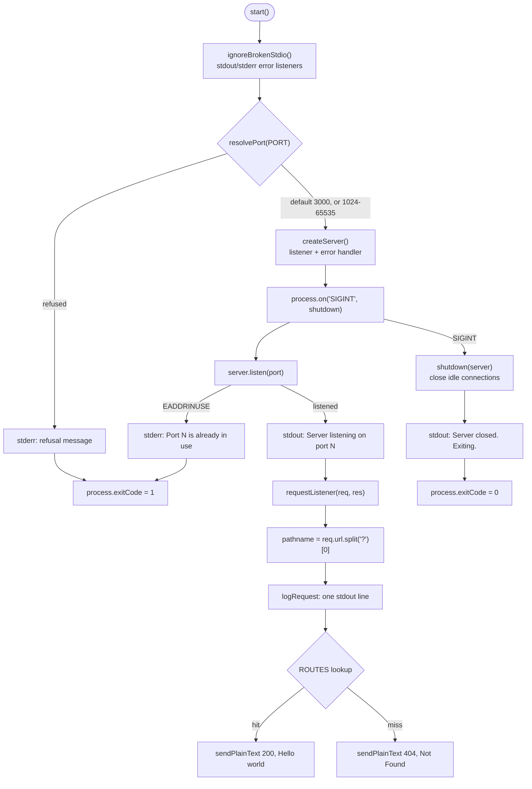

**Observed refinements to the documented behaviour.** Two details differ between the README's prose and what the delivered code does when exercised:

- The README describes the program as "about 150 lines" (`README.md` L14); the file is 176 lines.
- The README states that a byte outside printable ASCII in a logged method or path is rendered as a `\uXXXX` escape (`README.md` L192-212). `logRequest` does apply `escapeNonPrintable` to both tokens (`server.js` L43), but Node's HTTP parser rejects such a request line first: sending `0x01` in the method and in the target, or `0xFF` in the target, each returned `HTTP/1.1 400 Bad Request` with no request log line written, because the request never reached `requestListener`. The escaping is therefore reachable and observable in the `PORT` refusal messages — `PORT` set to `ab<0x01>c` produced `Invalid PORT value "ab\u0001c": must be an integer between 1024 and 65535.` — and stands as defence in depth in the log path.

### 1.2.3 Success Criteria

**Measurable objectives.** Each objective the repository sets for itself is paired with a threshold and the gate that decides it.

| Objective | Threshold | Gate |
|---|---|---|
| Serve the documented success contract | Status `200`, `Content-Type: text/plain`, body exactly 11 bytes | V2 |
| Serve the documented failure contract | Status `404`, `text/plain`, body exactly 9 bytes, no path echoed | V3, V4 |
| Log every request exactly once | One line per request, three tokens, timestamp matching `^\d{4}-\d{2}-\d{2}T\d{2}:\d{2}:\d{2}\.\d{3}Z$` | V5 |
| Shut down cleanly on `SIGINT` | Both shutdown lines printed, exit status `0`, no forced kill | V6 |
| Refuse invalid configuration before binding | Refusal on stderr, no startup line, exit status `1` | V11, V12 |
| Run with no install and no build | Three files at the root, no `node_modules`, no lockfile, `node --check` silent | V14, V16 |
| Answer promptly under concurrency | Five samples each below `0.010` s; 50 concurrent requests all `200` | V7, V8 |
| Hold memory steady under load | Third RSS reading within 10 MB of the second across two 5,000-request batches | V9 |

**Critical success factors.** Three properties decide whether the deliverable meets its purpose at all:

- **Code and prose must agree.** The README's literal expected output is the specification; a change to a body, a message or an exit status invalidates a gate. Nine of the thirteen commits exist to keep that agreement exact.
- **The dependency count must stay at zero.** Any added package would create the install step the deliverable exists to avoid, and would invalidate the three-file footprint gate (V16).
- **The `ROUTES` table must remain the only extension point.** Logging, response writing, configuration and shutdown must keep working untouched when an endpoint is added (`README.md` L23-24).

**Key performance indicators.** The figures below are the repository's gates measured on Node v22.23.4 in this environment; the README records its own separate measurements on Node 18-era runtime, which are of the same order.

| Indicator | Target | Measured |
|---|---|---|
| Success body size | 11 bytes, no trailing newline | 11 bytes |
| Failure body size | 9 bytes, no trailing newline | 9 bytes (`HEAD` delivers 0 body bytes, status and content type unchanged) |
| Loopback latency, warm | Each of five samples below 0.010 s | 0.000543-0.000775 s |
| Concurrency | 50 simultaneous requests, all `200` | 50 of 50 returned `200` |
| Memory stability | Third reading within 10 MB of the second | 48,888 → 58,592 → 59,592 KB (rise of 1,000 KB) |
| Request-log fidelity | One line per request | 2 request lines for 2 requests; 5 total lines including startup and two shutdown lines |
| Clean-shutdown exit status | `0` | `0` |
| Refusal exit status | `1` | `1` for each of eight invalid values, three privileged ports and one held port |

The repository defines no availability, throughput, error-budget or capacity indicator, and none should be inferred: the program has no persistence, no authentication and no rate limiting, so the figures above describe a tutorial's correctness, not a service's performance envelope.

## 1.3 Scope

The scope below is the boundary the repository itself draws. Every in-scope item is implemented in the three delivered files; every out-of-scope item is a deliberate, documented exclusion rather than unfinished work (`README.md` L637-644).

### 1.3.1 In-Scope: Core Features and Functionalities

**Must-have capabilities.** These are the capabilities whose absence would make the deliverable fail its own gates.

| Capability | Committed behaviour | Evidence |
|---|---|---|
| Success endpoint | `GET /hello` → `200 OK`, `Content-Type: text/plain`, body `Hello world`, 11 bytes | `server.js` L59-63, L70-72 |
| Catch-all failure endpoint | Every unmatched method and path → `404 Not Found`, body `Not Found`, 9 bytes, identical for every miss | `server.js` L66-68, L85-88 |
| Routing semantics | Exact, case-sensitive match on method and query-stripped path; no trailing-slash tolerance, no percent-decoding, no `HEAD`-as-`GET` | `server.js` L79-83; `README.md` L169-187 |
| Per-request logging | One stdout line per request, written before routing, three space-separated tokens | `server.js` L42-44, L81 |
| Port configuration | `PORT` read once at startup; default `3000`; range `1024`-`65535`; whitespace trimmed; digits only | `server.js` L15-39 |
| Configuration refusal | Four refusal conditions, each to stderr with exit status `1` and no bind | `server.js` L24-36, L103-114, L161-165 |
| Graceful shutdown | `SIGINT` closes idle connections, prints two lines, exits `0`; five-second failsafe forces the exit | `server.js` L117-153 |
| Self-contained footprint | Three files, 843 lines, one `require(`, no dependencies, no build, no lockfile | `package.json`; `server.js` L3 |
| Executable documentation | Sixteen manual verification gates with literal expected output | `README.md` L307-591 |

**Primary user workflows.** Each workflow is a sequence a reader or operator performs against the delivered files.

| Workflow | Steps | Expected result |
|---|---|---|
| W1 — Read the program | Open `server.js`; read it top to bottom | Each concern — routing, logging, configuration, shutdown — is visible in one named function |
| W2 — Start the server | `node server.js` or `npm start` | `Server listening on port 3000` on stdout, process stays in the foreground |
| W3 — Verify the success contract | `curl -si http://localhost:3000/hello` | `200 OK`, `text/plain`, body `Hello world` |
| W4 — Verify the failure contract | `curl -si http://localhost:3000/invalid`, or `POST`/`HEAD` to `/hello` | `404 Not Found`, body `Not Found`, or status only for `HEAD` |
| W5 — Observe logging | Read the server's stdout after W3 and W4 | Two lines, one per request, in arrival order |
| W6 — Stop the server | `CTRL+C`, or `kill -INT <pid>` | Both shutdown lines, exit status `0` |
| W7 — Retarget the port | `PORT=4000 node server.js`; then `PORT=abc` and `PORT=80` | Startup names 4000; the invalid values print a refusal on stderr and exit `1` |
| W8 — Extend the surface | Add one entry to `ROUTES` and one handler function | New endpoint works; logging, response writer, configuration and shutdown are untouched |

**Essential integrations.** Exactly three integrations are in scope; the program reaches no further.

| Integration | Requirement in scope | Evidence |
|---|---|---|
| Node.js runtime | 18.0.0 or later, with graceful degradation on 18.0.x through `typeof` guards | `package.json`; `server.js` L120-137 |
| HTTP/1.1 client | Any client able to issue a request; `curl` is the documented one | `README.md` L79-125 |
| POSIX shell | Environment-variable prefixing, job control and `$?` for scripted start, stop and gate checks | `README.md` L32-38 |

**Key technical requirements.** These are the invariant values the specification treats as binding.

| Requirement | Committed value | Evidence |
|---|---|---|
| Runtime floor | `>=18.0.0`, unchanged by design | `package.json`; `README.md` L650-654 |
| Port resolution | Default `3000`; accepted `1024`-`65535`; any other value refused before binding | `server.js` L5-7, L15-39 |
| Content type | Exactly `text/plain`, with no `charset` parameter, on every response | `server.js` L54 |
| Exit statuses | `0` for a clean `SIGINT`; `1` for invalid configuration, a privileged port or any bind failure; nothing else terminates the process | `server.js` L113, L151, L163; `README.md` L303-305 |
| Network binding | `server.listen(port)` with no host argument, so the bind covers every interface on plain HTTP | `server.js` L171; `README.md` L73-78 |
| Stream contract | Operational output on stdout; diagnostics on stderr | `server.js` L105-109, L162 |
| Dependency policy | No `dependencies`, no `devDependencies`, no `type` field | `package.json` |

### 1.3.2 In-Scope: Implementation Boundaries

**System boundaries.** The deliverable is bounded on every axis the specification cares about.

| Boundary | Inside | Outside |
|---|---|---|
| Code footprint | `server.js`, `package.json`, `README.md` at the repository root | Any test file, CI workflow, container file, linter or formatter configuration |
| Process model | One foreground Node.js process, started and stopped by the operator | Supervisors, process managers, daemons and clustering |
| Network surface | One TCP port, plain HTTP, bound on every interface because no host argument is passed | TLS termination, host binding, reverse proxies, multiple listeners |
| Data surface | Request method and query-stripped path for the log line; `PORT` read once at startup | Request bodies, query-string values, headers, cookies, files, databases and caches |

**User groups covered.** All users are anonymous and equal. The audience in scope is beginner Node.js developers reading a reference implementation, instructors and reviewers checking prose against behaviour, and developers diffing a design against a known-good baseline. No group is authenticated, distinguished or limited, because the program holds no account model, no session, no role and no permission (`README.md` L637-654).

**Geographic and market coverage.** The program is locale-neutral and jurisdiction-neutral: it contains no localization, no message catalogue, no currency or date-format configuration, and no compliance behaviour. Its only geographic fact is the clock — log timestamps are UTC ISO-8601 strings from `Date.prototype.toISOString()` (`server.js` L43) — while its network reach is any machine that can reach the host, since the bind covers every interface (`README.md` L73-78).

**Data domains included.** The two data domains in scope are both ephemeral and neither is persisted.

| Data domain | Handling | Retention |
|---|---|---|
| Request method and query-stripped path | Formatted into one stdout line, with characters outside printable ASCII escaped | Duration of the process's stdout only |
| `PORT` environment variable | Read once at startup, trimmed, validated, then used to bind | Process lifetime |

Nothing is written to disk, nothing is read from disk, and nothing survives a request or a process exit (`README.md` L637-654).

### 1.3.3 Out-of-Scope

**Explicitly excluded features and capabilities.** Each exclusion below is stated by the repository as a deliberate boundary.

| Excluded capability | Repository's stated position |
|---|---|
| Automated tests and test frameworks | The sixteen gates are the test suite: commands to run and compare, with no test file or test dependency in the repository |
| CI/CD, containers and orchestration | No workflow file, `Dockerfile` or compose file exists; the program runs with `node server.js` on the operator's machine |
| Deployment automation and process management | One foreground process, started and stopped by the operator |
| Persistence of any kind | No database, no cache, no file writes; nothing survives a request or an exit |
| Authentication, authorisation, sessions, cookies, CORS, CSRF, TLS | The endpoint is anonymous, read-only and plain HTTP |
| Rate limiting, quotas and request-size limits | No protected resource exists and there is no request body to limit |
| Additional endpoints | No health check, metrics route, favicon, static file route, redirect or API version prefix beyond `GET /hello` and the catch-all |
| Request-body and query-string parsing, content negotiation | The request stream is never read; the query string is only removed before comparison |
| Structured logging, log levels and log files | One line per request on stdout is the entire observability surface |
| `SIGTERM` and `SIGHUP` handling | `SIGINT` is the one signal handled, bounded by the five-second failsafe |
| TypeScript, build step, bundler, transpiler | `server.js` is the file that runs |
| Linter and formatter configuration | Style is kept consistent by hand; `node --check server.js` is the only static check |
| Environment variables other than `PORT` | No `HOST` variable; the server binds the port alone |
| A privileged-port override | The `1024` floor is the configuration; no second variable and no override exist |
| A raised `>=18.0.0` engine floor | The code is written to run at that floor |

**Future phase considerations.** The repository defines no roadmap, phase plan, milestone or backlog, and states that none of the exclusions above is a step a reader is expected to add (`README.md` L639-641). The single documented forward path is the `ROUTES` table in `server.js` (L70-72): a new endpoint is one table entry plus one handler function, and logging, the response writer, configuration and shutdown are unchanged (`README.md` L23-24). Any capability beyond that — tests, CI, TLS, authentication, persistence, rate limiting, structured logging, `SIGTERM` handling — would be a new project decision outside this specification, not an extension it anticipates.

**Integration points not covered.** No integration exists with an identity provider or SSO, a database or cache, a message broker or queue, a metrics, tracing or logging backend, a CI or CD pipeline, a container registry or orchestrator, a TLS terminator, a CDN or static host, or a reverse proxy. The delivered files contain no client for any of them, and no configuration surface exists through which one could be attached.

**Unsupported use cases.** The following uses are excluded by the boundaries above and would fail against this program:

- Serving production traffic of any kind, at any scale, with any availability expectation.
- Multi-tenant operation, user accounts, or any data gated behind a credential.
- Receiving or processing request bodies, including form posts, file uploads and JSON payloads.
- Storing, querying or retrieving any state across requests or restarts.
- Serving a browser UI, static assets, redirects, or versioned API paths.
- Health probing, metrics scraping, or feeding an observability pipeline.
- Terminating TLS, enforcing CORS or CSRF policy, or limiting request rate or size.
- Being pointed at a privileged port, or being reconfigured through anything other than `PORT`.

## 1.4 References

- `` (repository root) — the top-level folder: a single `README.md` in the `main` working tree, and the three-file deliverable (`README.md`, `package.json`, `server.js`) on branch `origin/blitzy-8a4de345-c459-434b-a545-c8cf76a5f502`
- `README.md` — established the tutorial framing and stated purpose (L3-25), prerequisites and integration surface (L26-52), the success, failure, method-mismatch and matching-semantics contracts (L79-191), the request-log format (L192-212), shutdown behaviour (L213-242), `PORT` configuration, refusals and exit statuses (L243-306), the sixteen verification gates V1-V16 (L307-591), troubleshooting (L593-636) and the scope and non-goals list (L637-654)
- `package.json` — established the manifest identity (`nodejs-tutorial-hello-world`, `1.0.0`, `main: server.js`), the `npm start` script, the `>=18.0.0` engine floor, the keywords, and the absence of `dependencies`, `devDependencies` and `type`
- `server.js` — established the implementation: constants and `escapeNonPrintable` (L5-12), `resolvePort` (L15-39), `logRequest` and `ignoreBrokenStdio` (L42-50), `sendPlainText` (L53-56), both handlers and the `ROUTES` table (L59-72), `requestListener` (L75-91), `createServer` and `onServerError` (L94-114), `shutdown` (L117-153) and `start` with its invocation (L156-176)
- `origin/blitzy-8a4de345-c459-434b-a545-c8cf76a5f502` — the 13-commit branch carrying the deliverable, whose tip is `10d5d2ce` and whose tree contains only `README.md`, `package.json` and `server.js`
- `main` (as `17c8b88`) — the initial commit by IrinaWulf containing only a 9-byte `README.md` whose content is `# IWNewGH`, establishing the placeholder state the deliverable replaced

No web sources were used; every statement in this section rests on the three delivered files, their git history, and the runtime behaviour reproduced from them on Node v22.23.4.

# 2. Product Requirements

## 2.1 Feature Catalog

The repository records no product-requirements document. Every feature below is a capability observed in the delivered files — `server.js` (176 lines), `package.json` (13 lines) and `README.md` (654 lines) on branch `origin/blitzy-8a4de345-c459-434b-a545-c8cf76a5f502` at tip `10d5d2ce` — and asserted by a named gate under the README's Verification section (`README.md` L307-591). The ten features are the complete functional surface: the whole program is two responses and one console line per request (`README.md` L20), plus the process behaviour that surrounds them.

| ID | Feature | Category | Priority |
|---|---|---|---|
| F-001 | Hello World Success Endpoint | HTTP Response Handling | Critical |
| F-002 | Exact-Match Route Dispatch | HTTP Response Handling | Critical |
| F-003 | Deterministic Catch-All Response | HTTP Response Handling | Critical |
| F-004 | Per-Request Logging | Observability | Critical |
| F-005 | Port Resolution and Validation | Configuration | Critical |
| F-006 | Startup Failure Reporting and Exit Statuses | Operational Error Handling | High |
| F-007 | Graceful SIGINT Shutdown | Process Lifecycle | High |
| F-008 | Broken-Pipe Tolerant Console Output | Console Reliability | Medium |
| F-009 | Dependency-Free, No-Build Footprint | Packaging and Footprint | High |
| F-010 | Documented Verification Gate Suite | Verification and Documentation | High |

All ten carry status **Completed**: each is implemented in the delivered `server.js` or `package.json`, each has at least one gate in `README.md`, and each was reproduced at runtime on Node v22.23.4 in this environment. The capability arrived across the branch's 13 commits, from `63152f0` (the `server.js` baseline) through `10d5d2ce` (the broken-pipe guard), and no feature is proposed, approved-but-unbuilt, or in development.

### 2.1.1 F-001 — Hello World Success Endpoint

| Attribute | Value |
|---|---|
| Feature ID | F-001 |
| Feature Name | Hello World Success Endpoint |
| Category / Priority / Status | HTTP Response Handling / Critical / Completed |
| Implementation | `handleHello` `server.js` L59-63; table entry `ROUTES['GET /hello']` L70-72; writer `sendPlainText` L53-56 |
| Primary gates | V2 (`README.md` L327-340), and V15 end-to-end (L553-555) |

**Overview.** A request for `GET /hello` is answered with status `200 OK`, header `Content-Type: text/plain`, and the fixed body `Hello world` — 11 bytes with no trailing newline. The handler ignores its `req` parameter deliberately, because the route key has already established the method and path, and the parameter is retained only so every entry in `ROUTES` shares one signature (`server.js` L60-61).

**Business Value.** This is the observable proof that the tutorial's program runs: one `curl http://localhost:3000/hello` distinguishes a working server from a broken one without reading the source (`README.md` L81-124). Its fixed 11-byte body turns a prose claim into an assertion a caller can measure (`curl -w '%{size_download}'` prints `200 text/plain 11`), which is what makes the surrounding documentation verifiable rather than aspirational (`README.md` L5).

**User Benefits.** A beginner sees the smallest complete request→response cycle in Node's `http` module — `writeHead` then `end`, with no framework in between. An instructor gets a stable expected output to compare against. A developer diffing a design against this baseline gets a pinned contract: `200`, exactly `text/plain` (no `charset` parameter), exactly 11 bytes.

**Technical Context.** `sendPlainText` is the only response writer in the program (`server.js` L52-56), so the content type is uniform across both outcomes. Headers the caller sees beyond `Content-Type` — `Date`, `Connection`, `Keep-Alive`, `Transfer-Encoding: chunked` — are added by the Node runtime and are explicitly outside the contract (`README.md` L188-190). The response is written synchronously from the request listener; no state is stored between requests.

| Dependency Type | Detail |
|---|---|
| Prerequisite features | F-002 (dispatch must resolve the route key before the handler runs); F-009 (the runtime must load with no install step) |
| System dependencies | Node.js `>=18.0.0` (`package.json` `engines.node`); `node:http` module (single `require(` at `server.js` L3) |
| External dependencies | An HTTP/1.1 client for the documented verification — `curl` (`README.md` L29) |
| Integration requirements | None. No database, identity provider, broker or external service is contacted; the request body and headers are never read |

### 2.1.2 F-002 — Exact-Match Route Dispatch

| Attribute | Value |
|---|---|
| Feature ID | F-002 |
| Feature Name | Exact-Match Route Dispatch |
| Category / Priority / Status | HTTP Response Handling / Critical / Completed |
| Implementation | `requestListener` `server.js` L75-91; `ROUTES` table L70-72 |
| Primary gates | Matching-semantics table (`README.md` L169-187), V4 (L357-363), V15 |

**Overview.** Routing is a single property lookup, `ROUTES[`${req.method} ${pathname}`]`, where `pathname` is `req.url.split('?')[0]` (`server.js` L79-83). The query string is cut, never parsed: the code comment records that `split` cannot throw on a malformed request target, so request data stays a plain method and path comparison and never reaches a parser (L76-78). Comparison is exact, case-sensitive, with no trailing-slash tolerance, no percent-decoding and no `HEAD`-as-`GET` substitution (`README.md` L173-182).

**Business Value.** The routing table is the repository's designated extension point: adding an endpoint is one table entry plus one handler function, and nothing else in the program changes — not the logging, the response writer, the configuration or the shutdown code (`README.md` L24). That keeps the tutorial extensible without a rewrite and gives the reader a pattern they can carry into any Node codebase.

**User Benefits.** A learner can predict every outcome from the request line alone, and can see the whole routing surface at a glance because it is a one-entry object literal. The absence of URL decoding means a percent-encoded path cannot be silently reinterpreted: `GET /hello%2F` is a 404, not a match (`README.md` L179).

**Technical Context.** Dispatch happens after logging (`server.js` L81), so a 404 is logged exactly like a 200. A missing key yields `undefined`, which the listener converts into the catch-all call rather than an exception (L85-88). Verified at runtime: `GET /hello` and `GET /hello?x=1` both return 200 and both log the path as `/hello`; `GET /hello/` returns 404.

| Dependency Type | Detail |
|---|---|
| Prerequisite features | F-009 (module loads with no dependencies); F-004 (runs inside the same listener, before dispatch) |
| System dependencies | Node.js `>=18.0.0`; `req.method` and `req.url` as supplied by the HTTP parser |
| External dependencies | None beyond the HTTP client issuing the request |
| Integration requirements | None; the only inputs are two strings from the request line |

### 2.1.3 F-003 — Deterministic Catch-All Response

| Attribute | Value |
|---|---|
| Feature ID | F-003 |
| Feature Name | Deterministic Catch-All Response |
| Category / Priority / Status | HTTP Response Handling / Critical / Completed |
| Implementation | `handleNotFound` `server.js` L66-68; fall-through L85-88 |
| Primary gates | V3 (`README.md` L342-355), V4 (L357-363) |

**Overview.** Every request that is not exactly `GET /hello` receives `404 Not Found`, `Content-Type: text/plain`, body `Not Found` — 9 bytes, no trailing newline. The same literal is returned for an unknown path, a wrong method, a trailing slash, a differing case, a percent-encoded path and a `HEAD` probe; there is no `405` and no path echo, error code, stack trace or runtime detail in the body (`README.md` L147, L161-167, L184).

**Business Value.** A single failure contract is a single thing to document, teach and assert: `curl -w` prints `404 text/plain 9` for every miss, so the tutorial needs one explanation instead of a taxonomy of errors. It also means the program cannot leak implementation detail through an error response.

**User Benefits.** A caller learns nothing about which check failed, which is the property the README states deliberately (`README.md` L186). A reader sees the catch-all expressed in one three-line function, sitting beside the success handler for comparison.

**Technical Context.** HTTP forbids a body on a `HEAD` response, so a `HEAD /hello` probe observes status `404` and `Content-Type: text/plain` with 0 bytes on the wire while the handler still writes the same literal (`README.md` L184; reproduced at runtime: `curl -I` returned `404` with `size_download=0`). Both handlers reach the wire through the same `sendPlainText` writer, which is why only the status line and the body differ between the 200 and 404 responses.

| Dependency Type | Detail |
|---|---|
| Prerequisite features | F-002 (the catch-all is reached only through dispatch's missing-key branch) |
| System dependencies | Node.js `>=18.0.0`; runtime suppression of response bodies for `HEAD` |
| External dependencies | None |
| Integration requirements | None; no logging backend, error tracker or alerting integration exists |

### 2.1.4 F-004 — Per-Request Logging

| Attribute | Value |
|---|---|
| Feature ID | F-004 |
| Feature Name | Per-Request Logging |
| Category / Priority / Status | Observability / Critical / Completed |
| Implementation | `logRequest` `server.js` L42-44; `escapeNonPrintable` L10-12; call site L81 |
| Primary gates | V5 (`README.md` L365-396), and the log assertions inside V1, V6, V8, V9 |

**Overview.** Every request writes exactly one line to stdout, before the request is routed, in the format `<ISO-8601 timestamp> <HTTP method> <pathname>` (`README.md` L192-209). The timestamp is `Date.prototype.toISOString()` — UTC with milliseconds and a `Z` suffix — the method is the method as received, and the third token is the query-stripped path, the same value the router matches on. A byte outside printable ASCII in either token is rendered as a `\uXXXX` escape by `escapeNonPrintable`, so the line always stays three tokens (`server.js` L43).

**Business Value.** Observability exists in the deliverable without a logging library, a level system or a log file — one line per request is the whole surface (`README.md` L649). Because the line is written before routing, a 404 is logged exactly like a 200, so the log reflects traffic rather than success.

**User Benefits.** A reader can watch a request arrive and correlate it with the response they just received in another terminal. A scripted run can count requests without a repository file: V5's counting block prints `2` request lines and `5` total lines for two requests (`README.md` L396).

**Technical Context.** The line is emitted with `console.log`, so it lands on stdout with the startup and shutdown lines, while diagnostics go to stderr (`README.md` L211). Verified at runtime: five requests produced five lines in arrival order, with `GET /hello?x=1` logged as `GET /hello`. The escaping is defence in depth in the log path, since Node's HTTP parser rejects a request line containing a control byte before it reaches the listener; the same escaper is observable in the `PORT` refusal messages (F-005).

| Dependency Type | Detail |
|---|---|
| Prerequisite features | F-002 (invoked from the listener before dispatch); F-008 (keeps a vanished reader from turning the write into an unhandled error) |
| System dependencies | Node.js `>=18.0.0`; `console.log`, `Date.prototype.toISOString`, `String.prototype.replace` |
| External dependencies | None; no log shipper, aggregator or storage is used |
| Integration requirements | stdout must be readable by the operator or a shell redirect — the documented gates redirect it with `mktemp` to keep the repository clean (`README.md` L378) |

### 2.1.5 F-005 — Port Resolution and Validation

| Attribute | Value |
|---|---|
| Feature ID | F-005 |
| Feature Name | Port Resolution and Validation |
| Category / Priority / Status | Configuration / Critical / Completed |
| Implementation | `resolvePort` `server.js` L15-39; constants L5-7; read once at `start` L159 |
| Primary gates | V10 (`README.md` L449-461), V11 (L463-481), V12 (L483-495) |

**Overview.** `PORT` is the single environment variable, read once at startup. Unset or blank resolves to the default `3000`; surrounding whitespace is trimmed, so `PORT=" 4000 "` binds 4000; only decimal digits are accepted; accepted range is `1024`-`65535`. Validation happens before `listen()`, so a refusal needs no root privileges and produces no permission error (`README.md` L267-301). Refusals take one of two forms: `Invalid PORT value "<value>": must be an integer between 1024 and 65535.` for a non-integer, `0`, or a value above 65535, and `Invalid PORT value "<value>": privileged ports 1-1023 are not permitted; choose a port between 1024 and 65535.` for a decimal integer below 1024 (`server.js` L24-36). Both write to stderr and exit `1` with no bind.

**Business Value.** Configuration fails fast and loudly instead of silently reinterpreting a value: `0x1F90` is not read as 8080, `1e3` is not read as 1000, `+3000` is not read as 3000, and `0` is treated as out of range rather than privileged (`README.md` L279). That precision is the lesson — external input is validated at the boundary before it becomes an operating-system call.

**User Benefits.** A learner can move the server off 3000 with one documented form, `PORT=4000 node server.js`, and gets an explicit message naming the offending value when the setting is wrong. There is no override variable for privileged ports and no `HOST` variable to confuse the picture (`README.md` L301, L653).

**Technical Context.** `resolvePort` returns a discriminated result — `{ ok: true, port }` or `{ ok: false, message }` (`server.js` L14, L38) — so the caller never inspects an error string to decide whether to proceed. The offending value is shown through `escapeNonPrintable`, so a control byte in `PORT` cannot break the message or the terminal (L22, commit `b7a0b94`). Verified at runtime: `abc`, `65536` and `0` produced the integer message on stderr with empty stdout and exit `1`; `80` produced the privileged message with exit `1`; `" 4000 "` bound 4000.

| Dependency Type | Detail |
|---|---|
| Prerequisite features | None; it runs first inside `start`, before any server object exists |
| System dependencies | Node.js `>=18.0.0`; `process.env.PORT`; `server.listen(port)` with no host argument (`server.js` L171) |
| External dependencies | A POSIX shell for the documented `PORT=… node server.js` form (`README.md` L256) |
| Integration requirements | The host must permit binding the chosen port; a privileged port is refused before the operating system is asked |

### 2.1.6 F-006 — Startup Failure Reporting and Exit Statuses

| Attribute | Value |
|---|---|
| Feature ID | F-006 |
| Feature Name | Startup Failure Reporting and Exit Statuses |
| Category / Priority / Status | Operational Error Handling / High / Completed |
| Implementation | `createServer` `server.js` L94-100; `onServerError` L103-114; refusal exit at L161-165 |
| Primary gates | V13 (`README.md` L497-522), V11/V12 exit statuses, and the exit-status statement at L303-305 |

**Overview.** One `error` handler is attached to the server and separates three situations: `EADDRINUSE` reports `Port <port> is already in use. Stop the process using it or set PORT to a free port.`; any other failure whose `syscall` is `listen` reports `Failed to start server: <error message>`; anything else reports `Server error while serving: <error message>` and returns without touching the exit status (`server.js` L104-111). The two listen failures set `process.exitCode = 1` (L113). The documented exit vocabulary is closed: `0` for a clean `SIGINT` shutdown and `1` for invalid configuration, a privileged port and any bind failure — nothing else terminates the process (`README.md` L305).

**Business Value.** A bind failure becomes one actionable stderr line and a status a script can branch on, instead of a stack trace and an unhandled `error` event. Because the post-bind branch returns before setting an exit status, a failure while serving is reported without claiming the process should stop — the distinction the README's gate V13 and commit `bc93b97` both record.

**User Benefits.** An operator who sees nothing on startup is told to read `$?` and then the stderr message, which names the cause (`README.md` L623-631). A CI or shell script can assert `exit=1` on a refusal and `exit=0` after `SIGINT`.

**Technical Context.** The handler receives the server's `error` event, so the runtime's own `error.port` and `error.message` are interpolated rather than re-derived (L105-109). Verified at runtime: a second server on a held port printed the port-in-use line and exited `1` with no stack trace, while `PORT=3001` started normally beside it (`README.md` L508-522). No other listen failure is gated, because inducing one depends on the host (L299).

| Dependency Type | Detail |
|---|---|
| Prerequisite features | F-005 (a refused port returns before any server exists, so the two refusal paths are exclusive); F-007 (shares the exit-status vocabulary) |
| System dependencies | Node.js `>=18.0.0`; `net.Server` `error` events and their `code`, `syscall`, `port` and `message` properties |
| External dependencies | None |
| Integration requirements | None; diagnostics go to stderr only (`README.md` L211) |

### 2.1.7 F-007 — Graceful SIGINT Shutdown

| Attribute | Value |
|---|---|
| Feature ID | F-007 |
| Feature Name | Graceful SIGINT Shutdown |
| Category / Priority / Status | Process Lifecycle / High / Completed |
| Implementation | `shutdown` `server.js` L117-153; registration L169 |
| Primary gates | V6 (`README.md` L398-413); shutdown lines asserted in V5 and V9 |

**Overview.** On `SIGINT` the program prints `Received SIGINT. Shutting down gracefully.`, closes idle connections, calls `server.close()`, and from its callback clears a five-second failsafe and prints `Server closed. Exiting.` before setting `process.exitCode = 0` (`server.js` L118-152). If a connection refuses to finish, the failsafe writes `Forcing shutdown after 5s.` and closes the remaining connections (L126-133).

**Business Value.** `CTRL+C` produces a documented, deterministic shutdown rather than a truncated process: the two lines are the evidence that the close completed, and the status is `0` so a scripted run can assert it (`README.md` L222, L239). The failsafe bounds the worst case at five seconds without changing the success path.

**User Benefits.** A reader learns three operational techniques in one function — signalling, connection draining, and a timer as a backstop. An operator can stop the server by `CTRL+C` or `kill -INT <pid>` and get the same two lines and the same status (`README.md` L227-237).

**Technical Context.** The success path deliberately does not call `process.exit()`: an early exit truncates pending stdout writes, and `Server closed. Exiting.` is itself the evidence of a clean shutdown (`server.js` L144-151). `closeIdleConnections()` and `closeAllConnections()` arrived in Node 18.2.0, above the declared `>=18.0.0` floor, so both calls are `typeof`-guarded and the failsafe still guarantees status `0` on 18.0.x (L120-137). Idle connections are closed because Node 18's `close()` keeps existing connections, so an idle keep-alive socket would hold the process open. `SIGTERM` and `SIGHUP` are deliberately unhandled (`README.md` L650). Verified at runtime: `kill -INT` produced both lines and exit status `0`.

| Dependency Type | Detail |
|---|---|
| Prerequisite features | F-006 (both paths share the exit-status vocabulary and the stderr/stdout split); F-008 (the failsafe's own write is guarded against a vanished reader) |
| System dependencies | Node.js `>=18.0.0`; `process.on('SIGINT')`, `server.close`, optional `closeIdleConnections`/`closeAllConnections`, `setTimeout` |
| External dependencies | A shell or terminal that can deliver `SIGINT` to the server's pid only (`README.md` L396) |
| Integration requirements | None; no process manager, supervisor or orchestrator is involved (`README.md` L643) |

### 2.1.8 F-008 — Broken-Pipe Tolerant Console Output

| Attribute | Value |
|---|---|
| Feature ID | F-008 |
| Feature Name | Broken-Pipe Tolerant Console Output |
| Category / Priority / Status | Console Reliability / Medium / Completed |
| Implementation | `ignoreBrokenStdio` `server.js` L46-50, called first in `start` L157; guarded failsafe write L127-128 |
| Primary gates | None named; verified through V5's and V6's redirected runs, where the log file or reader can go away |

**Overview.** Registering an inert `error` listener on `process.stdout` and `process.stderr` as the first thing `start()` does keeps a write to a consumer that has exited from becoming an unhandled `error` event. Before this, four of the program's five stdout writes — the request line, both shutdown lines and the startup line — died with an `EPIPE` stack trace and exit status `1`, so a clean `SIGINT` reported a failure and the documented output was replaced by a trace (commit `10d5d2ce`). The handler is deliberately inert: it writes nothing, sets no exit status and calls no `process.exit`, so the documented statuses and every log literal, stream and ordering are unchanged.

**Business Value.** The documentation's own contract — exit `0` on a clean `SIGINT`, with both shutdown lines printed — holds even when the reader of those lines has gone away, which is the normal case in the scripted runs V5, V6 and V9 prescribe. It protects the deliverable's credibility at exactly the point a tutorial is most often run: piped into a counting filter.

**User Benefits.** A learner who pipes the server's output, closes a terminal, or redirects to a file that is later removed sees the documented behaviour instead of an `EPIPE` trace they would have to explain.

**Technical Context.** The guard is installed before `resolvePort`, so even a refusal message is protected (L157-159), and it is expressed as one two-line function with no branches (L47-50). The failsafe's own write was already defended with a `once('error')` handler that exits `0`, and that path is left as it was (L127-128).

| Dependency Type | Detail |
|---|---|
| Prerequisite features | None; it is the first statement of `start` |
| System dependencies | Node.js `>=18.0.0`; `process.stdout`/`process.stderr` as streams with `on('error')` |
| External dependencies | None |
| Integration requirements | Any shell redirection or pipeline the operator chooses; the program assumes nothing about the consumer |

### 2.1.9 F-009 — Dependency-Free, No-Build Footprint

| Attribute | Value |
|---|---|
| Feature ID | F-009 |
| Feature Name | Dependency-Free, No-Build Footprint |
| Category / Priority / Status | Packaging and Footprint / High / Completed |
| Implementation | `package.json` (13 lines); single `require(` at `server.js` L3 |
| Primary gates | V14 (`README.md` L524-551), V16 (L557-591), and the installation statement at L41-51 |

**Overview.** The deliverable is three files at the repository root. `package.json` declares `name` `nodejs-tutorial-hello-world`, `version` `1.0.0`, `description`, `main` `server.js`, `scripts.start` `node server.js`, `engines.node` `>=18.0.0` and five keywords — and no `dependencies`, no `devDependencies`, no `type`, no repository, licence or author field. The program makes exactly one `require(` call, and it names `node:http` (`server.js` L3).

**Business Value.** There is no install step, no build step, no lockfile and no `node_modules`, so the tutorial has no supply-chain surface, no version-resolution drift and no setup failure mode: copy the three files and run them (`README.md` L45-51). The declared engine floor is the only environmental precondition.

**User Benefits.** A beginner reaches a working server with one command and no dependency resolution. A reviewer can validate the whole artifact from a shell: `node --check server.js` prints nothing, `find . -maxdepth 1 -type f` lists exactly `README.md`, `package.json` and `server.js`, and `grep -c "require(" server.js` prints `1` (`README.md` L559-591).

**Technical Context.** The single import means the reader sees Node's HTTP primitives — `createServer`, `writeHead`, `end`, `listen`, `close` — directly rather than through a wrapper (`README.md` L9-13). `npm start` and `node server.js` are the same program, because `scripts.start` is exactly that command. Verified: `node --check server.js` was silent, and enumeration of every blob in the repository's history found only `README.md`, `package.json` and `server.js` beyond the 9-byte placeholder.

| Dependency Type | Detail |
|---|---|
| Prerequisite features | None; it is the precondition for F-001 through F-008 being runnable at all |
| System dependencies | Node.js `>=18.0.0` only. No framework, middleware, routing library or third-party package (`README.md` L9) |
| External dependencies | `npm` (optional, only for the `npm start` form and the `npm pkg get` check); `curl` for the request gates |
| Integration requirements | None; there is no registry, package manager state or build pipeline in the footprint |

### 2.1.10 F-010 — Documented Verification Gate Suite

| Attribute | Value |
|---|---|
| Feature ID | F-010 |
| Feature Name | Documented Verification Gate Suite |
| Category / Priority / Status | Verification and Documentation / High / Completed |
| Implementation | `README.md` Verification section L307-591 (V1-V16); Troubleshooting L593-636; Scope and non-goals L637-654 |
| Primary gates | V15 — following the README on a clean machine reproduces every documented output (`README.md` L553-555) |

**Overview.** Sixteen named gates prove the behaviour the README documents, each a command with literal expected output. Thirteen are exact-match checks (V1-V6, V10-V16) and three are host measurements (V7 latency, V8 concurrency, V9 memory). The gates are the repository's test suite: there is no test file and no test dependency (`README.md` L641).

**Business Value.** The prose cannot drift from the code without a gate failing, and nine of the branch's thirteen commits exist to keep that agreement exact (for example `4dba479` made the gates runnable as written and `8be576f` corrected the `HEAD` semantics they describe). For a teaching artifact, that coupling between claim and behaviour is the product.

**User Benefits.** A reviewer can verify the whole program without reading the source, and an instructor can hand the gates to students as exercises. A learner gets a literal output to compare against when their own build misbehaves, plus the Troubleshooting section that maps each message to a fix (`README.md` L593-636).

**Technical Context.** The gates are documented, not automated: they rely on the operator's shell for job control, `$?` and backgrounding (`README.md` L39). V15 states the documentation coverage requirement — purpose, prerequisites, installation, execution, testing, expected output, shutdown and `PORT` configuration — which is the README's own completeness criterion.

| Dependency Type | Detail |
|---|---|
| Prerequisite features | F-001 through F-009 — each gate asserts one of their contracts; F-009's footprint is asserted by V14 and V16 |
| System dependencies | Node.js `>=18.0.0`, `curl`, a POSIX shell; `seq` and `ps` for V7-V9 only (`README.md` L39) |
| External dependencies | None; no CI service, test runner or assertion library is involved |
| Integration requirements | The gates need free port `3000` for the self-starting checks and must be run from the repository root (`README.md` L309-311) |


## 2.2 Functional Requirements Table

Each requirement below carries an identifier of the form `F-XXX-RQ-YYY`, where `F-XXX` is the owning feature from Section 2.1 and `YYY` is a sequence number within it. Acceptance criteria cite the README gate that decides them and the source line that implements them, so a requirement is verified either by a literal string comparison (`README.md` L307-591) or by reading a named function.

| Convention | Rule |
|---|---|
| Priority scale | `Must-Have` — its absence breaks a delivered contract or a gate; `Should-Have` — its absence degrades a documented guarantee or the extension point; `Could-Have` — maintainability only, with no observable contract |
| Complexity scale | `High`, `Medium`, `Low`, assigned from what the requirement touches: cross-cutting process behaviour is `High`, guarded or version-dependent code is `Medium`, a single literal comparison is `Low` |
| Version tracking | Baseline `r1`, aligned to branch tip `10d5d2ce`. Gate numbers V1-V16 are the acceptance-criteria reference and move only with the code; a change to a body, message or exit status invalidates the gate that asserts it |
| Compliance scope | No requirement carries a compliance obligation. The program has no authentication, no personal data, no persistence and no regulated behaviour; its exclusions are stated in `README.md` L637-654 |
| Traceability | Every requirement maps to exactly one feature (Section 2.1) and at least one gate or source location; the consolidated matrix is in Section 2.3.4 |

### 2.2.2 Response Requirements — F-001, F-002, F-003

#### F-001 — Hello World Success Endpoint

| Requirement ID | Description | Acceptance criteria | Priority |
|---|---|---|---|
| F-001-RQ-001 | `GET /hello` responds `200 OK` with body `Hello world` | V2 returns status `200` and the literal body (`README.md` L327-340); implemented `server.js` L59-63, L70-72 | Must-Have |
| F-001-RQ-002 | The response carries `Content-Type: text/plain` with no `charset` parameter | V2 prints `text/plain` and the header shows no `; charset=` (`README.md` L340); `server.js` L54 | Must-Have |
| F-001-RQ-003 | The success body is exactly 11 bytes with no trailing newline | V2's one-line check prints `200 text/plain 11` (`README.md` L337) | Must-Have |
| F-001-RQ-004 | Both handlers write through the single `sendPlainText` writer, so content type is uniform | No `writeHead` call exists outside `sendPlainText` (`server.js` L53-56, L62, L67) | Should-Have |
| F-001-RQ-005 | Handlers share one `(req, res)` signature even though `req` is unread | Comment at `server.js` L60-61 states the reason; no handler reads the request stream | Could-Have |

| Requirement ID | Input parameters and response | Performance criteria | Data requirements |
|---|---|---|---|
| F-001-RQ-001 | Input: method `GET`, pathname `/hello` → response status `200`, body `Hello world` | Client-side warm loopback samples each below `0.010` s (V7, `README.md` L415-424); measured 0.000543-0.000775 s | None retained; the body is a string literal, not read from disk, memory store or network |
| F-001-RQ-002 | Output header written by `res.writeHead(statusCode, { 'Content-Type': 'text/plain' })` | Header emitted on every response, both paths | No charset, no encoding negotiation; the literal is ASCII |
| F-001-RQ-003 | Body written by `res.end(body)` with no newline appended | Body size is fixed, so payload cost is constant per request | 11 bytes, no file or template source |
| F-001-RQ-004 | One writer for status and body | No measurable effect; it removes a second code path | None |
| F-001-RQ-005 | `req` accepted and ignored | None | None |

| Requirement ID | Business rules | Data validation and security | Complexity |
|---|---|---|---|
| F-001-RQ-001 | The route succeeds only when method and pathname match the table key exactly (F-002) | No request input reaches the body; the response is a constant | Low |
| F-001-RQ-002 | The content type is part of the contract, not a runtime default | Prevents content sniffing by keeping the declared type explicit and parameter-free | Low |
| F-001-RQ-003 | A byte-count assertion is the contract, so prose drift is detectable | No user-supplied data in the body | Low |
| F-001-RQ-004 | All responses must be produced by the one writer | Single sink for response headers, so no path can add headers | Low |
| F-001-RQ-005 | Handler uniformity is a reading aid for the tutorial's audience | None | Low |

#### F-002 — Exact-Match Route Dispatch

| Requirement ID | Description | Acceptance criteria | Priority |
|---|---|---|---|
| F-002-RQ-001 | The query string is removed before comparison, so `GET /hello?anything=1` matches | Matching table row `GET /hello?anything=1` → `200` (`README.md` L176); `server.js` L79 | Must-Have |
| F-002-RQ-002 | Method and path compare exactly: case-sensitive, no trailing-slash tolerance, no percent-decoding, `HEAD` not treated as `GET` | Matching table (`README.md` L173-182); `server.js` L83 | Must-Have |
| F-002-RQ-003 | Dispatch is one property lookup on `` `${req.method} ${pathname}` ``; a missing key falls through to the catch-all | Unknown route reaches `handleNotFound` (`server.js` L83-88); V3 | Must-Have |
| F-002-RQ-004 | Adding an endpoint changes only the `ROUTES` table plus one handler | Nothing else in `server.js` references the table; README states the extension contract (`README.md` L24) | Should-Have |
| F-002-RQ-005 | The request target is never passed to a URL parser | `split('?')[0]` only; rationale in the comment at `server.js` L76-78 | Should-Have |

| Requirement ID | Input parameters and response | Performance criteria | Data requirements |
|---|---|---|---|
| F-002-RQ-001 | Input: `req.url` → output: `pathname` string without the `?` suffix | One `split` per request; included in the sub-10 ms loopback budget (V7) | The query string is discarded, never stored or logged |
| F-002-RQ-002 | Input: `req.method` plus `pathname` → route key | One string comparison class; constant per request | Both tokens reduced to strings for the log line (F-004) |
| F-002-RQ-003 | Output: handler reference or `undefined` | Object property lookup, constant time | No route registry beyond the literal object |
| F-002-RQ-004 | N/A — structural constraint | A 50-request burst is accepted together rather than serialised (V8, `README.md` L426-432) | No dynamic route state |
| F-002-RQ-005 | Input: any request target, including malformed ones | `split` cannot throw, so no request can raise inside routing | Request data stays a plain string comparison |

| Requirement ID | Business rules | Data validation and security | Complexity |
|---|---|---|---|
| F-002-RQ-001 | The logged path and the matched path are the same value | Removes a class of mismatch between what is logged and what is routed | Low |
| F-002-RQ-002 | A near-miss is a 404, never an implicit match | No path normalisation, so no traversal-style reinterpretation of the target | Low |
| F-002-RQ-003 | One missing key means the catch-all, never an exception | Fail-closed dispatch: an unmatched request cannot reach a handler | Low |
| F-002-RQ-004 | The table is the only extension point | New endpoints inherit logging, writer, configuration and shutdown unchanged | Low |
| F-002-RQ-005 | Avoid parsing where a cut suffices | Eliminates parser failure modes on attacker-controlled request targets | Low |

#### F-003 — Deterministic Catch-All Response

| Requirement ID | Description | Acceptance criteria | Priority |
|---|---|---|---|
| F-003-RQ-001 | Every unmatched method and path responds `404 Not Found`, `text/plain`, body `Not Found` (9 bytes) | V3 prints `404 text/plain 9` (`README.md` L342-355); `server.js` L66-68, L85-88 | Must-Have |
| F-003-RQ-002 | The response is identical for every miss, with no path echo, error code, stack trace or runtime detail | V3's stated exclusions (`README.md` L355, L186) | Must-Have |
| F-003-RQ-003 | A wrong method is the catch-all, neither `405` nor `200` | V4 (`README.md` L357-363), reproduced with `POST /hello` → `404` | Must-Have |
| F-003-RQ-004 | A `HEAD` probe observes `404` and `Content-Type` with no body on the wire | `README.md` L184; reproduced: `curl -I` returned `404` with 0 body bytes | Must-Have |

| Requirement ID | Input parameters and response | Performance criteria | Data requirements |
|---|---|---|---|
| F-003-RQ-001 | Input: any request whose key is absent from `ROUTES` → status `404`, body `Not Found` | Same constant-time dispatch as a hit; no I/O on the miss path | Fixed 9-byte literal; no request-derived content stored |
| F-003-RQ-002 | Output: one literal, independent of what was requested | Response size constant regardless of target length, so a long path yields no amplification | The requested path is never written into the body |
| F-003-RQ-003 | Input: any method other than `GET` on `/hello` → `404` | Constant | None |
| F-003-RQ-004 | Input: `HEAD /hello` → status `404`, 0 body bytes | Runtime suppresses the body; the handler still calls `end` | None |

| Requirement ID | Business rules | Data validation and security | Complexity |
|---|---|---|---|
| F-003-RQ-001 | No unmatched request may reach a handler | Default-deny: the absence of a key is the only path to the catch-all | Low |
| F-003-RQ-002 | The failure response reveals nothing about which check failed | No disclosure of routes, internals or stack traces | Low |
| F-003-RQ-003 | Method mismatch is not distinguished from path mismatch | Uniform response removes a method-enumeration signal | Low |
| F-003-RQ-004 | The contract is status plus content type for `HEAD` | Runtime behaviour, not program behaviour, suppresses the body | Low |

### 2.2.3 Observability Requirements — F-004

| Requirement ID | Description | Acceptance criteria | Priority |
|---|---|---|---|
| F-004-RQ-001 | Every request writes exactly one line to stdout | V5 yields two lines for two requests and `wc -l` yields 5 including startup and shutdown (`README.md` L365-396) | Must-Have |
| F-004-RQ-002 | The line is written before routing, so a 404 is logged like a 200 | Call order `logRequest` then lookup (`server.js` L81-83); V5 logs the `/invalid` request (`README.md` L370-374) | Must-Have |
| F-004-RQ-003 | The line has three space-separated tokens: ISO-8601 UTC timestamp, method, pathname | V5 asserts the timestamp pattern `^\d{4}-\d{2}-\d{2}T\d{2}:\d{2}:\d{2}\.\d{3}Z$` (`README.md` L207, L374) | Must-Have |
| F-004-RQ-004 | A byte outside printable ASCII in method or pathname is rendered as `\uXXXX`, keeping the line at three tokens | `escapeNonPrintable` applied to both tokens (`server.js` L43, L10-12); rule stated `README.md` L208-209 | Should-Have |
| F-004-RQ-005 | The third token is the query-stripped path, matching what the router matched on | `GET /hello?x=1` logs `GET /hello` (`README.md` L209); reproduced at runtime | Must-Have |
| F-004-RQ-006 | Operational output goes to stdout; diagnostics go to stderr | Startup and shutdown lines via `console.log`; refusals and errors via `console.error` (`server.js` L105-109, L162, L172); stated `README.md` L211 | Must-Have |

| Requirement ID | Input parameters and response | Performance criteria | Data requirements |
|---|---|---|---|
| F-004-RQ-001 | Input: method and pathname → output: one stdout line | One write per request; 10,000 requests were each logged one line (V9, `README.md` L447) | Nothing retained per request; no log file, buffer or rotation |
| F-004-RQ-002 | Same inputs; ordering guarantee is before the route lookup | Line appears even for a request that fails | None |
| F-004-RQ-003 | Timestamp from `Date.prototype.toISOString()` | Timestamp generation and one template literal per request | UTC only; no locale, timezone or format configuration |
| F-004-RQ-004 | Input: any method or pathname string → escaped token | Adds one regex replace over the two tokens | Escaping applies to the two request-derived tokens only |
| F-004-RQ-005 | Input: `req.url` before the cut is applied at L79 | Same value the router uses | Query values are neither logged nor stored |
| F-004-RQ-006 | Stream chosen per message class | No measurable effect | Two streams, no third destination |

| Requirement ID | Business rules | Data validation and security | Complexity |
|---|---|---|---|
| F-004-RQ-001 | One line per request, never zero and never two | The log is the only observability surface, so its cardinality is the contract | Low |
| F-004-RQ-002 | Logging precedes routing | Failures remain visible in the audit trail | Low |
| F-004-RQ-003 | Exactly three tokens, no literal brackets | Client-supplied content cannot inject additional tokens once escaped | Low |
| F-004-RQ-004 | No raw control byte may reach the stream | Prevents log-line forgery and terminal escape injection | Low |
| F-004-RQ-005 | Logged path equals routed path | Log and behaviour cannot disagree about which path was tested | Low |
| F-004-RQ-006 | Streams are separated by purpose | Operational output and diagnostics can be separated without prefix parsing | Low |

### 2.2.4 Configuration and Startup Requirements — F-005, F-006

#### F-005 — Port Resolution and Validation

| Requirement ID | Description | Acceptance criteria | Priority |
|---|---|---|---|
| F-005-RQ-001 | Unset or blank `PORT` resolves to the default `3000` | V1 prints `Server listening on port 3000` with empty stderr (`README.md` L313-325); `server.js` L16-18 | Must-Have |
| F-005-RQ-002 | A supplied `PORT` overrides the default and the startup line names the resolved port | V10 (`PORT=4000` → `Server listening on port 4000`, `README.md` L449-461); `server.js` L171-173 | Must-Have |
| F-005-RQ-003 | Surrounding whitespace is trimmed before validation | `PORT=" 4000 "` binds 4000 (reproduced; `server.js` L20) | Must-Have |
| F-005-RQ-004 | Only decimal digits are accepted; `abc`, `3000.5`, `-1`, `0x1F90`, `1e3`, `+3000` are refused with the integer message | V11 (`README.md` L463-481); `server.js` L24-26 | Must-Have |
| F-005-RQ-005 | A decimal integer below `1024` is refused with the privileged-port message, before any bind and without root | V12 with `80`, `1`, `1023` (`README.md` L483-495); `server.js` L30-32 | Must-Have |
| F-005-RQ-006 | `0` and values above `65535` are refused with the integer message, `0` treated as out of range rather than privileged | V11 covers `0` and `65536` (`README.md` L273-279); `server.js` L34-36 | Must-Have |
| F-005-RQ-007 | Every refusal writes to stderr, prints no startup line, exits `1` and leaves nothing listening | V11 and V12 print `exit=1` and no startup line (`README.md` L475-481, L495) | Must-Have |
| F-005-RQ-008 | The offending value appears in the message with non-printable bytes escaped | `escapeNonPrintable` applied at `server.js` L22; refusal quote shown in V11 | Should-Have |
| F-005-RQ-009 | `PORT` is the only environment variable; it is read once at startup and no `HOST` variable exists | Read once at `server.js` L159; `README.md` L245, L653 | Must-Have |

| Requirement ID | Input parameters and response | Performance criteria | Data requirements |
|---|---|---|---|
| F-005-RQ-001 | Input: `process.env.PORT` undefined or `''` → `{ ok: true, port: 3000 }` | Resolved before `listen()`, so no retry or fallback bind occurs | No configuration file, no persisted default |
| F-005-RQ-002 | Input: valid integer in range → `{ ok: true, port }` used by `server.listen(port)` with no host argument | Startup line emitted from the listen callback, i.e. after the bind (`server.js` L171-173) | The resolved port is echoed once |
| F-005-RQ-003 | Input: `" 4000 "` → `4000` | Trim before the digit test, so no second parse | None |
| F-005-RQ-004 | Input: non-digit string → `{ ok: false, message }` | Refusal path terminates before creating a server | No coercion, no base detection, no exponent handling |
| F-005-RQ-005 | Input: `1`-`1023` → privileged message | No bind attempted, so no permission error and no root needed (`README.md` L301) | None |
| F-005-RQ-006 | Input: `0` or `> 65535` → integer message | No bind attempted | None |
| F-005-RQ-007 | Output: stderr line, exit status `1`, empty stdout | Process exits promptly without binding | None |
| F-005-RQ-008 | Input: raw value → escaped value in the message | One regex replace on the refusal path only | The raw value is never logged elsewhere |
| F-005-RQ-009 | Input: environment → one read at `start()` | No re-read while serving; changing `PORT` after start has no effect | Configuration is the process environment only |

| Requirement ID | Business rules | Data validation and security | Complexity |
|---|---|---|---|
| F-005-RQ-001 | Absence of configuration is valid configuration | Default chosen so a first run needs no setup | Low |
| F-005-RQ-002 | The startup line reports the resolved port, not the default | Confirms the effective configuration to the operator | Low |
| F-005-RQ-003 | Whitespace is not part of the value | Prevents a trailing space from turning a valid port into a refusal | Low |
| F-005-RQ-004 | A value must be canonical decimal digits to be accepted | Rejects ambiguous notations rather than guessing their intent | Low |
| F-005-RQ-005 | Privileged ports are a configuration error, not a permission matter | Removes any need for elevated privileges to run the tutorial | Low |
| F-005-RQ-006 | `0` is out of range | Prevents an ephemeral-port bind from silently contradicting the startup line | Low |
| F-005-RQ-007 | A refusal never binds | No half-started state; exit status is the machine-readable signal | Low |
| F-005-RQ-008 | Untrusted text is escaped before it is displayed | Refusal output cannot carry control sequences | Low |
| F-005-RQ-009 | One variable, read once | No configuration surface to audit beyond a single name | Low |

#### F-006 — Startup Failure Reporting and Exit Statuses

| Requirement ID | Description | Acceptance criteria | Priority |
|---|---|---|---|
| F-006-RQ-001 | A held port reports `Port <port> is already in use. Stop the process using it or set PORT to a free port.` on stderr and exits `1` | V13 (`README.md` L497-522); `server.js` L104-105, L113 | Must-Have |
| F-006-RQ-002 | Any other listen failure reports `Failed to start server: <error message>` and exits `1` | Message literal `server.js` L106-107; documented `README.md` L293-299 | Should-Have |
| F-006-RQ-003 | A post-bind error is reported as `Server error while serving: <error message>` without changing the exit status | `return` before the exit assignment (`server.js` L108-111), fixed by commit `bc93b97` | Should-Have |
| F-006-RQ-004 | The exit vocabulary is closed: `0` for a clean `SIGINT`, `1` for invalid configuration, a privileged port and any bind failure | `README.md` L303-305; assignments at `server.js` L113, L151, L163 | Must-Have |
| F-006-RQ-005 | No failure path produces a stack trace or an unhandled `error` event | V13 states both exclusions (`README.md` L514); the `error` listener is attached in `createServer` (`server.js` L97) | Must-Have |
| F-006-RQ-006 | Diagnostics are written to stderr while operational lines stay on stdout | `console.error` at L105-109 and L162 versus `console.log` at L118, L142, L172; `README.md` L211 | Must-Have |

| Requirement ID | Input parameters and response | Performance criteria | Data requirements |
|---|---|---|---|
| F-006-RQ-001 | Input: error with `code === 'EADDRINUSE'` → stderr line naming `error.port`, exit `1` | Reported as soon as the listen error event fires | Uses the runtime's `error.port` rather than re-deriving it |
| F-006-RQ-002 | Input: error with `syscall === 'listen'` and another code → stderr line with `error.message`, exit `1` | No retry, no backoff; the process ends | Runtime message passed through verbatim |
| F-006-RQ-003 | Input: error after binding → stderr line, exit status untouched | Serving failures do not terminate the process from this handler | None |
| F-006-RQ-004 | Output: process exit status | Status observable with `$?` immediately after the command | No exit code beyond 0 and 1 is produced by the program |
| F-006-RQ-005 | Input: any `error` event on the server | One handler, three branches, no unhandled event | None |
| F-006-RQ-006 | Stream chosen per message class | None | Diagnostics only on stderr |

| Requirement ID | Business rules | Data validation and security | Complexity |
|---|---|---|---|
| F-006-RQ-001 | A held port is an operator-fixable condition and the message says how to fix it | No process, pid or path detail beyond the port number is disclosed | Low |
| F-006-RQ-002 | Non-`EADDRINUSE` listen failures stay distinguishable | The runtime's own wording names the cause to act on | Low |
| F-006-RQ-003 | A serving error does not change the exit contract | Exit status cannot be rewritten after successful startup | Low |
| F-006-RQ-004 | Only two statuses exist, and nothing else terminates the process | Scripts can branch on status alone | Low |
| F-006-RQ-005 | Errors are handled where they are raised | No unhandled rejection or event can replace a message with a trace | Low |
| F-006-RQ-006 | Two streams, no prefixes | Operational and diagnostic output can be filtered separately | Low |

### 2.2.5 Lifecycle, Resilience and Footprint Requirements — F-007, F-008, F-009

#### F-007 — Graceful SIGINT Shutdown

| Requirement ID | Description | Acceptance criteria | Priority |
|---|---|---|---|
| F-007-RQ-001 | `SIGINT` prints `Received SIGINT. Shutting down gracefully.`, closes idle connections and closes the server | V6 shows both shutdown lines and `exit=0` (`README.md` L398-413); `server.js` L118, L135-139 | Must-Have |
| F-007-RQ-002 | When the close callback runs, the failsafe is cleared, `Server closed. Exiting.` is printed and `process.exitCode` becomes `0` | `server.js` L139-152; V6 (`README.md` L404-411) | Must-Have |
| F-007-RQ-003 | If a connection does not finish within five seconds, the failsafe prints `Forcing shutdown after 5s.`, closes remaining connections and exits `0` | `server.js` L126-133; documented `README.md` L241 | Should-Have |
| F-007-RQ-004 | The success path does not call `process.exit()`, so pending stdout writes are not truncated | Rationale comment `server.js` L144-151; `README.md` L239 | Must-Have |
| F-007-RQ-005 | Graceful degradation on Node 18.0.x: both connection-closing calls are `typeof`-guarded | `server.js` L120-137; `README.md` L28 | Must-Have |
| F-007-RQ-006 | `SIGTERM` and `SIGHUP` are deliberately not handled; `SIGINT` is the one signal | `README.md` L650; the only registration is `server.js` L169 | Should-Have |
| F-007-RQ-007 | Both shutdown lines appear once each, in order, with the startup line first | V5's count of 5 lines and V6's ordered output (`README.md` L396, L406-411) | Must-Have |

| Requirement ID | Input parameters and response | Performance criteria | Data requirements |
|---|---|---|---|
| F-007-RQ-001 | Input: `SIGINT` to the process → stdout line, idle connections closed, `server.close()` called | Closure reported as soon as the callback fires for an idle server | No connection registry maintained by the program |
| F-007-RQ-002 | Output: second stdout line, exit status `0` | Normal path completes in the same event-loop turn as the close callback | None |
| F-007-RQ-003 | Input: open connection beyond five seconds → forced-close line and exit `0` | Bounded worst case: 5,000 ms | None |
| F-007-RQ-004 | Output: natural process end | Lets the pending write reach stdout before exit | The second line is the evidence of a clean shutdown |
| F-007-RQ-005 | Input: runtime without `closeIdleConnections`/`closeAllConnections` | Failsafe still guarantees status `0` at the declared floor | None |
| F-007-RQ-006 | Input: `SIGTERM`/`SIGHUP` → default disposition | Not intercepted, so no documented output or status is promised | None |
| F-007-RQ-007 | Output ordering: startup, then both shutdown lines | Exactly one instance of each line | None |

| Requirement ID | Business rules | Data validation and security | Complexity |
|---|---|---|---|
| F-007-RQ-001 | Signalling the server process is the documented stop mechanism | Only the server process handles the signal, so a pipeline's filters still die by default (`README.md` L396) | Low |
| F-007-RQ-002 | Clean shutdown is proven by output, not by a forced exit | Exit status is set, not forced, so it cannot race the write | Low |
| F-007-RQ-003 | Shutdown is bounded in time | A stuck connection cannot hold the process open indefinitely | Medium |
| F-007-RQ-004 | `process.exit()` must not appear on the success path | Truncation would remove the documentation's own evidence line | Low |
| F-007-RQ-005 | The declared engine floor must remain sufficient | Version checks are runtime feature detection rather than floor arithmetic | Medium |
| F-007-RQ-006 | Shutdown scope is one signal | Narrow, documented signal surface; no unhandled-signal ambiguity | Low |
| F-007-RQ-007 | Line count is a contractual observation | Counting is how V5 decides that logging and shutdown are both intact | Low |

#### F-008 — Broken-Pipe Tolerant Console Output

| Requirement ID | Description | Acceptance criteria | Priority |
|---|---|---|---|
| F-008-RQ-001 | Inert `error` listeners are registered on `process.stdout` and `process.stderr` before any write | `ignoreBrokenStdio()` is the first statement of `start()` (`server.js` L157, L47-50) | Must-Have |
| F-008-RQ-002 | The handlers write nothing, set no exit status and call no `process.exit` | Empty arrow bodies (`server.js` L48-49); rationale in the JSDoc at L46 | Must-Have |
| F-008-RQ-003 | A clean `SIGINT` still prints both shutdown lines and exits `0` when the log consumer has gone away | The behaviour commit `10d5d2ce` restored; previously four of five stdout writes died with `EPIPE` and status `1` | Must-Have |
| F-008-RQ-004 | The failsafe's own write keeps its guarded `once('error')` exit | `server.js` L127-128 left as it was by commit `10d5d2ce` | Should-Have |

| Requirement ID | Input parameters and response | Performance criteria | Data requirements |
|---|---|---|---|
| F-008-RQ-001 | Input: streams with potential write consumers → listeners attached | Two listener registrations at startup | No buffering or retry introduced |
| F-008-RQ-002 | Output: none | No measurable effect on any path | None |
| F-008-RQ-003 | Input: `EPIPE`/`error` on stdout after the reader exits → process still ends `0` | Shutdown completes without a stack trace | None |
| F-008-RQ-004 | Input: failsafe write failure → `process.exit(0)` from the guarded handler | Bounded by the same five-second failsafe | None |

| Requirement ID | Business rules | Data validation and security | Complexity |
|---|---|---|---|
| F-008-RQ-001 | Protection must precede the first write, including refusals | A refusal cannot be lost to a vanished reader | Low |
| F-008-RQ-002 | The guard must be inert by design | Documented statuses, literals, streams and ordering stay unchanged | Low |
| F-008-RQ-003 | Documented output survives a departed consumer | Prevents a false failure report in scripted runs | Medium |
| F-008-RQ-004 | The failsafe path keeps its own defence | Forced shutdown cannot become an unhandled error either | Low |

#### F-009 — Dependency-Free, No-Build Footprint

| Requirement ID | Description | Acceptance criteria | Priority |
|---|---|---|---|
| F-009-RQ-001 | The delivered set is exactly `README.md`, `package.json` and `server.js` at the repository root, with no `node_modules`, lockfile, test file or CI file | V16 (`README.md` L557-591); confirmed by enumerating every blob in the repository history | Must-Have |
| F-009-RQ-002 | `package.json` declares no `dependencies`, no `devDependencies` and no `type` | V14 prints `deps? false false false` (`README.md` L536) | Must-Have |
| F-009-RQ-003 | The program contains exactly one `require(` call, and it names `node:http` | `grep -c "require(" server.js` prints `1` (`README.md` L588-591); `server.js` L3 | Must-Have |
| F-009-RQ-004 | The manifest identity is fixed: name, version, description, `main`, `scripts.start`, `engines.node`, five keywords | V14's field table (`README.md` L541-549) | Must-Have |
| F-009-RQ-005 | The source parses cleanly under `node --check` and carries no `TODO`/`FIXME`/`XXX`/`TBD`/`placeholder` marker | V16 (`README.md` L585) | Should-Have |
| F-009-RQ-006 | Every function carries a JSDoc block stating its parameters and return shape | Blocks at `server.js` L9, L14, L41, L46, L52, L58, L65, L74, L93, L102, L116, L155 (completed in commit `8b4fe4a`) | Could-Have |

| Requirement ID | Input parameters and response | Performance criteria | Data validation and security | 
|---|---|---|---|
| F-009-RQ-001 | Input: a checkout at the branch tip → three files beside `.git` | No install or build time; `node server.js` starts immediately | No compiled artifact, so nothing to rebuild or verify separately |
| F-009-RQ-002 | Input: `package.json` → resolved with zero packages | `npm install` creates nothing; `node_modules` never appears | No third-party code in the supply chain |
| F-009-RQ-003 | Input: `server.js` → one built-in module import | Module load cost is the Node core module only | No transitive dependency surface |
| F-009-RQ-004 | Input: `npm pkg get …` → seven fields | `npm start` runs the same program as `node server.js` | No author, licence, repository or homepage metadata is published |
| F-009-RQ-005 | Input: `server.js` → silent syntax check, no marker match | Static check completes in one command | Marker words exist only inside README examples, not in code |
| F-009-RQ-006 | Input: source read → one comment block per function | None | Documentation cannot drift from the signature it sits beside |

| Requirement ID | Business rules | Data validation and security | Complexity |
|---|---|---|---|
| F-009-RQ-001 | The footprint is the contract; extra files are a failure | Nothing installable, so nothing to compromise at install time | Low |
| F-009-RQ-002 | Zero dependencies is a standing constraint | No dependency-update or CVE-triage obligation | Low |
| F-009-RQ-003 | One import, built-in only | No package resolution, no lockfile, no registry access | Low |
| F-009-RQ-004 | Manifest fields are asserted literally | Published metadata stays minimal | Low |
| F-009-RQ-005 | The only static check is `node --check` | No lint configuration to maintain | Low |
| F-009-RQ-006 | Comment style is kept consistent by hand | Readability of a teaching artifact | Low |

### 2.2.6 Verification Requirements — F-010

| Requirement ID | Description | Acceptance criteria | Priority |
|---|---|---|---|
| F-010-RQ-001 | Sixteen named gates V1-V16 exist, each with a command and literal expected output | `README.md` L307-591; V1-V6, V10-V16 are exact matches, V7-V9 are measurements | Must-Have |
| F-010-RQ-002 | The gates run as written, from the repository root, without writing a file into the repository | V5's counting block uses `mktemp` and removes the log (`README.md` L374-396); fixed in commit `4dba479` | Must-Have |
| F-010-RQ-003 | Measurement thresholds hold: five latency samples each below `0.010` s, 50 concurrent requests all `200`, third RSS within 10 MB of the second | V7, V8, V9 (`README.md` L415-447) | Should-Have |
| F-010-RQ-004 | The documentation covers eight topics — purpose, prerequisites, installation, execution, testing, expected output, shutdown, `PORT` configuration | V15 (`README.md` L553-555) | Must-Have |
| F-010-RQ-005 | Documented output and code must not drift: every literal, message and exit status in the README is what the code produces | Nine of the thirteen commits adjust this agreement (`4dba479`, `8be576f`, `bc93b97`, `0ef1865`, among others) | Must-Have |
| F-010-RQ-006 | Each documented error message has a troubleshooting entry naming its fix | `README.md` L593-636 covers the four refusal messages, the missing startup line and an unexpected 404 | Should-Have |

| Requirement ID | Input parameters and response | Performance criteria | Data requirements |
|---|---|---|---|
| F-010-RQ-001 | Input: the documented commands → output compared literally | Exact-match gates complete in seconds; V9 takes minutes for 10,000 requests | No test file, fixture or harness; expected output lives in prose |
| F-010-RQ-002 | Input: repository root, free port `3000` for self-starting gates | Gates that start their own server require `3000` to be free (`README.md` L311) | Temporary log created outside the repository and removed |
| F-010-RQ-003 | Output: measured values against stated thresholds | Observed: 0.000466-0.000523 s (V7), 50 of 50 `200` in a 7 ms window (V8), RSS 47384/59604/62180 KB (V9) | Host-dependent; thresholds are the pass condition |
| F-010-RQ-004 | Input: a clean machine with Node and `curl` | Every documented command reproduces its output | No file, package or directory outside the repository is needed |
| F-010-RQ-005 | Input: the delivered source → documented literals | Drift is detected by running the gate that names the literal | Literals are the contract: `Hello world`, `Not Found`, the three messages, statuses `0`/`1` |
| F-010-RQ-006 | Input: an observed message → the matching section | Deterministic lookup by message text | Six documented failure situations with fixes |

| Requirement ID | Business rules | Data validation and security | Complexity |
|---|---|---|---|
| F-010-RQ-001 | The gates are the test suite; no test framework is added | Commands are reviewed as text, with no executable harness to trust | Medium |
| F-010-RQ-002 | Verification must not pollute the repository | Log files land outside the checkout, created with owner-only permissions (`README.md` L396) | Medium |
| F-010-RQ-003 | Measurements are stability checks, not capacity claims | No throughput or availability guarantee is implied | Medium |
| F-010-RQ-004 | Coverage is defined by eight named topics | Documentation completeness is auditable | Low |
| F-010-RQ-005 | Code and prose change together | A message change without a gate update is a defect | Medium |
| F-010-RQ-006 | Every refusal has an operator path | Failure messages map to a documented fix | Low |


## 2.3 Feature Relationships

Every relationship below is visible in `server.js` (call sites, shared functions, shared literals) or asserted by a README gate. No relationship is inferred from intent: the program has ten features, three shared functions, one shared table, one shared writer and one shared exit-status vocabulary, and that is the whole graph.

### 2.3.1 Feature Dependency Map

An arrow `A --> B` reads "B depends on A": A must exist, or must behave as documented, for B's contract to hold.

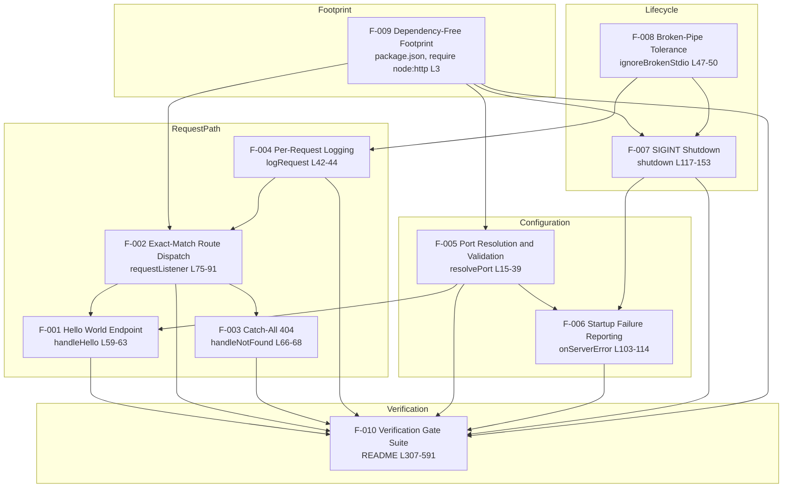

| Dependent feature | Depends on | Nature of the dependency | Evidence |
|---|---|---|---|
| F-002 Route Dispatch | F-009 Footprint | The module must load with no install step before any request can be routed | `server.js` L3; `package.json` |
| F-002 Route Dispatch | F-004 Logging | The listener calls `logRequest` before the lookup, so the log-before-route guarantee is F-004's behaviour invoked from F-002 | `server.js` L81-83 |
| F-001 Hello World | F-002 Route Dispatch | The handler is reachable only through the `ROUTES` lookup; the key `'GET /hello'` is the dispatch contract | `server.js` L70-72, L83 |
| F-001 Hello World | F-005 Port Resolution | The endpoint is reachable only once the validated port is bound | `server.js` L159, L171 |
| F-003 Catch-All 404 | F-002 Route Dispatch | The 404 is reached only through the missing-key branch of dispatch | `server.js` L85-88 |
| F-004 Logging | F-008 Broken-Pipe Tolerance | The stdout writes are protected by the inert `error` listeners, so a departed reader cannot turn a log line into a trace | `server.js` L47-50, L157 |
| F-006 Startup Failure Reporting | F-005 Port Resolution | A refused port returns before any server object exists, so the two refusal paths never overlap | `server.js` L161-165 |
| F-006 Startup Failure Reporting | F-007 SIGINT Shutdown | Both paths share the closed exit-status vocabulary; the bind failures set `1` where shutdown sets `0` | `server.js` L113, L151 |
| F-007 SIGINT Shutdown | F-008 Broken-Pipe Tolerance | The shutdown lines and the failsafe's own write survive a consumer that has gone away | `server.js` L127-128, L142 |
| F-007 SIGINT Shutdown | F-009 Footprint | The `typeof` guards exist because the declared floor is `>=18.0.0`, below the 18.2.0 connection-closing APIs | `server.js` L120-137; `package.json` |
| F-010 Gate Suite | F-001 … F-009 | Each gate asserts one of the nine other features' contracts; V14 and V16 assert F-009's footprint | `README.md` L307-591 |

F-005 has no prerequisite feature: `resolvePort` runs first inside `start()` and pure logic decides the outcome (`server.js` L159-165). F-008 has no prerequisite feature either: it is the first statement of `start()`, before any other feature has run (`server.js` L157).

### 2.3.2 Integration Points

| Integration point | Contract | Features | Evidence |
|---|---|---|---|
| Node.js runtime (HTTP server) | `http.createServer(requestListener)`, `writeHead`/`end`, `server.listen(port)` with no host argument, `server.close()` | F-001, F-002, F-003, F-005, F-007 | `server.js` L3, L95, L54-55, L171, L139 |
| Node.js runtime (process) | `process.env.PORT`, `process.exitCode`, `process.on('SIGINT')`, `process.stdout`/`process.stderr` stream events | F-004, F-005, F-006, F-007, F-008 | `server.js` L159, L113, L169, L48-49, L151, L163 |
| Node.js runtime (network errors) | `error` events from `net.Server` with `code`, `syscall`, `port` and `message` | F-006 | `server.js` L97, L103-111 |
| HTTP/1.1 client | Issues the request line only; no request body, headers or cookies are read. `curl` is the documented client | F-001, F-002, F-003 | `README.md` L26-40, L79-190; `server.js` L79-83 |
| POSIX shell | Supplies `PORT`, backgrounds the process, delivers `SIGINT` by pid and reads `$?` | F-005, F-006, F-007, F-010 | `README.md` L32-39, L227, L378-394 |
| stdout consumer | Operators, terminal scrollback or a redirected file; V5 redirects to a `mktemp` file outside the repository | F-004, F-007, F-008 | `README.md` L311, L378; `server.js` L43, L118, L142, L172 |
| npm (optional) | `npm start` and `npm pkg get`; never an install step, since no dependency exists | F-009, F-010 | `package.json` L6-8; `README.md` L64, L526-537 |

No other integration exists: the program contacts no database, cache, broker, identity provider, metrics backend or external service, and there is no configuration file through which one could be attached (`README.md` L637-654).

### 2.3.3 Shared Components and Common Services

| Shared component | Features served | Role in the program | Evidence |
|---|---|---|---|
| `sendPlainText(res, statusCode, body)` | F-001, F-003 | The only response writer, so `Content-Type: text/plain` and the parameter-free header are uniform across both outcomes | `server.js` L53-56, L62, L67 |
| `ROUTES` object | F-001, F-002, F-003 | The single routing table and the program's only extension point; a missing key is the sole path to the catch-all | `server.js` L70-72, L83-88 |
| `escapeNonPrintable(value)` | F-004, F-005 | One escaper serving two call sites: the method and path in the log line, and the offending value in a refusal message | `server.js` L10-12, L22, L43 |
| `requestListener(req, res)` | F-002, F-004 | The request-path composer: query cut, log, lookup, dispatch or catch-all, in that order | `server.js` L75-91 |
| `start()` | F-005, F-006, F-007, F-008 | The startup composer: install stdio guards, resolve the port, create the server, register `SIGINT`, listen | `server.js` L156-174, invoked L176 |
| Exit-status contract (`0` / `1`) | F-006, F-007 | One vocabulary shared by the four refusal paths, the two bind-failure paths and the clean-shutdown path | `server.js` L113, L151, L163; `README.md` L303-305 |
| stdout / stderr split | F-004, F-005, F-006, F-007 | Operational output on stdout, diagnostics on stderr, so the two can be separated without prefix parsing | `server.js` L43, L118, L142, L172 vs L105-109, L162 |
| `onServerError(error)` | F-006, F-007 | The single server `error` handler; its third branch reports without changing the exit status the shutdown path owns | `server.js` L103-114 |

Two components are deliberately *not* shared, and the code says so: `handleHello` ignores its `req` parameter although it keeps the common signature (`server.js` L60-61), and no handler reads the request stream, so there is no shared request-body service of any kind.

### 2.3.4 Traceability Matrix

| Feature | Requirements | Gates and assertions | Source |
|---|---|---|---|
| F-001 Hello World Success Endpoint | F-001-RQ-001 … RQ-005 | V2, V15 | `server.js` L53-63, L70-72 |
| F-002 Exact-Match Route Dispatch | F-002-RQ-001 … RQ-005 | Matching table, V4, V15 | `server.js` L70-72, L75-91 |
| F-003 Deterministic Catch-All Response | F-003-RQ-001 … RQ-004 | V3, V4 | `server.js` L66-68, L85-88 |
| F-004 Per-Request Logging | F-004-RQ-001 … RQ-006 | V5 (plus log assertions in V1, V6, V8, V9) | `server.js` L10-12, L42-44, L81 |
| F-005 Port Resolution and Validation | F-005-RQ-001 … RQ-009 | V1, V10, V11, V12 | `server.js` L5-7, L15-39, L159-165 |
| F-006 Startup Failure Reporting and Exit Statuses | F-006-RQ-001 … RQ-006 | V13, V11/V12 exit statuses, exit-status statement | `server.js` L94-114, L161-165 |
| F-007 Graceful SIGINT Shutdown | F-007-RQ-001 … RQ-007 | V6 (plus shutdown lines in V5, V9) | `server.js` L117-153, L169 |
| F-008 Broken-Pipe Tolerant Console Output | F-008-RQ-001 … RQ-004 | No gate named; exercised by V5's and V6's redirected runs | `server.js` L46-50, L127-128, L157 |
| F-009 Dependency-Free, No-Build Footprint | F-009-RQ-001 … RQ-006 | V14, V16 | `package.json`; `server.js` L3 |
| F-010 Documented Verification Gate Suite | F-010-RQ-001 … RQ-006 | V15 (and V1-V16 as its own content) | `README.md` L307-591 |

Coverage is complete in both directions: every feature has at least one requirement, and every requirement names a gate, a documented assertion or a source location. The one feature without a dedicated gate is F-008, which is verified indirectly because its contract is the preservation of the documented terminus of V5 and V6 when the log consumer has gone away.

### 2.3.5 Referenced Process Flows

Three flows carry the feature interactions above. The first is the end-to-end lifecycle documented in Section 1.2.2 (`start()`, port refusal, bind failure, request handling, `SIGINT` shutdown, and the two exit paths). The second is the request path in detail, which is the interaction of F-002, F-004, F-001 and F-003:

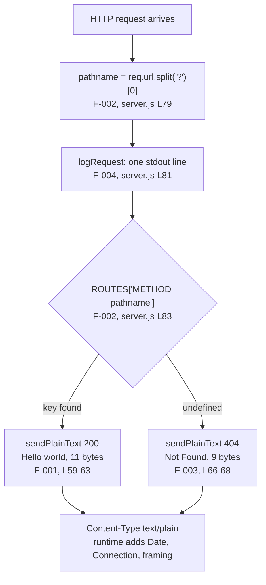

The third is the startup and failure path, which is the interaction of F-008, F-005 and F-006:

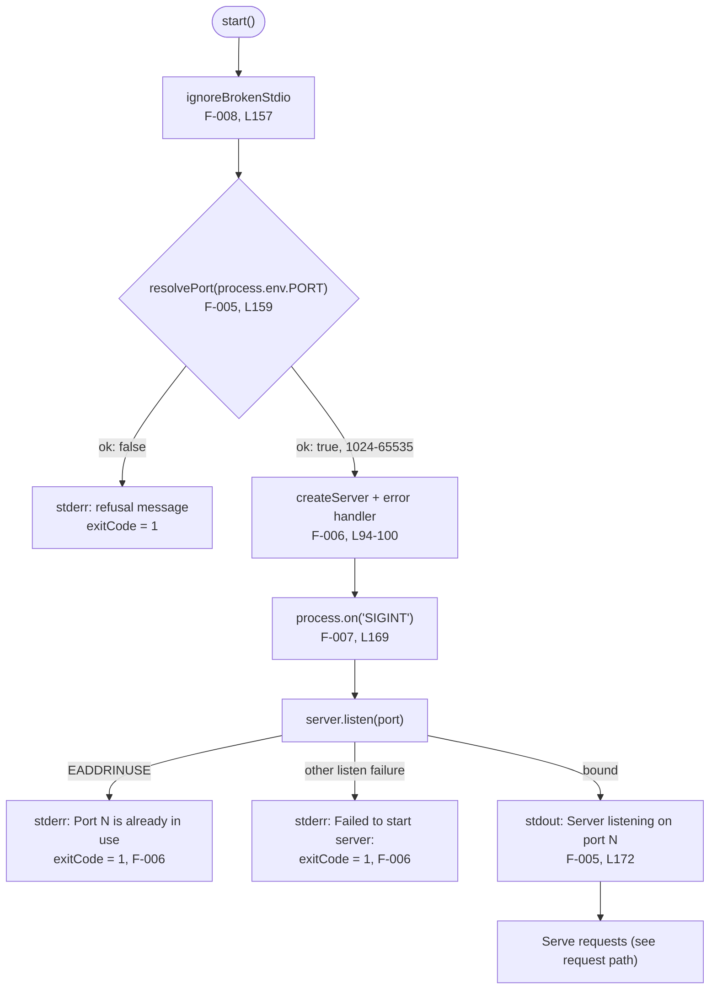


## 2.4 Implementation Considerations

The considerations below are properties of the delivered code and of the README's own statements, not recommendations. Two of them bound everything else: the program is one 176-line file with no dependency surface, and it is explicitly not a production service (`README.md` L22, L637-654).

### 2.4.1 Cross-Cutting Constraints

| Constraint | Effect on implementation | Enforcement | Evidence |
|---|---|---|---|
| One file, one built-in import | Every feature lives in `server.js`; routing, logging, writer, configuration and shutdown must compose without a module boundary | `grep -c "require(" server.js` prints `1` (V16) | `server.js` L3; `README.md` L588-591 |
| Zero dependencies and no build step | No transpile, bundle, patch or post-install step is available to any feature; the file that ships is the file that runs | V14 prints `deps? false false false`; V16 lists three files | `package.json`; `README.md` L41-51, L536, L580-583 |
| Node `>=18.0.0` floor | APIs newer than the floor must be feature-detected, not assumed | `typeof` guards around both connection-closing calls | `server.js` L120-137; `package.json` |
| Closed exit vocabulary | `0` and `1` are the only statuses the program produces; a new termination path must reuse one of them | Stated as a contract | `README.md` L303-305; `server.js` L113, L151, L163 |
| Fixed response literals | Every response body, message and log format is a literal that a gate asserts; changing one invalidates the gate that names it | V1-V16 compared literally | `server.js` L25, L31, L35, L43, L62, L67, L105, L107, L109, L118, L128, L142, L172 |
| No persistence and no request-body read | No feature may introduce state across requests or read the request stream | The request stream is never touched; nothing is written to disk | `server.js` L75-91; `README.md` L644, L648 |
| One signal only | `SIGINT` is handled; `SIGTERM` and `SIGHUP` keep their default disposition | Single registration | `server.js` L169; `README.md` L650 |

### 2.4.2 Response Features — F-001, F-002, F-003

| Feature | Technical constraints | Performance and scalability | Security and maintenance |
|---|---|---|---|
| F-001 Hello World Success Endpoint | Body must stay the 11-byte literal `Hello world`; must be written through `sendPlainText` so no second header path appears; the handler signature `(req, res)` is uniform with the catch-all | No I/O, no allocation per request beyond the response; warm loopback samples measured 0.000543-0.000775 s against a `0.010` s threshold (V7). Scales to a 50-request burst answered together (V8), and memory stays flat across two 5,000-request batches (V9) | Security: the response is a constant, so no request input is reflected. Maintenance: a body or content-type change requires updating V2, the endpoint section and the one-line `curl -w` expectation |
| F-002 Exact-Match Route Dispatch | The query string must be cut with `split('?')[0]`, never parsed; the key format `` `${req.method} ${pathname}` `` must match the `ROUTES` keys exactly; a missing key must fall through, not throw | One string split plus one property lookup per request; constant regardless of table size in practice, and the table has one entry. Concurrency is bounded only by the host's descriptors (V8) | Security: no URL parser, no normalisation, so no parser exploit or traversal-style reinterpretation; ambiguous targets fail closed to 404. Maintenance: adding an endpoint is one table entry plus one handler — the documented reason the table is the only extension point |
| F-003 Deterministic Catch-All Response | Body must stay the 9-byte literal `Not Found`; no path echo, error code or stack trace; `HEAD` must not gain a body | Constant-time and constant-size on every miss; response length does not depend on target length, so no amplification | Security: uniform failure response discloses neither route existence nor which check failed; no internals leak. Maintenance: one handler and one gate cover every unmatched case, so new negative tests extend the matching table rather than the code |

### 2.4.3 Observability Feature — F-004

| Feature | Technical constraints | Performance and scalability | Security and maintenance |
|---|---|---|---|
| F-004 Per-Request Logging | Exactly three space-separated tokens; timestamp from `Date.prototype.toISOString()` (UTC, milliseconds, `Z`); both request-derived tokens escaped; the line must be written before routing; stdout only | One write per request — 10,000 requests produced 10,000 lines (V9). Log volume grows linearly with traffic, but nothing is buffered, rotated or stored by the program; the consumer's pipe is the only back pressure | Security: escaping prevents log-line forgery and terminal escape injection from a crafted method or path. Maintenance: the format is asserted by V5 and by the log assertions inside V1, V6, V8 and V9, so any format change touches four gates; the escaping path is defence in depth because Node's parser rejects control bytes in the request line first |

### 2.4.4 Configuration and Startup Features — F-005, F-006

| Feature | Technical constraints | Performance and scalability | Security and maintenance |
|---|---|---|---|
| F-005 Port Resolution and Validation | `PORT` read once at startup; digits-only test before numeric conversion; `1024`-`65535`; `0` treated as out of range; one variable, no `HOST`; validation strictly before `listen()` | Startup cost is a trim, a regex test and two comparisons; no retry or rebind loop, so a refusal terminates instead of consuming ports | Security: validation precedes the bind, so a privileged port is a validation outcome rather than a permission error and no elevated privileges are ever requested; escaped value cannot inject control sequences into the refusal. Maintenance: four refusal conditions map to two message literals and to V11/V12; a new condition would need a gate and a troubleshooting entry |
| F-006 Startup Failure Reporting and Exit Statuses | One `error` handler with three branches, distinguished by `code === 'EADDRINUSE'` then `syscall === 'listen'`; the post-bind branch must `return` before the exit assignment; the messages consume `error.port` and `error.message` rather than re-deriving them | Failure reporting happens on the listen error event; no retry, no backoff, so a held port fails in milliseconds instead of entering a supervision loop | Security: messages disclose only the port number and the runtime's own text, never a pid, path or stack. Maintenance: only the `EADDRINUSE` branch is gated (V13); the other listen failure is documented but not induced, because its cause is host-specific (`README.md` L299) |

### 2.4.5 Lifecycle and Console Resilience Features — F-007, F-008

| Feature | Technical constraints | Performance and scalability | Security and maintenance |
|---|---|---|---|
| F-007 Graceful SIGINT Shutdown | Two stdout lines in order; `closeIdleConnections()`/`closeAllConnections()` only when `typeof` reports a function; `server.exitCode` set rather than forced; no `process.exit()` on the success path; five-second single-shot failsafe | Normal shutdown completes as soon as the close callback fires; worst case is bounded at 5,000 ms by the failsafe. The program keeps no connection registry, so shutdown cost does not scale with traffic served | Security: no privileged operations and no signal other than `SIGINT`. Maintenance: line order and both literals are asserted by V6 and counted by V5; the 18.0.x guards exist because the declared floor is below the 18.2.0 APIs, so the floor must not be raised casually |
| F-008 Broken-Pipe Tolerant Console Output | Inert `error` listeners on both streams, installed before the first write; handlers must stay inert — no output, no exit status, no `process.exit`; the failsafe's guarded `once('error')` write stays as it is | Two listener registrations at startup, no per-write cost on the success path | Security: not a security control; its purpose is output integrity. Maintenance: no named gate covers it, so its contract is stated in the function's JSDoc (L46) and in commit `10d5d2ce` — the most likely place for a future refactor to regress `EPIPE` behaviour |

### 2.4.6 Footprint and Verification Features — F-009, F-010

| Feature | Technical constraints | Performance and scalability | Security and maintenance |
|---|---|---|---|
| F-009 Dependency-Free, No-Build Footprint | Exactly three files at the root; no `dependencies`, `devDependencies` or `type`; one `require(` naming `node:http`; seven manifest fields fixed; `node --check` clean | Nothing to install or build, so first-run cost is process start plus bind. Footprint does not grow with load | Security: no third-party code, therefore no transitive dependency to audit, patch or pin. Maintenance: any added package would create the install step the deliverable exists to avoid and would fail V16's footprint gate |
| F-010 Documented Verification Gate Suite | Sixteen gates with literal expected output; gates runnable as written from the repository root; temporary log files kept outside the repository with owner-only permissions; no test framework | Exact-match gates finish in seconds. V9 drives 10,000 requests and takes a couple of minutes; V7 and V8 are host measurements, so their thresholds are pass conditions rather than capacity claims | Security: verification writes nothing into the checkout. Maintenance: nine of the thirteen commits exist to keep prose and behaviour in agreement, so a change to any literal, message or status obliges a gate update in the same change |

### 2.4.7 Assumptions and Open Constraints

| ID | Assumption or constraint | Effect |
|---|---|---|
| A-01 | The reader has Node.js `>=18.0.0`, `curl` and a POSIX shell; `seq` and `ps` are needed only for V7-V9 | Defines the whole prerequisite set; nothing else is assumed installed (`README.md` L26-39) |
| A-02 | The operator runs the server in the foreground and stops it with `CTRL+C` or `kill -INT <pid>` | No supervisor, process manager or daemon contract exists (`README.md` L643) |
| A-03 | Port `3000` is free for the self-starting gates; gates that start their own server must not run against a held port | Documented ordering constraint for V1, V5-counting, V6, V9, V13 and V14 (`README.md` L311) |
| A-04 | Loopback latency, concurrency and memory gates are measured with host tools, so their absolute numbers vary by host while their thresholds hold | V7-V9 are stability checks, not capacity guarantees (`README.md` L415-447) |
| C-01 | The README describes the program as "about 150 lines"; `server.js` is 176 lines | Documentation-only discrepancy with no behavioural effect (`README.md` L9) |
| C-02 | The README states that a non-printable byte in a logged method or path is escaped as `\uXXXX`; Node's HTTP parser rejects such a request line with `400` before the listener runs, so the escaping is observable in the `PORT` refusal messages instead | The requirement (F-004-RQ-004) holds in the code and remains defence in depth; the log-path demonstration is unreachable over the wire |
| C-03 | Only the `EADDRINUSE` listen failure has a gate; the generic listen failure and post-bind error branches are documented but not induced | F-006-RQ-002 and RQ-003 rest on the code path, not on a reproduced run (`README.md` L299) |
| C-04 | No gate covers F-008 directly | Its contract is verified only indirectly, through redirected V5/V6 runs |
| C-05 | The repository's `main` branch holds only the 9-byte placeholder `README.md`; the capability lives on `origin/blitzy-8a4de345-c459-434b-a545-c8cf76a5f502` at tip `10d5d2ce` | Every requirement in this section applies to the three-file deliverable on that ref, not to a checkout of `main` |
| C-06 | The working tree this specification was produced in also carries a `blitzy/` research directory | It stands outside the delivered set and is not a footprint failure (`README.md` L567-577) |


## 2.5 References

- `` (repository root) — the top-level folder: this checkout at branch `main` holds only `README.md` and `.git`; the deliverable this section specifies is the three-file tree on branch `origin/blitzy-8a4de345-c459-434b-a545-c8cf76a5f502`
- `server.js` — the single program file (176 lines) and the source of every implementation statement here: constants and `escapeNonPrintable` (L5-12), `resolvePort` and its three outcomes (L15-39), `logRequest` (L42-44), `ignoreBrokenStdio` (L46-50), `sendPlainText` (L53-56), `handleHello` (L59-63), `handleNotFound` (L66-68), the `ROUTES` table (L70-72), `requestListener` (L75-91), `createServer` and `onServerError` (L94-114), `shutdown` (L117-153) and `start` with its invocation (L156-176); established every response literal, log format, refusal message, exit-status assignment and guard used in F-001 through F-010
- `package.json` — the manifest (13 lines) and the basis for F-009: name, version, description, `main`, `scripts.start`, `engines.node` `>=18.0.0`, five keywords, and the absence of `dependencies`, `devDependencies` and `type`
- `README.md` — the executable documentation (654 lines) and the basis for F-010: tutorial framing and audience (L3-25), prerequisites (L26-40), no-install statement (L41-51), run commands (L53-77), the 200 and 404 contracts and the matching-semantics table (L79-190), the request-log format (L192-211), shutdown behaviour and its five-second failsafe (L213-241), `PORT` configuration, four refusal conditions and exit statuses (L243-305), the sixteen verification gates V1-V16 (L307-591), troubleshooting (L593-636) and the fifteen scope exclusions (L637-654)
- `origin/blitzy-8a4de345-c459-434b-a545-c8cf76a5f502` (tip `10d5d2ce`) — the branch carrying the deliverable; its thirteen commits establish feature provenance: `bf884ad` (`package.json`), `63152f0` (`server.js` baseline), `7f5e9e7`, `7c7142c` (gates and alignment), `b7a0b94` (escaped refusal messages), `bc93b97` (post-bind error reporting), `4dba479` (runnable gates), `8be576f`, `fed7b96`, `0ef1865` (documentation corrections) and `10d5d2ce` (broken-pipe tolerance, F-008)
- `main` (as `17c8b88`) — the initial commit containing only a 9-byte `README.md` whose content is `# IWNewGH`; established that the feature set has no predecessor, no migration obligation and no backward-compatibility constraint
- `git cat-file --batch-all-objects` over the repository — established that no file other than `README.md`, `package.json` and `server.js` has ever existed on any ref, which is what makes the "three files only" footprint claim (F-009) a complete rather than a sampled statement
- Runtime verification on Node v22.23.4 against the three files at `10d5d2ce` — reproduced `200 text/plain 11`, `404 text/plain 9`, the query-stripped log line, `404` for `/hello/` and for `POST /hello`, `404` with 0 body bytes for `HEAD /hello`, one log line per request, exit `0` after `SIGINT`, and exit `1` with the documented messages for `PORT=abc`, `80`, `65536` and `0`, plus a successful bind on `PORT=" 4000 "`
- Section 1.2.2 of this specification — referenced for the end-to-end process lifecycle flowchart that the two feature-level flows in Section 2.3.5 decompose

No web sources were used. Every statement in this section rests on the three delivered files, their git history and object store, and the runtime behaviour reproduced from them.


# 3. Technology Stack

## 3.1 Programming Languages

The system is written in exactly one programming language: JavaScript, executed by a Node.js runtime. There is no compiled component, no second language for tests or tooling, and no client-side language, because the program has no user interface and emits only `text/plain` bodies. The stack supplied with this specification (Python, TypeScript, Swift, Kotlin, Objective-C, and the JavaScript used by React, React-Native and ElectronJS) was reconciled against the delivered files component by component; section 3.1.5 records the outcome for the language choices it owns, and the remaining sub-sections record the outcome for the components they own.

### 3.1.1 Languages by Platform and Component

| Component | Language and form | Version or standard | Evidence |
|---|---|---|---|
| Application source (`server.js`, 176 lines) | JavaScript — CommonJS script in strict mode | Feature floor ECMAScript 2017; executed by Node.js `>=18.0.0`, observed on v22.23.4 | `server.js` L1, L3, L11; `package.json` `engines.node`; `README.md` L28 |
| Package manifest (`package.json`, 13 lines) | JSON — npm manifest | Seven fields: `name`, `version`, `description`, `main`, `scripts.start`, `engines.node`, `keywords` | `package.json` L1-13 |
| Documentation (`README.md`, 654 lines) | Markdown — ATX headings, fenced code blocks, GitHub-flavoured tables | No format declaration; rendered by the hosting platform | `README.md` L1-654; V15's eight topics at L553-555 |
| Operator shell (not a deliverable) | POSIX shell with job control | Used by every documented command that starts, counts, signals or reads `$?` | `README.md` L39, L227, L365-396 |

The delivery boundary is a single language running on a single runtime. The only software layer beneath `server.js` is the Node.js runtime's own HTTP implementation and event loop; the only software above it is an HTTP/1.1 client and the operator's shell.

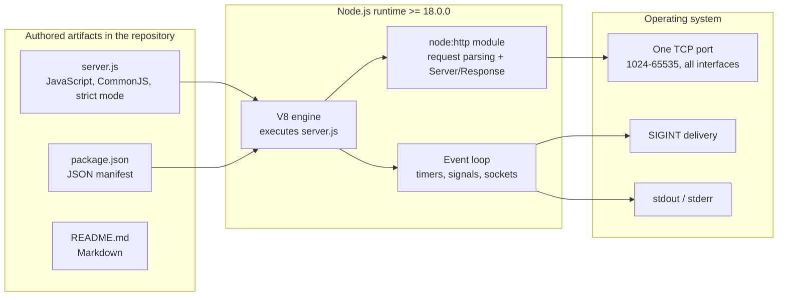

### 3.1.2 Selection Criteria and Justification

Four criteria explain the choice, and each is satisfied by evidence rather than intent:

- **Runtime sufficiency.** Every capability in the program — routing, response writing, timers, signals, stream output — is provided by the Node.js standard library. `server.js` makes one import, `require('node:http')` (L3), and reaches for `console`, `process`, `setTimeout` and `Date`, which are runtime globals. No capability required a language extension or a helper package.
- **Zero install and zero build.** JavaScript is executed directly by the runtime, so the file that ships is the file that runs. The README states this as a deliberate boundary — "No TypeScript, build step, bundler or transpiler. `server.js` is the file that runs" (`README.md` L651) — and V16 asserts it by listing exactly three files at the root (`README.md` L580-585).
- **Audience fit.** The stated audience is "beginner-level Node.js developers who need a reference implementation of a server without framework dependencies" (`README.md` L20). The language stays inside constructs that audience reads without translation: fourteen `const` declarations, nine arrow functions, template literals, two regular expressions and no classes.
- **No platform-specific surface.** The source uses no filesystem, path, network-client, process-spawning or cryptography API, so the same file behaves identically on any host that provides Node.js `>=18.0.0`; only the documented operator commands assume a POSIX shell (`README.md` L39).

### 3.1.3 Language Edition and Feature Floor

The highest language edition the source relies on is ECMAScript 2017, far below what the declared runtime floor provides. The complete inventory of language features used:

| Feature | Edition | Use in `server.js` |
|---|---|---|
| `'use strict'` directive, `const` bindings, arrow functions, template literals, shorthand methods, computed member access | ES2015 | L1, fourteen `const` declarations, nine arrow functions, template literals at L11, L25, L43, L83, L105, L172, `ROUTES` shorthand at L70-72, lookup at L83 |
| `String.prototype.padStart` | ES2017 | L11 — pads the hexadecimal escape to four digits |
| `String.prototype.trim`, `Number()`, `String.prototype.replace` with a function replacer, `Date.prototype.toISOString`, `String.prototype.charCodeAt` | ES5 | L16, L20, L28, L11, L43 |
| Regex literals `/^[0-9]+$/` and `/[^\u0020-\u007E]/g` | ES3 | L24, L11 |
| `typeof` operator guards | ES3 | L130, L135 — the compatibility mechanism for the runtime floor |

No other edition-dependent construct appears: the audit found zero occurrences of `var`, `let`, `class`, `async`, `await`, `Promise`, `import` and `export` (the single textual match for "async" is the word "asynchronous" in the comment at L148, and the single match for `new URL` is the comment at L76-78 explaining why the URL parser is *not* used).

### 3.1.4 Language Constraints and Dependencies

| Constraint | Consequence | Evidence |
|---|---|---|
| CommonJS only — no `"type"` field, no `import`/`export` | The module system is `require`; a move to ES modules would change the file's loading semantics | `package.json`; `server.js` L3 |
| No exported API | `main` names `server.js`, but the file declares no `module.exports` and calls `start()` at L176; requiring it returns an empty exports object and begins listening as a side effect | `server.js` L176; verified by `require()` returning `{}` |
| Runtime floor `>=18.0.0` | APIs introduced after 18.0.0 must be feature-detected, not assumed | `package.json` `engines.node`; `server.js` L130, L135 |
| Two shutdown APIs postdate the floor | `closeIdleConnections()` and `closeAllConnections()` arrived in Node v18.2.0, so both calls sit behind `typeof` guards and the five-second failsafe carries exit status `0` on 18.0.x | `server.js` L120-137 (comment L121-122) |
| Strict mode only | No implicit globals; every binding is a `const` | `server.js` L1 |
| Single-threaded, no user-written concurrency | Request handling is a plain synchronous function; the only asynchronous boundaries are the runtime's `listen`/`close` callbacks and the failsafe timer | `server.js` L126-133, L139-152, L171-173 |
| Not an executable file | All three files are committed with mode `100644`, so the program is started as `node server.js` (or `npm start`), never as `./server.js` | `git ls-tree` at tip `10d5d2ce` |
| Floor is declared, not enforced | npm's `engine-strict` defaults to `false`, and no install step ever runs an engine check, so the floor is a documented contract whose only enforcement is the reader following `README.md` L28 | `npm config get engine-strict` → `false`; `README.md` L41-51 |

Two language-level security properties follow from the constraints above and are documented rather than incidental: input reaches a digits-only regex test before any numeric conversion (`server.js` L24, L28), and request targets are cut with `split('?')[0]` instead of the URL parser so a malformed target cannot throw (L76-79) — both are ES3-level operations with no parsing surface.

### 3.1.5 Default-Stack Languages Not Used

| Default-stack language | Present | Evidence it is absent |
|---|---|---|
| Python | No | No `.py` file was ever committed, and no `requirements.txt`, `pyproject.toml`, `setup.py` or `Pipfile` exists; the only extensions ever committed are `.md`, `.json` and `.js` |
| TypeScript | No | `README.md` L651 excludes TypeScript, a build step, a bundler and a transpiler; there is no `tsconfig.json` and no `.ts` file |
| Swift, Kotlin, Objective-C | No | No native application, source file or platform project of any kind exists — no `.swift`, `.kt` or `.m` file, and no Xcode or Android project directory (no directory was ever committed) |
| JavaScript for a UI (React, React-Native, ElectronJS) | No | The program emits only `text/plain` bodies (`server.js` L54) and serves no static asset, HTML document or script; there is no frontend directory, bundler configuration or asset pipeline |

The single language decision this system makes is JavaScript on the server, chosen for runtime sufficiency rather than for ecosystem reach, and the constraint that follows from it is that the deliverable has no client-side, native or mobile language surface at all.


## 3.2 Frameworks &amp; Libraries

No third-party framework and no third-party library is installed, imported or configured anywhere in this system. The framework layer is the Node.js standard library — chiefly `node:http` — and the supporting library layer is the set of runtime globals the source calls directly. This sub-section documents that layer with the versions and compatibility requirements it imposes, then records the framework and library layers that are deliberately absent and what stands in their place.

### 3.2.1 Core Framework: The Node.js Runtime and `node:http`

| Component | Version | Role in this system | Evidence |
|---|---|---|---|
| Node.js runtime | `>=18.0.0` declared; observed on v22.23.4 (linux x64) | Execution environment, HTTP/1.1 server, event loop, signal delivery, standard streams | `package.json` `engines.node`; `README.md` L28 |
| `node:http` built-in module | Ships with the runtime; versioned with it | Request parsing, `Server` and `ServerResponse` objects, connection lifecycle | `server.js` L3 |
| npm (only for `npm start`) | 11.21.0 in the observed environment | Runs `scripts.start`, which is `node server.js`; adds its own banner lines to stdout | `package.json`; `README.md` L61-67 |

`node:http` is the whole framework surface. The program uses only seven of its entry points, and nothing wraps them:

| API | Call site | Purpose |
|---|---|---|
| `http.createServer(requestListener)` | L95 | Creates the server with the routing listener attached |
| `server.on('error', …)` | L97 | The single failure-reporting hook |
| `server.listen(port, callback)` | L171 | Binds the port with no host argument, so every interface is bound; the callback prints the startup line |
| `server.close(callback)` | L139 | Stops accepting connections and runs the shutdown callback |
| `res.writeHead(statusCode, headers)` | L54 | Sets the status and `Content-Type: text/plain` |
| `res.end(body)` | L55 | Writes the body with no trailing newline |
| `server.closeIdleConnections()`, `server.closeAllConnections()` | L136, L131 | Connection cleanup during shutdown, both behind `typeof` guards |

**Justification.** The choice is stated by the repository itself: the deliverable exists to show "an HTTP server built on Node's built-in `http` module: no framework, no middleware, no routing library and no third-party package of any kind" (`README.md` L9). The framework was not omitted for expedience; it is excluded so that a reader sees the runtime's primitives — `createServer`, `writeHead`, `end`, `listen`, `close` — rather than a framework's abstractions over them (`README.md` L11-18). The cost of this choice is that every cross-cutting concern a framework would supply must be written by hand, and the program does write the three it needs: dispatch (`ROUTES` L70-72, L83), response writing (`sendPlainText` L53-56) and error translation (`onServerError` L103-114).

### 3.2.2 Supporting Libraries

No third-party supporting library exists. The supporting set is composed entirely of runtime built-ins and JavaScript globals, each with a single responsibility in this program:

| Facility | Origin | Use | Evidence |
|---|---|---|---|
| `console.log`, `console.error` | Node.js global | Startup, request and shutdown lines on stdout; refusal and failure messages on stderr | L43, L105, L107, L109, L118, L142, L162, L172 |
| `process.env` | Node.js global | Reads `PORT` once at startup; the only environment variable read | L159 |
| `process.exitCode` | Node.js global | Sets `0` for a clean shutdown and `1` for every refusal, without forcing an exit | L113, L151, L163 |
| `process.stdout` / `process.stderr` | Node.js streams (duplex) | Inert `'error'` listeners absorb a vanished reader; the failsafe writes its line through `stdout` | L48-49, L127-128 |
| `process.on('SIGINT', …)` | Node.js global | The single signal registration in the program | L169 |
| `setTimeout` / `clearTimeout` | ECMAScript host timer | The five-second shutdown failsafe and its cancellation on a clean close | L126, L140 |
| `Date.prototype.toISOString()` | ECMAScript | UTC millisecond timestamp in the log line | L43 |
| `String.prototype.replace`, `charCodeAt`, `padStart`, `trim`; `Number`; regex literals | ECMAScript | Port validation and the `\uXXXX` escaping of non-printable bytes | L11, L16, L20, L24, L28 |

**Compatibility requirements that follow.** Every facility above is present at Node.js 18.0.0, so the declared floor holds without a single polyfill (the only post-18.0.0 APIs in the program are the two connection-closing methods, and both are feature-detected rather than assumed). The manifest accordingly carries no `dependencies`, no `devDependencies`, no `overrides` and no `peerDependencies`, and no lockfile or `node_modules` directory has ever existed in the repository — the all-commit file union is exactly `README.md`, `package.json` and `server.js`.

### 3.2.3 Integration and Runtime Compatibility

The framework layer's behaviour at its edges is what a deployment must accommodate. Each item below was observed on the runtime in use:

| Requirement | Behaviour | Evidence |
|---|---|---|
| Client protocol | HTTP/1.1 over plain TCP; `curl` measured `http_version=1.1` and the status line reads `HTTP/1.1 200 OK` | Observed run; `README.md` L102-112 |
| Runtime-added headers | `Date`, `Connection`, `Keep-Alive` and the framing header are written by the runtime, not the program; the contract is status, `Content-Type` and byte-exact body only | `README.md` L190 |
| Framing is runtime-chosen | `Transfer-Encoding: chunked` with a kept-alive connection on v22.23.4; the README records that another runtime may set `Content-Length` instead, so no gate may assert the framing header | Observed headers; `README.md` L190 |
| Content type | Exactly `text/plain`, with no `charset` parameter, on both response paths | `server.js` L54; V2 at `README.md` L327-340 |
| Transport security | None: no TLS, no certificate, no redirect; the bind covers every interface because `listen` receives no host argument | `server.js` L171; `README.md` L77, L645 |
| Signal contract | `SIGINT` is handled; `SIGTERM` and `SIGHUP` keep the runtime's default disposition | `server.js` L169; `README.md` L650 |
| Broken-pipe tolerance | A closed stdout/stderr consumer reports to an inert `'error'` listener instead of becoming an unhandled event, so a vanished log reader cannot change the exit status | `server.js` L46-50, L127-128 |

The composition, with no framework layer present, is:

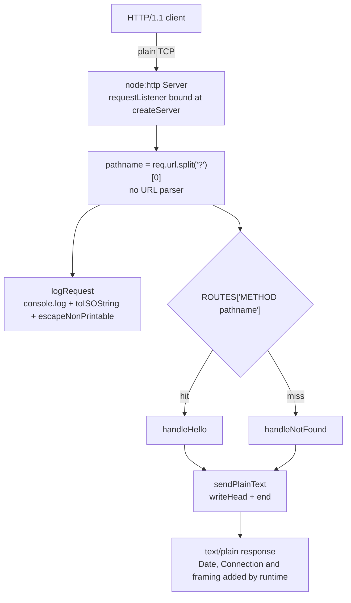

### 3.2.4 Deliberately Absent Framework and Library Layers

Each absent layer is a boundary the repository states, and in every case a named function or a documented gate takes its place:

| Absent layer | Replacement in this system | Evidence |
|---|---|---|
| HTTP framework (Express, Fastify, Koa, Hapi, NestJS) and middleware pipeline | `http.createServer` plus the two-statement `requestListener` (log, then dispatch) | `server.js` L75-95; `README.md` L9, L642 |
| Router library | The `ROUTES` object keyed by `"<METHOD> <pathname>"`, with one property lookup at L83 — the documented single extension point | `server.js` L70-72; `README.md` L23-24 |
| Template engine or view layer | Two literal bodies written through one writer | `server.js` L62, L67 |
| Validation library | `resolvePort`'s digits-only regex and two range comparisons | `server.js` L15-39 |
| Configuration library | One `process.env.PORT` read, trimmed and validated before the bind | `server.js` L159-165; `README.md` L243-251 |
| Logging framework, log levels, log files | One `console.log` call with a fixed three-token format | `server.js` L42-44; `README.md` L192-211, L649 |
| Body parser, cookie/session library, CORS or CSRF middleware | Nothing to parse and nothing to protect: the request stream is never read and no header is consumed | `server.js` L75-91; `README.md` L645-648 |
| Test framework and assertion library | Sixteen manual gates with literal expected output | `README.md` L307-591, L641 |
| Bundler, transpiler, linter, formatter | The file that ships is the file that runs; `node --check server.js` is the only static check | `README.md` L580-585, L651-652 |
| Database, cache or ORM driver | Nothing persists; see section 3.5 | `README.md` L644 |

### 3.2.5 Default-Stack Frameworks Not Used

| Default-stack framework | Present | Evidence it is absent |
|---|---|---|
| Flask (Python backend) | No | No Python file, manifest or dependency exists, and no framework dependency appears in `package.json`; `server.js` L3 imports only `node:http` |
| Langchain (AI framework) | No | No model client, embedding, prompt or provider SDK exists; the program makes no outbound network call of any kind |
| React, React-Native, TailwindCSS, ElectronJS | No | No frontend or desktop project exists — no HTML, CSS, JSX/TSX, component directory, bundler configuration or asset pipeline was ever committed; responses are `text/plain` only |
| Express, Fastify, Koa, Hapi, NestJS | No | A name search across every commit returns zero hits for each; the README states "no framework, no middleware, no routing library" (`README.md` L9) |

The resulting position is unusual but deliberate: the system has a framework in the sense that it depends on a runtime library for its entire request lifecycle, and it has no framework in the sense that nothing sits between the program's functions and that library.


## 3.3 Open Source Dependencies

The open-source dependency set of this system is empty. That is a designed property of the deliverable, asserted by the repository's own gates, not an accident of an early codebase: the program reaches the npm registry for nothing, and no package has ever been installed, pinned, vendored or vendored-in-place in the project's history.

### 3.3.1 Third-Party and Open-Source Libraries Identified

| Check | Result | Evidence |
|---|---|---|
| Declared dependency blocks (`dependencies`, `devDependencies`, `peerDependencies`, `optionalDependencies`, `bundledDependencies`, `overrides`, `workspaces`) | All absent | `package.json` L1-13 — the only keys are `name`, `version`, `description`, `main`, `scripts`, `engines`, `keywords` |
| Module specifiers in the source | One, and it is a built-in: `require('node:http')` | `server.js` L3; V16's `grep -c "require("` prints `1` (`README.md` L588-591) |
| Non-built-in import specifiers | Zero — no bare specifier, no relative import, no `import()` | `server.js` L1-176 |
| Lockfile (`package-lock.json`, `npm-shrinkwrap.json`, `yarn.lock`, `pnpm-lock.yaml`) | Never created or committed | All-commit path union is `README.md`, `package.json`, `server.js`; `README.md` L49 |
| `node_modules` directory | Never created or committed | Same union; `README.md` L48, L585 |
| Vendored source, git submodule, or copied third-party file | None — no `.gitmodules`, no directory was ever committed | `git ls-tree` at tip `10d5d2ce` shows three blobs and no trees |

The consequence is that the total third-party code in the system's trust base is the Node.js runtime itself. There is no transitive graph to resolve, no version conflict to arbitrate, no package to patch, and no advisory feed to subscribe to for a package this repository owns.

### 3.3.2 Package Identity, Registry and Versions

The manifest is registry-shaped — it carries the fields npm reads — but it is used only as a local entry point and descriptor, never as something installed from or published to a registry.

| Manifest field | Value | Effect |
|---|---|---|
| `name` | `nodejs-tutorial-hello-world` | Identity in the npm namespace shape; nothing is fetched from that namespace |
| `version` | `1.0.0` | Single declared version; no release history, no dist-tags, no tags in git |
| `description` | `Minimal Node.js HTTP server tutorial demonstrating single endpoint implementation` | Descriptor only |
| `main` | `server.js` | Names the executable entry point, not an importable module (see 3.2.1) |
| `scripts.start` | `node server.js` | The only script defined; no `test`, `build`, `lint`, `prepublish` or lifecycle hook exists |
| `engines.node` | `>=18.0.0` | The runtime compatibility contract, unchanged by design (`README.md` L654) |
| `keywords` | `nodejs`, `tutorial`, `http`, `server`, `beginner` | Discoverability metadata; states the audience |

Fields a distributed package would normally carry are absent: `private`, `license`, `repository`, `homepage`, `bugs`, `author`, `bin`, `files` and `type`. Two consequences matter for the stack: the package declares no licence of its own, and the runtime is the only dependency whose licence a consumer must honour.

**Versions in force.** The only versions the system pins are the runtime floor `>=18.0.0` (declared) and the observed verification environment Node.js v22.23.4 with npm 11.21.0, `curl` 8.5.0 on linux x64. Because no package is installed, no dependency version — exact, caret, tilde or range — exists anywhere in the repository.

### 3.3.3 Dependency Policy and Constraints

| Constraint | Origin | Effect on the stack |
|---|---|---|
| Exactly three files at the repository root | V16 footprint gate (`README.md` L557-591) | Adding a dependency would add a fourth file and fail the gate |
| No installation step in any documented workflow | `README.md` L43-51 | `npm install` appears in no instructions; a dependency would introduce a step the documentation does not have |
| A clean machine needs Node.js and `curl` only | V15 (`README.md` L553-555) | Any install step would break the promise that the documented commands work with nothing else installed |
| One `require(` naming a built-in | V16's `grep -c` expectation of `1` | A second import would change the asserted count |
| No lockfile and no `node_modules` | V16's `find` expectation of exactly three names | Reproducibility currently comes from having nothing to reproduce |

**Security implications.** With no third-party package, the supply-chain surface is limited to the runtime distribution the operator installs and to whatever its release channel delivers. The program adds no code of unknown provenance, no post-install script and no registry credential. `npm install` is never run, so no lifecycle script executes in this repository's documented workflows. What remains is the runtime's own advisory exposure, which is the operator's patch responsibility and is not tracked anywhere in the repository.

**Maintenance implications.** Nothing in the stack needs updating on a dependency cadence; the only version decision that exists is the deliberate refusal to raise the `>=18.0.0` engine floor (`README.md` L654), and the two connection-closing calls are guarded precisely so that floor stays viable (`server.js` L120-137). Introducing a package later would oblige, in the same change, a lockfile, an install step in the documentation, and updated V14, V15 and V16 expectations — the repository's verification suite is what makes the zero-dependency policy enforceable rather than aspirational.


## 3.4 Third-Party Services

No external service is integrated with this system. The program is a server only: it accepts inbound connections and never originates one, so there is no outbound API call, no identity provider, no monitoring backend and no cloud service in the runtime path. The single third-party service anywhere near the deliverable is GitHub, which hosts the source and publishes nothing from it.

### 3.4.1 External APIs and Integrations

| Candidate integration | Status | Evidence |
|---|---|---|
| Outbound HTTP or HTTPS client | Absent | Zero occurrences of `fetch(`, `http.request`, `http.get` or `https.` in `server.js` |
| Raw sockets, DNS or TLS clients | Absent | Zero occurrences of `net.`, `tls.` or `dgram`; `node:http` is the only import (`server.js` L3) |
| Third-party API SDK or webhook sender | Absent | No dependency block, no API key, no token or endpoint constant in the source |
| Message broker, queue or event bus | Absent | No client of any kind; the only timer is the local shutdown failsafe (`server.js` L126) |
| Secrets manager or remote configuration | Absent | The complete configuration surface is one environment variable, `PORT` (`server.js` L159; `README.md` L245) |

The integrations that do exist are all inbound or local, and each has an explicit contract:

| Counterparty | Direction | Contract | Evidence |
|---|---|---|---|
| HTTP/1.1 client | Client → server | `GET /hello` returns `200` with `Hello world`; every other method and path returns `404` with `Not Found` | `server.js` L59-68, L70-90 |
| Operator's shell | Shell → process | `PORT` in the environment and `SIGINT` for shutdown; exit status `0` or `1` | `server.js` L159, L169, L113, L151, L163 |
| Log consumer (terminal, pipe, CI log) | Process → stdout/stderr | One line per request plus four lifecycle lines on stdout; diagnostics on stderr | `server.js` L43, L118, L142, L172; `README.md` L211 |
| Operating system | Process → kernel | One TCP listener on the resolved port, binding every interface because no host argument is passed | `server.js` L171; `README.md` L77 |

### 3.4.2 Authentication Services

None. The program contains no authentication, authorisation, session, cookie, token or credential logic — the strings `auth`, `jwt`, `token` and `crypto` appear nowhere in `server.js`. The endpoint is anonymous and read-only, and the repository states the boundary directly: "No authentication, authorisation, sessions, cookies, CORS, CSRF or TLS. The endpoint is anonymous, read-only and plain HTTP" (`README.md` L645).

Two security consequences belong in the stack record. First, because the program performs no identity check and terminates no TLS, every access-control decision is made outside it — the deployment must restrict network reach, and the program cannot contribute to that decision. Second, the listener is not loopback-scoped: `server.listen(port)` receives no host argument (`server.js` L171), so the bind covers every interface, which `README.md` L77 states explicitly. A host that can be reached can reach the endpoint.

### 3.4.3 Monitoring and Observability Tools

No monitoring, tracing, metrics or logging service is integrated: no agent, no exporter, no endpoint, no structured format, and no health check route (`README.md` L647, L649). The entire observability surface is the console output listed below, and every line is a fixed literal that a verification gate asserts.

| Stream | Literal emitted | Trigger |
|---|---|---|
| stdout | `Server listening on port <port>` | Listen callback, after the port is bound (L172) |
| stdout | `<ISO-8601 timestamp> <METHOD> <pathname>` | Every request, before routing (L43) |
| stdout | `Received SIGINT. Shutting down gracefully.` | `SIGINT` received (L118) |
| stdout | `Server closed. Exiting.` | `server.close` callback, clean shutdown (L142) |
| stdout | `Forcing shutdown after 5s.` | Five-second failsafe only (L128) |
| stderr | `Invalid PORT value "<value>": must be an integer between 1024 and 65535.` | Non-numeric or out-of-range `PORT` (L25, L35) |
| stderr | `Invalid PORT value "<value>": privileged ports 1-1023 are not permitted; …` | `PORT` in 1-1023 (L31) |
| stderr | `Port <port> is already in use. Stop the process using it or set PORT to a free port.` | `EADDRINUSE` (L105) |
| stderr | `Failed to start server: <error message>` | Any other listen failure (L107) |
| stderr | `Server error while serving: <error message>` | Error after the bind, without changing the exit status (L109) |

The stack implication is that monitoring is an external consumer's job: the process writes to its own streams and buffers nothing, so a pipeline that captures stdout is the only metric source. `README.md` L649 states the same boundary — "No structured logging, log levels or log files. One line per request on stdout is the whole observability surface" — and the log-counting gate demonstrates the intended consumption pattern, redirecting stdout to a file outside the repository and counting lines (`README.md` L365-396).

### 3.4.4 Cloud Services

None. There is no cloud SDK, no infrastructure-as-code provider, no object storage, no managed database, no DNS or CDN client, no container registry and no managed secrets store; the repository's only committed files are three root-level artifacts, and its only credential-shaped value is the access token embedded in the `origin` remote URL used to clone the repository (deliberately not reproduced here). No cloud region, account, role or endpoint is configured anywhere.

The deployment model that follows is a single foreground process on a host the operator controls, started with `node server.js`, reachable on one plain-HTTP port, and stopped with `SIGINT` (`README.md` L53-77, L213-241, L643).

### 3.4.5 Default-Stack Third-Party Services Not Used

| Default-stack service | Present | Evidence it is absent |
|---|---|---|
| Auth0 (authentication) | No | Zero occurrences of `auth0`, OIDC discovery, JWKS, bearer-token parsing or session handling in any commit; the endpoint has no credential path (`README.md` L645) |
| AWS (cloud platform) | No | No AWS SDK dependency, no IaC file, no region or credential configuration; the program makes no outbound call at all |
| Third-party monitoring or APM SaaS | No | No agent, exporter or ingest endpoint; observability is stdout only (`README.md` L649) |
| GitHub | Yes, in one narrow role | The `origin` remote is a GitHub HTTPS URL, so GitHub hosts the source repository; no GitHub Actions workflow, release or package publication exists (see 3.6) |

The absence is total on the runtime side: nothing the program does at request time leaves the host, which is what makes the deliverable safe to run on a laptop and unsuitable as a service component without a surrounding platform.


## 3.5 Databases &amp; Storage

The system has no database, no cache, no storage service and no file persistence. Its persistence strategy is the absence of persistence: all state is module-scope constants fixed at load plus the validated port resolved once at startup, and the only data that outlives a request leaves the process through stdout.

### 3.5.1 Primary and Secondary Databases

| Candidate datastore | Status | Evidence |
|---|---|---|
| Relational database (PostgreSQL, MySQL, SQLite) | Absent | No driver dependency, no SQL text, zero occurrences of `query(`, and no `fs` use that could open a SQLite file |
| Document database — MongoDB, the default-stack choice | Absent | No `mongodb` string in any commit, no connection string, no ODM or driver dependency |
| Key-value store or cache (Redis, Memcached) | Absent | No socket client, no `net.`/`tls.` use, no client library |
| Search index, time-series store, warehouse | Absent | No client, no export path, no batch writer |
| ORM, query builder or migration tooling | Absent | No dependency of any kind; no migrations directory was ever committed |

There is no primary database and no secondary database, so there is no schema, no connection pool, no transaction boundary, no migration sequence and no consistency model to document. `README.md` L644 states the boundary: "No persistence. No database, no cache, no file writes: nothing survives a request or a process exit."

### 3.5.2 Data Persistence Strategy

The program holds exactly four pieces of state, and all of them are immutable module-scope constants or a startup-only value:

| State | Kind | Lifetime | Evidence |
|---|---|---|---|
| `DEFAULT_PORT` 3000, `MIN_PORT` 1024, `MAX_PORT` 65535 | Module-scope constants | Process lifetime, never written after load | `server.js` L5-7 |
| `ROUTES` — the single-entry routing table | Module-scope constant object | Process lifetime, never mutated | `server.js` L70-72 |
| Resolved port | Local value from `resolvePort(process.env.PORT)`, closed over by the listener and the shutdown handler | Process lifetime | `server.js` L159-173 |
| Per-request `pathname` | Local binding inside `requestListener` | The duration of one dispatch; discarded immediately | `server.js` L79-90 |

No value is retained per request. `requestListener` allocates one string for the stripped path, formats the log line and discards both; `sendPlainText` writes a constant body. This is why the memory gate can assert stability rather than merely boundedness: across two 5,000-request batches the third resident-set reading stays within 10 MB of the second, and all 10,000 requests are logged one line each (`README.md` L434-447).

The strategy has four observable consequences:

- **No writes.** The program uses no filesystem API — zero occurrences of `fs.`, `writeFile`, `readFile` or `createReadStream` — so it cannot create, modify or delete a file. The only file a documented workflow writes is the operator's own log capture, created with `mktemp` outside the repository and removed at the end of the block (`README.md` L377-396).
- **No reads.** There is no configuration file, no fixture, no seed data and no metadata file to load; configuration arrives solely through `PORT` (`server.js` L159).
- **Nothing survives a restart.** A restart re-binds a port and re-creates the routing table from source; there is no recovery step, no warm-up and no reconciliation, and equally no corruption risk or upgrade migration.
- **Backpressure and retention belong to the consumer.** A log line exists in the stream the operator attached, and the process buffers nothing beyond the stream write itself; a `stdout` consumer that disappears is absorbed by an inert `'error'` listener rather than changing behaviour (`server.js` L46-50).

### 3.5.3 Caching

No cache exists at any layer of the program. It sets no cache validator and honours none: zero occurrences of `Cache-Control`, `ETag`, `Last-Modified`, `If-None-Match`, `If-Modified-Since`, `max-age` or `expires` in `server.js`. The only header the program writes is `Content-Type` (`server.js` L54); everything else in a response — `Date`, `Connection`, `Keep-Alive` and the framing header — is added by the runtime, and none of them is a cache validator (`README.md` L190).

Caching is also unnecessary here, which is why its absence costs nothing: every response is a constant string selected by one property lookup, so there is no computation, no query and no upstream call to avoid. The only reuse in the system is connection-level — a kept-alive HTTP connection is reused by the runtime, which is a transport optimisation rather than a cache, and the observed `Connection: keep-alive` and `Keep-Alive: timeout=5` headers reflect the runtime's defaults rather than any program setting.

### 3.5.4 Storage Services

No storage service is used: no object storage, no block volume, no network filesystem, no managed backup, no snapshot, no archive tier and no data-retention or classification configuration. The delivery deploys as three text files, and the running process needs no writable path — a read-only working directory is sufficient, because the program opens nothing for writing.

Two stack consequences follow. First, storage capacity, throughput and durability are not properties of this system and cannot be scaled, monitored or restored through it. Second, the deployment cannot lose data on restart, because it holds none; the only durable artifacts are the source files themselves, which live in version control.

### 3.5.5 Data Handled and What Is Deliberately Not Read

| Data item | Source | Where it lives | Retention |
|---|---|---|---|
| Request method and query-stripped path | Request line | One formatted stdout line, with bytes outside printable ASCII escaped | Duration of the stream write only |
| `PORT` value | Environment | Validated integer in module scope | Process lifetime |
| Response bodies `Hello world` and `Not Found` | Source literals | Constant strings in the read-only code segment | Not applicable |
| Timestamp | `Date.prototype.toISOString()` per request | Composed into the log line, never stored | Duration of the stream write only |

The program deliberately reads nothing else. It never consumes the request stream, so request bodies do not exist as data in this system; it never parses the query string, only cutting it before the path comparison (`server.js` L76-79); and it reads no request header, no cookie and no client address. `README.md` L645 and L648 record both boundaries as deliberate exclusions. For the stack this is a data-minimisation property with a concrete security effect: there is no store in which personal or sensitive data could accumulate, and no retention policy is required because nothing is retained.


## 3.6 Development &amp; Deployment

Development and deployment of this system are deliberately minimal: it is developed with an editor and a Node.js runtime, has no build step, is not containerised, has no pipeline and is deployed by copying three files to a host and running one command in the foreground. Every omission below is stated by the repository as a boundary rather than missing work (`README.md` L637-643).

### 3.6.1 Development Tools

| Tool | Version observed | Role | Evidence |
|---|---|---|---|
| Node.js | `>=18.0.0` declared; v22.23.4 (linux x64) observed | Runs the program and provides the only static check, `node --check server.js` | `package.json`; `README.md` L28, L585-586 |
| npm | 11.21.0 | Runs `scripts.start`; V14 reads manifest fields through `npm pkg get` | `package.json`; `README.md` L61-67, L524-551 |
| Git | 2.43.0 | Version control; a linear 13-commit history, no tags, no stashes | Repository `.git`; `git log` |
| `curl` | 8.5.0 | Every request gate, plus `--write-out` measurements for latency and body size | `README.md` L79-125, L415-424 |
| POSIX shell utilities — `grep`, `wc`, `mktemp`, `kill`, `wait`, and `seq`/`ps` for the measurement gates | GNU bash 5.2.21, procps-ng 4.0.4 | Job control, `$?` assertions, log counting, and the three host measurements | `README.md` L39, L227, L365-396, L415-447 |

There is no linter, formatter, type checker, debugger configuration, test runner or task runner. The repository states the position: "No linter or formatter configuration. Style is kept consistent by hand, and `node --check server.js` is the only static check" (`README.md` L652). Verification is a set of sixteen manual gates with literal expected output (`README.md` L307-591), which is the documented substitute for a test framework (`README.md` L641).

### 3.6.2 Build System

No build system exists, and the absence is structural rather than provisional:

| Build concern | Status | Evidence |
|---|---|---|
| Compile, transpile or bundle step | None | `README.md` L651 excludes TypeScript, a build step, a bundler and a transpiler |
| Scripts defined | One — `scripts.start` = `node server.js` | `package.json` L6-8; no `build`, `test`, `lint`, `prepare` or `prepublish` script |
| Dependency installation | None — `npm install` appears in no documented workflow | `README.md` L43-51 |
| Lockfile or dependency resolution | None, because there is nothing to resolve | `README.md` L49; all-commit file union |
| Build artifacts (`dist`, `build`, `out`) | None; the committed file is the deployed file | V16's `find` expectation of exactly three names (`README.md` L580-585) |
| Static validation | `node --check server.js`, which prints nothing on success | `README.md` L585-586 |

The practical effect is that first-run cost is process start plus a socket bind, and there is no artifact to promote between environments — the commit that holds the source is the artifact. Reproducibility currently comes from having nothing to resolve: no version range, no lockfile and no registry fetch participate in a start.

### 3.6.3 Containerization

None. There is no `Dockerfile`, no compose file, no OCI image definition, no registry and no orchestrator manifest, and the README says so explicitly: "No CI/CD and no containers. There is no workflow file, no `Dockerfile` and no compose file; the program runs with `node server.js` on your own machine" (`README.md` L642). No path matching `docker`, `compose`, `kubernetes` or `terraform` was ever committed.

One integration constraint governs any future containerisation and is derived from the signal contract rather than invented here: the program handles `SIGINT` only and leaves `SIGTERM` at the runtime's default disposition (`server.js` L169; `README.md` L650). A supervisor that stops a process with `SIGTERM` therefore never enters the graceful path — no `Received SIGINT. Shutting down gracefully.`, no `Server closed. Exiting.`, and no `0` exit status from that path. The documented stop mechanism is `CTRL+C` or `kill -INT <pid>` (`README.md` L213-241).

### 3.6.4 CI/CD Requirements

| CI/CD concern | Status | Evidence |
|---|---|---|
| Pipeline definition | None — no `.github/workflows`, `Jenkinsfile`, `.gitlab-ci.yml` or equivalent was ever committed | All-commit path union; `README.md` L642 |
| Automated test stage | None; the sixteen gates are run by hand | `README.md` L307-591, L641 |
| Deployment automation, release or tagging | None; no tags exist and no release step is documented | `README.md` L643 |
| Process management, supervisors, daemons | None; one foreground process started and stopped by the operator | `README.md` L643, L53-77 |
| Source hosting | GitHub — the `origin` remote is a GitHub HTTPS URL; it hosts the repository and runs nothing | `git remote -v` |

If a pipeline were introduced it would have to reproduce the conditions the manual gates depend on: Node.js `>=18.0.0` and `curl` on the runner; port `3000` free for the self-starting gates and no gate run against a held port (`README.md` L311); `seq` and `ps` for the measurement gates; a `SIGINT` delivered to the server process rather than to a pipeline, since `SIGINT` sent to a foreground process group kills a counting filter before it prints (`README.md` L389-396); and temporary logs written outside the repository with owner-only permissions (`README.md` L377).

### 3.6.5 Deployment Model and Runtime Requirements

| Requirement | Value | Evidence |
|---|---|---|
| Runtime | Node.js `>=18.0.0`; two connection-closing APIs feature-detected above 18.0.0 | `package.json`; `server.js` L120-137 |
| Start command | `node server.js`, or `npm start` which runs the same program (npm adds banner lines) | `package.json` L7; `README.md` L53-67 |
| Configuration | One environment variable, `PORT`; default `3000`; accepted `1024`-`65535`; read once at startup | `server.js` L15-39, L159; `README.md` L243-251 |
| Network exposure | One TCP listener, no host argument so every interface is bound, plain HTTP, no TLS and no access control | `server.js` L171; `README.md` L77 |
| Stop mechanism | `SIGINT` → graceful close, two stdout lines, exit `0`; a five-second failsafe bounds a stuck shutdown | `server.js` L117-153; `README.md` L213-241 |
| Exit statuses | `0` for a clean shutdown; `1` for invalid or privileged `PORT` and for any bind failure | `server.js` L113, L151, L163; `README.md` L303-305 |
| Streams | Operational output on stdout, diagnostics on stderr | `server.js` L105-109, L162; `README.md` L211 |
| Filesystem | No writable path is opened; three source files total (843 lines) | `server.js` L1-176; V16 (`README.md` L557-591) |
| Host prerequisites | Node.js; `curl` for verification; a POSIX shell for the documented commands | `README.md` L26-39 |

The full deployment shape, with the layers the stack does *not* contain omitted:

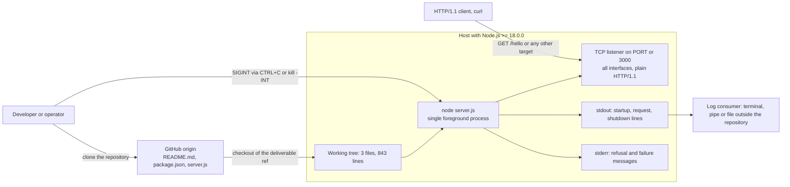

No load balancer, reverse proxy, container runtime, orchestrator, pipeline agent, database or monitoring backend appears in that diagram because none exists in the system; the only third-party service involved in delivery is GitHub as the source host.

### 3.6.6 Default-Stack Development and Deployment Components Not Used

| Default-stack component | Present | Evidence it is absent |
|---|---|---|
| Docker | No | No `Dockerfile`, compose file or image definition in any commit; `README.md` L642 |
| Terraform (and any IaC) | No | No `.tf` file, no provider configuration, no state file or module |
| GitHub Actions | No | No workflow directory or file; GitHub is used only to host the repository |
| AWS (deployment platform) | No | No SDK, no region or account configuration, no deployment automation |
| CI runner, artifact registry, k8s manifest | No | No committed path matches any of these; the run method is one foreground command |

The justified position is that the deliverable's value is that it runs from a clean checkout with one command on a machine that has Node.js and nothing else. A build, an image or a pipeline would each add a step the documentation does not have and would invalidate V15's clean-machine promise (`README.md` L553-555) — which is why these components are absent rather than pending.


## 3.7 References

Every claim in this section rests on the three files of the deliverable on the reference branch `origin/blitzy-8a4de345-c459-434b-a545-c8cf76a5f502` at tip `10d5d2ce`, on the repository's own history and metadata, or on a live run of the program against the Node.js runtime in this environment.

- `server.js` — the entire implementation (176 lines): `'use strict'` at L1, the single `require('node:http')` at L3, the port constants at L5-7, `escapeNonPrintable` at L10-12, `resolvePort` at L15-39, `logRequest` at L42-44, `ignoreBrokenStdio` at L46-50, `sendPlainText` at L53-56, the two handlers and `ROUTES` at L59-72, `requestListener` at L75-91, `createServer` and `onServerError` at L94-114, `shutdown` at L117-153 and `start` at L156-176. Established the language feature floor, the CommonJS-only constraint, the absent library API, the seven `node:http` entry points, the runtime-global facilities, the fixed console literals, the `typeof` guards for Node 18.0.x, the `SIGINT`-only signal contract, and the absence of filesystem, network-client, cache-validator and third-party API use.
- `package.json` — the manifest (13 lines). Established the package identity `nodejs-tutorial-hello-world` 1.0.0, `main`, the single `scripts.start`, `engines.node` `>=18.0.0`, the keywords, and the absence of `dependencies`, `devDependencies`, `peerDependencies`, `optionalDependencies`, `bundledDependencies`, `overrides`, `workspaces`, `private`, `license`, `repository`, `homepage`, `bugs`, `author`, `bin`, `files` and `type`.
- `README.md` — the documentation and the specification of record (654 lines). Established the prerequisites and runtime floor (L26-39), the absent installation step (L41-51), the run and start-script forms (L53-77), the response contracts (L79-190), the runtime-added headers and the runtime-chosen framing (L190), the log format and stream separation (L192-211), the stop mechanism and failsafe (L213-241), the single `PORT` configuration and its four refusal conditions (L243-305), the exit-status vocabulary (L303-305), the sixteen verification gates V1-V16 (L307-591), the troubleshooting messages (L593-636), and the fifteen deliberate non-goals that exclude tests, CI, containers, persistence, authentication, TLS, structured logging, TypeScript and every environment variable but `PORT` (L637-654).
- Repository root folder — at `main` (HEAD `17c8b88`) it holds only `.git` and a 9-byte `README.md` containing `# IWNewGH`; the deliverable's three files exist only on the reference branch. Established which checkout a reader actually has, and that no directory, test file, CI file, container file or manifest of another ecosystem was ever committed.
- `.git/` — repository metadata. Established the four refs and the linear 13-commit history, the absence of tags, stashes, submodules and dangling objects, all three files being committed with mode `100644`, the `origin` GitHub remote, and — through an all-commit path union and name searches — that the extensions ever committed are only `.md`, `.json` and `.js`, with zero hits for every framework, cloud, container, IaC and alternate-language name in the supplied default stack.

Live verification performed for this section, on Node.js v22.23.4 with npm 11.21.0 and `curl` 8.5.0 (linux x64), against the files extracted from tip `10d5d2ce`:

- `node --check server.js` — silent, so the source parses cleanly at the declared feature floor's constructs.
- `PORT=4123 node server.js` with `curl` — confirmed `HTTP/1.1 200 OK` with `Content-Type: text/plain`, the runtime-added `Date`, `Connection: keep-alive`, `Keep-Alive: timeout=5` and `Transfer-Encoding: chunked` headers, an 11-byte body, one log line per request, both shutdown lines on `SIGINT`, and exit status `0`.
- `require('/tmp/insp/server.js')` — returned an empty exports object and began listening, confirming the manifest's `main` names an executable entry point rather than an importable module.
- `npm config get engine-strict` — returned `false`, establishing that the declared engine floor is a documented contract rather than an enforced check.
- Tool versions recorded for the development-tool inventory: Git 2.43.0, GNU bash 5.2.21, procps-ng 4.0.4, with `seq`, `mktemp`, `grep`, `wc` and `kill` present on the host.

No external web source was consulted for this section; every statement about the technology stack is drawn from the repository files and metadata listed above.


# 4. Process Flowchart

## 4.1 Workflow Model and System Boundaries

The processes in this section describe the three-file deliverable on branch `origin/blitzy-8a4de345-c459-434b-a545-c8cf76a5f502` at tip `10d5d2ce` — `server.js` (176 lines), `package.json` (13 lines) and `README.md` (654 lines). A checkout of `main` (`17c8b88`) contains only a 9-byte placeholder README and has no process to document. Every diagram below names the function and line range that implements each step, and every decision diamond corresponds to one of the ten `if` statements in `server.js`.

**What "workflow" means for this system.** The program has no choreography between services, no queue, no scheduler and no background worker. Its entire runtime surface is one startup gate, one request path that repeats per request, one shutdown sequence, and the failure reporting attached to each. The static evidence fixes that scope exactly: `server.js` contains ten `if` statements (L16, L24, L30, L34, L85, L104, L106, L130, L135, L161), one timer (`setTimeout`, L126) with one cancellation (`clearTimeout`, L140), four event registrations (stdout `error` L48, stderr `error` L49, server `error` L97, `SIGINT` L169), and no loop, no `async` function, no `await` and no `Promise` in executable code. Any process beyond those is not implemented and is reported as absent in Section 4.3.3 rather than invented.

### 4.1.1 Actors, Swim Lanes and User Touchpoints

Five participants appear in the flows. Three sit outside the process boundary and two inside it, and the lanes in Section 4.2.2 follow this split.

| Actor (swim lane) | Role in the flows | Touchpoints | Evidence |
|---|---|---|---|
| Operator shell | Starts the process, reads its two output streams, delivers `SIGINT`, reads `$?` | `node server.js` / `npm start`; `CTRL+C` or `kill -INT <pid>`; exit status `0` or `1` | `package.json` `scripts.start`; `README.md` L53-77, L213-241, L303-305 |
| HTTP client | Opens the TCP connection, sends the request line and headers, reads status, `Content-Type` and body | One TCP listener on `PORT` (default `3000`), bound on every interface; no authentication, no TLS | `server.js` L171; `README.md` L77, L169-190 |
| Node.js HTTP runtime | Parses request lines, rejects malformed ones, frames responses, supplies `error` events and the five-second keep-alive timeout | `http.createServer` L95, the `error` event L97, `Transfer-Encoding`/`Connection` framing, `Keep-Alive: timeout=5` | `server.js` L3, L95-97; observed response headers |
| Server process (`server.js`) | Resolves configuration, binds, routes, writes responses, logs, drains and exits | Its own function set: `start` L156, `resolvePort` L15, `requestListener` L75, `sendPlainText` L53, `shutdown` L117 | `server.js` L1-176 |
| Log consumer | Receives stdout operational lines and stderr diagnostics; may disappear mid-run | Terminal, pipe or redirected file outside the repository | `server.js` L43, L105-109, L118, L142, L162, L172; `README.md` L211, L378 |

The operator's touchpoints are the only interactive ones: a start command, `curl` requests issued from a second terminal, `CTRL+C`, and the exit status. The client's touchpoints are entirely HTTP; it can observe nothing about the program except status, `Content-Type`, body bytes and connection framing. No user-facing screen, notification, file or database exists to touch.

### 4.1.2 System Boundary

The boundary is narrow enough to enumerate every crossing. Inbound: one request stream on the listening socket, the `PORT` environment variable read once, and `SIGINT` delivered to the process. Outbound: response bytes on the same socket, lines on stdout, lines on stderr, and the process exit status. Nothing else crosses — there is no file read after module load, no writable path, no outbound network call, no database, cache or message broker, and exactly one `require(` naming `node:http` (`server.js` L3).

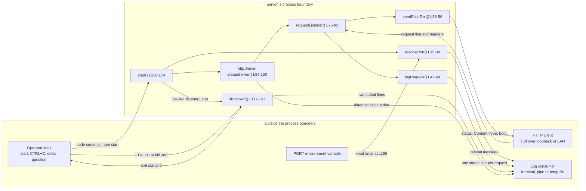

| Boundary crossing | Direction | Format at the boundary | Contract owner |
|---|---|---|---|
| Request target and method | Inbound | HTTP/1.1 request line; parser rejects a control byte with `400 Bad Request` before the listener runs | Node.js runtime, then `requestListener` L75-91 |
| `PORT` | Inbound | String or undefined; trimmed, digits only, `1024`-`65535` | `resolvePort` L15-39 |
| `SIGINT` | Inbound (control) | POSIX signal delivered to the process, not to a pipeline group | `shutdown` L117-153 |
| Response | Outbound | Status line, `Content-Type: text/plain`, 11-byte or 9-byte body | `sendPlainText` L53-56 |
| Operational lines | Outbound | Three-token request line, two shutdown lines, one startup line | `logRequest` L42-44 and `console.log` L118, L142, L172 |
| Diagnostics | Outbound | Four refusal/failure messages, stderr only | `console.error` L105, L107, L109, L162 |
| Exit status | Outbound | `0` clean `SIGINT`; `1` invalid `PORT`, privileged port, bind failure | `process.exitCode` L113, L151, L163 |

### 4.1.3 Flow Inventory and Notation

Four flows carry the whole behaviour, plus the failure flows in Section 4.6 and the state transitions in Section 4.5.

| Flow | Trigger | Owning feature | Diagram location |
|---|---|---|---|
| Startup and configuration gate | Process start | F-005, F-006 | Section 4.2.1 |
| End-to-end serving workflow | Start, request, stop | F-001 to F-008 | Section 4.2.2 |
| Request routing and response | Each accepted request | F-002, F-003, F-004, F-001 | Section 4.2.3 |
| Graceful shutdown | `SIGINT` | F-007 | Section 4.2.4 |

Diagram conventions: every node label carries the implementing symbol and line range; a diamond is one `if` condition from `server.js` with the condition text and its line; terminal nodes are stadium-shaped; annotated timings quote the documented gate (`README.md` L307-591) rather than an invented threshold. Where a step belongs to the Node.js runtime rather than to `server.js` — request parsing, response framing, `HEAD` body suppression — the label says so, because the program cannot be read as though it performed that step itself.


## 4.2 Core Business Processes

Two processes dominate the runtime: a startup gate that decides whether the process ever serves, and a request path that repeats for every request until a signal arrives. A third closes the process. Each is documented here with its decisions, its touchpoints, its error states and the observations that confirm it at runtime on Node v22.23.4.

### 4.2.1 Startup and Configuration Gate (F-005, F-006)

Startup is a linear sequence of five steps with one branch cluster in the middle. `start()` installs the broken-stdio guard first (`server.js` L157), resolves `PORT` (L159), refuses or proceeds, creates the server with its `error` handler attached (L167, L97), registers `SIGINT` (L169) and calls `server.listen(port)` with no host argument (L171). The startup line comes from the listen callback (L172), never from the statement following the call, so it proves the bind rather than assuming it.

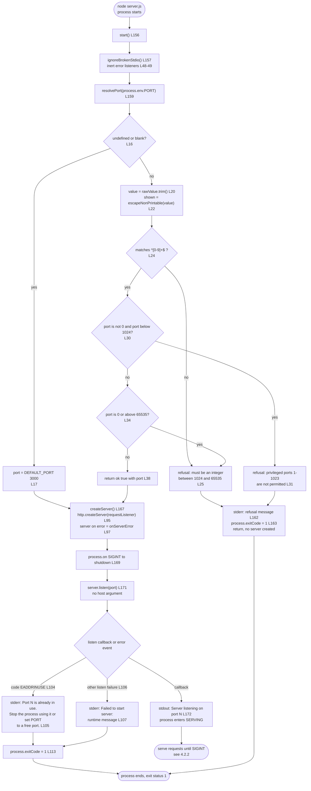

| Step | Implementation | Observable outcome | Validation gate |
|---|---|---|---|
| Broken-stdio guard installed before any write | `ignoreBrokenStdio` L47-50, called L157 | A vanished log reader cannot turn a later line into an unhandled `error` | No named gate; exercised by V5 and V6 redirects |
| `PORT` resolved and validated | `resolvePort` L15-39 | `3000` by default; otherwise the trimmed value or a refusal message | V1, V10, V11, V12 |
| Renderer created with its error handler | `createServer` L94-100 | One `error` handler covers every server-level failure | V13 covers `EADDRINUSE` |
| `SIGINT` registered before the bind | `process.on('SIGINT', …)` L169 | The window between bind and handler registration does not exist | V6 |
| Bind, then announce | `server.listen(port, callback)` L171-173 | Startup line names the resolved port, only after the socket is bound | V1, V10 |

Observed at runtime: `PORT=abc`, `PORT=0` and `PORT=65536` each wrote the integer refusal to stderr, printed nothing on stdout and exited `1`; `PORT=80` wrote the privileged-port refusal and exited `1`; `PORT=" 4000 "` bound `4000` and printed `Server listening on port 4000`; a second process on a held port wrote `Port 3000 is already in use. Stop the process using it or set PORT to a free port.` and exited `1` while a companion on `PORT=3001` started normally.

### 4.2.2 End-to-End Serving Workflow (F-001 to F-008)

The end-to-end journey has four user touchpoints — start, request, response, stop — and one loop. Nothing about the run is time-driven: the process waits on the listening socket, and each request is handled to completion in the order the runtime delivers it.

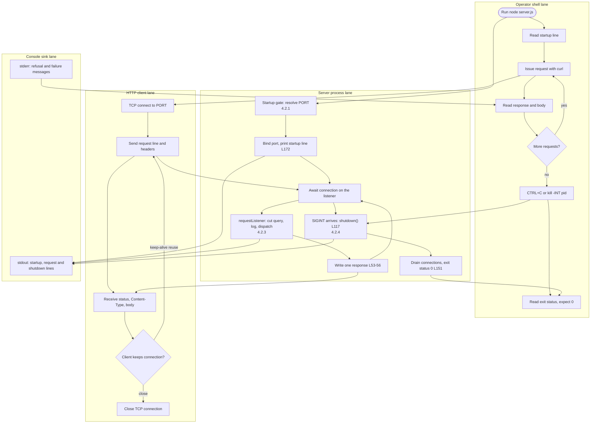

| Journey stage | What the actor does | What the system does | Touchpoint observed |
|---|---|---|---|
| Start | Runs `node server.js` or `npm start` | Validates `PORT`, creates the server, binds, announces | Startup line `Server listening on port 3000` on stdout (V1) |
| Request | Sends `curl http://localhost:3000/hello` | Cuts the query, logs one line, looks up the route, writes the body | `200 text/plain 11` (V2); request line on stdout (V5) |
| Failure request | Sends any other method or path | Logs the same way, matches nothing, writes the catch-all | `404 text/plain 9` (V3, V4) |
| Reuse | Keeps the connection open | Serves each subsequent request on that socket independently | Two responses on one socket, one log line each |
| Stop | Presses `CTRL+C` or `kill -INT <pid>` | Prints two lines, drains, sets exit status `0` | `exit=0` (V6) |

The observed run matches the diagram in every branch: the startup line appears only after the bind; five requests produced five log lines in arrival order; an idle keep-alive socket was closed during shutdown without delaying it; and the exit status was `0` for `SIGINT` and `1` for every configuration refusal.

### 4.2.3 Request Routing and Response Decision Path (F-002, F-003, F-004, F-001)

Per request the program performs exactly two transformations and one decision: it cuts the query string off `req.url`, writes the log line, then looks the composed key up in `ROUTES`. There is no middleware chain, no body read and no content negotiation.

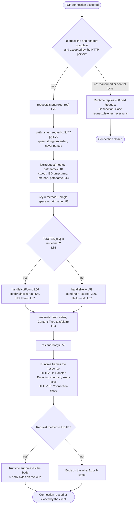

| Decision or step | Rule applied | Observed outcome |
|---|---|---|
| Parser acceptance | Node's HTTP parser validates the request line before the listener; a byte outside `0x20`-`0x7E` in the target yields `HTTP/1.1 400 Bad Request` with `Connection: close` and no log line | Confirmed with a `0x01` byte in the target |
| Query removal | `req.url.split('?')[0]`; the query string is never parsed or logged | `GET /hello?x=1` returned `200` and logged `GET /hello` |
| Logging precedence | `logRequest` runs before the route lookup, so a miss is logged like a hit | A `404` request produced a request line |
| Route key | Exact, case-sensitive match on method and query-stripped path; no trailing-slash tolerance, no percent-decoding, no `HEAD`-as-`GET` | `/hello` matched; `/hello/`, `/Hello`, `/hello%2F` and `POST /hello` did not |
| Missing key | Falls through to `handleNotFound`; never an exception, never a `405` | `POST /hello` returned `404` with the 9-byte body |
| Response writer | The only writer is `sendPlainText`, so both outcomes carry `Content-Type: text/plain` with no `charset` parameter | Both responses showed exactly `text/plain` |
| Body suppression | The runtime omits the body for `HEAD`; the handler still writes the literal | `HEAD /hello` returned `404` with 0 body bytes |

Two properties of this path belong to the runtime rather than to the program and are worth separating when reading the diagram: the `400` rejection and `HEAD` suppression both happen outside `server.js`. The escaping in `logRequest` (L43) is therefore defence in depth in the log path — reachable in practice through the `PORT` refusal messages, where `escapeNonPrintable` renders a control byte as `\uXXXX`.

### 4.2.4 Graceful Shutdown Process (F-007)

`SIGINT` starts a bounded drain: one synchronous line, a five-second failsafe timer, an optional idle-connection close, then `server.close()`. The close callback is the success path; the timer is the only other exit.

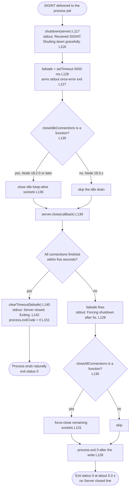

| Connection class at signal time | Path taken | Observed result |
|---|---|---|
| None | `server.close()` callback fires immediately | Both shutdown lines, `exit=0`, completion within about 5 ms of the signal |
| Idle keep-alive socket, no request in flight | `closeIdleConnections()` closes it, then the callback fires | Both shutdown lines, `exit=0`, 6 ms elapsed in the reproduction |
| Socket holding a partial request line | `server.close()` waits; the failsafe fires at 5 s and `closeAllConnections()` forces the socket shut | `Received SIGINT. Shutting down gracefully.` then `Forcing shutdown after 5s.`, `exit=0`, 5,022 ms elapsed |
| A response in flight | Drained before the callback, within the five-second bound | The success path, by design; the failsafe bounds the worst case |

The forced path was reproduced twice and both runs printed the forcing line **instead of** `Server closed. Exiting.`: `process.exit(0)` in the failsafe's write callback ends the process before the close callback can log. `README.md` L241 documents the forcing line but does not say the success line is then absent, so the sequence above records what the code does rather than what the prose implies. The success path deliberately avoids `process.exit()` because an early exit truncates pending stdout writes (`server.js` L144-151).

### 4.2.5 Signals Not Handled and Process Termination

`SIGINT` is the only signal with a registered handler (`server.js` L169); every other signal keeps the runtime's default disposition, and `README.md` L650 states the exclusion for `SIGTERM` and `SIGHUP`. There is no `uncaughtException` or `unhandledRejection` handler.

| Signal or event | Disposition | Observable effect | Consequence for the operator |
|---|---|---|---|
| `SIGINT` | Handled by `shutdown` L117-153 | Two stdout lines (or the forcing line), exit status `0` | The documented stop mechanism (`README.md` L213-241) |
| `SIGTERM` | Default: terminate | Process ends with no shutdown lines; observed exit status `143` | A supervisor that stops with `SIGTERM` never enters the graceful path |
| `SIGHUP` | Default: terminate | Same as `SIGTERM` | No reload, no drain |
| `SIGKILL` | Not catchable | Immediate termination, no output | Nothing is flushed |
| Unhandled exception or rejection | No handler | Runtime prints a stack trace to stderr, exit status `1` | Outside the documented exit vocabulary; no code path was found that raises one in normal operation |

Because the graceful path is keyed to one signal, a deployment that signals differently changes the observable contract: the two shutdown lines and the `0` status are properties of `SIGINT` delivery, not of process termination in general.


## 4.3 Integration Workflows

The system integrates with three things and nothing else: an HTTP client on its listening socket, the operator's console streams, and the Node.js runtime that mediates both. There is no outbound call, no message broker, no batch job and no event consumer to integrate with, so this section documents those three channels in full and states the absences explicitly.

### 4.3.1 Client–Server HTTP Interaction Sequence

A single sequence covers both the success and the failure contract, because they differ only in the status number and the body literal handed to the same writer. The diagram traces two requests on one connection: a `GET /hello` followed by a `POST /hello` on the reused socket, which reproduces the observed behaviour of one log line and one response per request.

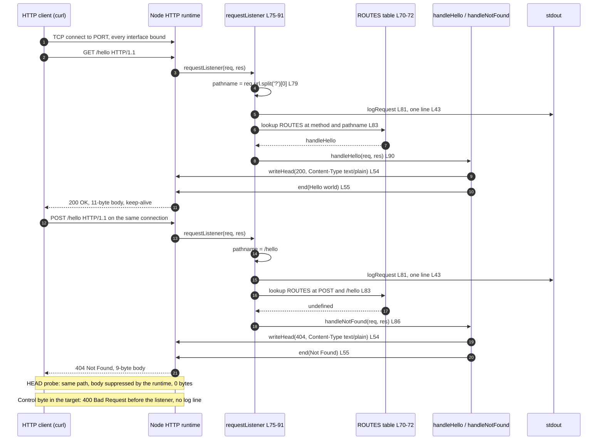

| Interaction | Request | Response on the wire | Log line written |
|---|---|---|---|
| Success | `GET /hello`, with or without a query string | `200 OK`, `Content-Type: text/plain`, `Hello world` (11 bytes) | `2026-11-12T19:14:27.694Z GET /hello` |
| Failure | Any other method or path | `404 Not Found`, `Content-Type: text/plain`, `Not Found` (9 bytes) | `2026-11-12T19:14:27.702Z GET /invalid` |
| Probe | `HEAD /hello` | `404 Not Found`, `Content-Type: text/plain`, 0 body bytes | One line for `HEAD /hello` |
| Rejected | Target containing `0x01` | `400 Bad Request`, `Connection: close` | None; the listener is never entered |
| Reused | Second request on one socket | Its own status and body, independent of the first | One line per request |

Framing is the runtime's, not the program's: an HTTP/1.1 client observes `Date`, `Connection: keep-alive`, `Keep-Alive: timeout=5` and `Transfer-Encoding: chunked`, while an HTTP/1.0 client observes `Date` and `Connection: close` with no `Keep-Alive` and no chunked framing. `README.md` L188-190 is explicit that none of these is part of the contract, which is the status, the content type and the byte-exact body.

### 4.3.2 Console Stream Interaction and Broken-Reader Handling (F-008)

Console output is the system's only observability channel, and the program splits it by purpose: operational output on stdout, diagnostics on stderr. Nine write sites exist in total, and each is guarded by the inert `error` listeners installed as the first statement of `start()` (`server.js` L47-50, L157).

| Stream | Site | Message | Trigger |
|---|---|---|---|
| stdout | L43 | `<ISO-8601 timestamp> <method> <pathname>` | Every request, before routing |
| stdout | L118 | `Received SIGINT. Shutting down gracefully.` | `SIGINT` received |
| stdout | L142 | `Server closed. Exiting.` | `server.close()` callback, success path only |
| stdout | L128 | `Forcing shutdown after 5s.` | Failsafe timer fires after 5,000 ms |
| stdout | L172 | `Server listening on port <resolved port>` | Listen callback, after the bind |
| stderr | L105 | `Port <port> is already in use. Stop the process using it or set PORT to a free port.` | Server `error` with `code === 'EADDRINUSE'` |
| stderr | L107 | `Failed to start server: <runtime message>` | Server `error` with `syscall === 'listen'` and another code |
| stderr | L109 | `Server error while serving: <runtime message>` | Any other server `error`, after the bind |
| stderr | L162 | `Invalid PORT value "<value>": …` (two variants) | `resolvePort` refusal |

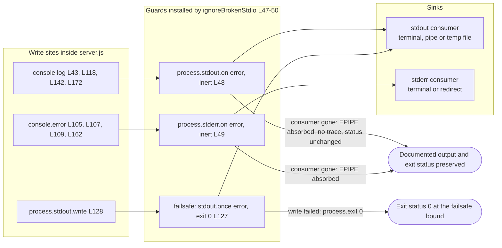

| Reader condition | Before the guard (commit history) | With the guard (tip `10d5d2ce`) |
|---|---|---|
| Terminal attached | Documented lines appear normally | Unchanged |
| Reader exits mid-run (pipe closed) | Four of the five stdout writes failed with `EPIPE`, replaced by a stack trace and exit status `1` | Failure absorbed by the inert listener; shutdown still prints what it can and exits `0` |
| Log redirected to a file later removed | The write fails at the next flush | Absorbed; no trace, no status change |
| Failsafe line cannot be written | Not previously guarded on this path | `stdout.once('error', () => process.exit(0))` at L127 keeps the forced exit at status `0` |

The guard is deliberately inert — it writes nothing, sets no exit status and calls no `process.exit` — so no documented literal, stream or ordering changes when it is present (`server.js` L46). This is the only place where a failure is swallowed rather than reported, and it is swallowed precisely so the documented shutdown contract survives a consumer that has gone away, which is the normal case in the scripted runs V5, V6 and V9 prescribe.

### 4.3.3 Batch, Event and Scheduled Processing

None exists, and the absence is structural rather than pending:

- **No batch processing.** There is no loop in executable code, no file scan, no bulk import and no report generation; `README.md` L644 records that no file is written.
- **No event processing.** The four event registrations are stdout and stderr `error`, the server `error`, and `SIGINT`. Nothing subscribes to a broker, a queue, a webhook or a cron trigger, and the request stream itself is never read: a `POST` carrying a five-byte body was answered `404` with its 9-byte body immediately, without the body being consumed.
- **No scheduled work.** One timer exists (`setTimeout` L126) and it exists only inside the shutdown path, with a matching `clearTimeout` (L140). No interval, no keep-alive probe, no cache refresh, no retry backoff timer.
- **No asynchronous pipeline.** No `async` function, `await`, `Promise`, `.then` or callback chain appears in the code; every handler returns synchronously after `res.end`.

A reader looking for a nightly job, a queue consumer or a webhook receiver will not find one, and any such diagram would be inventing behaviour the repository does not contain.

### 4.3.4 Data Flow Between Systems

Every crossing in Section 4.1.2 carries a value that is transformed in a small, enumerable way. Nothing is enriched, persisted or forwarded.

| Flow | Shape as received | Transformation in the program | Shape as emitted | Site |
|---|---|---|---|---|
| Configuration | `process.env.PORT`: string or undefined | Trim; digit test; range test including the privileged band and zero; convert to `Number` | Integer port handed to `server.listen(port)` | `resolvePort` L15-39, `start` L159-171 |
| Request target | `req.url`: raw request target string | `split('?')[0]`, no decoding, no parser | `pathname` used twice — as the logged third token and as the route key's second half | L79, L81, L83 |
| Method | `req.method`: string as received | `escapeNonPrintable` for the log token only; otherwise compared verbatim | Second token of the log line; first half of the route key | L43, L83 |
| Route lookup | Composite key `<method> <pathname>` | Property lookup in a one-entry object | Handler reference or `undefined` | L70-72, L83 |
| Response | Status number and body literal chosen by the handler | `writeHead(status, {'Content-Type': 'text/plain'})` then `end(body)` | Status line, one program-set header, and 11 or 9 body bytes; framing added by the runtime | L53-56, L62, L67 |
| Server error | `Error` object from the runtime | Branch on `code` and `syscall`; message interpolated verbatim | One stderr line naming the port or the runtime message | L103-114 |
| Signal | `SIGINT` delivery | No payload; triggers the drain sequence | Two stdout lines and an exit status | L117-153, L169 |
| Exit status | — | `process.exitCode` assigned, never forced except in the failsafe | `0` or `1` observed through `$?` | L113, L151, L163 |

Two properties of this flow are worth stating because they bound every later diagram. The program never reads a request body, so nothing a client sends beyond the request line and headers reaches any code path. And the program writes nothing outward except response bytes and console lines, so there is no downstream system whose state a flow could leave inconsistent.


## 4.4 Decision Points and Validation Rules

Every decision the program makes is one of ten `if` statements, and every validation rule is applied at the boundary it protects — the environment for configuration, the runtime parser and the route table for requests. This section inventories both so a reviewer can confirm that no branch is undocumented and no input path is unvalidated.

### 4.4.1 Decision Inventory

| # | Location | Condition text | True branch | False branch | Feature / requirement |
|---|---|---|---|---|---|
| D1 | L16 | `rawValue === undefined \|\| rawValue.trim() === ''` | Default `3000` (`{ ok: true, port: 3000 }`) | Continue to trimming and validation | F-005-RQ-001 |
| D2 | L24 | `!/^[0-9]+$/.test(value)` | Refuse with the integer message | Continue to the range tests | F-005-RQ-004 |
| D3 | L30 | `port !== 0 && port < MIN_PORT` | Refuse with the privileged-port message | Continue to the upper-bound test | F-005-RQ-005 |
| D4 | L34 | `port === 0 \|\| port > MAX_PORT` | Refuse with the integer message | Return `{ ok: true, port }` | F-005-RQ-006 |
| D5 | L85 | `handler === undefined` | Call `handleNotFound`, return | Call the matched handler | F-002-RQ-003, F-003-RQ-001 |
| D6 | L104 | `error.code === 'EADDRINUSE'` | Report the port-in-use message, then exit status `1` | Fall to D7 | F-006-RQ-001 |
| D7 | L106 | `error.syscall === 'listen'` | Report `Failed to start server: …`, then exit status `1` | Fall to the post-bind report | F-006-RQ-002 |
| D8 | L130 | `typeof server.closeAllConnections === 'function'` | Force-close remaining sockets in the failsafe | Skip the force-close, keep the timed exit | F-007-RQ-003, F-007-RQ-005 |
| D9 | L135 | `typeof server.closeIdleConnections === 'function'` | Close idle keep-alive sockets before `server.close()` | Skip the idle drain | F-007-RQ-001, F-007-RQ-005 |
| D10 | L161 | `!resolved.ok` | Write the refusal to stderr, set exit status `1`, return without binding | Create the server and listen | F-005-RQ-007, F-006-RQ-004 |

D6 and D7 form an ordered chain rather than independent tests: the second is only reached when the first is false, and the `else` branch at L108-111 is the post-bind case that reports without touching the exit status. D8 and D9 are capability tests, not data tests — on Node 18.0.x both are false and the five-second failsafe alone guarantees exit status `0`.

### 4.4.2 Validation Rules at Each Step

**Configuration validation (before any bind).** `resolvePort` applies four ordered rules, and their order is what determines which message a given value receives.

| Rule | Accepted | Refused with | Evidence |
|---|---|---|---|
| Absence is valid configuration: undefined or whitespace-only resolves to `3000` | unset, `""`, `"   "` | — | L16-18; observed: `PORT="   "` printed `Server listening on port 3000` |
| Surrounding whitespace is not part of the value | `" 4000 "` | — | L20; observed binding `4000` |
| Only canonical decimal digits are accepted, so `0x1F90`, `1e3`, `+3000`, `3000.5`, `-1` and `abc` are refused rather than reinterpreted | `1024` to `65535` in digits | `Invalid PORT value "<value>": must be an integer between 1024 and 65535.` | L24-26; V11 |
| The privileged band is refused as configuration, before any bind, so no root is needed | `>= 1024` | `Invalid PORT value "<value>": privileged ports 1-1023 are not permitted; choose a port between 1024 and 65535.` | L30-32; V12 |
| Zero is out of range, not privileged, and above `65535` is out of range | `1024`-`65535` | The integer message | L34-36; V11 covering `0` and `65536` |

The offending value is rendered through `escapeNonPrintable` (L22, L10-12) before it appears in a message, so a control byte in `PORT` cannot break the message or the terminal; the escaping is directly observable here, for example `Invalid PORT value "ab\u0001c": …`.

**Request validation (per request).** No field validation is performed on headers, because no header is read. The matching rules act as the request-level validation gate, and every miss is a 404.

| Rule | Matched | Not matched |
|---|---|---|
| The query string is removed before comparison | `GET /hello?anything=1` | — |
| Path comparison is exact and case-sensitive | `GET /hello` | `GET /Hello`, `GET /HELLO`, `GET /hello/` |
| No percent-decoding is performed | — | `GET /hello%2F` |
| The method must match exactly; `HEAD` is not treated as `GET` | `GET /hello` | `POST /hello`, `PUT /hello`, `HEAD /hello` |
| A request line the runtime cannot parse never reaches the program | — | Target containing `0x01` → runtime `400 Bad Request`, no log line |

**Response validation (before the wire).** There is no response validation step in code: the status and the body are literals, and the verification gates assert their exact bytes — 11 for `Hello world`, 9 for `Not Found` — which makes drift detectable without a test harness (`README.md` L112, L147).

### 4.4.3 Authorization Checkpoints and Compliance Checks

There are none, and the absence is a stated boundary rather than an oversight. The program contains no authentication, session, cookie, token, role, permission or policy logic; no header is inspected for identity; and the endpoint is anonymous and read-only (`README.md` L645). No regulatory compliance check, data-retention rule or audit requirement applies: no personal data is received, no state is persisted, and the only record of a request is one stdout line containing a timestamp, the method and the query-stripped path (`server.js` L43).

| Control a reviewer might look for | Present | What governs the exposure instead |
|---|---|---|
| Authentication or authorization | No | The catch-all: anything but `GET /hello` is refused with `404` |
| Rate limiting or quotas | No | None; documented as a non-goal (`README.md` L646) |
| TLS or transport protection | No | Plain HTTP on every interface because `listen` is called without a host argument (`server.js` L171; `README.md` L77) |
| Input sanitisation on the request path | Partial by construction | The path is cut with `split`, never parsed, and never echoed into the response body |
| Log-injection control | Yes | `escapeNonPrintable` on both request-derived tokens, keeping each line at three tokens (L43) |
| Secret or credential handling | None exists | No configuration beyond `PORT`; no secret is read or stored |

The two security-relevant facts a reader should carry away are that the listener is reachable from every interface with no access control, and that the refusal path (`404`) discloses nothing about which check failed — which the README states as deliberate (`README.md` L186).


## 4.5 State Management

All state in this system lives in the process image and dies with it. There are six state holders, four lifecycle states reachable through documented paths plus two failure sinks, no persistence, no cache and no transaction that spans more than one request.

### 4.5.1 State Variables and Transitions

| State holder | Type and lifetime | Written at | Read at | Effect on behaviour |
|---|---|---|---|---|
| `DEFAULT_PORT`, `MIN_PORT`, `MAX_PORT` | Module constants, `3000`, `1024`, `65535`, for the process lifetime | Module load L5-7 | `resolvePort` L16-36 | Fix the accepted configuration range |
| `resolved.port` | Local in `start`, one per process lifetime | L159 | `server.listen` L171, startup line L172 | The only configuration value the process carries forward |
| `server` | `http.Server` instance, created once | L167 | `SIGINT` closure L169, `shutdown` L121-139 | The handle the drain operates on |
| Failsafe timer | `Timeout` object, alive only during a drain | L126 | `clearTimeout` L140 | Bounds shutdown at 5,000 ms |
| `process.exitCode` | Process-wide integer, initially `0` | L113, L151, L163 | The shell, after exit | The only machine-readable outcome |
| Per-request locals (`pathname`, `handler`) | Function locals, one request's lifetime | L79, L83 | L81, L83, L90 | Never shared between requests, never stored |

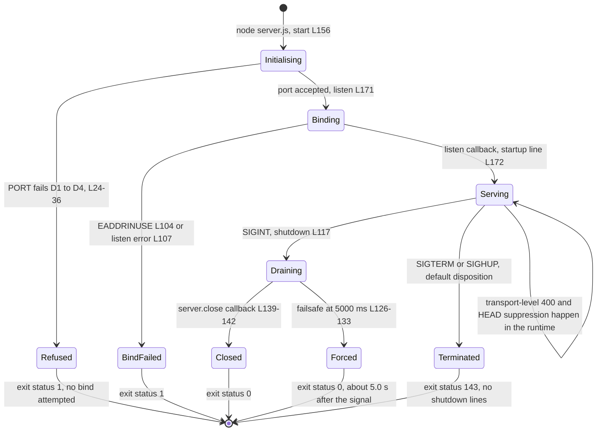

| Transition | Trigger | Guard | Observable evidence |
|---|---|---|---|
| Initialising → Refused | `PORT` present but invalid | D1 to D4 | One stderr line, empty stdout, exit `1` |
| Initialising → Binding | Valid or absent `PORT` | `resolved.ok` true (D10 false) | No output yet; the bind is in flight |
| Binding → Serving | Successful bind | Listen callback runs | `Server listening on port N` on stdout |
| Binding → BindFailed | Bind error | D6 or D7 true | One stderr line, exit `1`, nothing listening |
| Serving → Serving | Each request, each post-bind error | — | One log line and one response per request; serving continues after a reported error |
| Serving → Draining | `SIGINT` | Only registered signal | `Received SIGINT. Shutting down gracefully.` |
| Draining → Closed | All connections finished | Within 5,000 ms | `Server closed. Exiting.`, exit `0` |
| Draining → Forced | Failsafe fires | Connection not finished at 5,000 ms | `Forcing shutdown after 5s.`, exit `0` |
| Serving → Terminated | `SIGTERM` or `SIGHUP` | Default disposition, no handler | Exit `143` observed for `SIGTERM`; startup line only, no shutdown lines |

`Serving` is the only state that accepts concurrent work, and it does so without shared mutable request state: each request's `pathname` and `handler` are locals of one `requestListener` invocation, which is why fifty parallel requests produced fifty independent responses and fifty log lines in the reproduction.

### 4.5.2 Data Persistence Points

None. The program opens no writable path, requires no filesystem module and writes no log file; its single import is `node:http` (`server.js` L3), and `README.md` L644 states that nothing survives a request or a process exit.

| Storage concern | Status | Evidence |
|---|---|---|
| Database, key-value store, embedded store | Absent | No client import, no connection string, no schema |
| Files written or appended | None | No `node:fs` import; the only writes are to `res` and to the console streams |
| In-memory accumulation across requests | None; the heap reaches steady state during the first batch | V9's RSS readings were stable rather than proportional to request count (`README.md` L447) |
| Durable record of a request | One stdout line, if a reader keeps it | `server.js` L43; a redirected log is the consumer's artifact, not the program's |
| Restart behaviour | Every restart begins from `Initialising` with no recovered state | No load step exists in `start()` L156-174 |

The practical consequence for the flows in Section 4.2: no step can fail in a way that leaves durable state inconsistent, and no recovery procedure needs to reconcile anything after a crash.

### 4.5.3 Caching Requirements

There is no cache and no cache directive. Responses carry only the `Content-Type` header the program sets, plus the framing and date headers the runtime adds; no `Cache-Control`, `ETag`, `Last-Modified` or `Expires` header is emitted, so a client or intermediary has nothing from the program to key on.

| Caching concern | Status | Detail |
|---|---|---|
| Response caching headers | None emitted | Observed headers: `Content-Type`, `Date`, `Connection`, `Keep-Alive`, `Transfer-Encoding` (HTTP/1.1) or `Content-Type`, `Date`, `Connection: close` (HTTP/1.0) |
| In-process memoisation | None | `ROUTES` is a module-level constant object (L70-72), a routing table rather than a cache; nothing is stored per request |
| Repeated computation avoided by hand | Two spots, both trivial | `escapeNonPrintable` runs per token per line (L43); the timestamp is generated per request (L43). Neither is cached |
| Connection reuse | Provided by the runtime, not cached | `Keep-Alive: timeout=5` is a runtime header; the program keeps no per-connection state |
| Invalidation requirements | None | Nothing cached means nothing to invalidate |

### 4.5.4 Transaction Boundaries

A request is the only unit of work, and its commit point is the response write.

| Boundary | Starts | Commits | Rollback on failure |
|---|---|---|---|
| One request | Entry to `requestListener` L75 | `res.end(body)` L55 | None; a partially written response cannot be recalled, and the socket is the only record |
| Log line for that request | `logRequest` L81, before routing | The stdout write | None; a line already written is not withdrawn if the response later fails |
| Startup | `start()` L156 | The listen callback at L172 | None needed before the bind; a refusal or bind failure simply ends the process |
| Shutdown | `SIGINT` L118 | `process.exitCode = 0` L151, or the forced `process.exit(0)` L128 | The failsafe substitutes a bounded exit for a drain that cannot complete |
| Configuration | `resolvePort` L15 | Return of `{ ok: true, port }` L38 | Refusal returns before any server exists, so there is no half-started state to unwind |

Two ordering facts are the whole of the transactional story, and both are observable: the log line is committed before the route is decided, so a 404 is recorded exactly like a 200; and the response is committed through one writer, so no path can emit a status without a body or a body without the program-set content type.


## 4.6 Error Handling and Flowcharts

Error handling in this system is a classification problem, not a recovery loop. Every failure is detected at one of six sites, reported on exactly one channel, and resolved by either continuing to serve or ending the process with a status of `0` or `1`.

### 4.6.1 Error Classes and Notification Flows

| Error class | Detected at | Channel and message | Process outcome | Documented gate |
|---|---|---|---|---|
| Non-integer or out-of-range `PORT` | `resolvePort` L24-26, L34-36 | stderr: `Invalid PORT value "<value>": must be an integer between 1024 and 65535.` | Exit status `1`, no bind attempted | V11 |
| Privileged `PORT` (1-1023) | `resolvePort` L30-32 | stderr: `Invalid PORT value "<value>": privileged ports 1-1023 are not permitted; choose a port between 1024 and 65535.` | Exit status `1`, no bind attempted, no root needed | V12 |
| Port already in use | `onServerError` L104-105 | stderr: `Port <port> is already in use. Stop the process using it or set PORT to a free port.` | Exit status `1` | V13 |
| Other listen failure | `onServerError` L106-107 | stderr: `Failed to start server: <runtime message>` | Exit status `1` | None; inducing it depends on the host (`README.md` L299) |
| Post-bind server error | `onServerError` L108-111 | stderr: `Server error while serving: <runtime message>` | Reported, no status change, serving continues | None named |
| Request line rejected by the parser | Node.js HTTP parser, before the listener | Runtime-generated `HTTP/1.1 400 Bad Request` with `Connection: close`; nothing on stderr, no request log line | Connection closed; process unaffected | None named |
| Console write failure (`EPIPE` and similar) | stdout or stderr `error` event | Absorbed by the inert listeners L48-49; no message | Status unchanged; documented output preserved where the sink survives | Exercised incidentally by V5 and V6 |
| Connection that will not finish during shutdown | Failsafe timer L126-133 | stdout: `Forcing shutdown after 5s.` | Forced `process.exit(0)` | `README.md` L241 |
| Unexpected exception or rejection | No handler exists | Runtime stack trace on stderr | Exit status `1`, outside the documented vocabulary | Not reachable on any branch in the code |

The routing miss is deliberately not in this table: a 404 is a response contract (Section 4.2.3), not an error condition, and the program reports it only through the ordinary log line and the ordinary response.

### 4.6.2 Error Handling Flowchart

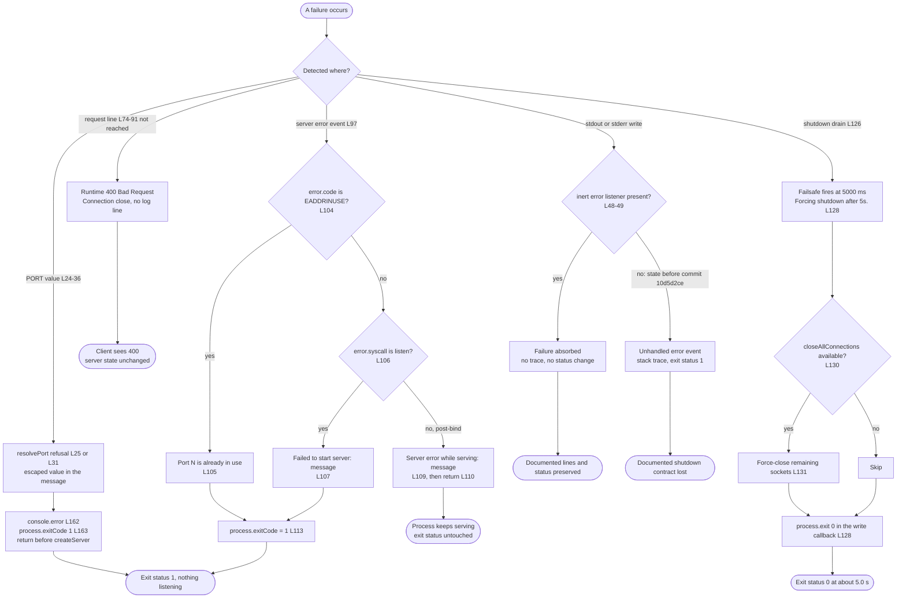

The `H1` false branch is historical rather than hypothetical: it is the behaviour observed before commit `10d5d2ce`, where four of the five stdout writes failed with `EPIPE`, the documented lines were replaced by a stack trace and a clean `SIGINT` reported exit status `1`. The tip keeps it in the diagram only to show what the guard prevents.

### 4.6.3 Retry Mechanisms

There are none, and this is a design property rather than an omission:

| Failure | Retry behaviour | Evidence |
|---|---|---|
| Bind failure of any kind | No retry, no alternate port, no backoff | One `server.listen` call (L171); `onServerError` reports and sets exit status `1` (L113) |
| `PORT` refusal | No fallback to the default port when a value was supplied | `resolvePort` returns a refusal, and `start` returns before creating a server (L161-165) |
| Request that fails mid-response | No retry, no re-send; the socket is the only record | One `res.end` per request (L55); no loop exists |
| Console write failure | No re-write, no buffering, no queued flush | Inert listeners L48-49; the failsafe is the one write that waits for its own completion (L128) |
| Shutdown that stalls | Not a retry: the five-second failsafe is a hard bound that replaces the wait | `setTimeout` L126 with `clearTimeout` on success L140 |

The only construct that resembles a retry — waiting for a write callback before exiting in the failsafe path — is a single flush of one line, not a repeated attempt.

### 4.6.4 Fallback Processes

| Fallback | When it applies | Mechanism | Observed effect |
|---|---|---|---|
| Route fallback | Any method or path that is not the table key | `handleNotFound` L66-68 via the missing-key branch L85-88 | `404 Not Found`, 9 bytes, identical for every miss |
| Shutdown fallback | A connection still open at 5,000 ms | Failsafe timer L126-133 with `closeAllConnections` L130-132 | `Forcing shutdown after 5s.`, exit `0` |
| Idle-drain fallback | Runtime without `closeIdleConnections`, i.e. Node 18.0.x | `typeof` guard L135-137 | Shutdown still completes, bounded by the failsafe |
| Stream fallback | The log reader has gone away | Inert `error` listeners L48-49 | No trace, no status change, documented lines preserved where possible |
| Framing fallback | Client speaks HTTP/1.0, or a `HEAD` is answered | Node's runtime chooses `Connection: close` instead of chunked framing and suppresses the body | Client still observes the status and `Content-Type` contract |
| Configuration fallback | `PORT` unset or blank | `DEFAULT_PORT` 3000 L17 | Startup succeeds on the documented default |

None of these is a degraded mode the operator must enable: each is taken automatically, and each preserves the observable contract of the path it protects.

### 4.6.5 Recovery Procedures

Recovery is entirely the operator's, and it is documented message by message. The program has no self-healing behaviour — no restart, no re-bind, no state repair — because it has no state to repair.

| Situation observed | Documented action | Source |
|---|---|---|
| `Invalid PORT value "…": must be an integer between 1024 and 65535.` | Supply a decimal port between `1024` and `65535`, for example `PORT=4000 node server.js` | `README.md` L595-601 |
| `Invalid PORT value "…": privileged ports 1-1023 are not permitted…` | Choose a port at or above `1024`; no root is required and no override variable exists | `README.md` L603-605 |
| `Port <port> is already in use…` | Stop the process holding the port, or start on another one with `PORT=4000` | `README.md` L607-613 |
| `Failed to start server: <message>` | Act on the runtime message; rule configuration out with the `PORT` override form | `README.md` L615-621 |
| Nothing printed on startup | Check `$?` in the same shell; a `1` means stderr names the cause | `README.md` L623-631 |
| An unexpected 404 | Compare the method and query-stripped path exactly; `/hello/`, `/Hello`, `/hello%2F` and `POST /hello` do not match | `README.md` L633-635 |
| A predictor stops the process with `SIGTERM` | Use `CTRL+C` or `kill -INT <pid>`; `SIGTERM` never enters the graceful path | `README.md` L650, `server.js` L169 |

After any of these the recovery is a restart: `node server.js` re-enters `Initialising` with no recovered state, which Section 4.5.2 establishes is safe because nothing was persisted.


## 4.7 Timing Constraints and SLA Considerations

The system declares no service-level objective: no availability target, no throughput guarantee, no error budget and no response-time commitment appears in `README.md` or `package.json`, and none should be inferred from the tutorial's measurements. What the repository does state is a small set of concrete timing facts — where a line must appear relative to a bind, how fast a loopback request completes, how long a shutdown may take — and those are recorded here with the gate that decides each.

### 4.7.1 Timing Constraints Inside the Process

| Constraint | Bound | Enforcement | Evidence |
|---|---|---|---|
| The startup line must follow the bind, never precede it | Ordering only, no delay | The line is written inside the `server.listen` callback | `server.js` L171-173; `README.md` L75 |
| A request is handled to completion in one event-loop turn | No internal deadline; one string comparison and one `end()` write | Synchronous handler, no `await`, no I/O | `server.js` L75-91, L53-56 |
| Idle keep-alive connections are held for 5 s by the runtime, then dropped | 5,000 ms | Runtime header `Keep-Alive: timeout=5`; the program sets no timeout | Observed response headers; `README.md` L188-190 |
| A graceful shutdown must complete within 5 s | 5,000 ms hard bound | `setTimeout` L126, cleared on success L140 | `server.js` L120-133; `README.md` L241 |
| The failsafe's exit waits for its own stdout write | One asynchronous write | `process.exit(0)` runs from the write callback L128 | `server.js` L126-128 |
| A refusal must not bind | Immediate | `start` returns before `createServer` L161-165 | V11, V12 |

The five-second figure appears twice with different meanings and should not be conflated: it is the shutdown failsafe in the program (`server.js` L126), and separately the runtime's keep-alive idle timeout reported in the `Keep-Alive` header. Neither is a request timeout; the program applies none.

### 4.7.2 Measured Figures and Their Thresholds

| Indicator | Threshold | Documented measurement | Reproduced measurement |
|---|---|---|---|
| Warm loopback latency for `GET /hello` (V7) | Each of five samples below `0.010` s | `0.000478`, `0.000522`, `0.000466`, `0.000523`, `0.000518` s (`README.md` L424) | `0.000660`, `0.000875`, `0.001049`, `0.000761`, `0.000514` s |
| Concurrent requests without serialisation (V8) | 50 requests, all `200` | 50 of 50 within a single 7 ms window (`README.md` L432) | 50 of 50 `200`, with 50 request lines and 53 total lines including startup and both shutdown lines |
| Memory stability (V9) | Third RSS reading within 10 MB of the second across two 5,000-request batches | 47,384 → 59,604 → 62,180 KB (`README.md` L447) | Not re-measured here; Section 1.2 records a 1,000 KB rise across its own batches |
| Clean shutdown latency (V6) | No forced kill, exit status `0` | Both lines present, `exit=0` (`README.md` L404-411) | About 5-6 ms with no traffic and with one idle keep-alive socket; 5,022 ms on the forced path |
| Response body size | 11 bytes success, 9 bytes failure, no trailing newline | `200 text/plain 11` and `404 text/plain 9` (`README.md` L337, L352) | Both reproduced exactly; `HEAD` delivered 0 body bytes |

The V7 threshold measures the client, not the server: `curl --write-out %{time_total}` over loopback includes `curl`'s own process start and host scheduling, so a sample above `0.010` s on an idle host points at host contention rather than at the program (`README.md` L424). That is why the gate takes five samples rather than one, and why the figures here vary between runs while remaining two orders of magnitude below the threshold.

### 4.7.3 Timing Behaviour of Each Workflow

| Workflow | Timing behaviour | What is guaranteed |
|---|---|---|
| Startup | Bind, then announce; no readiness delay exists and no readiness probe is defined | The startup line, once printed, means the socket is accepting connections |
| Request serving | No queue, no batching, no artificial delay; concurrent requests are accepted together | Each request is answered with one response and one log line; order of log lines follows arrival order |
| Refusal | Immediate, before any bind or server object | No half-started process and no port held while a refusal is written |
| Graceful shutdown | Drain completes in milliseconds when nothing is in flight; bounded at 5,000 ms otherwise | The process always terminates with status `0` after `SIGINT`, within the failsafe bound |
| Forced shutdown | Exactly one timer firing at 5,000 ms | Exit status `0`, `Forcing shutdown after 5s.` printed, no `Server closed. Exiting.` |
| `SIGTERM` | Immediate default termination | No shutdown lines; exit status `143` observed |

### 4.7.4 Absence of Service Levels

| Service-level concern | Status | Consequence for a reader |
|---|---|---|
| Availability or uptime target | None stated | The process is a foreground command started and stopped by hand (`README.md` L643); no supervisor restarts it |
| Throughput or capacity commitment | None stated | V8's 50-request burst is a correctness check, not a capacity claim |
| Latency SLO beyond the V7 threshold | None | `0.010` s is a verification threshold on one host, not a promised response time |
| Request timeout or deadline | None implemented | A slow client is bounded only by the runtime's keep-alive timeout and by the shutdown failsafe |
| Retained history or monitoring window | None | One stdout line per request, held by whichever consumer reads it |
| Recovery time objective | None | Restart is the recovery path, and it begins from `Initialising` with no state to restore |

The honest summary is that the timing content of this system is a correctness envelope — announce after bind, answer each request once, always exit within five seconds of `SIGINT` — and that the repository makes no performance promise a reader could hold it to.


## 4.8 Feature-to-Workflow Coverage

The ten features catalogued in Section 2.1 map onto the flows above without remainder: eight execute inside the process, one governs what is on disk, and one is a documented procedure the operator performs. The table makes that mapping explicit, and the final diagram records the ordering constraint the verification procedure imposes.

| Feature | Where its flow is documented | Gate that decides it |
|---|---|---|
| F-001 Hello World Success Endpoint | Section 4.2.3, success branch through `handleHello` L59-63 | V2 |
| F-002 Exact-Match Route Dispatch | Section 4.2.3, route key and `ROUTES` lookup L79-83 | V4, matching table `README.md` L173-182 |
| F-003 Deterministic Catch-All Response | Section 4.2.3, missing-key branch L85-88 through `handleNotFound` | V3, V4 |
| F-004 Per-Request Logging | Section 4.2.3, `logRequest` before the lookup L81; Section 4.3.2 write sites | V5 |
| F-005 Port Resolution and Validation | Section 4.2.1, decisions D1-D4 and the refusal branch | V10, V11, V12 |
| F-006 Startup Failure Reporting and Exit Statuses | Section 4.2.1, `onServerError` branches D6-D7; Section 4.6.1 | V13 |
| F-007 Graceful SIGINT Shutdown | Section 4.2.4, success and forced paths | V6 |
| F-008 Broken-Pipe Tolerant Console Output | Section 4.3.2, guard diagram | No named gate; exercised by V5 and V6 redirects |
| F-009 Dependency-Free, No-Build Footprint | No runtime flow: the trace is the start command itself, `node server.js` via `scripts.start` | V14, V16 |
| F-010 Documented Verification Gate Suite | The procedure below: an operator-run sequence with a port-availability precondition | V15 |

### 4.8.1 Verification Procedure as a Process

The sixteen gates are not a script. They carry an ordering constraint that a reader must satisfy by hand: five of them start a server of their own on port `3000`, so the server from the running instructions must be stopped first, while three of them expect that long-running server to still be listening. `README.md` L311 states the split, and the sequence below follows it.

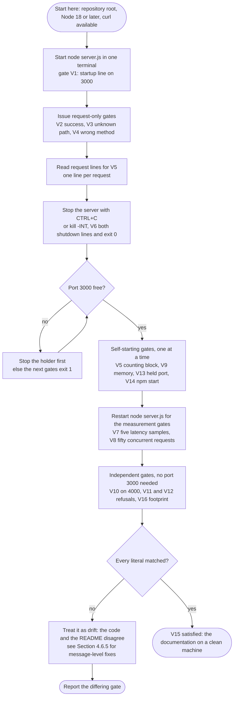

Two failure modes of the procedure itself are documented rather than inferred: running a self-starting gate against a held port yields `Port 3000 is already in use…` and exit status `1` instead of the expected output, and counting request lines through a pipeline fails because the terminal delivers `SIGINT` to every process in the foreground group, killing the counting filter before it prints (`README.md` L389-396). Both are procedural defects rather than program defects, which is why they belong to this workflow rather than to the error handling in Section 4.6.


## 4.9 References

- `server.js` — the whole program (176 lines at `origin/blitzy-8a4de345-c459-434b-a545-c8cf76a5f502`, tip `10d5d2ce`); source of every step, decision and line reference in Sections 4.2 to 4.6: `start` L156-176, `resolvePort` L15-39, `escapeNonPrintable` L10-12, `logRequest` L42-44, `ignoreBrokenStdio` L46-50, `sendPlainText` L53-56, `handleHello` L58-63, `handleNotFound` L65-68, `ROUTES` L70-72, `requestListener` L74-91, `createServer` L93-100, `onServerError` L102-114, `shutdown` L116-153
- `README.md` — the documented contracts and the sixteen gates the flows are measured against: running L53-77, endpoints L79-190, request logging L192-211, stopping L213-241, configuration and refusals L243-301, exit statuses L303-305, gates V1-V16 L307-591, troubleshooting L593-636, scope and non-goals L637-654
- `package.json` — start command `node server.js`, the `>=18.0.0` engine floor, the `1024`-`65535` port context, and the absence of dependencies that removes any install or build flow
- repository root folder (empty path) — confirmed that a checkout at `main` (`17c8b88`) holds only the 9-byte placeholder `README.md`, so the documented processes exist solely on the deliverable branch
- git history of `origin/blitzy-8a4de345-c459-434b-a545-c8cf76a5f502` — 13 commits from `17c8b88` to `10d5d2ce`, including `63152f0` (server baseline), `bc93b97` (post-bind error reporting), `b7a0b94` (`PORT` message escaping) and `10d5d2ce` (broken-pipe guard), which explain the historical branches shown in Section 4.6.2
- Section 1.2 System Overview of this specification — the component map, exit-status vocabulary and measured indicators reused in Sections 4.1 and 4.7
- Sections 2.1 Feature Catalog and 2.2 Functional Requirements Table — the F-001 to F-010 feature identifiers and the `F-XXX-RQ-YYY` requirement identifiers cited throughout
- Section 3.6 Development & Deployment — the deployment shape, the `SIGTERM` versus `SIGINT` constraint and the "no pipeline" position that Section 4.2.5 and Section 4.6.5 depend on
- Runtime observation set recorded while producing this section (Node v22.23.4, files extracted from tip `10d5d2ce`): 200/404/`POST`/`HEAD`/query/trailing-slash outcomes, five latency samples, a 50-request burst with 50 log lines and 53 total lines, `PORT` refusal matrix with exit statuses, `EADDRINUSE` and companion bind, non-loopback reachability, clean shutdown at 5-6 ms, forced shutdown at 5,022 ms with the forcing line replacing the success line, `SIGTERM` exit status `143`, a `0x01` target rejected with `400 Bad Request` and no log line, an unconsumed five-byte request body, and two responses on one keep-alive socket


# 5. System Architecture

## 5.1 High-Level Architecture

### 5.1.1 System Overview

**Architecture style.** The system is a single-process, single-threaded, event-driven HTTP server whose entire implementation is three files at the repository root: `server.js` (176 lines), `package.json` (13 lines) and `README.md` (654 lines). It is a monolith in the literal sense — one deployable unit, one entry point, no module boundaries to cross — and it is layered internally as a fixed sequence of small functions: configuration resolution, server hosting, request dispatch, handler invocation, response writing, with logging and failure reporting as side channels. There is no framework container, no dependency-injection graph, no plugin system and no service boundary behind which another process runs. The full component inventory is enumerated in Section 5.1.2 and the function-level detail in Section 5.2.

**Rationale for the style.** The style follows from the deliverable's stated purpose rather than from scaling pressure. The repository describes itself as teaching material that also runs correctly at tutorial scale and explicitly not a production service (`README.md` L3-5, L20-22). Its stated design intent is that a reader sees each runtime primitive "in isolation": one `createServer` call, one request handler, one route match, one log line, one port resolution, one shutdown (`README.md` L11-18). Every architectural choice that would normally be made for operational reasons — a framework, a middleware pipeline, a router package, a configuration library, a logger — is deliberately omitted so that nothing sits between the program's own functions and `node:http`. That trade is documented as a boundary, not as unfinished work (`README.md` L637-654).

**Key architectural principles.** Nine principles are observable in the source and are enforced consistently:

- **Read order equals call order.** Helper functions are declared before their callers, and the single entry-point invocation is the last statement in the file (`start()` at `server.js` L176). The startup path reads top to bottom: `ignoreBrokenStdio` → `resolvePort` → `createServer` → `process.on('SIGINT')` → `server.listen` (L157-173).
- **Single responsibility per function.** Ten top-level functions divide the lifecycle with no overlap: `escapeNonPrintable` L10-12, `resolvePort` L15-39, `logRequest` L42-44, `ignoreBrokenStdio` L47-50, `sendPlainText` L53-56, `handleHello` L59-63, `handleNotFound` L66-68, `requestListener` L75-91, `createServer` L94-100, `onServerError` L103-114, `shutdown` L117-153, `start` L156-176.
- **Table-driven dispatch, not a middleware chain.** `ROUTES` is a plain object with one key, `'GET /hello'` (`server.js` L70-72), and dispatch is a single property lookup on `` `${req.method} ${pathname}` `` (L83). The README designates this as the one extension point: adding an endpoint is one table entry plus one handler, and "nothing else in the program changes — not the logging, not the response writer, not the configuration or the shutdown code" (`README.md` L24`).
- **One response writer.** Every response the program produces — success and failure alike — passes through `sendPlainText` (L53-56), which sets the status and `Content-Type: text/plain` and ends the response. No path can emit a status without the program's content type or a body without a status.
- **Validate before acquiring.** `resolvePort` completes before `createServer` is called (`server.js` L159-167), so a configuration refusal ends the process with no server object and no socket ever created.
- **Log before route.** `logRequest` runs before the route lookup (`server.js` L81, L83), so a request that ends in 404 is recorded exactly like one that succeeds.
- **Exit status is the machine-readable contract.** The success paths assign `process.exitCode`, they never force `process.exit()` on a clean shutdown, because an early exit truncates pending stdout writes and the `Server closed. Exiting.` line is itself the evidence of cleanliness (`server.js` L144-151).
- **Bound every wait.** The one unbounded wait in the lifecycle — draining connections during shutdown — is capped by a single-shot five-second timer (`server.js` L126-133).
- **Absorb stream failures.** Write failures on stdout and stderr are caught by inert `'error'` listeners (`server.js` L47-50), so a departed log reader cannot turn a log line into an unhandled event.

**Architectural layers.** The request path crosses five horizontal layers, and each layer has exactly one outbound dependency on the layer below it. Observability and failure reporting are vertical concerns that the layers write to without being called back.

| Layer | Functions | Responsibility | Depends on |
|---|---|---|---|
| Configuration | `DEFAULT_PORT`/`MIN_PORT`/`MAX_PORT` L5-7, `escapeNonPrintable` L10-12, `resolvePort` L15-39 | Turn the `PORT` string into a validated port number or a refusal message | Nothing but ECMAScript string and regex facilities |
| Host | `createServer` L94-100, `start` L156-176 | Own the `http.Server` instance, register the listener, the `error` handler and the `SIGINT` handler, bind the port | `node:http`, `process` |
| Dispatch | `requestListener` L75-91, `ROUTES` L70-72 | Cut the query string, emit the log line, resolve the handler by exact method-and-path key, fall through to 404 | Request object, route table, logger |
| Handler | `handleHello` L59-63, `handleNotFound` L66-68 | Choose the status code and the fixed body | Response writer |
| Presentation | `sendPlainText` L53-56 | Write the status, the `Content-Type` header and the body | `ServerResponse` |
| Observability (vertical) | `logRequest` L42-44, `ignoreBrokenStdio` L47-50 | One stdout line per request; tolerate a vanished reader | stdout, stderr |
| Failure (vertical) | `onServerError` L103-114, `shutdown` L117-153 | Classify and report server errors; drain connections on `SIGINT` | Error object, `http.Server`, timers |

**System boundaries and major interfaces.** The boundary is the operating-system process. Exactly five interfaces cross it, and nothing else does.

| Interface | Direction | Contract | Evidence |
|---|---|---|---|
| TCP socket on the resolved port | Inbound | HTTP/1.1 request in, HTTP/1.1 response out; `200 text/plain Hello world` (11 bytes) or `404 text/plain Not Found` (9 bytes) | `server.js` L171, L53-56; observed responses |
| `PORT` environment variable | Inbound | Optional; `1024`-`65535`; default `3000` when unset or blank; read once at startup | `server.js` L159; V10-V12 |
| `SIGINT` | Inbound | Triggers the graceful drain; the only signal handled | `server.js` L169 |
| stdout | Outbound | Operational lines: one startup line, one line per request, up to two shutdown lines | `server.js` L43, L118, L142, L172 |
| stderr | Outbound | Diagnostics only: refusal and server-error messages | `server.js` L105, L107, L109, L162 |
| Process exit status | Outbound | `0` clean `SIGINT` shutdown, `1` invalid configuration or bind failure, `143` on `SIGTERM` | `server.js` L113, L151, L163; observed runs |

Four negative boundaries define the architecture as sharply as the positive ones. The request body is never read and no request header is consumed, so the program has no parser and no input-validation surface for request data (`server.js` L75-91; `README.md` L648). The request target is cut rather than parsed — `req.url.split('?')[0]` instead of `new URL` — which the code comment records as an explicit choice so that request data stays a plain string comparison and never reaches a parser (`server.js` L76-79). No writable path is opened, so nothing persists across a request or a process exit (`README.md` L644). No outbound connection of any kind is made: the program never acts as a client.

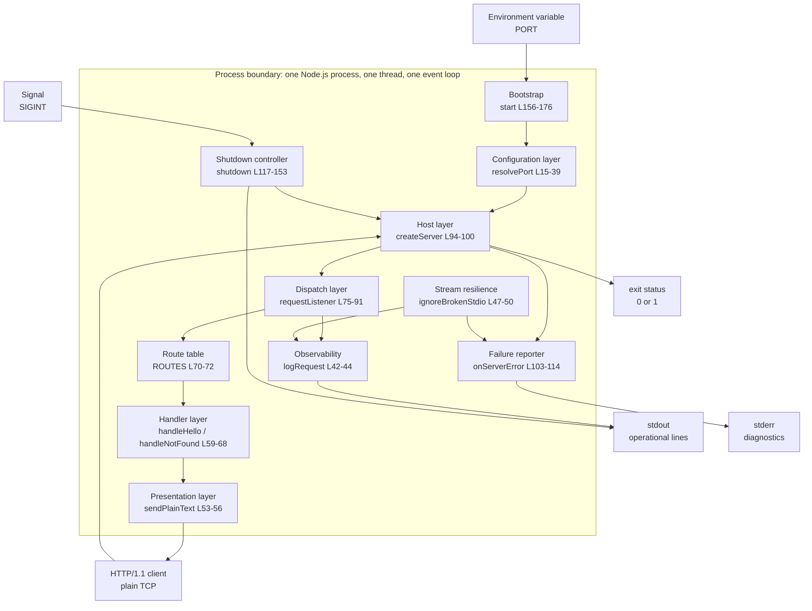

### 5.1.2 Core Components Table

The system comprises eleven components: ten functions or function groups in `server.js`, plus the distribution manifest. The first table records responsibility, dependency and integration; the second records the critical consideration that governs each one. Component-level detail — interfaces, persistence, scaling — is in Section 5.2.

| Component Name | Primary Responsibility | Key Dependencies | Integration Points |
|---|---|---|---|
| Bootstrap (`start`) | Compose the lifecycle: install stream guards, resolve the port, create the server, register `SIGINT`, bind, and run at module load (L156-176) | `resolvePort`, `createServer`, `ignoreBrokenStdio`, `process` | Invoked by Node at load (L176); calls `server.listen` L171; registers the `SIGINT` closure L169 |
| Configuration resolver (`resolvePort`, module constants, `escapeNonPrintable`) | Convert `process.env.PORT` into `{ ok: true, port }` or `{ ok: false, message }`, with four refusal conditions (L5-39) | ECMAScript `trim`, regex, `Number`; `escapeNonPrintable` L10-12 | Reads `process.env.PORT` L159; result consumed by `start` L161-165 and `server.listen` L171 |
| HTTP server host (`createServer`) | Create the `http.Server` with the routing listener and attach the single `error` handler (L94-100) | `node:http` L3; `requestListener`; `onServerError` | Returns the server object to `start` L167; error events arrive via L97 |
| Request listener and dispatcher (`requestListener`) | Cut the query string, log the request, resolve the handler by exact key, fall through to the 404 handler (L75-91) | `logRequest` L81; `ROUTES` L83; `handleNotFound` L86 | Registered as the server's request callback L95; receives `(req, res)` from the runtime |
| Route table (`ROUTES`) | Map the single key `'GET /hello'` to its handler; the documented sole extension point (L70-72) | `handleHello` L71 | Read by a property lookup at L83 |
| Handler pair (`handleHello`, `handleNotFound`) | Choose the status and the fixed body: `200`/`Hello world` or `404`/`Not Found` (L59-68) | `sendPlainText` L62, L67 | Invoked by `requestListener` L86, L90 |
| Response writer (`sendPlainText`) | The only response writer: `writeHead(statusCode, {'Content-Type': 'text/plain'})` then `end(body)` (L53-56) | `ServerResponse` API | Called by both handlers; terminal node of every request |
| Request logger (`logRequest`) | Emit one stdout line of three space-separated tokens before routing (L42-44) | `new Date().toISOString()`, `escapeNonPrintable`, `console.log` | Called from `requestListener` L81 |
| Stream resilience (`ignoreBrokenStdio`) | Install inert `'error'` listeners on stdout and stderr so a vanished reader cannot become an unhandled event (L47-50) | `process.stdout`, `process.stderr` | Called first in `start` L157; protects every log and diagnostic write |
| Failure reporter (`onServerError`) | Classify a server `'error'` event into port-in-use, listen failure or post-bind failure, and set exit status `1` for the first two (L103-114) | Error object (`code`, `syscall`, `message`, `port`), `console.error` | Attached at L97; the only path that reports bind failures |
| Shutdown controller (`shutdown`) | On `SIGINT`: stop accepting, close idle connections, report, exit `0`; force the exit at 5,000 ms (L117-153) | `http.Server.close`, `closeIdleConnections`, `closeAllConnections`, `setTimeout` | Registered at L169; calls `server.close` L139 |
| Distribution manifest (`package.json`) | Declare the package name, version, description, entry point, start script, engine floor and keywords; declare no dependencies | None | `npm start` invokes `scripts.start`; `engines.node` states the runtime requirement |

| Component Name | Critical Consideration |
|---|---|
| Bootstrap | The invocation at L176 is the only thing that starts the program; there is no `if (require.main === module)` guard, so the module has no importable form and no test seam. It binds with no host argument (L171), so every interface is exposed. |
| Configuration resolver | Validation is strictly lexical: only digits are accepted, so `0x1F90`, `1e3`, `+3000` and `3000.5` are refused rather than reinterpreted, and `0` is treated as out of range rather than privileged (L30-36). Refusal messages interpolate the escaped value, so a non-printable byte cannot break the line. |
| HTTP server host | Single-threaded, so request handling must not block; the handlers perform one string comparison and one write, which is why 20 concurrent requests completed within a 29 ms window in verification. |
| Request listener | Routing is exact and case-sensitive, with no trailing-slash tolerance, no percent-decoding and no method fallback: `HEAD /hello` returns 404 rather than an empty 200 (`README.md` L172-187). The query string is cut before both logging and matching, so log output and routing key agree. |
| Route table | The key format `"<METHOD> <pathname>"` couples the table to the dispatcher's single line at L83; a key written in another form silently routes to 404 rather than failing loudly. |
| Handler pair | Both bodies are fixed literals with no request data interpolated, so neither response can echo a path, an error code or a stack trace (`README.md` L147). `handleHello` accepts `req` but never reads it (L60-62). |
| Response writer | The `Content-Type` is exactly `text/plain` with no `charset` parameter, and no body length is set, so framing is left to the runtime — observed as `Transfer-Encoding: chunked` under HTTP/1.1 keep-alive and `Connection: close` under HTTP/1.0. |
| Request logger | Writes synchronously to stdout before the response and has no level, no redaction and no buffering; the timestamp is generated per request, so log order reflects arrival order. |
| Stream resilience | The listeners are deliberately inert: they change no exit status and print nothing, so a broken pipe is invisible in output. Before this guard existed, four of five stdout writes failed with `EPIPE` and the shutdown contract was lost (recorded in Section 4.6). |
| Failure reporter | The post-bind branch returns without setting an exit status (L108-111), so a serving error is reported while the process continues. Only the two bind-failure branches exit `1`. |
| Shutdown controller | The two connection-closing calls arrived in Node 18.2.0, above the declared `>=18.0.0` floor, so both are `typeof`-guarded (L130, L135); the failsafe timer is what guarantees exit `0` on 18.0.x. The path never calls `process.exit(0)` on the success branch. |
| Distribution manifest | There is no `dependencies`, `devDependencies` or `type` field and never a lockfile, so there is no install step and no build step; `main` and `scripts.start` name the same file, so both entry points run identical code. |

### 5.1.3 Data Flow Description

**Primary data flows.** Four flows carry all the system's data. Three are triggered by an external event and one is a side channel that runs on every request.

| Flow | Trigger | Path through the system | Terminal effect |
|---|---|---|---|
| Startup and configuration | Process exec | `start` L156 → `ignoreBrokenStdio` L157 → `resolvePort(process.env.PORT)` L159 → `createServer` L167 → `process.on('SIGINT')` L169 → `server.listen(port)` L171 → listen callback L172 | One stdout startup line and a bound socket, or one stderr refusal line and exit `1` |
| Request | An HTTP/1.1 request arrives | `requestListener` L75 → `req.url.split('?')[0]` L79 → `logRequest` L81 → `ROUTES[key]` L83 → handler L90 or `handleNotFound` L86 → `sendPlainText` L54-55 | One response on the socket and one stdout log line |
| Diagnostics | A server `'error'` event, or a configuration refusal | `onServerError` L103-114, or `start` L162 | One stderr line; exit status `1` for bind failures and refusals; nothing for a post-bind error |
| Shutdown | `SIGINT` | `shutdown` L118 → optional `closeIdleConnections` L136 → `server.close` L139 → callback L139-152, with the failsafe timer L126-133 racing it | Two stdout lines and exit `0`, or the forced line and exit `0` at about 5.0 s |

**Integration patterns and protocols.** Every internal interaction is a synchronous in-process function call with an explicit argument list and a returned value or a side effect. There is no message queue, no inter-process communication, no remote call, no event bus and no callback chain inside the program: the only asynchronous boundaries are the ones the runtime owns — the network socket, the listen callback, the `'error'` event, the `server.close` callback and one timer. Three protocols cross the process boundary: HTTP/1.1 over TCP for requests and responses; newline-delimited plain text on stdout and stderr; and POSIX signal delivery for `SIGINT`. Configuration is delivered through the process environment at exec time, which makes it a start-once input rather than a runtime channel.

**Data transformation points.** Six transformations change the shape of the data, and each occurs at exactly one line:

- **`PORT` string → port number.** `process.env.PORT` is read once (L159), trimmed (L20), tested against `/^[0-9]+$/` (L24), range-checked against `1024` and `65535` (L30-36) and converted with `Number` (L28). The result is `{ ok: true, port }` or a message; `start` never proceeds on the message.
- **Request target → pathname.** `req.url.split('?')[0]` removes the query string without decoding or normalising it (L79). No percent-decoding and no trailing-slash folding follow, which is why `/hello%2F` and `/hello/` both miss.
- **Method and pathname → route key.** Template interpolation builds `` `${req.method} ${pathname}` `` (L83). This string is the only routing input, and an exact-match lookup decides the handler.
- **Request tokens → log line.** `logRequest` composes an ISO-8601 UTC millisecond timestamp, the method and the pathname, each token passed through `escapeNonPrintable`, which replaces every character outside `0x20`-`0x7E` with a `\uXXXX` escape (L10-12, L43). The transformation guarantees the line always stays three space-separated tokens.
- **Handler decision → response bytes.** Each handler supplies a `(statusCode, body)` pair, which `sendPlainText` turns into a status line, a `Content-Type: text/plain` header and a body with no trailing newline (L54-55). The runtime then adds `Date`, `Connection`, `Keep-Alive` and the framing header, none of which the program controls.
- **Error object → classified message.** `onServerError` maps `error.code`, `error.syscall` and `error.port` onto one of three fixed message templates (L104-109). No branch interpolates a stack trace.

**Key data stores and caches.** There are none. The program holds no database connection, opens no file for writing and keeps no cache; its single import is `node:http` (L3), and the README states that nothing survives a request or a process exit (`README.md` L644). The only long-lived in-memory state is immutable: the three module constants `DEFAULT_PORT`, `MIN_PORT`, `MAX_PORT` (L5-7) and the `ROUTES` table (L70-72), which is a routing registry rather than a cache. Per-request state is limited to two function locals, `pathname` (L79) and `handler` (L83), which cannot be shared between requests — the property that let 20 concurrent requests each produce an independent response and one log line. No response carries `Cache-Control`, `ETag`, `Last-Modified` or `Expires`; connection reuse under `Keep-Alive: timeout=5` is provided by the runtime, and the program keeps no per-connection state. The only artifact that outlives a request is a stdout line, and it belongs to whichever consumer redirected the stream, not to the program.

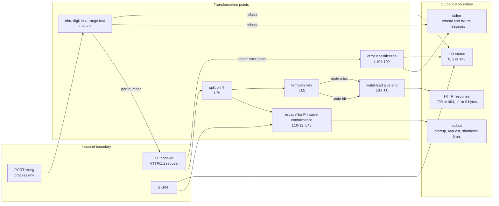

### 5.1.4 External Integration Points

The program integrates with six external systems, four of which it cannot run without. Every one of them is a boundary the process does not cross with a protocol beyond HTTP, POSIX streams, signals or the environment; there is no database, cache, broker, identity provider, metrics backend or tracing collector, and no outbound network call of any kind.

| System Name | Integration Type | Data Exchange Pattern and Format | SLA Requirements |
|---|---|---|---|
| Node.js runtime | Host platform, in-process API | Synchronous calls into `node:http` and the `process`/console globals; no data format over a wire | `>=18.0.0` declared (V14); verified on v22.23.4. Two shutdown calls require `>=18.2.0` and are `typeof`-guarded so 18.0.x still exits `0` |
| HTTP/1.1 client (`curl` is the documented one) | Inbound synchronous request/response over TCP | One request in, one response out; `text/plain` body; status and `Content-Type` are the contract, `Date`/`Connection`/framing headers are runtime-added | No availability or throughput SLA. Measured only: five loopback samples each below `0.010` s (V7), 50 concurrent requests all `200` (V8), 20 concurrent verified here within 29 ms |
| POSIX shell and terminal | Process control and configuration channel | `PORT=… node server.js` at exec; `CTRL+C` or `kill -INT <pid>` for shutdown; `$?` reads the exit status | None. `SIGINT` is the only handled signal; `SIGTERM` and `SIGHUP` keep the default disposition and terminate with status `143` (observed) |
| stdout consumer (terminal, pipe, file) | Outbound append-only character stream | Newline-delimited plain text, one line per event: `<ISO-8601 timestamp> <method> <pathname>`; three space-separated tokens, non-printable bytes escaped as `\uXXXX` | No delivery guarantee beyond best effort. A vanished reader yields `EPIPE`, absorbed by the inert listener (L48) with no status change; verification confirmed the server kept serving `200`/`404` after its log reader exited |
| stderr consumer | Outbound append-only character stream | Newline-delimited plain text, one line per refusal or failure; four templates for `POLL` refusals and bind failures | Best effort, same absorption as stdout (L49). No message is ever duplicated onto stdout |
| npm CLI (`npm start`) | Optional launcher | Executes `scripts.start`, which is exactly `node server.js`; prints npm's own banner to stdout before the server's lines | None. `npm` is not required: `node server.js` is the primary documented command and produces identical server behaviour |

Two further integration facts belong here because they shape any deployment attempt. First, the bind passes no host argument — `server.listen(resolved.port, …)` (L171) — so the socket is reachable on every interface, not only loopback, over plain HTTP with no authentication, no access control and no rate limiting; the README states this explicitly (`README.md` L77`). Second, the program is started and stopped by a human or a shell: there is no CI pipeline, no container image, no compose file, no orchestration definition and no process manager in any commit, and the all-commit file union is exactly `README.md`, `package.json` and `server.js`.


## 5.2 Component Details

### 5.2.1 Component Inventory and Grouping

Twelve components make up the system: twelve top-level function declarations in `server.js`, grouped below into six cohesive units by lifecycle phase, plus the distribution manifest. The grouping follows the order in which a reader meets the definitions in the file, and each group below records purpose, technology, interfaces, persistence and scaling in the same structure so the groups can be compared directly.

| Group | Functions | Lines | Lifecycle phase |
|---|---|---|---|
| Bootstrap and configuration | `start`, `resolvePort`, `escapeNonPrintable`, module constants | L5-39, L156-176 | Before the first socket exists |
| HTTP serving | `createServer`, `requestListener` | L75-100 | Per process, then per request |
| Routing and handlers | `ROUTES`, `handleHello`, `handleNotFound` | L59-72 | Per request |
| Response writing | `sendPlainText` | L53-56 | Per request |
| Logging and stream resilience | `logRequest`, `ignoreBrokenStdio` | L42-50 | Per request, plus once at startup |
| Failure reporting and shutdown | `onServerError`, `shutdown` | L103-153 | On an error event, and once at exit |

### 5.2.2 Bootstrap and Configuration Components

**Purpose and responsibilities.** `start` (L156-176) is the composition root and the only entry point; the single statement `start();` at L176 runs it at module load. It installs the stream guards (L157), resolves the port (L159), refuses and returns before any socket is created when resolution fails (L161-165), creates the server (L167), registers the `SIGINT` closure over that server (L169) and binds (L171). `resolvePort` (L15-39) is the whole configuration subsystem: it accepts the raw environment string and returns either a validated port or a refusal message. `escapeNonPrintable` (L10-12) is a lexical utility used by both configuration refusals and request logging. The module constants `DEFAULT_PORT` 3000, `MIN_PORT` 1024 and `MAX_PORT` 65535 (L5-7) are the accepted policy.

**Technologies and frameworks.** ECMAScript only. `String.prototype.trim`, `String.prototype.replace`, `String.prototype.charCodeAt`, `String.prototype.padStart`, `Number`, regex literals `/^[0-9]+$/` and `/[^\u0020-\u007E]/g`, and the `process.env` global. No import of any kind is involved in this group; `node:http` (L3) is the file's only import and belongs to the serving group.

**Key interfaces.** `start()` takes no arguments and returns nothing; it either binds and keeps the process alive or sets an exit status and returns. `resolvePort(rawValue)` returns a discriminated union — `{ ok: true, port: number }` or `{ ok: false, message: string }` — which is the only structured value in the program. `escapeNonPrintable(value)` returns a string in which every character outside `0x20`-`0x7E` becomes a `\uXXXX` escape of its code unit. The refusal contract, in the order the checks run:

| Condition | Line | stderr message | Exit status |
|---|---|---|---|
| `PORT` unset or whitespace only | L16-18 | None; default port `3000` is used and startup continues | Not applicable |
| Value contains anything but digits, or is empty after trim | L24-26 | `Invalid PORT value "<escaped>": must be an integer between 1024 and 65535.` | `1` |
| Value is a digit string from `1` to `1023` | L30-32 | `Invalid PORT value "<escaped>": privileged ports 1-1023 are not permitted; choose a port between 1024 and 65535.` | `1` |
| Value is `0`, or greater than `65535` | L34-36 | `Invalid PORT value "<escaped>": must be an integer between 1024 and 65535.` | `1` |

The guard at L30 reads `port !== 0 && port < MIN_PORT`, so `0` skips the privileged branch and is refused by the range branch — it is reported as out of range, not as privileged. Validation is lexical rather than numeric-conventional: `0x1F90`, `1e3`, `+3000` and `3000.5` all fail the digit regex and are refused rather than reinterpreted, and `1023`, `1024`, `65535` and `65536` were each confirmed at the range boundaries in verification.

**Data persistence requirements.** None. Configuration is read once into a local, `resolved.port` (L159), and passed to `listen` (L171); no configuration file is read, nothing is cached for reuse and no default is written back to the environment.

**Scaling considerations.** Negligible and bounded: four string operations and two numeric comparisons per process, executed once. The component has no concurrency, cannot be re-entered and does not participate in request handling. Its only scaling-relevant property is that configuration is immutable after startup — no runtime reconfiguration exists, and no second environment variable is read anywhere in the program, so changing the port requires a restart.

### 5.2.3 HTTP Serving Components

**Purpose and responsibilities.** `createServer` (L94-100) constructs the `http.Server` with `requestListener` as the request callback and attaches exactly one `'error'` listener, `onServerError`, before returning the server. `requestListener` (L75-91) is the request entry point and does four things in a fixed order: cut the query string (L79), log (L81), resolve a handler by exact key (L83) and either call it (L90) or call `handleNotFound` (L86-87).

**Technologies and frameworks.** `node:http`, imported at L3 as `const http = require('node:http')` — the program's only import — used for `createServer` (L95) and, through the returned instance, for `on`, `listen`, `close`, `closeIdleConnections` and `closeAllConnections`. The listener consumes only two properties of the request — `req.method` and `req.url` (L79, L81, L83) — and two call sites on the response, `writeHead` and `end`, both reached through `sendPlainText`. The request stream is never read, no header is inspected, and no body is parsed.

**Key interfaces.** `createServer()` takes no arguments and returns an `http.Server` with its listener and error handler attached. `requestListener(req, res)` conforms to the runtime's `(IncomingMessage, ServerResponse) => void` signature and returns nothing. Its observable contract is the pair it produces: a response on `res` and one line on stdout, always in that causal order — log first, response second, both unconditional.

**Data persistence requirements.** None. The server object holds no application state, no session table and no per-connection record; the two request locals, `pathname` (L79) and `handler` (L83), die with the invocation.

**Scaling considerations.** Concurrency is the runtime's event loop, not the program's: one thread serves all sockets, and nothing in the request path blocks except the log write. Verification issued 20 simultaneous requests and received 20 `200` responses with 20 log lines inside a 29 ms window, which is the practical evidence that the path is non-blocking. There is no `cluster`, no worker thread, no child process and no graceful-degradation mode, so throughput is capped by one core; the README sets no throughput target and calls the program deliberately tutorial-scale (`README.md` L22). The bind passes no host argument (L171), so the listening socket covers every interface rather than loopback alone — a scaling and exposure fact in one, since any reachable host can send requests.

### 5.2.4 Routing and Handler Components

**Purpose and responsibilities.** `ROUTES` (L70-72) is a module-level object with one property, `'GET /hello'`, mapped to `handleHello`. It is a registry, not a matcher: the dispatcher builds the key and performs one lookup (L83). `handleHello` (L59-63) returns `200` with the fixed body `Hello world`; `handleNotFound` (L66-68) returns `404` with the fixed body `Not Found`. Together they are the entire response vocabulary of the system.

**Technologies and frameworks.** Plain JavaScript object literals and template-literal key construction. No router library, no path pattern matcher, no regular-expression route table, no middleware chain and no parameter extraction — the deliberate absence documented in the README's purpose statement (`README.md` L9).

**Key interfaces.** Handlers share one signature, `(req, res) => void`, so a table entry is interchangeable with any other. That uniformity is deliberate: `handleHello` accepts `req` and never reads it, and the source records why — the route key already established the method and path, and the parameter is kept so every entry shares one signature (L60-61). Matching semantics define the routing contract:

| Request | Result | Reason |
|---|---|---|
| `GET /hello`, `GET /hello?x=1` | `200`, `Hello world` | Query string removed at L79 before the key is built |
| `HEAD /hello`, `POST /hello`, `PUT /hello` | `404`, `Not Found` | The method is part of the key; `HEAD` is not treated as `GET`, and there is no `405` |
| `GET /hello/`, `GET /Hello`, `GET /HELLO`, `GET /hello%2F` | `404`, `Not Found` | Exact comparison with no trailing-slash tolerance, no case folding and no percent-decoding |

**Data persistence requirements.** None. The table is created once at module load and never mutated: no route is added, removed or shadowed at runtime, and no handler retains a reference to a request.

**Scaling considerations.** Dispatch cost is a single property lookup (`ROUTES[key]`, L83) paid once per request, independent of the number of routes. The only growth factor is the key string allocation at L83. Because the table is keyed by `"<METHOD> <pathname>"`, the design scales by adding entries — one table row plus one handler — while logging, response writing, configuration and shutdown are untouched (`README.md` L24). Two limits follow from the format and are worth recording: keys are matched literally, so a parameterised path would require a different dispatcher rather than another entry; and a key written in a form other than `"<METHOD> <pathname>"` fails silently to the 404 handler instead of raising an error.

**Extension procedure.** The documented change is two edits and no others: add a handler with the shared `(req, res)` signature, and add one `'<METHOD> <pathname>'` property to `ROUTES` (L70-72). No registration call, no ordering constraint and no framework hook is involved.

### 5.2.5 Response Writer Component

**Purpose and responsibilities.** `sendPlainText(res, statusCode, body)` (L53-56) is the only code that writes a response. It sets the status and `Content-Type: text/plain` through one `writeHead` call (L54) and writes the body through one `end` call (L55). It is the single point at which an HTTP response is formed, and both handlers depend on it.

**Technologies and frameworks.** The `ServerResponse` API of `node:http`: `writeHead(statusCode, headers)` and `end(body)`. No `setHeader`, no `write` streaming, no `statusMessage` override, no body serialisation.

**Key interfaces.** `(res, statusCode, body) => void`. The body is passed through as a string with no trailing newline, which fixes the two observable payload sizes: `Hello world` is 11 bytes and `Not Found` is 9 bytes, both verified. The component sets exactly one header. Everything else an HTTP client sees is added by the runtime — `Date`, `Connection`, `Keep-Alive` and the framing header — and the README states that none of these is part of the contract (`README.md` L190). Framing was observed as `Transfer-Encoding: chunked` on a kept-alive HTTP/1.1 connection and as `Connection: close` with no framing header for an HTTP/1.0 client, so no caller may assert a framing header.

**Data persistence requirements.** None; the response is written once and never revised. A partially written response cannot be recalled, which is why the writer's single call pair is also the transaction boundary recorded in Section 4.5.4.

**Scaling considerations.** One header write and one body write per request, with no buffering, no compression and no serialisation cost. Because no `Content-Length` is set, the runtime chooses chunked framing, which avoids sizing the body before writing it and costs a few framing bytes per response. The component holds no state, so it cannot leak across requests.

### 5.2.6 Logging and Stream Resilience Components

**Purpose and responsibilities.** `logRequest(method, pathname)` (L42-44) emits exactly one stdout line per request, before the route is decided. `ignoreBrokenStdio()` (L47-50) installs two inert `'error'` handlers, one on `process.stdout` and one on `process.stderr`, so that a write failure against a departed reader is absorbed rather than raised as an unhandled event. The two are paired by design: the logger creates the writes, the guard keeps their failures from changing process behaviour.

**Technologies and frameworks.** `console.log` (L43) for the request line; `console.error` (L105, L107, L109, L162) and `process.stdout.write` (L128) for diagnostics and the forced-shutdown line; `Date.prototype.toISOString()` (L43) for the timestamp; `process.stdout.on` and `process.stderr.on` (L48-49) for the guards; `process.stdout.once` (L127) inside the failsafe.

**Key interfaces.** The log format is a fixed three-token line: an ISO-8601 UTC timestamp with millisecond precision and a `Z` suffix, the method, and the query-stripped pathname, each of the latter two passed through `escapeNonPrintable` (L43). Because the pathname token is the same value the router matches on, `GET /hello?x=1` logs `... GET /hello`, and the line and the routing key can never disagree. The stream split is an architectural separation: operational output — the startup line, every request line and both shutdown lines — goes to stdout, and diagnostics go to stderr, so the two can be separated without parsing prefixes (`README.md` L211).

| Output | Stream | Emitted at | Count per process |
|---|---|---|---|
| `Server listening on port <port>` | stdout | Listen callback L172 | One, on a successful bind |
| `<timestamp> <method> <pathname>` | stdout | L43 via L81 | Exactly one per request, including requests answered `404` |
| `Received SIGINT. Shutting down gracefully.` | stdout | L118 | One, on `SIGINT` |
| `Server closed. Exiting.` | stdout | L142 | One, on a clean drain |
| `Forcing shutdown after 5s.` | stdout | L128 | At most one, only when the failsafe fires |
| Refusal and server-error messages | stderr | L105, L107, L109, L162 | At most one per terminating failure |

**Data persistence requirements.** None. No log file is opened, no rotation exists and no buffer is retained: the only record is whatever the consumer of the stream keeps. The README's counting gate therefore redirects the server's own stdout to a temporary file outside the repository (`README.md` L378-394).

**Scaling considerations.** The stdout write is the one synchronous side effect in the request path, and it is the component that limits request throughput when a consumer applies backpressure. The guard changes failure behaviour, not throughput: verification started the server with its stdout connected to a reader that exited immediately, and the server absorbed the resulting `EPIPE`, stayed bound, answered a subsequent `200` and a subsequent `404`, wrote nothing to stderr and was then shut down cleanly by `SIGINT`. Without the guard the same scenario replaces the documented lines with a stack trace and alters the exit status — the regression recorded in Section 4.6.2.

### 5.2.7 Failure Reporting and Shutdown Components

**Purpose and responsibilities.** `onServerError` (L103-114) is the single sink for server `'error'` events and the only code that reports bind failures. `shutdown(server)` (L117-153) owns the exit path: on `SIGINT` it announces the drain, arms a bounded failsafe, closes idle connections, calls `server.close`, prints the closing line and sets exit status `0`, or forces the exit when the drain overruns five seconds.

**Technologies and frameworks.** The `http.Server` lifecycle methods — `close` (L139), `closeIdleConnections` (L136), `closeAllConnections` (L131) — the timer facilities `setTimeout` and `clearTimeout` (L126, L140), `process.exitCode` (L113, L151, L163), `process.exit` (L127-128) used only in the forced branch, and `process.on('SIGINT')` (L169).

**Key interfaces.** Error classification is a three-branch decision over the runtime's error object, and the branch decides whether the process terminates:

| Condition | Line | stderr message | Exit status effect |
|---|---|---|---|
| `error.code === 'EADDRINUSE'` | L104-105 | `Port <port> is already in use. Stop the process using it or set PORT to a free port.` | Sets `1` at L113 |
| Otherwise, `error.syscall === 'listen'` | L106-107 | `Failed to start server: <runtime message>` | Sets `1` at L113 |
| Otherwise — a post-bind failure | L108-111 | `Server error while serving: <runtime message>` | Reported, then returns without touching the status; serving continues |

The shutdown sequence is fixed and every step is observable:

| Step | Line | Effect | Bound |
|---|---|---|---|
| Announce the drain | L118 | `Received SIGINT. Shutting down gracefully.` on stdout | Immediate |
| Arm the failsafe | L126-133 | Single-shot timer at 5,000 ms that writes `Forcing shutdown after 5s.`, calls `closeAllConnections` when available and exits `0` | 5,000 ms |
| Close idle connections | L135-137 | `closeIdleConnections` behind a `typeof` guard, because Node 18's `close` keeps existing connections and an idle keep-alive socket would hold the process open | Immediate |
| Stop accepting and drain | L139 | `server.close(callback)`; the callback runs when all connections have finished | Until every connection closes, or the failsafe |
| Complete cleanly | L140-151 | `clearTimeout`, `Server closed. Exiting.`, `process.exitCode = 0`; `process.exit(0)` is deliberately not called because it truncates pending stdout writes | Immediate after drain |

**Data persistence requirements.** None. Shutdown leaves no artefact: no socket in a half-closed handler, no file to flush, no queue to drain. The README's own framing is that the shutdown "leaves nothing behind" (`README.md` L3), and the failsafe's exit deliberately waits for its own write callback (L128) rather than exiting before a piped write completes.

**Scaling considerations.** Both paths are constant-cost. The shutdown wait is the only unbounded wait in the program and is capped at approximately 5.0 seconds; the process therefore cannot hang indefinitely on `SIGINT`, and the exit status is `0` on both the clean and the forced branch. `SIGTERM` and `SIGHUP` are not handled (only `SIGINT` is registered at L169), so a supervisor that stops the process with `SIGTERM` bypasses the drain entirely and observes exit status `143` — verified — with no shutdown lines on stdout.

### 5.2.8 Component Interaction Diagram

The call graph below is the complete set of internal interactions in the program: every arrow is a direct function call or a runtime callback registration, and no arrow crosses a process boundary except the three at the edges.

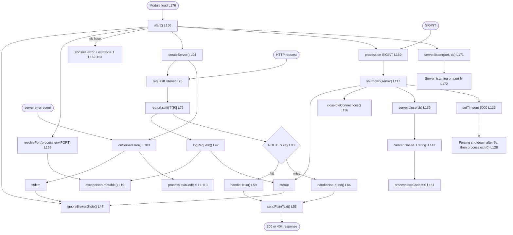

### 5.2.9 State Transition Diagram

The server object and the process move together through a small set of states. Every transition below corresponds to a line in `server.js`, and each terminal state fixes the exit status the shell observes.

```mermaid
stateDiagram-v2
    [*] --> Initialising: node server.js runs start at L176
    Initialising --> Refused: resolvePort returns ok false L161
    Refused --> [*]: stderr line, exit status 1
    Initialising --> Binding: port accepted, listen called L171
    Binding --> BindFailed: EADDRINUSE L104 or listen error L107
    BindFailed --> [*]: stderr line, exit status 1
    Binding --> Serving: listen callback prints the startup line L172
    Serving --> Serving: request logged and answered 200 or 404
    Serving --> Serving: post-bind error reported, status unchanged L109-110
    Serving --> Draining: SIGINT handled L169
    Draining --> Closed: server.close callback L139-142
    Closed --> [*]: exit status 0
    Draining --> Forced: failsafe timer fires at 5000 ms L126-133
    Forced --> [*]: exit status 0
    Serving --> Terminated: SIGTERM or SIGHUP, default disposition
    Terminated --> [*]: exit status 143, no shutdown lines
```

Three properties of the diagram matter architecturally. `Serving` is the only state that accepts concurrent work, and it does so without shared mutable request state, which is why 20 simultaneous requests each produced an independent response and one log line. `Serving` has a self-transition for reported post-bind errors, so an individual socket failure does not move the process out of service. And `Draining` has two exits, both of which fix status `0`, so the clean and forced paths are indistinguishable to the shell — only the presence of the `Forcing shutdown after 5s.` line distinguishes them.

### 5.2.10 Sequence Diagrams for Key Flows

**Success flow — `GET /hello`.** The log line precedes the response, and the runtime adds every header the program did not set.

```mermaid
sequenceDiagram
    participant C as HTTP client
    participant N as node http runtime
    participant L as requestListener
    participant G as logRequest
    participant T as ROUTES
    participant H as handleHello
    participant W as sendPlainText
    participant S as stdout
    C->>N: GET /hello HTTP/1.1
    N->>L: requestListener req, res
    L->>L: pathname = req.url.split of question mark index 0
    L->>G: logRequest method, pathname
    G->>S: ISO-8601 timestamp, GET, /hello
    L->>T: property lookup for GET space /hello
    T-->>L: handleHello
    L->>H: handleHello req, res
    H->>W: sendPlainText res, 200, Hello world
    W->>N: writeHead 200 text plain
    W->>N: end body
    N-->>C: HTTP/1.1 200 OK, Content-Type text plain, 11 bytes
```

**Failure flow — unmatched method or path.** The only difference from the success flow is which handler the lookup returns; logging, response writing and headers are identical.

```mermaid
sequenceDiagram
    participant C as HTTP client
    participant L as requestListener
    participant G as logRequest
    participant T as ROUTES
    participant H as handleNotFound
    participant W as sendPlainText
    participant S as stdout
    C->>L: HEAD /hello or GET /invalid
    L->>L: strip query string
    L->>G: logRequest method, pathname
    G->>S: one line, same three token format
    L->>T: property lookup for the method and pathname key
    T-->>L: undefined
    L->>H: handleNotFound req, res
    H->>W: sendPlainText res, 404, Not Found
    W->>W: writeHead 404 text plain, then end
    W-->>C: HTTP/1.1 404 Not Found, 9 bytes, or 0 bytes for HEAD
```

**Startup refusal and bind failure.** Both paths end in exit status `1` and never reach `Serving`, but only one of them creates a socket.

```mermaid
sequenceDiagram
    participant O as Operator shell
    participant St as start
    participant R as resolvePort
    participant SRV as createServer
    participant E as stderr
    O->>St: node server.js with PORT set
    St->>R: resolvePort process env PORT
    R-->>St: ok false and message
    St->>E: console error message L162
    St->>St: process exitCode 1 L163, return before createServer
    Note over St,SRV: createServer is never called on the refusal path
    O->>St: node server.js with a valid PORT
    St->>SRV: createServer and listen
    SRV-->>St: error event EADDRINUSE
    St->>E: Port N is already in use L105
    St->>St: process exitCode 1 L113
```

**Graceful shutdown and the failsafe.** Two exits from one signal, both with status `0`.

```mermaid
sequenceDiagram
    participant O as Operator shell
    participant P as process
    participant SD as shutdown
    participant SV as http Server
    participant S as stdout
    O->>P: SIGINT
    P->>SD: shutdown server
    SD->>S: Received SIGINT, shutting down gracefully
    SD->>SD: arm single shot timer at 5000 ms
    SD->>SV: closeIdleConnections when available
    SD->>SV: close with callback
    SV-->>SD: callback, all connections finished
    SD->>SD: clearTimeout on the failsafe
    SD->>S: Server closed, exiting
    SD->>P: process exitCode 0
    P-->>O: exit status 0
    Note over SD,SV: If the callback has not run at 5000 ms the failsafe writes Forcing shutdown after 5s and calls process exit 0
```


## 5.3 Technical Decisions

### 5.3.1 Architecture Style Decision and Tradeoffs

**The decision.** One process, one file, zero third-party dependencies, standard-library HTTP, and dispatch through a plain object literal. The alternatives were available and are named in the repository's own purpose statement, which rules them out explicitly: no framework, no middleware, no routing library (`README.md` L9). Section 3.2 records the framework and library inventory; this sub-section records why the style was chosen and what it costs.

| Decision | Benefit realised | Cost accepted | Where the cost is visible |
|---|---|---|---|
| No web framework; `http.createServer` directly | The reader sees `createServer`, `writeHead`, `end`, `listen` and `close` with nothing between the program and the runtime (`README.md` L11-18); three files, no install step, no build step | Every cross-cutting concern a framework would supply is hand-written: dispatch, response writing and error translation are the program's own code | `ROUTES` L70-72, `sendPlainText` L53-56, `onServerError` L103-114 |
| Single file, function-per-concern | Read order equals call order; the entry call is the file's last statement (L176), so the whole lifecycle is a linear read | No module boundaries, no import/export surface and no `if (require.main === module)` guard, so the file has no test seam and cannot be imported without starting a server | `start()` invoked at L176; no test file exists in any commit |
| Single-threaded, single process | No shared-state hazards: per-request data lives in two function locals (L79, L83), so 20 concurrent requests produced 20 independent responses | Throughput is capped by one core; a blocking call in the request path would stall every connection | No `cluster`, no worker thread, no child process anywhere |
| Table-driven dispatch keyed by `"<METHOD> <pathname>"` | Dispatch is one property lookup (L83); adding an endpoint touches one table entry plus one handler and nothing else (`README.md` L24) | Literal keys give no path parameters and fail silently to 404 if mistyped; an alternative dispatcher would be needed for parameterised routes | Key construction L83, table L70-72 |
| Validate configuration before acquiring any resource | A refusal leaves nothing to unwind: no server object, no socket, no partially bound port | One environment variable only; changing the port requires a restart, and there is no precedence chain, no config file and no reload | `resolvePort` L15-39 called at L159 before `createServer` L167 |
| Exit status as the machine-readable contract | A shell can decide the outcome from `$?` alone; `0` and `1` are the entire vocabulary on documented paths | Nothing is reported on a durable channel; a supervisor that ignores `$?` learns nothing, and `SIGTERM` bypasses the vocabulary with `143` | `process.exitCode` at L113, L151, L163; no log file or metrics endpoint exists |

**Architectural assumptions.** Each assumption below is relied upon by the design; the last column records what fails if it is wrong.

| Assumption | Basis | Consequence if violated |
|---|---|---|
| The audience reads the source, not an operations runbook | The README is the specification and its literal expected output is the contract (`README.md` L5) | Legibility gains are worth nothing and the missing framework becomes pure cost |
| Traffic is one client at a time, from one host, over loopback or a trusted network | Tutorial context; measurements in V7-V9 are loopback only | The bind covers every interface with no authentication, rate limiting or request-size limit (`README.md` L77, L645-646) |
| Responses are constant and no request data is needed to produce them | Both bodies are literals (`server.js` L62, L67) | The dispatcher would need a different key format and the writer would need serialisation |
| Nothing must survive a request or a process exit | No writable path is opened and the only import is `node:http` (L3) | Persistence, migration and backup concerns all become new work; see 5.3.3 |
| The runtime is Node.js 18.0.0 or later, unmodified | `package.json` `engines.node` | The two `typeof` guards (L130, L135) only matter below 18.2.0; below 18.0.0 the `node:` prefixed import at L3 fails |
| A human or a shell starts and stops the process | No process manager, container or orchestrator in any commit | Graceful shutdown depends on `SIGINT`; a `SIGTERM`-sending supervisor terminates with status `143` and no drain |
| Available capability, not availability, is the goal | The README states the program is not a production service (`README.md` L22) | The absence of health checks, metrics, retries and timeouts becomes a defect rather than a boundary |

### 5.3.2 Communication Pattern Choice

Three distinct communication channels exist, and each was chosen for its shape rather than by inheritance. Internally there is no asynchronous messaging at all: every interaction is a direct function call with an explicit argument list, so the call graph in Section 5.2.8 is the complete control flow.

| Channel | Pattern | Guarantee | Alternative rejected, and why |
|---|---|---|---|
| Client to server | Synchronous request/response over HTTP/1.1 on plain TCP | One request answered by exactly one response; no streaming, no `Upgrade`, no WebSocket, no server push | Asynchronous or streaming designs would require request-state tracking the program does not have; the runtime's native model is used directly (`server.js` L95) |
| Component to component | Direct in-process function call | Synchronous return; no callback chain, no event bus, no queue, no dependency-injection container | A middleware pipeline was rejected because the dispatch decision is a single lookup (L83) and the README makes the flat call sequence the teaching point (`README.md` L11-18) |
| Process to operator | One-way writes to stdout and stderr, plus exit status | Best effort: no acknowledgement, no retry, no delivery confirmation | A logging protocol, log levels or a log file were rejected as out of scope (`README.md` L649); the exit status carries the outcome instead |

**Why the response is not streamed.** `sendPlainText` uses one `writeHead` and one `end` (L54-55) rather than `write` calls, because every body in the program is a constant of at most 11 bytes. Streaming would add framing decisions and error handling that the fixed bodies do not need.

**Why the log is fire-and-forget.** The log line is written before routing and its failure cannot affect the response: the inert listeners (`server.js` L48-49) absorb a broken pipe and the request is still answered. Verification confirmed this ordering and independence — with its log reader already gone, the server still answered a `200` and a `404` and wrote nothing to stderr.

**Why the exit status carries the outcome.** Because no message is machine-readable, a scripted caller learns the outcome from `$?`: `0` for a clean `SIGINT` shutdown and `1` for an invalid or privileged `PORT` or a bind failure (`README.md` L310). Diagnostics go to stderr for a human, and the two channels are never mixed — the README states the separation directly (`README.md` L211).

### 5.3.3 Data Storage Solution Rationale

**The decision.** No storage of any kind. No database, no key-value store, no embedded store, no file written or appended, no ORM, no migration, no connection pool and no transaction. The program's only import is `node:http` (L3); nothing in the repository reads or writes a persistent path, and the README lists "No persistence. No database, no cache, no file writes: nothing survives a request or a process exit" as a deliberate boundary (`README.md` L644).

| Storage concern | Decision | Rationale |
|---|---|---|
| Database, cache, message store | Absent | No data is created, read or updated: the two responses are literals compiled into the source (`server.js` L62, L67) |
| Files written by the program | None | The only writes are to the response and to the console streams; the program does not import `node:fs` |
| In-memory state across requests | None | Per-request data is two function locals (L79, L83); the heap reaches steady state, which is what V9 measures |
| Durable record of a request | A stdout line, if a consumer keeps it | The sink belongs to the consumer — the README's counting gate redirects to a temporary file outside the repository (`README.md` L378-394) |
| Restart behaviour | Every restart begins empty | `start()` has no load or recovery step (L156-176), so there is no state to reconcile after a crash |

**Consequences, stated as tradeoffs.** The absence removes an entire class of failure: no connection can drop, no query can be slow, no write can partially commit and no recovery can leave an inconsistency — which is why Sections 4.5.4 and 4.6.5 record no reconciliation step. The price is that the program cannot answer any question that requires remembered state: no counters, no session, no rate-limit window, no request history. Adding persistence would also force a second import and break the three-file, no-install footprint that gate V16 asserts (`README.md` L559-591), so storage is not a feasible increment within this architecture — it is a different architecture.

### 5.3.4 Caching Strategy Justification

**The decision.** No cache, and no cache directive. The program emits exactly one header of its own, `Content-Type: text/plain` (L54); no `Cache-Control`, `ETag`, `Last-Modified` or `Expires` appears on any response. Nothing is memoised in process, and no response is reused.

| Caching layer | Present | Justification |
|---|---|---|
| In-process memoisation | No | The values it would cache are cheaper to produce than to look up: two string literals and one `res.end` write. Caching a constant adds state where the design has none |
| HTTP response cache headers | No | Both bodies are fixed, so a validator would be a constant that never changes; emitting `ETag` would add a header to maintain for no invalidation benefit. The cost is that no client or intermediary is told it may reuse a response |
| Connection reuse (keep-alive) | Yes, by the runtime | The runtime emits `Keep-Alive: timeout=5` and reuses sockets; the program keeps no per-connection state and does not configure the timeout |
| Parser or path cache | No | The pathname is a single `split` on the request target (L79) and the route key a single template interpolation (L83); both are O(length of the URL) with a small constant |

**Why the choice is sound here.** A cache exists to avoid recomputation; the program recomputes nothing that costs anything measurable — five loopback samples measured between `0.000466` and `0.000523` seconds in the README's own run, and the same order was observed in verification. Adding caching would therefore add a state-management and invalidation surface to a program whose defining property is that it holds no state, in exchange for a saving below the measurement noise.

**What would have to change.** If a body became dynamic, caching would still be premature: the first requirement would be serialisation and a data source, not a cache. The architectural trigger for caching is contention on an expensive computation, and no such computation exists in the current design.

### 5.3.5 Security Mechanism Selection

**The decision.** No authentication, no authorization, no sessions, no cookies, no CORS, no CSRF, no TLS, no rate limiting and no quotas. Each is a named boundary rather than an oversight: the README enumerates them under Scope and non-goals (`README.md` L645-646), and the justification is structural — there is no protected resource, no user identity, no request body and no persisted data, so there is nothing for an access-control mechanism to protect and nothing for a body or rate limiter to bound.

Six controls are present, and each addresses a specific hazard rather than a general one:

| Control | Mechanism | Hazard it removes |
|---|---|---|
| No request data in responses | Both bodies are fixed literals; no path, error code or stack trace is ever echoed (`server.js` L62, L67; `README.md` L147) | Response-splitting and reflected-content risks, and information disclosure about which check failed |
| No URL parser on the request target | `req.url.split('?')[0]` instead of `new URL`, chosen because `split` cannot throw on a malformed target (`server.js` L76-79) | A parser reachable from attacker-controlled input, and a 500 path on a malformed request line |
| Strict configuration validation | Digits-only regex, then two range comparisons, before any bind (L24-36) | Malformed configuration reaching the runtime; also produces the documented refusal instead of a bind error |
| Non-printable character escaping | `escapeNonPrintable` replaces every character outside `0x20`-`0x7E` with `\uXXXX` in both log tokens and refusal messages (L10-12, L22, L43) | Terminal-escape and log-injection sequences corrupting the operator's terminal or forging a log line |
| Privileged port refusal | `1`-`1023` refused as a validation outcome before any bind (L30-32) | The program requiring root to start, which would grant it more privilege than serving needs |
| Broken-stream absorption | Inert `'error'` listeners on stdout and stderr (L48-49) | A vanished log reader converting a log write into an unhandled event and changing the exit status |

**Residual risks, recorded plainly.** The listener binds without a host argument (L171), so the endpoint is reachable from any host that can reach the machine, over plaintext HTTP, with no authentication and no rate limiting. Request headers, header size, keep-alive and request timeouts are left at the runtime's defaults because the program configures none of them, so slow-client and volumetric protections are whatever the runtime supplies rather than a deliberate design. No TLS termination exists in the process, and the README names the absence of TLS explicitly (`README.md` L645). The correct deployment posture follows from these facts rather than from the code: run it where only trusted clients can reach the port, and never treat it as the edge of a production service.

### 5.3.6 Architecture Decision Records

All ten records are `Accepted` and in force at the branch tip `10d5d2ce`; none was later reversed. The identifier scheme is local to this section.

| ID | Decision | Rationale | Consequence |
|---|---|---|---|
| ADR-001 | Implement the server on `node:http` with zero third-party dependencies, in one file | Show the runtime's primitives with nothing between the program and the library (`README.md` L9-18) | No framework, no middleware, no router; install and build steps do not exist; gate V16 asserts a three-file footprint |
| ADR-002 | Dispatch through the `ROUTES` object keyed by `"<METHOD> <pathname>"` | One property lookup replaces a matching chain; the extension point is visible and singular (`server.js` L83; `README.md` L24) | Literal keys only, case-sensitive and no trailing-slash tolerance, silent 404 on a mistyped key |
| ADR-003 | Validate `PORT` fully before creating the server, and refuse with exit status `1` | A refusal then leaves no socket and no half-started state; a privileged port is refused without root (L15-39) | No fallback to the default port when a value was supplied; no runtime reconfiguration; one variable only |
| ADR-004 | Log one three-token line to stdout before routing | The log records every request, including 404s, and cannot disagree with the routing key because both use the same pathname (L79-83) | No levels, no redaction, no file, no structured format; the write is in the request path |
| ADR-005 | Funnel every response through `sendPlainText` with `Content-Type: text/plain` | One writer guarantees no path emits a status without a body, and the content type is identical on success and failure (L53-56) | No per-response header control, no serialisation, no compression; framing is left to the runtime |
| ADR-006 | Set `process.exitCode` rather than calling `process.exit()` on the clean path | `process.exit()` truncates pending stdout writes, and the closing line is the evidence of a clean shutdown (L144-151) | Exit waits for the event loop to drain; the forced-shutdown branch must therefore write and wait for its callback (L128) |
| ADR-007 | Feature-detect `closeIdleConnections` and `closeAllConnections` | Both arrived in Node 18.2.0, above the declared `>=18.0.0` floor (`server.js` L120-137) | Shutdown works on 18.0.x, bounded by the failsafe rather than by connection accounting |
| ADR-008 | Bound shutdown with a single-shot five-second timer | Drain could otherwise wait forever on a connection that never finishes (L126-133) | Exit status is `0` on both branches; the forced branch is distinguishable only by its `Forcing shutdown after 5s.` line |
| ADR-009 | Handle `SIGINT` only | `CTRL+C` is the documented stop method, and one signal keeps the lifecycle enumerable (L169; `README.md` L650) | `SIGTERM` and `SIGHUP` keep the default disposition; verified exit status `143` with no shutdown lines |
| ADR-010 | No persistence, no cache, no authentication, no TLS, no rate limiting, no request-body parsing | Nothing in the system's purpose requires them, and each would break the zero-dependency, three-file footprint (`README.md` L637-654) | The program is not deployable as a production service, and the boundary is stated rather than implied |

### 5.3.7 Decision Tree Diagram

The diagram routes a change request to the component that must change and flags the changes that the architecture does not accommodate. Its branches follow from the single documented extension point (`README.md` L24) and the enumerated non-goals (`README.md` L637-654), so it doubles as a test of whether a proposed change fits this design.

```mermaid
flowchart TD
    CHANGE(["A change is requested"]) --> Q1{"Is it a new endpoint?"}
    Q1 -->|"yes"| A1["Add one handler with the req res signature<br/>and one ROUTES entry L70-72"]
    A1 --> A2{"Does the path need a parameter<br/>or a wildcard?"}
    A2 -->|"no"| FIT1["Fits: no other component changes"]
    A2 -->|"yes"| BREAK1["Does not fit: literal key lookup L83<br/>needs a different dispatcher"]
    Q1 -->|"no"| Q2{"Is it a new configuration input?"}
    Q2 -->|"yes"| B1["resolvePort L15-39 plus start L159"]
    B1 --> BREAK2["Does not fit: one variable only, read once,<br/>no HOST and no reload"]
    Q2 -->|"no"| Q3{"Does it change status, headers or body framing?"}
    Q3 -->|"yes"| C1["sendPlainText L53-56"]
    C1 --> FIT2["Fits: every response path inherits the change"]
    Q3 -->|"no"| Q4{"Does it change the log format?"}
    Q4 -->|"yes"| D1["logRequest L42-44"]
    D1 --> FIT3["Fits, but the README gates V5 and the<br/>three-token contract must be updated with it"]
    Q4 -->|"no"| Q5{"Does it change startup, exit status<br/>or shutdown behaviour?"}
    Q5 -->|"yes"| E1["start L156-176, onServerError L103-114<br/>or shutdown L117-153"]
    E1 --> FIT4["Fits, within the 0 and 1 status vocabulary"]
    Q5 -->|"no"| Q6{"Does it need a third-party package,<br/>storage, auth, TLS or a body parser?"}
    Q6 -->|"yes"| F1["Does not fit: breaks the three-file footprint<br/>gate V16 and the no-install boundary"]
    Q6 -->|"no"| G1["Likely a documentation change:<br/>README.md only"]
```


## 5.4 Cross-Cutting Concerns

### 5.4.1 Monitoring and Observability

**The observability surface.** The program exposes no telemetry endpoint: no health check, no readiness probe, no metrics route, no status page and no admin port. `GET /hello` and the catch-all 404 are the only routes, and the README states that no endpoint besides them exists (`README.md` L647). Observability is therefore entirely out-of-band: five kinds of stdout line, four stderr templates and the process exit status.

| Signal | Source | What it establishes | Limit |
|---|---|---|---|
| `Server listening on port N` | Listen callback L172 | The bind succeeded and the port named is the one resolved — not the default | Printed once; a process that fails to bind prints nothing |
| `<timestamp> <method> <pathname>` | L43 via L81 | A request reached the listener, with its method and query-stripped path | No status code, duration, client address, response size or request ID |
| `Received SIGINT. Shutting down gracefully.` | L118 | The drain began because the handled signal arrived | Absent on `SIGTERM`, `SIGHUP` and crash |
| `Server closed. Exiting.` | L142 | All connections finished inside the five-second bound | Absent when the failsafe fires instead |
| `Forcing shutdown after 5s.` | L128 | The drain overran its bound and was forced | Emitted at most once per process |
| Refusal and failure messages | L105, L107, L109, L162 | Why startup failed, or that a post-bind error occurred | One line; no structured fields, no error code beyond the message text |
| Exit status | L113, L151, L163 | The machine-readable outcome: `0` clean, `1` refused or failed | Nothing beyond `0`, `1` and the runtime's `143` for `SIGTERM` |

**How a supervisor can observe the system.** Three techniques are available and all three are external to the program: read the exit status with `$?` after the process ends (`README.md` L623-631); treat the startup line itself as the readiness signal, since it is written from the listen callback only after the port is bound (L172); and attach to the running process with host tools to sample memory, which is what gate V9 does with `ps -o rss=` (`README.md` L436-447). Nothing in the program reports latency, throughput, error rate or saturation.

**Gaps, stated as gaps.** There is no liveness or readiness endpoint, so an external monitor must infer liveness from the TCP socket accepting a connection or from the presence of the process. There is no request-scoped identifier, so a client observation cannot be tied to a log line except by timestamp, method and path. There is no counter of any kind, so rate and error ratio cannot be computed without parsing logs. The repository sets no monitoring requirement, provides no alerting rule and names no metrics backend; these absences follow from the tutorial boundary (`README.md` L649), not from an unimplemented feature.

### 5.4.2 Logging and Tracing Strategy

**The log record.** One line per request, three space-separated tokens, no literal brackets: a UTC ISO-8601 timestamp with milliseconds and a `Z` suffix, the method, and the query-stripped pathname (`server.js` L43). The timestamp matches `^\d{4}-\d{2}-\d{2}T\d{2}:\d{2}:\d{2}\.\d{3}Z$`. Both variable tokens pass through `escapeNonPrintable` (L10-12), so every character outside `0x20`-`0x7E` becomes a `\uXXXX` escape and the line can never be split into a fourth token or corrupted by a terminal control sequence. A literal pair, one successful and one rejected:

```
2026-11-12T19:35:57.270Z GET /hello
2026-11-12T19:35:57.304Z GET /invalid
```

**The stream split as a severity channel.** The program defines no severity field, but it does define two streams, and the split functions as a coarse level: stdout carries operational events that occur on every normal run, and stderr carries only conditions that stop the process or degrade service. An operator or a `2>&1`-less redirect can therefore partition fatal from operational output without parsing prefixes (`README.md` L211).

| Property | Implementation | Consequence for a consumer |
|---|---|---|
| Ordering | Written synchronously in arrival order, before routing (L81) | Line order reflects request arrival, and a log line always precedes its response |
| Timestamps | Generated per request with `toISOString()` (L43) | Always UTC and always millisecond precision; no timezone configuration exists |
| Correlation | Timestamp, method and path only | Two requests to the same path in the same millisecond are indistinguishable |
| Volume | Exactly one line per request, including 404s; no sampling, no throttling | Log size is proportional to request count with no cap a consumer can rely on |
| Retention | None; the program owns no file and rotates nothing | Retention is entirely the consumer's, and the README's counting gate redirects to a temporary file outside the repository (`README.md` L378-394) |
| Failure behaviour | Absorbed by the inert listeners L48-49 | A missing or broken reader loses lines silently and leaves the exit status untouched |

**Tracing: none.** There is no distributed tracing, no span, no request identifier, no correlation identifier and no `traceparent` propagation. No trace context is read from a request header — the listener consumes only `req.method` and `req.url` — and no outbound call exists that a trace could span. Any tracing must be added outside the process, and even then the program's log line carries nothing a trace could join on beyond the timestamp.

### 5.4.3 Error Handling Patterns

Error handling in this architecture is **classify, report, contain**: every failure is caught at one of a small set of sites, converted to a fixed message on one stream, and confined so that it affects as little as possible. There is no retry, no circuit breaker, no compensating action and no error propagation across components — the patterns are chosen for containment rather than recovery, and Section 4.6 holds the exhaustive failure inventory.

| Pattern | Applied to | Mechanism | Observable result |
|---|---|---|---|
| Refuse before acquiring | Invalid or privileged `PORT` | `resolvePort` returns a refusal and `start` returns before `createServer` (L159-165) | One stderr line, exit `1`, no socket ever created |
| Report and exit | `EADDRINUSE`, other listen failures | `onServerError` branch sets `process.exitCode = 1` (L104-107, L113) | One stderr line, exit `1`, nothing listening |
| Report and continue | Post-bind server error | `onServerError` logs and returns without touching the status (L108-111) | One stderr line; the process stays in `Serving` |
| Absorb and continue | stdout/stderr write failure | Inert `'error'` listeners (L48-49) | No output at all; documented lines and status preserved where the sink survives |
| Bound and force | Drain that overruns | Single-shot timer at 5,000 ms writes its line and exits `0` (L126-133) | `Forcing shutdown after 5s.`, exit `0` |
| Fixed-literal fallback | Any unmatched method or path | Missing-key branch calls `handleNotFound` (L85-88) | `404 Not Found`, 9 bytes, identical for every miss |

Two architectural properties make these patterns safe. First, the failure sites are disjoint: the configuration site runs before any socket exists, the server-error site is the only listener on `'error'`, and the stream site is the only `'error'` listener on the console streams — so no failure has two handlers and none is reported twice. Second, no error can cross a component boundary, because no component returns an error to a caller: `resolvePort` is the only function that returns a structured outcome, and it returns to `start` alone. The cost is that an exception thrown inside the request listener has no handler at all and reaches the runtime's default behaviour — a stack trace and exit status `1`, outside the documented `0`/`1` vocabulary that the program otherwise defines deliberately.

```mermaid
flowchart TD
    F(["A failure occurs"]) --> Q1{"Caught before the bind?"}
    Q1 -->|"resolvePort L24-36"| C1["Refuse: stderr line, exitCode 1<br/>start returns L161-165"]
    Q1 -->|"no"| Q2{"Server error event L97?"}
    Q2 -->|"EADDRINUSE L104"| C2["Report and exit 1"]
    Q2 -->|"listen syscall L106"| C3["Report and exit 1"]
    Q2 -->|"post-bind L108"| C4["Report, return, keep serving"]
    Q2 -->|"no handler: throw inside the listener"| C5["Runtime stack trace, exit 1<br/>outside the defined vocabulary"]
    F --> Q3{"Console write fails?"}
    Q3 -->|"guard installed L48-49"| C6["Absorbed: no line, no status change"]
    Q3 -->|"guard absent"| C7["Unhandled error event<br/>status and output contract lost"]
    F --> Q4{"Drain overruns 5000 ms?"}
    Q4 -->|"yes"| C8["Failsafe: Forcing shutdown after 5s.<br/>process.exit 0"]
    Q4 -->|"no"| C9["server.close callback<br/>Server closed. Exiting. exit 0"]
    C1 --> S1(["Containment: nothing acquired"])
    C2 --> S2(["Containment: nothing listening"])
    C3 --> S2
    C4 --> S3(["Containment: service continues"])
    C6 --> S3
    C8 --> S4(["Containment: bounded exit, status 0"])
    C9 --> S4
    C5 --> S5(["No containment: process lost"])
    C7 --> S5
```

### 5.4.4 Authentication and Authorization Posture

**Both are absent, and the absence is complete.** The program has no authentication mechanism, no authorization mechanism, no session, no cookie, no token, no API key, no identity provider integration and no permission model. It does not read a single request header, so no credential could be presented to it even if one existed; `requestListener` inspects only `req.method` and `req.url` (L79-83). The README states the boundary directly: "No authentication, authorisation, sessions, cookies, CORS, CSRF or TLS. The endpoint is anonymous, read-only and plain HTTP" (`README.md` L645).

| Mechanism | Present | Why the decision holds |
|---|---|---|
| Authentication | No | There is no identity to establish: the only operation returns a constant, and no data belongs to anyone |
| Authorization | No | There is no protected resource, no per-user data and no operation with a prerequisite, so there is no decision point to evaluate |
| Sessions and cookies | No | With no state and no identity, there is nothing to carry between requests; `Set-Cookie` is never emitted |
| CSRF defence | No | No state-changing route exists: the only matched method is `GET`, and every other method falls to 404 |
| CORS configuration | No | No browser-facing client is contemplated and no `Access-Control-*` header is emitted; a `text/plain` response with no CORS header is not readable cross-origin by a browser |
| TLS and transport security | No | Plain HTTP only; no certificate, no key, no redirect to HTTPS (`README.md` L645) |

**The effective security model** is perimeter-based and external to the process. Any client that can reach the bound port is fully authorized for the only operation that exists, because that operation returns a constant. Access control must therefore be supplied by whatever surrounds the process — a network boundary, a reverse proxy, a firewall or a private host — and the program neither provides nor requires credentials. The architectural consequence is that the bind domain is the security boundary: `server.listen` receives no host argument (L171), so the socket listens on every interface, and the README calls out that any reachable machine can reach the endpoint (`README.md` L77). Section 5.3.5 records the controls that are present and the residual risks that follow from this posture.

### 5.4.5 Performance Requirements and SLAs

**No service-level objective is declared.** The repository defines no availability target, no throughput target, no error budget, no capacity plan and no latency SLO, and none should be inferred: the program has no persistence, no authentication and no rate limiting, and the README positions it as tutorial material rather than a production service (`README.md` L22). The figures that do exist are correctness and stability checks measured on loopback with host tools.

| Requirement | Target in the README | Reading observed | Owner of the number |
|---|---|---|---|
| Loopback response time | Five samples each below `0.010` s (V7) | `0.000466`-`0.000523` s in the README's run | Client-side `curl --write-out`, so it includes process start and host scheduling |
| Concurrency without blocking | 50 simultaneous requests, all `200` (V8) | 50 of 50, inside one 7 ms window | The event loop; the program contributes no lock and no shared state |
| Memory stability | Third RSS reading within 10 MB of the second across two 5,000-request batches (V9) | A rise of 2,576 KB between batches in the README's run | The JavaScript heap's own collection schedule |
| Concurrency, independently re-verified | Not a documented gate | 20 simultaneous requests, 20 `200` responses, 20 log lines within 29 ms | Same path as V8 |

**Where the latency goes.** The request path does four things: one `split` on the request target (L79), one synchronous `console.log` with two `escapeNonPrintable` passes and a timestamp (L43), one object property lookup (L83) and one `writeHead`/`end` pair (L54-55). The log write is the only operation that touches an external sink and therefore the dominant and least predictable term; the routing and response work is a subset of a microsecond. Everything else a client observes — TCP accept, HTTP parsing, header serialisation, `Date`, `Connection` and framing — belongs to the runtime.

**Capacity.** One thread serves all connections, so the ceiling is set by how fast the process can accept, log and write, and by the runtime's own socket and timeout defaults, which the program does not configure. There is no queue, no worker and no admission control, so excess load produces longer response times rather than rejections. No behavioural guarantee is offered at any load level, and the README provides no load-test gate beyond the 50-request burst.

### 5.4.6 Disaster Recovery Procedures

**There is no disaster to recover from, and no recovery machinery.** The program holds no durable state, so the recovery point objective is trivially satisfied — there is nothing to lose — and recovery consists of starting the process again in `Initialising` with no restore, replay or reconciliation step (Section 4.5.2). No backup, no replication, no snapshot, no standby instance, no failover mechanism and no recovery automation exists in any commit, and no process manager, container or orchestrator supervises the process.

| Scenario | Impact | Recovery procedure | Data loss |
|---|---|---|---|
| Process crashes or is killed | The port stops accepting; clients see connection refusals | Re-run `node server.js` in the repository root (`README.md` L57-59) | None of application state, because none exists; request lines already written are the consumer's file, and lines still buffered when the process died are lost |
| Bind fails at startup | The process exits `1` and nothing listens | Read the stderr line and act on it: change `PORT`, or stop the process holding the port (`README.md` L595-621) | None |
| `PORT` refused | The process exits `1` before creating a socket | Supply a decimal port in `1024`-`65535` (`server.js` L24-36) | None |
| Host reboots | The server does not return; nothing restarts it | Start it again by hand | None of application state; the stdout destination decides whether earlier lines survived |
| The log consumer disappears | Serving is unaffected; log lines are lost silently | Reconnect or restart the pipeline; no program action is required | Log lines only, from the moment the reader left — proved by verification, where the server kept answering `200` and `404` after its reader exited |
| Stop by `SIGTERM` instead of `SIGINT` | Immediate termination with status `143`, no drain, no shutdown lines | Treat the stop as a crash and restart | In-flight responses are abandoned |
| Disk fills on the consumer's log volume | No effect on the server, which writes no file | Free space in the consumer's volume | Lines the consumer could not write |

**Recovery time.** Because the process has no startup dependency — no database connection, no cache warm-up, no configuration fetch and no certificate load — recovery is bounded by process spawn plus bind, which was sub-second in every verification run: the startup line appeared before the first request in all of them. The practical obstacle to a short recovery time is organisational rather than technical: nothing restarts the process automatically, so the recovery time objective is really the time until a human or a shell re-runs the command.


## 5.5 References

Every claim in this section rests on the three files of the deliverable, all of which are carried by the branch ref `origin/blitzy-8a4de345-c459-434b-a545-c8cf76a5f502` (tip `10d5d2ce`) rather than by `main`. No web source was consulted; the repository is self-contained apart from the Node.js runtime it executes on.

**Files**

- `README.md` (branch ref, 654 lines) — the authoritative statement of the system's contracts: purpose and the no-framework rationale (L9-24), prerequisites and the `>=18.0.0` floor (L26-39), the start commands (L53-77), the success and failure contracts with exact bytes and headers (L79-190), the matching-semantics table (L169-187), runtime-added headers (L188-190), the three-token log format and the stdout/stderr split (L192-211), the shutdown narrative and failsafe (L213-241), the `PORT` configuration table and the four refusal messages (L243-305), exit statuses (L308-310), the sixteen verification gates V1-V16 (L312-591), troubleshooting (L593-635) and the Scope and non-goals list (L637-654).
- `server.js` (branch ref, 176 lines) — the entire implementation, cited throughout by line: constants and `escapeNonPrintable` L5-12, `resolvePort` L15-39, `logRequest` L42-44, `ignoreBrokenStdio` L47-50, `sendPlainText` L53-56, `handleHello`/`handleNotFound` L59-68, `ROUTES` L70-72, `requestListener` L75-91, `createServer` L94-100, `onServerError` L103-114, `shutdown` L117-153, `start` L156-176 and the entry call at L176.
- `package.json` (branch ref, 13 lines) — the manifest that fixes the package identity (`nodejs-tutorial-hello-world`), the entry point (`main`: `server.js`), the start script (`scripts.start`: `node server.js`), the runtime floor (`engines.node`: `>=18.0.0`) and the keyword set, and that declares no `dependencies`, `devDependencies` or `type`.
- `README.md` (repository root at `main`, 9 bytes) — the placeholder whose entire content is `# IWNewGH`; it establishes that a checkout of `main` contains no application code.

**Folders**

- repository root (`""`) — contains only `README.md` beside the `.git` directory; the deliverable's three files exist on the branch ref, and the all-commit file union is exactly `README.md`, `package.json` and `server.js`.

**Verification performed against the code**

- Node.js v22.23.4 on loopback: `200`/`404` contracts with 11-byte and 9-byte bodies and `Content-Type: text/plain`; `HEAD /hello` → `404` with no body; an HTTP/1.0 client receiving `Connection: close` with no framing header; the `PORT` matrix (`""`, `"  "` → 3000; `0`, `65536`, `3000.5`, `0x1F90`, `+3000`, `-1`, `1e3` → range refusal; `1023` → privileged refusal; `1024` and `" 4000 "` → bound); `EADDRINUSE` → one stderr line and exit `1`; `SIGINT` → both shutdown lines and exit `0`; `SIGTERM` → exit `143` with no shutdown lines; 20 concurrent requests all `200` with 20 log lines inside 29 ms; and a vanished stdout reader absorbed with the server still serving.

**Related sections of this specification**

- Section 3.2 for the framework and library inventory the architecture is built on, and Section 3.6 for the development and deployment environment.
- Section 4.5 for the lifecycle state holders and transition table, Section 4.6 for the exhaustive failure inventory and its flowchart, and Section 4.4 for the validation rules referenced in 5.3.1.
- Section 2.3 for feature relationships and Section 2.4 for implementation considerations that constrain the architecture.


# 6. SYSTEM COMPONENTS DESIGN

## 6.1 Core Services Architecture

### 6.1.1 Applicability Assessment

**Core Services Architecture is not applicable for this system.**

`IWNewGH` is one deployable unit that runs as one operating-system process: `server.js` (176 lines) is the entire program, `package.json` declares no dependencies, and the union of every file committed on any branch is exactly `README.md`, `package.json` and `server.js`. There is no second artifact to deploy, so there is no seam at which a service boundary could be drawn, and no interface for one service to call another. The definitional requirements of a core services architecture — independently deployable services, inter-service transport, discovery, balanced ingress and per-service scaling and failure isolation — have no referent in this repository.

Three observations decide the question in the negative:

- **Nothing is composed.** The whole program makes exactly one `require(` call, and it names `node:http` (`server.js` L3; V16 at `README.md` L557-591). A scan of every committed blob for `cluster`, `worker_threads`, `fork`, `child_process`, `http.request`, `https.request`, `net.connect`, `axios`, `fetch(`, `redis`, `amqp` and `kafka` returns no match, so the process neither hosts a second logical service nor acts as a client to one.
- **Distribution is a documented non-goal.** "No CI/CD and no containers. There is no workflow file, no `Dockerfile` and no compose file"; "No deployment automation and no process manager. One foreground process, started and stopped by you" (`README.md` L642-643). Every committed path was checked for `docker`, `compose`, `kubernetes`, `helm`, `terraform`, `nginx`, `Procfile`, systemd units and workflow directories: none exists (Section 3.6).
- **The purpose excludes it.** The repository describes itself as teaching material that runs correctly at tutorial scale and explicitly not a production service (`README.md` L3-5, L20-22). Its only extension point is a lookup table inside the one file (`ROUTES`, `server.js` L70-72; `README.md` L24), so extension has so far been additive within the single process rather than divisional across processes.

The determinations for each area this section was asked to cover, mapped to the evidence that decides them:

| Requested area | Determination for this system | Evidence |
|---|---|---|
| Service boundaries and responsibilities | One boundary only, the process; eleven components sit inside it, ten of them functions in `server.js` | §5.1.2; `server.js` L94-100, L156-176 |
| Inter-service communication | None. In-process function calls, plus HTTP to the client, stdout/stderr and `SIGINT` | `server.js` L3, L75-91 |
| Service discovery | None. The address is supplied by the operator; `PORT` is the only addressing input | `server.js` L15-39, L159; `README.md` L84 |
| Load balancing | None. One listener in one process; no balancer, proxy or `cluster` in any commit | `server.js` L171; V16 |
| Circuit breaker | None, and no outbound dependency for one to protect | §5.4.3; `README.md` L644 |
| Retry and fallback | No retry of anything; a dispatch-level fallback answers every unmatched request with a fixed 404 | `server.js` L85-88, L126-133 |
| Horizontal scaling and auto-scaling | Not implemented. A second instance on a held port is refused with status `1` | V13, `README.md` L497-514; §3.6.5 |
| Fault tolerance, failover, redundancy | Process-local containment only; no replica, standby or failover mechanism | §5.4.3, §5.4.6 |
| Disaster recovery | Restart by hand; no durable state to restore, no backup or replay | `README.md` L643-644; §5.4.6 |
| Service degradation policy | Two implicit postures: keep serving after a post-bind error, and keep serving without logs after a stream failure | `server.js` L108-111, L47-50 |

What the remainder of this section documents is therefore the nearest observable equivalent of each requested area rather than a distributed architecture: the internal boundary and contract of the one service (6.1.2), the scaling posture of a single process (6.1.3), and the resilience mechanisms that exist at process scope (6.1.4). Component inventory, data flow and failure classification are held in Sections 5.1, 5.2, 5.4.3 and 4.6, and timing in Section 4.7; those are referenced rather than restated.

This determination is a property of the deliverable, not of the runtime. Introducing a second deployable unit, an outbound dependency or a health endpoint for an external balancer would create the seams this section would then have to describe; today none of them exists in any commit.


### 6.1.2 Service Components

One service exists in this system: an HTTP/1.1 request/response service that listens on a single TCP port and returns one of two constant responses. Its boundary is the process boundary; inside it, ten function-level components divide the lifecycle (Section 5.1.2 enumerates all eleven including the manifest, and Section 5.2 holds their interfaces). Every edge between those components is a synchronous in-process call, so the component graph *is* the service decomposition — there is no second axis along which services are separated.

**Service boundary and published contract.** The service owns exactly one socket, created by `http.createServer(requestListener)` and bound by `server.listen(resolved.port, …)` with no host argument (`server.js` L95, L171). Two contracts cross that boundary:

| Method and path | Status, content type and body | Bytes | Evidence |
|---|---|---|---|
| `GET /hello` | `200 OK`, `text/plain`, `Hello world` | 11 | `server.js` L59-63, L70-72 |
| Every other method and path | `404 Not Found`, `text/plain`, `Not Found` | 9 | `server.js` L66-68, L85-88 |

The contract is exact and case-sensitive with no method fallback, so `HEAD /hello`, `POST /hello`, `/hello/`, `/Hello` and `/hello%2F` all return the 404 response (`README.md` L169-187, L633-635). `Date`, `Connection`, `Keep-Alive` and the framing header are added by the runtime and are outside the contract (`README.md` L188-190).

**Responsibility boundaries inside the service.** The split is by lifecycle stage, and each stage has one owner:

| Component group | Owns in the request path | Line range |
|---|---|---|
| Configuration | Turning `process.env.PORT` into a validated port or a refusal message | `server.js` L5-39 |
| Host and lifecycle | The `http.Server` instance, the `'error'` handler, `SIGINT`, the bind | `server.js` L94-100, L156-174 |
| Dispatch | Cutting the query string, emitting the log line, resolving the handler, falling through to 404 | `server.js` L70-91 |
| Handlers | Choosing the status and the fixed body | `server.js` L59-68 |
| Presentation | The single response writer: `writeHead` then `end` | `server.js` L53-56 |
| Observability and failure | One stdout line per request; classified stderr diagnostics; connection drain | `server.js` L42-50, L103-153 |

Two properties make the boundary clean rather than merely small. Only one function returns a structured outcome to a caller — `resolvePort` returns `{ ok: true, port }` or `{ ok: false, message }` to `start` alone (`server.js` L15-39, L161-165) — so no error object crosses a component edge. And every response, success or failure, passes through `sendPlainText` (`server.js` L53-56), so no handler can emit a status without the program's content type or a body without a status.

**Inter-service communication patterns.** There are none. No component in this system calls another process, and no process calls this one except as an HTTP client. The complete set of communication paths is:

| Path | Pattern | Blocking behaviour | Evidence |
|---|---|---|---|
| Client → service | HTTP/1.1 request/response over one TCP connection; connection reuse at the runtime's 5 s keep-alive default | Concurrent requests accepted together, each served in one event-loop turn | `server.js` L95, L171; `README.md` L188-190 |
| Dispatcher → handler → writer | Direct synchronous calls, one argument pair `(req, res)` | Returns before the next request is examined | `server.js` L90, L62, L67, L54-55 |
| Service → log sinks | Synchronous writes: one stdout line per request before routing; diagnostics on stderr | Write completes inside the handler call | `server.js` L43, L81, L105-109, L162 |
| OS → service | One handled signal, `SIGINT`; `SIGTERM` and `SIGHUP` keep their default disposition | Handler runs on the event loop | `server.js` L169; `README.md` L650 |

There is no message queue, event bus, RPC, webhook, shared file or shared memory in any commit; the only asynchronous boundaries are the ones the runtime owns — the socket, the listen callback, the `'error'` event, the `server.close` callback and one timer (§5.1.3).

**Service discovery mechanisms.** None. A client must be given the address, and the only addressing input the program reads is an optional port number:

| Discovery concern | Mechanism in this system | Evidence |
|---|---|---|
| How a caller learns the endpoint | Out of band: the operator reads the startup line `Server listening on port <N>` | `server.js` L172; `README.md` L69-75 |
| Registry, DNS-based lookup, mesh | None; no registration call, no lookup, no resolver | `server.js` L3; all-commit scan |
| Readiness signalling | None; the bind itself is the readiness event, and a caller infers liveness by connecting | §5.4.1; `README.md` L623-631 |
| Address resolution input | `PORT`, read once at startup; default `3000`, accepted `1024`-`65535` | `server.js` L5-7, L15-39, L159 |

**Load balancing strategy.** Absent, in both directions. Inbound, one process owns one listener, so requests are distributed by the operating system's accept queue into a single event loop; there is no balancer component, no algorithm (round-robin, least-connection, weighted), no upstream pool, no health-checked backend list and no connection draining driven by a balancer. The only published evidence about distribution is the concurrency gate V8: fifty simultaneous requests all answered `200` within one 7 ms window (`README.md` L426-432), re-verified on Node v22.23.4 as fifty of fifty `200`.

The one multi-instance arrangement the repository demonstrates is manual and unmanaged: while port `3000` is held, a companion instance starts normally on `PORT=3001` (V13, `README.md` L514-522). The client chooses the port; nothing distributes traffic between them, because no balancer exists in any commit (`README.md` L642; Section 3.6.3).

**Circuit breaker patterns.** None, and the pattern has no applicability: a circuit breaker protects a caller from a failing dependency, and this program has no dependency to call — no database, cache, broker, upstream API or third-party service, and no outbound socket of any kind (`server.js` L3; `README.md` L644). Four mechanisms in the code resemble failure gating without being breakers:

| Mechanism in the code | What it achieves | Why it is not a circuit breaker |
|---|---|---|
| Refuse before acquiring (`server.js` L159-165) | A doomed start ends before a socket exists | One-shot check; no failure counter, no state, no threshold |
| Classify and report (`server.js` L103-114) | Fixed message per failure class, written once | No trip, no open/half-open/closed transition, no timer to re-close |
| Fixed-literal 404 (`server.js` L85-88) | Deterministic answer for every unmatched request | Protects against routing misses, not dependency failure |
| Bounded drain (`server.js` L126-133) | A stuck connection cannot hold the process open | Single-shot timer; no reset after success, no retry |

**Retry and fallback mechanisms.** The program retries nothing. There is no retry loop, no attempt count, no backoff, no jitter, no idempotency key and no re-issue of a failed write, because every operation in the request path is a local string comparison or a socket write with no transient-failure class to retry. What exists is bounded waiting and deterministic fallback:

| Mechanism | Present | Behaviour | Evidence |
|---|---|---|---|
| Dispatch fallback | Yes | A missing route key calls `handleNotFound`: `404`, `Not Found`, no path echo | `server.js` L83-88 |
| Shutdown failsafe | Yes | At 5,000 ms the timer writes `Forcing shutdown after 5s.` and exits `0` | `server.js` L126-133; `README.md` L241 |
| Post-bind error handling | Yes | Reported to stderr, then serving continues with no status change | `server.js` L108-111 |
| Stream error absorption | Yes | Inert `'error'` listeners keep a broken sink from becoming an unhandled event | `server.js` L47-50 |
| Request retry, backoff, reconnection | No | Client-visible behaviour is one response per request; retrying is left to the client | `server.js` L75-91; `README.md` L646 |

Figure 6.1-1 shows the resulting single-service interaction topology: one process, two inbound channels from outside it (`PORT` and `SIGINT`), one request pipeline, and two one-way log sinks.

```mermaid
flowchart LR
    CLIENT["HTTP/1.1 client<br/>curl or any client"]
    ENVV["Environment variable<br/>PORT"]
    SIG["Signal<br/>SIGINT"]

    subgraph SVC["Service boundary: one Node.js process on one TCP port"]
        START["start<br/>L156-174"]
        RES["resolvePort<br/>L15-39"]
        HOST["http.Server<br/>createServer L94-100"]
        LISTEN["requestListener<br/>L75-91"]
        LOG["logRequest<br/>L42-44"]
        TABLE["ROUTES key lookup<br/>L83"]
        HELLO["handleHello<br/>200 Hello world L59-63"]
        NF["handleNotFound<br/>404 Not Found L66-68"]
        WRITE["sendPlainText<br/>L53-56"]
        ERRH["onServerError<br/>L103-114"]
        DOWN["shutdown<br/>L117-153"]
    end

    STDOUT["stdout<br/>startup, request, shutdown lines"]
    STDERR["stderr<br/>refusal and failure messages"]
    EXIT["exit status<br/>0 or 1"]

    ENVV --> START
    START --> RES
    RES -->|"valid port"| HOST
    RES -->|"refusal"| STDERR
    START -->|"listen port"| HOST
    CLIENT -->|"HTTP/1.1 request"| HOST
    HOST --> LISTEN
    LISTEN --> LOG
    LOG --> STDOUT
    LISTEN --> TABLE
    TABLE -->|"GET /hello matched"| HELLO
    TABLE -->|"no match"| NF
    HELLO --> WRITE
    NF --> WRITE
    WRITE -->|"200 or 404, text/plain"| CLIENT
    HOST -->|"error event"| ERRH
    ERRH --> STDERR
    ERRH --> EXIT
    SIG --> DOWN
    DOWN --> HOST
    DOWN --> STDOUT
```

*Figure 6.1-1 — Service interaction diagram. The dashed concept of a second service, a registry or a balancer has no node because none exists; the only inbound paths are an HTTP connection, the `PORT` environment variable and `SIGINT`.*


### 6.1.3 Scalability Design

Scaling in this system is vertical only, and the unit that scales is the operating-system process. There is no autoscaling, no orchestrator, no replica set and no managed distribution of load; the repository states the position directly — "One foreground process, started and stopped by you" (`README.md` L643) — and the README's capacity-adjacent figures are correctness checks rather than capacity commitments (Section 4.7.4).

**Horizontal and vertical scaling approach.**

| Scaling dimension | Approach in this system | Evidence |
|---|---|---|
| Vertical (larger or faster host) | The only in-place lever. One thread, synchronous handlers and no pool sizing, so added CPU raises per-request throughput directly | `server.js` L75-91, L156-174 |
| Horizontal (more processes) | Manual only: each instance needs its own `PORT`; nothing spawns, supervises or balances them | `README.md` L514-522, L643 |
| Same-port second instance | Refused: `Port <port> is already in use…` on stderr and exit status `1`, with no partial start | `server.js` L104-105; V13 |
| In-process parallelism | None. No `cluster` module, no `worker_threads`, no child process, no thread-pool tuning | All-commit keyword scan; `server.js` L1-176 |
| Shared state between instances | Not needed: instances are stateless and independent, so any instance can serve any request | `README.md` L644 |

Because a second instance binds a different port rather than joining the first, scaling out changes the address the client must use. Distributing that address is outside the program: no balancer, reverse proxy or service mesh exists in any commit (`README.md` L642; Section 3.6.3), so an operator who runs several instances must supply the routing layer and the port map themselves.

**Auto-scaling triggers and rules.** There are no triggers and no rules, because the signals an autoscaler consumes are not produced:

| Signal an autoscaler would need | Present | Evidence |
|---|---|---|
| Request rate, error rate or saturation metric | No counters and no metrics endpoint | `README.md` L647, L649 |
| Health, liveness or readiness endpoint | No; only `GET /hello` and the catch-all 404 exist | `README.md` L647; §5.4.1 |
| CPU or memory reporting | No in-process reporting; host tools only, as gate V9 uses `ps -o rss=` | `README.md` L436-447 |
| Supervisor, process manager or orchestrator | No; deployment is one foreground command | `README.md` L642-643 |
| Queue depth | No queue exists; excess concurrency lengthens response time instead of being queued or rejected | §5.4.5 |

The observable consequence is that scaling is a human action with two inputs: the startup line that confirms a bind, and the exit status that reports a refusal (`README.md` L623-631). Nothing reads either signal automatically.

**Resource allocation strategy.** Allocation is whatever the Node runtime does by default; the program configures no resource boundary of its own:

| Resource | Allocation in this system | Evidence |
|---|---|---|
| Process and threads | One process, one event loop; `scripts.start` is exactly `node server.js`, with no `--max-old-space-size` or other runtime flags | `package.json` L6-8; `server.js` L156-174 |
| Memory | Runtime defaults; steady state, not a limit. Gate V9 recorded RSS `47,384` → `59,604` → `62,180` KB across two 5,000-request batches | `README.md` L434-447 |
| File descriptors | One per open connection, runtime-managed; the README calls descriptor and process limits "the only host-dependent factors" | `README.md` L432 |
| Listening socket | One TCP listener per instance, bound with no host argument so every interface is covered | `server.js` L171; `README.md` L77 |
| Log sink | Unbounded one line per request, owned by whichever consumer redirects the stream | `README.md` L378-396; §5.4.2 |

**Performance optimisation techniques present in the code.** The design is optimised by removing work rather than by tuning it:

| Technique | Effect | Evidence |
|---|---|---|
| Single object-key dispatch on `"<METHOD> <pathname>"` | Route resolution is one property lookup, not a scan of a route list | `server.js` L70-72, L83 |
| Request target cut with `split`, never parsed | No URL parser, so no parse cost and no parser to throw on a malformed target | `server.js` L76-79; `README.md` L648 |
| Request body and headers never read | No body buffering, no content negotiation, no header map access | `server.js` L59-68, L75-91; `README.md` L648 |
| Single response writer, no middleware chain | One `writeHead`/`end` pair per response and no per-request call stack | `server.js` L53-56 |
| Synchronous, allocation-light handlers | A request completes inside one event-loop turn, which is why 50 concurrent requests were answered in a single 7 ms window | `server.js` L59-68; `README.md` L426-432 |
| Escaping confined to the two log tokens | Control-character neutralisation costs nothing on the routing path | `server.js` L10-12, L43 |
| No per-request retention | Heap reaches steady state; V9's two batches show no growth proportional to request count | `README.md` L447 |
| Connection reuse delegated to the runtime | Keep-alive removes per-request TCP setup without program state | `README.md` L188-190 |

The dominant cost is therefore not routing but the log write: the request path performs one `split`, one synchronous `console.log` with a timestamp and two escape passes, one property lookup and one `writeHead`/`end` pair, and only the log write touches an external sink (§5.4.5). Everything else a client observes — accept, HTTP parsing, header serialisation, `Date` and framing — belongs to the runtime.

**Capacity planning guidelines.** Because no service level is declared (§4.7.4), capacity must be planned from measured behaviour and from the structural limits the code and runtime impose:

| Capacity factor | Guideline derivable from the repository | Evidence |
|---|---|---|
| Concurrency | One thread serves all connections in arrival order; the published burst is 50 simultaneous requests all answered `200`, which is a correctness check rather than a ceiling | `README.md` L426-432 |
| Latency | Sub-millisecond on loopback, measured client-side, so the figure includes client process start; plan against host contention, not against a server-side budget | `README.md` L415-424; §4.7.2 |
| Memory | Budget roughly 50-65 MB RSS per instance at steady state and no per-request growth; the JavaScript heap collects on its own schedule, so plan stability across batches rather than an absolute figure | `README.md` L434-447 |
| Connections | Bounded by the host's descriptor limit, not by the program; idle keep-alive sockets are held for the runtime's 5 s timeout and are closed on `SIGINT` | `README.md` L188-190; `server.js` L135-137 |
| Log volume | One line per request, no sampling, no rotation and no cap; size the consumer's sink and retention for peak request rate | §5.4.2; `README.md` L649 |
| Scale-out shape | N instances on N distinct ports plus a routing layer the operator supplies; the program provides no registration for one | `README.md` L514-522, L642 |

Figure 6.1-2 shows that shape: instances share host resources and are individually addressable, with no component between them and the client.

```mermaid
flowchart TD
    HOST["Host resources<br/>CPU, memory, file descriptors"]
    OP["Operator or client<br/>selects the port explicitly"]

    subgraph I1["Instance 1 - one process, one event loop"]
        N1["node server.js<br/>PORT=3000"]
        L1["TCP listener on 3000<br/>no host argument"]
        E1["event loop<br/>accept, log, route, write"]
    end

    subgraph I2["Instance 2 - manual, separate port"]
        N2["node server.js<br/>PORT=3001"]
        L2["TCP listener on 3001<br/>no host argument"]
        E2["event loop<br/>independent process"]
    end

    N1 --> L1
    L1 --> E1
    N2 --> L2
    L2 --> E2
    E1 --> HOST
    E2 --> HOST
    OP -->|"request to 3000"| L1
    OP -->|"request to 3001"| L2
```

*Figure 6.1-2 — Scalability architecture. Scaling out means running more independent single-process instances on distinct ports; nothing in the system creates, scales, health-checks or load-balances them, and vertical growth of the host is the only lever that requires no external component.*


### 6.1.4 Resilience Patterns

Resilience operates at process scope only. There is no replica to take over, no durable state to protect and no recovery automation: every mechanism below either prevents a failure, reports it in a fixed form, or bounds how long the process can be degraded. The exhaustive failure inventory is in Section 4.6 and the error-handling taxonomy in Section 5.4.3; this sub-section records the patterns as resilience decisions.

**Fault tolerance mechanisms.**

| Mechanism | Failure addressed | Behaviour | Evidence |
|---|---|---|---|
| Validate before acquiring | Invalid or privileged `PORT` | Refusal on stderr, exit `1`, no server object and no socket created | `server.js` L159-165; V11, V12 |
| Bind-failure classification | Port held, or any other listen failure | One stderr line naming the cause, exit `1`, nothing left listening | `server.js` L103-107; V13 |
| Post-bind error containment | Serving-time server error | One stderr line, process keeps serving, exit status untouched | `server.js` L108-111 |
| Stream error absorption | Closed or broken stdout/stderr | Silent absorption; documented lines and status preserved where the sink survives | `server.js` L47-50 |
| Bounded drain | Connection that will not finish at shutdown | Forced close at 5,000 ms, `Forcing shutdown after 5s.`, exit `0` | `server.js` L126-133; `README.md` L241 |
| Deterministic miss handling | Unknown method or path | Fixed `404`/`Not Found`, no path echo, no error detail | `server.js` L85-88; `README.md` L355 |
| Non-blocking handlers | Event-loop starvation | Handlers only compare a key and write a constant; no I/O, no `await`, no loop over request data | `server.js` L59-68, L75-91 |

These mechanisms share one design property that makes them composable: their sites are disjoint. Configuration failures are decided before any socket exists, `onServerError` is the only listener on the server's `'error'` event, and `ignoreBrokenStdio` is the only `'error'` listener on the console streams, so no failure has two handlers and none is reported twice (§5.4.3).

**Mechanisms deliberately absent.** Each absence below is a boundary the README states, and each has a consequence an operator must plan around rather than expect the program to cover:

| Pattern | Status | Consequence |
|---|---|---|
| Request timeout or deadline | Absent | A slow client is bounded only by the runtime's 5 s keep-alive and by the shutdown failsafe (`README.md` L650; §4.7.4) |
| Liveness or readiness probe | Absent | Liveness must be inferred from the socket accepting a connection or from the process existing (`README.md` L647; §5.4.1) |
| Supervisor or auto-restart | Absent | A crash needs a manual re-run; nothing restarts the process (`README.md` L643) |
| `SIGTERM` / `SIGHUP` handling | Absent | A supervised stop skips the drain entirely: no shutdown lines and exit status `143` (`README.md` L650; §3.6.3) |
| Replica, standby or bulkhead | Absent | One process serves the address; there is no second copy to absorb load or failure (§3.6.5) |
| Retry, backoff, circuit breaker | Absent | No transient-failure class exists to retry, and no outbound dependency to break a circuit over (6.1.2) |
| Rate limiting, quotas, request-size limits | Absent | Overload lengthens response times instead of producing rejections (`README.md` L646; §5.4.5) |

**Disaster recovery procedures.** The recovery point objective is satisfied trivially: no application state exists, so there is nothing to lose and nothing to restore (`README.md` L644; Section 4.5). Recovery is a restart, with no backup, replica, snapshot, replay, reconciliation or restore step in any commit:

| Scenario | Recovery procedure | Data loss |
|---|---|---|
| Process crashes or is killed | Re-run `node server.js` from the repository root | None of application state; buffered stdout lines are lost |
| `PORT` refused or bind fails | Read the stderr line, then change `PORT` or free the port | None; nothing was acquired |
| Host reboots or is lost | Re-provision, clone the three files, start the process by hand | Application state none; earlier log lines depend on the consumer's own durability |
| Stop by `SIGTERM` | Treat it as a crash: no drain occurred, in-flight responses were abandoned | In-flight responses |

Recovery time is bounded by process spawn plus bind, which was sub-second in every verification run because there is no database connection, cache warm-up, configuration fetch or certificate load to wait for. The practical objective is therefore organisational rather than technical: nothing restarts the process, so the recovery time is the time until a human re-runs the command (§5.4.6).

**Data redundancy approach.** There is none at the application layer. The program opens no writable path, holds no cache and writes no file, so it has no data to replicate, and the only artifact it produces — a stdout line per request — belongs to whichever consumer redirected the stream, whose retention and redundancy are entirely their own (`README.md` L378-396; §5.4.2). The only redundancy in the system is at the source: the deliverable is three committed files with a GitHub origin (Section 3.6.5), so a lost host is repaved by cloning rather than by restoring a backup. Configuration is redundant only in the sense that the operator can restate the one `PORT` value; no configuration file, secret store or parameter service exists (`README.md` L245-251, L653).

**Failover configurations.** None. One process serves one address, with no standby, no health-based switch, no virtual address and no take-over path; a second instance presented with a held port is refused rather than promoted (`server.js` L104-105; V13). Address-level failover is therefore a manual act: stop the holder, or start on another port and move the client (`README.md` L607-613). Three behaviours inside the process are the nearest analogues, and each is a containment rather than a failover:

| Failover level | Configuration | Evidence |
|---|---|---|
| Request-level fallback | Unmatched requests fall through to the fixed 404 handler instead of failing the connection | `server.js` L83-88 |
| Process-level survival | A post-bind server error is reported and serving continues on the same socket | `server.js` L108-111 |
| Shutdown-level bound | A drain that overruns is forced at 5,000 ms so the process always terminates with status `0` | `server.js` L126-133 |

**Service degradation policies.** The service has two capabilities — answer `200` and answer `404` — so it degrades by losing observability or availability, never by serving a reduced feature set. There is no read-only mode, no load-shedding mode, no maintenance response and no degraded-mode signal to clients: no `503`, no `Retry-After`, no status channel beyond the two constants.

| Trigger | Degradation posture | Client-visible effect | Evidence |
|---|---|---|---|
| Post-bind server error | Continue serving | None unless the socket itself is affected | `server.js` L108-111 |
| stdout/stderr reader gone | Continue serving without logs | Responses unchanged; log lines lost silently | `server.js` L47-50; §5.4.2 |
| Drain overruns 5 s | Force-close remaining connections | In-flight requests may be cut; process still exits `0` | `server.js` L126-133; `README.md` L241 |
| `PORT` held by another process | Refuse to start | Connection refused from the new instance; the holder keeps serving | `server.js` L104-105; V13 |
| `SIGTERM` received | Immediate termination, no drain | In-flight responses dropped; exit status `143` | `README.md` L650; §4.7.3 |

Figure 6.1-3 arranges these patterns by layer, from prevention before the socket exists through detection, containment, and recovery by operator action.

```mermaid
flowchart TD
    P1["Validate PORT lexically<br/>resolvePort L15-39"]
    P2["Refuse before acquiring<br/>start returns L161-165"]
    P3["Fixed-literal responses<br/>no request data echoed L59-68"]
    P4["No body or header parsing<br/>requestListener L75-91"]

    D1["Server 'error' listener<br/>L97 with onServerError L103-114"]
    D2["stdout and stderr 'error' listeners<br/>L47-50"]
    D3["Exit status contract<br/>0 or 1 at L113, L151, L163"]

    C1["Bind failure: report and exit 1<br/>L104-107"]
    C2["Post-bind error: report and keep serving<br/>L108-111"]
    C3["Broken sink: absorb and keep serving<br/>L47-50"]
    C4["Drain bounded at 5000 ms<br/>L126-133"]
    C5["Unmatched request: fixed 404<br/>L85-88"]

    R1["Process ends, no drain on SIGTERM"]
    R2["Operator re-runs node server.js<br/>README L57-59"]
    R3["No state to restore<br/>no replica, no standby"]

    subgraph PREV["Prevention - before a socket exists"]
        P1
        P2
        P3
        P4
    end

    subgraph DET["Detection - runtime events observed"]
        D1
        D2
        D3
    end

    subgraph CONT["Containment - bounded, in-process"]
        C1
        C2
        C3
        C4
        C5
    end

    subgraph RECV["Recovery - operator action only"]
        R1
        R2
        R3
    end

    P1 --> P2
    P2 --> D3
    P4 --> C5
    P3 --> C5
    P1 --> D1
    D1 --> C1
    D1 --> C2
    D2 --> C3
    C4 --> D3
    C1 --> D3
    C2 --> R1
    C3 --> R1
    R1 --> R2
    R2 --> R3
```

*Figure 6.1-3 — Resilience pattern implementation, arranged by layer. Retry, circuit breaking, replica failover and automatic restart are absent by design and therefore have no node: the recovery layer consists of an operator re-running `node server.js` against a process that stores nothing.*


### 6.1.5 Section Cross-References

This section records the service-architecture determination and the process-scope scaling and resilience posture. Component, behavioural and deployment detail lives in the sections below, and is referenced rather than repeated.

| Concern | Section | What that section holds |
|---|---|---|
| Architecture style, layers, component inventory, data flows, external integration points | 5.1 (5.1.1-5.1.4) | The single-process, event-driven monolith, its eleven components, four data flows and five boundary-crossing interfaces |
| Function-level component interfaces | 5.2 | Interfaces, dependencies and constraints of each component in `server.js` |
| Rationale behind the design choices | 5.3 | Recorded technical decisions, including the deliberate omissions this section treats as non-applicability |
| Observability and the stdout/stderr signal set | 5.4.1, 5.4.2 | Why no metrics or health endpoint exists, and what the log record and stream split provide instead |
| Error-handling patterns and their containment | 5.4.3, 4.6 | The classify-report-contain taxonomy and the exhaustive failure inventory referenced in 6.1.4 |
| Authentication, authorisation and transport security posture | 5.4.4 | The absent controls and the perimeter-based security model that governs the single exposed port |
| Performance figures, capacity and absence of SLAs | 5.4.5, 4.7.2, 4.7.4 | The V7-V9 measurements, where latency accrues, and the capacities no commitment is made against |
| Disaster recovery scenarios and recovery time | 5.4.6 | The full scenario table, data-loss analysis and the reason recovery is organisational rather than technical |
| Timing constraints and the five-second bounds | 4.7.1, 4.7.3 | Request, shutdown and keep-alive timing, including the two distinct five-second figures |
| State management | 4.5 | Why the process carries no durable or per-request state across requests |
| Runtime, dependencies and third-party services | 3.1-3.4 | The `node:http`-only runtime surface, the absent dependency tree and the absent external services that make discovery and circuit breaking inapplicable |
| Deployment topology, containerisation and process management | 3.6 (3.6.3, 3.6.5) | The one-foreground-process deployment shape, the `SIGTERM` gap relevant to supervisors, and the absent balancer and orchestrator |
| Features and functional requirements served by the single service | 2.1, 2.2 | The feature catalogue and requirements whose only runtime surface is the two constant responses |


### 6.1.6 References

- `server.js` — the 176-line single-file HTTP server; source of every component, route key, handler, response writer, logger, error classifier, timer, signal handler and exit-status assignment cited in this section.
- `package.json` — the distribution manifest: `main` and `scripts.start` naming `server.js` with no runtime flags, `engines.node` `>=18.0.0` as the floor the shutdown feature-detection is written against, and the absence of any dependency.
- `README.md` — the 654-line tutorial README: the two response contracts and runtime-added headers (L188-190), request logging format (L192-212), shutdown and failsafe behaviour (L213-241), `PORT` configuration and refusal messages (L243-302), exit statuses (L303-306), verification gates V1-V16 including the V7-V9 measurements (L307-591), troubleshooting (L593-636) and the scope-and-non-goals boundaries that decide this section's applicability verdict (L637-654).
- Repository root (``) and its full commit history — established that the union of files in every commit is `README.md`, `package.json` and `server.js`, and that no `Dockerfile`, compose file, Kubernetes or Helm manifest, IaC file, reverse-proxy configuration, process-manager unit or CI workflow has ever been committed.
- Branch `origin/blitzy-8a4de345-c459-434b-a545-c8cf76a5f502` — the ref that holds the delivered `server.js`, `package.json` and `README.md`; inspected there because the checked-out `main` carries only the 9-byte `README.md` placeholder.

No external web source was consulted; every statement rests on the files above.


## 6.2 Database Design

### 6.2.1 Applicability Determination

**Database Design is not applicable to this system.**

`IWNewGH` stores nothing and remembers nothing. `server.js` (176 lines) makes exactly one `require(` call and it names `node:http` (L3); no filesystem module, database driver, ORM, migration tool, cache client or queue library appears in it. The union of every path tracked in any of the repository's thirteen commits is exactly `README.md`, `package.json` and `server.js`, so no schema, DDL, seed, fixture or dataset has ever existed here. There is consequently no store to model, index, partition, replicate, back up or retain.

Four observations decide the question in the negative:

- **No writable path exists.** The only writes in `server.js` go to the response socket (`sendPlainText`, L53-56) and to the console streams (L43, L105-109, L128, L172). No `fs` call, no `Buffer`, no `JSON.stringify`, no `child_process` and no outbound socket appears in any committed file.
- **Nothing survives a request.** Module scope holds three numeric constants (L5-7) and one object literal, `ROUTES` (L70-72). The file contains no `let`, no `var`, no counter, no cache and no array mutation, and gate V9 records resident memory flat across two 5,000-request batches (`README.md` L434-447).
- **Persistence is a declared boundary, not an omission.** "**No persistence.** No database, no cache, no file writes: nothing survives a request or a process exit" (`README.md` L644); "There is no build tool, no database and no package to install" (L39); "There is no installation step", and the manifest declares no dependency (L43-49).
- **No store is provisioned or addressed.** No connection string, host, database name, user or credential is named anywhere in the repository. The only environment variable the program reads is `PORT` (`server.js` L159; `README.md` L245-249, L653).

| Requested area | Determination for this system | Evidence |
|---|---|---|
| Entity relationships | None. No entity, key, cardinality or association exists; the only mapping is one string key to one function value | `server.js` L70-72, L83 |
| Data models and structures | Four in-memory shapes only: three numeric constants, one route table, and transient objects created and discarded per call | `server.js` L5-7, L15-39, L70-72 (enumerated in 6.2.2) |
| Indexing strategy | No index and no store to index. The nearest equivalent is one object-key lookup on `"<METHOD> <pathname>"` | `server.js` L83 |
| Partitioning approach | None. One process, one listener, one table; separate instances share and shard nothing | `server.js` L171; `README.md` L514-522 |
| Replication configuration | None. No primary, replica or standby; a second instance is an independent copy of the code, not of any data | Figure 6.2-2; `README.md` L514-522 |
| Backup architecture | None. No artifact is written, so nothing is copied; the only redundancy is the source in a Git origin | `README.md` L644; Section 6.1.4 |
| Migration procedures | None. No DDL, no migration tool, no seed, no rollback; deployment is copying three files | `README.md` L41-51 |
| Versioning strategy | Distribution version `1.0.0` in the manifest; no schema version, data-format version or migration ledger | `package.json` L3 |
| Archival policies | None in the program; whatever is archived is the stdout consumer's decision | `README.md` L377-396, L649 |
| Data storage and retrieval | Retrieval is one in-memory lookup per request; storage is absent (6.2.3) | `server.js` L79-90; Figure 6.2-3 |
| Caching policies | No cache layer, no memoisation, no cache headers on the response | `server.js` L54; `README.md` L188-190 |
| Data retention rules | The program retains nothing beyond the response it writes, and expresses no retention rule | `README.md` L644 |
| Backup and fault tolerance | Process-local containment only; no durable state to protect, restore or reconcile | `server.js` L103-114, L126-153 |
| Privacy controls | No personal record is stored; the query string is cut before anything is logged or matched | `server.js` L79, L42-44 |
| Audit mechanisms | One stdout line per request; no identity, address, status code or tamper-evidence | `server.js` L42-44; `README.md` L192-212 |
| Access controls | No authentication, authorisation or store roles; only host isolation and file permissions apply | `README.md` L645, L77 |
| Query optimization | No query is ever issued. Dispatch is one property lookup, with no parser on the request path | `server.js` L76-79, L83 |
| Connection pooling | No application pool; one listener, one event loop, runtime-managed sockets | `server.js` L95, L171 |
| Read/write splitting | Not applicable. Every request is a read-only computation returning a constant | `server.js` L59-68 |
| Batch processing | None. One request in, one response out, one log line; no job, queue or worker | `server.js` L75-91 |

What the remainder of this section documents is therefore the nearest observable equivalent of each requested area: the complete set of structures the program holds and the constraints the code enforces in place of a schema (6.2.2), the one outbound data path and its durability properties (6.2.3), the compliance posture that follows from holding nothing (6.2.4), and the performance characteristics of a system whose storage tier is a single object-key lookup (6.2.5). State that does not survive a request is treated in Section 4.5, the failure inventory in Section 4.6, and process-scope resilience and disaster recovery in Section 6.1.4; those are referenced rather than restated here.

The determination is a property of the deliverable, not of the runtime. A schema, a connection pool, an ORM and a migration directory are absent because no code path needs them; introducing the first persistent entity would create every seam this section would then have to describe.


### 6.2.2 Schema Design

A schema describes structure that is stored and shared between executions. Nothing in this system is stored, so the material below is the complete inventory of the structures the program *does* hold, followed by the constraints the code enforces in the place where a schema's declarations would otherwise sit.

**Data models and structures.** The whole data vocabulary of the system is seven items, and only the first two outlive a single call:

| Structure | Kind | Content | Defined at |
|---|---|---|---|
| `DEFAULT_PORT`, `MIN_PORT`, `MAX_PORT` | Immutable numeric constants | `3000`, `1024`, `65535` | `server.js` L5-7 |
| `ROUTES` | Object literal, one entry | key `'GET /hello'` → `handleHello` | `server.js` L70-72 |
| `resolvePort` outcome | Transient object | `{ ok: true, port }` or `{ ok: false, message }` | L17, L25, L31, L35, L38 |
| Incoming request | Runtime object, read twice | `req.url` (L79) and `req.method` (L81); body and headers never read | L75-91 |
| Outgoing response | Runtime object, written once | status, `Content-Type: text/plain`, constant body | L53-55 |
| Request log line | Transient string | timestamp, method, pathname | L42-44 |
| Server error | Runtime event object | `code`, `port`, `syscall`, `message`, consumed by one classifier | L103-114 |

There is no serialisation format in the system: nothing is parsed and nothing is stringified — no `JSON` call, no `Buffer`, no schema-validation library, no `type` field in `package.json`. The only structured validation of any input is `resolvePort` (L15-39), and its outcome is a number or a message, never a record. Request data reaches the program as two bare strings: the request target is cut at `?` with `split` rather than parsed (L76-79), and the method is compared as received. The query string is therefore never decoded, never decomposed into parameters and never stored; the comment at L76-78 records the reason — `split` cannot throw on a malformed target, so no request data reaches a parser.

**Entity relationships.** There are none, and the absence is total rather than partial: no entity, no primary key, no foreign key, no cardinality, no join table, no uniqueness requirement spanning two structures and no relationship to traverse. The single association in the system is a map entry from a composite string key to a function value (L70-72, resolved at L83). Figure 6.2-1 shows the only two record-shaped values the program handles.

```mermaid
erDiagram
    REQUEST_LOG {
        string timestamp
        string method
        string pathname
    }
    ROUTE_ENTRY {
        string key
        string handler
    }
```

*Figure 6.2-1 — The complete data model. `REQUEST_LOG` is the only record the system produces and it is written to a stream, not to a store; `ROUTE_ENTRY` exists only in the process's heap. Neither has a key, an owner or a relationship, and no persistent entity exists anywhere in the repository.*

**Indexing strategy.** No index exists because no store exists. The one lookup structure in the system is the route table itself: `ROUTES[\`${req.method} ${pathname}\`]` (`server.js` L83) resolves a request to a handler by a single property lookup on a composite string key, in expected constant time and with no scan path, no range condition and no sort. Its properties are worth stating precisely because they are the whole of the "query plan":

| Property | Value in this system | Evidence |
|---|---|---|
| Lookup structure | Property lookup on an object literal, one entry | `server.js` L70-72, L83 |
| Key composition | `method` + single space + query-stripped `pathname` | `server.js` L79, L83 |
| Match semantics | Exact, byte-for-byte and case-sensitive; no prefix, wildcard or pattern form | L83; `README.md` L169-187 |
| Miss behaviour | `undefined` result falls through to the fixed 404 handler | `server.js` L85-88 |
| Statistics, maintenance, write amplification | None exist: the table is a source literal, never written at runtime | `server.js` L70-72 |

**Partitioning approach.** None. There is no table to partition, no shard key, no tenant column, no range or hash split and no time-based partition — the data is one three-field constant set and one single-entry map. The only boundary the system does recognise is the process: each instance owns one TCP listener, and the operating system's accept queue distributes connections into that instance's single event loop (`server.js` L95, L171). Adding an instance changes the address a client must use rather than partitioning a dataset: while port `3000` is held, a companion instance starts normally on `PORT=3001` and shares no state with the first (`README.md` L514-522).

**Replication configuration.** None at the data layer. A replica is a second copy of something durable, and the system holds nothing durable; there is no primary, no standby, no read replica, no log shipping, no change stream and no consistency or lag parameter to tune. What *is* duplicated is the deployment: two instances of the same three files, each with its own `ROUTES` literal resolved into its own heap, each with its own stdout stream. Because the two share no store, they cannot diverge — a read on either is the same constant response — and, equally, they cannot accumulate anything together. Figure 6.2-2 shows the topology; no arrow connects the two instances' data.

```mermaid
flowchart TD
    CLIENT["HTTP client<br/>chooses the port explicitly"]
    CONSUMER["Log consumer<br/>owns storage, rotation and deletion"]
    GIT["Git origin<br/>source redundancy only"]

    subgraph I1["Instance A - one process"]
        A1["node server.js<br/>PORT=3000"]
        A2["ROUTES literal in heap<br/>no writable store"]
        A3["stdout stream"]
    end

    subgraph I2["Instance B - one process, manual"]
        B1["node server.js<br/>PORT=3001"]
        B2["independent ROUTES literal"]
        B3["separate stdout stream"]
    end

    GIT -->|"clone"| A1
    GIT -->|"clone"| B1
    CLIENT -->|"request to 3000"| A1
    CLIENT -->|"request to 3001"| B1
    A1 --> A2
    B1 --> B2
    A2 --> A3
    B2 --> B3
    A3 --> CONSUMER
    B3 --> CONSUMER
```

*Figure 6.2-2 — Replication architecture. There is no replication: two instances are two independent copies of stateless code on distinct ports, joined only by the Git origin they were cloned from and by whatever the operator does with their streams. Nothing replicates between them, so there is no primary, no replica, no lag and no failover.*

**Backup architecture.** No backup mechanism exists, because there is no artifact the program produces that a backup could contain. Three things are nonetheless recoverable, and each has a different custodian:

| What would be restored | Custodian | Mechanism |
|---|---|---|
| The program itself (three files) | Git origin | Clone or copy the checkout; no build step, no install step (`README.md` L41-51) |
| Configuration | Operator | Restating one value, `PORT`, whose default is `3000` (`server.js` L5, L159) |
| The request log | Whichever consumer redirected stdout | Its own file, rotation and retention policy; the program cannot read, replay or rewrite it |

There is no snapshot, no point-in-time recovery, no write-ahead log, no dump and no restore procedure to run, because no window of change exists to roll back. The recovery point objective for application state is satisfied trivially — nothing can be lost that was ever held — while the recovery *time* objective is the time until an operator re-runs `node server.js` (Section 6.1.4). Buffered stdout lines are the only values that a crash can destroy, and they belong to the consuming process rather than to this one.

**Constraints enforced by the code.** With no schema to carry declarations, the invariants live in three places: the shape of the source text, the validation in `resolvePort`, and the two handlers. Every constraint the system enforces is listed below.

| Constraint | Enforced by | On violation | Evidence |
|---|---|---|---|
| Route keys are unique | The object literal in the source | A duplicate key would be silently overwritten by the later definition; nothing checks at runtime | `server.js` L70-72 |
| A route is matched by exact method and exact path | String equality on the composite key | Fixed `404` / `Not Found`; no method fallback, no trailing-slash tolerance | `server.js` L83-88; `README.md` L169-187 |
| `PORT` is a decimal integer within `1024`-`65535` | `resolvePort` digit test plus two range tests | One stderr refusal line, exit status `1`, no socket created | `server.js` L15-39, L159-165 |
| A response status is either `200` or `404` | The only two handlers, reachable only through the only two route outcomes | Unreachable: no other writer exists | `server.js` L59-68, L85-88 |
| A response carries exactly one program-set header | `sendPlainText` is the sole response writer | Unreachable by construction | `server.js` L53-56 |
| A response body is byte-exact and carries no request data | Bodies are string literals inside the handlers | Unreachable: neither handler interpolates a value | `server.js` L59-68; `README.md` L112, L186 |

Two of these constraints are ordinary database guarantees by analogy and are worth naming as such: the route key behaves like a primary key over the route table, and the exact-match rule behaves like an equality predicate with no index-assisted range scan. Neither is enforceable by a store, because there is no store — the first is guaranteed only by the programmer not writing the same key twice, the second only by the comparison at L83.


### 6.2.3 Data Management

Data management in this system reduces to one question the program answers per request and one line it emits afterwards. There is no stored corpus to migrate, version, archive, retrieve or cache, so each area below records the mechanism that would exist and the property that makes it inapplicable, with the closest observable substitute.

**Data storage and retrieval mechanisms.** The complete data path for one request is shown in Figure 6.2-3. Retrieval is a single lookup in the route table (`server.js` L83); storage is absent at every point. Every value the request creates — the sliced pathname, the log string, the handler reference, the response — is garbage-collected once the response is written, which is why gate V9 measures flat resident memory rather than growth (`README.md` L434-447). The one value that outlives the request is the stdout line, and it outlives it in the consumer's buffer, not in the process: the program keeps no handle to it, cannot read it back and could not delete it.

```mermaid
flowchart LR
    CLIENT["HTTP client"]
    ABSENT["No store exists<br/>no database, cache, file,<br/>queue or session"]

    subgraph PROC["One Node.js process - the only data boundary"]
        PARSE["Runtime HTTP parser<br/>node:http"]
        CUT["pathname = req.url.split('?')[0]<br/>server.js L79"]
        LOGW["logRequest<br/>L42-44"]
        LOOKUP["ROUTES composite-key lookup<br/>L83"]
        HEL["handleHello<br/>200 Hello world L59-63"]
        NF["handleNotFound<br/>404 Not Found L66-68"]
        SEND["sendPlainText<br/>L53-56"]
    end

    STDOUT["stdout stream"]
    CONSUMER["Consumer's own sink<br/>its retention and deletion policy"]

    CLIENT -->|"method + request target"| PARSE
    PARSE --> CUT
    CUT --> LOGW
    LOGW --> STDOUT
    STDOUT --> CONSUMER
    CUT --> LOOKUP
    LOOKUP -->|"key GET /hello matched"| HEL
    LOOKUP -->|"no matching key"| NF
    HEL --> SEND
    NF --> SEND
    SEND -->|"200 or 404, text/plain"| CLIENT
    LOOKUP -.->|"nothing read from, nothing written to"| ABSENT
```

*Figure 6.2-3 — Data flow for one request. Request data enters as two strings, is compared once, and leaves as a constant response plus one log line; no node in the pipeline reads or writes a store, and the dotted edge marks the persistence layer that does not exist.*

**Migration procedures.** There are none, in any sense: no DDL script, no migration runner, no version table, no seed or fixture load, no backfill, no dual-write window, no expand-and-contract sequence and no rollback path. Deployment is the whole of the procedure — copy or clone the three files and start the process (`README.md` L41-51). The thirteen commits in the repository are a source change history (`package.json` added, `server.js` added, then refinements such as the control-character handling in `PORT` refusals and the inert stdio error listeners), not a history of data migrations; no commit moves a record from one shape to another because no record outlives a process. A restart is the closest analogue to a migration cut-over, and it has two documented behaviours: `SIGINT` drains in-flight responses and exits `0` (`server.js` L117-153), while `SIGTERM` is unhandled and abandons them (`README.md` L650).

**Versioning strategy.** The only version identifier in the repository is the distribution version `"1.0.0"` in `package.json` (L3) — semver applied to the published tutorial, not to any stored structure. There is no schema version, no `schema_version` row, no migration ledger, no data-format marker and no `type` field in the manifest. The wire contract is likewise unversioned and un-negotiated: no API version prefix (`README.md` L647), no `Accept` handling, no request `Content-Type` handling, and the response header set is exactly `Content-Type: text/plain` plus the runtime's own `Date`, `Connection` and framing headers (`server.js` L54; `README.md` L188-190). Two version-shaped constraints do exist and stand in for the data-format versioning a database schema would carry:

| Version constraint | Form it takes | Evidence |
|---|---|---|
| Runtime floor | `engines.node: ">=18.0.0"`, the declared compatibility contract | `package.json` L9-11 |
| API availability across that range | Feature detection rather than a version check: `closeIdleConnections` and `closeAllConnections` are `typeof`-guarded because they arrived in Node 18.2.0 | `server.js` L120-137 |
| Response contract stability | Two literal bodies of 11 and 9 bytes, pinned by the verification gates | `server.js` L59-68; `README.md` L327-363 |

**Archival policies.** The program archives nothing: no rotation, no compression, no tiering, no deletion schedule, no retention window and no export, so there is no archival parameter to configure. The one archival-shaped act in the repository is performed by the operator rather than the system — verification gate V5 starts the server with its output redirected to a private `mktemp` file outside the repository, drives requests, counts lines, then removes the file (`README.md` L377-398). That block is the documented evidence that the log's lifecycle is entirely external: the program neither knows nor reports where its lines went, and it cannot age, compact or expire them. Long-lived operation therefore inherits whatever the consumer's sink does, and the README's capacity notes treat log volume as the consumer's sizing problem (`README.md` L649).

**Caching policies.** No cache exists at any layer — no in-process memoisation (the route table is a source literal, so there is nothing to memoise), no second-level cache, no HTTP cache validation and no cache directives on the response. `ETag`, `Cache-Control`, `Last-Modified`, `Vary` and `Expires` are never emitted (`sendPlainText` sets one header, `server.js` L54), conditional requests are ignored because request headers are never read (L75-91), and no response carries an age or freshness signal. Connection reuse through keep-alive is a transport optimisation rather than a cached value, and it is owned by the runtime rather than by the program.

The absence costs nothing and, in one respect, is a missed simplification: because both responses are compile-time constants, any intermediary could cache them indefinitely with no invalidation risk, and the program does not ask it to. The only unwritten caching opportunity is at the edge, where a reverse proxy's own defaults decide.


### 6.2.4 Compliance Considerations

The compliance posture is a direct consequence of the applicability finding: a system that stores nothing has no retention obligation to honour, no backup to prove, no personal record to erase and no database grant to review. What remains is a small set of obligations that attach to the one thing the program *does* emit — a request line on stdout — and to the network exposure of its single endpoint.

**Data retention rules.** The program expresses none, and needs none for anything it stores, because it stores nothing. Two retentions nonetheless exist outside it, each with a different custodian:

| Retained item | Custodian | Rule the system imposes |
|---|---|---|
| Request log lines | Whichever consumer redirected stdout | None: no rotation, no cap, no sampling, no expiry (`README.md` L649) |
| The program source | The Git origin and the operator's checkout | None beyond ordinary source control |
| Configuration | The operator | One value, `PORT`, restated at each start (`server.js` L159) |

Nothing in the log line is time-bounded: the ISO-8601 timestamp (`server.js` L43) is the only temporal field, and it is written for ordering, never read back for expiry. There is no purge endpoint, no TTL field and no deletion API, so any retention limit an operator is obliged to meet must be enforced by the log's consumer — the documented procedure in gate V5, which removes its temporary log with `rm -f` when the check ends, is the only deletion the repository performs (`README.md` L377-398).

**Backup and fault tolerance policies.** There is no backup policy to state and no fault-tolerance policy beyond process-local containment, because there is no durable state for a backup to contain or a replica to protect (6.2.2, and Section 6.1.4 for the failure inventory). The objectives that would normally be governed by such a policy resolve as follows:

| Objective | Value for this system | Basis |
|---|---|---|
| Recovery point, application state | Zero data at risk: nothing is stored, so nothing can be lost | `README.md` L644 |
| Recovery point, request log | Written lines survive in the consumer's sink; lines buffered in the process are lost on a crash | `server.js` L128; Section 6.1.4 |
| Recovery time | Process spawn plus bind — no pool warm-up, cache fill, migration or restore step can delay a start | `server.js` L156-174 |
| In-flight responses at stop | Drained on `SIGINT`, with a 5,000 ms failsafe; abandoned on `SIGTERM` or a crash | `server.js` L117-153; `README.md` L650 |
| Corruption class | None. No file, page, index, WAL or write path exists to corrupt | `server.js` L1-176 |

The failure classes a persistent store introduces — unavailable server, refused connection, exhausted pool, deadlock, replica lag, full disk, torn write — therefore have no referent in this system, and no policy, alert or runbook is needed to cover them. The only degradation the system can express is the loss of its log stream, which is absorbed silently so that serving continues (`ignoreBrokenStdio`, `server.js` L47-50).

**Privacy controls.** Privacy is protected by minimisation rather than by control, because the program collects almost nothing and retains none of it. The data elements it touches are exhaustive:

| Data element | Reaches the program | Leaves it | Evidence |
|---|---|---|---|
| Request method | Yes, compared and logged | Yes, in the log line | `server.js` L81, L83 |
| Path, query string removed | Yes, compared and logged without the query | Yes, as the third log token | `server.js` L79, L43 |
| Query string | Momentarily, only to be discarded by `split` | No: never logged, never matched, never parsed | `server.js` L76-79 |
| Request headers | No | No | `server.js` L75-91 |
| Request body | No | No | `server.js` L75-91; `README.md` L648 |
| Client address, cookies, user agent | No: `remoteAddress` is never read | No | `server.js` L1-176 |

Three properties follow. First, no personal record is ever at rest, so there is no data-at-rest surface to encrypt, classify or erase, and no subject-access or erasure mechanism is required — there would be nothing to return and nothing to delete. Second, the query string is removed before the path is logged or matched, which keeps parameter values from reaching the one place data leaves the process; the headers that usually carry credentials and identifiers are never read at all. Third, in transit there is no protection: the endpoint is plain HTTP with no TLS, no authentication and no access control (`README.md` L645, L77), so anything a client sends is exposed on the network, and that transport exposure — not storage — is the system's privacy risk.

Log integrity is handled where the log is written: every character outside printable ASCII in the method or path is rendered as a `\uXXXX` escape before the line is emitted (`server.js` L10-12, applied at L43), so a hostile request target cannot inject control characters or a line break into the consumer's log. This is a log-integrity control rather than a privacy control, and it is the only transformation the system applies to request data.

**Audit mechanisms.** One mechanism exists: `logRequest` writes a single line per request before routing, so a request answered with `404` is recorded exactly like one answered with `200` (`server.js` L42-44, L81; `README.md` L192-194). Its content determines what can and cannot be audited:

| Audit attribute | Recorded | Consequence |
|---|---|---|
| UTC timestamp, millisecond precision | Yes | Requests can be ordered within one instance |
| Method and query-stripped path | Yes | The requested resource is knowable, with control characters neutralised |
| Outcome (status, body size, duration) | No | A line cannot distinguish `200` from `404` without inferring it from the path |
| Client identity or source address | No | A request cannot be attributed to a caller, an account or a host |
| Correlation identifier, sequence number, server instance | No | Lines from different instances cannot be interleaved reliably |

The result is an activity trace, not an audit trail. It is written to the same stream as the startup and shutdown lines (`README.md` L211), carries no level or structured field, has no write-once or tamper-evident target, and can be lost silently when its reader disappears — so the absence of a line is not proof that no request arrived. Ordering is a total order for one instance, because the line is written synchronously in dispatch order, and no order at all across instances.

**Access controls.** No authentication, authorisation, session or cookie mechanism exists (`README.md` L645), and there is no store whose users, roles, grants or row-level policies could be configured. The controls that actually apply are all outside the program:

| Control surface | Position in this system | Evidence |
|---|---|---|
| Endpoint access | Anonymous and read-only; any client that can reach the port is served | `README.md` L645, L169-187 |
| Network exposure | Bound to every interface, because `listen` receives no host argument | `server.js` L171; `README.md` L77 |
| Log-file permissions | Consumer's own; the documented procedure uses `mktemp`, which creates the file mode `0600` | `README.md` L378, L396 |
| Credentials, keys, connection strings | None exists anywhere; `PORT` is the only environment variable read | `server.js` L159; `README.md` L653 |
| Repository and host access | Ordinary filesystem and Git permissions, outside the program | `README.md` L41-51 |

The practical consequence is that the confidentiality boundary of this system is the network and the permissions of the log sink, not the code. Anyone able to reach the host can read both constant responses and cause a log line to be written; anyone able to read the sink can read every path requested.


### 6.2.5 Performance Optimization

Performance in a system without a storage tier is bounded by the work the request path performs and by the one write that leaves it. The five conventional optimisation areas resolve as follows, and the residual profile is then described from the code.

| Performance concern | Position in this system | Consequence |
|---|---|---|
| Query optimization | No query is issued; dispatch is one property lookup on a composite key | Latency is independent of data volume, because no data volume exists |
| Caching strategy | No cache layer and no cache headers; both responses are compile-time constants | Nothing to warm, invalidate or evict; edge caching is possible but never requested |
| Connection pooling | No application pool; one listener, one event loop, runtime-managed sockets | No pool to size, no connection-acquisition wait, no exhaustion class |
| Read/write splitting | Not applicable: no read from a store and no write to one | No replica lag, no read-after-write anomaly, no lock wait, no write conflict |
| Batch processing | One request in, one response out, one log line | No batch size, queue depth or back-pressure parameter exists to tune |

**Query optimization patterns.** There is no query planner, no execution plan, no predicate pushdown and no join to optimise, because there is no store to query. The optimisation decisions that *were* made are all about removing work from a path that resolves a request:

| Technique | Effect on the request path | Evidence |
|---|---|---|
| Direct property lookup on `"<METHOD> <pathname>"` | Resolution is one lookup, not a scan of a route list | `server.js` L70-72, L83 |
| Request target cut with `split`, never parsed with `new URL` | No URL parser runs, so no parse cost and no parser that can throw on a malformed target | `server.js` L76-79 |
| Request body and headers never read | No buffering, no content negotiation, no header-map access | `server.js` L75-91 |
| Single response writer, no middleware chain | One `writeHead`/`end` pair per response and no per-request call stack | `server.js` L53-56 |
| Handlers that return string literals | Neither handler interpolates request data, so neither allocates a response string | `server.js` L59-68 |
| Escaping confined to the two log tokens | Control-character neutralisation costs nothing on the routing path | `server.js` L10-12, L43 |

**Caching strategy.** No cache exists at any layer (6.2.3), and the absence is not a missed optimisation on the request path: the two possible responses are constants, so a cache would store a value whose recomputation is one property lookup and one socket write. What the per-request budget actually contains is short enough to enumerate:

| Step | Work performed | Where |
|---|---|---|
| Cut the target | One `String.prototype.split` call | `server.js` L79 |
| Write the log line | One `toISOString`, two regex replacements, one `console.log` write | `server.js` L42-44 |
| Resolve the route | One property lookup | `server.js` L83 |
| Write the response | One `writeHead`, one `end` with a literal | `server.js` L53-55 |
| Accept, parse, serialise, frame | Entirely the runtime's: accept queue, HTTP parsing, header serialisation, `Date`, framing | `server.js` L3, L95, L171 |

The only step that crosses the process boundary is the log write, so it — not routing — is the dominant per-request cost in the program's own code. Measured client-side over loopback, five samples of `GET /hello` came in at `0.000466`, `0.000522`, `0.000478`, `0.000523` and `0.000518` seconds, including `curl`'s own process start (`README.md` L415-424); the server's share of that figure is the four steps above. Section 5.4.5 holds the wider performance discussion, and Section 4.7 records that no latency commitment is made.

**Connection pooling.** There is no pool to configure, because the program owns no reusable outbound connection: no database connection, no upstream HTTP agent, no message-broker channel, no worker pool. On the server side, inbound concurrency is handled by one listener feeding one event loop (`server.js` L95, L171), with sockets owned by the runtime and idle keep-alive connections held for the runtime's default and closed at shutdown (`server.js` L135-137). The consequences of having no pool are all favourable here — no acquisition timeout, no exhaustion under load, no leaked-connection class, no pool-size tuning parameter — and the measured behaviour matches: fifty simultaneous requests were all answered `200` within a single 7 ms window, with fifty corresponding request lines (`README.md` L426-432). Connection *reuse* is entirely the client's decision; the program holds no per-connection state between requests.

**Read/write splitting.** Not applicable, and inapplicable for a structural reason rather than an unimplemented one: every request is a read-only computation that returns a constant, and the only writes the process performs go to the response socket and to the console streams. There is no read replica to divert reads to, no primary to send writes to, and therefore no replica lag, no stale read, no read-your-writes requirement, no write conflict, no isolation level and no transaction to split. Where an operator runs several instances, reads are not split but independently recomputed: two instances answer identically because each holds the same literal route table, not because either synchronised with the other (Figure 6.2-2).

**Batch processing approach.** None exists: no bulk endpoint, no queue, no worker, no scheduled job, no streaming of a result set and no deferred write. Every unit of work is exactly one request, handled inside one event-loop turn, producing one response and one log line (`server.js` L75-91). Because nothing accumulates, there is no batch size to choose and no back-pressure mechanism to implement — overload lengthens response time rather than filling a queue (Section 5.4.5). Memory corroborates the absence of accumulation: gate V9 recorded resident set `47,384` → `59,604` → `62,180` KB across two 5,000-request batches, a rise of 2,576 KB between the second and third readings rather than growth proportional to request count (`README.md` L434-447). The only loop-shaped operations in the repository are the shell loops of the verification gates V8 and V9, which drive the server from outside it.

The resulting profile is that of a memory-resident lookup plus one stream write per request: there is no storage tier to tune, no index to maintain, no plan to regress and no cache to size, and the only performance risk the design carries is that the log's consumer becomes slower than the request rate.


### 6.2.6 References

- `server.js` — the 176-line program that is the entire system: the sole `require('node:http')` (L3), the three port constants (L5-7), the control-character escape (L10-12), `resolvePort` (L15-39), `logRequest` (L42-44), `ignoreBrokenStdio` (L47-50), `sendPlainText` (L53-56), the two handlers (L59-68), the one-entry `ROUTES` table (L70-72), the dispatcher including the `split`-based target cut and the composite-key lookup (L75-91), `createServer`/`onServerError` (L94-114), `shutdown` (L117-153) and `start` (L156-174). Source of every statement in this section about what data the system holds, emits and never writes.
- `package.json` — the 13-line manifest: `version` `1.0.0` as the only version identifier, `scripts.start` naming `server.js` with no runtime flags, `engines.node` `>=18.0.0` as the runtime floor the shutdown feature-detection is written against, and the absence of `dependencies`, `devDependencies` and `type` that makes every storage-related area inapplicable.
- `README.md` — the 654-line tutorial README: the no-installation posture (L41-51), the single `PORT` variable (L245-249), request-logging format and stream split (L192-212), runtime-added headers (L188-190), the `mktemp` log-counting block that shows retention is external (L377-398), the latency, concurrency and memory measurements V7-V9 (L415-447), and the scope-and-non-goals list whose "No persistence" and "No structured logging" entries (L644, L649) decide this section's applicability verdict.
- Repository root (``) and its complete commit history — established that the union of every path tracked in any of the thirteen commits is exactly `README.md`, `package.json` and `server.js`, so no schema, migration, seed or dataset has ever been committed.
- Branch `origin/blitzy-8a4de345-c459-434b-a545-c8cf76a5f502` — the ref that holds the delivered `server.js`, `package.json` and `README.md`; inspected there because the checked-out `main` carries only the 9-byte `README.md` placeholder.

No external web source was consulted; every statement rests on the files and refs listed above.


## 6.3 Integration Architecture

### 6.3.1 Applicability Assessment

**Determination: Integration Architecture applies to this system in one direction only — inbound.**

`IWNewGH` is an API provider and never an API consumer. It publishes one endpoint and a catch-all on a single TCP port, and it originates no connection, call, message or subscription of any kind: `server.js` makes exactly one `require(` call and it names `node:http` (`server.js` L3), while a scan of the file for `fetch(`, `http.request`, `https.`, `net.`, `dns.`, `axios` and `undici` returns no match. So the blanket statement that integration is not applicable would be wrong — an external client does integrate against this system, through a contract precise enough to assert byte for byte — but the outbound half of the subject is empty: no third-party service, message broker, API gateway, legacy interface, database or identity provider exists in any commit, and no path has ever been committed beyond the three delivered files.

| Requested area | Determination | Deciding evidence |
|---|---|---|
| API design | Applicable and fully specified in 6.3.2: one endpoint, one catch-all, one header written by the program | `server.js` L53-56, L59-68, L70-72; `README.md` L102-190 |
| Message processing | No middleware. Two message kinds exist: the request event and the log record; there is no queue, stream processor or batch job | `server.js` L75-91, L42-44; `README.md` L192-211, L649 |
| External systems | None outbound. Five inbound or local counterparties, each with an explicit contract (6.3.4) | `server.js` L3, L159, L169, L171; §3.4.1 |
| Diagrams | Three integration views plus two sequence diagrams, in 6.3.5 | Figures 6.3-1 to 6.3-5 |
| External dependencies | Runtime, tooling and delivery dependencies registered in 6.3.6 | `package.json` L11-13; `README.md` L26-39 |

Three properties make the inbound integration architecture documentable in full rather than by proxy:

- **The contract is closed.** The program writes exactly one response header — `Content-Type: text/plain` at `server.js` L54 — and produces exactly two responses. Every other header a client sees (`Date`, `Connection`, `Keep-Alive`, `Transfer-Encoding`) is added by the Node runtime and is explicitly outside the contract (`README.md` L188-190).
- **Every edge has a named owner.** Inbound HTTP terminates in `requestListener` (`server.js` L75-91), configuration enters once through `process.env.PORT` (`server.js` L159), shutdown enters through `SIGINT` (`server.js` L169), and all output leaves through `console.log`/`console.error` (`server.js` L43, L105-109). Nothing else crosses the process boundary.
- **Absence is asserted by the deliverable, not inferred.** The complete set of committed paths is `README.md`, `package.json` and `server.js`, and no commit ever deleted a path, so no configuration for a gateway, proxy, broker or integration client was removed and could be restored.

The counterparty inventory itself — who calls whom, in which direction, under which terms — is held in §3.4.1 and the security posture that follows from an unauthenticated endpoint in §5.4.4. This section documents the contract that crosses each edge: the protocol and its parameters (6.3.2), what the system does with a message once it has one (6.3.3), which external systems exist and where integration is delegated (6.3.4), the views that tie those edges together (6.3.5) and the dependency register an integrator must satisfy (6.3.6).


### 6.3.2 API Design

The published API is deliberately small enough to specify exhaustively: two outcomes, three contract elements (status code, `Content-Type`, byte-exact body), one route key and one header written by the program. There is no request schema to define because no request input is read beyond the method and the query-stripped path, and there is no request body, path parameter, header parameter or query parameter in the contract. What follows records the protocol, the four absent control planes (authentication, authorization, rate limiting, versioning) and the documentation regime that substitutes for a machine-readable specification.

#### 6.3.2.1 Protocol Specifications

**Transport and framing.** The service speaks HTTP/1.1 over plain TCP on one listening socket created by `http.createServer(requestListener)` (`server.js` L95) and bound by `server.listen(resolved.port, …)` with no host argument (`server.js` L171), so the bind covers every interface rather than loopback only (`README.md` L77). There is no TLS, no HTTP/2, no `Upgrade` handling, no WebSocket, no proxy protocol and no content encoding: `README.md` L645 states the boundary as "no authentication, authorisation, sessions, cookies, CORS, CSRF or TLS. The endpoint is anonymous, read-only and plain HTTP."

**What the program reads from a request.** Exactly two fields of the inbound message: `req.method` and `req.url` (`server.js` L79-83). The request target is cut at the first `?` with `split` rather than parsed with `new URL`, so a malformed target cannot throw and no decoding, normalisation or resolution happens (`server.js` L76-79). Request headers, cookies, body and trailers are never read; `handleHello` does not touch `req` at all and says so in place (`server.js` L60-61).

**The response contract.**

| Request | Status line | Body (bytes) |
|---|---|---|
| `GET /hello`, query string permitted and ignored | `200 OK` | `Hello world` (11) |
| Any other method and path, including `HEAD` and `OPTIONS` | `404 Not Found` | `Not Found` (9) |

Both responses carry `Content-Type: text/plain` — exactly that value, with no `; charset=utf-8` parameter — and neither body has a trailing newline (`README.md` L112, L121, L147). Matching is exact and case-sensitive with no trailing-slash tolerance, no URL decoding and no method fallback, so `/hello/`, `/Hello`, `/hello%2F`, `POST /hello` and `HEAD /hello` all take the catch-all (`README.md` L169-183). A `HEAD` request therefore observes the status and `Content-Type` with no body on the wire, because HTTP forbids one and the runtime omits it (`README.md` L184).

**Who owns which header.**

| Header | Written by | In the contract |
|---|---|---|
| `Content-Type: text/plain` | The program, one `writeHead` call (`server.js` L54) | Yes |
| `Date`, `Connection`, `Keep-Alive` | Node runtime | No (`README.md` L190) |
| `Transfer-Encoding: chunked` | Node runtime framing choice | No (`README.md` L190) |

A live capture on Node v22.23.4 against a copy of the delivered files returned `HTTP/1.1 200 OK` with `Content-Type: text/plain`, `Date`, `Connection: keep-alive`, `Keep-Alive: timeout=5` and `Transfer-Encoding: chunked`, then `Hello world`, and a `404` with the same header set and `Not Found`, matching `README.md` L102-110 and L137-145 exactly.

**Protocol features deliberately absent.** Each absence is a boundary the repository states, and each has a client-visible consequence:

| Feature | Status | Consequence for a client |
|---|---|---|
| Status codes beyond `200` and `404` | Absent | No `400`, `405`, `429`, `500` or `503` is produced by the program |
| Content negotiation (`Accept`, `Accept-Encoding`) | Absent | The response is always `text/plain`, never compressed or varied |
| CORS (`Access-Control-*` headers, preflight) | Absent | An `OPTIONS` preflight with `Origin` receives the plain `404`, as verified live |
| Cookies or session state | Absent | No `Set-Cookie`, no identity carried between requests |
| Caching headers (`ETag`, `Last-Modified`, `Cache-Control`) | Absent | Caching is the client's or an intermediary's decision |
| Query-string or body parsing | Absent | Query strings are ignored; a body is never read (`README.md` L648) |

#### 6.3.2.2 Authentication Methods

None. No authentication mechanism is offered, and none could be honoured: the program never reads the `Authorization` header, a cookie, a token, a client certificate or a TLS session, because it never reads the inbound header map at all (`server.js` L75-91). The word set `auth`, `jwt`, `token`, `bearer` and `crypto` appears nowhere in `server.js`, and the repository states the boundary directly: the endpoint is anonymous and read-only (`README.md` L645), "one anonymous read-only endpoint" (`README.md` L22).

| Authentication mechanism | Status | Evidence |
|---|---|---|
| API key, bearer token, basic credentials | Absent | No header access in `requestListener`; no credential string in the source |
| OIDC/OAuth flow, identity provider | Absent | No outbound call exists to reach one (§3.4.2) |
| Mutual TLS, client certificates | Absent | The listener terminates no TLS at all (`README.md` L645) |
| IP allow-list or network ACL | Absent | The bind covers every interface, unauthenticated (`server.js` L171; `README.md` L77) |

Two consequences follow for anyone integrating. First, authentication is entirely an outer-layer concern: it must be supplied by a gateway, a reverse proxy or network isolation, because the program contributes no identity signal it could enforce. Second, the service cannot distinguish callers, so no audit trail identifies who requested what — the log line records the timestamp, method and path only (`server.js` L43).

#### 6.3.2.3 Authorization Framework

None. There is no principal, no role, no scope, no resource ownership and no policy decision point, because there is no identity to carry them. The single resource — `GET /hello` — is public and read-only (`README.md` L22, L645).

What exists in place of an authorization framework is a uniform matching rule with a deliberate information-hiding property: `requestListener` looks up the composite key `` `${req.method} ${pathname}` `` in the `ROUTES` table, and if the key is absent it calls `handleNotFound`, which writes the same fixed `Not Found` literal for every miss (`server.js` L83-88, L66-68). The repository states why: every non-matching request receives the identical response, "which does not reveal which check failed" (`README.md` L186), and the 404 carries "no requested path echoed back, no error code, no stack trace and no runtime detail" (`README.md` L147).

| Authorization concern | Status in this system | Evidence |
|---|---|---|
| Principal identification | Absent: every request is anonymous | `server.js` L75-91; `README.md` L22 |
| Policy or role evaluation | Absent: the route table is the whole decision | `server.js` L70-72, L83-88 |
| Resource enumeration protection | Present by uniformity: one response for every miss | `README.md` L186, L147 |
| Enforcement beyond the process | Delegated to network perimeter | `README.md` L77; §5.4.4 |

#### 6.3.2.4 Rate Limiting Strategy

There is no rate limiting strategy: no request counter, no token bucket, no sliding window, no per-client state, no concurrency cap, no request-size cap, no request timeout and no `429` or `Retry-After` response — a status other than `200` or `404` cannot be produced by the program at all. `README.md` L646 states the boundary: "No rate limiting, quotas or request-size limits. No protected resource and no request body to limit."

What bounds load instead is structural rather than protective:

| Pressure point | What actually bounds it | Evidence |
|---|---|---|
| Concurrent connections | The operating system's accept queue and the host file-descriptor limit | `README.md` L432 |
| CPU work per request | One thread, one event loop, a few string operations per request | `server.js` L59-68, L75-91 |
| Slow or stuck clients | Only the runtime's 5 s keep-alive and the 5,000 ms shutdown failsafe | `README.md` L188-190, L241 |
| Memory per request | Nothing retained, so the heap reaches steady state | `README.md` L447 |

The measured consequences are recorded rather than promised: fifty simultaneous requests were all answered `200` within one 7 ms window (V8, `README.md` L426-432), and two batches of 5,000 requests left RSS at `47,384` → `59,604` → `62,180` KB (V9, `README.md` L434-447). Neither figure is a quota. Overload lengthens response time rather than producing rejections, because nothing in the program can reject (§5.4.5). An integrator that needs quotas must impose them at a proxy or in the client, since the service exposes no signal an edge could key on beyond the stdout log line.

#### 6.3.2.5 Versioning Approach

The API carries no version identifier in any of the usual places and has no versioning policy: no `/v1` path segment, no version header, no media-type parameter, no date-based header (`README.md` L647 — "no redirect and no API version prefix"). The `version` field `1.0.0` in `package.json` L3 is distribution metadata for the tutorial package; it is never read by `server.js` — the only `process.env` read in the program is `PORT` (`server.js` L159) — and it is not exposed on the wire.

| Versioning vector | Present | Evidence |
|---|---|---|
| Path prefix or version segment | No | `README.md` L647 |
| Request or response version header | No | `server.js` L53-56 writes one header only |
| Media-type parameter (`;v=`) | No | `Content-Type` is exactly `text/plain` (`README.md` L121) |
| Package version exposed at runtime | No | `package.json` L3; `server.js` never reads it |

Compatibility is instead governed by two structural facts. The contract is a set of literal constants, so any change to a status, a header or a body byte is observable and breaking by construction — the body is `Hello world` at exactly 11 bytes or `Not Found` at exactly 9 (`server.js` L62, L67; `README.md` L121, L135). And extension is additive by design: the `ROUTES` table is the single extension point, so a new endpoint is one table entry plus one handler while logging, response writing, configuration and shutdown are untouched (`server.js` L70-72; `README.md` L24). A change that alters an existing key or literal is a breaking change with no negotiation path — clients cannot request an older behaviour, and the verification gates V2-V4 are what would fail (`README.md` L330-372).

#### 6.3.2.6 Documentation Standards

Documentation here is normative and executable rather than machine-readable. `README.md` is the contract document: it states each response with a literal expected transcript, including the header block a client should see (`README.md` L102-110, L137-145), the matching-semantics table (`README.md` L169-183), the header-ownership split (`README.md` L188-190), the log-record grammar (`README.md` L194-209) and the exit-status contract (`README.md` L303-305). Beside it sit sixteen verification gates V1-V16 that turn each claim into a command with an exact expected output (`README.md` L307-591); V15 requires the document itself to work end to end on a clean machine, and V16 asserts the three-file footprint (`README.md` L550-591).

| Documentation artifact | Standard applied | Evidence |
|---|---|---|
| Endpoint contract | Expected transcript per response, byte-exact | `README.md` L102-145, L169-186 |
| Contract tests | Sixteen gates with literal expected output | `README.md` L307-591 |
| Code interface | JSDoc block per function, each stating `(params) -> return` | `server.js` L9, L14, L41, L46, L52, L58, L65, L74, L93, L102, L116, L155 |
| Machine-readable schema | None: no OpenAPI, Swagger, AsyncAPI or JSON Schema file in any commit | All-commit path list (three files) |

The code-level standard is consistent and complete: all twelve function declarations in `server.js` carry a docstring that names each parameter and the return value, including the one structured return in the program — `resolvePort` documenting `{ ok: true, port: number } | { ok: false, message: string }` (`server.js` L14). Message text follows the same discipline: every diagnostic is a fixed literal naming the offending value and the corrective action, and untrusted values are escaped before they enter a message so a refusal stays one line (`server.js` L10-12, L25-35). No changelog, no deprecation policy and no structured error code registry exists, because no versioned surface does.


### 6.3.3 Message Processing

No message middleware exists in this system: no broker, no queue, no event bus, no stream processor and no batch scheduler. What the code does contain is a small, complete message-processing architecture made of four channels — the inbound request event, the inbound `SIGINT` signal, the outbound stdout record and the outbound stderr diagnostic — each with one owner and a fixed shape. This sub-section documents those channels as they behave, including the delivery guarantee each one actually provides.

#### 6.3.3.1 Event Processing Patterns

All asynchronous structure in the program is Node's own event mechanism. `server.js` registers five listeners and two one-shot callbacks, and every one of them is either a request-scoped handler or a lifecycle transition:

| Event source | Handler | Registered at | Pattern |
|---|---|---|---|
| `request` on the `http.Server` | `requestListener` | `server.js` L95 | Request/reply: one handler per event, no fan-out |
| `'error'` on the `http.Server` | `onServerError` | `server.js` L97 | Terminal classification: report and set exit status |
| `'error'` on `process.stdout` / `stderr` | Inert arrow function | `server.js` L48-49 | Absorption: keep a broken sink from becoming an unhandled event |
| `SIGINT` on the process | Arrow calling `shutdown(server)` | `server.js` L169 | Lifecycle transition: drain then exit |
| `listen` completion callback | Startup log line | `server.js` L171-173 | Confirmation: the bind is the readiness event |
| `close` completion callback | Clean-shutdown log line | `server.js` L139-152 | Termination: clear the failsafe, set exit status `0` |

Four patterns govern how events are processed. **Log before route.** Every request produces its log line before the handler is chosen (`server.js` L81 precedes L83), which is what guarantees a `404` is logged exactly like a `200` (`README.md` L194). **One event, one handler, one response writer.** There is no middleware chain, no interceptor and no post-processing hook, and every path converges on `sendPlainText` (`server.js` L53-56), so a response cannot exist without the program's content type. **Synchronous completion within one turn.** Handlers compare a key and write a constant, with no I/O, no `await` and no loop over request data, so a request completes inside one event-loop turn — the reason fifty concurrent requests were all answered in a single 7 ms window (V8, `README.md` L426-433). **No replay and no ordering guarantees beyond arrival order.** The runtime queues events; the program keeps no event history, no cursor and no checkpoint, so an event the process never observed is lost.

The delivery semantics that follow are at-most-once in both directions: a request is either answered in the turn it is dispatched or the connection is abandoned at shutdown, and a log record is either written to a live stdout or lost when the consumer has gone away (`server.js` L46-50). There is no acknowledgement, retry, deduplication or idempotency key anywhere in the program.

#### 6.3.3.2 Message Queue Architecture

There is no message queue architecture. No producer or consumer role exists, no broker connection is opened, and the program has no concept of a message that outlives the request that caused it.

| Queue capability | Status | What exists instead |
|---|---|---|
| Broker, queue or topic | Absent | A direct function call from `requestListener` to a handler (`server.js` L90) |
| Persistence or durability | Absent | Nothing is written to disk, so no message can be replayed (`README.md` L644) |
| Acknowledgement, retry, dead letter | Absent | One attempt per request; failures are reported once on stderr |
| Backpressure or flow control | Absent | The operating system's accept queue absorbs bursts; excess concurrency lengthens response time (§5.4.5) |
| Scheduled or delayed messages | Absent | The single timer in the program is the 5,000 ms shutdown failsafe (`server.js` L126-133) |
| Ordering guarantee | Arrival order only | One event loop, one request per turn, one log line per request in that order |

Two buffering surfaces do exist, and both belong to the operating system rather than the program. Inbound, undelivered connection attempts wait in the kernel's accept queue, which is why V8's fifty simultaneous requests all succeeded without the program holding any of them. Outbound, the log line passes into the stdout stream, whose buffering and delivery are the consumer's problem: the program holds no queue, applies no cap, and drops a line rather than failing a request when the reader has disappeared.

#### 6.3.3.3 Stream Processing Design

The program implements no stream transformations — no windowing, aggregation, filtering, sampling, enrichment or routing. The only streams it touches are the response socket it writes to (`server.js` L54-55), `process.stdout` and `process.stderr`, and it writes to all three as plain strings.

The one record the system emits continuously is the request log line, and its shape is a three-token contract:

| Token | Value and grammar | Transformation applied |
|---|---|---|
| 1 | `Date.prototype.toISOString()`: UTC, milliseconds, `Z` suffix, matching `^\d{4}-\d{2}-\d{2}T\d{2}:\d{2}:\d{2}\.\d{3}Z$` | None |
| 2 | The method exactly as received | Non-printable bytes rendered as `\uXXXX` |
| 3 | The query-stripped path — the same value the router matched | Non-printable bytes rendered as `\uXXXX` |

The escaping step is the design's only stream-side guarantee: `escapeNonPrintable` rewrites every code point outside `0x20`-`0x7E` as a `\uXXXX` escape (`server.js` L10-12), and `logRequest` applies it to both variable tokens (`server.js` L43), so a request can never break the record into extra lines or inject a fourth token. `README.md` L207-209 states the three-token invariant from the consumer's side.

Beyond that, nothing is done to the stream: no log levels, no structured format, no rotation, no file sink, no sampling and no redaction (`README.md` L649). Operational lines go to stdout and diagnostics to stderr, so the two can be separated without parsing prefixes (`README.md` L211); the program itself never opens a file, so capture, rotation and retention belong entirely to whichever consumer redirects the stream. V5 shows the intended shape of that consumer: redirect stdout to a file created outside the repository with `mktemp`, drive requests, stop the process by pid, count the lines (`README.md` L365-396). Stream failure is handled by absorption, not by reconnect: an `'error'` listener that does nothing keeps a departed reader from turning a log write into a crash, at the cost of losing the lines silently (`server.js` L46-50).

#### 6.3.3.4 Batch Processing Flows

The product has no batch processing: no job, no scheduler, no cron entry, no trigger, no chunked bulk import or export, no reconciliation pass. Nothing in the system runs on a timer except the shutdown failsafe, and nothing reads or writes in bulk because nothing is stored (`README.md` L644).

Batch-like behaviour appears only in the verification material, where a shell loop is the driver and the server is a passive responder:

| Flow | Driver | Observed result | Evidence |
|---|---|---|---|
| 50-request burst | Shell `for` loop with backgrounded `curl`, collected by `wait` | 50 × `200` inside one 7 ms window | V8, `README.md` L426-433 |
| Two sequential 5,000-request batches | Shell `for` loop, RSS read between batches with `ps` | `47,384` → `59,604` → `62,180` KB, no per-request growth | V9, `README.md` L434-447 |

Both are client-side load flows over the same single-request path, and neither has a server-side counterpart: there is no batch endpoint, no bulk status, no progress reporting and no completion event. An integration that needs periodic bulk work must schedule it outside this process and call the endpoint once per item.

#### 6.3.3.5 Error Handling Strategy

Error handling is uniform across the message path and rests on three rules: classify the failure once at the site that detects it, emit one fixed literal to exactly one channel, and let the exit status carry the severity. No error object crosses a component boundary — the single structured return in the program is `resolvePort`'s `{ ok: true, port } | { ok: false, message }`, consumed by `start` alone (`server.js` L15-39, L161-165) — and no stack trace, error code or path echo ever reaches a client.

| Failure class | Detected at | Channel and outcome |
|---|---|---|
| Unmatched method or path | `ROUTES` lookup miss (`server.js` L83-88) | Response: `404` / `Not Found`; process unaffected |
| Invalid or privileged `PORT` | `resolvePort` (`server.js` L24-36) | stderr literal, exit status `1`, no socket created |
| Port already held (`EADDRINUSE`) | Server `'error'` (`server.js` L104-105) | stderr literal naming the port, exit status `1` |
| Other listen failure | Server `'error'` (`server.js` L106-107) | `Failed to start server: <message>`, exit status `1` |
| Error after the bind | Server `'error'` (`server.js` L108-111) | `Server error while serving: <message>`, serving continues, status untouched |
| Broken stdout or stderr | Stream `'error'` (`server.js` L48-49) | Absorbed silently; the request path is unaffected |
| Drain overruns 5,000 ms | Failsafe timer (`server.js` L126-133) | `Forcing shutdown after 5s.`, connections force-closed, exit status `0` |

Three properties make this strategy consistent under message load. **The client surface is a single status class.** A request either matches and receives `200` or receives the uniform `404`; the program cannot emit `5xx`, so no client-visible error distinguishes an internal fault from a routing miss (`README.md` L186). **Containment is preferred to restart.** A post-bind error is reported and serving continues on the same socket, and a departed log reader degrades observability rather than availability (`server.js` L108-111, L46-50). **Termination is explicit and singular.** Only two exit statuses are reachable — `0` for a clean `SIGINT` shutdown, `1` for a configuration refusal or bind failure — so a consumer of the process can branch on the status alone (`README.md` L303-305). `SIGTERM` deliberately keeps its default disposition, which means a supervised stop bypasses the drain and exits `143` (`README.md` L650; §4.7.3). The full failure inventory and the containment taxonomy are in §4.6 and §5.4.3; this sub-section records only how each class is routed through a message channel.


### 6.3.4 External Systems

No external system is integrated with this program at runtime. The integration model is inbound-only and contract-first: the process accepts connections, reads `PORT` once and listens for `SIGINT`, and it originates nothing — the sole `require(` in the source names `node:http` (`server.js` L3), and no HTTP client, socket client, DNS lookup, TLS client or SDK call exists anywhere in the file. The counterparty inventory and the stack-level record of absent services are held in §3.4; this sub-section records what each edge obliges the system to do and which integration responsibilities are therefore pushed outward.

#### 6.3.4.1 Third-Party Integration Patterns

Exactly one integration pattern is implemented: synchronous request/response over an inbound HTTP endpoint. Every other canonical pattern is absent, and the absence is what makes the deployment shape a single unmanaged foreground process (`README.md` L643).

| Integration pattern | Applies | Evidence |
|---|---|---|
| Inbound synchronous request/response | Yes — the only pattern present | `server.js` L95, L171; `README.md` L79-124 |
| Outbound API call (client role) | No | No `fetch(`, `http.request`, `https.`, `axios` or `undici` in `server.js` |
| Publish/subscribe or webhooks | No | No emitter, no subscription, no callback URL, no retry path |
| Shared database or file exchange | No | No driver, no `fs` write, no path opened (`README.md` L644) |
| RPC, streaming or message transport | No | `node:http` is the only import (`server.js` L3) |

Three integration properties follow directly. **No credentials exist to manage.** With no outbound call there is no API key, token, client certificate or secret store, and the only environment variable read by the program is `PORT` (`server.js` L159). **No cross-service failure mode exists.** A circuit breaker, retry policy or bulkhead would have nothing to protect, and none is present (§5.4.3, 6.1.2). **The whole system cannot propagate a downstream outage**, which also means it cannot participate in one as a consumer: every request is answered from constants held in the process.

The single third-party relationship outside the runtime path is source hosting: the repository's `origin` remote is a GitHub URL, so GitHub stores and serves the three files (§3.4.5, §3.6). Nothing is published from it — no workflow, package or release — so this relationship carries no runtime obligation in either direction.

#### 6.3.4.2 Legacy System Interfaces

There is no legacy interface, and none is adapted. No SOAP client, fixed-width or CSV file exchange, FTP/SFTP channel, database link, message-format translator, EDI or screen-scraper exists in any commit, and no adapter layer, translation table or mapping module is present in `server.js` — the three committed files are the whole surface.

| Legacy interface vector | Status | Evidence |
|---|---|---|
| File-based exchange (CSV, fixed-width, XML) | Absent | No `fs` import, no file path in the source; `README.md` L644 |
| Database or mainframe link | Absent | No driver, dependency or connection string (§3.5) |
| Legacy RPC (SOAP, CORBA, XML-RPC) | Absent | No XML, no envelope, no transport beyond plain HTTP |
| Protocol translation or adapter layer | Absent | Handlers write a fixed literal; there is nothing to map |

The nearest thing to a compatibility seam is a runtime-version one. `package.json` declares `"engines": { "node": ">=18.0.0" }` (`package.json` L11-13), and because `closeIdleConnections()` and `closeAllConnections()` only arrived in Node v18.2.0, `shutdown` feature-detects both with `typeof` guards rather than assuming them, leaving the 5,000 ms failsafe to guarantee a clean exit on 18.0.x (`server.js` L120-137; `README.md` L28). That guard is the only version-adaptive code in the program, and it is the only place where an older platform is accommodated.

#### 6.3.4.3 API Gateway Configuration

No gateway, reverse proxy, load balancer or ingress is configured, and no configuration language for one exists: the complete set of committed paths is `README.md`, `package.json` and `server.js`, no path was ever deleted in the history, and a scan of every commit for `proxy_pass`, `upstream`, `server_name`, `ingress`, `X-Forwarded` and `basePath` finds nothing.

Because the program supplies none of the gateway functions itself, an integrator that fronts this service inherits the full list:

| Gateway function | Supplied by the system | Consequence for the edge |
|---|---|---|
| TLS termination and transport security | No | Plain HTTP only; TLS must terminate in front (`README.md` L77, L645) |
| Authentication and authorization | No | The edge must identify callers; the program cannot (§5.4.4) |
| Rate limiting and quotas | No | The edge must bound traffic; no `429` can originate here (§5.4.5) |
| Routing, versioning, compression, CORS | No | All are edge concerns; the endpoint is one fixed path (`README.md` L647) |
| Health checking | No | Liveness must be inferred from a successful connect or `GET /hello` (`README.md` L647) |
| Draining and failover | Partly | `SIGINT` drains cleanly, but `SIGTERM` exits `143` with no drain (`README.md` L650) |

Three facts should shape that configuration. The listener takes no host argument, so it binds every interface and is reachable by anything that can reach the host unless the network is restricted (`server.js` L171; `README.md` L77). The upstream address is a bare `host:port` with no service name, no registration and no readiness signal, so the edge must be told the address out of band (`README.md` L623-631). And the drain is bounded at five seconds with a forced close, so an upstream timeout longer than 5,000 ms will observe connections cut at shutdown rather than drained (`server.js` L126-133; `README.md` L241).

#### 6.3.4.4 External Service Contracts

The system consumes no external contract and publishes four, each with a distinct consumer and each verifiable without reading the source:

| Contract | Terms | Consumer |
|---|---|---|
| HTTP response contract | `GET /hello` → `200` + `text/plain` + `Hello world` (11 bytes); every other method and path → `404` + `Not Found` (9 bytes) | Any HTTP client (`README.md` L102-190) |
| Log record contract | One stdout line per request, `<ISO-8601 ms> <method> <query-stripped path>`, non-printable bytes escaped | A log pipeline, terminal or CI log (`README.md` L192-211) |
| Exit-status contract | `0` for a clean `SIGINT` shutdown; `1` for invalid or privileged `PORT` and any bind failure | A supervisor or operator shell (`README.md` L303-305) |
| Configuration contract | `PORT` read once at startup, default `3000`, accepted range `1024`-`65535`, no other variable | The operator's environment (`README.md` L243-267) |

Nothing accompanies these contracts. There is no service level agreement — the README states no latency, throughput or availability commitment, and the V7-V9 figures are measurements rather than promises (§4.7.4). There is no deprecation policy, no error schema beyond the uniform `404`, no authentication or quota clause, no support commitment and no machine-readable schema. Consumer obligations are therefore implicit but strict: treat `404` as the only negative outcome the service can express, do not depend on `Date`, `Connection`, `Keep-Alive` or the framing header (`README.md` L190), parse the log line by its three-token grammar rather than by fixed offsets, and supply transport security and identity at the edge because the process supplies neither.


### 6.3.5 Integration Diagrams

The five views below carry the section's architecture. The first three are the required integration, API and message views; the last two are sequence diagrams for the flows that matter — a served request versus an unmatched one, and the three lifecycle transitions through which the process can enter or leave service.

| Figure | View | What it establishes |
|---|---|---|
| 6.3-1 | Integration flow | The complete set of crossed boundaries: one inbound request channel, two inbound control channels, two outbound log channels, and nothing outbound as a client |
| 6.3-2 | API architecture | The full request path from request target to written response, with the layers that do not exist marked absent |
| 6.3-3 | Message flow | How one record is composed and where it can be lost; how diagnostics leave on a separate stream |
| 6.3-4 | Sequence, request handling | Ordering of log write versus route resolution, and the two response outcomes |
| 6.3-5 | Sequence, lifecycle | Startup refusal, bind failure and the `SIGINT` drain with its bounded failsafe |

**Figure 6.3-1 — Integration flow.**

```mermaid
flowchart LR
    CLIENT["HTTP/1.1 client<br/>curl or any HTTP client"]
    SHELL["Operator shell<br/>environment and signals"]
    SINK["Log consumer<br/>terminal, pipe, CI log"]

    subgraph PROC["Process boundary - one node process, one TCP port"]
        CFG["resolvePort<br/>L15-39"]
        SRV["http.Server<br/>createServer L94-100"]
        RL["requestListener<br/>L75-91"]
        LOG["logRequest<br/>L42-44"]
        OUT["sendPlainText<br/>L53-56"]
        ERR["onServerError<br/>L103-114"]
        SHUT["shutdown<br/>L117-153"]
    end

    SHELL -->|"PORT, read once"| CFG
    CFG -->|"validated port"| SRV
    CLIENT -->|"request: method and target"| SRV
    SRV -->|"request event"| RL
    RL --> LOG
    RL --> OUT
    OUT -->|"200 or 404, text/plain"| CLIENT
    LOG -->|"one stdout line per request"| SINK
    ERR -->|"stderr diagnostic"| SINK
    SRV -->|"error event"| ERR
    SHELL -->|"SIGINT"| SHUT
    SHUT -->|"close idle, drain, exit 0"| SRV
```

*Figure 6.3-1 — Integration flow across the process boundary. There is no client-role node and no outbound edge because the program originates no connection; the only paths that leave the process are the two log streams and the HTTP response.*

**Figure 6.3-2 — API architecture.**

```mermaid
flowchart TD
    IN["Inbound request<br/>req.method and req.url"]
    CUT["pathname = req.url.split('?')[0]<br/>L79 - no parser, no decoding"]
    LOGCALL["logRequest, unconditionally<br/>L81 - stdout line before routing"]
    KEY["composite key<br/>METHOD SP pathname L83"]
    TAB["ROUTES object key lookup<br/>L70-72"]
    HELLO["handleHello<br/>200, Hello world, L59-63"]
    MISS["handleNotFound<br/>404, Not Found, L66-68"]
    WRITE["sendPlainText<br/>writeHead plus end, L53-56"]
    PROGHD["program header:<br/>Content-Type text/plain"]
    RESP["Response to client<br/>status, text/plain, body"]

    IN --> CUT
    CUT --> LOGCALL
    CUT --> KEY
    KEY --> TAB
    TAB -->|"GET /hello"| HELLO
    TAB -->|"key absent"| MISS
    HELLO --> WRITE
    MISS --> WRITE
    WRITE --> PROGHD
    PROGHD --> RESP
```

*Figure 6.3-2 — API architecture. The layers an integration architecture usually draws between client and handler — TLS termination, authentication, authorization, rate limiting, request parsing, routing middleware and serialisation — have no node because no such component exists; the only routing structure is one object-key lookup, and the only serialisation is one `writeHead`/`end` pair.*

**Figure 6.3-3 — Message flow for the emitted record.**

```mermaid
flowchart LR
    IN["Inbound request<br/>req.method, req.url"]
    STRIP["query string cut at ?<br/>L79"]
    ESC["escapeNonPrintable<br/>method and path, L43"]
    TS["Date.toISOString<br/>UTC milliseconds, L43"]
    LINE["one stdout line<br/>ts SP method SP path"]
    OUTS["process.stdout<br/>operational stream"]
    ERRS["process.stderr<br/>diagnostic stream"]
    CLASSIFY["onServerError<br/>one literal per class, L103-114"]
    SINK["consumer sink<br/>file, pipe or CI log"]
    BROKEN["consumer gone:<br/>error absorbed L47-50"]

    IN --> STRIP
    STRIP --> ESC
    ESC --> LINE
    TS --> LINE
    LINE --> OUTS
    OUTS --> SINK
    OUTS -->|"write fails"| BROKEN
    CLASSIFY --> ERRS
    ERRS --> SINK
    ERRS -->|"write fails"| BROKEN
```

*Figure 6.3-3 — Message flow for the only continuously emitted message. The record is composed by escaping both variable tokens and joining them with a timestamp, so it can never span lines; the two streams stay separate so diagnostics can be read without parsing prefixes, and a departed reader is absorbed rather than allowed to fail the process.*

**Figure 6.3-4 — Sequence, request handling: matched versus unmatched.**

```mermaid
sequenceDiagram
    autonumber
    participant C as HTTP client
    participant S as http.Server
    participant L as requestListener
    participant G as logRequest
    participant O as stdout
    participant T as ROUTES table
    participant H as handler
    participant W as sendPlainText

    Note over C,W: Matched request - GET /hello
    C->>S: GET /hello HTTP/1.1
    S->>L: request event with req and res
    L->>L: pathname = req.url.split('?')[0]
    L->>G: method and pathname
    G->>O: one line, written before routing
    L->>T: key GET /hello
    T-->>L: handleHello
    L->>H: req and res
    H->>W: res, 200, Hello world
    W-->>C: HTTP/1.1 200 OK, text/plain, 11 bytes

    Note over C,W: Unmatched request - POST /hello
    C->>S: POST /hello HTTP/1.1
    S->>L: request event with req and res
    L->>L: pathname = req.url.split('?')[0]
    L->>G: method and pathname
    G->>O: one line, same format as above
    L->>T: key POST /hello
    T-->>L: undefined
    L->>W: handleNotFound, res, 404, Not Found
    W-->>C: HTTP/1.1 404 Not Found, text/plain, 9 bytes
```

*Figure 6.3-4 — Request handling sequence. The log write precedes the route lookup in both outcomes, which is why a rejected request is logged exactly like a served one; the response carries one program-written header and no diagnostic detail.*

**Figure 6.3-5 — Sequence, process lifecycle transitions.**

```mermaid
sequenceDiagram
    autonumber
    participant SH as Operator shell
    participant P as start
    participant V as resolvePort
    participant S as http.Server
    participant D as shutdown
    participant O as stdout and stderr

    Note over SH,O: Transition 1 - configuration refusal, no socket created
    SH->>P: node server.js with PORT=80
    P->>V: resolvePort of the raw value
    V-->>P: ok false with a message
    P->>O: stderr refusal literal
    Note over P: exit status 1, nothing listening

    Note over SH,O: Transition 2 - bind failure on a held port
    SH->>P: node server.js with default port
    P->>S: createServer then listen 3000
    S->>S: error event, code EADDRINUSE
    S->>O: stderr Port 3000 is already in use
    Note over S: exit status 1, no forced kill

    Note over SH,O: Transition 3 - clean shutdown on SIGINT
    SH->>D: SIGINT
    D->>O: stdout Received SIGINT. Shutting down gracefully.
    D->>S: closeIdleConnections, then close
    S-->>D: close callback fires if drained
    D->>O: stdout Server closed. Exiting.
    Note over D: exit status 0, failsafe disarmed
```

*Figure 6.3-5 — Lifecycle transitions an integrator must handle. Two of the three end the process before any request is served; the third is the only graceful path, and it is bounded at 5,000 ms by the failsafe that force-closes remaining connections and still exits `0` (`server.js` L126-133, L118, L142, L151, L163, L113).*


### 6.3.6 External Dependency Register

Everything a consumer needs in order to integrate is a runtime, a shell and an HTTP client; nothing is installed, built or published.

**Runtime and library dependencies.**

| Dependency | Constraint | Enforced by | Evidence |
|---|---|---|---|
| Node.js | `>=18.0.0` | `engines.node` in the manifest; `README.md` L28 | `package.json` L9-11 |
| Built-in module `node:http` | The only import in the program | Source scan: exactly one `require(` | `server.js` L3 |
| Third-party packages | None — no `dependencies`, `devDependencies` or `peerDependencies` key | Manifest inspection; `npm install` is not part of any step | `package.json` L1-13; `README.md` L45-49 |

No lockfile exists, `node_modules` is never created, and no build, bundler or transpiler is involved: `scripts.start` is literally `node server.js` (`package.json` L6-8), so the file that runs is the file committed. The current line was verified against Node v22.23.4.

**Operator and verification tooling.**

| Tool | Needed for | Evidence |
|---|---|---|
| `curl` | Driving and inspecting requests; the documented client for every gate | `README.md` L29, 24 invocations across L84-352 |
| POSIX shell | Starting with `PORT=… node server.js`, job control, `$?`, the scripted `SIGINT` | `README.md` L39, L226-228 |
| `seq`, `ps` | Only the optional V8 concurrency and V9 memory measurements | `README.md` L39, L429, L439-443 |
| `mktemp` | V5's log capture into a private file outside the repository | `README.md` L378 |

**Delivery and hosting.**

| Item | Role | Runtime obligation |
|---|---|---|
| GitHub `origin` | Stores and serves the three committed files | None: no workflow, release, package or registry publication (§3.6) |
| Host operating system | Owns the listening socket, the accept queue and the file-descriptor limit | Supplies the address and the descriptor budget (`README.md` L432) |
| Consumer's log sink | Receives every operational and diagnostic line | Supplies capture, rotation and retention; the program writes no file |

**Components the integrator must supply.** Because the system provides none of them, an integration is incomplete without an outer layer for transport security, authentication and authorization, rate limiting and quota enforcement, routing and version negotiation, health checking with liveness inference, and log capture. Each of these is absent for a recorded reason rather than by omission, and each is enumerated in 6.3.4.3 with the file that states the boundary; the security consequences are held in §5.4.4 and the capacity consequences in §5.4.5.

No dependency in this register was added, upgraded or removed during the section's research; the register is the manifest and the README read together, and it is exhaustive because the repository contains no other source of configuration.


### 6.3.7 References

- `server.js` — the 176-line single-file HTTP server; source of every claim about the protocol surface (`createServer` L95, `listen(port)` L171), the request path (L75-91, L83), the route table (L70-72), the two handlers (L59-68), the single response writer and its one program-written header (L53-56), the log record and its escaping (L10-12, L42-44), the stream-error absorption (L47-50), the port validation and its refusal messages (L15-39), the error classification (L103-114), the bounded drain and failsafe (L117-153), the `SIGINT` registration (L169) and every exit-status assignment (L113, L151, L163).
- `package.json` — the distribution manifest: `scripts.start` as exactly `node server.js` (L6-8), `engines.node` `>=18.0.0` (L9-11), and the absence of `dependencies`, `devDependencies` and `type`, which with `server.js` L3 establishes the runtime dependency register.
- `README.md` — the 654-line normative contract document: the 200 and 404 transcripts with their header blocks (L102-158), the matching-semantics table (L169-183), the runtime-added header disclaimer (L188-190), the log-record grammar and stdout/stderr split (L192-211), shutdown and its failsafe (L213-241), configuration and refusals (L243-301), the exit-status contract (L303-305), the sixteen verification gates including V5 (L365-396), V8 (L426-433) and V9 (L434-447), the clean-machine and footprint gates (L553-591), troubleshooting (L593-631) and the scope-and-non-goals boundaries that decide every absence recorded here (L637-654, in particular L643-650).
- Repository root (``) and its full commit history — established that the union of files committed on any ref is exactly `README.md`, `package.json` and `server.js`, that no path was ever deleted, and that no gateway, proxy, ingress, broker or integration-client configuration has ever existed in the project.
- Branch `origin/blitzy-8a4de345-c459-434b-a545-c8cf76a5f502` — the ref that carries the delivered `server.js`, `package.json` and `README.md`; all source and documentation facts above were read there, because the checked-out `main` holds only the 9-byte `README.md` placeholder at `17c8b88`.
- Copies of the three files run locally on Node v22.23.4 (bound to `PORT=3411`) — verified the recorded response headers and bodies, the `404` returned to `POST`, `HEAD`, `/Hello` and a CORS preflight carrying `Origin`, one stdout line per request including rejected ones, an empty stderr on a clean run, and the two shutdown lines on `SIGINT`.

No external web source was consulted; every statement rests on the files above.


## 6.4 Security Architecture

### 6.4.1 Applicability Determination and Security Scope

**The determination, stated plainly.** Three of this section's domains are empty, and the repository declares them as boundaries rather than leaving them unfinished. **Detailed Security Architecture is not applicable for this system** in its authentication, authorization and cryptographic data-protection domains: no identity is established, no principal is authorized, and no secret is stored, encrypted or protected in transit. The reason is structural rather than budgetary — the program has nothing of that kind to protect. Its only operation returns a constant string (`server.js` L62), it accepts no input beyond a method and a path (`server.js` L79-83), and its entire configuration surface is one integer read from the environment (`server.js` L159).

Two domains are not empty, and they are the ones that make this section worth reading. The first is **untrusted-input handling** in the two places request-derived data is used: the path comparison at `server.js` L79 and the log record at `server.js` L43. The second is the **exposure of the listening socket**, which accepts on every interface with no access control at all (`server.js` L171; `README.md` L77). A third, the audit record, exists but is minimal enough that its limits are themselves a finding.

| Domain | Determination | Deciding evidence |
|---|---|---|
| Identity management, MFA, sessions, tokens, passwords | **Not applicable** — the program reads no header, so no credential can be presented to it | Only `req.url` (L79) and `req.method` (L81, L83) are touched; the substring `req.headers` appears nowhere in the file; `README.md` L645 |
| RBAC, permission management, resource authorization, enforcement points | **Not applicable** — there is no protected resource, no principal and no denial channel | One public route returning a literal (L59-63, L70-72); `README.md` L22, L186 |
| Encryption, key management, data masking | **Not applicable** — no secret, no key, no stored data and no TLS path exists to protect | `node:http` is the only import (L3); `process.env.PORT` the only configuration read (L159); no `crypto`, no `tls`, no `fs` write |
| Untrusted-input handling | **Applicable** — escaping and non-parsing are the design's two input controls | `escapeNonPrintable` (L10-12) applied at L22 and L43; `split` rather than `new URL` at L76-79; constant response bodies (L62, L67) |
| Listening-socket exposure | **Applicable** — the bind is the real security boundary | `server.listen(resolved.port, …)` passes no host argument (L171); `README.md` L77 |
| Audit logging | **Applicable but minimal** — one line per request, written before routing | `logRequest` L42-44, invoked at L81 |
| Regulatory compliance | **Not applicable as a system requirement** — no regulated data is accepted, and no licence or compliance claim is made | `package.json` carries no `license` field; `README.md` contains no occurrence of GDPR, HIPAA, PCI, SOX, ISO, privacy, personal data or retention |

**Standard security practices followed instead.** Because these controls are absent by design rather than misconfigured, security here is a property of how the process is deployed. The practices below are the ones the repository's own documentation supports, and each is the compensating control for a named absence.

| Practice | What it means for this system | Repository basis |
|---|---|---|
| Isolate the network before exposing the port | Run it where only trusted clients can reach the port; a host that can be reached can reach the endpoint | `README.md` L77; §5.3.5 |
| Terminate TLS in front of the process | The program speaks plain HTTP only, so transport protection is an edge responsibility | `README.md` L645; §6.3.4.3 |
| Run unprivileged | Ports `1`-`1023` are refused as configuration before any bind, so the service never needs root and no override variable exists | `server.js` L30-32; `README.md` L301, L605 |
| Keep the audit sink on a restricted path | Capture stdout to a `mktemp` file (mode `0600`) outside the repository rather than a fixed name in a shared directory, which can be pre-placed as a file or symlink | `README.md` L378, L396 |
| Keep the secret surface at one variable | `PORT` is the only environment read, so no credential needs provisioning, rotation or revocation | `server.js` L159 |
| Keep the dependency count at zero | No package, no lockfile and no install step means no third-party supply-chain path exists to compromise | `package.json`; `README.md` L45-49 |

**How this section proceeds.** §6.4.2 fixes the trust boundaries and the threat surface. §6.4.3 and §6.4.4 record the authentication and authorization determinations item by item, with a flow diagram apiece that shows where the missing control plane would sit if it were added. §6.4.5 covers transport, keys, masking and the compliance controls that do exist. §6.4.6 consolidates every control into a matrix with a threat-coverage view and a residual-risk register, and §6.4.7 states the compliance position. The design rationale for the absences is held in §5.3.5, and the auth/authz posture summary in §5.4.4; this section does not restate those arguments, it documents the resulting architecture.


### 6.4.2 Threat Surface and Trust Boundaries

**One ingress, one control plane, no enforcement layer.** The system has exactly one network-facing surface — a single listening socket with no companion admin, metrics or health port (`README.md` L647) — and exactly one place where untrusted data is used. Everything a security zone diagram would normally show between those two points is absent, which is the fact the diagram below is designed to make visible rather than to hide.

**Zone inventory.**

| Zone | What occupies it | Control at the boundary into it |
|---|---|---|
| Z1 — Untrusted client network | Any HTTP/1.1 client, and any host that can route to the machine at all | **None.** No allow-list, no authentication, no TLS handshake, no rate limit exists in any commit |
| Z2 — Host and network edge | The listening socket on every interface, plus whatever the operator or platform installs around it | Only the host's own firewall, if the operator adds one. The repository configures nothing here (`README.md` L77) |
| Z3 — Process trust zone | The Node runtime parser and the program's seven functions | The runtime's HTTP parser is the only filter; inside the zone, `escapeNonPrintable` and exact-match comparison are the only transformations of request data |
| Z4 — Operator and log sink | `process.stdout`, `process.stderr` and whatever the operator redirects them to | The sink's own file permissions; the program writes no file and sets none (`README.md` L378, L396) |

**The crossed interfaces.** Four things cross the process boundary, and only one of them is remotely reachable.

| Interface | Direction | Exposure | What bounds it |
|---|---|---|---|
| TCP listening socket | Inbound | Any host that can reach the machine; verified reachable on the host's non-loopback address, not loopback only | Nothing in the process; the runtime's parser rejects malformed requests with `400` (`server.js` L171) |
| `process.env.PORT` | Inbound | Set by whoever starts the process | Four ordered validation rules before any bind (`server.js` L16-38) |
| `SIGINT` | Inbound | Any process permitted to signal the pid | The handler drains and exits `0`, bounded by a 5,000 ms failsafe (L117-153, L169) |
| `stdout` / `stderr` | Outbound | The operator's terminal, pipe or file | Inert `'error'` listeners keep a departed reader from failing the process (L46-50) |

**Figure 6.4-1 — Security zones and trust boundaries.**

```mermaid
flowchart TB
    subgraph Z1["Z1 - Untrusted client network"]
        CLIENT["HTTP/1.1 clients<br/>any reachable host"]
        SCANNER["Scanners and unauthenticated callers"]
    end

    subgraph Z2["Z2 - Host and network edge, unguarded"]
        NIC["Listening socket on every interface<br/>server.listen(port), L171"]
        ABSENT["No TLS, no proxy, no firewall rule,<br/>no allow-list in any commit"]
    end

    subgraph Z3["Z3 - Process trust zone"]
        PARSER["Runtime HTTP parser<br/>rejects malformed requests with 400"]
        LISTENER["requestListener L75-91"]
        ROUTER["ROUTES exact-match lookup L83"]
        WRITER["sendPlainText L53-56"]
        ESCAPE["escapeNonPrintable L10-12"]
    end

    subgraph Z4["Z4 - Operator and log sink"]
        STDOUT["process.stdout request records"]
        STDERR["process.stderr diagnostics"]
        CAPTURE["Operator-owned capture<br/>mktemp 0600 outside the repository"]
    end

    CLIENT -->|"plain HTTP/1.1, no credential"| NIC
    SCANNER -->|"plain HTTP/1.1, no credential"| NIC
    NIC -->|"no control applied at this boundary"| ABSENT
    ABSENT -->|"handed straight to the parser"| PARSER
    PARSER --> LISTENER
    LISTENER --> ROUTER
    ROUTER --> WRITER
    LISTENER --> ESCAPE
    ESCAPE -->|"escaped three-token line"| STDOUT
    LISTENER -->|"fixed literal on failure"| STDERR
    STDOUT --> CAPTURE
    STDERR --> CAPTURE
    WRITER -->|"200 Hello world or 404 Not Found"| CLIENT
```

*Figure 6.4-1 — The four zones and the one boundary that carries no control. The single arrow from Z1 to Z3 passes through Z2 without a TLS handshake, an identity check, a quota or an allow-list, because none of those exists to be applied; the only filtering on that path is the Node runtime's HTTP parser, which returns `400 Bad Request` for a request line it cannot parse. Log output crosses into Z4 as one escaped line per request, so the zone boundary that is enforced is the one protecting the operator's terminal from request-supplied bytes, not the one protecting the endpoint from its callers.*

**What the zone model establishes.** The effective security boundary is the host, not the process: the program contributes no identity signal it could enforce and no policy it could apply, so reachability of the port is equivalent to authorization for the one operation that exists (§5.4.4). The bind is therefore the fact to design around, and it is deliberate and documented rather than accidental — `server.listen(resolved.port, …)` passes no host argument, which covers every interface, and the README states the consequence in the same paragraph that documents the start command (`server.js` L171; `README.md` L77). A deployment that needs the endpoint restricted must restrict the network, because nothing inside Z3 will do it.


### 6.4.3 Authentication Framework

**Determination: no authentication framework exists, and none could be honoured.** The program never reads the inbound header map, so a credential presented to it is not rejected — it is never observed. The complete set of request fields the source touches is two: `req.url` at `server.js` L79 and `req.method` at `server.js` L81 and L83. There is no `req.headers` access anywhere in the file, and a live check confirmed the behaviour: a request carrying `Authorization: Bearer …` and `Cookie: session=…` received a byte-identical `200 OK` with `Content-Type: text/plain` and the body `Hello world`, exactly as an anonymous request does.

The five requested areas are therefore recorded below as determinations rather than as deficiencies: in each case the mechanism is absent because the thing it would protect — a principal, a session, a credential — does not exist. The consequence that matters for an integrator is the same in all five: authentication must be supplied *in front of* this process, and the process will neither assist nor resist it.

#### 6.4.3.1 Identity Management

No identity is established, stored, propagated or revoked. The program has no user store, no directory integration, no identity provider client, no certificate handling and no notion of a caller that persists for longer than a single request. Because it makes no outbound connection (`node:http` is the only import, `server.js` L3), an external identity provider could not be consulted even in principle, and because it reads no header, an identity asserted by a caller is silently discarded rather than trusted or refused.

| Identity concern | Status | Consequence |
|---|---|---|
| Caller identification | Absent: every request is anonymous | No attribution of a request to a person or system in the audit record (`server.js` L43) |
| Credential ingestion | Absent: `Authorization`, `Cookie` and client certificates are never read | A caller cannot present an identity even if one exists upstream |
| Identity propagation | Absent: no per-request context is carried forward | A downstream or subsequent request inherits nothing |
| Account lifecycle | Not applicable: there are no accounts to create, suspend or revoke | No revocation surface is needed, and none exists |

The one identity-shaped artefact in the environment is a git hosting credential embedded in the checkout's `origin` remote URL, recorded in §3.4.4 and deliberately not reproduced here. It is repository tooling configuration, not runtime material: `server.js` reads no credential, `package.json` declares none, and nothing in the delivered set would consume it.

#### 6.4.3.2 Multi-Factor Authentication

MFA is not applicable, and the usual caveat about weak single-factor authentication does not apply either: there is no **first** factor, so there is no chain for a second factor to strengthen. Nothing in the program counts an attempt, challenges a caller, prompts for a code, verifies a device or binds a factor to a session; `requestListener` goes straight from path derivation to the route lookup (`server.js` L79-83).

If a deployment adds MFA at a gateway, the process remains completely unaware of it: the factor is verified upstream, the resulting identity is expressed in headers the program does not read, and the request arrives at `requestListener` indistinguishable from an anonymous one. The only trace an authenticated call leaves is the same three tokens the program would record for an unauthenticated call.

#### 6.4.3.3 Session Management

There is no session. No session identifier is generated or accepted, no server-side session store exists, no cookie is set, no expiry or idle timeout is applied at the application layer, and no login or logout transition exists to begin or end a session. A live capture confirms the absence on the wire: no `Set-Cookie` header appears on either response, and a request carrying a `Cookie` header is answered identically to one without it.

| Session concern | Status | Where it is decided instead |
|---|---|---|
| Session creation, storage, expiry | Absent: no state is kept between requests | Nowhere; with no identity there is nothing to carry forward |
| Cookie issuance and attributes | Absent: `Set-Cookie` is never emitted | The program writes one header in its entire life, `Content-Type` (`server.js` L54) |
| Session fixation and hijacking | Out of scope: no session value exists to fix or hijack | — |
| Connection reuse | Present, but a transport property, not a session | The Node runtime keeps the socket alive and advertises `Keep-Alive: timeout=5`; the program holds no per-connection state and configures no timeout (§5.3.4) |

The distinction matters for a reviewer: a keep-alive connection is not a session. Two requests on the same socket are processed by the same stateless function with no memory of each other, which is why a `200` followed by a `404` on one connection shows no influence of the first request on the second.

#### 6.4.3.4 Token Handling

No token is issued, parsed, validated, refreshed, introspected or revoked, from any scheme: no JWT, no opaque bearer token, no API key, no signed URL, no HMAC. The words `jwt`, `token`, `bearer`, `auth` and `crypto` appear nowhere in `server.js`, and the only string the program signs or verifies is nothing at all — which is why no signing key exists to manage (§6.4.5.2).

One positive consequence deserves stating, because it is a data-protection property rather than an omission: **a token cannot leak into the audit record.** `logRequest` receives only `req.method` and the query-stripped pathname (`server.js` L43, L81), so a credential placed in an `Authorization` header, a cookie or a query parameter never reaches the log. A request for `/admin?secret=1` was recorded as `GET /admin`, with the query string absent from the record entirely.

If a token scheme is introduced at the edge, the process will not validate it and, importantly, will not strip it — the header passes unread. That is what makes an authenticating reverse proxy viable in front of this service without any change to the program.

#### 6.4.3.5 Password Policies

No password exists anywhere in the system: no user record, no credential store, no verification routine, no hashing function, no complexity rule, no rotation policy, no lockout counter and no reset flow. `server.js` imports `node:http` and nothing else (`server.js` L3), so no hashing library is available and none is used.

| Policy a reviewer might look for | Status | Reason it cannot exist here |
|---|---|---|
| Complexity, length and expiry rules | Not applicable | Nothing stores or verifies a password |
| Hashing and salting parameters | Not applicable | No credential material is held, so no digest is computed |
| Lockout and throttling after failures | Not applicable | There is no verification step that could fail repeatedly |
| Reset and recovery flow | Not applicable | There is no account to reset |

The security effect is the removal of an entire attack class rather than a weakened defence: there is no password to guess, spray, stuff or crack, and no credential database to breach, because the system stores no data at all (`README.md` L644). The corresponding risk — that the endpoint is entirely unauthenticated — is recorded in §6.4.2 and §6.4.6 rather than here.

#### 6.4.3.6 Authentication Flow Diagram

**Figure 6.4-2 — Authentication flow as implemented, with the delegated control marked.**

```mermaid
flowchart TD
    REQ(["Inbound HTTP request<br/>possibly carrying a credential"])
    EDGE["Reverse proxy or gateway<br/>NOT part of this repository"]
    HDR{"Does the program read<br/>any identity header?"}
    NONE["No - req.headers is never accessed<br/>request is anonymous by definition"]
    ANON["No principal, no session,<br/>no token, no factor verified"]
    LOG["Audit line records timestamp,<br/>method and path only, L43"]
    ROUTE["Route lookup on<br/>METHOD SP pathname, L83"]
    OK["200 OK - Hello world"]
    NF["404 Not Found"]

    REQ --> HDR
    HDR -->|"never: L79 and L83 only touch<br/>req.url and req.method"| NONE
    NONE --> ANON
    ANON --> LOG
    ANON --> ROUTE
    ROUTE -->|"key present"| OK
    ROUTE -->|"key absent"| NF
    EDGE -.->|"the only place a credential<br/>could actually be checked"| REQ
```

*Figure 6.4-2 — The authentication flow terminates at its first decision, because the decision never branches: no header is read, so no credential is examined, no session is resumed and no challenge is issued. The dashed edge marks the delegated control — an authenticating proxy in front of the process is the only component that can turn a credential into a decision, and it must do so before the request reaches `requestListener`, since the program offers no insertion point of its own (`server.js` L75-91).*

**Where an in-process control would have to go.** If authentication were ever added inside the program rather than in front of it, the single seam is `requestListener` between the path derivation at L79 and the route lookup at L83, before `logRequest` would want an identity to record. Adding it would require reading `req.headers`, which the program currently never does, and would immediately raise the questions the current design avoids: where the credential is stored, how it is rotated, how failures are counted, and what status a refusal returns given that the two-value vocabulary is `200` and `404`. That is the shape of a different architecture, which is why the repository declines it explicitly (`README.md` L645; §5.3.6 ADR-010).


### 6.4.4 Authorization System

**Determination: there is no authorization system, and the one decision the program makes is a routing decision.** No principal is evaluated, no role or scope is consulted, no resource ownership is checked and no denial is expressed in a distinguishable way. The whole of the policy surface is a single object-key lookup: `requestListener` builds `` `${req.method} ${pathname}` `` and reads it from the two-entry `ROUTES` table, and a missing key falls through to the catch-all (`server.js` L70-72, L83-88). That lookup is authorization-adjacent in exactly one respect — it decides whether a request is served — and it is documented here for that reason, not because it enforces a policy.

What the design does contribute on this axis is information hiding rather than access control: every non-match receives the identical `404 Not Found` literal, so a caller cannot learn which check failed, whether a path exists under another method, or any runtime detail (`server.js` L66-68; `README.md` L186, L147). That is a genuine confidentiality property and it is the substitute this architecture offers for a permission model.

#### 6.4.4.1 Role-Based Access Control

RBAC is not applicable: there is no subject to assign a role to, no role definition, no role-to-permission mapping and no evaluation step. A role is a label on a principal, and §6.4.3.1 establishes that no principal exists. The concept is absent from the manifest as well — `package.json` declares no authorization configuration, and the source contains no occurrence of `role`, `scope`, `acl`, `permission` or `grant`.

| RBAC element | Status | What stands in its place |
|---|---|---|
| Subject and role assignment | Absent | Nothing: every request is anonymous (`server.js` L75-91) |
| Role definitions and hierarchy | Absent | The `ROUTES` table has two entries and no notion of who may use them (`server.js` L70-72) |
| Role-to-permission mapping | Absent | Serving is unconditional for the one matched key |
| Separation of duties | Absent | One process, one code path, no privileged operation to separate |

#### 6.4.4.2 Permission Management

Nothing is managed, provisioned, reviewed or revoked, because no permission object exists. There is no administration endpoint, no policy file, no configuration key that grants or withholds anything, and — decisively — no second configuration variable at all: `PORT` is the only environment read in the program (`server.js` L159), so no environment setting could enable or restrict a capability even accidentally.

The nearest analogue to a permission boundary is structural: a capability exists only if a `ROUTES` key exists, and adding one is a source-code change requiring a redeploy (`README.md` L24). That makes the deployment artefact, not a runtime configuration store, the unit of permission — a property worth noting for change control, since it means permissions cannot drift at runtime and also cannot be adjusted without shipping code.

#### 6.4.4.3 Resource Authorization

The one addressable resource, `GET /hello`, is public, read-only and returns a constant (`server.js` L59-63). It has no owner, no tenant, no visibility setting and no per-caller view, so the question a resource-authorization check answers — *may this principal act on this object* — has no operand on either side.

| Resource concern | Status | Evidence |
|---|---|---|
| Ownership or tenancy | Not applicable: nothing is owned and nothing is stored | No persistence of any kind (`README.md` L644) |
| Read vs write distinction | Present only as method matching: `GET /hello` matches, every other method takes the catch-all | `server.js` L70, L83; verified `POST`, `PUT`, `DELETE`, `PATCH`, `TRACE` and `OPTIONS` all return `404` |
| Object enumeration | Not possible: ids are not part of any path and every miss is identical | `README.md` L186; §6.4.4.4 |
| Per-caller filtering | Absent: the body is a literal, so there is nothing to filter | `server.js` L62, L67 |

#### 6.4.4.4 Policy Enforcement Points

There is exactly one enforcement point in the process, and it enforces a route shape rather than a policy: the table lookup at `server.js` L83, whose miss branch calls `handleNotFound` at L85-88. Every other point at which a policy could be enforced — at the socket, before parsing, after authentication, at the response — has no corresponding component.

| Enforcement point | Present | Bounds |
|---|---|---|
| Before the socket (network ACL, proxy allow-list) | No | Nothing in the repository; the operator's platform only (`README.md` L77) |
| At the listener, before routing | Partly | The Node parser rejects unparseable requests with `400`; the program adds no check (`server.js` L75-79) |
| Route match | Yes — the only in-process PEP | A method-and-path key; a miss is `404` (`server.js` L83-88) |
| Response construction | Yes, as uniformity | One writer, one content type, no caller-influenced header or body (`server.js` L53-56) |

Three properties make this single point dependable in what it does and useless in what it does not do. It cannot be bypassed, because every request passes through `requestListener` — there is no second route into a handler. It leaks nothing, because the miss branch is a constant. And it authorizes no one, because it never asks who is calling.

#### 6.4.4.5 Audit Logging

**The record.** One line per request, three space-separated tokens, written before the request is routed (`server.js` L42-44, invoked at L81). Writing before routing is the design decision that makes the record complete with respect to *answered* requests: a `404` is recorded exactly like a `200`, so a rejection cannot be used to act without leaving a trace.

| Token | Content | Transformation applied |
|---|---|---|
| 1 | `Date.prototype.toISOString()`: UTC, millisecond precision, `Z` suffix | None; taken from the host clock |
| 2 | The request method as received | `escapeNonPrintable`: every character outside `0x20`-`0x7E` becomes `\\uXXXX` (`server.js` L10-12, L43) |
| 3 | The query-stripped pathname — the same value the router matched (`server.js` L79) | Same escaping applied |

**What the record can establish, and what it cannot.**

| Investigative question | Answerable | Reason |
|---|---|---|
| Was a request received and at what time? | Yes | Timestamp plus method and path, one line per request (L43) |
| What was the outcome for that request? | **No** | No status code, no duration and no response size is recorded; `200` and `404` produce identical line shapes |
| Who made the request? | **No** | The client address is never read, and no identity exists to record (§6.4.3.1) |
| What exactly was asked? | **Partly** | The path is recorded, but the query string is discarded at L79 and no header or body is ever read |
| Which line belongs to which request? | **No** | No request identifier or correlation id exists; two requests to one path in one millisecond are indistinguishable |
| Was a malformed request seen at all? | **No** | See the coverage gap below |

**Two coverage gaps, verified rather than inferred.** First, requests the runtime rejects never reach the program and therefore produce no line: a request target containing a raw `0x01` or a raw carriage return, or an HTTP/1.1 request with no `Host` header, each returned `400 Bad Request` with `Connection: close` and left the log with no entry, because the program registers no `'clientError'` listener and `requestListener` was never entered. Second, the record has no bound on the length of the data it carries: a request with a 5,000-byte path was written to the log in full on one line. Combined with the fact that the third token is caller-controlled printable text, this means a caller can make the audit record carry arbitrary content of its own choosing — a data-retention and log-hygiene consideration recorded in §6.4.5.3 and §6.4.7.

**Integrity and retention.** Injection is the one attack the record actively resists: because both variable tokens pass through `escapeNonPrintable`, a request cannot split the line, forge an additional record or emit terminal control sequences into the operator's console (`server.js` L10-12, L43; `README.md` L207-209). Notably, the same escaping is **not** applied to the runtime-supplied text interpolated at `server.js` L107 and L109 (`Failed to start server: <message>` and `Server error while serving: <message>`), nor to `error.port` at L105; those strings originate in the runtime rather than in a request, which bounds the exposure but leaves the escaping control partial rather than uniform.

Retention, rotation, permissions and tamper-evidence are entirely outside the program. It writes no file, so an auditor's evidence is whatever the operator's redirect captured; the README's own counting gate shows the intended shape — a `mktemp` file created owner-only (mode `0600`) outside the repository, rather than a fixed name in a shared directory that could be pre-placed as a file or a symlink (`README.md` L378, L396). A broken or departed reader loses lines silently, because the stream-error listeners do nothing (`server.js` L46-50), and nothing in the process can detect a modified log. Process-level evidence is limited to the exit status: `0` for a clean `SIGINT` drain and `1` for a configuration refusal or bind failure (`server.js` L113, L151, L163; `README.md` L303-305).

#### 6.4.4.6 Authorization Flow Diagram

**Figure 6.4-3 — Authorization flow: the route lookup as the only decision.**

```mermaid
flowchart TD
    A(["requestListener(req, res)<br/>L75 - every request enters here"])
    B["pathname = req.url.split('?')[0]<br/>L79 - cut, never parsed"]
    C["logRequest(method, pathname)<br/>L81 - record written before the decision"]
    D{"ROUTES lookup<br/>'METHOD SP pathname' L83"}
    E["handleHello L59-63<br/>200 OK, body 'Hello world'"]
    F["handleNotFound L66-68<br/>404 Not Found, body 'Not Found'"]
    G["sendPlainText L53-56<br/>one writer, one content type"]
    H(["Response to caller<br/>no subject evaluated,<br/>no permission consulted"])
    X1["No principal, role, scope<br/>or ownership is consulted"]
    X2["No denial code exists:<br/>a refusal cannot be told<br/>apart from an absent route"]

    A --> B
    B --> C
    C --> D
    D -->|"key present: GET /hello"| E
    D -->|"key absent"| F
    E --> G
    F --> G
    G --> H
    D -.-> X1
    F -.-> X2
```

*Figure 6.4-3 — The authorization flow in full. The log write at L81 precedes the decision at L83, so the record captures the attempt before the outcome is known and cannot be shaped by it. Both branches converge on the same writer, and the miss branch is a constant, which is why the two outcomes differ only in status and body and never in what they disclose. The dashed nodes mark what a conventional authorization architecture would place on this path — a subject lookup and a denial path — and neither exists (`server.js` L70-88).*

**The substitute for a denial channel.** A conventional system distinguishes `401`, `403` and `404` so a caller learns whether to authenticate, escalate or stop looking. This program emits only the `404` catch-all, which is a deliberate reduction of the information surface: an unauthorized caller and a caller who mistyped a path receive identical bytes (`README.md` L186). The trade is that the service cannot express *why* a request was refused — which is acceptable precisely because it has no notion of who is asking.


### 6.4.5 Data Protection

**Determination: no data is protected because no data is held, and nothing is encrypted because nothing needs to be.** The program stores nothing (`README.md` L644), transmits no secret, and performs no cryptographic operation of any kind: `node:http` is its only import (`server.js` L3), and the strings `crypto`, `tls`, `https`, `cipher` and `hash` appear nowhere in the source. The only transformation applied to data is `escapeNonPrintable` (`server.js` L10-12), and it is an encoding rather than a protection — it is reversible, it uses no key, and its purpose is to keep a log line at three tokens rather than to conceal anything.

That said, this domain contains the architecture's real strengths as well as its real gaps. Data minimisation is unusually strict: the query string is discarded before use, no header is read, no body is consumed, and no client address is captured. The strengths are recorded below alongside the absences, because an integrator needs to know which of the two they are relying on.

#### 6.4.5.1 Encryption Standards

No encryption standard is implemented, applied or claimed. There is no TLS listener, no certificate, no cipher suite selection, no key exchange, no at-rest encryption and no application-level integrity protection such as an HMAC or a signature.

| Data state or channel | Protection present | Standard claimed |
|---|---|---|
| Data at rest | None, because nothing is persisted: no database, no cache, no file written or appended | Not applicable (`README.md` L644) |
| Data in transit, client to server | None: plain HTTP/1.1 over TCP, with no TLS handshake and no redirect to HTTPS | None (`README.md` L645) |
| Response integrity and authenticity | None beyond TCP checksums and HTTP framing, both supplied by the runtime | None; the only program-written header is `Content-Type` (`server.js` L54) |
| Log record in transit to its sink | None: the line is written to a pipe or file descriptor in the clear | None; the channel is the operator's own stream (`server.js` L43) |

A live capture on Node v22.23.4 confirms what a client sees on the wire: `Content-Type: text/plain`, `Date`, `Connection`, `Keep-Alive` and the framing header — and no `Strict-Transport-Security`, no `Content-Security-Policy`, no `X-Content-Type-Options`, no `X-Frame-Options` and no `Access-Control-Allow-Origin`. Every one of those is absent because the program writes one header and no more, not because a middleware failed to run.

#### 6.4.5.2 Key Management

There is no key, certificate, secret, keystore, trust store or credential store, and therefore no lifecycle to manage: nothing is generated, distributed, rotated, escrowed, revoked or audited. `PORT` is the only value the program reads from its environment (`server.js` L159), and a port number is a deployment parameter rather than a secret; when it appears in a refusal message it is passed through `escapeNonPrintable` first (`server.js` L22), which keeps the message to one line rather than protecting its value.

| Key-management concern | Status | Note |
|---|---|---|
| Secret storage and injection | Absent | No secret exists to inject; the program would read none if one were set |
| Rotation and revocation | Not applicable | No material to rotate; the process holds nothing across a restart |
| Certificate handling and trust anchors | Absent | The runtime is not asked to load a certificate, and no TLS context is created |
| Cryptographic key generation | Absent | No `crypto` import and no randomness source is used anywhere |

Two consequences follow. The good one: an entire class of incident — a key committed to the repository, a certificate allowed to expire, a secret leaked in a log — cannot occur here, because there is no key and no certificate, and the escaping rule guarantees that whatever configuration value does reach the log arrives escaped. The qualifying one: the only credential-shaped artefact anywhere near the project is the git hosting token embedded in the checkout's `origin` remote URL (§3.4.4), which is repository tooling configuration rather than runtime material and must never be copied into a committed file or into an environment variable the program would read. Because the program reads exactly one variable, adding a second would itself be a visible, reviewable code change — a useful property if a key ever needs to be introduced.

#### 6.4.5.3 Data Masking Rules

The system's masking strategy is exclusion rather than transformation: sensitive fields are not redacted before being recorded, they are never captured in the first place. This is the strongest data-minimisation property in the architecture and it is enforced structurally, by what the code chooses not to read.

| Data class | Reaches the audit record | Mechanism of exclusion |
|---|---|---|
| Query parameters | No | Cut at the first `?` by `req.url.split('?')[0]` before the record is written (`server.js` L79, L81); a request for `/admin?secret=1` logs `GET /admin` |
| Request headers, including `Authorization` and `Cookie` | No | The header map is never accessed anywhere in the file |
| Request body and trailers | No | The request stream is never read (`README.md` L648) |
| Client IP address, user agent, referrer | No | Never accessed; `req.socket` is not touched, and no `X-Forwarded-For` is read even if a proxy sets one |
| Method and pathname | **Yes** | Escaped and recorded (`server.js` L43) |
| `PORT` value, on refusal | Yes, on stderr | Escaped before interpolation into the refusal message (`server.js` L22) |
| Runtime error text, on failure | Yes, on stderr | Interpolated unescaped at `server.js` L107 and L109 |

**The one masking rule this system needs.** The third token is caller-controlled printable text, and the program imposes no length cap on it — a 5,000-byte path was recorded in full on a single line during verification. Nothing prevents a caller from placing an identifier, a token-shaped string or a personal datum in the path, so **the operator must treat the audit log as potentially containing caller-supplied content and apply retention and access limits to the sink accordingly**. The repository states the same principle from the other direction in its counting gate: capture to a `mktemp` file with owner-only permissions outside the repository, rather than to a fixed path in a shared directory that could be pre-placed as a file or a symlink (`README.md` L396). Clients should not embed sensitive values in a path: query parameters are discarded, paths are not.

#### 6.4.5.4 Secure Communication

**Transport.** HTTP/1.1 over plain TCP on one port (`server.js` L95, L171). There is no TLS termination, no HTTP/2, no `Upgrade` handling, no WebSocket and no proxy protocol support in the process, and the README states the boundary directly: "No authentication, authorisation, sessions, cookies, CORS, CSRF or TLS. The endpoint is anonymous, read-only and plain HTTP" (`README.md` L645).

| Communication concern | Position in this system | Where it must be supplied |
|---|---|---|
| Transport confidentiality and integrity | Absent | A TLS-terminating proxy in front of the process (§6.3.4.3) |
| Certificate management and renewal | Absent | The same proxy or the platform terminating TLS |
| Client-address preservation | Impossible in-process | No header is read, so `X-Forwarded-For` cannot be recovered for the audit record |
| Cross-origin policy | Absent | No `Access-Control-*` header is emitted, so an edge must add CORS if a browser client is intended (`README.md` L647) |
| Connection lifetime | Runtime defaults, unconfigured | The runtime advertises `Keep-Alive: timeout=5`; the program sets no timeout of its own (§5.3.4) |

**What this means in practice.** Because the program will neither accept nor verify a credential, a proxy can safely front it without any coordination: the credential is checked at the edge and the program never sees, logs or mis-handles it. The corresponding obligation is strict — the process must not be reachable except through that edge, because anything that reaches the port directly receives an unauthenticated answer over plaintext.

#### 6.4.5.5 Compliance Controls

The controls below are the ones that happen to support compliance objectives, whether or not they were written for that reason. Each is verifiable from the source, and each is stated with the objective it serves rather than as a general claim.

| Control | Objective it supports | Enforcement site |
|---|---|---|
| Uniform, detail-free refusal | Breach reconnaissance resistance: no path echo, no error detail, no stack trace, no indication of which check failed | `server.js` L66-68, L85-88; `README.md` L186, L147 |
| Data minimisation in the audit record | Privacy by default: query strings, headers, bodies and client addresses are never recorded | `server.js` L79, L81; §6.4.5.3 |
| No persistence | Erasure and retention obligations have no target: nothing survives a request or a restart | `README.md` L644 |
| Log-injection escaping | Audit-record integrity: a request cannot forge or split a record | `server.js` L10-12, L43 |
| Privileged-port refusal before any bind | Least privilege: the service never needs root and no override exists | `server.js` L30-32; `README.md` L301, L605 |
| Zero third-party dependencies | Supply-chain minimisation: no package, no lockfile, no install step, no transitive trust | `package.json`; `README.md` L45-49 |

The controls that a compliance framework would also expect — access control, encryption, audit retention and immutability, a licence declaration, an accountable owner — are absent, and §6.4.7 records that position rather than implying otherwise.


### 6.4.6 Security Control Matrix

**Eleven controls exist, and each one is a named line of code rather than a policy.** This sub-section consolidates them, tests them against a threat list, and records the exposure that remains. The matrix is deliberately complete in both directions: a control that cannot be located in the source is not listed, and a threat that no control addresses is listed as a gap rather than omitted.

#### 6.4.6.1 Control Inventory

| ID | Control | Enforcement site | Threat it abates |
|---|---|---|---|
| C-01 | Configuration validated before any resource is acquired, so a refusal leaves no socket, no server object and no half-bound port | `resolvePort` L16-38, called at L159 before `createServer` L167 | Malformed configuration reaching the runtime; partial start-up state |
| C-02 | Privileged ports refused as a configuration outcome, before any bind, with no override variable | L30-32; `README.md` L301, L605 | Running the service as root; privilege it does not need |
| C-03 | `escapeNonPrintable` rewrites every character outside `0x20`-`0x7E` as `\\uXXXX` in the log tokens and in refusal messages | L10-12, applied at L22 and L43 | Log forging, line splitting, terminal escape injection |
| C-04 | The request target is cut with `split`, never parsed with `new URL`, so no parser is reachable from request data | L76-79 | Parser exceptions and parser-level attacks on the request target |
| C-05 | Both response bodies are constants; no path, error code, stack trace or request value is ever echoed, and the only header written is `Content-Type` | L62, L67, L54; `README.md` L147 | Response splitting, reflected content, information disclosure |
| C-06 | Every non-match returns the identical `404 Not Found`, so a caller cannot learn which check failed or whether a route exists under another method | L66-68, L85-88; `README.md` L186 | Enumeration and differential disclosure |
| C-07 | One response writer, so no path can emit a status without a body and both branches carry the same content type | L53-56 | Response-construction drift between paths |
| C-08 | Inert `'error'` listeners on both console streams absorb a broken pipe | L46-50 | A departed log reader becoming an unhandled event that alters the exit status |
| C-09 | Shutdown is bounded by a single-shot 5,000 ms failsafe that force-closes remaining connections | L126-133 | Indefinite drain and resource retention at shutdown |
| C-10 | Zero third-party dependencies, no lockfile and no install step, with `'use strict'` in force | L1; `package.json`; `README.md` L45-49 | Third-party supply-chain compromise; accidental implicit globals |
| C-11 | Exit status is the machine-readable outcome: `0` for a clean `SIGINT` drain, `1` for a refusal or bind failure | L113, L151, L163; `README.md` L303-305 | Ambiguous operational outcome for a supervising shell |

#### 6.4.6.2 Threat Coverage Matrix

| Threat | Verdict | Basis |
|---|---|---|
| Credential theft, spraying, password cracking | **Not applicable** | No credential is accepted or stored (§6.4.3.1, §6.4.3.5) |
| Unauthenticated use of the endpoint | **Not abated — by design** | Any reachable host gets `200`; the boundary is the network (§6.4.2) |
| Eavesdropping or man-in-the-middle on the wire | **Not abated** | Plain HTTP with no TLS in the process (§6.4.5.1) |
| Path traversal and arbitrary file access | **Not applicable** | No filesystem access; `fs` is never imported |
| OS command, SQL or template injection | **Not applicable** | No interpreter, shell, query or template is invoked |
| Response splitting and header injection | **Abated** | Constant bodies, one header, no request data in the response (C-05) |
| Reflected content and script injection into a response | **Abated** | Nothing is reflected; the content type is `text/plain` on both branches (C-05, C-07) |
| Log forging, line splitting and terminal escapes | **Largely abated** | C-03 covers both request-derived tokens; the runtime-supplied text at L107 and L109 is not escaped |
| Privilege escalation through a privileged port or root requirement | **Abated** | C-02 refuses `1`-`1023` before any bind, with no override |
| Resource enumeration and differential disclosure | **Abated** | C-06 makes every miss identical |
| Malformed-request handling faults in the program | **Abated** | C-04 keeps a parser off the request path; the runtime rejects the rest with `400` |
| Volumetric or slow-client denial of service | **Not abated** | No rate limit, no quota, no request-size cap, and no timeout configured: all limits are runtime defaults (§5.4.5) |
| Resource exhaustion through an oversized request target | **Not abated in-process** | A 5,000-byte path was accepted, logged in full and answered `404` |
| Third-party supply-chain compromise | **Eliminated** | C-10: no package is installed, so no dependency can be compromised |
| An exception inside the request listener | **Not abated** | No handler exists; the runtime prints a stack trace and exits `1` (§5.4.3) |

#### 6.4.6.3 Residual Risk Register

| ID | Residual risk | Exposure | Mitigation available to the operator |
|---|---|---|---|
| R-01 | Any host that can reach the port is authorized for the only operation | Complete, and confirmed by reaching the endpoint on the host's non-loopback address | Network isolation, or a firewall rule restricting the port to trusted sources |
| R-02 | Traffic is plaintext, with no confidentiality or integrity protection | Full interception and modification on the path | Terminate TLS in a proxy in front of the process and close the port to everything else |
| R-03 | No authentication, so no caller can be distinguished or refused | Every request is served identically | Authenticate at the edge; the program will neither see nor mishandle the credential |
| R-04 | No rate limit, quota, request-size cap or configured timeout | Volumetric and slow-client pressure reach the runtime's defaults unchecked | Bound traffic at the proxy; the program cannot emit `429` |
| R-05 | Requests the runtime rejects are not audited | A malformed or `Host`-less request produces `400` and no log line | Capture the runtime's own stderr and correlate; no `'clientError'` hook exists to add without a code change |
| R-06 | The audit record carries no outcome, identity, client address or request id | A served request and a refusal are indistinguishable in the log | Correlate with a proxy's access log, which is the only source of client address and status |
| R-07 | The log's third token is caller-controlled and unbounded, and escaping is not applied to runtime error text at L107 and L109 | A caller can place arbitrary printable content in the record; a runtime message could carry control bytes | Treat the log as untrusted input to later tooling; keep the sink owner-only |
| R-08 | No log retention, rotation or tamper-evidence inside the process | Loss if the reader departs; undetectable modification by anyone who can write the sink | Own the sink: restricted permissions, append-only storage, external retention |
| R-09 | `SIGTERM` keeps its default disposition, so a supervised stop exits `143` with no drain | In-flight responses abandoned on a managed restart | Use `SIGINT` from the supervisor, or accept the abrupt stop (`README.md` L650) |
| R-10 | An uncaught exception ends the process with a stack trace | Availability, and detail on stderr that the program did not intend to emit | Supervise the process; treat stderr as diagnostic rather than as a controlled channel |

Read together, the controls and the residuals describe a consistent posture: everything the program itself touches is handled defensively, and everything that requires a decision about *who* is calling or *how much* they may send is delegated entirely to the surrounding platform. §5.3.5 records the design rationale for that split, and §6.4.7 states its compliance consequences.


### 6.4.7 Compliance Requirements

**Position: the system claims no compliance regime, and none is enforceable through its code.** No regulatory standard, control framework or certification is referenced anywhere in the three delivered files: `README.md` contains no occurrence of GDPR, HIPAA, PCI, SOX, ISO, SOC, privacy, personal data or retention, and `package.json` declares no licence, no author, no repository and no `private` flag. The determination in §6.4.1 therefore governs this domain too — compliance is a property the operator must establish around the process, and the process contributes only the six supporting controls listed in §6.4.5.5.

| Regime or concern | Applicability to this system | Basis |
|---|---|---|
| Personal-data protection (GDPR-style) | **Not applicable to the process** — it accepts no personal data field, holds no record and persists nothing | No header, body or client address is read; no storage exists (`server.js` L79-83; `README.md` L644) |
| Regulated health information (HIPAA-style) | **Not applicable** — no record type exists that could carry it | Two constant bodies; no persistence (`server.js` L62, L67) |
| Payment card data (PCI-DSS) | **Not applicable** — no payment surface and no cardholder field | Plain HTTP would be non-conformant if such data were ever carried, so the absence of the data is what holds |
| Financial-reporting controls (SOX-style) | **Not applicable** — no financial record and no control over one | No database, no write path, no reconciliation (§5.4.6) |
| Control frameworks and certification (ISO 27001, SOC 2) | **No claim made** — no control register, evidence pack or attestation exists | `README.md` and `package.json` reference no framework |
| Licence and redistribution terms | **Undeclared** | `package.json` has no `license` field and no `LICENSE` file exists in any commit; the manifest also omits `"private": true`, so nothing in it would prevent publication |

**The one compliance exposure the code does create.** Although the process accepts no personal data *field*, it records a caller-controlled path verbatim (`server.js` L43). A client that puts an identifier in a path — `/customers/12345` — causes that identifier to appear in the operator's log, and the program imposes no length cap or masking on that token. The obligation that follows is not the program's but the log sink owner's: treat the audit record as potentially containing caller-supplied content, and apply retention, access and deletion rules to the sink. Query parameters are safely discarded at `server.js` L79, so the practical rule for any client of this service is that sensitive values must never be placed in a path.

**Evidence an auditor can obtain from the repository itself.** Two of the sixteen verification gates produce compliance-relevant evidence without any additional tooling. Gate V14 asserts the manifest's exact field set — which is how the absence of a `dependencies`, `devDependencies` or `type` field is demonstrated rather than asserted — and gate V16 asserts the three-file footprint with no `node_modules`, no lockfile and no CI file (`README.md` L524-551, L557-591). Those two gates are the closest thing to an attestation in the project: they establish a zero-dependency supply chain and an enumerable artefact set.

**Actions required to make this system conformant in any regulated context.** Each row is the gap that must be closed outside the delivered three files; none of them can be closed by configuration, because `PORT` is the only setting the program reads (`server.js` L159).

| Requirement | Action, and where it belongs | Why it cannot be done in-process |
|---|---|---|
| Transport protection and confidentiality | Terminate TLS at a proxy and expose only that proxy | No TLS path exists; the program is plain HTTP (`README.md` L645) |
| Caller authentication and authorization | Authenticate at the edge; the program passes credentials through untouched | No header is read, so no credential can be evaluated (§6.4.3) |
| Access restriction to trusted clients | Firewall or network policy on the listening port | The bind covers every interface (`server.js` L171; `README.md` L77) |
| Audit integrity, retention and access control | Own the log sink: restricted permissions, append-only storage, external retention | The program writes no file and rotates nothing (§6.4.4.5) |
| Licence terms for redistribution | Add a `license` field or a `LICENSE` file, and set `"private": true` if the package must not be published | The manifest declares neither (`package.json`) |
| Vulnerability disclosure and ownership | Add `SECURITY.md` and a maintainer or author field | Neither exists in any commit |


### 6.4.8 References

- `server.js` — the 176-line single-file server and the source of every control documented here: the `'use strict'` directive (L1) and the single `node:http` import (L3); the port constants (L5-7); `escapeNonPrintable` and its stated intent (L9-12); `resolvePort` with its four ordered rules and the privileged-port refusal (L14-39); `logRequest` and the three-token record (L41-44); the inert stream `'error'` listeners (L46-50); `sendPlainText` as the only response writer (L52-56); the two handlers with their constant bodies (L58-68); the `ROUTES` table (L70-72); `requestListener`, where the path is cut rather than parsed (L76-79) and the only route decision is made (L83-88); `createServer` and `onServerError`, including the two unescaped runtime messages (L93-114); the bounded `SIGINT` drain and its 5,000 ms failsafe (L116-153); and `start`, which validates configuration before acquiring a socket (L155-174).
- `package.json` — the manifest establishing the absent supply chain and the absent compliance declarations: no `dependencies`, `devDependencies`, `peerDependencies`, `license`, `author`, `repository` or `private` field, with `scripts.start` as exactly `node server.js` and `engines.node` at `>=18.0.0`.
- `README.md` — the normative contract document, cited for its security-relevant statements: the teaching-material boundary and one anonymous read-only endpoint (L5, L22); the runtime floor (L28); the all-interface bind and its consequences (L77); the byte-exact response transcripts (L102-158); the log-record grammar, the three-token invariant and the stdout/stderr split (L192-211); the privileged-port refusal and the absence of an override (L284, L301, L605); the exit-status contract (L303-305); the log-capture practice using `mktemp` with owner-only permissions outside the repository (L378, L396); the enumeration-resistant catch-all semantics (L186); the non-goals that decide every absence recorded in this section, in particular no authentication, sessions, cookies, CORS, CSRF or TLS and no rate limiting (L645-646), and no persistence (L644); and gates V14 and V16, which supply the auditor's evidence of the manifest field set and the three-file footprint (L524-551, L557-591).
- Repository root (``) and its complete history across 13 commits and 41 git objects — established that the union of committed paths on any ref is exactly `README.md`, `package.json` and `server.js`, that no path was ever deleted, that all three files carry mode `100644`, and that no TLS material, key, secret, CI workflow, container definition, `node_modules` directory or `.blitzyignore` file has ever existed in the project.
- Branch `origin/blitzy-8a4de345-c459-434b-a545-c8cf76a5f502` (tip `10d5d2ce`) — the ref that carries the delivered source and documentation; every source and prose citation above was read there, because the checked-out `main` holds only the 9-byte `README.md` placeholder from `17c8b88`.
- Copies of the three delivered files executed locally on Node v22.23.4 (bound to `PORT=3411` and `PORT=3412`) — verified the response header set with no security, CORS or cookie headers and no `Server` banner; that `Authorization: Bearer …` and `Cookie: session=…` produce a byte-identical `200`; that `HEAD`, `POST`, `PUT`, `DELETE`, `PATCH`, `TRACE` and `OPTIONS` on `/hello` each return the uniform `404`; that the endpoint answers on the host's non-loopback address, confirming the all-interface bind; that a query string is stripped from both the route key and the audit record; that a 5,000-byte request target is logged in full; that a percent-encoded CRLF in the target is logged literally with no decoding and no header injection; and that a raw `0x01` or carriage return in the target, or an HTTP/1.1 request without `Host`, yields a runtime `400 Bad Request` with no log line from the program.

No external web source was consulted; every statement in this section rests on the files and verifications listed above.


## 6.5 Monitoring and Observability

### 6.5.1 Applicability Assessment and Monitoring Architecture

**Detailed Monitoring Architecture is not applicable for this system.**

`IWNewGH` ships no monitoring component of any kind, and the absence is a stated boundary rather than unfinished work: *"No structured logging, log levels or log files. One line per request on stdout is the whole observability surface"* (`README.md` L649) and *"No endpoints besides `GET /hello` and the catch-all 404. No health check, no metrics"* (`README.md` L647). A scan of all 41 objects in all 41 commits finds no metrics client, tracing library, logger package, syslog or journald hook, exporter, alert route, dashboard definition or health endpoint; the only observability code in the repository is eight `console.*` call sites and one raw `process.stdout.write` in `server.js` (L43, L105, L107, L109, L118, L128, L142, L162, L172).

Four structural facts decide the assessment, and each holds in the source rather than in prose:

- **There is nothing to instrument.** The request path performs one `split` (L79), one synchronous log write (L43), one property lookup (L83) and one `writeHead`/`end` pair (L54-55). There is no dependency to time, no queue to measure, no connection pool to size and no cache to warm (`README.md` L644).
- **There is no second process to correlate with.** The entire program is `server.js` (176 lines) with one `require(` call naming `node:http` (L3; gate V16 at `README.md` L557-591). A trace has no span to cross and no propagation channel to use.
- **There is no state whose health could be reported.** No writable path is opened and nothing survives a request or an exit (`README.md` L644), so a readiness probe would test nothing a request does not already test.
- **There is no operator-facing runtime.** Deployment is one foreground process started and stopped by a person (`README.md` L643); no supervisor, container, orchestrator or platform agent exists to consume a probe, a metric or an alert (`README.md` L642).

What replaces a monitoring architecture is the program's output surface: five stdout lines, four stderr templates and the process exit status, all read out of band by an operator or a shell.

| Signal | Written by | Condition | What it establishes |
|---|---|---|---|
| `Server listening on port <N>` | `console.log` L172 | Once, inside the listen callback | The bind succeeded and `N` is the resolved port, not the default |
| `<ISO-8601.3Z> <METHOD> <path>` | `console.log` L43 via L81 | Once per request, before routing | A request reached the listener, with its method and query-stripped path |
| `Received SIGINT. Shutting down gracefully.` | `console.log` L118 | First statement of `shutdown` | The drain began because the one handled signal arrived |
| `Server closed. Exiting.` | `console.log` L142 | `server.close` callback, failsafe cleared | Every connection finished inside the five-second bound |
| `Forcing shutdown after 5s.` | `process.stdout.write` L128 | Failsafe timer fired | The drain overran its bound and was forced |
| `Port <port> is already in use. …` | `console.error` L105 | `EADDRINUSE` on listen | Another process holds the port; nothing is listening |
| `Failed to start server: <message>` | `console.error` L107 | Any other `listen` failure | The bind failed for a cause other than a held port |
| `Server error while serving: <message>` | `console.error` L109 | Server `'error'` event after bind | Something failed while serving; the process keeps serving |
| `Invalid PORT value "<v>": …` | `console.error` L162 | `resolvePort` refused the value | No socket was ever created; the message names the rule broken |
| Exit status | `process.exitCode` L113, L151, L163 | At process end | `0` clean drain or forced drain, `1` refusal or bind failure, `143` on `SIGTERM` (measured) |

The program's own vocabulary also defines where observability is deliberately absent, and the README names each gap (`README.md` L637-654): no metrics, no health check, no structured logging, no log levels, no log files, no `SIGTERM` handling, and one environment variable. The consequence an operator must plan around is recorded in Section 5.4.1 for the architecture-level view; this section documents how the existing signals are consumed, what they can and cannot establish, and the operator procedures that stand in for alerting, dashboards and incident tooling.

```mermaid
flowchart TD
    CLIENT["HTTP/1.1 client<br/>curl or any client"]

    subgraph PROC["Process boundary - node server.js, one file, one event loop"]
        PARSE["HTTP parser owned by the runtime<br/>llhttp, not program code"]
        LISTEN["requestListener L75-91"]
        LOGF["logRequest L42-44"]
        ESC["escapeNonPrintable L10-12"]
        ROUTE["ROUTES lookup L83"]
        HAND["handleHello / handleNotFound L59-68"]
        WRITE["sendPlainText L53-56"]
        CFG["resolvePort L15-39"]
        ERRH["onServerError L103-114"]
        DOWN["shutdown L117-153"]
        GUARD["ignoreBrokenStdio L47-50"]
    end

    subgraph SINKS["Operator-owned sinks - the program retains nothing"]
        OUT["stdout<br/>startup, request, SIGINT, closed, forcing"]
        ERRV["stderr<br/>four refusal and failure templates"]
        EXIT["exit status<br/>0, 1 or 143"]
    end

    OPER["Operator, shell or collector<br/>composes every rule by hand"]
    CRASH["Uncaught throw inside the listener<br/>runtime stack trace, exit 1"]

    CLIENT --> PARSE
    PARSE -->|"well-formed request"| LISTEN
    PARSE -->|"400 Bad Request, no log line"| CLIENT
    LISTEN --> LOGF
    LOGF --> ESC
    ESC --> OUT
    LISTEN --> ROUTE
    ROUTE --> HAND
    HAND --> WRITE
    WRITE -->|"200 or 404, text/plain"| CLIENT
    CFG -->|"refusal message"| ERRV
    CFG -->|"exitCode 1"| EXIT
    ERRH -->|"classified message"| ERRV
    ERRH -->|"exitCode 1 on bind failure"| EXIT
    DOWN -->|"two or three lines"| OUT
    DOWN -->|"exitCode 0"| EXIT
    GUARD -.->|"absorbs EPIPE"| OUT
    GUARD -.->|"absorbs EPIPE"| ERRV
    LISTEN -.->|"throw"| CRASH
    CRASH --> ERRV
    CRASH --> EXIT
    OUT --> OPER
    ERRV --> OPER
    EXIT --> OPER
```

*Figure 6.5-1 — Monitoring architecture as built. Every arrow that leaves the process ends at a sink the operator owns, and every consumer-facing arrow ends at the operator: there is no metrics recorder, no collector, no trace exporter and no alert router to draw, because none exists in any commit.*


### 6.5.2 Monitoring Infrastructure

No monitoring infrastructure component exists in the repository, and the pipeline that serves in its place is a shell redirection. The program writes newline-delimited plain text to two standard streams and terminates with an exit status; everything downstream of those three channels — collection, storage, indexing, querying, graphing, thresholding and notification — is supplied by whoever redirected the streams (`README.md` L211, L649). Nothing in `package.json` (13 lines, no `dependencies`, no `devDependencies`) can start or configure such a component, and no commit contains one.

The boundary is worth stating precisely, because it defines every technique in this section: the program is a **producer of unstructured text and process status only**. It emits no counter, no gauge, no histogram, no span, no log level, no key-value field and no request metadata beyond three tokens per request. Any metric, alert or dashboard described below is therefore a *derivation* performed outside the process, and its accuracy is bounded by what those tokens contain.

#### 6.5.2.1 Metrics Collection

The program collects no metrics and exposes none. There is no metrics endpoint (`README.md` L647), no counters or timers in the source, and not one call to `process.memoryUsage()`, `process.hrtime()` or `performance.now()` in the 176 lines of `server.js`. The one measurement the repository defines is taken by the client, not the server: gate V7 uses `curl --write-out '%{time_total}'` over loopback (`README.md` L415-424).

Metrics are nevertheless reconstructible from the request log, because the line grammar is deterministic and the route table has exactly one entry. The log line is `` `${new Date().toISOString()} ${method} ${pathname}` `` (L43), and dispatch is an exact lookup on `` `${req.method} ${pathname}` `` against the single key `'GET /hello'` (L70-72, L83). Since a request that reaches the listener produces exactly one line and the 200 outcome is reachable only when the second and third tokens are `GET` and `/hello`, the outcome is recoverable from the log alone.

| Metric | Derivation from the delivered surface | Fidelity |
|---|---|---|
| Request count | `grep -c 'Z ' <log>` — every request line carries the `Z` of its ISO timestamp | Exact; one line per request, verified as 2000 lines for 2000 requests |
| 200 count | Lines whose second token is `GET` and third token is exactly `/hello` | Exact for requests that reached the listener |
| 404 count | All request lines minus the 200 count | Exact for requests that reached the listener |
| Request rate | Count of request lines per timestamp bucket, to 1 ms resolution | Exact, bounded by client clock resolution of `toISOString()` |
| Startup success | Presence of `Server listening on port <N>`; absence with exit `1` means a refusal | Exact; the line is written from the listen callback (L172) |
| Bind failure | Exit status `1` plus one stderr line (L105, L107, L162) | Exact, with the cause named in prose |
| Drain overrun | Presence of `Forcing shutdown after 5s.` (L128) | Exact, and mutually exclusive with `Server closed. Exiting.` |
| Memory | `ps -o rss= -p <pid>` — the host tool gate V9 uses (`README.md` L436-447) | Sampled point-in-time, host-side |
| Response latency | Not derivable. Nothing in the log records a duration | Absent; only client-side `curl` measurement (V7) |
| In-flight concurrency | Not derivable. Neither accept nor completion is logged | Absent |
| Error ratio | Computable only through the 200/404 reconstruction above | Exact for well-formed requests, blind to parser rejects |

Three limits bound every figure in that table, and each follows from a line of source rather than from inference. First, **no status code is logged** — `logRequest` receives only `(method, pathname)` (L42-44, L81), so the outcome is inferred from the route table rather than observed. Second, **no duration is recorded**, so latency exists only as seen by the client. Third, **lifecycle lines carry no timestamp**: the startup, `SIGINT`, `closed` and `forcing` lines are fixed literals (L118, L128, L142, L172), which means the interval between `Received SIGINT.` and `Server closed.` cannot be computed from the log at all; an operator who needs the drain duration must timestamp the stream externally or observe the process exit.

#### 6.5.2.2 Log Aggregation

No aggregator is present: no collector agent, no shipper, no log directory, no rotation and no retention policy. The program opens no file for writing (`README.md` L644), so the destination is entirely the consumer's choice — a terminal, a pipe, or a redirect to a file the consumer creates. Gate V5 demonstrates the pattern in full, writing to `mktemp`-created private files outside the repository with mode `0600` (`README.md` L376-394).

| Property | Behaviour in this system | Consequence for aggregation |
|---|---|---|
| Encoding | Newline-delimited plain UTF-8 text; three space-separated tokens for a request, fixed literals otherwise | Parseable by `awk`/`grep`/`cut` without a schema; not parseable by a JSON log pipeline |
| Severity | No level field; the stream split acts as one — stdout operational, stderr diagnostics (`README.md` L211) | Two sinks suffice to separate fatal from operational output |
| Timestamps | Request lines only, `toISOString()` — UTC, milliseconds, `Z` suffix (L43) | Merge-safe across hosts without timezone configuration |
| Correlation | Timestamp, method and path only; no request ID, no client address, no host field | Requests cannot be joined to responses or to a client trace |
| Ordering | Written synchronously, in arrival order, before routing (L81) | Line order reflects arrival order; a log line always precedes its response |
| Volume control | One line per request, no sampling, no throttling, no cap | Log size is proportional to request count; retention is the consumer's problem |
| Rotation | None in the program | Rotation, if any, is the consumer's |
| Sink failure | Inert `'error'` listeners on both streams (L48-49) absorb `EPIPE` | A departing reader loses lines silently and changes no exit status |

The sink-failure row was verified directly: with stdout attached to a reader that consumed one line and exited, the server continued answering `200` and `404` and still exited `0` on `SIGINT`, with stderr empty. The observable cost is that lines written after the reader left are lost with no record that they existed — an aggregation pipeline must therefore monitor *its own* liveness, not the server's.

Aggregation has one operational trap that the repository documents and that any scripted collection must honour: a `SIGINT` from a terminal reaches every process in the foreground process group, so a pipeline such as `node server.js | grep -c 'Z '` kills the counting filter on its default disposition before it can print its total. The signal must be delivered to the server's pid (`README.md` L389-396).

```bash
LOG=$(mktemp "${TMPDIR:-/tmp}/http-server.XXXXXX")
node server.js > "$LOG" 2>&1 & pid=$!
```

#### 6.5.2.3 Distributed Tracing

There is no distributed tracing, and no component of it: no span, no trace or span identifier, no sampling decision, no exporter, no collector endpoint, no `traceparent` propagation, and no library of any kind (`package.json` declares no dependencies). The listener reads exactly two properties of the request — `req.method` and `req.url` (L79, L81, L83) — so no inbound trace header could be received even if a client sent one, and there is no outbound call in the program for a span to cross (`server.js` L3; `README.md` L644).

| Tracing concern | Status | Evidence |
|---|---|---|
| Request or correlation identifier | Absent; no ID is generated, logged or returned | L42-44 emits three tokens only |
| Context propagation | Absent; no header is read and none is emitted | `requestListener` L75-91 inspects method and URL only |
| Span creation and export | Absent; no instrumentation, no exporter, no collector | No dependency; no outbound socket in the program |
| Cross-process correlation | Not applicable; the system is one process with no upstream or downstream service | §6.1.2; `README.md` L642-643 |

The practical consequence is that a client-observed slow or failed request cannot be tied to a server-side record except by the tuple of timestamp, method and path. Two requests to the same path inside the same millisecond are indistinguishable in the log, and a request that the runtime's parser rejected appears nowhere at all — see 6.5.3.6.

#### 6.5.2.4 Alert Management

No alert engine, rule file, notification integration, suppression window, deduplication key or on-call rotation exists in any commit. Alerts must be composed externally from two things the program does produce: the content of one stream line, or the exit status of the process. The threshold matrix an operator would implement from the delivered signals is given in full in 6.5.5; this sub-section records what can be alerted on and how quickly it can be detected.

| Condition | Detection source | Detection latency |
|---|---|---|
| Process exited non-zero (refusal or bind failure) | Exit status `1` plus one stderr line | At process exit, immediate |
| Process was stopped without a drain | Exit status `143` (`SIGTERM`) with no shutdown lines | At process exit, immediate |
| Bind succeeded | `Server listening on port <N>` on stdout | At bind, immediate |
| Drain overran its bound | `Forcing shutdown after 5s.` on stdout | About 5,000 ms after the signal |
| Serving error after bind | `Server error while serving: …` on stderr, process still running | At the error event |
| Log sink lost its reader | Nothing in the program reports it; the EPIPE is absorbed | Undetectable from inside the process |
| Elevated 404 ratio or traffic surge | Request-line parsing, external to the process | At the consumer's polling interval |

Two characteristics of this set matter more than the list. Alerts on exit status require a supervising shell that inspects `$?`, because nothing in the repository restarts or reports on the process (`README.md` L643) — the exit status is only observable to a parent. And the `Server error while serving:` line is the single case where the process reports a fault *and keeps running* (L108-111): it sets no exit code, so an alert wired only to process exit will never fire on it.

#### 6.5.2.5 Dashboard Design

No dashboard definition is delivered — no JSON model, no provisioning file, no query, no panel — and there is no metrics backend in the repository for one to read (`README.md` L647, L649). A dashboard over this system is necessarily a view over text: the minimum viable operator console is a terminal tailing the aggregated log beside a periodic `ps` reading of the server's pid.

| Panel | Data source | Refresh mechanism |
|---|---|---|
| Readiness | First line of the session log: `Server listening on port <N>` | Present or absent; no polling needed |
| Traffic | `grep -c 'Z ' <log>` over the current interval, or a running line count | Re-count on each refresh |
| Outcome mix | Count of `GET /hello` lines against total request lines | Re-count on each refresh |
| Diagnostics | The stderr sink, filtered for `Server error while serving:` | Tail |
| Health of the drain | Presence of `Server closed. Exiting.` or `Forcing shutdown after 5s.` | At process exit |
| Resource footprint | `ps -o rss= -p <pid>` | Sampled, as gate V9 does |

What such a console cannot show is as important as what it can: no latency, no in-flight count, no per-status series, no error-rate trend and no saturation curve, because none of those quantities is produced (6.5.2.1). A layout proposal for this console, with the panels arranged by operator question rather than by data type, is in 6.5.6.


### 6.5.3 Observability Patterns

The patterns below are the observability practices that actually apply to this system: what an operator can check, what each check establishes, and what no check can establish. Each is grounded in a line of `server.js` or in a gate the README defines, and each was re-measured on Node v22.23.4 while preparing this section. Architecture-level context for the same surface is in Section 5.4.1, and the absence of declared performance objectives in Section 5.4.5.

#### 6.5.3.1 Health Checks

There is no health, liveness or readiness endpoint. The route table has one entry and the catch-all answers everything else with `404`, so *"No health check, no metrics"* is a literal description of the router (`README.md` L647; `server.js` L70-72, L83-88). Health must be inferred from outside the program by three substitutable techniques.

| Probe | What it proves | Measured behaviour |
|---|---|---|
| `GET /hello`, expecting `200 text/plain` and 11 bytes | The process is running, the socket is accepting, the route table is intact and the response writer works — the full request path is healthy | `200 text/plain 11` |
| Any TCP connect to the port | A listener exists and the runtime accepts connections; proves nothing about routing or response writing | Connection accepted |
| Presence of `Server listening on port <N>` on stdout | The bind succeeded, and the port named is the resolved one | `Server listening on port 3456` |
| Process existence (`ps -p <pid>`) | The process has not exited; a hung event loop still passes | Passes while degraded |

Two probe choices are traps, and both return a healthy-looking status to a careless checker. **`HEAD /hello` returns `404`**, not `200`: the method must match exactly and `HEAD` is not treated as `GET` (`README.md` L181; measured `404` with 0 bytes downloaded), so a checker that uses `curl -I` will report the service as broken. **`GET /` also returns `404`** for the same reason. A correct check asserts the status *and* the body, exactly as gate V2 does:

```bash
curl -s -o /dev/null -w '%{http_code} %{content_type} %{size_download}\n' http://localhost:3000/hello
# expected: 200 text/plain 11

```

A third option is admissible but weaker: because every unmatched request also receives a well-formed response, accepting `200`-or-`404` proves liveness without proving routing. **Readiness is a distinct event and has its own signal** — the startup line is written from the listen callback, after the port is actually bound (L171-173), so its presence is the readiness fact and there is no earlier state in which the process exists but cannot serve.

Two constraints apply to any probe frequency. The server is single-threaded, so each probe occupies the event loop for the duration of one log write and one response; and every probe is logged, so probe traffic is indistinguishable from user traffic in the request log (6.5.2.1). A probe should therefore target only `/hello`, and an operator who needs to exclude probe noise must use a distinguishable path and accept the resulting 404s.

#### 6.5.3.2 Performance Metrics

No performance metric is emitted by the program. The repository defines three performance *checks* — gates V7, V8 and V9 — and each measures the system from outside using host tools (`README.md` L415-447). Their documented figures and the readings taken while preparing this section are below; the difference between the two columns is host variance, not a change in behaviour.

| Metric | Documented gate and threshold | Reading observed for this section |
|---|---|---|
| Loopback response time | V7: five warm samples, each below `0.010` s; README run `0.000466`-`0.000523` s | `0.000735`, `0.000971`, `0.001136`, `0.000802`, `0.000813` s — all inside the threshold |
| Concurrency without blocking | V8: 50 simultaneous requests, all `200`, answered inside one 7 ms window | 50 of 50 answered `200` |
| Memory stability | V9: third RSS within 10 MB of the second across two 5,000-request batches; README `47,384` → `59,604` → `62,180` KB | `47,400` → `59,016` → `58,796` KB across two 1,000-request batches — a 220 KB *decrease* between batches |
| Log completeness under load | V5 and V9: one log line per request, all 10,000 logged | 2,000 requests produced exactly 2,000 request lines |

Three properties of these numbers govern how they may be used. Latency is **measured client-side by `curl --write-out` over loopback**, so it includes curl's own process start and host scheduling; the server's own share is one string comparison and one `end()` write, while the log write is the only term that touches an external sink (Section 5.4.5). Memory has **no configured ceiling**: V9's 10 MB tolerance is a stability assertion over a steady-state heap, not a limit the program enforces. And all three figures are **correctness checks, not performance commitments** — no throughput, latency percentile or saturation target is declared anywhere in the repository.

There is no server-side instrumentation to add to that set: `server.js` contains no timing call, so a server-side latency sample, a p50/p99 latency distribution, a requests-per-second gauge or a time-in-queue figure cannot be produced without modifying the program.

#### 6.5.3.3 Business Metrics

No business metric exists or can be derived, because the system has no commercial surface to measure. There is no user, account, session or identity (`README.md` L645), no persistence to record a transaction against (`README.md` L644), no revenue, conversion, retention or engagement concept, and no customer or market segment referenced anywhere in the 654-line README. Its stated purpose is instructional (`README.md` L3-5, L20-22).

| Candidate business metric | Available | Reason |
|---|---|---|
| Active users, sessions, sign-ups | No | No identity, no session, no cookie and no credential is processed (Section 5.4.4) |
| Revenue, orders, conversion rate | No | No commercial operation, no transaction and no durable record |
| Feature adoption | No | One feature exists; there is no second capability to adopt |
| Data volume processed | No | The request body is never read and nothing is persisted (`README.md` L648) |

The nearest meaningful equivalents are **deliverable-integrity metrics** — measures of whether the tutorial still does what it documents. They are the metrics this repository's own verification section is built from, and they are the only quantities whose degradation would represent a real loss to its stakeholders (Section 1.1).

| Deliverable-integrity metric | Check | Cadence |
|---|---|---|
| Documented gates passing | The 16 named gates V1-V16, each compared literally (`README.md` L307-591) | Before any change to `server.js`, `package.json` or `README.md` |
| Source parses | `node --check server.js` prints nothing | Every change |
| Delivered footprint unchanged | Exactly `README.md`, `package.json`, `server.js`, with one `require(` call (V16) | Every change |
| Documentation-to-code drift | Every documented line, status and exit code still reproduced by the running program (V15) | Every change |

#### 6.5.3.4 SLA Monitoring and Requirements

**No service-level agreement, objective or indicator is declared, and none should be inferred.** The repository states its position twice: the server *"is not a production service"* (`README.md` L5) and is *"deliberately at tutorial scale rather than a production service"* (`README.md` L22). There is no availability target, no throughput target, no latency percentile, no error budget, no RTO and no RPO in any file — and no monitoring of any of them is possible from a program that emits no metric (6.5.2.1).

| Requirement class | Declared commitment | What can be observed instead |
|---|---|---|
| Availability | None | Whether the process is bound and answering `GET /hello` (6.5.3.1) |
| Latency | None; V7's `< 0.010` s is a loopback check, measured client-side | Five `curl --write-out` samples (`README.md` L415-424) |
| Throughput and concurrency | None; V8's 50-request burst is a blocking check | 50 simultaneous requests all answered `200` (`README.md` L426-432) |
| Error rate | None | 200/404 mix reconstructed from the request log (6.5.2.1) |
| Recovery time | None; nothing restarts the process | Process spawn plus bind, sub-second in every run; the real bound is the time until a human re-runs the command (Section 5.4.6) |
| Recovery point | Implicitly satisfied — no durable state exists to lose | Nothing to measure; no writable path is opened |

What the program *does* commit to are **deterministic correctness contracts**, and these are the closest defensible substitute for an SLA because they are exact and machine-checkable: a `200` with an 11-byte body for `GET /hello`, a `404` with a 9-byte body for everything else, one log line per request, exit `0` for a clean `SIGINT` drain and exit `1` for a refusal or bind failure (`README.md` L303-305; `server.js` L62, L67, L113, L151, L163). The one bounded-time commitment in the system is the shutdown: a drain that has not completed at 5,000 ms is forced and the process still exits `0` (`server.js` L126-133). If an operator must operate this program under any external agreement, that agreement is theirs to declare and monitor, and Section 6.5.5 gives the thresholds such monitoring would use.

#### 6.5.3.5 Capacity Tracking

Capacity is one thread's worth of work per event-loop turn, and the program enforces no limit of its own: no rate limiting, no quota, no request-size limit, no connection cap, no queue and no back-pressure (`README.md` L646). Excess load lengthens response times rather than producing rejections, so capacity is tracked as a trend in host-measurable quantities, never as a utilization percentage the program reports.

| Capacity indicator | Observed value or limit | Tracking method |
|---|---|---|
| Resident memory | `47`-`62` MB RSS at steady state; no per-request retention | `ps -o rss= -p <pid>` at intervals, as gate V9 does |
| Log volume | 36 bytes per `GET /hello` line including the newline — 24-byte timestamp, method, path; 38 bytes for a `/invalid` line | `wc -c` on the aggregated sink; size it for peak request rate |
| File descriptors | One per open connection, bounded by the host, not the program | Host limits; idle keep-alive sockets are held for the runtime's 5 s default |
| Concurrency | 50 simultaneous requests answered `200` is the published burst, a correctness check rather than a ceiling | Shell loop with background jobs (`README.md` L426-432) |
| Instance footprint | One process, one listener, one port; a second instance on the same port is refused with exit `1` | V13; each instance needs its own `PORT` |
| Startup cost | Process spawn plus bind; the startup line appeared before the first request in every run | Time from exec to the startup line |

Two tracking consequences follow from the architecture rather than from measurement. Because log volume is exactly proportional to request count with no sampling or rotation, **the log sink grows without a ceiling the program controls** — 10,000 requests produce about 360 KB of `GET /hello` lines, and a sustained rate will exhaust a fixed sink. And because a single thread serves every connection, **CPU saturation presents as rising latency rather than as a queue depth**, which is the shape an operator must watch for given that no latency metric exists (6.5.3.2). Section 6.1.3 carries the scaling posture these indicators feed.

#### 6.5.3.6 Observability Blind Spots

The gaps below are verified absences, not omissions of this document. Each was reproduced while preparing this section, and each determines what an alert or a dashboard must not be trusted to show.

| Blind spot | What is lost | Evidence |
|---|---|---|
| Requests rejected by the runtime's HTTP parser | No log line at all: a control byte in the target, a non-ASCII byte in the target, a malformed request line, or an empty connection all yield `400 Bad Request` or a silent close with nothing on stdout | Measured: `400` responses and an empty connection left the log holding only the startup and shutdown lines |
| `SIGTERM` and `SIGHUP` stops | No `Received SIGINT.`, no `Server closed. Exiting.`, no drain; exit `143` is the only trace | Measured: the process log held the startup line alone |
| A log sink that lost its reader | Lines are dropped silently; no counter, warning or status change | Measured: requests kept returning `200` and the process still exited `0`, stderr empty |
| Outcome of an individual request | No status code, no duration, no client address, no request ID — a `404` line is distinguishable from a `200` only by the route table | `logRequest` L42-44, L81 |
| Drain duration | Lifecycle lines carry no timestamp, so the interval from `Received SIGINT.` to `Server closed.` cannot be computed from the log | L118, L142 are fixed literals |
| A serving error | `Server error while serving:` is written but no exit code is set, so an exit-status alert never fires | L108-111 |
| An uncaught exception in the listener | The runtime's stack trace and exit `1`, outside the program's own `0`/`1` vocabulary and with no classified message | Section 5.4.3 |

The first row is the most consequential for monitoring design: the parser runs before the request listener, so the earliest and cheapest failures — scans, malformed clients, protocol abuse — are the ones the request log cannot see. An operator who needs visibility there must observe the socket or the runtime's own diagnostics, not this program's stdout.


### 6.5.4 Incident Response

Incident response for this system is entirely human and entirely manual. The repository contains no alert router, no paging integration, no escalation policy, no runbook, no incident log, no post-mortem template and no improvement tracker — the only operational documentation is the README's Troubleshooting section (`README.md` L593-635), which supplies a diagnosis and a fix for each documented failure class. What follows is the incident-response practice that the delivered signals *support*, stated as a procedure an operator can follow today, with the repository's own text as the procedure's source wherever it exists.

#### 6.5.4.1 Alert Flow and Routing

No routing component exists. An alert in this system is a line an operator or a script noticed, and routing is the channel that line was written to plus the person watching it. The program's own vocabulary supplies the classification, because each failure class produces a distinct, fixed line — a property Section 5.4.3 records as the classify-report-contain pattern.

| Class | Triggering signal | Where it lands |
|---|---|---|
| Start refusal | Exit status `1` with one stderr line: `Invalid PORT value`, `Port <port> is already in use` or `Failed to start server` | stderr of the starting shell, plus `$?` |
| Stopped without drain | Exit status `143` and no shutdown lines on stdout | `$?` of the supervising shell |
| Degraded serving | `Server error while serving: <message>` on stderr while the process keeps running | stderr, watched by whoever tails it |
| Drain overrun | `Forcing shutdown after 5s.` on stdout, with no `Server closed. Exiting.` | stdout |
| Unreachable | A failing `GET /hello` probe, or connection refused | The external probe |
| Silent observability loss | No signal exists — the EPIPE is absorbed by L48-49 | Nothing; detectable only by the absence of expected lines |

The flow from signal to action is short and has no automated step: detection is a shell reading a stream or a status, classification is a match on a fixed literal, and the action is a human following a runbook from 6.5.4.3.

```mermaid
flowchart TD
    PROC["node server.js<br/>one process, one port"]

    subgraph DET["Detection - no in-process alerting"]
        D1{"Process exited?"}
        D2{"Startup line on stdout?"}
        D3{"stderr carried a message?"}
        D4{"Forcing shutdown line?"}
        D5{"Probe to GET /hello failed?"}
    end

    subgraph CLS["Classification - fixed literals"]
        C1["Refused or bind failed<br/>exit 1, stderr named the cause"]
        C2["Stopped without drain<br/>exit 143, no shutdown lines"]
        C3["Degraded serving<br/>server error line, process alive"]
        C4["Drain overran 5 s<br/>forced exit 0"]
        C5["Unreachable<br/>connection refused"]
    end

    subgraph ACT["Action - human only"]
        A1["Read the stderr line<br/>apply runbook RB-1 or RB-2"]
        A2["Restart: node server.js<br/>expect the startup line"]
        A3["Inspect host and log sink<br/>capture the window"]
        A4["Record the incident<br/>outside the repository"]
    end

    PROC --> D1
    PROC --> D2
    PROC --> D3
    PROC --> D4
    PROC --> D5
    D1 -->|"status 1"| C1
    D1 -->|"status 143"| C2
    D3 -->|"while still running"| C3
    D4 -->|"present"| C4
    D5 -->|"refused or non-200 body"| C5
    D2 -->|"absent together with exit 1"| C1
    C1 --> A1
    C3 --> A1
    C2 --> A2
    C4 --> A3
    C5 --> A3
    A1 --> A4
    A2 --> A4
    A3 --> A4
```

*Figure 6.5-2 — Alert flow as built. Every path ends at a human action and there is no notification node, no paging integration and no auto-remediation step, because nothing in the repository can receive an alert or restart a process.*

The routing decision an operator must make before alerts are useful is which of the five signals is delivered where. Exit status and stderr are visible only to a parent process, so any monitoring of the two highest-severity classes requires the server to be started by a supervising shell that captures `$?`; stdout alone cannot report a refused start, because a refused start writes nothing to stdout at all (measured: stdout empty, stderr one line, exit `1`).

#### 6.5.4.2 Escalation Procedures

There are no escalation tiers, no on-call rota, no contact list, no acknowledgement deadline and no response-time commitment in any file; the system is *"one foreground process, started and stopped by you"* (`README.md` L643). Escalation therefore has exactly one level, and the only decision it involves is whether the fault is in the program — which the operator can fix by following a runbook — or in the host, which the program cannot report on.

| Tier | Who | Trigger to move up | What they can do |
|---|---|---|---|
| Tier 0 — operator of the process | The person who started `node server.js` | A runbook's resolution does not restore a passing `GET /hello` | Change `PORT`, free a held port, restart the process, capture the log window |
| Tier 1 — host or platform owner | Whoever owns the machine, network or shell environment | The process starts correctly but is unreachable, or the host cannot run Node.js `>=18.0.0` | Host-level diagnosis: descriptor limits, root filesystem, network exposure, firewall |
| Tier 2 — maintainer of the deliverable | Whoever may change `server.js` | A failure is reproducible in the source rather than in the environment, e.g. a documented contract no longer holds | Change the code and re-run gates V1-V16 (`README.md` L307-591) |

Three escalation facts are fixed by the code and should be known before an incident, not during one. A post-bind `Server error while serving:` message **does not** warrant an escalation on its own: the process keeps serving and sets no exit code (L108-111), so the correct first action is to read the message, not to restart. A `SIGTERM` stop **always** arrives as an unplanned outage from the program's point of view — there is no drain, no shutdown line and exit status `143` (`README.md` L650; measured) — so a supervisor that stops the process this way makes every routine stop look like a crash. And because nothing restarts the process, **the escalation response time is the detection interval plus human availability**; no automated recovery shortens it (Section 5.4.6).

#### 6.5.4.3 Runbooks

Each runbook below is derived from a documented failure class and from the delivered messages, and each ends in a checkable exit criterion rather than in a judgement. The diagnosis commands use only tools the README already requires: a POSIX shell, `curl` and `ps` (`README.md` L26-39).

| Runbook | Trigger | Procedure | Exit criterion |
|---|---|---|---|
| RB-1 — `PORT` refused | Exit `1` with `Invalid PORT value "<v>": …` on stderr | Read the rule the message names: non-decimal, out of `1024`-`65535`, or privileged `1`-`1023`. Choose a decimal port in range, e.g. `PORT=4000 node server.js`, and re-run | Startup line names the new port; `GET /hello` returns `200 text/plain 11` |
| RB-2 — Port held or bind failed | Exit `1` with `Port <p> is already in use. …` or `Failed to start server: <message>` | For a held port: find the holder (`lsof -ti tcp:<p> -sTCP:LISTEN`), stop it, or start on another port. For any other message: act on the runtime's own text, and rule configuration out with `PORT=4000 node server.js` | A startup line appears; nothing else is listening on the intended port |
| RB-3 — Nothing on stdout | The start command returned without the startup line | The startup line is written from the listen callback (L171-173), so its absence means the bind never happened. Read `$?` immediately in the same shell; a status of `1` means stderr names the cause | A documented exit status plus one stderr line, or a startup line |
| RB-4 — Unexpected `404` | A request that should match returns `404` | Compare method and query-stripped path exactly: `/hello/`, `/Hello`, `/HELLO`, `/hello%2F`, `POST /hello` and `HEAD /hello` all miss by design (`README.md` L169-187, L633-635). The identical body deliberately does not reveal which check failed | The request re-issued as `GET /hello` returns `200` with an 11-byte body |
| RB-5 — Forced shutdown | `Forcing shutdown after 5s.` on stdout, and no `Server closed. Exiting.` | A connection did not finish inside the bound, so the failsafe closed it (L126-133). The process still exits `0`; the affected client saw an abandoned response. Identify the slow client from the log window and treat the exit as clean but incomplete | Next stop produces both normal shutdown lines |
| RB-6 — Stop without drain | Exit `143` and no shutdown lines | The stop arrived as `SIGTERM`, which has no handler (`README.md` L650). Confirm in-flight responses were dropped, then restart with `node server.js` and stop future instances with `CTRL+C` or `kill -INT <pid>` | Both shutdown lines and exit `0` on the next stop |
| RB-7 — Missing request lines | Traffic served but the log window has no corresponding lines | The sink's reader has gone and the `EPIPE` was absorbed (L47-50). The server is healthy and the lines are gone. Restore the reader; compare request counts before and after | New requests produce lines again; serving was never interrupted |
| RB-8 — Process gone | No process, connection refused, no shutdown lines | Treat as a crash: nothing restarts it (`README.md` L643). Restart with `node server.js`; there is no state to restore and no cleanup to perform (`README.md` L644) | Startup line appears; `GET /hello` returns `200` |

The common verification step for every runbook is the one-line contract check, which is also gate V2:

```bash
curl -s -o /dev/null -w '%{http_code} %{content_type} %{size_download}\n' http://localhost:3000/hello
# expected: 200 text/plain 11

```

RB-1 and RB-2 are the two runbooks that must be executable without the server running at all, because their trigger is a process that has already exited; they are also the only two whose resolution ends in a `1` exit status being turned into a `0`. RB-3 through RB-8 all begin with a running or recently-running process and end in a probe.

#### 6.5.4.4 Post-Mortem Process

No post-mortem process, incident log, template or retrospective artifact exists in the repository, and none could have been produced by an earlier incident, because nothing in the system records incidents. The practice must be supplied by the operator, and its evidential limits are set by what survives a process exit: the request log, if the consumer captured it, the exit status, and whatever the host recorded.

| Evidence item | Survives the incident | Source |
|---|---|---|
| Request lines with UTC millisecond timestamps | Only if the consumer redirected stdout somewhere durable | The aggregated sink (6.5.2.2) |
| Startup, `SIGINT`, `closed` and `forcing` lines | Same; these carry no timestamp, so their position in the file is their only time reference | The same sink |
| Refusal or serving-error message | Only as the single stderr line the program wrote | stderr capture |
| Exit status | Only if a parent shell observed `$?` | The supervising shell |
| Anything the program held in memory | Nothing; no writable path is opened and nothing survives an exit (`README.md` L644) | — |

The reconstruction a post-mortem can perform is therefore chronological and coarse: request lines place traffic in time to the millisecond, and the order of the fixed lifecycle lines places the bind and the drain relative to that traffic, but the interval between `Received SIGINT.` and `Server closed.` cannot be measured from the log at all (6.5.3.6). Three questions are answerable from the evidence and three are not, and separating them keeps a post-mortem honest about what it knows.

| Answerable | Not answerable |
|---|---|
| Whether the process ever bound, and on which port | Why a slow request was slow: no duration is logged |
| How many requests arrived in a window, and their methods and paths | Which requests received `404` versus `200`, other than by reconstructing it from the route table |
| Whether the stop was clean, forced, or absent | Whether requests were dropped by the runtime's parser before the listener |
| The exit status, if a parent observed it | Whether any single response was delivered to its client |

The process that follows from this is deliberately small: capture the window, state the exit status and the last lifecycle line, name the runbook applied, and record it outside the repository. There is no confidentiality constraint to satisfy and no customer impact to quantify, because no user, account or persisted record exists.

#### 6.5.4.5 Improvement Tracking

No tracker, backlog, issue reference or `TODO`/`FIXME`/`TBD` marker exists in the repository — the completeness gate searches for exactly those markers and expects no match in `server.js` (`README.md` L563, L585). Improvement tracking is external, and its only in-repository enforcement mechanism is unusual and effective: **a change is accepted only if all sixteen documented gates still produce their literal output** (`README.md` L307-591, L641), because the gates are the test suite.

| Improvement signal | Where it is recorded | How the fix is proven |
|---|---|---|
| A gate's documented output no longer reproduces (V1-V16) | Outside the repository | Re-running the affected gate and comparing literally |
| A documented message, status or exit code drifted from the code | Outside the repository | V15, which requires the README read top to bottom on a clean machine (`README.md` L553-555) |
| An incident's runbook was incomplete or wrong | Outside the repository | The runbook reaching its exit criterion against a reproduced failure |
| A monitoring gap was hit in practice, e.g. an unlogged parser reject | Outside the repository | The gap table in 6.5.3.6 updated with the evidence, and the delivered footprint unchanged (V16) |
| A dependency, build step or container was proposed | Outside the repository | Rejected by default: V15's clean-machine promise excludes anything the three files do not contain (`README.md` L553-555) |

Two constraints keep improvement work inside the system's boundaries. The delivered footprint is itself a gate — exactly `README.md`, `package.json`, `server.js`, one `require(` call, no lockfile, no test directory, no CI file (V16) — so an "improvement" that adds monitoring infrastructure would invalidate the deliverable rather than improve it; observability additions belong in the consumer's pipeline, not in `server.js`. And the engine floor is fixed at `>=18.0.0` (`package.json` L9-11; `README.md` L654), so no improvement may assume a newer runtime API than the floor provides.


### 6.5.5 Alert Threshold Matrix and SLA Requirement Register

The repository ships no threshold of any kind — no rule file, no default, no alert — so every row below is a threshold an operator would implement themselves, and the matrix is the specification they would implement it from. Each threshold is anchored either in a documented figure (`README.md` L307-591) or in a measured property of the delivered code, and the anchor is named in the row so the number can be defended rather than guessed. The three severity classes are operator-defined: **Critical** means the service is not answering, **Warning** means it is answering but a documented property has been lost, and **Info** means the signal is worth a record and no action.

| Signal or condition | Threshold | Severity | First action |
|---|---|---|---|
| Start command returned, no `Server listening on port` line, exit status `1` | Any occurrence (documented: V1, V11-V13) | Critical | RB-1 or RB-2, by the stderr message |
| Start command still running, no startup line yet | 5 s after exec (operator-defined; bind is sub-second in every run) | Warning | Sample `ps`; if the process is alive but silent, treat as a hang and restart |
| Probe `GET /hello` does not return `200 text/plain` with an 11-byte body | 2 consecutive probes (documented contract: V2) | Critical | RB-8 (restart) after confirming the port with `lsof` |
| `Port <port> is already in use.` on stderr | Any occurrence (documented: V13) | Critical | RB-2 — free the port or choose another |
| Exit status `143` with no shutdown lines | Any occurrence (measured; `SIGTERM` unhandled, `README.md` L650) | Warning | RB-6 — restart and change the stop mechanism to `SIGINT` |
| `Forcing shutdown after 5s.` on stdout | Any occurrence; the line can appear at most once per process (L126-133) | Warning | RB-5 — identify the slow connection in the window |
| Intended `SIGINT` given and neither `Server closed. Exiting.` nor `Forcing shutdown` appears | 6 s after the signal (5,000 ms failsafe plus 1 s, L126-133) | Warning | Confirm the exit status; a hung process needs host-level attention |
| `Server error while serving:` on stderr | 1 line (measured behaviour of L108-111: no exit code is set) | Warning | Read the message; keep serving; escalate only if it repeats |
| `Server error while serving:` repeated | 3 lines within 5 minutes (operator-defined) | Critical | Tier 1 — host-level diagnosis, then restart |
| Probe succeeded but no request line appeared for it | 1 missing line within 1 s (derived: one line per request, L81) | Warning | RB-7 — the sink lost its reader; serving is unaffected |
| 404 share of request lines | Above 20% of lines in a 5-minute window (operator-defined) | Info | Record; a high share means method or path mismatches, which are designed responses, not faults |
| Request-line count per window | Above the busiest documented burst of 50 simultaneous requests scaled to the window (V8) | Info | Sample RSS and latency; the program has no queue, so growth shows as latency |
| Resident memory | Above 100 MB, or a rise of more than 10 MB between consecutive samples (V9 uses 10 MB) | Warning | Sample again; observed steady state is `47`-`62` MB with no per-request retention |
| Aggregated log sink usage | Free space below twice the projected hourly log volume, at 36 bytes per `GET /hello` line | Info | Rotate or relocate the sink; the program rotates nothing |

Two rows deserve emphasis because they are the ones a generic monitoring template gets wrong. The **404 share** is not an error indicator: `404 Not Found` is the designed answer to every request that is not exactly `GET /hello`, including `HEAD /hello` and `GET /hello/` (`README.md` L169-187), so a threshold on it measures client behaviour rather than server health. And **memory** has no configured limit: the program sets no heap ceiling, so the 100 MB figure is an operator's early-warning choice informed by V9's observed `47`-`62` MB, not a limit the runtime enforces.

**SLA requirement register.** No service-level agreement is declared (6.5.3.4), so the only requirements that can be held to account are the correctness contracts the program itself defines. They are recorded here as a register because they are the acceptance criteria any external agreement would have to preserve.

| Requirement | Statement | Acceptance criterion | Owner |
|---|---|---|---|
| R-1 Success contract | `GET /hello` answers `200 OK`, `Content-Type: text/plain`, body `Hello world` | 11 bytes downloaded, no trailing newline (V2) | `server.js` L53-63 |
| R-2 Failure contract | Every other method and path answers `404 Not Found` with body `Not Found` | 9 bytes, no path echo and no error detail (V3, V4) | `server.js` L66-68, L85-88 |
| R-3 Observability contract | Every request that reaches the listener produces exactly one stdout line, including 404s | 2,000 requests produced 2,000 lines; V5 counts `grep -c 'Z '` | `server.js` L42-44, L81 |
| R-4 Drain contract | `SIGINT` drains, closes idle connections and exits; a drain overrunning 5,000 ms is forced | Both shutdown lines and exit `0`, or `Forcing shutdown after 5s.` and exit `0` (V6) | `server.js` L117-153 |
| R-5 Refusal contract | An invalid, privileged or unavailable port exits `1` before serving | One stderr line, empty stdout, exit `1` (V11-V13) | `server.js` L103-107, L161-165 |
| R-6 Availability, throughput, latency, error budget, RTO, RPO | Not declared and not committed | No monitoring of these is possible from the delivered surface | Not applicable |

R-1 through R-5 are machine-checkable at every release and are the requirements an incident is measured against; R-6 records the explicit absence, so that no reader infers a commitment the repository does not make. Where an operator needs a real availability or latency objective, it must be declared outside the repository and monitored with the external probes of 6.5.3.1 and the client-side sampling of 6.5.3.2.


### 6.5.6 Dashboard Layouts

No dashboard artifact exists in the repository: no panel definition, no query, no provisioning file, no theme and no dashboard product declared as a dependency (`package.json` has no `dependencies` at all). No metrics backend exists for a dashboard to read either (`README.md` L647, L649), so a dashboard over this system can only be a view over the aggregated log, the stderr sink, the exit status and host sampling — the four sources named in 6.5.2.5.

The layout below is therefore organised by the operator's questions rather than by data type, in three rows of decreasing urgency. It is a design for the delivered signals, not a shipped artifact.

```mermaid
flowchart TD
    SRC1["stdout sink<br/>aggregated log"]
    SRC2["stderr sink<br/>four message templates"]
    SRC3["Exit status<br/>from the parent shell"]
    SRC4["ps -o rss= -p pid<br/>host sampling"]

    subgraph ROW1["Row 1 - Is it up, and did it stop cleanly"]
        A1["Startup line and resolved port"]
        A2["Stop outcome: clean, forced, or absent"]
    end

    subgraph ROW2["Row 2 - What traffic, and with what outcome"]
        B1["Request-line count per window"]
        B2["200 versus 404 mix, reconstructed from the two tokens"]
        B3["Burst view: lines per second"]
    end

    subgraph ROW3["Row 3 - Why, and how much room is left"]
        C1["stderr messages: refusal or serving error"]
        C2["RSS samples against the observed 47-62 MB"]
        C3["Sink size and free space at 36 bytes per line"]
    end

    SRC1 --> A1
    SRC1 --> B1
    SRC1 --> B2
    SRC1 --> B3
    SRC1 --> C3
    SRC2 --> C1
    SRC3 --> A2
    SRC4 --> C2
```

*Figure 6.5-3 — Dashboard layout for the delivered signals. Panels that would normally appear on an operations dashboard — latency percentiles, in-flight requests, saturation, error-rate trend — have no node because no data source for them exists in any commit.*

| Panel | Question answered | Query or source | Refresh |
|---|---|---|---|
| A1 Startup and port | Did it bind, and on the port I expected? | First line of the session sink: `Server listening on port <N>` | Once per process start |
| A2 Stop outcome | Did it drain, force, or vanish? | `Server closed. Exiting.` or `Forcing shutdown after 5s.` or nothing, plus `$?` | At process exit |
| B1 Request volume | How much traffic has arrived in the window? | `grep -c 'Z ' <sink>` | Each refresh |
| B2 Outcome mix | How much of that traffic matched the route? | `awk '$2=="GET" && $3=="/hello"' <sink> \| wc -l` against the total | Each refresh |
| B3 Burst view | Is traffic arriving in bursts rather than steadily? | Request lines per second, bucketed on the log timestamp | Each refresh |
| C1 Diagnostics | Why did it refuse or degrade? | The stderr sink, filtered for the four templates | Tail |
| C2 Memory footprint | Is the process still inside its observed steady state? | `ps -o rss= -p <pid>` | Sampled interval |
| C3 Sink headroom | Will the log sink fill? | File size and free space, budgeted at 36 bytes per `GET /hello` line | Sampled interval |

Three layout rules follow from the data rather than from taste. Row 1 must be a **state** panel, not a chart: readiness has one bit of information — the startup line is present or it is not — and the stop outcome is equally discrete. Row 2 is where every available *rate* lives, and each of its panels is a count over the same log, so it is the only row that benefits from a time axis. Row 3 is diagnostic and must not be aggregated into a trend, because the stderr templates are prose whose only value is as written.

The panel set is exhaustive for the delivered surface, and stating the missing panels is part of the design: **no latency panel, no in-flight request panel, no per-status series, no saturation or utilization gauge, and no error-rate trend**. Each would require a measure the program does not produce (6.5.2.1), and adding one would mean changing `server.js` — which the delivered footprint gate V16 constrains (`README.md` L557-591). An operator who needs those panels must derive them from client-side measurements (6.5.3.2) or from a proxy in front of the server, not from this program.


### 6.5.7 References

- `server.js` — the 176-line single-file HTTP server and the sole source of every signal this section documents: `escapeNonPrintable` L10-12, `resolvePort` L15-39, `logRequest` L41-44 (the one request line), `ignoreBrokenStdio` L46-50 (the inert stream `'error'` listeners that absorb `EPIPE`), `sendPlainText` L52-56, the handlers L58-68, `ROUTES` L70-72, `requestListener` L74-91 (the log-before-route order at L81), `createServer` L93-100, `onServerError` L102-114 (the three stderr templates and the exit-status assignment for bind failures only), `shutdown` L116-153 (the `SIGINT` lines, the 5,000 ms failsafe write at L128 and `process.exitCode = 0` at L151), and `start` L155-176 (the startup line at L172, read from the listen callback).
- `package.json` — the 13-line manifest: `scripts.start` = `node server.js`, `main` = `server.js`, `engines.node` `>=18.0.0`, and the absence of `dependencies`, `devDependencies` and `type`, which is what makes any external monitoring component the consumer's rather than the deliverable's.
- `README.md` — the 654-line tutorial README, cited throughout: the non-production positioning (L3-5, L20-22), the unreachable-but-exposed bind (L77), the response contract and runtime-added headers (L99-190), the request-logging format and the stdout/stderr split (L192-211), stopping and the 5 s failsafe (L213-241), `PORT` configuration and refusal messages (L243-302), exit statuses (L303-305), the sixteen verification gates V1-V16 including the V5 counting block (L365-396), V7 latency (L415-424), V8 concurrency (L426-432) and V9 memory (L434-447), troubleshooting (L593-635), and the scope-and-non-goals list that states the monitoring boundary (L637-654, especially L647 and L649).
- Repository root (``) and its full history — established the delivered footprint and the absence of monitoring infrastructure: 13 commits in all refs, 41 git objects in total (commits, trees and blobs), and a file union of exactly `README.md`, `package.json` and `server.js`, with no `Dockerfile`, compose file, workflow, dashboard definition, alert rule, exporter configuration or logger dependency in any commit.
- Branch `origin/blitzy-8a4de345-c459-434b-a545-c8cf76a5f502` at commit `10d5d2c` — the ref that holds the delivered `server.js`, `package.json` and `README.md`; inspected there because the checked-out `main` carries only the 9-byte `README.md` placeholder.
- Runtime verification on Node v22.23.4, performed on a temporary copy outside the repository — produced the measured behaviour this section reports: the startup, request and shutdown line sequences; 2,000 request lines for 2,000 requests; `200 text/plain 11`, `404` with 9 bytes and `HEAD /hello` returning `404` with 0 bytes; exit `0` on `SIGINT`, `143` on `SIGTERM`, and `1` for `PORT=abc`, `PORT=80`, `PORT=65536` and a held port; the `Forcing shutdown after 5s.` line with no `Server closed. Exiting.`; no log line for parser-level `400` responses, control or non-ASCII targets, malformed request lines and empty connections; serving unaffected after the log reader exited; five latency samples of `0.000735`-`0.001136` s; RSS `47,400` → `59,016` → `58,796` KB; 50 of 50 concurrent requests answered `200`; and a 36-byte `GET /hello` request line.

No external web source was consulted; every statement in this section rests on the files and runs listed above.


## 6.6 Testing Strategy

### 6.6.1 Applicability Determination and Test Strategy Matrix

**Detailed Testing Strategy is not applicable for this system.**

The absence is a declared boundary of the deliverable, not a gap in this document. `README.md` L641 states it as the first of fifteen scope exclusions: *"**No tests and no test framework.** The gates under Verification are the test suite: they are commands you run and compare, and no test file or test dependency exists in the repository."* `package.json` carries no `test` script — its `scripts` object holds only `start: node server.js` (L6-8) — and no commit in any ref has ever contained a test file, a test runner, an assertion library, a coverage tool, a linter or a pipeline (the all-commit path union is exactly `README.md`, `package.json`, `server.js`; word-boundary scans of all three files return zero matches for `jest`, `mocha`, `node:test`, `assert`, `supertest`, `coverage`, `eslint` and `prettier`).

Five structural properties of the system make a comprehensive testing strategy inapplicable rather than merely absent:

- **The functional surface is two responses and one log line.** `ROUTES` holds a single key, `'GET /hello'` (`server.js` L70-72), and everything else falls to one 404 handler (L66-68, L85-88). `README.md` L21 calls the whole surface *"two responses and one console line per request, which is what makes it readable in one sitting"*.
- **There is nothing to version, audit or stub.** `package.json` is 13 lines with no `dependencies`, no `devDependencies` and no `type` field; `server.js` has one `require(` call, naming `node:http` (L3). There is no third-party surface for a dependency-vulnerability stage to scan and no framework for a harness to drive.
- **There is no state, no store and no outbound call.** No writable path is opened, nothing survives a request or an exit (`README.md` L644), and the program makes no network request of its own — so there is no data-integrity assertion, no fixture, no schema and no contract between services to test.
- **There is no build.** No transpile, bundle or packaging step exists (`README.md` L651), so there is no build artifact to verify; the committed file is the deployed file.
- **There is one process, one port and one thread.** No cluster, no worker, no queue and no second instance participate in a request (`README.md` L643), so distributed, failover and multi-node scenarios have no subject.

What exists in its place is a verification suite of sixteen named gates, `V1`-`V16`, under the README's `## Verification` heading (`README.md` L307-591). Their contract is literal comparison: *"Run them from the repository root with the server started as documented … and compare the output literally"* (`README.md` L309). Thirteen gates are exact-match assertions; three (V7, V8, V9) are threshold measurements taken with host tools.

| Test level | Delivered mechanism | Evidence |
|---|---|---|
| Unit | None. The two pure functions are exercised only transitively through gate outcomes | `server.js` L10-39; §6.6.2 |
| Integration — HTTP contract | V2, V3, V4 assert status, `Content-Type` and byte-exact body | `README.md` L327-363 |
| Integration — configuration | V10, V11, V12, V13 assert port resolution, three refusals and `EADDRINUSE` | `README.md` L449-522 |
| End-to-end — process lifecycle | V1, V5, V6 assert startup, request logging and drain | `README.md` L313-413 |
| Performance envelope | V7, V8, V9 assert latency, concurrency and memory stability | `README.md` L415-447 |
| Static and packaging | `node --check`, V14, V15, V16 assert parseability, manifest, doc fidelity and footprint | `README.md` L524-591, L652 |

The full gate inventory, which is this system's test strategy matrix, follows. Section 6.6.4.1 groups the same gates by execution order and the environment each one needs.

| Gate | Area decided | Pass criterion | Kind |
|---|---|---|---|
| V1 | Default-port startup | stdout `Server listening on port 3000` exactly once, stderr empty, process stays foreground | Exact match |
| V2 | Success contract | `200 OK`, `Content-Type: text/plain`, body `Hello world`, 11 bytes, no trailing newline | Exact match |
| V3 | Failure contract | `404 Not Found`, `text/plain`, body `Not Found`, 9 bytes, no path echo | Exact match |
| V4 | Method mismatch | `POST /hello` → the V3 contract; neither `405` nor `200` | Exact match |
| V5 | Request logging | Two lines in order; each `^\d{4}-\d{2}-\d{2}T\d{2}:\d{2}:\d{2}\.\d{3}Z$ METHOD PATH`; counting block prints `exit=0`, `2`, `5` | Exact match |
| V6 | Clean shutdown | Both shutdown lines present, no forced kill, `exit=0` | Exact match |
| V7 | Loopback latency | Five warm samples, each below `0.010` s | Threshold |
| V8 | Concurrency | 50 parallel requests, 50 × `200`, 50 matching log lines in one window | Threshold |
| V9 | Memory stability | Third RSS within 10 MB of the second across two 5,000-request batches; all 10,000 logged | Threshold |
| V10 | Port override | stdout `Server listening on port 4000`; V2 contract served on 4000 | Exact match |
| V11 | Non-integer / out-of-range `PORT` | stderr integer-message naming the value, empty stdout, `exit=1`, no bind | Exact match |
| V12 | Privileged `PORT` | stderr privileged-port message, empty stdout, `exit=1`, no bind attempted | Exact match |
| V13 | Port held | stderr `Port 3000 is already in use…`, `exit=1`, no stack trace; companion on 3001 starts | Exact match |
| V14 | Manifest and start script | Seven fields print correctly, `deps? false false false`, `npm start` prints the V1 line | Exact match |
| V15 | Documentation fidelity | Every documented command reproduces its shown output on a clean machine; eight topics covered | Manual review |
| V16 | Completeness and footprint | Three file names only, `node --check` silent, no marker word in `server.js`, `grep -c "require("` prints `1` | Exact match |

The cost of this determination is real and should be stated plainly. There is no automated regression net: a change to `server.js` is safe only to the extent that a human re-runs the gates it touches, and V15 — *"Follow this document from the top on a machine that has Node.js 18.0.0 or later and `curl`, and nothing else"* (`README.md` L553) — is the only mechanism that detects documentation drifting from code. The corresponding benefit is that the testing story imposes no dependency and no install step, which is what preserves V15's clean-machine promise (`README.md` L41-51). Sections 6.6.2 to 6.6.6 therefore document the basic verification practice this system uses, together with the unit-level approach its source admits and why the delivered footprint constrains adopting it in-repository.


### 6.6.2 Unit Testing

No unit test framework, runner, assertion library or reporter is delivered, and none has ever been committed. This sub-section records the unit-level approach the source actually admits: which units are testable, what blocks unit testing today, the framework that would satisfy the engine floor without adding a dependency, and the conventions the repository's own verification style supplies.

#### 6.6.2.1 Testing Frameworks and Tools

| Tool | Version | Role in this system | Status |
|---|---|---|---|
| `node --check` | Ships with the runtime (Node.js v22.23.4 observed) | The only static check the repository defines; parses `server.js` and prints nothing on success | Delivered — `README.md` L652, V16 at L585 |
| `node:test` | Built in from Node.js 18.0.0; part of the declared `>=18.0.0` floor | Would supply `test`, `describe` and sub-test nesting with zero install and no manifest entry | Available, not adopted |
| `node:assert` | Built in from Node.js 18.0.0 | Would supply `deepEqual`, `equal`, `match` and `throws` against the same floor | Available, not adopted |
| `npm` | 11.21.0 observed | Runs `scripts.start` and the `npm pkg get` read in V14; would invoke a `test` script if one existed | Delivered — `package.json` L6-8 |
| Jest, Mocha, Vitest, `tap`, `ava`, Cypress, Playwright, Supertest | — | Nothing to run them against, and installing any would break V15's clean-machine promise | Absent — zero matches in all commits |

The framework choice is constrained rather than open. Two requirements follow from the repository itself: the suite may not add a `devDependencies` entry, because V14 asserts `'devDependencies' in p` is `false` (`README.md` L536-539), and it may not assume an API newer than `>=18.0.0`, which `README.md` L654 freezes as a boundary. `node:test` and `node:assert` satisfy both. A suite built from them was executed against copies of `resolvePort` and `escapeNonPrintable` on Node v22.23.4 and reported `# tests 8`, `# pass 8`, `# fail 0` in 68 ms, so the pattern is viable at the declared floor without a single install.

#### 6.6.2.2 Test Organization Structure

No test directory, test file or test fixture exists, and the footprint gate actively forbids one: V16 requires `find . -maxdepth 1 -type f` to list *exactly* `README.md`, `package.json` and `server.js`, *"with no `node_modules`, no `package-lock.json`, no test file and no CI file"* (`README.md` L557-585). Adding a test directory in-repository would therefore fail a documented gate, and the change would have to amend V16 in the same commit — which V15 then requires to be re-verified top to bottom.

Two organizations are consequently admissible, and they trade differently:

| Approach | Location | Advantage | Cost |
|---|---|---|---|
| Out-of-tree harness (the pattern the gates already use) | A scratch directory outside the repository, as V5's `mktemp` log does (`README.md` L377-379) | Leaves the delivered footprint and V16 intact | Not versioned, not rerun automatically, and drifts silently from the source |
| In-tree `test/` directory | `test/pure.test.js`, `test/contract.test.js`, `test/lifecycle.test.js` | Versioned and rerunnable with `node --test` | Requires amending V16 and README L641, and contradicts the stated non-goal |

Because the repository's verification is organized by *gate* rather than by *module*, the structure that matches its existing vocabulary is one file per gate family rather than one file per source function: contracts (`V2`-`V4`), configuration (`V10`-`V13`), lifecycle (`V1`, `V5`, `V6`), performance (`V7`-`V9`), and packaging (`V14`-`V16`).

#### 6.6.2.3 Unit Boundary Analysis

`server.js` declares twelve functions (L10, 15, 42, 47, 53, 59, 66, 75, 94, 103, 117, 156), each preceded by a one-line JSDoc that names its parameters and return value. Only two are pure; the rest are separated from purity by an explicit side effect, which is what decides how each can be tested.

| Unit | Lines | Side effect | Unit-test difficulty |
|---|---|---|---|
| `escapeNonPrintable(value)` | L10-12 | None — pure, total over strings | Trivial |
| `resolvePort(rawValue)` | L15-39 | None — pure, five return paths | Trivial |
| `sendPlainText(res, statusCode, body)` | L53-56 | Calls `res.writeHead`, `res.end` | Needs a two-method response double |
| `handleHello(req, res)` / `handleNotFound(req, res)` | L59-68 | Delegate to `sendPlainText` | Needs the same response double |
| `logRequest(method, pathname)` | L42-44 | `console.log`, reads the clock via `toISOString()` | Needs stdout capture; assertions must tolerate a moving timestamp |
| `requestListener(req, res)` | L75-91 | Reads `req.method`, `req.url`; logs; dispatches | Needs request and response doubles plus stdout capture |
| `createServer()` | L94-100 | `http.createServer`, registers the error listener | Crosses into the runtime; belongs at the integration level |
| `ignoreBrokenStdio()` | L47-50 | Registers inert listeners on `process.stdout` and `process.stderr` | Requires stream stubbing; observable only under a broken pipe |
| `onServerError(error)` | L103-114 | `console.error`; assigns `process.exitCode` | Exit status is process-wide; best asserted through a subprocess |
| `shutdown(server)` | L117-153 | Timers, `server.close`, connection closing, `console.log` | Needs a fake server plus timer control, or a subprocess |
| `start()` | L156-174 | Reads `process.env.PORT`, registers `SIGINT`, binds a socket | Must run as a subprocess |

The decisive constraint is not purity but importability, and it is structural: `server.js` declares **no exports** and calls `start()` at load (L176). Executing `require('./server.js')` therefore starts a real server — verified on Node v22.23.4, where the require printed `Server listening on port 3000` and held the process until a five-second timeout killed it. No unit test can import the module to reach `resolvePort` without binding a port, and the file's own comment structure signals the intended remedy: the pure functions sit above every side effect, so extraction is mechanical.

Three approaches are available, in increasing fidelity:

| Approach | Mechanism | Fidelity | Risk |
|---|---|---|---|
| Copy the pure functions into the test file | Duplicate `escapeNonPrintable`, `resolvePort` and the three constants verbatim | Tests the algorithm, not the shipped copy | Silent drift if the source changes; needs a guard that compares the copied text to `server.js` |
| Refactor to `module.exports` behind a `require.main === module` guard | Export the pure functions, call `start()` only when run directly | Tests the shipped code | Changes the program and its documented behaviour; the gate set must be re-run |
| Drive the program as a subprocess | `spawn(process.execPath, ['server.js'], { env: { PORT } })` and assert on stdout, stderr and exit status | Tests the shipped code unchanged | Slower, and cannot reach an individual function in isolation |

The first approach was executed and passed 8 of 8 sub-tests; the third was executed and reproduced every refusal and contract outcome. The second is the only one that yields true unit coverage of the shipped functions, and its cost is the one this repository refuses to pay: it edits `server.js`, which every V-gate then has to re-verify.

`resolvePort` is the single unit worth testing exhaustively, because it holds five return paths and is the program's only validation logic. Its branch matrix, reproduced against the shipped body, follows.

| Input | Path taken | Result |
|---|---|---|
| `undefined`, `''`, `'   '` | L16-18 default | `{ ok: true, port: 3000 }` |
| `' 4000 '`, `'1024'`, `'65535'` | L20 trim → L38 success | `{ ok: true, port }` trimmed; both boundaries accepted |
| `'abc'`, `'3000.5'`, `'0x1F90'`, `'1e3'`, `'+3000'`, `'-1'` | L24 non-digits refusal | Integer/range message; the value is quoted, never reinterpreted |
| `'80'`, `'1'`, `'1023'` | L30-32 privileged refusal | Privileged-port message naming `1-1023` |
| `'0'`, `'65536'` | L34-36 range refusal | Integer/range message |

One further assertion belongs at this level and is easy to omit: `resolvePort` escapes the offending value before embedding it in the message, so a control byte cannot break the line. `resolvePort('ab\u0001c').message` contains `ab\u0001c` rather than the raw byte, because the message interpolates `escapeNonPrintable(value)` (L22). That behaviour is directly observable here and nowhere else — request-line escaping never reaches the log for malformed targets, since the runtime's parser rejects them first.

#### 6.6.2.4 Mocking Strategy

The program's design keeps the mocking surface to four seams, and nothing more is required because it performs no I/O of its own: no filesystem access, no database, no outbound HTTP, no randomness, no environment read beyond `PORT`, and a single clock call used only for the log timestamp.

| Seam | Where it is touched | Why a double is needed | Mock-free alternative |
|---|---|---|---|
| `process.env.PORT` | Single read at L159 | It is process-global; a test cannot vary it per case | Subprocess with `env: { PORT: … }`; the real code path runs unchanged |
| `console.log` / `console.error` | L43, L105-109, L118, L142, L162, L172 | Output is the primary observable, and the process streams are shared | Capture the child process's streams instead of stubbing in-process |
| `node:http` | `createServer` L95, `listen` L171, `close` L139 | Binding a real port couples the test to host state | Use a high, disposable port and read the resolved port from the startup line |
| `setTimeout` / `clearTimeout` | Failsafe L126, cancellation L140 | The five-second bound makes a real timer slow | Exercise the forced path only in one deliberate, long-running test (measured at 5,022 ms) |

Two mocking temptations are worth refusing. The `Date` call at L43 is not worth freezing: the log format is asserted by pattern, not by value — `README.md` L207 fixes the regex `^\d{4}-\d{2}-\d{2}T\d{2}:\d{2}:\d{2}\.\d{3}Z$` precisely so the timestamp can vary. And `sendPlainText` is easier to satisfy than to mock: a two-method object exposing `writeHead` and `end` captures the status, the header and the body, which is the entire contract.

The most valuable assertion at this level has no mock at all. `README.md` L190 states that `Date`, `Connection`, `Keep-Alive` and the framing header are added by the runtime and are *not* part of the contract — so a test must assert the status line, `Content-Type` and the byte-exact body, and must never assert the framing header. A suite that pins `Transfer-Encoding: chunked` would pass on the observed runtime and fail on another, which is exactly the failure mode the README pre-empts.

#### 6.6.2.5 Code Coverage Requirements

No coverage tool, threshold, report or baseline exists: `coverage`, `nyc` and `istanbul` return zero matches in every commit, and `package.json` has no `test` script to attach a reporter to. Coverage is therefore not a quantity this repository can currently measure, and no target is declared.

The measurable proxies that stand in its place are small and exact:

| Measure | Delivered value | How it is obtained |
|---|---|---|
| Source volume under test | `server.js` 176 lines; 843 lines across the three files | `wc -l` on the delivered set |
| Pure-function surface | 31 lines (`L9-39`), comprising `escapeNonPrintable` and `resolvePort` | Line range of the two pure functions plus their docstrings |
| Branch coverage of validation | 5 of 5 `resolvePort` return paths, reachable from 12 documented input classes | §6.6.2.3 matrix against `README.md` L273-279 |
| Function coverage by gates | 12 of 12 functions exercised transitively across V1-V16 | Every path traced from a gate; e.g. `shutdown` only by V6 and V13 |
| Structural completeness | Exactly one `require(` call; no marker word in `server.js` | V16, `README.md` L585-591 |

If a threshold were to be set, the honest form follows from the above: full branch coverage of `resolvePort` and `escapeNonPrintable`, plus one subprocess test per documented refusal message and per contract outcome. That set is finite — twelve `PORT` input classes, four contract outcomes, four refusal messages — and would cover the program's entire decision surface, which is the 10 `if` statements at L16, L24, L30, L34, L85, L104, L106, L130, L135 and L161. A line-percentage target would be misleading here, because the 37-line `shutdown` function is reached by only two gates and dominates the denominator.

#### 6.6.2.6 Test Naming Conventions

No naming convention for tests exists. The repository's only verification vocabulary is the gate label: a bold `V<n> — <lowercase imperative description>` heading, where the description names the behaviour rather than the function — *"V2 — `GET /hello`"*, *"V12 — privileged port refused"*, *"V9 — memory stays stable"* (`README.md` L327, L483, L434). Handlers follow the same instinct: `handleHello` and `handleNotFound` are named for the outcome, not for the path they match.

A suite that mirrored the existing style would read as a continuation of the gates rather than as a second vocabulary:

| Convention element | Delivered practice | Unit-suite equivalent |
|---|---|---|
| Test name | `V<n> — <behaviour>` in the README | `V2 success contract — 200, text/plain, Hello world, 11 bytes` |
| Grouping | By gate family under `## Verification` | `describe('contracts')`, `describe('configuration')`, `describe('lifecycle')` |
| Naming of units | Verb phrases: `resolvePort`, `escapeNonPrintable`, `sendPlainText` | Unchanged — the function name plus the input class, e.g. `resolvePort refuses privileged 80` |
| Failure text | The literal expected output, quoted in the gate | `assert.equal` with the expected literal, so the diff shows the contract |

The naming rule the repository does enforce indirectly is in the diagnostics: every failure line names the offending value or cause — `Invalid PORT value "abc": …` (L25), `Port <port> is already in use. …` (L105) — so a test's failure message should likewise name the input class rather than restate the assertion.

#### 6.6.2.7 Test Data Management

Test data in this system is entirely literal, inline and enumerated in the documentation; there is no fixture file, no factory, no seed, no database and no generated input. That has a direct benefit — every input class is auditable in the README — and one obligation: the data set is the README's own tables, so it must be kept in step with them.

| Data class | Values | Defined at | Lifecycle |
|---|---|---|---|
| `PORT` refusals — non-decimal or out of range | `abc`, `3000.5`, `0x1F90`, `1e3`, `+3000`, `-1`, `65536`, `0` | `README.md` L273-279; V11 L466-468 | Inline string literal per case; no file |
| `PORT` refusals — privileged | `80`, `1`, `1023` | V12 L486-488 | Inline; run unprivileged, since no bind is attempted |
| `PORT` acceptance | `3000`, `4000`, `1024`, `65535`, `" 4000 "` | L247-251, L267, V10 | Inline; 1024 and 65535 are the boundaries |
| Request-target matrix | `GET /hello`, `GET /hello?anything=1`, `GET /hello/`, `GET /Hello`, `GET /HELLO`, `GET /hello%2F`, `POST /hello`, `PUT /hello`, `HEAD /hello`, `GET /` | `README.md` L173-182 | Inline; each row is one assertion |
| Expected bodies | `Hello world` (11 bytes), `Not Found` (9 bytes) | L102-112, L137-147 | Byte-counted, not newline-terminated |
| Runtime artifact | The request log | V5's `mktemp "${TMPDIR:-/tmp}/http-server.XXXXXX"` | Created mode `0600` outside the repository, removed with `rm -f` at the block's end (L377-396) |

Two properties of this data set are deliberate and should be preserved by any suite that reuses it. Every value is a *string the operator would actually type*, including the near-misses — `0x1F90` is refused rather than read as 8080, `1e3` rather than 1000, `+3000` rather than 3000 (L275-277) — so the negative cases are not contrived. And the only file any gate creates is a temporary log outside the repository, because writing into the working tree would break V16's three-file expectation. There is no setup or teardown beyond creating and removing that log and starting and stopping the server process.


### 6.6.3 Integration Testing

There is no second service to integrate with, so integration testing in this system means one thing only: asserting the contract between an HTTP client and the running process across the real socket, with the real router, the real response writer and the real log. That boundary is exercised by nine of the sixteen gates, and it is the boundary where nearly every regression would surface.

#### 6.6.3.1 Service Integration Test Approach

The system is one process with one listener; the integration path is a client socket, the runtime's HTTP parser, `requestListener`, the route lookup, the response writer, and the two standard streams plus the exit status. Section 6.1 records the absence of inter-service architecture; this sub-section records how that single boundary is tested.

| Integration boundary | What crosses it | Gate or technique | Evidence |
|---|---|---|---|
| Client → runtime parser → listener | Request line and method; the parser may reject before the program sees the request | V2, V3, V4 drive real `curl` requests | `README.md` L327-363 |
| Listener → route table → writer | Query-stripped path, method, status, `text/plain` body | V2-V4 assert status, type and byte count | `server.js` L79-91 |
| Listener → stdout | One three-token line per request, logged before routing | V5 asserts order, format and count | `README.md` L365-396 |
| `process.env` → `resolvePort` → `listen` | Port resolution and the three refusals | V10, V11, V12 | `README.md` L449-495 |
| Socket bind → process | `EADDRINUSE` classification and exit status | V13 | `README.md` L497-522 |
| `SIGINT` → `shutdown` → connection close | Drain lines, failsafe, exit status | V6 | `README.md` L398-413 |

The executable form is a subprocess, not an in-process import — the module cannot be imported without binding a port (§6.6.2.3). A harness that spawns the program, waits for the startup line, issues a request on the resolved port, then signals `SIGINT` and asserts the exit status exercised every row above on Node v22.23.4: `PORT=abc` returned code `1` with empty stdout and one stderr line; `PORT=80` returned code `1` with the privileged message; a live instance on port 3499 answered `GET /hello` with `200`, `text/plain`, 11 bytes and `GET /invalid` with `404`, `text/plain`, 9 bytes; `SIGINT` exited `0` after printing both shutdown lines.

Wiring the wait correctly is the one non-obvious part, and the program supplies the signal for it: the startup line is written *inside* the `listen` callback (L171-173), so it is emitted only once the port is actually bound. `README.md` L75 states the same fact and L533-535 uses it as a diagnostic — *"The startup line is written from the listen callback, so it appears only once the port is actually bound."* A harness should therefore wait for the first stdout line rather than sleep, which also removes the race that makes timing-based waits flaky.

#### 6.6.3.2 API Testing Strategy

The API surface is one route plus a catch-all, and its contract is exactly three things: the status code, `Content-Type: text/plain` with no charset parameter, and a byte-exact body (`README.md` L102-112, L137-147). Every API assertion in the repository is a form of that triple, taken with `curl` and compared literally.

`README.md` L123 supplies the canonical one-line assertion, and every gate that makes a request uses it or a variant:

```bash
curl -s -o /dev/null -w '%{http_code} %{content_type} %{size_download}\n' http://localhost:3000/hello
# expected: 200 text/plain 11

```

The full API test matrix is the README's matching-semantics table, which is the most precise specification the system has: it fixes the case sensitivity, the exact-match rule, the query-string behaviour and the absence of URL decoding.

| Request | Status | Body | What it pins down |
|---|---|---|---|
| `GET /hello` | `200` | `Hello world`, 11 bytes | The success contract |
| `GET /hello?anything=1` | `200` | `Hello world`, 11 bytes | The query string is stripped before comparison, not parsed |
| `GET /hello/` | `404` | `Not Found`, 9 bytes | No trailing-slash tolerance |
| `GET /Hello`, `GET /HELLO` | `404` | `Not Found`, 9 bytes | The path comparison is case-sensitive |
| `GET /hello%2F` | `404` | `Not Found`, 9 bytes | No URL decoding is performed |
| `POST /hello`, `PUT /hello` | `404` | `Not Found`, 9 bytes | The method must match exactly; a mismatch is not `405` |
| `HEAD /hello` | `404` | 0 bytes on the wire | `HEAD` is not treated as `GET`, and the runtime omits the body |
| `GET /` and any other path | `404` | `Not Found`, 9 bytes | One catch-all answers everything else |

Three assertion rules follow, and each prevents a specific false result. **Assert the byte count, not just the status:** a body with an added newline would still be `200`, so `%{size_download}` equal to `11` and `9` is the real check, and `README.md` L343-352 states the failure body carries *"no path echo, no error detail and no stack trace"*. **Never assert the framing or the added headers:** `Date`, `Connection`, `Keep-Alive` and the framing header are written by the runtime, and the README explicitly excludes them from the contract, since another runtime may send `Content-Length` where this one sends `Transfer-Encoding: chunked` (`README.md` L188-190). **Do not use `curl -I` as a health check:** `HEAD /hello` is a `404` by design (L181), so a `-I` probe reports a healthy server as broken.

Two behaviours sit outside the API matrix and must be tolerated rather than asserted against. Requests the runtime's parser rejects — a control byte in the target, a non-ASCII byte, a malformed request line, an empty connection — produce `400 Bad Request` or a silent close and **no application log line**, because the parser runs before `requestListener` (§6.5.3.6). A test that asserts "one log line per request" must therefore only issue well-formed requests, or it will fail against correct behaviour.

#### 6.6.3.3 Database Integration Testing

Not applicable. The system has no database, no cache, no ORM, no driver, no migration and no writable path of any kind; `README.md` L644 states the boundary — *"**No persistence.** No database, no cache, no file writes: nothing survives a request or a process exit."* Section 6.2 records the same determination. No test-data seeding, transaction rollback, schema assertion or connection-pool check has a subject, and there is no state to reset between tests: each request is answered from two string literals, and restarting the process restores a state indistinguishable from any other.

The one verification that would otherwise belong to this category is completeness of the delivered set, and V16 covers it as a filesystem assertion rather than a database one (`README.md` L557-585).

#### 6.6.3.4 External Service Mocking

Nothing is mocked, because the program calls nothing. `server.js` has one `require(` — `node:http` at L3 — and contains no HTTP client, no DNS lookup, no TLS context, no socket beyond the listener, and no filesystem call; the only environment read is `process.env.PORT` (L159). There is therefore no external service whose absence could fail a test and no response to simulate.

| External actor | Relationship | Mock needed | How a test accounts for it |
|---|---|---|---|
| HTTP client (`curl`) | Drives the request | No | It is the test driver itself; the README uses 24 `curl` invocations across its gates |
| Node.js runtime HTTP parser | Rejects malformed input before the listener runs | No — cannot be intercepted without changing the program | Issue only well-formed requests, and treat parser-level `400`s as outside the assertion set |
| Operator's shell | Delivers `SIGINT` by pid, supplies `$?` | No | Signal the process by pid; `kill -INT $pid; wait $pid; echo "exit=$?"` (V6) |
| stdout / stderr consumer | Receives the log and the diagnostics | No | Redirect to a `mktemp` file outside the repository (V5) |
| Host clock | Supplies the log timestamp | Not worth mocking | Assert the timestamp by regex, `^\d{4}-\d{2}-\d{2}T\d{2}:\d{2}:\d{2}\.\d{3}Z$` (`README.md` L207) |

The absence of mocking is a design property worth noting rather than a shortcut: because the program's only collaborator is the runtime itself, an integration test written against a real socket and a real subprocess is a *complete* test of the system's behaviour, with no seam left simulated.

#### 6.6.3.5 Test Environment Management

The environment requirements are few but strictly ordered, and the repository documents the ones that cause false failures. The most consequential is port exclusivity: the gates split into those that expect an already-running server on `3000` and those that start their own, and running the second group against a held port produces `Port 3000 is already in use…` and exit `1` instead of the expected output (`README.md` L309-311).

| Environment dimension | Requirement | Consequence if unmet |
|---|---|---|
| Runtime | Node.js `>=18.0.0` declared; v22.23.4 observed | The two connection-closing calls are `typeof`-guarded, so 18.0.x still drains, but a runtime below the floor is outside the contract (`README.md` L28) |
| Port availability | `3000` free for the self-starting gates; `4000` for V10; `3001` for V13's companion | `EADDRINUSE` and exit `1`, indistinguishable from a real failure at a glance |
| Shell | POSIX shell with job control and `$?`; `seq` and `ps` for V7-V9; `grep`, `wc`, `mktemp` for V5 | The measurement and counting gates cannot run at all |
| Signal delivery | `SIGINT` to the server's pid, never to the foreground process group | A pipeline such as `node server.js \| grep -c 'Z '` kills the counting filter, which dies on its default disposition before printing (`README.md` L389-396) |
| Temporary storage | `TMPDIR` writable, files created with `mktemp` at mode `0600` | A fixed name in a shared directory can be pre-placed as a symlink (`README.md` L396) |
| Working tree | No writes into the repository during a run | V16's three-file expectation fails on any stray artifact |
| Isolated instances | One instance per port; each additional instance needs its own `PORT` | The second instance is refused by design (V13) |

Isolation between test runs is therefore achieved by port choice and process lifetime rather than by a sandbox: a gate that starts its own server stops it with `kill -INT` and `wait`, and the only artifact it produces is removed before the gate finishes. Nothing persists between runs — which is also why test ordering matters (§6.6.4.1) and why a run that leaves a server listening will fail the next one.


### 6.6.4 End-to-End Testing

End-to-end testing in this system *is* the gate suite: a gate starts the real program, drives the real socket with `curl`, reads the real stdout and asserts the real exit status. There is no UI layer and no browser, so the end-to-end surface is the process lifecycle itself. This sub-section records the scenarios, the order they must run in, their setup and teardown, the performance envelope, and the client-compatibility matrix that stands in place of cross-browser testing.

#### 6.6.4.1 E2E Test Scenarios

The sixteen gates split into three execution groups by what they expect of port `3000`, and the README states the grouping as a precondition rather than a detail: *"V1, V5's counting block, V6, V9, V13 and V14's `npm start` each start a server of their own on `3000`, so stop that one with `CTRL+C` before you run any of them"* (`README.md` L311). Running a self-starting gate against a held port produces `Port 3000 is already in use…` and exit `1` instead of the documented output — a false failure that looks exactly like a real one.

| Execution group | Gates | Port expectation |
|---|---|---|
| Requests against an already-running server | V2, V3, V4, and the in-terminal half of V5 | A server started under `## Running the server` must be listening on `3000` |
| Self-starting, exclusive on `3000` | V1, V5's counting block, V6, V9, V13, V14's `npm start` | Nothing else may hold `3000`; each gate starts and stops its own process |
| Isolated or bind-free | V7, V8 (need a running server, re-started after the group above), V10 (`4000`), V11 and V12 (refuse before any bind), V16 (binds nothing) | No conflict with `3000` beyond what the gate states |

The scenarios themselves, grouped by the lifecycle property each establishes. All sixteen are listed in the strategy matrix at §6.6.1; the grouping here is the execution view.

| Scenario | Gates | Pass criterion |
|---|---|---|
| Process starts and announces the bound port | V1, V10, V14 | `Server listening on port <resolved>` once on stdout, stderr empty, process foreground |
| Request contract holds | V2, V3, V4 | `200 text/plain 11` for `GET /hello`; `404 text/plain 9` for everything else |
| Every request is logged exactly once, in order | V5, V9 | One three-token line per request, timestamp matching the ISO regex, 404s included |
| Configuration is validated before the bind | V11, V12, V13 | One stderr line naming the cause, empty stdout, `exit=1` |
| The process drains and exits cleanly | V6 | Both shutdown lines, `exit=0`, no forced kill |
| The service sustains load without degrading | V7, V8, V9 | Five samples each under `0.010` s; 50 of 50 answered `200`; RSS stable within 10 MB |
| The documentation still describes the code | V15, V16 | Every shown output reproduced; three files only; `node --check` silent; one `require(` |

One end-to-end property is not gated at all and should be recorded as a gap rather than inferred: the **forced** shutdown path. A drain that overruns 5,000 ms prints `Forcing shutdown after 5s.` and exits `0` **without** `Server closed. Exiting.` (`server.js` L126-133), and no gate poses that condition, because it needs a deliberately stalled client — a partial request line held open, which reproduced the forced path at 5,022 ms. A verifier who needs that path must construct it deliberately; V6 only covers the clean path.

#### 6.6.4.2 UI Automation Approach

Not applicable: the system has no user interface. There is no HTML, CSS, JavaScript bundle, component directory, template or static asset in any commit, and every response is `text/plain` with no `charset` parameter (`server.js` L54). No browser automation tool — Cypress, Playwright, Puppeteer — appears in any commit, and none could be installed without adding the dependency the manifest explicitly lacks.

The nearest equivalent to a rendered-output assertion is the byte-exact body check, and it is stricter than a DOM assertion: `Hello world` must download as exactly 11 bytes and `Not Found` as exactly 9, with no trailing newline (`README.md` L337, L352). The one presentation behaviour worth knowing is HTTP's, not the program's: a `HEAD` response carries the status and the `Content-Type` but **no body on the wire**, so a probe that expects 9 bytes will see 0 (`README.md` L184).

#### 6.6.4.3 Test Data Setup and Teardown

Setup is a port choice and teardown is a signal, and the repository supplies one worked pattern for both (V5's counting block, `README.md` L377-396). Nothing is installed, seeded or migrated, because nothing persists.

| Phase | Action | Why it is written that way |
|---|---|---|
| Setup — log sink | `LOG=$(mktemp "${TMPDIR:-/tmp}/http-server.XXXXXX")` | Creates the file with a random name and mode `0600` outside the repository; a fixed name in a shared directory can be pre-placed as a file or symlink (L396) |
| Setup — process | Start the server with its output redirected, keep its pid: `node server.js > "$LOG" 2>&1 & pid=$!` | The pid is needed for teardown; redirecting captures stdout and stderr together |
| Setup — readiness | Wait for the startup line, or `sleep 1` as the block does | The line comes from the listen callback (L171-173), so its presence is proof of the bind |
| Exercise | Issue the requests with `curl -s -o /dev/null` | Body and headers are irrelevant to a counting gate; the assertion is on the log |
| Teardown — process | `kill -INT $pid; wait $pid; echo "exit=$?"` | Steers the program down its one handled path; `wait` collects the status, which is the `0` V5 asserts |
| Teardown — assert | `grep -c 'Z ' "$LOG"` for request lines; `wc -l < "$LOG"` for all lines | Two counts, because every non-request line is a fixed literal that the difference reveals |
| Teardown — cleanup | `rm -f "$LOG"` | Leaves nothing behind, so V16's three-file expectation still holds |

Two traps in this pattern are documented and were reproduced while preparing this section. **A `SIGINT` from a terminal reaches every process in the foreground process group**, so `node server.js | grep -c 'Z '` kills the counting filter before it prints; the signal must go to the server's pid (`README.md` L389-396). And **a bare shell `wait` waits for the background server too**, not only for the `curl` jobs — a gate script must wait on the specific jobs it means to collect, or it will hang until the server is stopped. The counting arithmetic itself is exact and was reproduced: 56 request lines against 59 total lines, the difference being the startup line and the two shutdown lines, which is the same `n + 3` relation V5 publishes as `2` and `5`.

Ordering is part of setup rather than an incidental: because the self-starting gates need `3000` free, a teardown that fails leaves the next gate set up for a false `EADDRINUSE` failure. There is no automatic isolation layer to recover from that.

#### 6.6.4.4 Performance Testing Requirements

Three gates measure performance and each is a threshold check, not a benchmark; the repository declares no throughput, latency-percentile or capacity commitment (Section 4.7.4). No load generator, no harness and no result store exist — the load is a shell loop and the measurement is `curl --write-out` or `ps`.

| Requirement | Threshold | Documented result | Reproduced in this environment |
|---|---|---|---|
| Warm loopback latency (V7) | Five samples, each `< 0.010` s | `0.000478`, `0.000522`, `0.000466`, `0.000523`, `0.000518` s (`README.md` L424) | `0.001037`, `0.000891`, `0.000810`, `0.000771`, `0.000646` s |
| Concurrency without serialisation (V8) | 50 parallel requests, all `200`, one log line each | 50 of 50 within a single 7 ms window (`README.md` L432) | 50 of 50 returned `200`, 50 request lines logged |
| Memory stability (V9) | Third RSS within 10 MB of the second across two 5,000-request batches; all 10,000 logged | `47,384` → `59,604` → `62,180` KB (`README.md` L447) | `47,400` → `59,016` → `58,796` KB over two 1,000-request batches (Section 6.5.3.2) |
| Log completeness under load (V5, V9) | One line per request, no sampling | 10,000 requests, 10,000 lines | 56 requests → 56 request lines |

Three properties govern how these may be read. The latency figure is **measured client-side**: `curl --write-out %{time_total}` over loopback includes `curl`'s own process start and host scheduling, so a sample above `0.010` s on an idle host indicates host contention rather than server behaviour — which is why V7 takes five samples rather than one (`README.md` L424). The memory figure has **no configured ceiling**: the 10 MB tolerance is a stability assertion over a heap that reaches steady state, not a limit the program enforces. And the resource cost of the suite itself is significant: V9 drives 10,000 requests in two shell loops and *"takes a couple of minutes"* (`README.md` L447), so V9 is the long pole in any end-to-end run.

#### 6.6.4.5 Cross-Browser Testing Strategy

Not applicable: no browser renderer, DOM, CSS or JavaScript bundle is involved, so there is no browser matrix to cover. What replaces it is a **client-compatibility matrix**, because the program's observable behaviour depends on the HTTP client's protocol version and method — and the repository documents the differences.

| Client behaviour | Observed result | Consequence for a test |
|---|---|---|
| HTTP/1.1 with keep-alive | `Transfer-Encoding: chunked`, `Keep-Alive: timeout=5`, body intact | Never assert the framing header; another runtime may send `Content-Length` (`README.md` L190) |
| HTTP/1.0 client | `Connection: close`, no `Transfer-Encoding`, no `Keep-Alive`; body intact | Framing is runtime-chosen per connection, so body assertions must read to the end rather than trust a length |
| `HEAD /hello` | `404`, `Content-Type: text/plain`, 0 body bytes | A probe must not expect a body, and `curl -I` is not a health check |
| `POST /hello` with a body | `404`, 9 bytes, answered immediately; the request stream is never read | No wait for body consumption; no `Content-Length` handling to test |
| `OPTIONS` with `Origin` | `404` with no `Access-Control-*` header | CORS absence is verifiable as an absent header, not a failed preflight |
| Multiple requests on one socket | Each gets its own response and its own log line | Keep-alive reuse is safe to exercise; ordering of log lines follows arrival |
| Malformed target (control or non-ASCII byte) | `HTTP/1.1 400 Bad Request`, `Connection: close`, **no log line** | Parser-level rejects are outside the log contract; exclude them from "one line per request" assertions |

The practical rule for the suite is that the *contract* is client-independent — status, `Content-Type` and byte-exact body — while everything else in the response is chosen by the runtime per connection. A test written to that rule passes against any conforming client; a test written to the observed headers passes only on the runtime that produced them.


### 6.6.5 Test Automation

No automation exists at any layer: no pipeline, no scheduled job, no test runner invocation, no result parser and no notification. The gates are run by a person, and their output is compared by a person. Section 3.6.4 records the same boundary from the deployment side; this sub-section records what it means for testing and what an automation layer would have to reproduce.

#### 6.6.5.1 CI/CD Integration

There is no CI/CD integration of any kind. No `.github/workflows`, `Jenkinsfile`, `.gitlab-ci.yml`, `Makefile`, `Taskfile` or equivalent has ever been committed, and `README.md` L642 states it: *"**No CI/CD and no containers.** There is no workflow file, no `Dockerfile` and no compose file."* `package.json` has no `test` script for a pipeline to call — only `start` (L6-8) — so a pipeline stage would have nothing to invoke without first inventing the harness.

The one `CI` reference in the repository is inside a gate, and it is not a pipeline stage: V14 runs `CI=true npm start` (`README.md` L529) to prove that the manifest's `start` script launches the program and prints the V1 startup line. Its purpose is manifest verification, not continuous integration.

| CI/CD concern | Status | Constraint a pipeline would inherit |
|---|---|---|
| Pipeline definition | Absent | — |
| Test stage | Absent; sixteen gates run by hand | Runner needs Node.js `>=18.0.0` and `curl`; `seq` and `ps` for V7-V9 |
| Port allocation | Absent | `3000`, `3001` and `4000` must be free; self-starting gates fail on a held port (`README.md` L311) |
| Signal delivery | Absent | `SIGINT` must reach the server's pid, not a process group, or the V5 counter dies before printing (L389-396) |
| Artifact policy | Absent | Logs go to `mktemp` files outside the workspace at mode `0600`; nothing may be written into the tree or V16 fails |
| Gating on documentation | Absent | V15 requires a human reading the README top to bottom on a clean machine — the one gate that resists automation |

That last row is the reason automation would be partial even if introduced: fifteen gates are mechanical, but V15 asserts that *"every documented command produces the output shown here"* by following the document — a review rather than an assertion. A pipeline could automate V16, `node --check`, and the request, refusal and lifecycle gates; V15 would remain manual.

#### 6.6.5.2 Automated Test Triggers

No trigger exists — not on commit, not on push, not on a schedule. The de facto trigger is the change itself: a modification to `server.js`, `package.json` or `README.md` obliges the author to re-run the gates it touches, and V15 obliges a full top-to-bottom pass before the documentation can be trusted. Section 6.5.4.5 records the same mechanism as the repository's only improvement control.

| Trigger | Exists | What would run |
|---|---|---|
| Pre-commit hook | No | — |
| Commit or push | No | — |
| Pull request | No | — |
| Scheduled | No | — |
| Manual, before a change is accepted | Yes, by convention | The gates the change touches, then `node --check`, then V15 where documentation changed |

The order matters when the manual trigger is used, because it is the only thing preventing a false failure: V1, V5's counting block, V6, V9, V13 and V14 start their own server on `3000`, so any server already running must be stopped first, and V7 and V8 then need a server started again (`README.md` L311). That sequencing discipline is entirely human.

#### 6.6.5.3 Parallel Test Execution

Nothing is executed in parallel at the suite level, and attempting it produces false failures rather than speed. The reason is concrete: six gates each bind port `3000`, so two of them running concurrently see `EADDRINUSE` and exit `1` — the failure mode V13 deliberately exercises.

| Level | Parallelism | Reason |
|---|---|---|
| Across gates | Not possible for the `3000` group; V10 (`4000`) and the bind-free gates could run alongside | A held port turns the second gate into a V13 outcome instead of its own |
| Within a gate | V8 runs 50 clients concurrently, all answered `200` | The server is single-threaded but non-blocking, so a burst is accepted together rather than serialised |
| Within the process | One event-loop turn per request; no worker, cluster or queue | `server.js` contains no `async`, no `Promise` and no concurrency primitive |
| Measurement isolation | V7, V8 and V9 must not overlap | Each measures latency or RSS; concurrent load on the same process or host corrupts the reading |

Concurrency is therefore a *subject of testing* (V8) rather than a property of the test run. The only safe parallel structure is one instance per port, which is what V13's companion on `3001` demonstrates.

#### 6.6.5.4 Test Reporting Requirements

No report is generated, stored or transmitted: no TAP stream, no JUnit XML, no JSON report, no HTML report, no dashboard and no result history. The report is the operator's own comparison of terminal output, and the pass/fail signal is the literal match plus the exit status.

| Report artifact | Delivered form | Where it appears |
|---|---|---|
| Expected output | A fenced block below each gate heading | `README.md` L307-591 |
| Actual output | The terminal, or a `mktemp` log captured for counting gates | V5's `$LOG` (L377-396) |
| Verdict | Literal comparison by the operator | Gate text: *"compare the output literally"* (L309) |
| Machine-readable result | None | — |
| Exit status | `0` clean shutdown; `1` invalid or privileged port and any bind failure; `143` on `SIGTERM` | `README.md` L303-305; measured |
| Count assertions | `grep -c 'Z '` for request lines, `wc -l` for all lines | V5 (L389-394); reproduced as 56 and 59 for 56 requests |

The count-pair idiom is the closest thing to a structured report the repository has, and it is worth understanding because it encodes a completeness check: the request count proves every request was logged, and the total count minus the request count proves no unexpected line was written — the difference must be exactly 3 (startup plus the two shutdown lines), which a run reproducing V5 and V9 together confirms.

#### 6.6.5.5 Failed Test Handling

No automated handling exists: no retry, no quarantine, no auto-filing, no bisect. A failure is handled by the operator, and the repository supplies the classification: `README.md` L593-635 maps each documented failure signature to its cause and its fix.

| Failure signature | What it means | Documented fix |
|---|---|---|
| `Invalid PORT value "<v>": must be an integer between 1024 and 65535.` | Not a decimal integer, or out of range — includes `0`, `65536` and negatives | Choose a port in `1024`-`65535` (L595-605) |
| `Invalid PORT value "<v>": privileged ports 1-1023 are not permitted…` | A decimal integer below `1024`; refused before any bind | Choose a port at or above `1024`; no root needed, no override exists (L607-617) |
| `Port <p> is already in use…` | Another process holds the port — often a server left running by a previous gate | Stop the holder or set another `PORT` (L619-627) |
| `Failed to start server: <message>` | A bind failure whose cause is not a held port | Act on the runtime's own message (L629-635) |
| Nothing printed on startup | The bind never happened; the startup line comes from the listen callback | Check `$?` immediately: `1` means stderr names the cause (L611-616) |
| A request returns `404` | Method or query-stripped path did not match exactly | `/hello` matches; `/hello/`, `/Hello`, `/hello%2F`, `POST /hello` and `HEAD /hello` do not (L633-635) |

Three failure classes have **no recovery path in the program** and must be handled at the harness level. A test that hangs is a bare shell `wait` collecting the background server; it must wait on the specific jobs instead. A suite left with a listening server makes every subsequent self-starting gate fail with `EADDRINUSE`, so a failed run must kill the server by pid. And a `SIGTERM` sent by a harness — for example from a CI timeout — bypasses the graceful path entirely, yielding exit `143` and no shutdown lines (`README.md` L650), which will look like a contract failure unless the harness knows to use `SIGINT`.

#### 6.6.5.6 Flaky Test Management

Thirteen gates are deterministic by construction: they compare fixed literals and cannot flake. The three measurement gates can, and the repository manages that with thresholds and sample counts rather than with retries or quarantine.

| Gate | Flakiness source | Control written into the gate |
|---|---|---|
| V7 latency | Host contention and scheduling; the figure includes `curl`'s own start | Five samples rather than one, each compared to a loose `0.010` s bound; the text states figures vary with the host (L424) |
| V8 concurrency | File-descriptor and process limits, which are host-dependent | `50` chosen well inside any default; success is 50 of 50 with a matching line count, not a timing assertion (L432) |
| V9 memory | Heap collection happens on its own schedule | Stability asserted *across batches* — third reading within 10 MB of the second — rather than an absolute figure (L441-447) |
| V5 log counting | `SIGINT` delivered to a process group kills the counting filter | The block signals the server by pid and reads a file, never a pipeline (L389-396) |

Four rules follow, and each removes a specific class of false failure. Assert **thresholds, not point values**, for the measurement gates — the documented and reproduced figures already differ by a factor of two within the threshold (`0.000466` s documented versus `0.001037` s reproduced). Never assert a **timestamp**; assert its format with the regex `^\d{4}-\d{2}-\d{2}T\d{2}:\d{2}:\d{2}\.\d{3}Z$` (`README.md` L207). Never assert a **runtime-added header** — framing, `Date`, `Connection` — since the runtime chooses them per connection (L190). And never assert **log lines for malformed requests**, because the runtime's parser rejects them before the listener and writes nothing (§6.5.3.6). The repository's own remedy for a persistent measurement failure is not a retry but an investigation: *"A sample above 0.010 on an idle host points at host contention rather than server behaviour"* (`README.md` L424).


### 6.6.6 Quality Metrics

No quality metric is measured, reported or enforced by tooling: there is no coverage percentage, no pass rate, no benchmark history and no dashboard. What the repository has instead is a set of exact expectations that a person checks, plus three thresholds. This sub-section states those metrics precisely and records the decision paths that no gate reaches.

#### 6.6.6.1 Code Coverage Targets

No coverage target, tool or baseline exists — `coverage`, `nyc` and `istanbul` return zero matches across every commit, and `package.json` has no `test` script to attach a reporter to. The measurable substitutes are the source volume (176 lines in `server.js`; 843 across the three delivered files) and the decision-path coverage below.

The gates reach every documented behaviour but not every branch in the source. The table enumerates each decision path and the gate that exercises it, so the uncovered set is stated rather than assumed.

| Path or decision point | Exercised by | Status |
|---|---|---|
| `resolvePort` default branch (L16-18) | V1 and V14 (unset), and the documented empty-value case | Covered |
| `resolvePort` non-decimal refusal (L24-25) | V11, across 8 input classes | Covered |
| `resolvePort` privileged refusal (L30-32) | V12, across `80`, `1`, `1023` | Covered |
| `resolvePort` zero/out-of-range refusal (L34-36) | V11, via `0` and `65536` | Covered |
| `resolvePort` success (L38) | V1, V10, V13's companion | Covered |
| `requestListener` hit and miss (L83-90) | V2-V4, V5, V8 | Covered |
| `onServerError` `EADDRINUSE` (L104-105) | V13 | Covered |
| `onServerError` other listen failure (L106-107) | None — the README states it depends on the host (L291-293) | **Uncovered** |
| `onServerError` serving-time error (L108-111) | None — no gate induces a post-bind error | **Uncovered** |
| `shutdown` clean path (L139-142, L151) | V6, V13 | Covered |
| `shutdown` five-second failsafe (L126-133) | None — needs a deliberately stalled client; reproduced manually at 5,022 ms | **Uncovered** |
| `escapeNonPrintable` on a control byte (L11) | None directly — V11's values are all printable, so the escape is only observable through a hand-made `PORT` with a raw byte | **Uncovered** |
| `ignoreBrokenStdio` (L47-50) | None — observable only with a reader that exits mid-run | **Uncovered** |
| `logRequest` format and ordering (L43) | V5, V9 | Covered |

Five uncovered paths is the honest coverage figure for this suite, and three of them are documented boundaries rather than oversights: the README says a non-`EADDRINUSE` listen failure *"depends on the host"* and is not gated (L291-293), the forced shutdown requires a stalled client, and the broken-stream absorption was added to protect a scenario (a departed log reader) that a normal run cannot create. A coverage target would therefore be misleading if expressed as a line percentage: the covered paths sit in short functions, while the two largest uncovered blocks — `shutdown`'s failsafe and `onServerError`'s serving-time branch — carry no gate at all.

If a target were to be set, the defensible one is path-based and finite: **all five `resolvePort` return paths, both `onServerError` refusal messages, both handler outcomes, the clean and forced shutdown paths, and the control-byte escape** — fourteen assertions in all, which with the harness in §6.6.3.1 covers every branch in the file except `ignoreBrokenStdio`'s inert listeners.

#### 6.6.6.2 Test Success Rate Requirements

The requirement is absolute for the deterministic gates and threshold-based for the three measurements. No partial pass, no acceptable failure rate, no retry budget and no "known failure" list exists.

| Requirement | Value | Basis |
|---|---|---|
| Deterministic gates (V1-V6, V10-V16) | 16 of 16 gates must match literally | *"compare the output literally"* (`README.md` L309); a mismatch is a defect in code or documentation |
| Measurement gates (V7, V8, V9) | All three within their thresholds | V7 five samples each `< 0.010` s; V8 50 of 50 `200`; V9 third RSS within 10 MB of the second |
| Exit-status correctness | Every gate's documented status reproduced | `0` clean, `1` refusal, and `143` only for an out-of-contract `SIGTERM` |
| Documentation fidelity | V15 passes on a clean machine | Every documented command reproduces its shown output (L553-555) |
| Log completeness | Exactly one line per request, no sampling | V5 and V9; reproduced as 56 request lines for 56 requests |

The success rate has one structural exception worth stating: a gate can fail for environmental reasons that are not defects — a held port, a `SIGTERM` instead of `SIGINT`, a host under load during V7. Those are distinguished by the failure signature rather than by a pass-rate metric, which is why §6.6.5.5's signature table is the operative tool and a percentage is not.

#### 6.6.6.3 Performance Test Thresholds

| Metric | Threshold | Documented figure | Tolerance basis |
|---|---|---|---|
| Warm loopback latency (V7) | Each of five samples `< 0.010` s | `0.000466`-`0.000523` s (`README.md` L424) | Two orders of magnitude of headroom for host scheduling and `curl`'s own start-up |
| Concurrency (V8) | 50 of 50 answered `200` within one window | 50 within a single 7 ms window (L432) | Correctness of non-blocking behaviour, not a throughput figure |
| Memory stability (V9) | Third RSS within 10 MB of the second | `47,384` → `59,604` → `62,180` KB (L447) | Steady-state heap; the program enforces no ceiling |
| Response body size | 11 bytes success, 9 bytes failure, no trailing newline | `200 text/plain 11`, `404 text/plain 9` (L337, L352) | Exact; a newline would change the count |
| Clean shutdown (V6) | No forced kill; exit `0` | Both lines present, `exit=0` (L404-411) | Observed at about 5-6 ms with no traffic |
| Forced shutdown bound | 5,000 ms then exit `0` | `Forcing shutdown after 5s.` (L241) | The one hard timing bound in the program (`server.js` L126) |

None of these is a service-level commitment; Section 4.7.4 records that no availability, throughput or latency objective is declared. They are verification thresholds — a reading outside one indicates a bug or host contention, not a breach of contract.

#### 6.6.6.4 Quality Gates

The gates that must pass for a change to be considered complete are the same sixteen, with three acting as structural gates that would fail on an otherwise-correct change. `node --check` is the only static gate the repository defines (`README.md` L652).

| Gate | Check | Failure signature |
|---|---|---|
| `node --check server.js` | The source parses cleanly | A stack trace and a non-zero exit, where silence is expected (L585-586) |
| V16 — footprint | `find . -maxdepth 1 -type f` lists exactly three names | Any fourth file — a test file, a lockfile, a log written in the tree (L580-585) |
| V16 — parse and marker scan | `node --check` silent; the marker grep finds no match in `server.js` | A `TODO`/`FIXME`/`XXX`/`TBD`/`placeholder` word in code (L585-590) |
| V16 — single import | `grep -c "require(" server.js` prints `1` | Any second import, which invalidates the no-dependency claim (L590-591) |
| V14 — manifest | `deps? false false false`; the seven fields print correctly | A populated `dependencies`, `devDependencies` or `type` (L536-539) |
| V15 — documentation | Every documented command reproduces its output; eight topics covered | Any drift between prose and behaviour (L553-555) |

The first two are what make an "improvement" such as adding a test framework expensive rather than free: a `test/` directory, a `node_modules` tree or a `package-lock.json` fails V16 by name, and a `devDependencies` entry fails V14. Any of those changes must be accompanied by an edit to the gates themselves — which is the repository's way of forcing the trade-off to be explicit.

#### 6.6.6.5 Documentation Requirements

Documentation is a tested artifact here, not an accompaniment: V15 makes the README's accuracy a pass condition, and the source carries one JSDoc line per function (12 docstrings at L9, L14, L41, L46, L52, L58, L65, L74, L93, L102, L116, L155 for the 12 functions at L10, L15, L42, L47, L53, L59, L66, L75, L94, L103, L117, L156).

| Requirement | Standard | Evidence |
|---|---|---|
| Topic coverage | Eight topics present: purpose, prerequisites, installation, execution, testing, expected output, shutdown, `PORT` configuration | V15 (L553-555) |
| Output fidelity | Every documented command reproduces the shown output literally | V15; the literal blocks under each gate (L307-591) |
| Function documentation | One JSDoc line per function, naming parameters and return value | L9-155 |
| Observable behaviour | Every printed line, refusal message and exit status documented | L192-211, L269-301, L303-305 |
| Stream contract | Operational output on stdout, diagnostics on stderr, so the two separate without parsing prefixes | L211 |
| Contract boundaries | Runtime-added headers named as outside the contract | L188-190 |

The requirement this places on a change is the one that costs the most: because V15 asserts the document end to end, a code change that alters any observable output obliges the corresponding README passage to change in the same commit, and the gate to be re-read rather than skimmed. That is the mechanism by which this repository's documentation stays true — not a lint rule, but a verification gate that fails when the two diverge.


### 6.6.7 Security Testing Requirements

No security testing is performed, and no security testing tool is present: there is no SAST scanner, no DAST scanner, no dependency audit (there are no dependencies to audit), no secret scanner, no fuzz harness, no penetration test record and no threat model in any commit. The repository is explicit that the endpoint is not defended — *"No authentication, authorisation, sessions, cookies, CORS, CSRF or TLS. The endpoint is anonymous, read-only and plain HTTP"* (`README.md` L645) — and that the program *"is not a production service"* (L5). Section 6.4 records the security architecture itself; this sub-section records only what security-relevant verification exists, and what it leaves unverified.

#### 6.6.7.1 Security Controls the Gates Already Assert

Six controls that matter to security are verified indirectly, because they are preconditions of a gate's expected output rather than security features in their own right. Each is real and each fails loudly if broken.

| Security control | How a gate exercises it | Gate | Residual gap |
|---|---|---|---|
| Port validation before any bind | A privileged value is refused as a validation outcome, so no `EACCES` and no root is needed | V12 (L483-495) | Only the three documented values are tested; the rule itself is unit-testable (§6.6.2.3) |
| No privileged ports | `1`-`1023` are refused with a distinct message and exit `1` | V12 | No override variable exists, so the boundary cannot be raised without editing code (L301) |
| No information disclosure on unmatched requests | The same 9-byte `Not Found` body is returned for every miss, with no path echo, no error detail and no stack trace | V3, V4 (L342-363) | The assertion is on the body only; response headers are not asserted |
| No stack trace on a bind failure | `EADDRINUSE` produces one fixed line and exit `1`, not an unhandled event | V13 (L497-522) | Other listen failures are ungated (`README.md` L291-293) |
| Log-line integrity against control bytes | The line must remain exactly three space-separated tokens, so a raw control byte would break the V5 assertion | V5 (L365-396) | V5's own inputs are printable, so the escape is not directly exercised |
| No unreviewed dependency | Exactly one `require(` call, naming a built-in | V16 (L590-591) | Proves only the count, not the target; the target is visible in the source (L3) |

Two further properties are verified by the gate format rather than by a dedicated test, and both were confirmed directly. Query-string values never reach the log, because the path is cut at `?` before logging (L79, L81) — a request to `/admin?secret=1` logged `GET /admin` and returned the generic `404`, so a credential in a query string is neither echoed nor recorded. And no request data reaches a parser: the target is cut with `split('?')` rather than parsed with `new URL` (L76-79), so a percent-encoded CRLF in the target is logged verbatim and injects no header — the response is the constant `Not Found`.

#### 6.6.7.2 Security Tests That Are Absent

The checks a security review would ask for do not exist, and their absence is a property of the system rather than a defect in this document. The table names each and gives the observation that stands in for a test result, so a reviewer can see what is known without running anything.

| Concern | Standing observation | Where documented |
|---|---|---|
| Transport encryption | None: plain HTTP, no certificate, no redirect, no HSTS header | `README.md` L645; §6.4 |
| Authentication and authorisation | None: an `Authorization: Bearer …` header and a `Cookie` header were both ignored and returned the identical `200` | §5.4.4; `README.md` L645 |
| CORS | `OPTIONS /hello` with `Origin` and `Access-Control-Request-Method` returned `404` with no `Access-Control-*` header | `README.md` L167; §6.4 |
| Rate limiting and quotas | None: a 50-request burst all returned `200`; nothing in the source counts requests | `README.md` L646; V8 |
| Request-size limits | None configured; a 5,000-byte target returned `404` and was logged in full, untruncated | `README.md` L646 |
| Bind exposure | The listener takes no host argument, so every interface is bound; reachable on the host's non-loopback address | `README.md` L77; `server.js` L171 |
| Security response headers | None emitted: no CSP, HSTS, `X-Content-Type-Options`, `X-Frame-Options`, `Set-Cookie` or `Server` banner | §6.4 |
| Malformed-input handling | The runtime's parser answers `400 Bad Request` and the program never sees the request — no log line, no classified message | §6.5.3.6 |

#### 6.6.7.3 Minimum Security Verification for a Deployment

Because the gates cover only the tutorial's own contract, anyone who runs this program where a client other than the author can reach it needs a verification set of their own. The six checks below are the minimum, each is expressible with the tools the README already requires, and each has an expected observation confirmed against the delivered code.

| Check | Command shape | Expected observation |
|---|---|---|
| Only the intended interface is reachable | Connect to the host's non-loopback address on the resolved port | Currently reachable; the code takes no `HOST` argument, so exposure must be bounded by the host firewall |
| No credential is honoured | Send `Authorization: Bearer <v>` and `Cookie: session=<v>` | Identical `200` response; no credential is read or validated |
| No path or query is reflected | Request an unmatched target containing a query value | Generic `Not Found` body; the log records the query-stripped path only |
| Log injection is neutralised | Start the server with a `PORT` containing a control byte | The refusal message shows `\u0001`, not the raw byte (`server.js` L22) |
| Malformed requests are rejected before the program | Send a target containing a control byte | `400 Bad Request`, connection closed, no log line |
| No security header is relied upon | Inspect any response | No CSP, HSTS, framing or cookie header; the only headers are `Content-Type` plus runtime-added ones |

Forcing the shutdown bound is the check most often omitted: a stalled client holds the drain to 5,000 ms, the failsafe fires, and the process still exits `0` (L126-133). Verified by hand at 5,022 ms, with `Forcing shutdown after 5s.` printed **instead of** `Server closed. Exiting.` — an operator who greps only for the latter line will misread a forced drain as an unclean stop.


### 6.6.8 Test Environment and Resource Requirements

The suite's environment needs are bounded and fully documented, because the repository defines exactly which host tools each gate requires (`README.md` L26-39) and each gate states the port it needs (L309-311). Nothing in the suite requires network access beyond loopback, a credential, a container or a package install.

#### 6.6.8.1 Test Environment Requirements

| Resource | Requirement | Consumed by |
|---|---|---|
| Node.js runtime | `>=18.0.0` declared; v22.23.4 observed. The floor matters: two connection-closing API are `typeof`-guarded because they arrived in 18.2.0 | Every gate; §6.6.3.5 |
| `curl` | Present; 8.5.0 observed | Every request gate — 24 `curl` invocations across the README |
| POSIX shell | Job control and `$?` | `PORT=… node server.js` form; V5's counting block, V6, V8, V9, V11, V12, V13 |
| `npm` | 11.21.0 observed | V14 (`npm pkg get`, `CI=true npm start`) |
| `seq` and `ps` | Present; procps-ng 4.0.4 observed | V7, V8 and V9 only (L39) |
| `grep`, `wc`, `mktemp` | Present | V5's counting block (L377-396); V16's marker scan |
| Free TCP ports | `3000` for the self-starting gates, `4000` for V10, `3001` for V13's companion | V1, V5-count, V6, V9, V13, V14; V10; V13 |
| Writable `TMPDIR` | A temporary file at mode `0600`, outside the repository | V5 |
| Working tree | Must stay unmodified — no logs, no artifacts written into it | V16's three-file expectation |
| Network | Loopback only; no external host, registry or service is contacted | All gates |
| Credentials | None required — the privileged-port refusal happens before any bind, so no root is needed | V12 |

Two environment facts are easy to get wrong and are documented for that reason: there is **no installation step**, so an environment prepared with `npm install` is not closer to correct — `node_modules` and `package-lock.json` must not exist (`README.md` L41-51); and the gates that self-start expect the runtime's default `Keep-Alive: timeout=5` behaviour, so a client that reuses sockets differently can change how long a drain takes, though not whether it succeeds.

#### 6.6.8.2 Resource Requirements for Test Execution

| Dimension | Demand | Basis |
|---|---|---|
| Wall-clock time | V9 dominates at *"a couple of minutes"* (two 5,000-request loops); V7 is seconds; V1-V6 and V10-V16 are near-instant; V13 waits about a second for the first bind | `README.md` L447, L415-424, L499-503 |
| Server memory | About 47-62 MB RSS at steady state; no per-request retention | V9 measurements (§6.5.3.2) |
| Client processes | 50 concurrent `curl` processes during V8, each holding one socket | V8 (L426-432); the shell's `wait` collects them |
| File descriptors | One per open connection on the server, plus the log sink; 50 is well inside any default | V8; `README.md` L432 |
| Disk for logs | About 36 bytes per `GET /hello` line, so 10,000 requests produce roughly 360 KB; V5's log is 5 lines | §6.5.3.5; V5, V9 |
| CPU | One core, since the server is single-threaded; the client loops are the busier side | `server.js` L75-91 |
| Isolation | One server per port at a time; the self-starting gates must not overlap | `README.md` L311 |

The practical consequence is that a full pass is cheap except for V9, and that V9 is the only gate whose cost grows with the number of requests rather than with the number of assertions. A verifier running a subset should therefore prefer the deterministic gates for a quick regression check and reserve V7-V9 for a run that also has time to interpret host-dependent figures.

#### 6.6.8.3 Environment Failure Modes

| Symptom | Environment cause | Resolution |
|---|---|---|
| Self-starting gate exits `1` with `Port 3000 is already in use…` | A server from the previous gate is still listening | Stop it by pid, then re-run (`README.md` L311) |
| Counting gate prints nothing | `SIGINT` reached a pipeline, killing the filter | Signal the server's pid; read from a file (L389-396) |
| A gate script hangs indefinitely | A bare shell `wait` is collecting the background server | Wait only on the request jobs |
| Measurement gate misses its threshold | Host contention — the figure includes `curl` start-up and scheduling | Re-sample on an idle host (L424) |
| `Failed to start server: <message>` | A bind failure other than a held port, e.g. an unavailable interface | Act on the runtime's message (L629-635) |
| Exit `143` with no shutdown lines | The harness sent `SIGTERM`, which has no handler | Send `SIGINT` instead (`README.md` L650) |


### 6.6.9 Testing Diagrams

The three diagrams below describe the verification practice as it exists: a manual, sequential gate run against one process on one host, with the assertion surfaces being two streams, an exit status and a response body. Nothing in them is automated, and no node represents a component the repository does not contain.

#### 6.6.9.1 Test Execution Flow

```mermaid
flowchart TD
    BEGIN["Operator starts a verification run"]
    PREREQ{"Node.js >= 18.0.0, curl,<br/>POSIX shell present?"}
    PREREQFAIL["Stop: prerequisites unmet<br/>README L26-39"]
    PORTFREE{"Port 3000 free?"}
    STOPOLD["Stop the previous server by pid<br/>README L311"]
    PARSE["node --check server.js<br/>expect silence"]
    PARSEFAIL["Gate V16 fails on parse"]
    PICK{"Which gate group?"}

    subgraph LIVEG["Group A - server already running on 3000"]
        A1["V2 GET /hello<br/>expect 200 text/plain 11"]
        A2["V3 GET /invalid<br/>expect 404 text/plain 9"]
        A3["V4 POST /hello<br/>expect 404, never 405"]
    end

    subgraph SELFG["Group B - self-starting gates on 3000"]
        B1["V1 startup line once<br/>stderr empty"]
        B2["V5 counting block<br/>expect exit=0, 2, 5"]
        B3["V6 SIGINT drain<br/>expect exit=0"]
        B4["V9 memory across<br/>two request batches"]
        B5["V13 port held<br/>expect exit=1"]
        B6["V14 manifest and npm start"]
    end

    subgraph ISOLG["Group C - isolated or bind-free"]
        C1["V10 PORT=4000<br/>startup names 4000"]
        C2["V11 and V12 refusals<br/>stderr only, exit=1"]
        C3["V16 footprint, marker scan,<br/>require count"]
        C4["V15 read the README<br/>end to end"]
    end

    MEAS["Measurement group<br/>V7 five samples, V8 fifty parallel"]
    COMPARE{"Actual output equals<br/>documented output?"}
    PASSED["Gate passes<br/>result recorded outside the repository"]
    FAILED["Gate fails"]
    CLASSIFY["Classify by failure signature<br/>README L593-635"]
    ENVCAUSE["Environment cause<br/>held port, SIGTERM, host load"]
    CODECAUSE["Defect in code or document"]

    BEGIN --> PREREQ
    PREREQ -->|"no"| PREREQFAIL
    PREREQ -->|"yes"| PORTFREE
    PORTFREE -->|"held"| STOPOLD
    PORTFREE -->|"free"| PARSE
    STOPOLD --> PARSE
    PARSE -->|"stack trace"| PARSEFAIL
    PARSE -->|"silent"| PICK
    PICK -->|"Group A"| A1
    PICK -->|"Group B"| B1
    PICK -->|"Group C"| C1
    A1 --> A2
    A2 --> A3
    B1 --> B2
    B2 --> B3
    B3 --> B4
    B4 --> B5
    B5 --> B6
    C1 --> C2
    C2 --> C3
    C3 --> C4
    A3 --> MEAS
    B6 --> MEAS
    MEAS --> COMPARE
    C4 --> COMPARE
    COMPARE -->|"match"| PASSED
    COMPARE -->|"mismatch"| FAILED
    FAILED --> CLASSIFY
    CLASSIFY --> ENVCAUSE
    CLASSIFY --> CODECAUSE
    ENVCAUSE --> PORTFREE
    CODECAUSE --> PARSE
```

*Figure 6.6-1 — Test execution flow as the repository defines it. Every comparison and every classification is performed by a person; the two loops back into the flow (re-check the port, re-parse the source) are the manual equivalents of a retry and a fix-and-rerun stage.*

#### 6.6.9.2 Test Environment Architecture

```mermaid
flowchart LR
    subgraph HOSTSYS["Host - Node.js >= 18.0.0, POSIX shell, curl"]
        subgraph DRIVER["Test driver - the operator's shell"]
            SHELL["POSIX shell<br/>job control and $?"]
            CURL["curl<br/>request driver and write-out"]
            TOOLS["grep, wc, mktemp, seq, ps"]
        end

        subgraph SUTPROC["System under test - one foreground process"]
            NODE["node server.js"]
            LISTENER["TCP listener on PORT<br/>default 3000, all interfaces"]
            PUREFN["resolvePort and escapeNonPrintable"]
            LOGFN["logRequest"]
        end

        subgraph SURFACE["Assertion surfaces"]
            OUTSTREAM["stdout<br/>startup, request, shutdown lines"]
            ERRSTREAM["stderr<br/>refusal and failure templates"]
            EXITSTATUS["exit status<br/>0 or 1"]
            TMPLOG["mktemp log, mode 0600<br/>outside the working tree"]
        end
    end

    LOOPBACK["loopback 127.0.0.1"]
    NOSVC["Absent from the environment<br/>no database, registry, external API or credential"]

    SHELL -->|"spawn, then SIGINT by pid"| NODE
    CURL --> LOOPBACK
    LOOPBACK --> LISTENER
    NODE --> LISTENER
    NODE --> PUREFN
    LISTENER --> LOGFN
    LOGFN --> OUTSTREAM
    NODE --> ERRSTREAM
    NODE --> EXITSTATUS
    OUTSTREAM --> TMPLOG
    TMPLOG --> TOOLS
    ERRSTREAM --> TOOLS
    EXITSTATUS --> SHELL
    NOSVC -.->|"nothing to stub or seed"| SUTPROC
```

*Figure 6.6-2 — Test environment architecture. One host, one process, one port and two streams; the only isolation mechanism is which port an instance binds, and the only artifact a run creates is a temporary log outside the working tree.*

#### 6.6.9.3 Test Data Flow

```mermaid
flowchart TD
    subgraph INDATA["Input classes - inline literals from the README"]
        ACCEPT["Acceptance set<br/>3000, 4000, 1024, 65535, 4000 padded"]
        REFUSE["Refusal set<br/>abc, 3000.5, 0x1F90, 1e3, +3000, -1, 65536, 0"]
        PRIV["Privileged set<br/>80, 1, 1023"]
        TARGETS["Request-target matrix<br/>ten documented targets"]
    end

    subgraph TRANSFORM["Transformations in the program"]
        RESOLVE["resolvePort L15-39"]
        ESCAPE["escapeNonPrintable L10-12"]
        STRIP["req.url.split of the query string L79"]
        MATCH["ROUTES lookup L83"]
    end

    subgraph OBSERVE["Observable outputs - what a gate compares"]
        STARTLINE["startup line naming the resolved port"]
        REQLINE["request lines, three tokens each"]
        MSGLINE["refusal message, value quoted and escaped"]
        BODYBYTES["response body<br/>11 bytes or 9 bytes"]
        EXITCODE["exit status<br/>0 clean, 1 refused"]
    end

    subgraph CHECK["Assertions applied"]
        LITERAL["literal match<br/>thirteen gates"]
        COUNTS["grep -c and wc -l<br/>V5, V9"]
        THRESHOLD["threshold comparison<br/>V7, V8, V9"]
    end

    ACCEPT --> RESOLVE
    REFUSE --> RESOLVE
    PRIV --> RESOLVE
    RESOLVE -->|"accepted"| STARTLINE
    RESOLVE -->|"refused"| ESCAPE
    ESCAPE --> MSGLINE
    RESOLVE --> EXITCODE
    TARGETS --> STRIP
    STRIP --> REQLINE
    STRIP --> MATCH
    MATCH --> BODYBYTES
    STARTLINE --> LITERAL
    REQLINE --> LITERAL
    MSGLINE --> LITERAL
    BODYBYTES --> LITERAL
    EXITCODE --> LITERAL
    REQLINE --> COUNTS
    REQLINE --> THRESHOLD
    BODYBYTES --> THRESHOLD
```

*Figure 6.6-3 — Test data flow. Every input is a literal the README documents, every transformation is a named function in `server.js`, and every assertion is applied to an output the program already produces — no fixture, seed or generated value participates at any stage.*


### 6.6.10 References

- `server.js` — the 176-line single-file HTTP server and the sole unit of code this strategy tests. Cited for: the only import, `require('node:http')` at L3; the constants `DEFAULT_PORT`/`MIN_PORT`/`MAX_PORT` at L5-7; `escapeNonPrintable` L10-12 and its single call site for a port value at L22; `resolvePort` L15-39 with its five return paths (L16-18 default, L24-25 non-decimal, L30-32 privileged, L34-36 range, L38 success); `logRequest` L42-44; `ignoreBrokenStdio` L47-50; `sendPlainText` L53-56 (the only `writeHead`, at L54); `handleHello` L59-63 and `handleNotFound` L66-68; `ROUTES` L70-72; `requestListener` L75-91 including the query cut at L79 and the log-before-route order at L81; `createServer` L94-100; `onServerError` L103-114 with `EADDRINUSE` at L104-105, other listen failures at L106-107, the serving-time branch at L108-111 and `process.exitCode = 1` at L113; `shutdown` L117-153 including the 5,000 ms failsafe L126-133 and `process.exitCode = 0` at L151; `start` L156-174 with the `process.env.PORT` read at L159, the `SIGINT` registration at L169 and the startup line at L172; and the unconditional `start()` call at L176, which is what prevents the module from being imported by a unit test. Also the source of the twelve one-line JSDoc docstrings at L9, L14, L41, L46, L52, L58, L65, L74, L93, L102, L116 and L155.
- `package.json` — the 13-line manifest. Cited for: `main` = `server.js` at L5; the `scripts` object at L6-8 whose only entry is `start: node server.js`, there being no `test` script to invoke; `engines.node` `>=18.0.0` at L9-11, the floor that makes `node:test` and `node:assert` available without an install; `keywords` at L12; and the absence of `dependencies`, `devDependencies` and `type`, which V14 asserts and which makes every test tool external to the deliverable.
- `README.md` — the 654-line tutorial README and the repository's test specification. Cited for: the non-production positioning at L3-5, L20-22 and the "two responses and one console line" scope statement at L21; prerequisites and the gate-to-tool mapping at L26-39; the no-install boundary at L41-51; running the server and the listen-callback startup line at L53-77; the response contracts at L79-125 (200 contract L102-112, one-line check L123, 404 contract L137-147); the method-mismatch catch-all at L161-167; the matching-semantics table at L169-187; the exclusion of runtime-added headers from the contract at L188-190; the request-log format and timestamp regex at L192-211; stopping and the 5 s failsafe at L213-241; the `PORT` table and refusal conditions at L243-302 including the eight refused values at L273-279, the privileged rule at L281-285, the port-in-use message at L287-291 and the statement that no gate poses other listen failures at L293-297; exit statuses at L303-305; the sixteen gates **V1** L313, **V2** L327, **V3** L342, **V4** L357, **V5** L365 (counting block L377-396, signal-delivery rule L389-396), **V6** L398, **V7** L415 (samples at L424), **V8** L426 (window claim at L432), **V9** L434 (tolerance and result at L441-447), **V10** L449, **V11** L463, **V12** L483, **V13** L497, **V14** L524 (`CI=true npm start` L529, dependency assertion L536-539), **V15** L553, **V16** L557 (footprint L580-585, marker scan L585-590, `require(` count L590-591); the troubleshooting map at L593-635 — invalid `PORT` L595, privileged `PORT` L603, port held L607, other bind failure L615, nothing on startup L623, unexpected `404` L633; and the scope-and-non-goals list at L637-654, in which L641 states "No tests and no test framework", L642 "No CI/CD and no containers", L643 no deployment automation or process manager, L644 no persistence, L645 no authentication or TLS, L646 no rate limiting, L647 no other endpoints or health check, L649 no structured logging, L650 no `SIGTERM`/`SIGHUP` handling, L651 no build step, L652 no linter or formatter with `node --check` as the only static check, L653 `PORT` as the only environment variable, and L654 the fixed `>=18.0.0` floor.
- Repository root (``) and its full history — established the absence of any test infrastructure: a file union across all commits and all refs of exactly `README.md`, `package.json` and `server.js`; no test file, coverage tool, linter configuration, `Dockerfile`, compose file or workflow file in any commit; 13 commits in a linear history with no tags or stashes; and the 843 total lines of the delivered set.
- Branch `origin/blitzy-8a4de345-c459-434b-a545-c8cf76a5f502` at commit `10d5d2c` — the ref that holds the delivered `server.js`, `package.json` and `README.md`; every file citation above was read from this branch, because the checked-out `main` carries only the 9-byte `README.md` placeholder.
- Runtime verification on Node.js v22.23.4 (npm 11.21.0, curl 8.5.0, linux x64), performed on temporary copies outside the repository — produced the measured behaviour this section reports and established the feasibility of the patterns it describes: `require()` of `server.js` printing `Server listening on port 3000` and holding the process, proving the module cannot be imported without binding a port; `node --test` on the copied `resolvePort` and `escapeNonPrintable` reporting 8 tests, 8 pass, 0 fail in 68 ms; a `child_process.spawn` harness reproducing `PORT=abc` → exit `1` with empty stdout and one stderr line, `PORT=80` → exit `1` with the privileged message, `GET /hello` → `200 text/plain` 11 bytes, `GET /invalid` → `404 text/plain` 9 bytes, `SIGINT` → exit `0` after both shutdown lines; V7 samples of `0.001037`, `0.000891`, `0.000810`, `0.000771` and `0.000646` s; 50 of 50 concurrent requests answered `200`; the V5 count pair reproduced as 56 request lines against 59 total lines; `node --check server.js` silent with exit `0`; and the forced shutdown path at 5,022 ms printing `Forcing shutdown after 5s.` without `Server closed. Exiting.`.
- No external web source was consulted; every statement in this section rests on the files and runs listed above.


# 7. User Interface Design

## 7.1 No User Interface Required

**No user interface required.**

The system defines no user interface. It is a single foreground process whose entire presentation surface is two fixed `text/plain` bodies written by one response function, `sendPlainText` (`server.js` L53-56). It serves no HTML document, no stylesheet, no script, no image and no static asset. Every string a human can observe is either an HTTP response body of at most 11 bytes or a line of console output.

### 7.1.1 Basis for the Determination

| Inspection | Result |
|---|---|
| Files ever tracked in any commit | Exactly three, all at the repository root: `README.md`, `package.json`, `server.js`. No sub-directory has ever existed in any of the 13 commits on `origin/blitzy-8a4de345-c459-434b-a545-c8cf76a5f502` (tip `10d5d2c`) |
| Working tree at `main` (`17c8b88`) | `README.md` only, 9 bytes, content `# IWNewGH` — no application code of any kind |
| Markup and styling | No `.html`, `.css`, `.jsx`, `.tsx`, `.vue` or `.svelte` file, and no `<!doctype`, `<html`, `<body`, `<div`, `<form`, `<script`, `<style`, `class=`, `text/html` or `stylesheet` occurrence in any blob of any commit |
| Templating / view layer | None: no view or template directory, no engine (`ejs`, `pug`, `handlebars`), no `render(` call. Section 3.2 records this layer as deliberately absent, replaced by two literal bodies |
| Client-side framework | None: no React, Vue, Svelte, Angular or Electron source or dependency; `package.json` declares no `dependencies` and no `devDependencies` |
| Static asset serving | None: `ROUTES` holds one entry, `'GET /hello'` (`server.js` L70-72`), and `README.md` L647 records that there is no favicon or static file route |
| Response content type | Exactly `text/plain`, with no `charset` parameter, on both response paths (`server.js` L54) |
| Redis/web/static folders named by the runtime | None: the program imports only `node:http` (`server.js` L3) and never reads the filesystem, so it cannot serve a file even if one were added |

### 7.1.2 Status of Each UI Design Aspect

| Aspect | Status in this system |
|---|---|
| Core UI technologies | None. No browser document, DOM, CSS, client-side JavaScript, component framework, bundler or asset pipeline exists. The only presentation primitive is the HTTP response writer `sendPlainText`, which emits a bare `text/plain` body |
| UI use cases | Not applicable. There is no screen, form or interaction flow. The two observable outcomes — success and failure — are protocol responses consumed by any HTTP/1.1 client (`curl` is the documented one), not by a user operating a view |
| UI / backend interaction boundary | There is no presentation tier, so the boundary collapses onto the raw HTTP exchange: client request in, status plus `text/plain` body out. No API contract, serialization format or field-level schema sits between a view and the server. See 7.1.3 |
| UI schemas | None. No form schema, component schema, view-model, state shape or client-side validation rule exists. Port validation (`resolvePort`, `server.js` L15-39) is server-side configuration validation surfaced to stderr, not a UI input schema |
| Screens required | None. Zero screens, pages, views or routes intended for rendering. The routing table has a single entry, `'GET /hello'` (`server.js` L70-72`); every other method and path falls through to the 404 catch-all |
| User interactions | None. No click, input, navigation or keyboard interaction is modelled. The only signals the process accepts are a `SIGINT` from the controlling terminal (`server.js` L169) and the `PORT` value read once at startup (`server.js` L159) — both operational controls, not UI interactions |
| Visual design considerations | None. No typography, colour, spacing, layout, iconography, responsive breakpoint, accessibility or theming decision exists to document, because no pixel is composed by this system. Styling of the output is entirely the consuming client's choice: a browser pointed at the endpoint renders the body as an unstyled plain-text document, since the `Content-Type` declares no markup |

### 7.1.3 The Boundary That Does Exist

The only interface a client meets is the HTTP contract itself. The diagram shows where a presentation layer would sit and why it is absent:

```mermaid
flowchart LR
    CLIENT["Any HTTP/1.1 client<br/>curl, browser, script"] -->|"GET /hello over plain TCP"| SERVER["server.js<br/>requestListener"]
    SERVER -->|"200 + text/plain: Hello world"| CLIENT
    SERVER -->|"404 + text/plain: Not Found"| CLIENT
    SERVER -->|"one stdout line per request"| CONSOLE["Terminal stdout / stderr"]
```

The two responses a client can receive, verbatim from `README.md` L102-110 and L137-145, with the runtime-added headers shown as the runtime supplies them:

```text
HTTP/1.1 200 OK
Content-Type: text/plain

Hello world
```

```text
HTTP/1.1 404 Not Found
Content-Type: text/plain

Not Found
```

The accompanying console output, one line per request at `README.md` L203-204, is the system's observability surface rather than a user interface: it is unstructured text written to stdout for an operator, with no rendering, interaction or layout.

```text
2026-10-26T07:56:28.326Z GET /hello
2026-10-26T07:56:28.334Z GET /invalid
```

Accordingly, this section documents no screens, no interaction model, no UI schema and no visual design system, because the repository contains none. Any future presentation layer would be an addition to the system, not a description of it.


## 7.2 References

- `server.js` (at ref `10d5d2ce`, branch `origin/blitzy-8a4de345-c459-434b-a545-c8cf76a5f502`) - the only source file: 176 lines using `node:http`, with `sendPlainText` as the sole response writer setting `Content-Type: text/plain` (L53-56), the two handlers `handleHello` and `handleNotFound` (L59-68), a one-entry `ROUTES` table (L70-72), and no filesystem access, view layer or asset handling. Establishes that no UI exists and that the response surface is two plain-text bodies.
- `package.json` (at ref `10d5d2ce`) - manifest declaring `main: server.js`, `scripts.start: node server.js`, `engines.node: >=18.0.0`, and no `dependencies` or `devDependencies`. Establishes the absence of any UI, component or styling package.
- `README.md` (at ref `10d5d2ce`) - 654 lines documenting the exact `GET /hello` response (L84-124), the 404 contract (L126-159), the matching-semantics table (L169-187), request logging (L192-211), and the "Scope and non-goals" list whose L647 states there are no endpoints besides `GET /hello` and the catch-all 404, and no favicon or static file route. The source of every literal response and log line quoted in 7.1.3.
- `README.md` (at ref `17c8b88`, branch `main`) - the checked-out 9-byte placeholder `# IWNewGH`, containing no headings, links or code. Confirms the working tree itself carries no UI or application code.
- Repository root folder (path `""`, ref `10d5d2ce`) - contains only the three files above, with no sub-folders. Establishes that no `public/`, `static/`, `views/`, `src/` or `assets/` directory exists at any depth.


# 8. Infrastructure

## 8.1 Infrastructure Applicability Assessment

**Detailed Infrastructure Architecture is not applicable for this system.**

`IWNewGH` is a standalone, single-file Node.js program with no dependencies, no build step, no persistence and no managed service of any kind. It is started by a person as one foreground process (`node server.js`), answers on one TCP port, writes its output to two standard streams and exits on `SIGINT`. There is no server fleet to provision, no cloud account to authenticate against, no artifact to publish to a registry, no pipeline to trigger and no topology beyond *one host, one process, one port*. The repository says so directly: *"No CI/CD and no containers. There is no workflow file, no `Dockerfile` and no compose file; the program runs with `node server.js` on your own machine"* and *"No deployment automation and no process manager. One foreground process, started and stopped by you"* (`README.md` L642-643).

The determination rests on the repository contents rather than on prose. Across all 13 commits and all 41 git objects, the union of committed paths is exactly three files — `README.md`, `package.json` and `server.js` — and not one path matches `Dockerfile`, `compose`, `kubernetes`, `helm`, `terraform`, `.github`, `workflow`, `Jenkinsfile`, `gitlab-ci`, `ansible`, `nginx`, `Procfile`, `systemd`, `.service`, `fly.toml`, `vercel` or `netlify`. There are no tags and no releases, and no commit subject mentions deployment, containers, pipelines, cloud or monitoring.

| Infrastructure concern | Present in this system | What stands in its place |
|---|---|---|
| Provisioned compute | No | One host the operator already owns, with Node.js `>=18.0.0` installed (`README.md` L26-28) |
| Release artifact or registry | No | The git commit itself; the committed file is the deployed file (V16, `README.md` L557-591) |
| Container or orchestrator | No | A foreground process started from a shell (`README.md` L53-77, L642-643) |
| Configuration service or secret store | No | One environment variable, `PORT`, read once at startup (`server.js` L159; `README.md` L243-251) |
| Managed data service | No | Nothing to persist: no writable path is opened (`README.md` L644) |
| Monitoring, alerting or log backend | No | stdout, stderr and the exit status, consumed out of band (`README.md` L192-211, L649) |
| Pipeline or deployment automation | No | Sixteen manual verification gates V1-V16 (`README.md` L307-591) |

Two files that the practice of infrastructure documentation would normally place outside the deliverable do exist, and they bound the whole picture. The **runtime host** is whatever machine has Node.js on it; the program opens no writable path, so it needs no volume, no bucket and no share. The **source host** is GitHub, as an `origin` remote holding the repository, and it runs nothing (`git remote -v`). Those two, plus a client with `curl`, are the entire external surface.

The complete infrastructure of the delivered system therefore fits in one diagram, and the layers that would ordinarily dominate it are drawn empty because no commit contains them:

```mermaid
flowchart LR
    SRC["Source host: GitHub origin<br/>irina kwulf/IWNewGH, 3 files at the delivered ref"]
    CLIENT["HTTP/1.1 client<br/>curl, same host or another"]
    OPER["Operator<br/>the person who started the process"]

    subgraph HOST["One host — no fleet, no cluster, no cloud account"]
        FS["Working directory<br/>server.js, package.json, README.md<br/>38,305 bytes, 843 lines"]
        PROC["node server.js<br/>one process, one event loop"]
        SOCK["TCP listener on PORT, default 3000<br/>all interfaces, plain HTTP/1.1"]
        OUT["stdout<br/>startup, request, shutdown lines"]
        ERRV["stderr<br/>refusal and failure messages"]
    end

    subgraph ABSENT["Layers the stack does not contain"]
        A1["No load balancer, reverse proxy or CDN"]
        A2["No container runtime or orchestrator"]
        A3["No pipeline, registry or artifact store"]
        A4["No database, cache or object store"]
        A5["No metrics, tracing or alerting backend"]
    end

    SRC -->|"clone, or copy the three files"| FS
    FS --> PROC
    PROC --> SOCK
    PROC --> OUT
    PROC --> ERRV
    CLIENT -->|"GET /hello, or any method and path"| SOCK
    OPER -->|"SIGINT via CTRL+C or kill -INT"| PROC
```

*Figure 8.1-1 — The entire infrastructure architecture as delivered. The `ABSENT` group is inert: no arrow reaches it because no provisioned resource, image, pipeline or backend exists in any commit.*

**What this section still documents.** Because the system is not deployable to infrastructure, the remainder of this section covers only what genuinely exists and matters to a reader: the host requirements and the resource envelope a deployment would occupy (8.2), the explicit non-applicability of cloud services, containers and orchestration together with the constraints any future wrapper must honour (8.3-8.5), the manual substitute for a build and deployment pipeline (8.6), the observability surface an operator inherits (8.7), and the external dependencies, sizing guidance and cost estimate for each realistic hosting choice (8.8). Where a topic has nothing to report, it says so rather than inventing a design.

**Reference note on the delivered ref.** The branch checked out in this workspace, `main`, carries a single 9-byte `README.md` containing only the project name; the delivered `server.js`, `package.json` and `README.md` (654 lines) sit at the tip of `origin/blitzy-8a4de345-c459-434b-a545-c8cf76a5f502` (commit `10d5d2c`). Every fact in this section is drawn from that ref, which is the only ref that holds a runnable artifact.


## 8.2 Deployment Environment

The deployment environment of this system is a single host running one foreground process. There is no environment tier, no provisioned resource and no managed platform between the source repository and that process, so what follows assesses the host the program needs, the management practices that replace IaC and promotion, and the recovery position of a system that keeps no state.

### 8.2.1 Target Environment Assessment

**Environment type.** The target is a self-managed single host: the developer's or operator's own machine, or one virtual machine of any provider, running a Node.js `>=18.0.0` runtime (`README.md` L26-28). It is not a cloud-native deployment, not hybrid and not multi-cloud, because the program has no cloud resource to consume and makes no outbound network connection of any kind.

| Environment type | Applies | Reason |
|---|---|---|
| On-premises or single self-managed host | Yes | The documented run method is `node server.js` from a checkout on the operator's machine (`README.md` L53-77) |
| Single cloud virtual machine | Yes, equivalently | Nothing in the program distinguishes a VM from a physical host; it needs Node.js and a reachable TCP port |
| Cloud-native or PaaS with a buildpack | No | No build step, no dependency manifest to resolve and no managed service to bind (`README.md` L41-51, L651) |
| Hybrid or multi-cloud | No | No data store, message broker or provider SDK exists, so there is nothing to span |
| Cluster, serverless or edge fleet | No | One long-lived process holds a listening socket; there is no function entry point and no replica logic (`server.js` L171) |

**Geographic distribution.** None. There is one process on one host, one listening socket, no replication, no read replica, no CDN, no DNS-based failover and no second region. Availability is therefore the availability of that single host, and request latency is the network distance from the client to it — measured at 0.000466-0.000523 s over loopback by gate V7 (`README.md` L415-424).

**Resource requirements.** The figures below are either declared by the manifest or measured on this host while preparing this section; each row names which.

| Resource | Requirement | Recommendation for a host | Evidence |
|---|---|---|---|
| Compute | One core; the program is single-threaded with one event loop, no worker threads and no child processes | Any current x86-64 or arm64 vCPU; 1 vCPU is ample | `server.js` L171; measured bind ~34 ms after exec |
| Memory | Measured RSS 47,520 KB idle → 57,984 KB after 200 requests → 59,152 KB after 2,200 requests; no heap ceiling is configured | 256 MB as a floor, 512 MB comfortable, leaving room for the runtime's own baseline | Measured here; V9 documents 47,384 → 59,604 → 62,180 KB (`README.md` L434-447) |
| Storage | 38,305 bytes of source (843 lines across three files); the Node.js runtime installation is the dominant term, measured at 120 MB for the `node` binary on this host | 200 MB of disk for the runtime, the source and the log sink; the program writes no file itself | `wc -c` on the three files; `ls -l /usr/bin/node`; no file created during a measured run |
| Network | One inbound TCP listener on `PORT` (default 3000), plaintext HTTP/1.1, no egress, no DNS use, no TLS | One reachable port; no outbound rules, no certificate, no proxy | `server.js` L171; `README.md` L77 |

**Network exposure** is the one placement decision the program does not make for the operator. `server.listen(resolved.port)` is called with no host argument (`server.js` L171), so the socket is bound on every interface, and no `HOST` variable exists to narrow it (`README.md` L653). Measured: a request to the host's non-loopback address returned `200` with an 11-byte body, identically to loopback. The program supplies no TLS, no authentication, no access control and no rate limiting (`README.md` L645-646), so placement is a host or firewall responsibility.

```mermaid
flowchart LR
    C1["Client on the same host<br/>curl http://localhost:3000/hello"]
    C2["Client on another host<br/>plain HTTP, no TLS"]

    subgraph HOSTNET["Host network stack"]
        IFACE["TCP listener<br/>port from PORT, default 3000<br/>bound on every interface"]
        KA["Keep-alive idle timeout<br/>5 s, chosen by the runtime"]
    end

    subgraph PROCB["Process boundary — node server.js"]
        PARSE["HTTP/1.1 parser<br/>owned by the runtime, not the program"]
        ROUTER["requestListener<br/>exact match on method and query-stripped path"]
        RESP["200 Hello world, 11 bytes<br/>or 404 Not Found, 9 bytes"]
    end

    C1 --> IFACE
    C2 --> IFACE
    IFACE --> PARSE
    PARSE --> ROUTER
    ROUTER --> RESP
    RESP --> IFACE
    IFACE --> KA
```

*Figure 8.2-1 — Network architecture. One inbound socket, one plaintext protocol, two response shapes, and no egress path: the program opens no client connection for any purpose, so there is no outbound arrow to draw.*

| Placement | Acceptable | Why |
|---|---|---|
| Loopback only, on the operator's own machine | Yes — the documented use | The README targets `http://localhost:3000` (`README.md` L77); a host firewall or an explicit bind would be needed to enforce it, since the program binds every interface |
| Private network behind a firewall | Yes, for a demonstration | Traffic is unauthenticated plaintext; a firewall is the only access control available |
| Public internet | No | No TLS, no authentication, no rate limiting and no request-size limit are implemented by design (`README.md` L645-646) |
| Inside a shared container network | No, without isolation | The same absence of authentication applies, and the process cannot distinguish peers |

**Compliance and regulatory requirements.** The repository declares none, and its data position supports that: no personal data is read, no request body is consumed, no credential is processed, and no writable path is opened, so nothing survives a request or a process exit (`README.md` L644-648). The obligations that do apply are therefore host-level rather than application-level.

| Requirement class | Position in this system |
|---|---|
| Data residency and cross-border transfer | Not applicable: no data is stored or transmitted onward; the only outbound traffic is none at all |
| Encryption in transit (for example TLS) | Not implemented; plaintext HTTP only (`server.js` L171; `README.md` L645), so any environment that mandates it must terminate TLS in front of the process |
| Encryption at rest | Not applicable: no file, database or volume is written (`README.md` L644) |
| Access control and audit logging | Not implemented: no identity, no session and no audit trail (`README.md` L645, L649); only the single request line on stdout |
| Retention and right-to-erasure | Not applicable: nothing is retained beyond the operator's log sink |

### 8.2.2 Environment Management

**Infrastructure as Code.** There is no IaC layer, and none is needed: the infrastructure *is* three files under version control. The declarative source of truth is the git commit; the only state file is `.git`; and drift can be detected by comparing the deployed directory against that commit, which is exactly what gate V16 does when it asserts the footprint is precisely `README.md`, `package.json` and `server.js` with no `node_modules`, no lockfile and no CI file (`README.md` L557-591).

| IaC concern | Status in this system | Substitute |
|---|---|---|
| Provisioning tool (Terraform, CloudFormation, Pulumi) | Absent in every commit | Copy the three files to a host that has Node.js (`README.md` L51) |
| Configuration management (Ansible, Chef, Puppet) | Absent | The start command is the whole configuration; one variable, `PORT` |
| Declarative state and drift detection | No state file exists | `git status` against the delivered ref, plus V16's file-list assertion |
| Idempotent provisioning | Not applicable: nothing to provision | Restarting the process is idempotent because nothing persists |
| Environment-specific parameters | None beyond `PORT` | One variable per process, set in the shell that starts it (`README.md` L243-251) |

**Configuration management.** One environment variable exists, and it is validated in a fixed ladder before any socket is created: unset or blank falls back to `3000`; the value is trimmed; anything that is not digits only is refused; `1`-`1023` is refused as privileged; `0` and anything above `65535` are refused (`server.js` L15-39, L159-165). Every refusal writes one stderr line and sets exit status `1` with no bind attempted, which is why the privileged-port check passes as an unprivileged user (V11, V12; `README.md` L264-283).

| Setting | Default | Accepted values | Enforced at |
|---|---|---|---|
| `PORT` | `3000` when unset or empty | Decimal integer `1024`-`65535`, surrounding whitespace trimmed | Startup, before `listen()` (`server.js` L159-165) |
| Host or bind address | All interfaces | No variable exists; a host argument is never passed | `server.js` L171 |
| Secrets, tokens, certificates | None | No secret of any kind is read | No credential code exists |
| Log destination | stdout and stderr | Whatever the operator redirects to | `README.md` L211 |

**Environment promotion strategy.** There are no `dev`, `staging` and `prod` tiers, because there is nothing to configure differently between them: the same three files run the same way on every host, and `PORT` is the only variation. Promotion, where a team performs it, is a git operation followed by a file copy and a restart, and the gate that decides whether a change is promotable is the set of sixteen manual gates. This is the practice Section 3.6.4 describes as replacing a pipeline, applied here as the promotion flow:

```mermaid
flowchart TD
    EDIT["Change server.js, package.json or README.md"] --> GATES["Run the sixteen gates V1-V16<br/>plus node --check server.js"]
    GATES -->|"any output differs"| FIX["Correct the change<br/>no second environment exists to catch it"]
    FIX --> EDIT
    GATES -->|"all outputs match"| COMMIT["Commit to the working branch"]
    COMMIT --> PUSH["Push to origin<br/>GitHub stores the ref and runs nothing"]
    PUSH --> ART["Delivered ref<br/>the commit is the artifact"]
    ART --> COPY["Copy the three files to the target host"]
    COPY --> RESTART["Start node server.js<br/>bind, then announce the port"]
    RESTART --> PROBE{"GET /hello returns<br/>200 text/plain 11?"}
    PROBE -->|"no"| ROLLBACK["Check out the previous commit<br/>and restart"]
    ROLLBACK --> RESTART
    PROBE -->|"yes"| SERVING["Serving"]
```

*Figure 8.2-2 — Environment promotion flow as it exists. There is no staging tier and no automated gate: the sixteen manual gates are the only promotion criterion, and the rollback path is a git checkout of an earlier commit.*

**Backup and disaster recovery.** Nothing is persisted, so there is no data to back up and no restore procedure to rehearse: the program opens no writable path and holds no state between requests (`README.md` L644). The durable asset is the source history — 13 commits, 41 git objects, three files — and it is backed up by being pushed to the GitHub `origin`. Recovery is therefore a clone or copy plus a start, which measured 34 ms from exec to a bound socket.

| Recovery concern | Position | Evidence |
|---|---|---|
| Recovery point objective (RPO) | Zero application data at risk: no writable path is opened, so nothing can be lost between backups | `README.md` L644; no file created during a measured run |
| Recovery time objective (RTO) | Process start plus bind, measured at ~34 ms, plus the time until a human re-runs the command — nothing restarts the process automatically | Measured; `README.md` L643 |
| Backup mechanism | Push to the GitHub `origin`; the working tree can always be reconstructed from the delivered ref | `git remote -v`; `git rev-list --count --all` = 13 |
| Failover | None: a single host, no replica, no load balancer, no standby | Section 8.2.1 |
| Disaster recovery plan | Reinstall Node.js `>=18.0.0` on a replacement host, copy the three files, start the process, confirm the startup line and probe `GET /hello` | `README.md` L26-39, L53-77 |

**Maintenance procedures.** The routine work is small enough to enumerate, and each item is the operator's because the program automates none of it.

| Procedure | Steps | Verification |
|---|---|---|
| Start | Run `node server.js` (or `npm start`) in the foreground | Startup line `Server listening on port <N>`; empty stderr (`README.md` L69-73) |
| Stop | `CTRL+C`, or `kill -INT <pid>` — never `SIGTERM` | Both shutdown lines and exit status `0`; `SIGTERM` yields no lines and status `143` (measured) |
| Restart after a change | Stop, replace the files, start again; a bind failure on a held port is refused with exit `1` | Startup line names the new port; probe returns `200 text/plain 11` |
| Change the port | Start with `PORT=<n> node server.js`, `1024`-`65535` | Startup line names the resolved port (`README.md` L250-262) |
| Log handling | Redirect stdout and stderr where the operator wants them; the program rotates nothing and writes no file | Line count equals request count plus lifecycle lines (`README.md` L365-396) |
| Runtime upgrade | Install a newer Node.js; the engine floor is `>=18.0.0` and the two connection-closing APIs are feature-detected | Gates V1-V16 still produce their literal output (`README.md` L307-591) |
| Pre-change validation | `node --check server.js`, then the sixteen gates | `node --check` prints nothing; every gate output matches (`README.md` L580-591) |

One maintenance trap deserves emphasis because it is created by `npm` rather than by the program: in a non-interactive run, signalling the `npm start` wrapper ends npm with status `0` while the `sh -c node server.js` child keeps the port until it is signalled by its own pid (measured). Any supervision should therefore exec `node server.js` directly, as 8.5 sets out.


## 8.3 Cloud Services

**The system does not use cloud services.** There is no cloud provider, no account, no region, no credential, no SDK, no managed resource and no outbound network call anywhere in the program or its history. `server.js` contains exactly one `require(` call and it names `node:http` (`server.js` L3; V16 at `README.md` L557-591), so no cloud client library is even loadable, and the program opens no client socket for any purpose. `package.json` declares no `dependencies` and no `devDependencies`, so no provider SDK could be installed without first changing the deliverable's footprint, which gate V16 forbids.

| Cloud service category | Used | What would be needed, and what stands in its place today |
|---|---|---|
| Compute instance or serverless platform | No | Nothing: the operator's own host runs `node server.js` (`README.md` L53-77) |
| Managed database, cache or object store | No | Nothing: no writable path is opened and nothing persists (`README.md` L644) |
| Load balancer, API gateway or CDN | No | Nothing: one process accepts connections directly on its own port; no TLS and no routing layer exist (`README.md` L77) |
| Managed queue, scheduler or messaging | No | Nothing: requests are handled synchronously in one event-loop turn (`server.js` L75-91) |
| Secret manager, KMS or certificate service | No | Nothing: one non-secret variable, `PORT`; no certificate is read because there is no TLS (`README.md` L653) |
| Managed observability (logs, metrics, traces) | No | Nothing: stdout, stderr and the exit status are the whole telemetry surface (`README.md` L649) |
| Identity provider or API management | No | Nothing: no identity, session or credential is processed (`README.md` L645) |

**Provider selection and justification.** None is selected, and the repository expresses no preference. The program is intentionally provider-neutral: it depends on the Node.js runtime and a TCP port, both of which every provider offers, and on nothing that is specific to any of them. The nearest thing to a cloud dependency in the delivered system is GitHub, which hosts the `origin` remote — a source-hosting and collaboration service, not a component of the running system, and it executes nothing.

**High availability design.** None exists. There is one process, on one host, with one listening socket; there is no replica, no health-checked pool, no failover target and no automated restart (`README.md` L643). A second instance on the same port is refused with exit status `1` rather than joining a pool (V13, `README.md` L286-301), so horizontal redundancy would require a proxy or orchestrator that the repository does not contain. Availability is bounded by the host's availability and by how quickly a person notices the process is gone.

**Cost optimization strategy.** Not applicable at the cloud layer: with no metered resource, there is nothing to right-size, reserve or schedule. The cost model for the realistic hosting choices is given once, in 8.8.3, where a single small instance or a developer machine is priced.

**Security and compliance considerations.** None arises from a cloud control plane, because no control plane is used: no IAM policy, no VPC or security-group rule, no KMS key, no bucket policy and no cloud audit trail is configured or needed. The security posture is entirely host-level and application-level — plaintext HTTP, no authentication, no rate limiting, no request-size limit (`README.md` L645-646) — which is why 8.2.1 concludes that the process must not be placed on a public network without a firewall in front of it.


## 8.4 Containerization

**The system does not use containers.** There is no `Dockerfile`, no compose file, no OCI image definition, no registry reference and no container-specific configuration in any commit, and the repository says so explicitly: *"No CI/CD and no containers. There is no workflow file, no `Dockerfile` and no compose file; the program runs with `node server.js` on your own machine"* (`README.md` L642). The absence is deliberate rather than pending, because the deliverable's stated value is that it runs from a clean checkout on a machine that has Node.js and nothing else (V15, `README.md` L553-555); an image would add a build step, a registry and a runtime the documentation does not have.

Nothing in the program resists containerisation, however — it is a foreground process with no writable path, no privileged port and no third-party code. Should a team choose to containerise it, the constraints below are the ones the delivered behaviour imposes, each derived from a line of source or a measured result rather than assumed.

| Constraint | Requirement | Evidence |
|---|---|---|
| Stopping signal | The entrypoint must be `node server.js` in exec form as PID 1, because only `SIGINT` is handled; a container runtime's default `SIGTERM` produces no drain, no shutdown lines and exit `143` | `server.js` L169; measured `SIGTERM` → exit `143`; `README.md` L650 |
| Install layer | No `npm install` layer, no lockfile, no `node_modules`; the build is a single copy of the three files | `package.json` has no dependencies; `README.md` L41-51 |
| Port floor | The container needs no privileged port and no `NET_BIND_SERVICE`: `1`-`1023` is refused by validation before any bind | `server.js` L30-32; V12 |
| Filesystem | A read-only root filesystem is sufficient; the process opens no file for writing and creates nothing during a run | Measured: no file created across a full start-probe-drain cycle |
| Logging | The container's log driver must consume stdout and stderr; the program writes no log file, rotates nothing and daemonises nothing | `server.js` L43, L105-109, L172; `README.md` L211 |
| User | Any non-root UID works; the process needs no file ownership, no home directory and no capability | Measured as an unprivileged run; `README.md` L282 |
| Bind address | Colocating one process per container is natural because `listen` takes no host argument and binds every interface inside the container | `server.js` L171 |

**Base image strategy.** The application layer adds 38,305 bytes; the image is therefore almost entirely the runtime. Any official Node.js image at `>=18.0.0` satisfies the manifest's engine declaration, and because the program has no native module, no build toolchain and no package to compile, a slim or Alpine variant is equally viable — there is no `node-gyp` step that would require glibc or a compiler. The runtime floor matters more than the variant: the two connection-closing calls used during shutdown were added in Node 18.2.0 and are feature-detected (`server.js` L120-137), so an image at exactly 18.0.0 still exits cleanly through the five-second failsafe.

**Image versioning approach.** No image exists, so no tagging convention exists either. The manifest supplies the only version facts available — `name` `nodejs-tutorial-hello-world` and `version` `1.0.0` (V14, `README.md` L510-551) — and the repository carries no git tags. A convention that would preserve traceability would derive the tag from both, for example the manifest version plus the short commit SHA, so that an image always names the commit whose gates it passed; this is a recommendation for a future wrapper, not a description of anything delivered.

**Build optimization.** There is nothing to optimise in the delivered system, because there is no build: the file that ships is the file that runs (`README.md` L651). In a future image, the same fact makes the layer graph trivially minimal — one `COPY` of three files over a runtime base, with no install layer to invalidate and no cache to warm.

**Security scanning requirements.** No scanning is configured or performed in the repository. The delivered program's security position is unusually simple to scan: it contains zero third-party code, one `require(` call naming a built-in module (V16), no network client, no file write and no credential handling, so the only meaningful scan surface is the base image. The single static check the repository defines is `node --check server.js`, which parses the source and prints nothing on success (`README.md` L580-586). Any container workflow would need to add base-image and dependency scanning itself, since neither exists today.


## 8.5 Orchestration

**The system does not require orchestration.** It is one process on one host, started and stopped by a person: *"No deployment automation and no process manager. One foreground process, started and stopped by you"* (`README.md` L643). No cluster, scheduler, service mesh, replica set, autoscaler, ingress controller or orchestration manifest of any kind appears in any commit, and none is needed — there is a single long-lived process holding a single socket, no replicas to place, no state to schedule around and no service discovery to satisfy.

| Orchestration capability | Needed | Reason |
|---|---|---|
| Scheduling and placement | No | One process on one host, started from a shell (`README.md` L53-77) |
| Replica management and autoscaling | No | A second instance on the same port is refused with exit `1` rather than joining a pool (V13) |
| Service discovery and load balancing | No | One listener, one port, no upstream or downstream service (`server.js` L171) |
| Rolling updates and self-healing | No | Nothing restarts the process; recovery is a human re-running the command (`README.md` L643) |
| Persistent volume orchestration | No | No writable path is opened (`README.md` L644) |
| Secret and configuration distribution | No | One non-secret variable, `PORT` (`README.md` L653) |

A team that still needs a supervisor — on a shared host, or to keep the process running after a logout — would be adding it around the program rather than into it, and the delivered behaviour constrains that wrapper in four specific ways.

| Wrapper concern | Constraint the program imposes | Evidence |
|---|---|---|
| Stop signal | The supervisor must send `SIGINT`, not `SIGTERM`. A `SIGTERM` stop skips the drain entirely: no `Received SIGINT.`, no `Server closed. Exiting.`, and exit status `143` | `server.js` L169; measured; `README.md` L650 |
| Process to signal | The supervisor must exec `node server.js` directly. Measured: signalling the `npm start` wrapper ended npm with status `0` while the `sh -c node server.js` child kept the port until signalled by its own pid | Measured on npm 11.21.0 |
| Stop grace period | At least 5 s, since the shutdown failsafe fires at 5,000 ms and then exits `0`; a shorter kill window turns a clean drain into an abrupt termination | `server.js` L126-133; `README.md` L241 |
| Liveness and readiness probe | Readiness is the startup line; a probe must assert `200` **and** an 11-byte body on `GET /hello`. A `HEAD /hello` probe returns `404` and would report a healthy process as broken | Measured `404` on `HEAD`; `README.md` L181, L647 |

**Cluster architecture, deployment strategy, auto-scaling and resource allocation policies** therefore have nothing to describe: with one process and no replica concept, there is no cluster topology, no rollout strategy to choose, no scaling metric to define (the program emits none; Section 6.5 documents the absent metric surface) and no resource request or limit the program would express. Where 8.2.1 gives the resource envelope — one core, 256 MB as a memory floor, 200 MB of disk — those figures are host sizing guidance for a supervisor's limits, not a policy the system enforces; the program sets no heap ceiling of its own.


## 8.6 CI/CD Pipeline

There is no CI/CD pipeline in this system and none is planned by it: *"No CI/CD and no containers. There is no workflow file, no `Dockerfile` and no compose file"* (`README.md` L642). No `.github/workflows` file, `Jenkinsfile`, `.gitlab-ci.yml`, build script or release job exists in any of the 13 commits. What exists instead is a documented sequence of sixteen manual gates that an operator runs and compares literally, and which the repository positions as its test suite (`README.md` L307-591, L641). This sub-section documents that substitute in pipeline terms, then the deployment procedure the gates feed.

### 8.6.1 Build Pipeline

**Source control triggers.** None are automated. The single `origin` remote holds the repository and runs nothing — no workflow runner, no webhook handler, no branch protection is configured in the repository itself. The de facto trigger for verification is a change to any of the three delivered files, and the response to that trigger is a person running the gates.

| Trigger | Automated response | What actually happens |
|---|---|---|
| Commit or push to any branch | None | GitHub stores the ref; the repository defines no workflow (`README.md` L642) |
| Change to `server.js`, `package.json` or `README.md` | None | The operator runs `node --check server.js` and the sixteen gates before accepting the change (`README.md` L307-591) |
| Change to the engine floor in `package.json` | None | V14 re-reads the manifest fields; V15 requires the README to still hold from top to bottom |
| Release or tag creation | None | No tag has ever been created (`git tag -l` is empty) |

**Build environment requirements.** The pipeline that does not exist would need only what the gates already demand of the operator's machine. Each requirement below is a documented precondition of a specific gate, so the list doubles as the runner specification for any future automation.

| Requirement | Value | Governing gate or reason |
|---|---|---|
| Node.js | `>=18.0.0`; `node --check` must parse the source | `package.json` `engines`; V16 |
| `curl` | Any version; `--write-out` and `-s -i` are used | V2-V5, V7-V13 (`README.md` L79-125, L415-447) |
| POSIX shell with job control | `kill -INT <pid>`, `$?`, background jobs, `wait` | V5, V6, V13 (`README.md` L365-411) |
| Port `3000` free, and `4000` for V10 | Gates that start their own server refuse a held port with exit `1` | `README.md` L311 |
| `seq` and `ps` | Only for the three measurement gates | V8, V9 (`README.md` L426-447) |
| A temporary directory outside the repository | Logs must not land in the working tree; `mktemp` creates mode `0600` | V5 (`README.md` L377) |

**Dependency management.** There is nothing to manage. `package.json` declares no `dependencies`, no `devDependencies` and no `type` field; `npm install` appears in no documented workflow; `node_modules` is never created and `package-lock.json` does not exist (`README.md` L41-51). Reproducibility follows from the absence of resolution: no version range, no lockfile and no registry fetch participates in a start. The manifest's one script, `scripts.start` = `node server.js`, is the only use npm has in the whole system (V14, `README.md` L524-551).

**Artifact generation and storage.** There is no build artifact. The commit is the artifact, and the distribution unit is three files totalling 38,305 bytes (843 lines): `server.js` 6,538 bytes, `README.md` 31,415 bytes, `package.json` 352 bytes. No `dist`, `build` or `out` directory exists, no tarball is produced, and nothing is published to a registry — gate V16 asserts the footprint is exactly those three names beside `.git`.

| Artifact concern | Status | Substitute |
|---|---|---|
| Compile, bundle or transpile | None | The committed file is the deployed file (`README.md` L651) |
| Versioned package in a registry | None | The git commit; the manifest version stays `1.0.0` (V14) |
| Artifact storage | None | The GitHub `origin` remote |
| Integrity check before release | `node --check server.js` prints nothing | V16 (`README.md` L580-586) |

**Quality gates.** Sixteen named gates, each with literal expected output, grouped here by what they establish. All are manual: no runner executes them, and no test framework, assertion library or linter exists (`README.md` L641-642, L652).

| Gate group | Gates | What a pass establishes |
|---|---|---|
| Functional contract | V1-V4 | Startup line on port 3000; `200 text/plain 11`; `404 text/plain 9`; a method mismatch still `404` |
| Observability and lifecycle | V5, V6 | Exactly one log line per request, counted correctly; `SIGINT` produces both shutdown lines and exit `0` |
| Measurement | V7-V9 | Five latency samples under `0.010` s; 50 concurrent requests all `200`; RSS stable within 10 MB across 5,000-request batches |
| Configuration and refusal | V10-V13 | `PORT` override honoured; invalid, privileged and held-port cases refused with exit `1` and one stderr line |
| Manifest and documentation | V14, V15 | The seven manifest fields match; the README holds from top to bottom on a clean machine |
| Footprint and parse | V16 | Exactly three files, one `require(` call, `node --check` silent, no marker comments |

### 8.6.2 Deployment Pipeline

**Deployment strategy.** The strategy is replace-and-restart: stop the running process, copy the three files over the deployed copy, start it again. None of the named zero-downtime strategies is available, and each is ruled out by a property of the delivered system rather than by preference.

| Strategy | Applicable | Reason |
|---|---|---|
| Replace and restart | Yes — the only supported form | Copy three files, `kill -INT`, `node server.js` (`README.md` L53-77, L213-241) |
| Blue-green | No | Requires two concurrently bound instances plus a router; a second instance on the same port is refused with exit `1` (V13) and no proxy exists |
| Canary | No | Same reason, plus no traffic splitter and no metric to weigh a canary on (Section 6.5) |
| Rolling | No | There are no replicas to roll through |

**Downtime and in-flight requests.** Downtime is the interval between the stop and the new bind. The drain half is bounded at 5,000 ms by the shutdown failsafe and completes in milliseconds with nothing in flight; the bind half measured 34 ms from exec to a bound socket. In-flight responses are allowed to finish by the drain, so a stop-and-restart replaces the process without truncating a response, provided the stop is `SIGINT`.

**Environment promotion workflow.** None exists beyond the flow drawn in Figure 8.2-2: the change is verified by the gates, committed, pushed to the `origin`, copied to the target host and restarted. There is no staging tier, no approval gate and no automated promotion, and 8.2.2 records the full sequence.

**Rollback procedures.** Rollback is a git checkout of the previous commit followed by a copy and a restart, with no state to reconcile and no schema to migrate. The measured recovery step is the same 34 ms bind, plus the operator's action.

| Step | Command pattern | Expected result |
|---|---|---|
| Identify the last good commit | `git log --oneline` — 13 linear commits, no tags | A commit whose gates passed |
| Restore the files | `git checkout <commit> -- server.js package.json README.md` | Working tree matches the delivered footprint |
| Restart | `kill -INT <pid>`, then `node server.js` | Both shutdown lines, exit `0`, then the startup line |
| Confirm | `curl -s -o /dev/null -w '%{http_code} %{content_type} %{size_download}\n' http://localhost:3000/hello` | `200 text/plain 11` |

**Post-deployment validation.** The validation is the documented contract check, not a health endpoint — no health or metrics route exists (`README.md` L647). The startup line proves the bind and names the resolved port; an empty stderr proves no refusal; the probe proves the route table and the response writer. A `HEAD` probe must not be used, because `HEAD /hello` returns `404` and would fail a healthy deployment (measured; `README.md` L181).

```mermaid
flowchart TD
    DEV["Operator changes one of the three files"] --> CHK["node --check server.js<br/>manual, must print nothing"]
    CHK --> G1["Manual gates V1-V4<br/>start, 200, 404, method mismatch"]
    G1 --> G2["Manual gates V5, V6<br/>one line per request, clean drain"]
    G2 --> G3["Manual gates V7-V9<br/>latency, 50 concurrent, RSS stability"]
    G3 --> G4["Manual gates V10-V13<br/>override, invalid, privileged, held port"]
    G4 --> G5["Manual gates V14, V15<br/>manifest fields, clean-machine read-through"]
    G5 --> G6["Manual gate V16<br/>3 files, one require, parses"]
    G6 --> STAGE["Copy the three files to the target host"]
    STAGE --> RUNNING{"Previous instance running?"}
    RUNNING -->|"yes"| DRAIN["kill -INT pid<br/>drain, both lines, exit 0"]
    RUNNING -->|"no"| START["node server.js"]
    DRAIN --> START
    START --> LINE["Startup line names the resolved port"]
    LINE --> VAL{"GET /hello returns<br/>200 text/plain 11?"}
    VAL -->|"yes"| DONE["Deployment accepted"]
    VAL -->|"no"| RB["Roll back to the previous commit<br/>copy and restart"]
    RB --> START
```

*Figure 8.6-1 — Deployment workflow. Every verification node is executed by a person and compared literally; no node in the diagram has an automated executor, because the repository contains no runner.*

**Release management.** Releases are not a mechanism in this repository: zero tags, zero GitHub releases, one fixed manifest version (`1.0.0`) and a linear history of 13 commits whose subjects describe small corrections to the code and its documentation. The unit of change is a commit that leaves all sixteen gates reproducible; the version field is metadata that V14 asserts rather than a value any process increments automatically. A team adopting the deliverable would supply its own tagging and release policy, since nothing here defines one.


## 8.7 Infrastructure Monitoring

No infrastructure monitoring component exists to operate. There is no agent, exporter, collector, metrics endpoint, dashboard backend or alerting route in any commit, and the program emits no counter, gauge or span: one line per request on stdout is the whole observability surface (`README.md` L649). Section 6.5 documents that surface in full — the signal inventory, the derivable metrics, the blind spots and the alert-threshold matrix. This sub-section takes the infrastructure operator's view of it: what to watch on the host, how to measure performance without instrumentation, what the running cost actually depends on, and why security and compliance monitoring cannot be provided from inside the process.

| Monitoring area | Available today | Mechanism |
|---|---|---|
| Resource monitoring | Process existence, resident memory, open descriptors, log-sink size | Host sampling with `ps`, `ls`, shell counters |
| Performance metrics | Client-side latency and concurrency checks only | `curl --write-out`, gates V7 and V8 (`README.md` L415-432) |
| Cost monitoring | Host cost is fixed; log growth is the only variable | `wc -c` on the sink, at 36 bytes per request line |
| Security monitoring | No identity, no peer address, no auth events | Nothing in-process; would require a reverse proxy that logs the peer |
| Compliance auditing | Git history plus the operator's captured streams | `git log`, and the retained log sink |

**Resource monitoring approach.** The process is small and steady, so three host measurements cover it: whether the pid exists, what its resident set is, and how much disk the log sink has consumed. Measured on this host: RSS 47,520 KB after the bind, 57,984 KB after 200 requests and 59,152 KB after 2,200 requests — a rise of 1,168 KB between the second and third readings, consistent with gate V9's documented 47,384 → 59,604 → 62,180 KB across two 5,000-request batches (`README.md` L434-447). There is no heap ceiling configured, so the 10 MB tolerance V9 uses is a stability assertion rather than a limit.

```bash
ps -o rss= -p <pid>          # resident kilobytes; expect roughly 48-62 MB
wc -c < <log-sink>           # sink growth: 36 bytes per GET /hello request line
```

**Performance metrics collection.** The program records no duration and emits no metric, so every performance figure is measured by the client. Gate V7 takes five warm `curl` samples and expects each below `0.010` s; gate V8 issues 50 simultaneous requests and expects 50 `200` responses; the README's verified samples were `0.000466`-`0.000523` s over loopback (`README.md` L415-432). Because the measurement includes `curl`'s own process start and host scheduling, a slow sample points at host contention rather than at the server, and no server-side latency, throughput or saturation series exists to correlate it with — Section 6.5.3.2 records the same limitation.

**Cost monitoring and optimisation.** There is no metered resource: no egress, no API call, no object store and no managed service, so the program cannot generate variable cloud spend and a cost dashboard would have nothing to chart. What does grow is the log sink, at exactly 36 bytes per `GET /hello` line (24-byte ISO timestamp, `GET`, `/hello`, newline). One thousand requests write about 36 KB, one million about 36 MB, and 1 GB of disk holds roughly 27.8 million request lines. That figure is the only parameter in the capacity plan an operator can tune, and it is tuned by redirecting, rotating or discarding the sink — the program rotates nothing and writes no file (`README.md` L649).

| Cost driver | Behaviour | Control |
|---|---|---|
| Host uptime | Fixed, whether or not requests arrive | Stop the process when it is not needed (`README.md` L213-241) |
| Log storage | 36 bytes per request line, unbounded by the program | Rotate or cap the consumer's sink |
| Network egress | None: the program opens no outbound connection | Nothing to control |
| Managed services, licences, seats | None exist | Nothing to control |

**Security monitoring.** The process cannot report on its own security posture, and it is not a gap in instrumentation — the facts needed are not collected. No client address is read or logged, no header is inspected, no request body is consumed, and no authentication event exists to record (`server.js` L75-91; `README.md` L645-648). The only in-process signal proportional to hostile traffic is the volume of request lines, since there is no rate limiting, no quota and no request-size limit by design (`README.md` L646). Any host or network-level security monitoring — firewall logs, connection accounting, an intrusion-detection rule set — must therefore be supplied by the host, and traffic rates attributable to a source require a reverse proxy in front of the process, because the program binds every interface with no access control of its own.

**Compliance auditing.** No audit trail is produced: the request line carries a UTC millisecond timestamp, the method and the path, and nothing else — no identity, no source, no outcome and no duration (`server.js` L42-44). What an auditor can actually reconstruct comes from outside the process: the git history (13 commits across three files, each diffable) proves what the deployed code is, the sixteen gate results prove it behaves as documented, and the retained log sink proves what traffic it served, for as long as the consumer kept it. The corresponding absence is deliberate and should be stated in any compliance discussion — no data is stored, so there is no retention policy, no erasure procedure and no data-subject request to service (`README.md` L644).


## 8.8 External Dependencies, Resource Sizing and Cost Estimates

Everything this system needs from outside itself is either a runtime or a verification tool. There is no third-party service at runtime, no scheduled job for a hosted platform and no vendor whose availability the program depends on.

### 8.8.1 External Dependencies

| Dependency | Needed for | Constraint | Evidence |
|---|---|---|---|
| Node.js runtime | Running the program; supplies `node:http`, streams, timers and signal delivery | `>=18.0.0`, declared and fixed; two APIs are feature-detected above 18.2.0 | `package.json` `engines`; `server.js` L3, L120-137; `README.md` L28 |
| npm | Only `npm start` and the V14 manifest reads | Any version that honours `scripts.start`; npm 11.21.0 observed | `package.json`; `README.md` L61-67, L524-551 |
| `curl` | Verification only — every request gate and the V7 measurements | Any version with `-s`, `-i` and `--write-out` | `README.md` L29, L79-125, L415-424 |
| POSIX shell | Start, stop and the scripted gates | Job control, `$?`, `kill -INT`, background jobs, `wait` | `README.md` L39, L213-241, L365-411 |
| `seq`, `ps` | Three measurement gates only | GNU `seq`; `ps -o rss=` | V8, V9 (`README.md` L426-447) |
| Git | Source control and rollback | Any version; history is linear, no tags | `git log --all`; 13 commits |
| GitHub | Hosting the `origin` remote | Executes nothing; not a runtime dependency | `git remote -v` |
| A person | Start, stop, restart and rollback | The program installs no supervisor (`README.md` L643) | Measured: nothing restarts the process |

The runtime dependency list is empty in the packaging sense as well: `package.json` declares no `dependencies` and no `devDependencies`, so a deployment needs no registry access, no lockfile and no install step (`README.md` L41-51). The only components that could fail independently of the host are the Node.js installation and the host's network path to the client; there is no upstream API, database, queue, identity provider or certificate to depend on.

### 8.8.2 Resource Sizing Guidelines

Sizing follows from two measured facts: the process is single-threaded, and it holds one file descriptor per open connection while the runtime keeps an idle keep-alive socket for 5 s (`Keep-Alive: timeout=5`, `README.md` L188-190). Memory is a steady 47-62 MB regardless of request count, so the guidance below is dominated by the runtime baseline and by descriptor budget, not by traffic.

| Scenario | Compute | Memory and disk | Notes |
|---|---|---|---|
| Developer machine or laptop, documented use | Any core | Node.js installation only; 38 KB of source | Measured: 47-62 MB RSS, bind in ~34 ms |
| Single small VM for a demonstration | 1 vCPU | 512 MB RAM, 200 MB disk plus log sink | One process; no other tenant assumed |
| Container, one process per container | 0.25-1 vCPU share | 256 MB limit is workable; no volume needed | Read-only root filesystem suffices (8.4) |
| Shared host with a supervisor | 1 vCPU | 512 MB plus host overhead | Supervisor must send `SIGINT` (8.5) |

| Sizing input | Guideline | Basis |
|---|---|---|
| Concurrent connections | Budget one descriptor per connection plus the runtime's own; 50 simultaneous requests is the published burst | V8 (`README.md` L426-432`); host `ulimit -n` |
| Idle sockets | Multiply expected clients by 1, held up to 5 s after the last request | Runtime keep-alive timeout (Section 4.7.1) |
| Log sink | 36 bytes per request; 36 MB per million requests; ~27.8 M lines per GB | Measured line size; no rotation in the program |
| Instance count | One per port; a second instance on the same port is refused with exit `1` | V13 (`README.md` L286-301) |
| Memory headroom | 256 MB floor against a 47-62 MB working set; no heap ceiling is configured | Measured RSS; V9 |

### 8.8.3 Cost Estimates

Two facts bound the cost model. First, the deliverable itself is free to obtain and free to run: three files, no licence in the repository, no dependency, no registry and no metered service. Second, because the program makes no outbound call, a deployment cannot generate accidental cloud spend through egress or API usage — the only recurring cost is whatever the host costs while it runs.

| Hosting option | Indicative cost | What it buys | Fit |
|---|---|---|---|
| Existing developer machine | $0 incremental | Everything the documented use needs | The documented use (`README.md` L53-77) |
| Smallest commercial VPS (1 vCPU, 512 MB-1 GB) | roughly $4-$8 per month | A host for one process and its log sink | A persistent demonstration |
| Small cloud VM, on-demand | roughly $8-$15 per month | The same, with provider tooling | When an existing cloud account must be used |
| Container host or PaaS free tier | $0-$7 per month | A managed runtime for one container | If a team standardises on containers (8.4) |
| Managed Kubernetes | roughly $70+ per month for the control plane before any node | Orchestration this system does not use | Not justified: no replica, no scaling rule, no probe target (`README.md` L643, L647) |

The ranges above are indicative planning figures for the instance classes named, not vendor quotations: the repository selects no provider, and no provider was consulted for this section. Two further cost notes follow from the delivered behaviour. A domain name and a TLS certificate — roughly $10-$15 per year and $0 for a free certificate — would only be needed if the endpoint were published, which 8.2.1 advises against, since the program implements no authentication and no TLS. And the only volume that grows with usage is the log sink, at 36 bytes per request, so an operator who discards or rotates that sink pays nothing that scales with traffic at all.


## 8.9 References

- `server.js` — the 176-line (6,538-byte) single-file HTTP server at the delivered ref, and the source of every runtime constraint this section reports: `'use strict'` and the single `require('node:http')` at L3; the port constants `DEFAULT_PORT` 3000, `MIN_PORT` 1024 and `MAX_PORT` 65535 at L5-7; `resolvePort` L15-39 (trim, digits-only, privileged-port and range refusals) and its call site at L159-165; `logRequest` L42-44 (the three-token, 36-byte request line); `ignoreBrokenStdio` L47-50; `sendPlainText` L53-56; `handleHello` L59-63 and `handleNotFound` L66-68 (the 11-byte and 9-byte bodies); `ROUTES` L70-72; `requestListener` L75-91; `createServer` L94-100; `onServerError` L103-114 (exit status `1` for pre-bind failures only); `shutdown` L117-153 (the `SIGINT` handler, feature-detected connection-closing calls L130-137, the 5,000 ms failsafe L126-133, `process.exitCode = 0` at L151); `start` L156-176 (the signal registration at L169 and the host-less `server.listen(resolved.port, …)` at L171 that binds every interface).
- `package.json` — the 13-line (352-byte) manifest: `name` `nodejs-tutorial-hello-world`, `version` `1.0.0`, `main` `server.js`, `scripts.start` = `node server.js`, `engines.node` `>=18.0.0`, five keywords; the absence of `dependencies`, `devDependencies` and `type` is what makes the deployment free of install and resolution steps.
- `README.md` — the 654-line (31,415-byte) tutorial documentation at the delivered ref: three-file deliverable and tutorial-scale positioning (L3-5), prerequisites (L26-39), no installation (L41-51), run commands and the all-interface bind (L53-77), endpoint verification (L79-190), request logging and the stdout/stderr split (L192-211), stopping with the 5 s failsafe (L213-241), `PORT` configuration and the four refusal messages (L243-302), exit statuses (L303-305), the sixteen manual gates V1-V16 (L307-591) including V7 latency (L415-424), V8 concurrency (L426-432), V9 memory (L434-447), V14 manifest fields (L524-551), V15 clean-machine promise (L553-555) and V16 footprint (L557-591), troubleshooting (L593-635), and the scope-and-non-goals list that states the infrastructure boundaries (L637-654, especially L642-643, L649, L650, L653-654).
- Repository root (``) — the checked-out `main` worktree: one 9-byte `README.md` containing only `# IWNewGH`, no sub-folders, no `.gitmodules`, no `.blitzyignore`; establishes that the default branch carries a placeholder and no runnable artifact.
- `refs/remotes/origin/blitzy-8a4de345-c459-434b-a545-c8cf76a5f502` (tip `10d5d2c`) — the ref that holds the delivered `server.js`, `package.json` and `README.md`; all file content in this section was read from it because `main` carries only the placeholder.
- Git history and refs (`git log --all`, `git rev-list --objects --all`, `git tag -l`, `git remote -v`) — 13 commits, 41 objects, 0 tags, one `origin` remote pointing at GitHub; the all-commit path union is exactly the three delivered files, with no `Dockerfile`, compose file, Kubernetes or Helm manifest, Terraform file, workflow file, `Jenkinsfile`, `gitlab-ci.yml`, Ansible playbook, `nginx.conf`, `Procfile`, systemd unit, `.npmrc`, `.nvmrc`, `.env` or lockfile in any commit, and no commit subject mentioning deployment, containers, pipelines, cloud or monitoring.
- Measured runs on this host (Node v22.23.4, npm 11.21.0, curl 8.5.0, git 2.43.0, GNU bash 5.2.21, Linux 6.12.105+ x86_64, 16 cores, 128 GB RAM, `ulimit -n` 1048576), performed on copies of the three files outside the repository — produced the figures this section reports: bind observed ~34 ms after exec; `Server listening on port 3456`; RSS 47,520 KB at idle → 57,984 KB after 200 requests → 59,152 KB after 2,200 requests; 2,200 request lines for 2,200 requests; one `GET /hello` line of exactly 36 bytes; exit `0` with both shutdown lines on `SIGINT`; exit `143` with no shutdown lines on `SIGTERM`; default port 3000 with `PORT` unset; `200` with an 11-byte body from a non-loopback address (confirming the all-interface bind); `404` on `HEAD /hello`; no file created across a full start-probe-drain cycle; `node --check server.js` silent with exit `0`; a clean-directory run of the three files serving `200 11` with no install step; 120 MB for the installed `node` binary used for the storage guideline; and the npm-wrapper signal behaviour, where `kill -INT` on `npm start` ended npm with status `0` while the `sh -c node server.js` child kept the port until signalled by its own pid, then drained cleanly with both shutdown lines.
- No external web source was consulted. Provider pricing in 8.8.3 is labelled as indicative planning range for the instance class named, because the repository selects no provider.


# 9. Appendices

## 9.1 Consolidated Technical Reference

**Purpose of this appendix.** The sections before it describe behaviour in the context that owns it. This appendix gathers the material that belongs to the system as a whole rather than to one part of it: the delivered artifacts as verifiable objects, the symbol map of `server.js`, every literal the program emits, the fixed values the rest of the document treats as binding, an index to the identifier namespaces used across the sections, an index to the README's own structure, and the commit ledger of the delivery branch. Each table names the section or file that defines the behaviour it lists, and no row establishes a contract that its owning section does not already state.

### 9.1.1 Delivered Artifacts and Delivery Identity

The deliverable is three files at the repository root. Line and byte counts below are those of the blobs at the delivery tip, and the blob id is the object identity a reader can confirm with `git cat-file`.

| Artifact | Lines / bytes | Git blob (abbreviated) | Role |
|---|---|---|---|
| `server.js` | 176 / 6,538 | `496e239` | The entire program: 12 functions, one `require(` call |
| `package.json` | 13 / 352 | `098b012` | npm manifest: seven fields, no dependency keys |
| `README.md` | 654 / 31,415 | `978d6b6` | Reader documentation and the sixteen verification gates |
| Delivered total | 843 / 38,305 | — | Three files, all committed with mode `100644` |

| Delivery fact | Value | How it is established |
|---|---|---|
| Delivering ref | `origin/blitzy-8a4de345-c459-434b-a545-c8cf76a5f502`, tip `10d5d2ce` | `git ls-tree -r` on the ref; §1.2.1 |
| History size | 13 commits, 41 git objects, no tag, no deleted path | `git rev-list --all --count`, `git count-objects -v`, `git tag` |
| Checked-out ref | `main` at `17c8b88` — 9-byte `README.md` placeholder, no code | `git log`, working-tree listing; §1.2.1 |
| Path union across all commits | Exactly `README.md`, `package.json`, `server.js` | Name-only log across all refs; V16 at `README.md` L557-591 |
| Research directory | The README's footprint gate records a pre-existing `blitzy/` directory as outside the delivered set (`README.md` L567-577); the tree inspected for this specification does not contain it | `README.md` L567-577 |

### 9.1.2 Symbol Map and Call Graph

Every executable statement of the program lives inside one of twelve function declarations, and each carries a one-line JSDoc block naming its parameters and return value — twelve `/**` blocks for twelve functions, with the return annotations completed by commit `8b4fe4a`. There is no class, no exported binding and no module boundary: `start()` runs at load (L176), so requiring the file would begin listening as a side effect.

| Symbol | Lines | Invoked from |
|---|---|---|
| `escapeNonPrintable` | L10-12 | `resolvePort` L22; `logRequest` L43 |
| `resolvePort` | L15-39 | `start` L159 |
| `logRequest` | L42-44 | `requestListener` L81 |
| `ignoreBrokenStdio` | L47-50 | `start` L157 — the first statement of the program's start path |
| `sendPlainText` | L53-56 | `handleHello` L62; `handleNotFound` L67 — the only writer of a response |
| `handleHello` | L59-63 | `ROUTES['GET /hello']` L71, dispatched at L90 |
| `handleNotFound` | L66-68 | `requestListener` L86 |
| `ROUTES` (constant table) | L70-72 | Read at L83; the documented single extension point (`README.md` L23-24) |
| `requestListener` | L75-91 | Passed to `http.createServer` L95 |
| `createServer` | L94-100 | `start` L167 |
| `onServerError` | L103-114 | Registered on the server's `'error'` event at L97 |
| `shutdown` | L117-153 | Registered on `SIGINT` at L169 |
| `start` | L156-174 | Module load, L176 |

```mermaid
flowchart TD
    LOAD["Module load, L176"] --> START["start L156-174"]
    START --> GUARD["ignoreBrokenStdio L47-50"]
    START --> RESOLVE["resolvePort L15-39"]
    RESOLVE --> ESC["escapeNonPrintable L10-12"]
    START --> CREATE["createServer L94-100"]
    CREATE --> LISTENER["requestListener L75-91"]
    CREATE --> ERRH["onServerError L103-114"]
    START --> SIGREG["process.on SIGINT, L169"]
    SIGREG --> SHUT["shutdown L117-153"]
    LISTENER --> LOG["logRequest L42-44"]
    LOG --> ESC
    LISTENER --> LOOKUP{"ROUTES lookup, L83"}
    LOOKUP -->|"key present"| HELLO["handleHello L59-63"]
    LOOKUP -->|"key absent"| NF["handleNotFound L66-68"]
    HELLO --> WRITE["sendPlainText L53-56"]
    NF --> WRITE
    ESC --> STDOUT["stdout line, L43"]
    WRITE --> WIRE["Response: 200 Hello world, or 404 Not Found"]
```

**Structural counts that the diagram depends on.** Ten `if` statements carry every branch (L16, L24, L30, L34, L85, L104, L106, L130, L135, L161); one timer (L126) with one cancellation (L140); four event registrations (stdout `error` L48, stderr `error` L49, server `error` L97, `SIGINT` L169); fourteen `const` declarations; nine arrow functions; two regular expressions (L11, L24); no loop, no `async`, no `await`, no `Promise`, and no `module.exports`.

### 9.1.3 Literal Message Catalogue

The program emits nine distinct message shapes and two response bodies, and nothing else. Each entry below is the template as it appears in the source, with `<...>` marking a substituted value rather than text the program prints.

| Literal | Channel | Emission site | Trigger |
|---|---|---|---|
| `Server listening on port <port>` | stdout | `console.log` L172 | The listen callback, once the port is bound |
| `<ISO-8601> <METHOD> <pathname>` | stdout | `console.log` L43, called at L81 | Every request, before routing |
| `Received SIGINT. Shutting down gracefully.` | stdout | `console.log` L118 | First statement of `shutdown` |
| `Server closed. Exiting.` | stdout | `console.log` L142 | `server.close` callback, failsafe cleared |
| `Forcing shutdown after 5s.` | stdout | `process.stdout.write` L128 | The 5,000 ms failsafe firing |
| `Port <port> is already in use. Stop the process using it or set PORT to a free port.` | stderr | `console.error` L105 | Server `error` with code `EADDRINUSE` |
| `Failed to start server: <message>` | stderr | `console.error` L107 | Server `error` with `syscall` `listen` |
| `Server error while serving: <message>` | stderr | `console.error` L109 | Any other server `error`; exit status unchanged |
| `Invalid PORT value "<value>": must be an integer between 1024 and 65535.` | stderr | `console.error` L162, text built at L25 and L35 | `PORT` not digits, equal to `0`, or above 65535 |
| `Invalid PORT value "<value>": privileged ports 1-1023 are not permitted; choose a port between 1024 and 65535.` | stderr | `console.error` L162, text built at L31 | `PORT` a decimal integer in 1-1023 |
| `Hello world` — 11 bytes, no trailing newline | Response body | `res.end` L55 via L62 | Route key `GET /hello` matched |
| `Not Found` — 9 bytes, no trailing newline | Response body | `res.end` L55 via L67 | Every other method and path |

**Two properties of this catalogue are contracts rather than conveniences.** The `<port>` substituted at L105 is the runtime's own `error.port` and the `<message>` at L107 and L109 is the runtime's `error.message`, both interpolated without escaping, whereas the `<value>` in the two refusal messages is passed through `escapeNonPrintable` first (L22) — the asymmetry §6.4.4.5 records as a partial control. And no message carries a status code, a duration, a client address or a request identifier, which is what makes the observability limits in §6.5.3.6 structural.

### 9.1.4 Fixed-Value Register

These are the values the specification treats as invariant. A change to any row invalidates at least one gate.

| Value | Setting | Where defined |
|---|---|---|
| Default port | `3000` | `DEFAULT_PORT` L5; `README.md` L249 |
| Accepted port range | `1024`-`65535` inclusive | `MIN_PORT` L6, `MAX_PORT` L7; `README.md` L250 |
| Port syntax | Decimal digits only; surrounding whitespace trimmed; `PORT=0` treated as out of range | `resolvePort` L16-36 |
| Route key | The single key `GET /hello` | `ROUTES` L70-72 |
| Content type | Exactly `text/plain`, with no `charset` parameter | L54; V2 at `README.md` L327-340 |
| Success contract | `200`, body `Hello world`, 11 bytes | L62; V2 |
| Failure contract | `404`, body `Not Found`, 9 bytes, no path echo | L67, L85-88; V3, V4 |
| Log timestamp format | `Date.prototype.toISOString()`, matching `^\d{4}-\d{2}-\d{2}T\d{2}:\d{2}:\d{2}\.\d{3}Z$` | L43; `README.md` L207 |
| Escape form | `\u` plus four lower-case hexadecimal digits per non-printable character | L11 |
| Shutdown failsafe | One single-shot timer at 5,000 ms, cancelled on a clean close | L126, L140 |
| Keep-alive idle timeout | 5 s, advertised by the runtime, not configured by the program | Observed `Keep-Alive: timeout=5`; `README.md` L188-190 |
| Exit status vocabulary | `0` clean or forced `SIGINT` drain; `1` refusal or bind failure; `143` observed on `SIGTERM` | L113, L151, L163; `README.md` L303-305 |
| Engine floor | `>=18.0.0`, with two connection-closing APIs feature-detected above it | `package.json` L10; L130-137 |
| Footprint invariants | Three files, 843 lines, one `require(` call, no lockfile, no `node_modules` | V14, V16 at `README.md` L524-591 |

### 9.1.5 Identifier Index

The specification refers to objects by identifier in eight namespaces. Two of them share the letter `R` and are otherwise unrelated, which is the one place where a reader following a citation needs the index.

| Namespace | Range | Count | Defined in |
|---|---|---|---|
| Feature | `F-001`-`F-010` | 10 | §2.1 Feature Catalog |
| Workflow | `W1`-`W8` | 8 | §1.3.1 (primary user workflows) |
| Verification gate | `V1`-`V16` | 16 | `README.md` L307-591; §2.1.10 |
| Runbook | `RB-1`-`RB-8` | 8 | §6.5.4.3 |
| Security control | `C-01`-`C-11` | 11 | §6.4.6.1 |
| Residual risk | `R-01`-`R-10` | 10 | §6.4.6.3 — not the same namespace as the `R-1`-`R-6` SLA requirements in §6.5.5 |
| Security zone | `Z1`-`Z4` | 4 | §6.4.2 |
| Architecture decision | `ADR-NNN`, cited as e.g. `ADR-010` | Not enumerated here | §§5.3 and 6.4.3.6 |

Two further conventions complete the cross-reference scheme: a citation of the form §X.Y.Z names a sub-section of this document, and a citation of the form `file.js` Lnn-nn names an inclusive line range in one of the three delivered files, always read at the delivering ref listed in §9.1.1.

### 9.1.6 README Content Index

The README is the normative contract document, and its structure is the same structure the gates verify against. Line ranges are inclusive.

| Section | Lines | Content |
|---|---|---|
| Project title | 1 | The tutorial's title and one-line summary |
| Purpose | 7-24 | What the single file demonstrates; the `ROUTES` extension point; the teaching audience |
| Prerequisites | 26-39 | Node.js `>=18.0.0`, `curl`, and the POSIX shell the gates need |
| Installation | 41-51 | The statement that there is no installation step |
| Running the server | 53-77 | `node server.js` / `npm start`, the startup line, and the all-interface bind |
| Verifying the endpoints | 79-191 | Success and failure transcripts, method mismatch, matching semantics, runtime-added headers |
| Request logging | 192-211 | The three-token line, timestamp format, escaping, and the stdout/stderr split |
| Stopping the server | 213-241 | `SIGINT`, the two shutdown lines, the five-second failsafe, exit status `0` |
| Configuration | 243-305 | `PORT` default, range and trimming; four refusal conditions; exit statuses |
| Verification | 307-591 | Gates V1-V16 with literal expected output, including V5's counting block |
| Troubleshooting | 593-635 | One entry per documented failure message, each with its fix |
| Scope and non-goals | 637-654 | Fourteen deliberate boundaries and no roadmap |

**Coverage claim the README makes for itself.** Gate V15 requires that the eight documentation topics — purpose, prerequisites, installation, execution, testing, expected output, shutdown and `PORT` configuration — are each covered (`README.md` L553-555); the twelve rows above are the physical map of that coverage.

### 9.1.7 Commit Ledger

The delivery branch is linear. The ledger below records, oldest first, what each commit changed and which files it touched, so that any claim in this specification can be traced to the change that introduced it.

| Commit | Subject | Files touched / delivers |
|---|---|---|
| `17c8b88` | Initial commit | `README.md` — the 9-byte `# IWNewGH` placeholder, still the tip of `main` |
| `bf884ad` | Add package.json manifest for the Node.js HTTP server tutorial | `package.json` — name, version, `main`, `scripts.start`, `engines.node`, keywords |
| `63152f0` | Add server.js: single-file Node.js HTTP server with GET /hello 200, total 404 catch-all, per-request logging, validated PORT configuration and graceful SIGINT shutdown | `server.js` — the baseline program |
| `7c7142c` | Update README.md: reader documentation and all sixteen manual verification gates | `README.md` — the reader manual and V1-V16 appear |
| `7f5e9e7` | Document the verification gates and align server.js with the tutorial's read order | `README.md`, `server.js` — code reordered to the sequence the prose describes |
| `b7a0b94` | Neutralize control characters in the PORT refusal messages | `server.js` — `escapeNonPrintable` applied at L22 (control C-03's refusal path) |
| `8b4fe4a` | Complete the JSDoc return values for logRequest, sendPlainText, onServerError and start | `server.js` — the twelve annotations become complete |
| `bc93b97` | Fix the README's log-counting commands, report post-bind errors accurately and keep the failsafe's line | `README.md`, `server.js` — the post-bind branch stops setting an exit status (L108-111) |
| `4dba479` | Make the README's verification gates runnable as written | `README.md` — gates corrected to execute as published |
| `8be576f` | Clarify the README's HEAD semantics, bind exposure and counting annotation | `README.md` — `HEAD` body suppression, all-interface bind, count annotation |
| `fed7b96` | Tighten server.js request logging, docstrings and shutdown comments | `server.js` — log path and comment precision |
| `0ef1865` | Clarify the README's request-log rendering and completeness claims | `README.md` — the log grammar and the escaping statement |
| `10d5d2c` | Keep the server's console output alive when its reader goes away | `server.js` — `ignoreBrokenStdio` (F-008) closes the last functional gap |

**Reading the ledger.** Six commits touch only `server.js`, five touch only `README.md`, and two touch both; the two that touch both (`7f5e9e7`, `bc93b97`) are the ones where a behaviour change and its documented output had to move together. That distribution is the evidence behind the claim in §1.2.3 that code and prose are kept in agreement by construction rather than by intent.


## 9.2 Glossary

**How to use the glossary.** The entries below define the terms this specification uses in a technical sense that differs from, or is narrower than, their general meaning. Each definition is written for this system specifically — a three-file, dependency-free Node.js HTTP tutorial — and each ends with the section or file that defines the behaviour it names.

| Term | Definition | Where defined |
|---|---|---|
| All-interface bind | The consequence of calling `server.listen(port)` with no host argument: the socket accepts on every interface, not only loopback, so any host that can route to the machine can reach the endpoint. It is the system's real security boundary because nothing inside the process applies an access control. | `server.js` L171; `README.md` L77; §6.4.2 |
| Audit record | The single stdout line written per request — timestamp, method and query-stripped path. It records that a request arrived and what was asked, but not the status, the duration, the client address or any request identifier. | `server.js` L42-44, L81; §6.4.4.5 |
| Broken-pipe tolerance | The property that a write to a stdout or stderr consumer that has exited is absorbed by an inert `'error'` listener instead of becoming an unhandled event. Without it, a departed log reader replaced the documented shutdown lines with an `EPIPE` stack trace and turned a clean `SIGINT` into exit status `1`. | `server.js` L46-50, L127-128; §2.1.8 |
| Catch-all response | The single `404 Not Found` response, body `Not Found` (9 bytes), returned for every request that is not exactly `GET /hello` — including wrong methods, trailing slashes, differing case and percent-encoded paths. It never echoes the requested path or names the failed check. | `server.js` L66-68, L85-88; §2.1.3 |
| CommonJS | The module system the program uses: a `require` call, no `import`, no `"type"` field in the manifest, and no `module.exports`. Requiring `server.js` returns an empty exports object and starts listening as a side effect. | `server.js` L3, L176; `package.json`; §3.1.4 |
| Constant body | A response body that is a fixed string literal rather than a value derived from the request. Both response paths use one, which is what removes reflected content and response-splitting risk from the response path. | `server.js` L62, L67; §6.4.6 |
| Delivery ref | The branch that carries the application code: `origin/blitzy-8a4de345-c459-434b-a545-c8cf76a5f502` at tip `10d5d2ce`. Every source and prose citation in this specification was read there, because `main` holds only the 9-byte placeholder README. | §1.2.1, §9.1.1 |
| Discriminated result | The shape `resolvePort` returns — `{ ok: true, port }` or `{ ok: false, message }` — so its caller branches on a boolean rather than inspecting an error string to decide whether to bind. | `server.js` L14-38, L161-165; §2.1.5 |
| Drain | The shutdown phase in which the server stops accepting connections, closes idle ones and lets in-flight responses finish before the process exits. It completes in milliseconds when nothing is in flight and is bounded at 5,000 ms by the failsafe. | `server.js` L117-153; §4.7.3 |
| Engine floor | The declared minimum runtime, `"engines": { "node": ">=18.0.0" }`. It is a documented contract rather than an enforced one, because no install step runs an engine check; two connection-closing APIs that postdate 18.0.0 are `typeof`-guarded to honour it. | `package.json` L9-11; §3.1.4 |
| Escaping (`\uXXXX`) | The transformation `escapeNonPrintable` applies to request-derived and configuration-derived text: every character outside `0x20`-`0x7E` becomes `\u` followed by four lower-case hexadecimal digits, so a log line stays three tokens and a refusal message stays one line. It is an encoding, not a protection: it is reversible and uses no key. | `server.js` L10-12, L22, L43; §6.4.4.5 |
| Exit status vocabulary | The closed set of process outcomes: `0` for a clean or forced `SIGINT` drain, `1` for an invalid or privileged `PORT` and for any bind failure, and `143` observed when a supervisor sends `SIGTERM`, which the program does not handle. | `server.js` L113, L151, L163; `README.md` L303-305 |
| Failsafe timer | The single-shot 5,000 ms timer armed when `SIGINT` arrives. If the drain has not finished it writes `Forcing shutdown after 5s.`, closes the remaining connections and exits `0`; on a clean close it is cancelled. | `server.js` L126-133, L140 |
| Footprint gate | Gate V16, which asserts the delivered set by listing the root directory and searching the source: exactly `README.md`, `package.json` and `server.js`, no `node_modules`, no lockfile, no CI file, no marker comment, and exactly one `require(` call. | `README.md` L557-591; §2.1.9 |
| Gate | One of sixteen named manual checks (V1-V16) consisting of a command and its literal expected output. The gates are the system's test suite: there is no test file, no test framework and no automated pipeline. | `README.md` L307-591; §2.1.10 |
| Graceful shutdown | The `SIGINT` path that prints `Received SIGINT. Shutting down gracefully.`, closes idle connections, waits for `server.close`, then prints `Server closed. Exiting.` and sets exit status `0` without calling `process.exit()`, because an early exit truncates pending stdout writes. | `server.js` L117-153; §2.1.7 |
| Keep-alive connection | A TCP connection the runtime reuses for successive requests, advertised as `Keep-Alive: timeout=5`. It is a transport property, not a session: the program holds no per-connection state, and no request influences the next. | Observed headers; `README.md` L188-190; §6.4.3.3 |
| Log sink | Whatever consumes the program's stdout and stderr — a terminal, a pipe or a redirected file. The program writes no file and configures no rotation, retention or permissions, so every one of those properties belongs to the sink's owner. | `README.md` L211, L378, L396; §6.5.2.2 |
| Manifest | `package.json`, the 13-line npm manifest with seven fields and no `dependencies`, `devDependencies`, `type`, `license`, `author` or `repository` field. `scripts.start` is exactly `node server.js`, so both documented start commands run the same program. | `package.json`; §2.1.9 |
| Non-goal | A capability the repository names as a deliberate boundary rather than unfinished work: no tests, no CI or containers, no persistence, no authentication, no rate limiting, no additional endpoints, no request-body parsing, no structured logging, no `SIGTERM` handling, no build step, no linter, no second environment variable. | `README.md` L637-654; §1.3.3 |
| Operational output vs diagnostic | The program's stream split: the startup line, every request line and both shutdown lines go to stdout; refusal and failure messages go to stderr, so the two channels can be separated without parsing prefixes. | `server.js` L105-109, L162; `README.md` L211 |
| Pathname (query-stripped) | The value `req.url.split('?')[0]` — the request target with everything from the first `?` removed. It is the value both logged and matched, and it is produced by `split` rather than a URL parser so a malformed target cannot throw. The path itself is never percent-decoded. | `server.js` L76-79, L81, L83 |
| Printable ASCII | The character range `0x20`-`0x7E`, which `escapeNonPrintable` leaves untouched. Every byte outside it is escaped, so request-derived text can neither split a log line nor emit terminal control sequences. | `server.js` L11; §6.4.4.5 |
| Request listener | `requestListener(req, res)`, the single function the runtime invokes per request. It cuts the query string, logs, performs one table lookup and dispatches, falling through to the catch-all when the key is absent. | `server.js` L75-91, L95 |
| Route key | The string `"<METHOD> <pathname>"` used as the `ROUTES` property name, matched exactly and case-sensitively. The only key that exists is `GET /hello`. | `server.js` L70-72, L83 |
| RSS | Resident set size — the physical memory the process holds, read in kilobytes by `ps -o rss=` in gate V9. The observed working set is 47-62 MB and shows no per-request retention; the program configures no heap ceiling. | `README.md` L434-447; §6.5.3.5 |
| Runtime-added header | A response header the Node.js runtime writes rather than the program: `Date`, `Connection`, `Keep-Alive` and the framing header it chooses (`Transfer-Encoding: chunked` on the observed runtime). None is part of the contract, which is status, `Content-Type` and byte-exact body. | `server.js` L54; `README.md` L188-190 |
| Stateless request handling | The property that nothing is retained between requests: no session, no cache, no file and no counter. It is why a restart is a complete recovery and why the memory figures describe a steady state rather than a growing one. | `server.js` L75-91; `README.md` L644; §4.5 |
| Strict mode | The `'use strict'` directive on line 1, in force for the whole file, so no implicit global can be created and every binding is a `const`. | `server.js` L1; §3.1.4 |
| Teaching material | The repository's own description of its purpose: a readable reference implementation that also runs correctly at tutorial scale, explicitly not a production service. It is the justification for every deliberate absence in §1.3.3. | `README.md` L3-5, L20-22 |
| Three-token line | The request-log grammar: timestamp, method and pathname separated by single spaces, with no literal brackets and no variable number of tokens because both variable tokens are escaped. | `server.js` L43; `README.md` L192-209 |
| typeof guard | The compatibility mechanism for the engine floor: `closeIdleConnections()` and `closeAllConnections()` arrived in Node 18.2.0, so each call is preceded by a `typeof` test and the failsafe still guarantees exit status `0` on 18.0.x. | `server.js` L130, L135; §3.1.4 |
| Warm sample | A latency measurement taken after one discard request, so the reading excludes first-request effects. Gate V7 takes five such samples with `curl --write-out`, each required to be below `0.010` s. | `README.md` L415-424; §4.7.2 |
| Zero-dependency footprint | The property that the program imports only `node:http`, the manifest declares no dependency of any kind, and no lockfile or `node_modules` directory exists — so there is no install step, no build step and no third-party supply-chain path. | `server.js` L3; `package.json`; §2.1.9 |


## 9.3 Acronyms

**Scope of the list.** Every acronym and initialism used in this specification appears once below, with its expansion and the context in which the document uses it. Acronyms that name an absent technology are listed because the document discusses their absence — for example `CORS`, `TLS` and `AWS` — and the fact that no such component exists is the point of those discussions.

| Acronym | Expansion | Use in this specification |
|---|---|---|
| ADR | Architecture Decision Record | The numbered decisions in §5.3, cited as `ADR-NNN` (e.g. `ADR-010` at §6.4.3.6) |
| API | Application Programming Interface | Node.js module entry points (`createServer`, `writeHead`, `end`, `listen`, `close`, the two connection-closing calls) and, generically, the HTTP endpoint surface |
| ASCII | American Standard Code for Information Interchange | The printable range `0x20`-`0x7E` that `escapeNonPrintable` preserves |
| AWS | Amazon Web Services | The deployment platform evaluated and found absent (§3.6.6) |
| CD | Continuous Delivery / Continuous Deployment | The second half of "CI/CD", which the repository has none of |
| CI | Continuous Integration | The pipeline stage the sixteen manual gates stand in for |
| CLI | Command-Line Interface | The surface the program does not expose; the start command is the whole operator interface |
| CORS | Cross-Origin Resource Sharing | A browser access-control policy no header implements (`README.md` L645) |
| CPU | Central Processing Unit | Capacity tracking, where single-threaded saturation appears as rising latency (§6.5.3.5) |
| CRLF | Carriage Return, Line Feed | The header-injection probe in the response-splitting analysis (§6.4.4.5) |
| CSRF | Cross-Site Request Forgery | A protection named as absent (`README.md` L645) |
| CSP | Content Security Policy | One of the response headers confirmed absent from the wire (§6.4.5.1) |
| EADDRINUSE | Error: ADDRess IN USE (the runtime's bind-failure code) | The `error.code` value that selects the port-in-use message (`server.js` L104) |
| EPIPE | Error: PIPE (the runtime's broken-pipe code) | The write failure the inert stream listeners absorb (`server.js` L46-50) |
| ES | ECMAScript | Language editions relied on — ES3, ES5, ES2015 and ES2017 (§3.1.3) |
| GB | Gigabyte | Log-sink sizing in §8.8.2 |
| GDPR | General Data Protection Regulation | The personal-data regime assessed as not applicable to the process (§6.4.7) |
| HIPAA | Health Insurance Portability and Accountability Act | The health-data regime assessed as not applicable (§6.4.7) |
| HMAC | Hash-based Message Authentication Code | A signature mechanism the program neither computes nor verifies (§6.4.3.4) |
| HTML | HyperText Markup Language | A document type the program never serves; responses are `text/plain` only |
| HTTP | HyperText Transfer Protocol | The only protocol spoken; specifically HTTP/1.1 over plain TCP |
| HTTPS | HTTP Secure | The TLS-protected variant the program does not speak (`README.md` L645) |
| I/O | Input / Output | The file and network operations the request path does not perform (§4.7.1) |
| IaC | Infrastructure as Code | Terraform-style tooling confirmed absent from every commit (§3.6.6) |
| ID | Identifier | Request or correlation identifiers, which the audit record does not carry (§6.4.4.5) |
| IP | Internet Protocol | The client IP address that is never read or logged (§6.4.5.3) |
| ISO | International Organization for Standardization | Two uses: the ISO 8601 timestamp in the log line, and the ISO 27001 certification no claim is made against |
| JSDoc | JavaScript Documentation (the `/** */` comment convention) | The one-line annotation on each of the twelve functions (`server.js` L9, L14, L41, ...) |
| JSON | JavaScript Object Notation | The manifest's format, and the structured log format the program does not emit |
| JSX | JavaScript XML | A frontend file type confirmed absent from every commit (§3.1.5) |
| JWT | JSON Web Token | A token scheme the program never issues, parses or validates (§6.4.3.4) |
| k8s | Kubernetes | Orchestration evaluated and found absent (§3.6.6) |
| KB | Kilobyte | Code-footprint and RSS figures (e.g. `47,384`-`62,180` KB in V9) |
| LTS | Long Term Support | The Node.js release class that satisfies the `>=18.0.0` floor (`README.md` L37) |
| MB | Megabyte | The 10 MB memory-stability tolerance in V9 and the sizing guidance in §8.8.2 |
| MFA | Multi-Factor Authentication | The authentication factor that does not exist because no first factor does (§6.4.3.2) |
| npm | The Node.js package manager, referred to by name — no official expansion is claimed | The manifest tool, `npm start`, and the `npm pkg get` read in gate V14 |
| OCI | Open Container Initiative | The image format no definition in the repository targets (§3.6.3) |
| ORM | Object-Relational Mapping | A data-access layer the program does not have; nothing persists (§3.2.4) |
| OS | Operating System | The layer that owns the port, the sockets, the signals and the file-descriptor limits |
| PaaS | Platform as a Service | One hosting option in the cost model of §8.8.3 |
| PCI DSS | Payment Card Industry Data Security Standard | The card-data regime assessed as not applicable (§6.4.7) |
| PEP | Policy Enforcement Point | The single route lookup, which enforces a route shape rather than a policy (§6.4.4.4) |
| POSIX | Portable Operating System Interface | The shell family every documented command assumes (`README.md` L39) |
| RAM | Random Access Memory | Memory sizing guidance in §8.8.2 |
| RBAC | Role-Based Access Control | The authorization model that cannot apply because no principal exists (§6.4.4.1) |
| RPO | Recovery Point Objective | Declared by no one and implicitly satisfied because nothing is persisted (§6.5.3.4) |
| RTO | Recovery Time Objective | Declared by no one; recovery is a human restart (§6.5.3.4) |
| RSS | Resident Set Size | The memory measure gate V9 reads with `ps -o rss=` |
| SDK | Software Development Kit | A client library the repository contains none of (§3.6.6) |
| SIGHUP | SIGnal: HUP (hang-up) | A signal left at the runtime's default disposition (`README.md` L650) |
| SIGINT | SIGnal: INTerrupt | The one handled signal, delivered by `CTRL+C` or `kill -INT` (`server.js` L169) |
| SIGTERM | SIGnal: TERMinate | The supervisor-style stop that bypasses the graceful path and exits `143` |
| SLA | Service Level Agreement | Declared by no one; §6.5.3.4 records the absence rather than inferring one |
| SLO | Service Level Objective | The latency, availability and throughput targets the repository does not set (§4.7.4) |
| SOC 2 | System and Organization Controls 2 | A certification framework against which no claim is made (§6.4.7) |
| SOX | Sarbanes-Oxley Act | The financial-reporting control regime assessed as not applicable (§6.4.7) |
| SQL | Structured Query Language | The query layer that does not exist, since there is no database (§3.2.4) |
| TCP | Transmission Control Protocol | The transport under HTTP/1.1; one listening socket, plain text on the wire |
| TLS | Transport Layer Security | The transport protection the program does not implement and a proxy must supply (`README.md` L645) |
| TSX | TypeScript XML | A frontend file type confirmed absent from every commit (§3.1.5) |
| UI | User Interface | The interactive surface the system has none of (§7.1) |
| URL | Uniform Resource Locator | The request target, and the `new URL` parser the program deliberately does not use (`server.js` L76-79) |
| UTC | Coordinated Universal Time | The time standard of every log timestamp, from `toISOString()` (`server.js` L43) |
| UTF-8 | Unicode Transformation Format, 8-bit | The encoding of the plain-text output the streams carry (§6.5.2.2) |
| vCPU | virtual Central Processing Unit | The sizing unit used in the deployment guidance of §8.8.2 |
| VPS | Virtual Private Server | One hosting option in the cost model of §8.8.3 |


## 9.4 References

- `server.js` — the 176-line, 6,538-byte program and the source of every row in §9.1.1 through §9.1.4: `'use strict'` at L1 and the single `require('node:http')` at L3; the three port constants at L5-7; `escapeNonPrintable`'s `\uXXXX` form with four-digit padding at L10-12; `resolvePort`'s four ordered rules and the two refusal templates at L15-39; `logRequest`'s three-token line at L42-44; the inert stream `'error'` listeners at L47-50; `sendPlainText` as the only response writer at L53-56; the two handlers with their constant bodies at L59-68; the `ROUTES` table at L70-72; `requestListener`'s query-strip, log-then-dispatch order and missing-key fall-through at L75-91; `createServer` and `onServerError`'s three branches at L94-114; the bounded `SIGINT` drain with its 5,000 ms failsafe at L117-153; and `start`'s configuration-before-socket order with `start()` at L176. Established the twelve function declarations, twelve JSDoc blocks, fourteen `const` declarations, nine arrow functions, ten `if` statements, and the nine console/stream emission sites catalogued in §9.1.3.
- `package.json` — the 13-line, 352-byte manifest: the seven fields (`name`, `version`, `description`, `main`, `scripts.start`, `engines.node`, `keywords`) recorded in §9.1.1 and §9.1.4, the `>=18.0.0` engine floor, and the absence of `dependencies`, `devDependencies`, `type`, `license`, `author` and `repository`.
- `README.md` — the 654-line, 31,415-byte documentation set and the system's normative contract: the teaching-material positioning at L3-5 and L20-22, the all-interface bind at L77, the response transcripts and matching semantics at L79-191, the log grammar and stream split at L192-211, stopping and the failsafe at L213-241, `PORT` configuration and the four refusal conditions at L243-301, the exit-status vocabulary at L303-305, gates V1-V16 at L307-591 (including V5's counting block at L365-396, V7 at L415-424, V8 at L426-432, V9 at L434-447, V14 at L524-551 and V16 at L557-591), troubleshooting at L593-635, and the fourteen non-goals at L637-654. Supplied every line range in §9.1.6 and every gate identifier in §9.1.5.
- Repository root folder (`""`) and its complete history — established the delivery identity in §9.1.1: 13 commits, 41 git objects, no tag, all three files committed with mode `100644`, no path ever deleted, and the path union across all refs limited to `README.md`, `package.json` and `server.js`, with no `blitzy/` directory, no `.blitzyignore` file and no other extension than `.md`, `.json` and `.js` in any commit. Also produced the file-level attribution in the §9.1.7 ledger and the 64 acronym candidates screened for §9.3.
- Branch `origin/blitzy-8a4de345-c459-434b-a545-c8cf76a5f502` at tip `10d5d2ce` — the ref that carries the application code, checked out as a temporary worktree for this section because the checked-out `main` at `17c8b88` holds only the 9-byte `# IWNewGH` README. Every line citation in §9.1 and §9.2 was read there.
- Existing specification sections reviewed for terminology, identifier namespaces and cross-references: §1.1, §1.2, §1.3, §2.1, §3.1, §3.2, §3.6, §4.1, §4.6, §4.7, §6.4, §6.5 and §8.8 — established the `F-`, `W`, `V`, `RB-`, `C-`, `R-` and `Z` namespaces indexed in §9.1.5, the two distinct `R` namespaces that index warns about, the acronym set of §9.3, and the `ADR-NNN` citation convention.

**Count conventions used in this appendix.** §9.1.3's catalogue is drawn from the nine emission sites in `server.js`; those sites produce ten distinct console templates, because `console.error` at L162 writes one of the two `PORT` refusal messages, and they are listed alongside the two response bodies for twelve rows in total. §9.1.2's twelve functions exclude the `ROUTES` constant, which is tabulated with them because dispatch reads it. The two byte and line totals in §9.1.1 are exact blob sizes at the delivery tip, not rounded estimates.

**External sources.** None. No web source was consulted for this appendix; every row rests on the three delivered files, the repository's git history, or a section of this specification named in the row.


