# Technical Specification

# 1. Introduction

## 1.1 Executive Summary

### 1.1.1 Project Overview

`nodejs-tutorial-hello-world` is a dependency-free Node.js HTTP server delivered as a teaching artifact that also executes correctly. The delivered set is three files at the repository root — `server.js` (176 lines), `package.json` and `README.md` (654 lines) — as recorded in commit `10d5d2ce05f177635ed928a01e9ed593ae550aa3`. The program uses Node's built-in `node:http` module and nothing else: `server.js` contains exactly one `require(` call, `package.json` declares no `dependencies` and no `devDependencies`, and there is no build step, lockfile, test framework, container file or CI workflow.

The functional surface is deliberately two responses and one console line per request:

| Request | Response | Evidence |
|---------|----------|----------|
| `GET /hello` | `200`, `Content-Type: text/plain`, body `Hello world` (11 bytes, no trailing newline) | `server.js` `handleHello`; verified with `curl` |
| Any other method/path pair | `404`, `Content-Type: text/plain`, body `Not Found` (9 bytes, no trailing newline) | `server.js` `handleNotFound`; verified with `curl` |
| Any request | One stdout line `<ISO-8601 timestamp> <method> <query-stripped pathname>` | `server.js` `logRequest`; verified at runtime |

Two operational paths complete the surface: the listening port is resolved once at startup from the `PORT` environment variable and validated before any bind is attempted, and `SIGINT` triggers an orderly shutdown that exits with status `0`.

All statements in this specification describe the implementation on branch `origin/blitzy-8a4de345-c459-434b-a545-c8cf76a5f502` at commit `10d5d2c`. The checked-out `main` branch (`17c8b88`) holds a single-line `README.md` stub reading `# IWNewGH`, so the technical content below rests on that delivery branch; see 1.2.1 Project Context.

### 1.1.2 Core Business Problem

The problem the artifact solves is stated in the `README.md` "Purpose" section: beginner-level Node.js developers need a reference implementation of an HTTP server that runs without framework dependencies, and readers need a small, correct baseline to compare other servers against. Framework-based tutorials obscure the primitives — server creation, request handling, routing, response writing, configuration and shutdown — behind middleware and routing libraries, so the reader cannot see each one in isolation. `server.js` is structured to show exactly those six concerns and nothing else, in a program that reads top to bottom.

The second half of the problem is trust: a tutorial is only useful if its stated behaviour is the behaviour the code produces. `README.md` therefore pairs every documented output with a command that reproduces it, and closes with sixteen verification gates (V1–V16) that compare output literally. The README's own framing is that "every response, log line and exit status documented here is what the delivered code produces", and V15 makes the document itself a testable artifact.

### 1.1.3 Key Stakeholders and Users

| Stakeholder | Relationship to the system | Primary need |
|-------------|---------------------------|--------------|
| Beginner Node.js developers | Primary learners; read `server.js` end to end and run the documented commands | A working server whose primitives are visible one at a time, with no configuration or install burden |
| Developers seeking a baseline | Evaluate or copy a minimal, correct reference before adopting a framework | Predictable status codes, byte-exact bodies, deterministic log format and exit statuses |
| Tutorial author / maintainer | Owns `README.md`, the sixteen gates and the engine floor | Documentation and code that stay in agreement; a verification path that fails visibly when they diverge |
| Reviewers and evaluators | Check the delivery against its claims without reading the implementation first | Runnable gates (V1–V16) that prove the documented contract |
| Anonymous HTTP clients (e.g. `curl`) | The only runtime consumers of the server | A stable `200`/`404` contract on a known port |

No authenticated user, role, tenant or administrative actor exists in the system; the endpoint is anonymous and read-only by construction.

### 1.1.4 Business Impact and Value Proposition

The value of the artifact is measured in readability and verifiability rather than throughput or revenue:

- **Zero dependency footprint.** `package.json` declares no `dependencies`, no `devDependencies` and no `type` field; `npm install` is never required, no `node_modules` and no `package-lock.json` are ever created (`README.md` "Installation"). Adoption cost is copying three files.
- **Single extension point.** Adding an endpoint is one entry in the `ROUTES` table plus one handler function; logging, the response writer, configuration and shutdown are untouched, so the learning path scales without restructuring the program.
- **Documented equivalence between text and behaviour.** Sixteen gates cover startup (V1), the success and failure contracts (V2–V4), logging (V5), shutdown status (V6), performance and stability (V7–V9), configuration and its refusals (V10–V13), manifest integrity (V14), documentation completeness (V15) and repository footprint (V16). Measured outcomes recorded while the README was verified include five `GET /hello` latency samples all below 10 ms (0.000478 s–0.000523 s), 50 concurrent requests all answered `200` within a single 7 ms window, and a resident-set rise of 2,576 KB between the second and third 5,000-request batches.
- **Auditable failure behaviour.** Every refusal writes a single diagnostic line to stderr and exits `1`, with no stack trace: an invalid or privileged `PORT`, an unparseable or out-of-range value, a port already in use, and any other bind failure. A clean `SIGINT` exits `0`. The complete exit-status contract is `0` or `1`, which makes the program scriptable from a shell.

The value proposition is therefore a minimal, self-verifying teaching baseline whose documented contract is reproducible on a machine that has only Node.js 18.0.0 or later and `curl` — not a production service, a position `README.md` states explicitly under "Scope and non-goals" and this specification records in 1.3.


## 1.2 System Overview

### 1.2.1 Project Context

#### 1.2.1.1 Business Context and Market Positioning

The repository is greenfield. `main` at commit `17c8b88` contains one file — `README.md`, nine bytes, the single line `# IWNewGH` — and no source, manifest, configuration, test or deployment file. Everything the system consists of was authored on branch `origin/blitzy-8a4de345-c459-434b-a545-c8cf76a5f502` across eleven subsequent commits (`bf884ad` manifest, `63152f0` server, `7c7142c` README, then nine refinement commits ending at `10d5d2c`). There is no predecessor system, no migration and no legacy interface.

The system's market position is educational reference material, stated in `README.md` ("Purpose") and in `package.json` itself: `description` is "Minimal Node.js HTTP server tutorial demonstrating single endpoint implementation" and `keywords` are `["nodejs", "tutorial", "http", "server", "beginner"]`. Its differentiation is the absence of a stack: no framework, no middleware, no routing library and no third-party package, against which a reader can compare framework-based servers. The same README fixes the positioning as an explicit boundary: "It is deliberately at tutorial scale rather than a production service".

| Positioning axis | This system | The alternative it is contrasted with |
|------------------|-------------|----------------------------------------|
| Runtime surface | One `node:http` server in one 176-line file | Framework application split across modules and middleware |
| Dependencies | None; `npm install` never runs | Third-party packages plus a lockfile |
| Routing | One object literal keyed by `"METHOD pathname"` | Router library with parameter, wildcard and middleware semantics |
| Verification | Sixteen literal-comparison shell gates (V1–V16) | Test framework and CI pipeline |

#### 1.2.1.2 Current System Limitations

No existing system is being replaced or upgraded, so the limitations below are the artifact's own boundaries rather than inherited deficiencies. Each is declared in `README.md` under "Scope and non-goals" and each was confirmed by reading `server.js`:

| Limitation | Consequence for an adopter | Where declared or observed |
|------------|---------------------------|----------------------------|
| One endpoint plus a catch-all, exact matching only | No trailing-slash tolerance, no case-insensitive paths, no URL decoding (`/hello%2F` and `/Hello` both answer `404`; `?query` is stripped and still matches) | `ROUTES` in `server.js`; README "Matching semantics" |
| No persistence | Nothing survives a request or a process exit; no database, cache or file write | `server.js` performs no I/O beyond sockets, stdout and stderr |
| No authentication, authorisation, sessions, CORS, CSRF or TLS | The endpoint is anonymous, read-only and plain HTTP | README "Scope and non-goals" |
| No rate limiting, quotas or request-size limits | The request stream is never read, so no body or query parsing occurs | `requestListener` reads only `req.method` and `req.url` |
| Observability limited to one stdout line per request | No levels, no structured fields, no log files, no metrics endpoint | `logRequest` |
| `SIGINT` is the only handled signal | No `SIGTERM`, `SIGHUP` or cluster-aware shutdown; the process runs in the foreground | `process.on('SIGINT', …)` in `start()` |
| Port bound with no host argument | The bind covers every interface, not loopback only, while documentation examples target `localhost` | `server.listen(resolved.port, …)`; README "Running the server" |
| No tests, CI, containers or process manager | Verification is a manual, documented procedure requiring a POSIX shell and `curl` | README "Scope and non-goals", V15 |

#### 1.2.1.3 Integration with the Existing Enterprise Landscape

The system integrates with nothing outside its own process and host. `server.js` makes no outbound network call, opens no database connection, reads no credential and requires no service to be available at startup. Its complete integration surface is five runtime touchpoints:

| Integration point | Direction | Contract |
|-------------------|-----------|----------|
| `PORT` environment variable | Inbound, read once at startup | Unset or empty selects `3000`; accepted range `1024`–`65535`; surrounding whitespace trimmed; anything else refuses startup with exit `1` |
| `SIGINT` | Inbound signal | Triggers `shutdown(server)`: closes idle connections, stops accepting, exits `0`; a five-second failsafe forces completion |
| Stdout and stderr | Outbound streams | Operational lines (startup, one line per request, shutdown) on stdout; diagnostics (port refusals, bind errors) on stderr |
| TCP listener | Inbound network | HTTP/1.1 on the resolved port, every interface, no TLS and no access control |
| HTTP client such as `curl` | Outbound verification only | The documented request/response pairs of V2–V4, V7, V8 and V9 |

No CI system, artifact registry, secret store, identity provider, message broker, monitoring agent or orchestrator is referenced anywhere in the three delivered files. Deployment automation is absent by design: the process is started and stopped by hand (`node server.js` or `npm start`).

### 1.2.2 High-Level Description

#### 1.2.2.1 Primary System Capabilities

| Capability | Delivered behaviour | Implementation |
|------------|--------------------|----------------|
| Serve one read-only endpoint | `GET /hello` answers `200`, `Content-Type: text/plain`, body `Hello world` (11 bytes, no trailing newline) | `handleHello` via `ROUTES` |
| Fail closed with a uniform catch-all | Every other method/path answers `404`, `Content-Type: text/plain`, body `Not Found` (9 bytes); no path echo, no error detail, no stack trace | `handleNotFound` |
| Log every request before routing | Exactly one stdout line per request: ISO-8601 UTC timestamp with milliseconds and `Z`, the method, the query-stripped path | `logRequest` in `requestListener` |
| Configure the listening port | `PORT` overrides the default `3000`; the startup line names the resolved port | `resolvePort`, called once in `start()` |
| Refuse bad configuration before binding | Non-integer, out-of-range and privileged values (1–1023) each write one stderr line and exit `1` without attempting a bind | `resolvePort` |
| Report bind failures | A held port and any other listen error each produce one stderr line and exit `1`, with no unhandled `error` event | `onServerError` |
| Shut down gracefully | `SIGINT` closes idle connections, finishes in-flight work, prints two shutdown lines and exits `0`; a five-second failsafe bounds the wait | `shutdown` |
| Survive a closed output stream | A consumer that stops reading stdout or stderr cannot convert a log line into an unhandled `'error'` event | `ignoreBrokenStdio`, plus a `'error'` listener on the failsafe write |
| Document and prove the contract | Sixteen verification gates (V1–V16) that compare output literally | `README.md` "Verification" |

#### 1.2.2.2 Major System Components

The delivered system has three files, and only one of them is code.

| Component | Responsibility | Location |
|-----------|----------------|----------|
| Routing and request handling | Strip the query string, log, look up `"METHOD pathname"` in `ROUTES`, fall through to the catch-all | `server.js`: `requestListener`, `ROUTES`, `handleHello`, `handleNotFound` |
| Response writing | Single writer for every response; sets the status and the one header the contract fixes | `server.js`: `sendPlainText` |
| Observability | Timestamped request line on stdout; `\uXXXX` escaping of any byte outside printable ASCII | `server.js`: `logRequest`, `escapeNonPrintable` |
| Configuration | Default, trim, digit-only validation, `1024`–`65535` range, privileged-port refusal | `server.js`: `resolvePort`, `DEFAULT_PORT`, `MIN_PORT`, `MAX_PORT` |
| Lifecycle | Create the server, attach the error handler, bind, handle `SIGINT`, bound the shutdown | `server.js`: `createServer`, `onServerError`, `shutdown`, `start` |
| Manifest | Identity, entry point and engine floor (`main`, `scripts.start`, `engines.node`); no dependency keys | `package.json` |
| Documentation and gates | Purpose, prerequisites, run/verify/stop instructions, `PORT` reference, V1–V16, troubleshooting, scope | `README.md` |

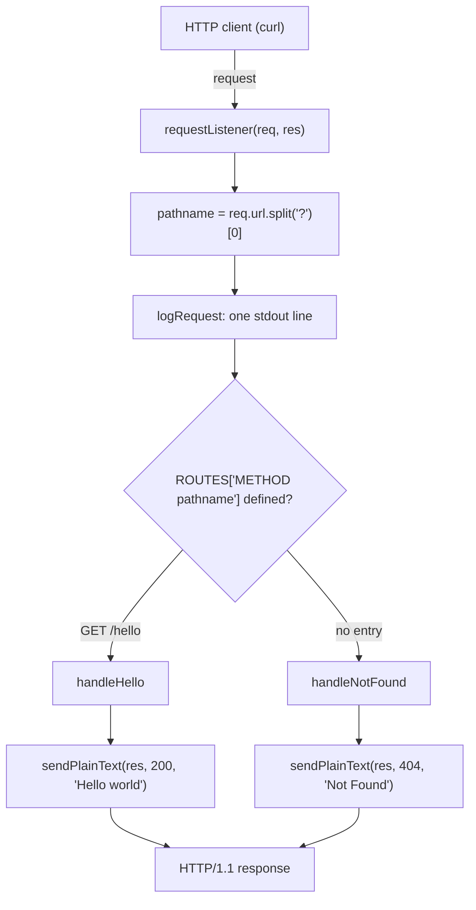

#### 1.2.2.3 Core Technical Approach

The program is a single file with a strict top-to-bottom read order: constants, then the escaping and configuration helpers, then logging and stdio protection, then the response writer and the two handlers, then the routing table and listener, then server creation, error handling, shutdown and `start()`, which is invoked as the final statement.

- **Table-driven routing without a router.** `ROUTES` is a plain object with one key, `'GET /hello'`. The listener composes the same shape from the request (`${req.method} ${pathname}`) and an undefined lookup falls through to `handleNotFound`. A method mismatch therefore yields the same `404` as an unknown path — never `405` — and `HEAD /hello` is a `404` whose body the runtime omits.
- **No request parsing.** `req.url.split('?')[0]` removes the query string instead of using `new URL`. The comment in `server.js` states the reason: `split` cannot throw on a malformed request target, so request data never reaches a parser. The request stream is never read.
- **One response writer.** `sendPlainText(res, statusCode, body)` calls `res.writeHead` with `{'Content-Type': 'text/plain'}` and `res.end(body)`, so both responses share framing and differ only in status and body. `Date`, `Connection`, `Keep-Alive` and `Transfer-Encoding` are added by the Node runtime and are explicitly outside the contract.
- **Log invariant defended by escaping.** `logRequest` writes three space-separated tokens and passes the method and path through `escapeNonPrintable`, which renders every character outside `0x20`–`0x7E` as `\uXXXX`. A crafted request target can therefore neither break the three-token line nor inject control characters into the terminal.
- **Configuration validated before any side effect.** `resolvePort` returns a discriminated result (`{ok: true, port}` or `{ok: false, message}`). Because validation precedes `listen()`, the privileged-port refusal needs no root and produces no permission error, and no startup line is printed on any refusal.
- **Exit-status discipline instead of `process.exit` on the success path.** Refusals set `process.exitCode = 1` and return, letting the process end naturally. The clean shutdown also sets `process.exitCode = 0` rather than calling `process.exit(0)`, because an immediate exit would truncate the pending stdout write that is itself the evidence of a clean shutdown. The failsafe path does call `process.exit(0)`, but only after its own write callback fires.
- **Engine floor honoured defensively.** `closeIdleConnections()` and `closeAllConnections()` arrived in Node 18.2.0, above the declared `>=18.0.0` floor, so both are reached only through `typeof` guards and the five-second failsafe guarantees termination on 18.0.x.

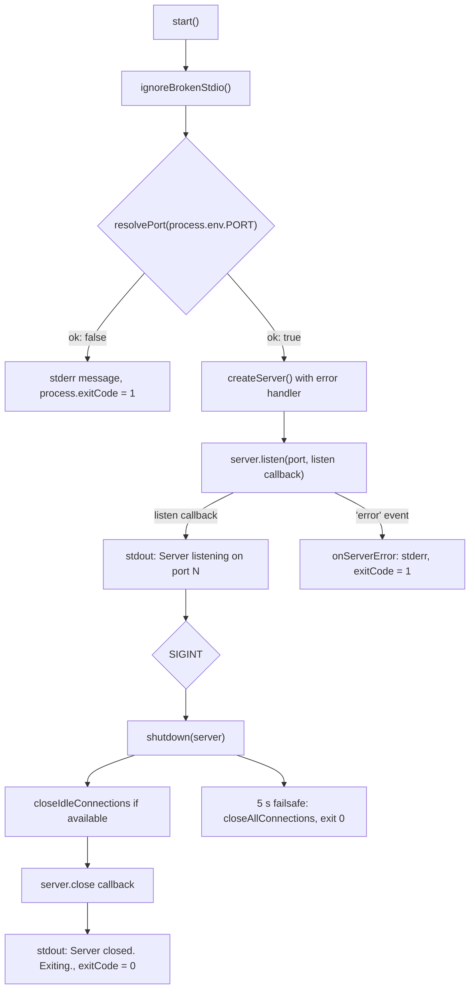

### 1.2.3 Success Criteria

#### 1.2.3.1 Measurable Objectives

Each objective below is a literal-comparison gate in `README.md` "Verification"; V7, V8 and V9 are host-side measurements rather than exact matches.

| Objective | Target | Gate |
|-----------|--------|------|
| Start on the default port | `Server listening on port 3000` once on stdout, empty stderr, process stays in foreground | V1 |
| Success contract | `200 OK`, `Content-Type: text/plain` with no charset parameter, body 11 bytes | V2 |
| Failure contract | `404 Not Found`, body `Not Found`, 9 bytes, no path echo or error detail | V3 |
| Method mismatch | `POST /hello` answers the same `404`, not `405` and not `200` | V4 |
| Request logging | Exactly one line per request, three tokens, first matching `^\d{4}-\d{2}-\d{2}T\d{2}:\d{2}:\d{2}\.\d{3}Z$`; two requests plus startup and two shutdown lines total five | V5 |
| Clean shutdown | Both shutdown lines printed, status `0`, no forced kill | V6 |
| Endpoint latency | Five samples each below 0.010 s | V7 |
| Concurrency | 50 concurrent requests all `200`, with 50 matching log lines | V8 |
| Memory stability | Third RSS reading within 10 MB of the second across 10,000 logged requests | V9 |
| Port override | `PORT=4000` prints and serves on 4000 | V10 |
| Invalid configuration refused | Exit `1`, stderr names the offending value, no startup line, no bind | V11 |
| Privileged port refused | Exit `1` with the privileged-port message, achievable without root | V12 |
| Held port reported | Exit `1`, one stderr line, no stack trace and no unhandled `error` event | V13 |
| Manifest integrity | Seven declared fields exactly as documented; no `dependencies`, `devDependencies` or `type` key | V14 |
| Documentation completeness | Every documented command reproduces its output on a machine with only Node.js ≥ 18.0.0 and `curl`; eight topics covered (purpose, prerequisites, installation, execution, testing, expected output, shutdown, `PORT` configuration) | V15 |
| Footprint | Exactly `README.md`, `package.json`, `server.js`; `node --check server.js` silent; one `require(` call; no `TODO`/`FIXME`/`XXX`/`TBD`/`placeholder` marker in code | V16 |

#### 1.2.3.2 Critical Success Factors

- **No dependency may appear.** A single third-party package would break the installation story, the footprint gate (V16) and the teaching premise; `server.js` keeps to `node:http` with exactly one `require(` call.
- **Documented output must remain byte-exact.** The 11-byte and 9-byte bodies with no trailing newline, the header without a charset parameter and the three-token log line are the contract; V2, V3 and V5 fail on any drift.
- **Failure paths must stay silent on stdout and single-line on stderr.** Every refusal exits `1` from one diagnostic line, so no partial startup banner or stack trace can appear (V11–V13).
- **The `>=18.0.0` floor must remain true.** Any unguarded use of a later API would invalidate `engines.node` and the shutdown failsafe rationale.
- **Readability at tutorial scale.** The whole program remains one file that reads top to bottom, with `ROUTES` as the only extension point.

#### 1.2.3.3 Key Performance Indicators

| Indicator | Threshold | Basis |
|-----------|-----------|-------|
| `GET /hello` response time over loopback | Each of five samples < 0.010 s; 0.000478–0.000523 s recorded during README verification | V7 via `curl --write-out '%{time_total}'` after one warm-up request |
| Burst concurrency | 50 requests answered `200` together, all inside one 7 ms window, with 50 log lines | V8; backgrounded `curl` loop plus shell `wait` |
| Resident memory growth | Third RSS within 10 MB of the second; 47,384 → 59,604 → 62,180 KB recorded, a 2,576 KB rise | V9; two 5,000-request batches sampled with `ps -o rss=` |
| Log completeness | One line per request, including every `404` | V5; `grep -c 'Z '` on a log written outside the repository |
| Exit-status determinism | `0` for clean `SIGINT`, `1` for invalid configuration, privileged port or any bind failure, nothing else | `server.js` `start`, `onServerError`, `shutdown`; README "Exit statuses" |


## 1.3 Scope

### 1.3.1 In-Scope

#### 1.3.1.1 Core Features and Functionalities

**Must-have capabilities.** These are the capabilities the delivered code implements, each with the gate that proves it:

| Capability | Required behaviour | Proof |
|------------|--------------------|-------|
| Single read-only endpoint | `GET /hello` → `200`, `text/plain`, `Hello world` (11 bytes) | V2 |
| Uniform catch-all | Every other method/path → `404`, `text/plain`, `Not Found` (9 bytes) | V3, V4 |
| Per-request logging | One three-token stdout line per request, written before routing | V5 |
| Configurable port | `PORT` overrides `3000`, read once at startup | V1, V10 |
| Configuration validation | Digit-only, `1024`–`65535`, privileged ports refused before binding | V11, V12 |
| Bind-failure reporting | Held port and other listen errors reported in one stderr line, exit `1` | V13 |
| Graceful `SIGINT` shutdown | Idle connections closed, in-flight work finished, two shutdown lines, exit `0` | V6 |
| Runnable documentation | Every documented command reproduces its documented output | V15 |
| Minimal footprint | Three files, one `require(`, no dependency keys | V16 |

**Primary user workflows.** All four are shell-driven; there is no UI, no account and no session.

1. **Start.** `node server.js` or `npm start` from the repository root; the reader sees `Server listening on port 3000` once the port is bound and the process stays in the foreground.
2. **Verify the success contract.** `curl -si http://localhost:3000/hello` shows the `200` status line, `Content-Type: text/plain` and the body; the one-line `curl -w` form reports `200 text/plain 11`.
3. **Verify the failure contract.** Any other request — `curl -si http://localhost:3000/invalid`, `curl -X POST …/hello`, `…/hello/` — returns `404` with `Not Found`, and each appears as one line on the server's stdout.
4. **Configure, then stop.** `PORT=4000 node server.js` moves the listener; `CTRL+C` (or `kill -INT <pid>`) shuts down with `Received SIGINT. Shutting down gracefully.` followed by `Server closed. Exiting.` and exit status `0`.

**Essential integrations.** The only integrations in scope are the five runtime touchpoints recorded in 1.2.1.3: the `PORT` environment variable, the `SIGINT` signal, stdout and stderr, the HTTP/1.1 listener, and an HTTP client such as `curl` used for verification. The README's verification procedure additionally assumes a POSIX shell (`$!`, `$?`, `kill -INT`, `mktemp`) and, for V7–V9, the host tools `ps` and `seq`.

**Key technical requirements.**

- Node.js 18.0.0 or later, as declared in `package.json` `engines.node` and enforced by the code's `typeof` guards around APIs added in 18.2.0.
- Exactly one built-in module, `node:http`; no third-party package, no `node_modules`, no `package-lock.json`.
- No build, transpile or lint step: `server.js` is the file that runs, and `node --check server.js` is the only static check.
- Plain HTTP/1.1 on the resolved port, with no TLS and no access control.
- The delivered set is exactly three files at the repository root: `server.js`, `package.json`, `README.md`.

#### 1.3.1.2 Implementation Boundaries

| Boundary element | Inside the boundary | Outside the boundary |
|------------------|--------------------|----------------------|
| Process | One foreground Node.js process started by hand | Supervision, clustering, restart-on-failure |
| Network | One listening socket on the resolved port, all interfaces, no host argument | TLS termination, reverse proxying, load balancing |
| Request data | Method and query-stripped path only | Request body, headers, query parameters, cookies, URL decoding |
| State | Per-process constants and the resolved port | Any state that survives a request or a process exit |
| Output | One stdout line per request plus lifecycle lines; one stderr line per refusal | Log files, log levels, metrics, tracing |

**User groups covered.** Beginner Node.js developers reading the source, developers adopting it as a baseline, the tutorial maintainers, and reviewers running V1–V16 (see 1.1.3). Anonymous HTTP clients are the only runtime consumers, and they receive identical responses regardless of origin.

**Geographic and market coverage.** The system has no geographic dimension: it runs on one host, serves one port, and holds no region, locale or currency logic. Documentation is English-only, response bodies are fixed ASCII literals (`Hello world`, `Not Found`), and there is no localisation, no content negotiation and no multi-tenancy. The V7–V9 measurements are explicitly host-dependent, so performance figures are illustrative of the verifying host rather than a service-level commitment.

**Data domains included.** The system touches exactly four kinds of data: the `PORT` value from the environment, the request method, the query-stripped request path, and the log lines composed from those values plus a timestamp. No personal data, credential, secret, session or record is read, stored or transmitted, and nothing is written to disk.

### 1.3.2 Out-of-Scope

`README.md` "Scope and non-goals" frames each exclusion as "a deliberate boundary of this tutorial rather than unfinished work. Nothing here is a step you are expected to add."

#### 1.3.2.1 Explicitly Excluded Capabilities

| Excluded area | What is absent | Effect on the delivered system |
|---------------|----------------|-------------------------------|
| Tests and test tooling | No test file, no test framework, no test dependency | The sixteen gates are the test suite: commands run and compared by hand |
| CI/CD and containers | No workflow file, no `Dockerfile`, no compose file | The program runs only via `node server.js` on the reader's machine |
| Deployment automation | No process manager, no orchestration descriptor, no release script | One foreground process, started and stopped by the reader |
| Persistence | No database, cache or file write | Nothing survives a request or a process exit |
| Security controls | No authentication, authorisation, sessions, cookies, CORS, CSRF or TLS | The endpoint is anonymous, read-only and plain HTTP |
| Traffic controls | No rate limiting, quotas or request-size limits | No protected resource and no body to limit |
| Additional endpoints | No health check, metrics, favicon, static file route, redirect or API version prefix | `GET /hello` and the catch-all are the whole surface |
| Request interpretation | No body parsing, query parsing or content negotiation | The request stream is never read; the query string is only stripped |
| Structured observability | No log levels, structured fields, log files, metrics or tracing | One stdout line per request is the entire observability surface |
| Signal coverage | No `SIGTERM` or `SIGHUP` handling | `SIGINT` is the only graceful path; the five-second failsafe bounds it |
| Build and quality tooling | No TypeScript, bundler, transpiler, linter or formatter configuration | Style is kept by hand; `node --check` is the only static gate |
| Additional configuration | No environment variable other than `PORT`, and no `HOST` variable | The listener always binds every interface on the resolved port |
| Runtime reach | No change to the `>=18.0.0` engine floor | Later runtime features must remain behind guards or be avoided |

#### 1.3.2.2 Future Phase Considerations

The repository defines no roadmap, no backlog and no future phase: `README.md` states the exclusions are not work to be added, and V16 asserts that `server.js` carries no `TODO`, `FIXME`, `XXX`, `TBD` or `placeholder` marker. The only extension mechanism the design names is the `ROUTES` table, which the README describes as the point where adding an endpoint costs "one entry in that table plus one handler function" while logging, the response writer, configuration and shutdown stay unchanged. That mechanism is a documented extension point of the current scope, not a planned phase; no schedule, owner or acceptance gate for any extension exists in the delivered files.

#### 1.3.2.3 Integration Points Not Covered

| Integration point | Why it is not covered |
|-------------------|----------------------|
| Identity provider or SSO | No authentication or authorisation exists; the endpoint is anonymous |
| Database, cache or queue | No persistence layer and no client library; the single `require(` names `node:http` |
| TLS terminator or certificate store | Transport is plain HTTP; no key, certificate or ACME path is configured |
| Reverse proxy or load balancer | The listener is a single process on a single port with no forwarded-header handling |
| Orchestrator health or readiness probes | No health endpoint exists, and no probe path is recognised by the router |
| Metrics, APM or tracing backend | No metrics endpoint, no exporter and no instrumentation |
| Log shipper or aggregation pipeline | Output is bare stdout/stderr lines with no structured format |
| CI runner or artifact registry | No workflow file and no packaging step |
| Secret manager or configuration service | The only configuration input is the `PORT` environment variable |

#### 1.3.2.4 Unsupported Use Cases

- **Production traffic.** No TLS, no access control, no rate limiting, no supervision and a single process; the README states the system is "deliberately at tutorial scale rather than a production service".
- **Multi-endpoint or versioned APIs.** The router holds one key; any growth means editing the table rather than configuring a route set.
- **Request-dependent responses.** The body is a fixed literal in both branches, and no path, query, header or body value is echoed back.
- **Anything requiring request bodies or uploads.** The flow is never read and no size limit is enforced.
- **Static assets, browser front-ends or cross-origin calls.** No file route, no CORS headers and no CSRF protection exist.
- **Health or metrics scraping.** Both requests would answer `404 Not Found`.
- **Long-lived or partially completed shutdown under other signals.** `SIGTERM` has no handler, so a supervisor issuing it terminates the process without the documented shutdown lines or the `0` exit status.
- **Service-managed verification outside a POSIX environment.** The gates that drive the server from the shell depend on `$!`, `$?`, `kill -INT`, `mktemp`, `ps` and `seq`, and the README documents no alternative procedure.
- **Constrained or privileged-port hosting.** `PORT` below `1024` is refused by validation, so binding port 80 or 443 directly is unsupported and no override variable exists.


## 1.4 References

- `README.md` — 654 lines on branch `origin/blitzy-8a4de345-c459-434b-a545-c8cf76a5f502`; established the system's purpose, prerequisites (Node.js ≥ 18.0.0, `curl`, POSIX shell), absence of any installation step, run/verify/stop procedures, the byte-exact `200` and `404` contracts, matching semantics, the three-token log format, the `PORT` configuration and its four refusal conditions, the `0`/`1` exit-status contract, verification gates V1–V16 with their thresholds and recorded measurements, troubleshooting entries, and the "Scope and non-goals" list quoted in 1.3.2.
- `server.js` — 176 lines; established the whole implementation: `DEFAULT_PORT`/`MIN_PORT`/`MAX_PORT`, `escapeNonPrintable`, `resolvePort`, `logRequest`, `ignoreBrokenStdio`, `sendPlainText`, `handleHello`, `handleNotFound`, `ROUTES` (`'GET /hello'`), `requestListener` (query strip via `split('?')`, log-before-route, catch-all fallthrough), `createServer`, `onServerError`, `shutdown` (five-second failsafe, `typeof` guards, `process.exitCode = 0`) and `start()` invoked as the final statement, plus the inline comments that justify the `split` choice, the guarded APIs and the avoided `process.exit(0)`.
- `package.json` — established the manifest identity used in 1.1.1 and 1.2.1.1: `name` `nodejs-tutorial-hello-world`, `version` `1.0.0`, `description`, `main` `server.js`, `scripts.start` `node server.js`, `engines.node` `>=18.0.0`, `keywords`, and the absence of `dependencies`, `devDependencies` and `type`.
- `` (repository root, path `""`) — the checkout contains exactly one child, `README.md` (9 bytes, `# IWNewGH`), confirming that no source, manifest, configuration, test, container or CI file exists on `main`.
- `main` at `17c8b88c92478aac7a52ecf282fa92c145678c9a` ("Initial commit") — the repository baseline cited in 1.2.1.1; one file, no implementation.
- `origin/blitzy-8a4de345-c459-434b-a545-c8cf76a5f502` at `10d5d2ce05f177635ed928a01e9ed593ae550aa3` — the delivery branch that holds the three files documented here, preceded by eleven commits (`bf884ad`, `63152f0`, `7c7142c`, `7f5e9e7`, `b7a0b94`, `8b4fe4a`, `bc93b97`, `4dba479`, `8be576f`, `fed7b96`, `0ef1865`).
- Runtime verification performed against the `10d5d2c` working tree on Node.js `v22.23.4` — confirmed `200 text/plain` with an 11-byte body, `404 text/plain` with a 9-byte body, `404` for `POST /hello`, `GET /hello/`, `GET /Hello` and `HEAD /hello` (0-byte body), `200` for `GET /hello?x=1`, one log line per request, `exit=0` on `SIGINT` with both shutdown lines, `exit=1` with the documented message for every refused `PORT` value (`abc`, `3000.5`, `0x1F90`, `1e3`, `+3000`, `-1`, `65536`, `0`, `80`, `1023`), the trimmed `PORT=" 4000 "` override, the port-in-use refusal, and a clean `node --check server.js`.


# 2. Product Requirements

## 2.1 Feature Catalog

The catalog below enumerates every capability the delivered code implements. It is closed: the three delivered files — `server.js` (176 lines), `package.json` and `README.md` (654 lines) — contain no other behaviour, and `README.md` "Scope and non-goals" declares everything absent to be a deliberate boundary rather than planned work (see 1.3.2). No feature in this section is proposed or aspirational; each is traceable to a named function, manifest field or documented verification gate, and each was exercised at runtime on Node.js `v22.23.4` while this section was written.

### 2.1.1 Feature Inventory

| ID | Feature name | Category | Priority |
|----|--------------|----------|----------|
| F-001 | Success contract endpoint `GET /hello` | Core HTTP serving | Critical |
| F-002 | Uniform catch-all failure contract | Core HTTP serving | Critical |
| F-003 | Exact-match routing table and query-string stripping | Routing | Critical |
| F-004 | Per-request stdout logging | Observability | High |
| F-005 | Port configuration and validation | Configuration | Critical |
| F-006 | Bind-failure reporting | Diagnostics and reliability | High |
| F-007 | Graceful `SIGINT` shutdown with bounded failsafe | Process lifecycle | High |
| F-008 | Broken-stdio resilience | Reliability | Medium |
| F-009 | Dependency-free manifest and `npm start` entry point | Packaging and bootstrap | Medium |
| F-010 | Self-verifying documentation (gates V1–V16) | Documentation and QA | High |

All ten features carry status **Completed**. Each is present in the delivered tree at commit `10d5d2ce05f177635ed928a01e9ed593ae550aa3` on branch `origin/blitzy-8a4de345-c459-434b-a545-c8cf76a5f502`; the commit series shows the manifest (`bf884ad`), then the server with all of F-001 through F-008 (`63152f0`), then the documentation (`7c7142c`), then nine refinement commits ending at `10d5d2c`. No feature is partially delivered, and `server.js` carries no `TODO`, `FIXME`, `XXX`, `TBD` or `placeholder` marker (gate V16).

Priority is assigned by consequence of absence for the artifact's stated purpose as teaching material that also runs correctly (`README.md` "Purpose"): a Critical feature's removal breaks the documented contract or leaves the program unable to start; High covers behaviour a reader is taught to rely on and verify; Medium covers robustness and packaging properties that no gate would notice if they silently regressed.

### 2.1.2 F-001 — Success Contract Endpoint `GET /hello`

| Field | Value |
|-------|-------|
| Feature ID | F-001 |
| Category / Priority | Core HTTP serving / Critical |
| Status / Owner area | Completed / request handling (`server.js`) |

**Overview.** One read-only endpoint answers `GET /hello` with status `200`, the header `Content-Type: text/plain` and the fixed body `Hello world` — 11 bytes with no trailing newline. The handler is `handleHello` (`server.js` L59–63) and its whole body is a single call to the shared writer, `sendPlainText(res, 200, 'Hello world')`.

**Business value.** The endpoint is the artifact's entire demonstration of the request/response cycle: creating a server, receiving a request, writing a status, a header and a body. It is the first thing the README asks a reader to run (`curl http://localhost:3000/hello`) and the anchor for the tutorial's claim that every documented output is what the delivered code produces.

**User benefits.** A reader sees a complete, correct HTTP response from a program of about 150 lines with no framework between the request and the body. A developer seeking a baseline gets a byte-exact, stable response to compare a framework against: `200 text/plain 11` from the README's one-line `curl -w` form.

**Technical context.** `handleHello` accepts `(req, res)` and deliberately reads neither; `server.js` L60–61 records that the route key already established the method and path and the parameter is kept only so every `ROUTES` entry shares one signature. `req` is therefore never inspected, and the response pipeline is `sendPlainText` (L53–56): `res.writeHead(statusCode, {'Content-Type': 'text/plain'})` followed by `res.end(body)`. `Date`, `Connection`, `Keep-Alive` and `Transfer-Encoding` are added by the Node runtime and are outside the contract (`README.md` "Runtime-added headers").

**Dependencies.**

| Dependency kind | Detail |
|-----------------|--------|
| Prerequisite features | F-003 (the `ROUTES` key `'GET /hello'` must resolve); F-009 (entry point that starts the listener) |
| System dependencies | `node:http` server created by `createServer` (L94–100); `sendPlainText` (L53–56); Node.js `>=18.0.0` per `package.json` `engines.node` |
| External dependencies | None — no package, no network call, no data store |
| Integration requirements | An HTTP/1.1 client such as `curl` for verification; a bound port supplied by F-005 |

### 2.1.3 F-002 — Uniform Catch-All Failure Contract

| Field | Value |
|-------|-------|
| Feature ID | F-002 |
| Category / Priority | Core HTTP serving / Critical |
| Status / Owner area | Completed / request handling (`server.js`) |

**Overview.** Every request that is not exactly `GET /hello` receives `404`, `Content-Type: text/plain` and the constant body `Not Found` — 9 bytes, no trailing newline. `handleNotFound` (L66–68) is the single implementation, reached from `requestListener` whenever the `ROUTES` lookup returns `undefined` (L85–88).

**Business value.** The failure path is part of the lesson: the tutorial teaches that an unmatched route is answered explicitly and identically, and that a method mismatch is not a `405`. It is also the artifact's safety property — one failure shape means no probe can learn which check failed.

**User benefits.** Predictable behaviour for any malformed or unexpected request: the same status, the same header, the same 9 bytes, whether the path is unknown, the method differs, or the casing is wrong. A learner comparing `200` against `404` sees only the status line and body change.

**Technical context.** The body is a fixed literal, so no requested path is echoed, no error code, no stack trace and no runtime detail appears (`README.md` "The failure contract"). Because HTTP forbids a body on a `HEAD` response, a `HEAD /hello` probe observes `404` with a 0-byte body while the same request as `GET` observes 9 bytes — verified at runtime, where `HEAD` reported `404` and `%{size_download}` of `0`.

**Dependencies.**

| Dependency kind | Detail |
|-----------------|--------|
| Prerequisite features | F-003 (the fallthrough decision and the matched-key shape) |
| System dependencies | `sendPlainText` — the same writer F-001 uses; Node's HTTP runtime for `HEAD` body omission |
| External dependencies | None |
| Integration requirements | None beyond an HTTP client; the handler is reachable only through the listener of F-003 |

### 2.1.4 F-003 — Exact-Match Routing Table and Query-String Stripping

| Field | Value |
|-------|-------|
| Feature ID | F-003 |
| Category / Priority | Routing / Critical |
| Status / Owner area | Completed / request handling (`server.js`) |

**Overview.** Routing is a plain object literal, `ROUTES = { 'GET /hello': handleHello }` (L70–72), consulted with a key composed from the request: `${req.method} ${pathname}` (L83). The path is derived by cutting the query string with `req.url.split('?')[0]` (L79). No router library, no middleware chain and no parameter, wildcard or prefix semantics exist.

**Business value.** The table *is* the documented extension point: `README.md` "Purpose" states that adding an endpoint is "one entry in that table plus one handler function, and nothing else in the program changes". The absence of a routing library is also the point of contrast the tutorial exists to provide.

**User benefits.** A reader can see the whole route set in five lines and predict the outcome of any request by exact comparison. The `split`-based strip means malformed request targets cannot throw: `server.js` L76–78 records that `split` cannot throw on a malformed target, so request data never reaches a parser.

**Technical context.** Matching is exact and case-sensitive on both the method and the query-stripped path, with no trailing-slash tolerance and no URL decoding. Verified at runtime: `/hello?anything=1` → `200` (11 bytes); `/hello/`, `/Hello`, `/hello%2F` and `/` → `404` (9 bytes); `POST`, `PUT`, `DELETE`, `OPTIONS` on `/hello` → `404`. The request stream is never read, so no body, header, cookie or content-negotiation logic exists.

**Dependencies.**

| Dependency kind | Detail |
|-----------------|--------|
| Prerequisite features | F-004 (logging is invoked in the same listener, before the lookup); F-001 and F-002 (the two entries the table resolves to) |
| System dependencies | `req.method`, `req.url` from the `node:http` request object; `requestListener` (L75–91) |
| External dependencies | None |
| Integration requirements | Node's HTTP parser, which rejects request lines carrying bytes outside its accepted set with `400 Bad Request` before the listener runs (observed with `0x7F`, `0xFF` and `0x01`) |

### 2.1.5 F-004 — Per-Request Stdout Logging

| Field | Value |
|-------|-------|
| Feature ID | F-004 |
| Category / Priority | Observability / High |
| Status / Owner area | Completed / observability (`server.js`) |

**Overview.** Exactly one line is written to stdout for every request, before the request is routed, in the format `<ISO-8601 timestamp> <HTTP method> <pathname>` (`logRequest`, L42–44). The timestamp is `Date.prototype.toISOString()`. Because logging precedes the lookup, a request that ends in `404` is logged like a success.

**Business value.** This line is the artifact's entire observability surface (`README.md` "Scope and non-goals": no levels, no structured fields, no log files). It is also what makes the tutorial's teaching claim checkable: the reader can see routing and response writing separated in the source and then watch one line per request on the terminal.

**User benefits.** A learner watches requests arrive in the same order they were made, with the query string already removed, so the logged path is visibly the value the router matched on. Counting lines gives a request count without any instrumentation: 50 concurrent requests produced 50 lines in the runtime probe.

**Technical context.** The method and pathname pass through `escapeNonPrintable` (L10–12), which renders every character outside `0x20`–`0x7E` as a `\uXXXX` escape, so the line always stays three space-separated tokens. Operational output (startup, request lines, shutdown) goes to stdout and diagnostics to stderr, which lets a reader separate the two streams without prefix parsing. On Node `v22.23.4` invalid bytes in the request line are rejected by the HTTP parser with `400 Bad Request` before the listener runs, so in practice the escape protects the line against values that do reach it — including the `PORT` refusal messages of F-005, which use the same helper.

**Dependencies.**

| Dependency kind | Detail |
|-----------------|--------|
| Prerequisite features | F-003 (supplies the query-stripped pathname that is logged); F-008 (keeps a departed stdout consumer from turning a log line into an unhandled event) |
| System dependencies | `console.log`, `Date.prototype.toISOString`, `escapeNonPrintable` (L10–12) |
| External dependencies | None |
| Integration requirements | A reader of stdout: a terminal, a file redirect, or a pipe. Counting through a pipeline is documented as unreliable because `SIGINT` reaches every process in the foreground group (`README.md` V5) |

### 2.1.6 F-005 — Port Configuration and Validation

| Field | Value |
|-------|-------|
| Feature ID | F-005 |
| Category / Priority | Configuration / Critical |
| Status / Owner area | Completed / configuration (`server.js`) |

**Overview.** The listening port is resolved once at startup from the `PORT` environment variable by `resolvePort` (L15–39) against the constants `DEFAULT_PORT = 3000`, `MIN_PORT = 1024` and `MAX_PORT = 65535` (L5–7). An unset, empty or whitespace-only value selects `3000`; surrounding whitespace is trimmed; only decimal digits are accepted; the range is `1024`–`65535`. The function returns a discriminated result, `{ok: true, port}` or `{ok: false, message}`, and `start()` (L159–165) writes the message to stderr and sets `process.exitCode = 1` without ever calling `listen()`.

**Business value.** Configuration is one of the six concerns the tutorial exists to show in isolation, and it is the only knob the system has. Validating before binding is what lets the privileged-port refusal be demonstrated by an unprivileged reader: the refusal is a validation outcome, not a failed bind, so it produces no permission error and needs no root.

**User benefits.** `PORT=4000 node server.js` moves the listener to 4000 and the startup line names the resolved port; a mistyped value fails immediately with a message that quotes the offending text, rather than surfacing later as an obscure bind error. Values are refused rather than reinterpreted: `0x1F90` is not read as `8080`, `1e3` is not `1000`, `+3000` is not `3000`, and `0` is out of range rather than treated as "any free port".

**Technical context.** Received messages are reproduced exactly by the runtime probe: `abc`, `3000.5`, `0x1F90`, `1e3`, `+3000`, `-1`, `65536` and `0` each produced `Invalid PORT value "<value>": must be an integer between 1024 and 65535.`; `80`, `1` and `1023` each produced `Invalid PORT value "<value>": privileged ports 1-1023 are not permitted; choose a port between 1024 and 65535.`; every case exited `1` with no startup line. `PORT=" 4000 "` was accepted after trimming, and `PORT` unset, `""` or whitespace selected `3000`. `PORT` is the only environment variable read, and no `HOST` exists: `server.listen(resolved.port, …)` (L171) passes the port alone, so the bind covers every interface.

**Dependencies.**

| Dependency kind | Detail |
|-----------------|--------|
| Prerequisite features | F-008 (installs the stdio error handlers before any refusal is written); F-009 (the start command that launches the process) |
| System dependencies | `process.env.PORT`; `escapeNonPrintable` for the quoted value; `Number` and a digits-only regular expression |
| External dependencies | Nothing; no configuration file, secret store or service is consulted |
| Integration requirements | A shell that can set an inline environment variable (`PORT=4000 node server.js`), as documented in `README.md` "Configuration" |

### 2.1.7 F-006 — Bind-Failure Reporting

| Field | Value |
|-------|-------|
| Feature ID | F-006 |
| Category / Priority | Diagnostics and reliability / High |
| Status / Owner area | Completed / lifecycle (`server.js`) |

**Overview.** `createServer` attaches a `'error'` listener (L97) whose handler, `onServerError` (L103–114), classifies the failure into three documented messages. A held port produces `Port <port> is already in use. Stop the process using it or set PORT to a free port.` and exit status `1`. Any other failure whose `syscall` is `listen` produces `Failed to start server: <error message>` and exit status `1`. An error after a successful bind produces `Server error while serving: <error message>` and, per L110–111, returns without setting an exit status.

**Business value.** Every failure is one stderr line and never a stack trace, which keeps the program scriptable and the documented exit-status contract limited to `0` and `1` (`README.md` "Exit statuses"). Attaching the listener is what prevents a bind failure from becoming an unhandled `'error'` event that would kill the process with a trace.

**User benefits.** A reader who already holds port 3000 sees exactly which port is held and the two remedies, plus `PORT=3001 node server.js` as the contiguous documented way to continue. The message names the port from `error.port` rather than re-reading configuration, so it reflects the port that could not be bound.

**Technical context.** The port-in-use path was verified end to end: with one server on 3000, a second exited `1` with the documented line on stderr while `PORT=3001 node server.js` printed `Server listening on port 3001`. The post-bind branch is deliberately not given exit status `1`, so a transient serve-time error does not fabricate a startup failure — the README's "Exit statuses" limits `1` to invalid configuration, a privileged port and a bind failure.

**Dependencies.**

| Dependency kind | Detail |
|-----------------|--------|
| Prerequisite features | F-005 (a resolved port must exist before a bind can fail); F-007 (the server instance whose lifecycle this reporting belongs to) |
| System dependencies | `server.on('error', …)` on the `http.Server`; the `code`, `port`, `syscall` and `message` fields of the emitted error; `process.exitCode` |
| External dependencies | Host state only: whether the port is already bound, and whether the host permits the bind |
| Integration requirements | A supervisor or shell that reads the exit status; no external monitoring is contacted |

### 2.1.8 F-007 — Graceful `SIGINT` Shutdown with Bounded Failsafe

| Field | Value |
|-------|-------|
| Feature ID | F-007 |
| Category / Priority | Process lifecycle / High |
| Status / Owner area | Completed / lifecycle (`server.js`) |

**Overview.** `start()` registers `process.on('SIGINT', () => shutdown(server))` (L169). `shutdown` (L117–153) logs `Received SIGINT. Shutting down gracefully.`, closes idle connections, stops accepting, lets in-flight responses finish, then logs `Server closed. Exiting.` and sets `process.exitCode = 0`. A single five-second timer started at the top of the function bounds the wait: if the close callback has not fired, it prints `Forcing shutdown after 5s.`, closes the remaining connections and exits `0`.

**Business value.** Shutdown is the sixth concern the tutorial demonstrates, and the clean-exit evidence matters more than the mechanism: the two shutdown lines and the `0` status are what the reader compares against the README. The exit-status discipline — `process.exitCode` instead of `process.exit(0)` on the success path — is the teaching point that an immediate exit truncates the pending stdout write that proves the shutdown was clean (L144–150).

**User benefits.** `CTRL+C` produces a documented, reproducible pair of lines and status `0`, so the same procedure works interactively and in a script (`node server.js & pid=$!; sleep 1; kill -INT $pid; wait $pid; echo "exit=$?"`). A stalled connection cannot hang the terminal: the five-second failsafe terminates with the same status.

**Technical context.** Verified at runtime: a normal `SIGINT` printed both lines and returned `exit=0`; with an incomplete request holding a connection open, the same signal printed `Received SIGINT. Shutting down gracefully.`, then, five seconds later, `Forcing shutdown after 5s.`, and the process still ended with code `0`. `closeIdleConnections()` and `closeAllConnections()` were added in Node `18.2.0`, above the declared `>=18.0.0` floor, so both are reached only behind `typeof` guards (L130, L135) and the failsafe guarantees termination on `18.0.x`. `SIGINT` is the only handled signal; no `SIGTERM` or `SIGHUP` handler exists.

**Dependencies.**

| Dependency kind | Detail |
|-----------------|--------|
| Prerequisite features | F-001, F-002 and F-003 (in-flight responses must be completable); F-006 (the server instance and its error listener); F-008 (the failsafe write tolerates a departed consumer) |
| System dependencies | `process.on('SIGINT')`, `server.close`, `setTimeout`/`clearTimeout`, the two guarded connection-closing APIs |
| External dependencies | None; the signal comes from the terminal or a shell `kill -INT` |
| Integration requirements | A foreground terminal or a shell with job control, and — for the documented counting procedure — `kill -INT <pid>` rather than a process-group signal |

### 2.1.9 F-008 — Broken-Stdio Resilience

| Field | Value |
|-------|-------|
| Feature ID | F-008 |
| Category / Priority | Reliability / Medium |
| Status / Owner area | Completed / robustness (`server.js`) |

**Overview.** `ignoreBrokenStdio` (L47–50) attaches no-op `'error'` listeners to `process.stdout` and `process.stderr`, and `start()` calls it first (L157), before the port is resolved and before anything is written. The failsafe path additionally registers a one-shot `'error'` listener on stdout before its write (L127–128), so a write callback that cannot fire still leads to exit `0`.

**Business value.** Without these listeners a consumer that stops reading — a closed terminal, a `head` in a pipeline, a log collector that disconnects — turns a log write into an unhandled `'error'` event, which would replace a documented line with a stack trace and an undocumented exit. The feature preserves the two-value exit-status contract under that condition.

**User benefits.** Redirecting the server's output to a file or a pipe stays predictable: the operational lines are the only observable effect and the process does not die with a stack trace when the reader disappears. `README.md` V5 depends on this, since its counting procedure redirects stdout to a temporary file outside the repository.

**Technical context.** The no-op handlers are deliberately silent, so they contribute no exit status of their own — the contract stays `0` for a clean shutdown and `1` for a refusal (L46 comment). This is a robustness property rather than a documented user-visible behaviour: no gate in `README.md` drives it, which is why it carries Medium priority.

**Dependencies.**

| Dependency kind | Detail |
|-----------------|--------|
| Prerequisite features | None — it must run before every other feature that writes |
| System dependencies | `process.stdout`, `process.stderr`, the `'error'` event on writable streams |
| External dependencies | None |
| Integration requirements | Any consumer of the output streams: terminal, file redirect or pipe |

### 2.1.10 F-009 — Dependency-Free Manifest and `npm start` Entry Point

| Field | Value |
|-------|-------|
| Feature ID | F-009 |
| Category / Priority | Packaging and bootstrap / Medium |
| Status / Owner area | Completed / manifest (`package.json`) |

**Overview.** `package.json` declares exactly seven identity and bootstrap fields — `name` `nodejs-tutorial-hello-world`, `version` `1.0.0`, `description` `Minimal Node.js HTTP server tutorial demonstrating single endpoint implementation`, `main` `server.js`, `scripts.start` `node server.js`, `engines.node` `>=18.0.0` and `keywords` `["nodejs", "tutorial", "http", "server", "beginner"]` — and no `dependencies`, no `devDependencies` and no `type` field.

**Business value.** The manifest states the artifact's two promises in machine-readable form: that there is nothing to install, and that the runtime floor is `>=18.0.0`. It also gives the tutorial a single documented start script, so `node server.js` and `npm start` are the same program.

**User benefits.** Adoption costs a copy of three files: `npm install` is never run, no `node_modules` and no `package-lock.json` are created, and `npm start` works on a clean machine with only Node installed. Gate V14 pins all seven fields and the absence of the three keys.

**Technical context.** `scripts.start` is the literal string `node server.js`, so the two documented start commands cannot drift apart. The `>=18.0.0` floor is honoured defensively rather than nominally: the only APIs used above it are the two shutdown calls added in `18.2.0`, both behind `typeof` guards (F-007). No `license`, `repository`, `author` or `private` field is declared, and no lint, test, build or `prepublish` script exists.

**Dependencies.**

| Dependency kind | Detail |
|-----------------|--------|
| Prerequisite features | None — it is the entry point every other feature is launched through |
| System dependencies | Node.js `>=18.0.0` as declared in `engines.node`; npm only when the reader chooses `npm start` |
| External dependencies | None — no registry lookup, no install step, no lockfile |
| Integration requirements | A shell and a Node binary on `PATH`; npm is optional |

### 2.1.11 F-010 — Self-Verifying Documentation (Gates V1–V16)

| Field | Value |
|-------|-------|
| Feature ID | F-010 |
| Category / Priority | Documentation and QA / High |
| Status / Owner area | Completed / `README.md` |

**Overview.** `README.md` carries the contract as a sequence of sixteen runnable gates: V1 startup on the default port, V2 the success contract, V3 the failure contract, V4 a method mismatch, V5 request logging, V6 clean shutdown, V7 latency, V8 concurrency, V9 memory stability, V10 the `PORT` override, V11 invalid `PORT`, V12 a privileged port, V13 a held port, V14 manifest fields, V15 the document itself on a clean machine, and V16 footprint and completeness. Each gate states a command and the output to compare literally; `README.md` calls this procedure "the testing instruction for the tutorial".

**Business value.** The trust premise of the artifact: a tutorial is only useful if its documented behaviour is the behaviour the code produces. V15 makes the document itself testable, and V16 enforces the footprint that the teaching premise depends on. Together they are the project's test suite in the absence of a test framework (`README.md` "Scope and non-goals").

**User benefits.** A reviewer can confirm the delivery without reading `server.js` first, and a maintainer has a pass/fail signal that fails visibly when documentation and code diverge. Thresholds are explicit where measurement replaces exact matching: five latency samples below `0.010` s (V7), 50 concurrent requests all `200` (V8), and a third resident-set reading within 10 MB of the second across two 5,000-request batches (V9).

**Technical context.** Running the gates while writing this section reproduced every exact-match expectation, and the measurements landed inside the documented thresholds: latency samples of `0.000938`, `0.000876`, `0.000585`, `0.000809` and `0.000707` s; 50 of 50 concurrent requests `200` with 50 log lines. The gates assume a POSIX shell and `curl`, with `ps` and `seq` only for V7–V9, and each is scoped so that a gate needing port `3000` is not run while another server holds it (`README.md` "Verification").

**Dependencies.**

| Dependency kind | Detail |
|-----------------|--------|
| Prerequisite features | F-001 through F-009 — the gates assert every one of them; V14 and V16 additionally assert F-009 and the three-file footprint |
| System dependencies | POSIX shell (`$!`, `$?`, `kill -INT`, `mktemp`), `curl`, and for measurements only `ps` and `seq` |
| External dependencies | None; no CI runner, no test framework, no registry |
| Integration requirements | A free port `3000` for self-starting gates, `4000` for V10, and a writable `${TMPDIR:-/tmp}` for V5's log file |


## 2.2 Functional Requirements Table

Requirements are numbered `F-<feature>-RQ-<sequence>`. Priority follows the MoSCoW scale as used by the delivered documentation: **Must-Have** requirements are those whose failure breaks a documented gate; **Should-Have** requirements are documented behaviour whose failure a reader would notice but which no exact-match gate pins; **Could-Have** covers robustness properties with no gate. Complexity estimates the difficulty of re-implementing the requirement in this dependency-free form, not of maintaining it. Every acceptance criterion below was executed against the delivered `server.js` on Node.js `v22.23.4`; where a criterion cites a gate, the gate identifier is the one in `README.md` "Verification".

### 2.2.1 F-001 Requirements — Success Contract Endpoint

| Requirement ID | Description | Acceptance criteria | Priority / Complexity |
|---|---|---|---|
| F-001-RQ-001 | Answer `GET /hello` with status `200` and the fixed body `Hello world` | Status line is `HTTP/1.1 200 OK`; body is exactly 11 bytes with no trailing newline; `curl -w '%{http_code} %{size_download}'` prints `200 11` (V2) | Must-Have / Low |
| F-001-RQ-002 | Response carries `Content-Type: text/plain` set by the program, with no charset parameter | Header is exactly `text/plain`; the one-line check prints `200 text/plain 11` (V2) | Must-Have / Low |
| F-001-RQ-003 | Body is a fixed literal, never derived from the request | `GET /hello?anything=1` returns the same 11-byte body and `200` | Must-Have / Low |
| F-001-RQ-004 | Both responses are written through one writer so framing cannot diverge | `sendPlainText` is the only caller of `res.writeHead` in `server.js` | Should-Have / Low |
| F-001-RQ-005 | Endpoint answers within 10 ms client-side over loopback | Five samples after one warm-up are each below `0.010` s (V7); recorded `0.000585`–`0.000938` s | Should-Have / Low |

| Requirement ID | Input → output / response | Performance and data requirements | Business, security and compliance rules |
|---|---|---|---|
| F-001-RQ-001 | `GET /hello` → `writeHead(200, {'Content-Type': 'text/plain'})`, `end('Hello world')` | Body is 11 ASCII bytes held as a literal; no allocation per request beyond the response itself | No authentication, authorisation or TLS; the endpoint is anonymous and read-only by design |
| F-001-RQ-002 | Handler signature `(req, res)`; header object literal at `server.js` L54 | Header set once per response; no content negotiation and no `Accept` inspection | No charset or language negotiation exists, so no locale-dependent output |
| F-001-RQ-003 | Request method and query-stripped path only | `req` is never read by the handler (`server.js` L60–61) | No request data is stored, echoed or logged beyond the method and path of F-004 |
| F-001-RQ-004 | `(res, statusCode, body)` → status plus header plus body | One write of the body; `Date`, `Connection`, `Keep-Alive` and framing headers come from the runtime | Framing/header changes by the runtime are explicitly outside the contract |
| F-001-RQ-005 | Loopback request → response | Measured client-side with `curl --write-out '%{time_total}'`, so curl start-up and host scheduling are included | A sample above the threshold on an idle host is attributed to host contention, not server behaviour (V7) |

### 2.2.2 F-002 Requirements — Catch-All Failure Contract

| Requirement ID | Description | Acceptance criteria | Priority / Complexity |
|---|---|---|---|
| F-002-RQ-001 | Answer any unmatched path with `404` and the body `Not Found` | `GET /invalid` gives `404 Not Found`, `text/plain`, body 9 bytes; one-line check prints `404 text/plain 9` (V3) | Must-Have / Low |
| F-002-RQ-002 | Treat a method mismatch as the same `404`, never `405` | `POST /hello` returns the identical `404` body (V4); `PUT`, `DELETE` and `OPTIONS` behave the same | Must-Have / Low |
| F-002-RQ-003 | Body must not leak path, error detail or stack trace | Body is the constant `Not Found` for `/invalid`, `/Hello`, `/hello/` and `/hello%2F` alike | Must-Have / Low |
| F-002-RQ-004 | Omit the body on `HEAD` while keeping the status | `HEAD /hello` returns `404` with a 0-byte body on the wire | Should-Have / Low |
| F-002-RQ-005 | One failure shape for every non-match, so a probe cannot tell which check failed | Every unmatched request, regardless of method or path, produces byte-identical responses | Should-Have / Low |

| Requirement ID | Input → output / response | Performance and data requirements | Business, security and compliance rules |
|---|---|---|---|
| F-002-RQ-001 | Unmatched method+path → `writeHead(404, {'Content-Type': 'text/plain'})`, `end('Not Found')` | Body is 9 ASCII bytes, a literal; no allocation from request data | Response reveals nothing about the router, the route table or the runtime |
| F-002-RQ-002 | `POST`/`PUT`/`DELETE`/`OPTIONS` on `/hello` → `404` | Same cost as the success path: one string comparison and one `end()` | No method allow-list is advertised; no `Allow` header is sent |
| F-002-RQ-003 | Any path, including percent-encoded forms → fixed literal | No URL decoding and no path echo, so no reflection surface | Deliberately satisfies "no information disclosure" without a policy layer |
| F-002-RQ-004 | `HEAD /hello` → `404`, no body | Runtime omits the body for `HEAD`; the handler still writes the same literal | HTTP/1.1 body rules are honoured by the runtime, not by the program |
| F-002-RQ-005 | All non-matches → one response | No per-case branch beyond the single fallthrough at `server.js` L85–88 | Uniformity is the security posture: nothing distinguishes a near-miss from an unknown path |

### 2.2.3 F-003 Requirements — Routing and Query-String Stripping

| Requirement ID | Description | Acceptance criteria | Priority / Complexity |
|---|---|---|---|
| F-003-RQ-001 | Resolve a handler by exact lookup of `"<METHOD> <pathname>"` in `ROUTES` | Only `GET /hello` resolves; an `undefined` result reaches the 404 handler (`server.js` L70–72, L83–88) | Must-Have / Low |
| F-003-RQ-002 | Remove the query string before matching and before logging | `GET /hello?anything=1` returns `200`/11 bytes; `GET /hello%2F`, which needs decoding, returns `404` | Must-Have / Low |
| F-003-RQ-003 | Compare case-sensitively and without trailing-slash tolerance | `/Hello`, `/HELLO` and `/hello/` each return `404` with 9 bytes | Must-Have / Low |
| F-003-RQ-004 | Strip the query with `split('?')[0]` so a malformed target cannot throw | Source shows `req.url.split('?')[0]`; no parser is constructed on request data | Must-Have / Low |
| F-003-RQ-005 | Never read the request stream; no body, header, cookie or content-type parsing | The listener reads only `req.method` and `req.url`; no size limit is required because no body is consumed | Should-Have / Low |
| F-003-RQ-006 | Adding an endpoint costs one table entry plus one handler | `ROUTES` is the only routing construct; no registration, ordering or middleware exists | Should-Have / Low |

| Requirement ID | Input → output / response | Performance and data requirements | Business, security and compliance rules |
|---|---|---|---|
| F-003-RQ-001 | `req.method`, `req.url` → handler or fallthrough | One object property lookup per request; the table holds a single key | Route set is fixed at load time; no runtime mutation path exists |
| F-003-RQ-002 | `req.url` string → query-stripped pathname | One `split` and one index access; the returned pathname is the value both logged and matched | The query string is discarded, not parsed, so no query parameter can influence behaviour |
| F-003-RQ-003 | Path variants → `404` | Byte-exact comparison; no normalisation cost | No path traversal or decoding surface exists, since no path is used as a filesystem or template reference |
| F-003-RQ-004 | Malformed request target → still a comparison, never a throw | `split` cannot throw on malformed input, per the comment at `server.js` L76–78 | Keeps request data away from URL parsing entirely |
| F-003-RQ-005 | Request headers/body → ignored | No buffering, no timeout configuration, no body-size enforcement | No input validation layer is needed because no input is interpreted |
| F-003-RQ-006 | New `"METHOD pathname"` key → new handler | Handler signature `(req, res)` shared across all entries | Extension changes no logging, writer, configuration or shutdown code (`README.md` "Purpose") |

### 2.2.4 F-004 Requirements — Per-Request Logging

| Requirement ID | Description | Acceptance criteria | Priority / Complexity |
|---|---|---|---|
| F-004-RQ-001 | Write exactly one stdout line per request, before routing | Two requests produce two lines; 50 concurrent requests produced 50 lines, and the `404` request is logged like the `200` (V5) | Must-Have / Low |
| F-004-RQ-002 | Use the three-token form `<ISO-8601> <method> <pathname>` | First token matches `^\d{4}-\d{2}-\d{2}T\d{2}:\d{2}:\d{2}\.\d{3}Z$`; tokens are space-separated with no literal brackets (V5) | Must-Have / Low |
| F-004-RQ-003 | Log the query-stripped path, the same value the router matched | `GET /hello?x=1` logs `… GET /hello` | Must-Have / Low |
| F-004-RQ-004 | Keep the line three tokens by escaping any byte outside printable ASCII as `\uXXXX` | Method and pathname pass through `escapeNonPrintable` (`server.js` L10–12, L43) | Should-Have / Low |
| F-004-RQ-005 | Keep operational output on stdout and diagnostics on stderr | Startup, request and shutdown lines use `console.log`; refusals and bind errors use `console.error` | Should-Have / Low |
| F-004-RQ-006 | Retain nothing per request | Resident set does not grow in proportion to request count (V9; recorded third-reading rise of 2,576 KB across 10,000 requests) | Should-Have / Medium |

| Requirement ID | Input → output / response | Performance and data requirements | Business, security and compliance rules |
|---|---|---|---|
| F-004-RQ-001 | `(method, pathname)` → one `console.log` call | One formatted string per request; written before the `ROUTES` lookup so every request is covered | No personal data or credential is ever logged; only method, path and timestamp |
| F-004-RQ-002 | Timestamp → `new Date().toISOString()` | UTC with milliseconds and `Z`; fixed width, so lines align | No local-time or locale dependence, keeping output machine-comparable |
| F-004-RQ-003 | Query-stripped path → third token | Value reused from the routing computation, not recomputed | Query values are discarded, so sensitive parameters cannot reach the log |
| F-004-RQ-004 | Any non-printable byte → `\uXXXX` | Escape applied per character; single-line output preserved | Prevents log injection and terminal control-character injection by construction |
| F-004-RQ-005 | Stream choice → stdout or stderr | Two streams separable without prefix parsing | No log files, levels, rotation or retention policy exist |
| F-004-RQ-006 | Sustained request load → stable memory | 10,000 requests across two batches with no per-request retention | No sink is configurable, so no sink can retain data |

### 2.2.5 F-005 Requirements — Port Configuration and Validation

| Requirement ID | Description | Acceptance criteria | Priority / Complexity |
|---|---|---|---|
| F-005-RQ-001 | Default to port `3000` when `PORT` is unset, empty or whitespace-only | Startup line reads `Server listening on port 3000`; verified for unset, `""` and `"   "` | Must-Have / Low |
| F-005-RQ-002 | Accept `1024`–`65535` as decimal digits, trimming surrounding whitespace | `PORT=4000` prints and serves on 4000 (V10); `PORT=" 4000 "` is accepted | Must-Have / Low |
| F-005-RQ-003 | Refuse non-integer and out-of-range values with one stderr line and exit `1`, before any bind | `abc`, `3000.5`, `0x1F90`, `1e3`, `+3000`, `-1`, `65536`, `0` each produce the range message, no startup line, `exit=1` (V11) | Must-Have / Low |
| F-005-RQ-004 | Refuse privileged ports `1`–`1023` with the privileged-port message, without attempting a bind | `80`, `1` and `1023` each produce the privileged message and `exit=1`, as an unprivileged user (V12) | Must-Have / Low |
| F-005-RQ-005 | Read `PORT` once, at startup, and honour no other environment variable | `process.env.PORT` is read only in `start()` (L159); no `HOST` variable exists | Must-Have / Low |
| F-005-RQ-006 | Quote the offending value in the refusal, with non-printable bytes escaped | Message contains the exact value, e.g. `Invalid PORT value "abc":` | Should-Have / Low |

| Requirement ID | Input → output / response | Performance and data requirements | Business, security and compliance rules |
|---|---|---|---|
| F-005-RQ-001 | `undefined` / `""` / whitespace → `{ok: true, port: 3000}` | Constant-time check; nothing read from disk or network | One knob only; no configuration file, secret store or service dependency |
| F-005-RQ-002 | `"4000"` / `" 4000 "` → `{ok: true, port: 4000}` | Trim then digits-only test, then `Number`; no parsing library | Values are refused rather than reinterpreted (`0x1F90`≠8080, `1e3`≠1000, `+3000`≠3000) |
| F-005-RQ-003 | `abc`, `3000.5`, `-1`, `0`, `65536`, `0x1F90`, `1e3`, `+3000` → `{ok: false, message}` | Validation completes before `listen()`, so no socket is created on refusal | `0` is out of range rather than "any free port"; `exit=1` with empty stdout |
| F-005-RQ-004 | `1`–`1023` → `{ok: false, message}` | Refusal needs no privileges and produces no `EACCES`, because no bind is attempted | No override variable for privileged ports; the `1024` floor is the configuration |
| F-005-RQ-005 | `process.env` → single read at startup | Read once, so a later environment change cannot alter a running listener | `server.listen(port)` with no host argument, so every interface is bound — documented in `README.md` "Running the server" |
| F-005-RQ-006 | Raw value → escaped quote in the message | `escapeNonPrintable` applied before interpolation (`server.js` L22) | Prevents a control character in the value from rewriting the diagnostic line |

### 2.2.6 F-006 Requirements — Bind-Failure Reporting

| Requirement ID | Description | Acceptance criteria | Priority / Complexity |
|---|---|---|---|
| F-006-RQ-001 | Report a held port with one stderr line and exit `1` | `Port 3000 is already in use. Stop the process using it or set PORT to a free port.` then `exit=1`, no stack trace (V13) | Must-Have / Low |
| F-006-RQ-002 | Report any other listen failure as `Failed to start server: <error message>` with exit `1` | Message uses the runtime's own text for the failure; no distinct gate induces it, since it depends on the host | Should-Have / Low |
| F-006-RQ-003 | Report a post-bind error as `Server error while serving: <error message>` without adopting exit status `1` | `onServerError` returns at L110–111 before `process.exitCode = 1` | Could-Have / Low |
| F-006-RQ-004 | Attach an `'error'` listener so no bind failure becomes an unhandled event | `server.on('error', onServerError)` in `createServer` (L97) | Must-Have / Low |
| F-006-RQ-005 | Keep serving another port while the original port stays held | `PORT=3001 node server.js` prints `Server listening on port 3001` while 3000 is occupied (V13 companion check) | Should-Have / Low |

| Requirement ID | Input → output / response | Performance and data requirements | Business, security and compliance rules |
|---|---|---|---|
| F-006-RQ-001 | `error.code === 'EADDRINUSE'` → stderr line naming `error.port` | Port reported from the error, not re-derived from configuration | No stack trace, no internal path and no runtime version disclosed |
| F-006-RQ-002 | `error.syscall === 'listen'` → `Failed to start server: …` | One line, then `process.exitCode = 1`; nothing left listening | Actionable text only; runtime message is passed through unmodified |
| F-006-RQ-003 | Post-bind error → `Server error while serving: …` | Returns without setting an exit status, so a transient serve-time error is not reported as a startup failure | Exit-status contract stays `0`/`1` and is limited to configuration, privileged-port and bind outcomes |
| F-006-RQ-004 | Emitted `'error'` → handler invocation | The listener is attached before `listen()` is called | Prevents an unhandled `'error'` event from terminating the process with a trace |
| F-006-RQ-005 | Second start on an occupied port → refusal | Independent process, independent exit status | No shared state or lock file between processes exists |

### 2.2.7 F-007 Requirements — Graceful Shutdown and Failsafe

| Requirement ID | Description | Acceptance criteria | Priority / Complexity |
|---|---|---|---|
| F-007-RQ-001 | On `SIGINT`, log `Received SIGINT. Shutting down gracefully.`, stop accepting, finish in-flight work, log `Server closed. Exiting.`, exit `0` | Both lines appear and `echo $?` prints `0` (V6), interactively and in the scripted `kill -INT` form | Must-Have / Medium |
| F-007-RQ-002 | Bound the wait with a single five-second failsafe that closes remaining connections and exits `0` | With an incomplete request holding a connection, `Forcing shutdown after 5s.` appears and the process exits `0` | Must-Have / Medium |
| F-007-RQ-003 | Set `process.exitCode` rather than calling `process.exit(0)` on the success path | Source shows `process.exitCode = 0` in the close callback (L151) and no `process.exit(0)` on that path | Should-Have / Low |
| F-007-RQ-004 | Close idle connections first, because `close()` alone keeps them open on Node 18 | `closeIdleConnections()` is called when available (L135–137) before the process can end | Should-Have / Low |
| F-007-RQ-005 | Remain correct on Node `18.0.x`, below the `18.2.0` APIs used for closing | Both connection-closing calls sit behind `typeof` guards (L130, L135) | Must-Have / Medium |
| F-007-RQ-006 | Handle `SIGINT` only; no `SIGTERM` or `SIGHUP` handler | The sole signal registration is `process.on('SIGINT', …)` (L169) | Should-Have / Low |

| Requirement ID | Input → output / response | Performance and data requirements | Business, security and compliance rules |
|---|---|---|---|
| F-007-RQ-001 | `SIGINT` → two stdout lines, exit `0` | Shutdown returns as soon as the close callback fires; typically immediate with no open connections | No state is flushed or persisted, because nothing is retained |
| F-007-RQ-002 | Stalled connection + `SIGINT` → forced line within five seconds, exit `0` | One `setTimeout` of `5000` ms, cleared when the close callback fires (L140) | Exit status stays `0`, so a scripted stop is not indistinguishable from a failure |
| F-007-RQ-003 | Close callback → `process.exitCode = 0` | Avoids truncating the pending stdout write that proves a clean shutdown (L144–150) | Preserves the evidence line for an operator reading the terminal |
| F-007-RQ-004 | Open keep-alive socket → closed | Guarded call, no per-connection tracking in the program | No connection registry or session state is maintained |
| F-007-RQ-005 | Node `18.0.x` → guards skip absent APIs | Failsafe timer remains the termination guarantee | Honours the declared `engines.node` floor without a version check at runtime |
| F-007-RQ-006 | `SIGTERM` → default disposition terminates the process | No handler, so no shutdown lines and no defined status | Documented as an explicit boundary; a supervisor is out of scope (1.3.2) |

### 2.2.8 F-008 Requirements — Broken-Stdio Resilience

| Requirement ID | Description | Acceptance criteria | Priority / Complexity |
|---|---|---|---|
| F-008-RQ-001 | Install no-op `'error'` listeners on stdout and stderr before anything is written | `ignoreBrokenStdio()` is the first statement of `start()` (L157) | Should-Have / Low |
| F-008-RQ-002 | Keep a departed failsafe write from throwing | A one-shot `'error'` handler precedes the failsafe write (L127–128) and exits `0` | Should-Have / Low |
| F-008-RQ-003 | Add no exit status of its own | Both handlers are no-ops; the contract stays `0` for clean shutdown and `1` for a refusal | Should-Have / Low |

| Requirement ID | Input → output / response | Performance and data requirements | Business, security and compliance rules |
|---|---|---|---|
| F-008-RQ-001 | Consumer closes stdout → write failure absorbed, process continues | Two listener registrations at startup; no buffering introduced | No output is persisted elsewhere, so nothing is silently retained |
| F-008-RQ-002 | Failsafe write fails → `process.exit(0)` | One-shot listener avoids repeated invocation | Guarantees termination rather than an unhandled `'error'` crash |
| F-008-RQ-003 | Any stream error → no status change | Handlers are empty functions (`server.js` L48–49) | Keeps the documented two-value exit-status contract intact |

### 2.2.9 F-009 Requirements — Manifest and Start Script

| Requirement ID | Description | Acceptance criteria | Priority / Complexity |
|---|---|---|---|
| F-009-RQ-001 | Declare exactly the seven documented fields with the documented values | `npm pkg get name version description main scripts engines keywords` prints those values (V14) | Must-Have / Low |
| F-009-RQ-002 | Declare no `dependencies`, `devDependencies` or `type` | The manifest contains none of the three keys; `require` count in `server.js` is `1` and names `node:http` (V14, V16) | Must-Have / Low |
| F-009-RQ-003 | Provide a start script identical to the documented command | `scripts.start` is `node server.js`; `npm start` prints the V1 startup line | Should-Have / Low |
| F-009-RQ-004 | Declare and honour the `>=18.0.0` engine floor | `engines.node` is `>=18.0.0`; every API above the floor is guarded (F-007-RQ-005) | Must-Have / Medium |
| F-009-RQ-005 | Require no install step | No `node_modules` and no `package-lock.json` are created; the delivered set is three files (V16) | Must-Have / Low |

| Requirement ID | Input → output / response | Performance and data requirements | Business, security and compliance rules |
|---|---|---|---|
| F-009-RQ-001 | Manifest read → seven fields | `main` points at `server.js`; `version` is `1.0.0` | Manifest carries no `license`, `author`, `repository` or `private` field |
| F-009-RQ-002 | Manifest → no dependency resolution | No registry lookup at any point | No third-party code is executed, so no third-party vulnerability surface exists |
| F-009-RQ-003 | `npm start` → same process as `node server.js` | npm adds only its own banner lines | npm is optional; the direct command works without it |
| F-009-RQ-004 | Runtime version → supported behaviour | Floor declared in the manifest, defended by guards in code | No version check at runtime and no conditional feature flags |
| F-009-RQ-005 | Clone or copy → runnable | Three files, no build output, no artefact to fetch | Footprint gate V16 fails if any file is added |

### 2.2.10 F-010 Requirements — Self-Verifying Documentation

| Requirement ID | Description | Acceptance criteria | Priority / Complexity |
|---|---|---|---|
| F-010-RQ-001 | Document purpose, prerequisites, installation, execution, testing, expected output, shutdown and `PORT` configuration | All eight topics are covered by the README's sections (V15) | Must-Have / Medium |
| F-010-RQ-002 | Make every documented command reproduce its documented output on a clean machine | Following the README top to bottom with only Node.js `>=18.0.0` and `curl` reproduces every shown output (V15) | Must-Have / Medium |
| F-010-RQ-003 | Provide exact-match gates for lifecycle, contracts, logging, configuration and manifest | V1–V6, V10–V14 compare output literally | Must-Have / Medium |
| F-010-RQ-004 | Provide measurement gates with explicit thresholds where output is host-dependent | V7 < `0.010` s per sample, V8 50/50 `200` with 50 log lines, V9 third RSS within 10 MB of the second | Should-Have / Medium |
| F-010-RQ-005 | Assert the delivered footprint and absence of markers | V16 lists exactly `README.md`, `package.json`, `server.js`; `node --check` silent; one `require(`; no `TODO`/`FIXME`/`XXX`/`TBD`/`placeholder` in code | Must-Have / Low |
| F-010-RQ-006 | Document configuration refusals and troubleshooting with the exact messages | Each refusal appears in "When the port is refused" and in "Troubleshooting" with its remedy | Should-Have / Low |

| Requirement ID | Input → output / response | Performance and data requirements | Business, security and compliance rules |
|---|---|---|---|
| F-010-RQ-001 | README → eight documented topics | 654 lines in the delivered file | Scope and non-goals are stated as deliberate boundaries, not as backlog |
| F-010-RQ-002 | Documented commands → documented output | No gate needs a file, package or directory the repository does not contain | Verification requires no network access and no external service |
| F-010-RQ-003 | Gate command → comparable output | Each gate is a shell command with its expected text; no test framework | Gates are run by hand, so there is no CI runner and no stored result |
| F-010-RQ-004 | Measurement gate → recorded figures | Recorded figures are labelled as host-dependent; `ps` and `seq` are used only here | Thresholds are stated as chosen figures for the check, not as service-level commitments |
| F-010-RQ-005 | Footprint check → three-file list | `find . -maxdepth 1 -type f` plus `node --check` and a marker grep | The pre-existing `blitzy/` research directory is documented as outside the delivered set |
| F-010-RQ-006 | Documented message → troubleshooting entry | Each message is quoted verbatim with a fix | Deliberately avoids advising a privileged-port override, which does not exist |


## 2.3 Feature Relationships

Every relationship below is visible in the delivered source: a call from one function to another (`server.js`), a documented prerequisite in `README.md`, or a manifest field in `package.json`. No relationship is inferred from naming or intent.

### 2.3.1 Feature Dependency Map

The ten features form four clusters around the single entry point that `start()` (L156–174) orchestrates. F-008 runs first and protects every later write; F-005 gates the bind; F-006 and F-007 both hang off the server instance that F-005 permits; F-001, F-002, F-003 and F-004 share one listener; F-010 asserts all of them.

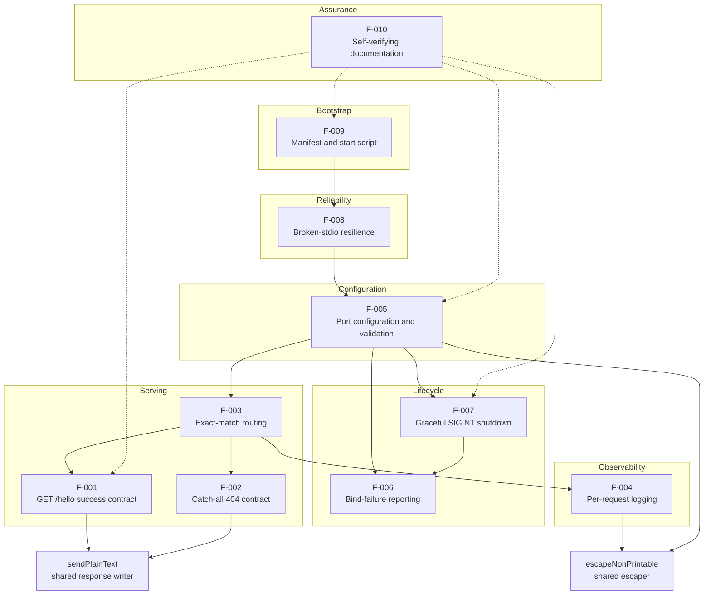

Dependency direction reads as "must exist first": an arrow from A to B means B's requirement cannot be satisfied unless A is present. The dashed edges from F-010 are verification-only — the documentation asserts the other features without the runtime depending on it.

### 2.3.2 Dependency Matrix

| Feature | Prerequisite features | Shared implementation element |
|---|---|---|
| F-001 | F-003, F-009 | `sendPlainText` (L53–56), `ROUTES` entry `'GET /hello'` (L71) |
| F-002 | F-003 | `sendPlainText` (L53–56), the fallthrough at L85–88 |
| F-003 | F-001, F-002, F-004 | `requestListener` (L75–91) — the only caller of `logRequest` and of the table |
| F-004 | F-003, F-008 | `escapeNonPrintable` (L10–12); `pathname` computed once in the listener (L79) |
| F-005 | F-008, F-009 | `escapeNonPrintable` (L22); `DEFAULT_PORT`/`MIN_PORT`/`MAX_PORT` (L5–7) |
| F-006 | F-005, F-007 | `createServer` (L94–100) — attaches the listener and returns the server both features act on |
| F-007 | F-001, F-002, F-003, F-006, F-008 | the `server` instance from `createServer`; `process.exitCode` |
| F-008 | — (must precede all output) | `process.stdout`, `process.stderr` |
| F-009 | — (entry point for all) | `scripts.start`, `main`, `engines.node` |
| F-010 | F-001 … F-009 | gates V1–V16 in `README.md` |

The matrix has one asymmetry worth noting: F-004 is both a prerequisite of nothing and a prerequisite of F-003 in the table, because `requestListener` calls `logRequest` before the `ROUTES` lookup (L81) — logging is structurally inside the routing path even though the two features are independent in purpose.

### 2.3.3 Integration Points

| Integration point | Features involved | Contract observed in the code |
|---|---|---|
| `PORT` environment variable | F-005 → F-006, F-007 | Read once in `start()` (L159); an accepted value is the only input to `server.listen(port)` (L171) |
| `SIGINT` signal | F-007 (with F-008 protecting its output) | `process.on('SIGINT', () => shutdown(server))` (L169); the signal is the only lifecycle input |
| stdout | F-004, F-005 (startup line), F-007 | Operational lines only: startup, one per request, two at shutdown |
| stderr | F-005, F-006 | Diagnostics only: port refusals, bind errors, serve-time errors |
| TCP listener | F-001, F-002, F-003, F-005 | HTTP/1.1 on the resolved port, all interfaces, no TLS |
| `node:http` server `'error'` event | F-006, F-007 | One listener attached in `createServer` (L97) serves both features |
| Node HTTP parser | F-003, F-004 | Rejects request lines with bytes outside its accepted set (`400 Bad Request`) before the listener runs, so the escaper only sees values the parser admits |
| npm start script | F-009 → all runtime features | `scripts.start` is `node server.js`, so npm adds no behaviour of its own |

### 2.3.4 Shared Components

| Shared component | Used by | Why it is shared |
|---|---|---|
| `sendPlainText(res, statusCode, body)` (L53–56) | F-001, F-002 | The only writer in the program, so the success and failure responses cannot diverge in header, framing or charset |
| `escapeNonPrintable(value)` (L10–12) | F-004, F-005 | One escaper keeps both the three-token log line and the quoted `PORT` value from carrying control characters |
| `requestListener(req, res)` (L75–91) | F-003 (routing), F-004 (logging) | Query strip, log and lookup happen in one pass, so the logged path is the matched path by construction |
| `createServer()` (L94–100) | F-006, F-007 | The server object must exist with its `'error'` listener before `listen()`, so creation is factored out of `start()` |
| `ROUTES` (L70–72) | F-001, F-002, F-003 | The table is simultaneously the route set, the extension point and the fallthrough trigger |
| `start()` (L156–174) | F-005, F-006, F-007, F-008 (and, through the listener, F-001–F-004) | The single orchestration point: stdio guard, resolve, create, register `SIGINT`, bind |

### 2.3.5 Common Services

| Common service | Consuming features | Behaviour relied upon |
|---|---|---|
| `console.log` / `console.error` | F-004, F-005, F-007 (log) and F-005, F-006 (diagnostics) | Line-oriented writes to stdout and stderr with no formatting layer, so the documented text is the text on the stream |
| `process.exitCode` | F-005 (`1`), F-006 (`1`), F-007 (`0`) | Exit statuses are set and the process ends naturally, except the failsafe path, which exits after its write callback |
| `Date.prototype.toISOString` | F-004 | Fixed-width UTC timestamp with milliseconds and `Z` |
| `setTimeout` / `clearTimeout` | F-007 | One five-second failsafe, cleared by the close callback |
| `http.createServer` / `server.listen` / `server.close` | F-001, F-002, F-003, F-006, F-007 | The whole server lifecycle, with no framework layer |
| `typeof` guards around `closeIdleConnections` / `closeAllConnections` | F-007 | Preserves the `>=18.0.0` compatibility that F-009 declares |


## 2.4 Implementation Considerations

The considerations below are properties of the delivered implementation, not recommendations. Where a constraint follows from a documented boundary it cites the boundary; where it follows from the code it cites the line range.

### 2.4.1 Technical Constraints and Scalability

| Feature | Technical constraints | Scalability considerations |
|---|---|---|
| F-001 | One fixed body of 11 ASCII bytes; no content negotiation, no compression, no conditional requests; response framing (`Transfer-Encoding: chunked` on the observed runtime) is chosen by Node, not the program | Every request costs one string comparison and one `end()`; no per-request allocation of request-derived data, so throughput is bounded by the runtime, not by the program |
| F-002 | One fixed body of 9 ASCII bytes for every non-match; `HEAD` bodies are omitted by the runtime; no `Allow` header, no redirect, no `405` | Uniform cost with the success path; the fallthrough adds no branch that grows with route count |
| F-003 | Exact, case-sensitive matching on method and query-stripped path only; no parameters, wildcards, prefixes, trailing-slash tolerance or URL decoding; the request stream is never read | `ROUTES` holds one key and lookup is a single property access; growth is one key per endpoint, linear in the table, with no middleware chain to traverse |
| F-004 | One line per request to stdout with no levels, fields, rotation or file sink; a line-per-request cost on the write path | Output is unbounded by design: request rate governs log volume, and the documentation's counting procedure therefore redirects to a temporary file outside the repository (V5) |
| F-005 | Digits-only decimal input, range `1024`–`65535`, read once at startup; `PORT` is the only variable and no `HOST` exists | The bind covers every interface because `server.listen(port)` passes no host (L171); one process, one port, no clustering or zero-downtime rebind path |
| F-006 | Diagnostics are one stderr line; the post-bind branch deliberately leaves the exit status unset | Reporting is per-process; a supervisor that inspects exit statuses is outside the delivered set |
| F-007 | `SIGINT` only; five-second fixed failsafe; `closeIdleConnections`/`closeAllConnections` reached only behind `typeof` guards | A single foreground process with no session or connection registry, so shutdown cost is bounded by in-flight responses and the fixed timer |
| F-008 | Two no-op `'error'` listeners plus a one-shot listener on the failsafe write | Constant overhead; nothing is buffered, retried or re-routed when a consumer departs |
| F-009 | Seven manifest fields; no dependency keys; `main` is `server.js` | No dependency resolution to scale; adoption is a copy of three files |
| F-010 | Gates require a POSIX shell and `curl`, with `ps` and `seq` for measurements; each gate that binds needs its port free | Sixteen gates are run by hand; V8 exercises 50 concurrent requests and V9 two batches of 5,000, both within default file-descriptor and process limits |

### 2.4.2 Security and Maintenance Implications

| Feature | Security implications | Maintenance requirements |
|---|---|---|
| F-001 | Anonymous, read-only, plain HTTP with no TLS, authentication or authorization; the response reveals nothing about the request | The body literal and status are the contract: any change breaks V2. The handler is the natural place to demonstrate a new endpoint |
| F-002 | One failure shape for every non-match, so no probe can distinguish a near-miss from an unknown path; no path echo, so no reflection surface | Keep the body a constant; any interpolation would break V3 and the no-information-disclosure property |
| F-003 | No URL decoding, no filesystem or template resolution from the path, and no parser on request data, so no traversal or parser-exploit surface exists | New endpoints are added only through `ROUTES` plus a handler with the shared `(req, res)` signature; the `split`-based strip must not be replaced with `new URL` |
| F-004 | Only method, query-stripped path and timestamp are logged — no headers, cookies, query values or bodies; `escapeNonPrintable` prevents log injection and terminal control sequences | The three-token format and the `toISOString()` timestamp are pinned by V5; the query must keep being stripped before logging |
| F-005 | Refusal before bind means the privileged-port rejection needs no root and produces no permission error; no override variable exists, so the `1024` floor cannot be bypassed by configuration | Messages are quoted verbatim in the README and in Troubleshooting; changing a message requires updating both, and V11/V12 compare them literally |
| F-006 | Messages name the port from `error.port` and pass the runtime's own text through, disclosing no stack trace or internal path | The exit-status contract must stay `0`/`1`; the post-bind branch intentionally does not set `1` |
| F-007 | No state is flushed or persisted at shutdown, because nothing is retained; the failsafe prevents an indefinite hang on a stalled connection | The guards exist for the `18.0.0` floor — removing them raises the effective floor. The success path must keep avoiding `process.exit(0)` so the evidence line is not truncated |
| F-008 | A vanished consumer cannot cause an unhandled `'error'` crash or invent a third exit status | Handlers are deliberately empty; adding logging inside them would reintroduce the failure they prevent |
| F-009 | No third-party code is executed, so there is no dependency vulnerability surface; no install step means no registry or network access during use | `version` is `1.0.0` and the manifest has no test, build or lint script; V14 pins all seven fields and the absence of the three keys |
| F-010 | Verification needs no network, credential or external service | Every documented output is a gate: any behavioural change must be reflected in the README in the same commit, or V2–V16 fail |


## 2.5 Traceability Matrix

### 2.5.1 Feature-to-Requirement-to-Gate Matrix

| Feature | Requirements | Verification gate |
|---|---|---|
| F-001 | F-001-RQ-001 … RQ-005 | V2, V7 (V1 for the startup line) |
| F-002 | F-002-RQ-001 … RQ-005 | V3, V4 |
| F-003 | F-003-RQ-001 … RQ-006 | V2, V3, V4 (`README.md` "Matching semantics" tabulates the cases) |
| F-004 | F-004-RQ-001 … RQ-006 | V5, V9 |
| F-005 | F-005-RQ-001 … RQ-006 | V1, V10, V11, V12 |
| F-006 | F-006-RQ-001 … RQ-005 | V13 |
| F-007 | F-007-RQ-001 … RQ-006 | V6 |
| F-008 | F-008-RQ-001 … RQ-003 | none — no gate drives a departed stdout consumer |
| F-009 | F-009-RQ-001 … RQ-005 | V14, V16 |
| F-010 | F-010-RQ-001 … RQ-006 | V15, V16 |

### 2.5.2 Implementation Traceability

| Feature | Implementation location | Documented in `README.md` |
|---|---|---|
| F-001 | `server.js` L59–63 (`handleHello`), L71 (`ROUTES` entry), L53–56 (`sendPlainText`) | "Verifying the endpoints", "Matching semantics" |
| F-002 | `server.js` L66–68 (`handleNotFound`), L85–88 (fallthrough) | "The failure contract", "A method that is not matched" |
| F-003 | `server.js` L70–72, L75–91 (`requestListener`) | "Matching semantics", "Runtime-added headers" |
| F-004 | `server.js` L42–44 (`logRequest`), L10–12 (`escapeNonPrintable`), L81 | "Request logging" |
| F-005 | `server.js` L5–7, L15–39 (`resolvePort`), L159–165, L171 | "Configuration", "When the port is refused", "Exit statuses" |
| F-006 | `server.js` L97, L103–114 (`onServerError`) | "When the port is refused", "Troubleshooting" |
| F-007 | `server.js` L117–153 (`shutdown`), L169 | "Stopping the server", "Exit statuses" |
| F-008 | `server.js` L47–50 (`ignoreBrokenStdio`), L127–128, L157 | mentioned only inside V5's counting procedure; no dedicated section |
| F-009 | `package.json` (whole file) | "Prerequisites", "Installation", "Running the server" |
| F-010 | `README.md` "Verification" (V1–V16), "Troubleshooting", "Scope and non-goals" | the document itself |

### 2.5.3 Requirement Baseline and Version Tracking

| Element | Recorded value |
|---|---|
| Requirement baseline | Commit `10d5d2ce05f177635ed928a01e9ed593ae550aa3` on `origin/blitzy-8a4de345-c459-434b-a545-c8cf76a5f502`; all ten features and every `F-XXX-RQ-YYY` at version 1 |
| Product version | `1.0.0`, from `package.json` `version` |
| Capability set at baseline | Three delivered files — `server.js` (176 lines), `package.json`, `README.md` (654 lines) |
| Change rule | A requirement's version increments when its acceptance criterion, its documented message or its gate changes; the README and the code change in the same commit, because V2–V16 compare documented output literally |
| Verification record | Every acceptance criterion in 2.2 was executed against the baseline on Node.js `v22.23.4`; V7 samples `0.000585`–`0.000938` s, V8 50/50 `200` with 50 log lines, clean `SIGINT` `exit=0`, five-second failsafe observed with a stalled connection |

The manifest carries no test, build or lint script, so version tracking depends on the commit history rather than on artefacts: the delivered tree's evolution is visible as `bf884ad` (manifest), `63152f0` (server: F-001–F-008), `7c7142c` (documentation: F-010) and the nine refinement commits up to `10d5d2c`, which tightened logging, escaping of refusal messages, JSDoc return values and the broken-stdio handling.

### 2.5.4 Assumptions and Constraints

- **Runtime floor.** Node.js `>=18.0.0` is assumed and declared. The only APIs used above it are `closeIdleConnections()` and `closeAllConnections()` (`18.2.0`), both behind `typeof` guards; on `18.0.x` the five-second failsafe is the termination guarantee (F-007-RQ-005).
- **Host-supplied conditions.** A free port (`3000` for most gates, `4000` for V10), loopback access for `curl`, and a writable `${TMPDIR:-/tmp}` for V5's log file. V7–V9 figures are host-dependent by nature and are recorded as such.
- **Single process, single port.** No supervision, clustering, TLS termination, reverse proxy or health endpoint is assumed or provided; the bind covers every interface because no host argument is passed.
- **No persistence.** Nothing is assumed to survive a request or a process exit, so no recovery, migration or restart-safety requirement exists.
- **Anonymous clients.** No identity, session or tenant is assumed; the response is identical regardless of client or origin.
- **Scope boundary as constraint.** The exclusions in 1.3.2 (`README.md` "Scope and non-goals") are constraints on any change: tests, CI, containers, deployment automation, additional endpoints, request parsing, structured logging and additional configuration are all outside the delivered requirements and are not unmet needs.
- **Footprint.** The delivered set is exactly three files at the repository root; V16 fails if a fourth deliverable appears, and `server.js` must keep a single `require(` naming `node:http` and no `TODO`/`FIXME`/`XXX`/`TBD`/`placeholder` marker.

### 2.5.5 Related Process Flowcharts and Specifications

- **Request flow** — the flowchart in 1.2.2.2 (client → `requestListener` → query strip → log → `ROUTES` lookup → `sendPlainText`) traces F-001 and F-002 through F-003 and F-004.
- **Startup and shutdown flow** — the flowchart in 1.2.2.3 (`start()` → stdio guard → `resolvePort` → `createServer` → `listen` → `SIGINT` → `shutdown` → failsafe) traces F-005, F-006, F-007 and F-008.
- **Feature-to-gate dependency graph** — the flowchart in 2.3.1 shows the same features grouped by cluster, with the shared writer and escaper as common nodes.
- **Scope of record** — 1.3.1 for the in-scope capabilities and 1.3.2 for the exclusions that bound this section.
- **Capability summary and measured objectives** — 1.2.2.1 and 1.2.3.1 for the capability table and the objective targets the gates enforce.
- **Source evidence** — the files listed in 2.6.


## 2.6 References

- `server.js` — 176 lines on `origin/blitzy-8a4de345-c459-434b-a545-c8cf76a5f502` at `10d5d2c`; established the whole implementation behind every requirement in 2.2: `DEFAULT_PORT`/`MIN_PORT`/`MAX_PORT` (L5–7), `escapeNonPrintable` (L10–12), `resolvePort` (L15–39) with its range and privileged-port refusals, `logRequest` (L42–44), `ignoreBrokenStdio` (L47–50), `sendPlainText` (L53–56), `handleHello` (L59–63), `handleNotFound` (L66–68), `ROUTES` (L70–72), `requestListener` (L75–91) with the `split('?')` strip and log-before-route ordering, `createServer` (L94–100), `onServerError` (L103–114), `shutdown` (L117–153) with the five-second failsafe and `typeof` guards, and `start()` (L156–174) invoked at L176.
- `package.json` — established F-009 and the manifest assertions of V14: `name` `nodejs-tutorial-hello-world`, `version` `1.0.0`, `description`, `main` `server.js`, `scripts.start` `node server.js`, `engines.node` `>=18.0.0`, `keywords`, and the absence of `dependencies`, `devDependencies` and `type`.
- `README.md` — 654 lines; established F-010 and the documented contract every acceptance criterion cites: "Purpose", "Prerequisites", "Installation", "Running the server", "Verifying the endpoints", "The failure contract", "A method that is not matched", "Matching semantics", "Runtime-added headers", "Request logging", "Stopping the server", "Configuration", "When the port is refused", "Exit statuses", gates V1–V16 with thresholds and recorded figures, "Troubleshooting", and "Scope and non-goals".
- `` (repository root, path `""`) — contained exactly one child, `README.md` (9 bytes, `# IWNewGH`), confirming that `main` carries no source, manifest, test, container or CI file and that all requirements rest on the delivery branch.
- `origin/blitzy-8a4de345-c459-434b-a545-c8cf76a5f502` at `10d5d2ce05f177635ed928a01e9ed593ae550aa3` — the delivery branch holding the three files; its commit series (`bf884ad` manifest, `63152f0` server, `7c7142c` documentation, then nine refinements to `10d5d2c`) supplied the status and version evidence in 2.1.1 and 2.5.3.
- `main` at `17c8b88c92478aac7a52ecf282fa92c145678c9a` ("Initial commit") — the one-file baseline, confirming that no feature predates the delivery branch.
- Runtime verification of the `10d5d2c` files on Node.js `v22.23.4`, executed from a copy outside the checkout so nothing was written into the repository — confirmed every acceptance criterion in 2.2: `200 text/plain` with an 11-byte body and `404 text/plain` with a 9-byte body; `200` for `GET /hello?anything=1` and `404` for `/hello/`, `/Hello`, `/hello%2F` and `/`; `404` for `POST`, `PUT`, `DELETE` and `OPTIONS` on `/hello`, and `404` with a 0-byte body for `HEAD`; one log line per request in the three-token format, including 50 lines for 50 concurrent requests; five latency samples of `0.000585`–`0.000938` s; `PORT=4000` and `PORT=" 4000 "` accepted, `PORT` unset/empty selecting `3000`; eleven refused values (`abc`, `3000.5`, `0x1F90`, `1e3`, `+3000`, `-1`, `65536`, `0`, `80`, `1`, `1023`) each exiting `1` with the documented message; the port-in-use refusal with `PORT=3001` succeeding alongside; `exit=0` with both shutdown lines on `SIGINT`; and the five-second failsafe printing `Forcing shutdown after 5s.` yet still exiting `0`. The same session confirmed `node --check server.js` silent, exactly one `require(`, and that request lines carrying `0x7F`, `0xFF` or `0x01` are answered `400 Bad Request` by Node's HTTP parser before `requestListener` runs.
- No web sources were consulted; every statement in this section rests on the three delivered files and the runtime verification recorded above.


# 3. Technology Stack

## 3.1 Programming Languages

The delivered system is written in one language on one runtime: JavaScript in CommonJS form running on Node.js, with JSON for the manifest and Markdown for the reader documentation. There is no compiled component, no second language, no generated code and no transpiled source. The complete delivered set on ref `origin/blitzy-8a4de345-c459-434b-a545-c8cf76a5f502` at commit `10d5d2ce` is three files at the repository root — `server.js` (176 lines), `package.json` (13 lines, 352 bytes) and `README.md` (654 lines) — and `git ls-tree` on that ref returns nothing else.

### 3.1.1 Language Inventory by Platform and Component

| Language | Platform / component | Artifact | Version basis |
|----------|----------------------|----------|---------------|
| JavaScript — ECMAScript 2017-compatible subset, CommonJS module format | Node.js server process; the only executable component | `server.js`, 176 lines, printable-ASCII source | `package.json` `engines.node` = `>=18.0.0` |
| JSON | npm package manifest | `package.json`, 13 lines | npm manifest format, read by npm 10 (Node 18–22) or npm 11 (Node 24) |
| Markdown | Reader documentation and the verification procedure | `README.md`, 654 lines | None; no schema, no doc toolchain |
| POSIX shell (reader-supplied) | Verification harness only; never shipped as a file | The fenced command blocks of `README.md` (L313–L591) | Host shell; `sh`/`bash` semantics such as `$!`, `$?`, `kill -INT`, `mktemp` |

**Absent languages.** No language other than the three above appears in the deliverable, and the absence is asserted by the repository's own boundary statement: `README.md` L651 declares "No TypeScript, build step, bundler or transpiler." A keyword search over all three tracked files finds `typescript` only inside that non-goal line. No Python, Java, Go, Rust, C/C++, SQL, HTML, CSS or template language occurs anywhere in the delivered set, and there is no native addon: no `binding.gyp`, and the single `require(` call names a built-in.

**Language features in use.** The source stays within an ES2017-era subset, which is what lets the declared `>=18.0.0` floor hold without a transpiler.

| Feature | Occurrences | Role |
|---------|-------------|------|
| `'use strict'` directive | 1 (L1) | Opts the whole file into strict mode |
| Arrow functions | 9 | Callbacks for the listeners, timers and `replace` |
| Template literals | 10 | Log line (L43), refusal messages, route key |
| `String.prototype.padStart` (ES2017) | 1 (L11) | Four-digit `\uXXXX` escape width |
| `Date.prototype.toISOString` | 1 (L43) | UTC millisecond timestamps with `Z` |
| Regular expressions | 2 | Non-printable matcher (L11); digit-only port test inside `resolvePort` (L15–L39) |
| `typeof` guards | 3 | Version-portability guards at L130 and L135 |

Deliberately unused: `async`/`await`, generators, classes, prototype manipulation, `Buffer`, `setInterval`, `eval`, the `Function` constructor and the `vm` module each occur zero times. The routing table is a plain object literal keyed by `"METHOD pathname"` (`ROUTES`, L70–L72) rather than a framework DSL.

### 3.1.2 Selection Criteria and Justification

JavaScript on Node.js is fixed by the platform decision documented in 3.2; the criteria below are the reasons that combination, and no transpiled dialect of it, satisfies the system's stated requirements.

| Criterion | How the chosen language satisfies it | Evidence |
|-----------|--------------------------------------|----------|
| Single-toolchain installation | A reader needs Node.js and `curl` and nothing else, so the language must be the runtime's own language | `README.md` L26–L40, L41–L51 ("There is no installation step"); gate V15 |
| Source equals artifact | The file that runs is the file that is read — no build output to trust or keep in sync | `README.md` L651; V16 asserts `node --check server.js` is the only static step |
| Readability at tutorial scale | 176 lines, one file, top-to-bottom read order, no cross-module graph | `README.md` L7–L24 |
| Concurrent request handling without user-level threads | The runtime's event loop and `node:http` handle concurrency; handlers stay synchronous and allocation-free | 50 concurrent requests answered together under V8 |
| One handler signature for every route | Functions are first-class values, so `ROUTES` maps keys to handlers sharing `(req, res)` | L59–L68, L70–L72 |
| No dependency resolution | The language supplies everything required — no type packages, no runtime helpers, no polyfills | Zero dependency keys in `package.json`; one `require(` |

**Why not TypeScript.** A type layer would require the transpile step, build tooling and `devDependencies` that `README.md` L651 and gates V14 and V16 forbid. Consistency is held by hand instead, with `node --check server.js` as the only static gate (`README.md` L652).

**Why not a second language.** Nothing in the delivered design needs one: there is no persistence driver, no native extension, no data pipeline and no front end. `fs`, `net`, `dns`, `child_process` and every HTTP client API are absent from `server.js`, so no language boundary is crossed at runtime.

### 3.1.3 Constraints and Dependencies

| Constraint | Declared value | Evidence | Consequence |
|------------|----------------|----------|-------------|
| Runtime version floor | `>=18.0.0` | `package.json` `engines.node`; `README.md` L28; L654 forbids changing it | Any language feature used must exist at 18.0.0 |
| Effective API floor for the full shutdown path | Node.js 18.2.0 | `server.js` L120–L136: `closeIdleConnections()` and `closeAllConnections()` are `typeof`-guarded because they arrived in 18.2.0, with the five-second failsafe covering 18.0.x | The program degrades rather than fails below 18.2.0 |
| Enforcement of the floor | Advisory only | No `process.versions.node` check in `server.js`; no `.npmrc` and therefore no `engine-strict` in the delivered set | An older runtime is not blocked by the program; the floor is contractual, not enforced |
| Module format | CommonJS | No `"type"` field in `package.json`; a single `require('node:http')` at L3 and no `import`/`export` anywhere | `.js` resolves as CommonJS; no ESM/CJS interop concern and no dual-package hazard |
| Build step | None | `README.md` L651; `main` is `server.js`, the file that runs | Source must parse unmodified on the target runtime |
| Source encoding | Printable ASCII only | No non-ASCII byte in `server.js`; response bodies are the ASCII literals `Hello world` and `Not Found` | No locale, charset or encoding dependency; the contract is byte-exact |

**Security implications of the language choices.**

- **The declared floor is a compatibility floor, not a supported one.** Node.js 18.x reached end of life on 2025-04-30 and 20.x on 2026-04-30, so a host pinned at the declared floor runs without security patches. The lines still receiving fixes are 22.x (maintenance to 2027-04-30), 24.x (maintenance to 2028-04-30) and 26.x (active LTS). Every API the program uses exists on all three, and the documented behaviour was reproduced on Node.js v22.23.4, so the deployment target can be raised with no code change — the only code that is version-sensitive is already guarded (L130, L135).
- **No dynamic code evaluation.** `eval`, the `Function` constructor and `vm` occur zero times, so the language layer offers no code-injection sink; request data reaches only a property lookup and a log line.
- **No unvalidated coercion.** Port input is tested against a digit-only regular expression before conversion to a number inside `resolvePort` (L15–L39), and request data never reaches a parser.
- **Reflected values are pre-escaped.** The only string interpolation of external data is the log line at L43, whose method and path arguments pass through `escapeNonPrintable` (L11) first.
- **The floor is stated in three places** — `package.json` `engines.node`, `README.md` L28 and `README.md` L654 — so a change must be applied consistently or the documentation gates fail.


## 3.2 Frameworks and Libraries

The system uses no application framework. The capabilities a web framework would supply — creating a server, binding a socket, modelling the request and response, and running the handler lifecycle — come from `node:http`, a module of the Node.js standard library imported once at `server.js` L3. Its "version" is therefore the Node.js line itself (`>=18.0.0`), not an independently versioned package, and the supporting library count is zero.

### 3.2.1 Core Framework: The Node.js Standard Library

| Capability | Provider and API | Version binding | Where used |
|------------|------------------|-----------------|------------|
| Server creation | `http.createServer(requestListener)` | Node.js ≥ 18.0.0 | L95 |
| TCP bind and accept | `server.listen(port, callback)`, no host argument | ≥ 18.0.0 | L171–L173 |
| Request access | `IncomingMessage`: `req.method`, `req.url` — no headers, body or query read | ≥ 18.0.0 | L79, L81, L83 |
| Response writing | `ServerResponse`: `res.writeHead(status, headers)`, `res.end(body)` | ≥ 18.0.0 | L53–L56 |
| Server error reporting | `'error'` event with `error.code`, `error.port`, `error.syscall`, `error.message` | ≥ 18.0.0 | L103–L113 |
| Graceful close | `server.close`, plus `closeIdleConnections()` and `closeAllConnections()` behind `typeof` guards | close calls: Node.js ≥ 18.2.0 | L126–L140 |
| Timers | `setTimeout`, `clearTimeout` (Node globals) | ≥ 18.0.0 | L126, L139 |
| Process integration | `process.env.PORT`, `process.stdout`/`process.stderr`, `process.on('SIGINT')`, `process.exitCode`, `process.exit` (failsafe only) | ≥ 18.0.0 | L113, L151, L159, L163, L169, L127–L128 |
| Console output | `console.log`, `console.error` | ≥ 18.0.0 | L43, L105–L109, L118, L142, L172 |
| Language built-ins | `Date`, `RegExp`, `String`, `Number` | ECMAScript, runtime-supplied | L11, L15–L39, L43 |

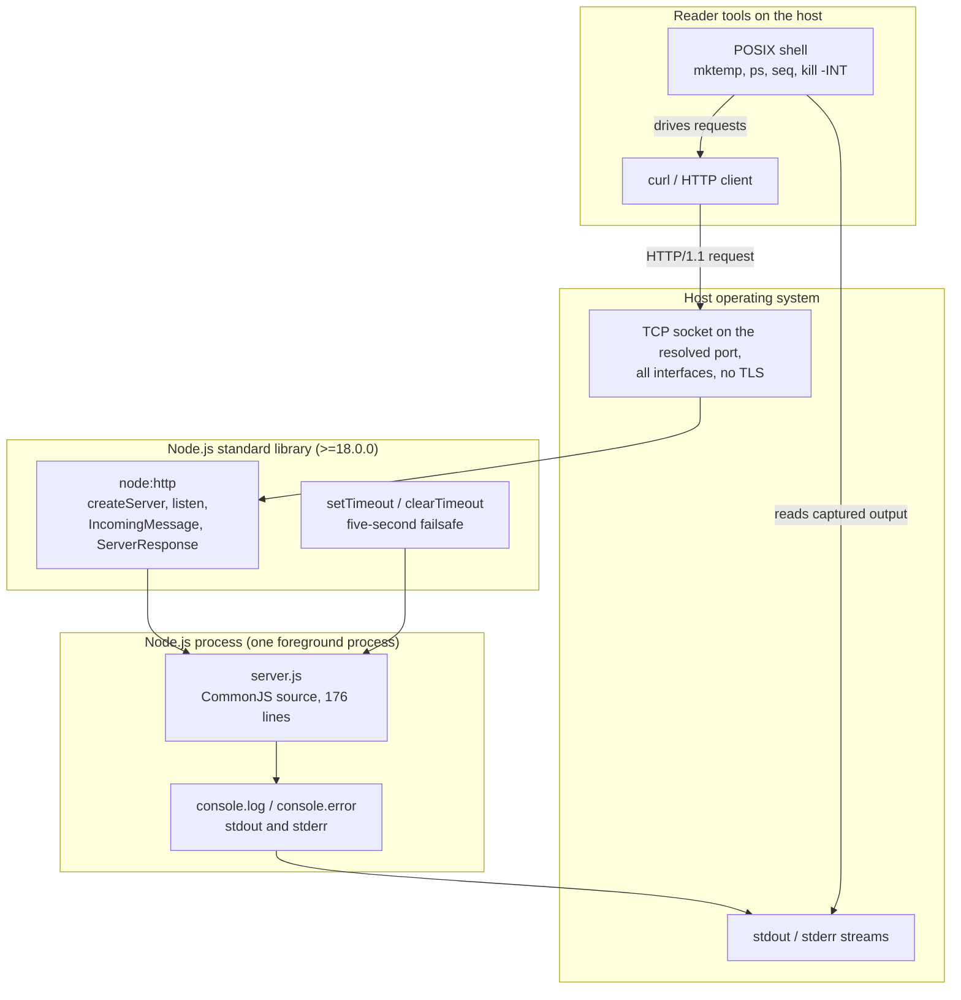

No framework layer sits between `server.js` and `node:http`: the router, the handlers and the response writer are all application code (L53–L91), and the only module boundary in the whole program is the single `require` at L3.

### 3.2.2 Supporting Libraries

The supporting-library inventory is empty. The table pairs each library category a comparable HTTP service would depend on with the hand-written construct that replaces it, so the absence is visible rather than asserted.

| Category | Library that would normally supply it | Substitute in this system | Evidence |
|----------|--------------------------------------|---------------------------|----------|
| Web framework | Express, Koa, Fastify, Hapi | None; `node:http` used directly | `package.json` has no dependency keys |
| Router | `express.Router`, `find-my-way` | Object literal `ROUTES` plus a template-literal lookup key | L70–L72, L83–L89 |
| Body parser | `body-parser`, `formidable` | Not needed; the request stream is never read | L75–L91 |
| Validation | Joi, Zod, `validator` | Hand-written `resolvePort` returning `{ ok, port }` or `{ ok, message }` | L15–L39 |
| Configuration | `dotenv`, `convict` | One `process.env` read at startup | L159 |
| Logging | `pino`, `winston`, `morgan` | Three-token `console.log` line | L42–L44 |
| Test framework | Jest, Mocha, Vitest, `node:test` | Sixteen shell gates V1–V16 compared literally | `README.md` L307–L591 |
| Template engine | EJS, Handlebars | Two fixed string literals | L61, L67 |
| HTTP client (in-process) | `axios`, `node-fetch`, `undici` | None; the program makes no outbound call | No `fetch`, `http.request` or `https` in `server.js` |
| Graceful-shutdown helper | `stoppable`, `http-terminator` | `shutdown()` with a five-second failsafe timer | L117–L153 |

### 3.2.3 Compatibility Requirements

| Requirement | Detail | Evidence |
|-------------|--------|----------|
| Runtime floor | `node:http`, `process`, `console`, `setTimeout` and `Date` behave as required at Node.js 18.0.0; nothing above that is used unguarded | `package.json` `engines.node`; `README.md` L28 |
| Guarded APIs | The two connection-closing calls exist only from 18.2.0, so both are reached behind `typeof` checks and the failsafe timer guarantees termination on 18.0.x | L120–L136 |
| Module resolution | The `node:` URL prefix is used, so the built-in cannot be shadowed by a same-named package | L3 |
| Runtime-owned headers | `Date`, `Connection`, `Keep-Alive` and the framing header are added by the runtime, not the program; the framing header is `Transfer-Encoding: chunked` on the verifying runtime and may be `Content-Length` where the runtime sets it, which is why the contract is defined as status line, `Content-Type` and byte-exact body only | `README.md` L188–L190 |
| Explicit content type | `Content-Type: text/plain` is set by the program with no charset parameter, so the contract does not depend on runtime defaulting of a charset for string bodies | L53–L56; gate V2 asserts `200 text/plain 11` |
| Protocol | HTTP/1.1 only, plaintext, no TLS, no HTTP/2, no content negotiation; `HEAD` is answered `404` and its body is suppressed by the runtime, not by the program | `README.md` L169–L190; L645 |
| Verified runtime | Every documented output was reproduced on Node.js v22.23.4; the samples in `README.md` (latency, memory, concurrency) are measurements of the verifying host | `README.md` L415–L448 |
| Client compatibility | Any HTTP/1.1 client; `curl` is the documented one, and the verification gates rely on its `--write-out` variables `%{http_code}`, `%{content_type}`, `%{size_download}` and `%{time_total}` | `README.md` L117, L152, L421 |

### 3.2.4 Justification of Framework Choices

| Decision | Rationale | Evidence |
|----------|-----------|----------|
| Use `node:http` rather than a web framework | A framework would add a dependency tree, a lockfile, middleware ordering semantics and an install step, none of which the tutorial can carry; the framework-free server is the artifact under study | `README.md` L7–L24 ("no framework, no middleware, no routing library and no third-party package of any kind"); L641–L654 |
| Keep the standard library as the only module boundary | One `require(` call makes the whole dependency surface auditable in a single line and makes the clean-machine gate achievable | Gate V16 (`README.md` L557–L591) asserts exactly one `require(` |
| Replace the router with an object literal | The teaching point is the method-plus-path lookup itself; one table entry plus one handler is the documented extension mechanism and nothing else changes | `README.md` L22–L24; L70–L72 |
| Accept the framework's absent features as boundaries | No parameterised routes, middleware, body parsing, content negotiation or static files; each is an explicit non-goal rather than a gap | `README.md` L647–L648 |

**Security consequences of going framework-free.** There is no third-party code in the request path, so no transitive package vulnerability, no middleware misordering and no framework configuration default can affect behaviour. There is also no route-parameter, wildcard or template resolution, and no request parser beyond the method string comparison, which removes the traversal and parser-exploit surfaces such routers carry. The trade-off is that every concern a framework normally centralises — access control, rate limiting, TLS, structured logging — is simply absent, which is why those boundaries are enumerated and the service is documented as unsuitable for production traffic (`README.md` L644–L649).

**Cost of substitution.** Introducing any framework would break the documented contract in four places at once: gate V14 (no `dependencies` or `devDependencies` key), gate V16 (exactly three files and one `require(`), gate V15 (a clean machine with only Node.js and `curl`), and the "no installation step" statement in `README.md` L41–L51. A framework adoption is therefore a redesign of the release gates and the documentation, not a drop-in change.


## 3.3 Open Source Dependencies

The system has no third-party or open-source library dependency: neither directly, nor transitively, nor in development. `server.js` imports exactly one module, the built-in `node:http` (L3), and `package.json` declares no dependency of any kind. What open-source software the system does require — the Node.js runtime and the `curl` client — is satisfied by the host as a prerequisite rather than declared, resolved or installed from a registry.

### 3.3.1 Third-Party and Open-Source Library Inventory

| Ecosystem / registry | Declaring manifest in the delivered set | Direct dependencies | Transitive dependencies |
|----------------------|------------------------------------------|---------------------|-------------------------|
| npm (`registry.npmjs.org`) | `package.json` | `0` — no `dependencies`, `devDependencies`, `peerDependencies` or `optionalDependencies` key | `0` |
| Any other ecosystem (PyPI, Maven Central, NuGet, RubyGems, Cargo, Go modules, Packagist, Hex) | None present | `0` | `0` |

The absence is enforced, not incidental. Because there is nothing to resolve, `npm install` is never part of any workflow, `node_modules` is never created and `package-lock.json` does not exist (`README.md` L41–L51). Gate V14 inspects the manifest and prints `deps? false false false` for the `dependencies`, `devDependencies` and `type` keys (`README.md` L524–L551), and gate V16 requires the delivered set to be exactly three files with exactly one `require(` call (`README.md` L557–L591). The repository contains no vendored, bundled or minified third-party source, so `server.js` is 176 lines of application code with no embedded dependency.

**Open-source software consumed as a host prerequisite** — required at run time, but outside the manifest and outside the dependency-resolution path:

| Component | Kind | Version requirement | Role | Evidence |
|-----------|------|---------------------|------|----------|
| Node.js runtime (OpenJS Foundation, MIT-licensed) | Platform | `>=18.0.0`; full shutdown path needs `>=18.2.0` | Executes `server.js`; supplies `node:http` and every built-in used | `package.json` `engines.node`; `README.md` L28; `server.js` L120–L136 |
| `curl` | Verification client | Any release supporting `-s -o /dev/null -w` | Issues every documented request and reports status, content type, size and timing | `README.md` L29, L117, L152, L421 |
| POSIX shell utilities — `mktemp`, `ps`, `seq`, `kill` | Verification harness | Host-provided | Log capture (V5), memory sampling (V9), concurrency loop (V8), signal delivery (V6) | `README.md` L39, L378, L429, L439–L443 |
| npm CLI | Manifest reader and script runner | npm 10 on Node.js 18–22, npm 11 on Node.js 24 | Reads manifest fields offline and runs `npm start`; never resolves a package | `README.md` L527, L530 |

### 3.3.2 Package Registries, Manifest and Versions

| Item | Observed value | Consequence |
|------|----------------|-------------|
| Registry contacted at install time | None — there is no install step | No registry availability, authentication or availability risk during setup |
| Registry contacted at run time | None; `scripts.start` is `node server.js` and `npm pkg get` reads the local manifest only | The running system has no network egress in any direction |
| Manifest file | `package.json`, 352 bytes, 13 lines, at the repository root | Single source of package identity |
| Declared fields | `name`, `version`, `description`, `main`, `scripts.start`, `engines.node`, `keywords` | Gate V14 pins all seven literally |
| Absent fields | `dependencies`, `devDependencies`, `type`, and also `license`, `author`, `repository` and `private` | No dependency surface, no module-type switch, and no licensing statement in the repository |
| Package version | `1.0.0` (`package.json` `version`) | Documentation identity only; nothing consumes the package from a registry |
| Lockfile | None; `package-lock.json` does not exist | Nothing to drift, no integrity hashes to verify, no resolution step |
| Installed tree | None; `node_modules` is never created | Adoption is a copy of three files (`README.md` L41–L51) |

**Licensing position.** Neither `package.json` nor any file in the delivered set carries a license declaration — the manifest has no `license` field and there is no `LICENSE` file, and `README.md` has no licensing section. The repository therefore states no license for its own code; the only licensing fact the system depends on is that its runtime, Node.js, is MIT-licensed and redistributed with the host.

### 3.3.3 Dependency Governance and Supply-Chain Posture

| Governing rule | Enforcement | Effect on dependencies |
|----------------|-------------|------------------------|
| Seven manifest fields, no dependency keys | Gate V14 (`README.md` L524–L551) | Any added dependency fails the gate and the documented `npm pkg` output |
| Exactly three files, one `require(`, no `node_modules` and no lockfile | Gate V16 (`README.md` L557–L591) | A dependency's footprint cannot be introduced without failing the gate |
| Runnable on a machine with only Node.js and `curl` | Gate V15 (`README.md` L553–L556) | No dependency may be required to reproduce documented behaviour |
| No build, bundler, transpiler or linter configuration | `README.md` L651–L652 | No build-time dependency chain either |
| No markers such as `TODO`/`FIXME` in code | Gate V16 marker search | No planned dependency work is implied |

**Supply-chain consequences.** No third-party code is executed at build time or at run time, so there is no package vulnerability surface, no typosquatting exposure, no post-install script risk and no integrity-verification obligation on a lockfile. The trust boundary collapses to the Node.js runtime binary itself, which makes runtime patch level the single maintenance obligation of the dependency posture — and the declared `>=18.0.0` floor admits end-of-life lines (18.x ended 2025-04-30, 20.x ended 2026-04-30), as recorded in 3.1.3. The corresponding trade-off is that anything a dependency would normally provide — a router, validation, a logger, a test framework — is either hand-written in `server.js` or declared out of scope in `README.md` L637–L654.


## 3.4 Third-Party Services

No third-party service is integrated in any category. The program issues no outbound network call, opens no client connection and reads no credential; its entire interface with the outside world is one listening TCP socket and two output streams. A keyword search of `server.js` finds zero occurrences of `fetch`, `http.request`, `http.get`, `https`, `net.`, `dns` and `child_process`, and the single `require(` at L3 names the HTTP server module, not an HTTP client.

### 3.4.1 External APIs and Integrations

| Integration category | Service used | Status | Evidence |
|----------------------|--------------|--------|----------|
| Outbound HTTP or HTTPS API | None | Absent — no client API is imported or called | No `fetch`, `http.request`, `http.get`, `https` in `server.js` |
| Webhook, callback or event subscription | None | Absent — no customer endpoint and no registration path | `ROUTES` holds one key, `'GET /hello'` (L70–L72) |
| Message broker, queue or stream | None | Absent — no producer, consumer, connection string or scheduler | No `setInterval`, no `child_process`; one `require(` |
| Name resolution | None | Absent — the program never resolves a name | No `dns` usage; the listener binds a port only (L171) |
| Third-party SDK of any kind | None | Absent — no vendor package exists to import | `package.json` declares no dependency; `README.md` L644–L646 |

**The actual integration surface.** What the system integrates with is not a service but five local runtime touchpoints, restated here so this section stands alone (the full contract is in 1.2.1.3):

| Touchpoint | Direction | Contract |
|------------|-----------|----------|
| `PORT` environment variable | Inbound, read once at startup (L159) | Unset or empty selects `3000`; accepted range `1024`–`65535` |
| `SIGINT` signal | Inbound (L169) | Triggers `shutdown()`: idle connections closed, two shutdown lines, exit `0` |
| stdout and stderr | Outbound | Operational lines on stdout; one diagnostic line per refusal on stderr |
| TCP listener | Inbound network | HTTP/1.1 on the resolved port, every interface, no TLS, no access control |
| An HTTP client such as `curl` | Verification only | The documented request/response pairs of gates V2–V4, V7–V9 |

The other processes the documented workflow uses — `curl`, the npm CLI, and the host utilities `mktemp`, `ps` and `seq` — are run by the reader beside the server, never called by it (`README.md` L26–L40).

### 3.4.2 Authentication and Authorisation Services

No identity provider, token issuer, session store or single-sign-on integration exists. The endpoint is anonymous and read-only, and transport is plain HTTP with no TLS (`README.md` L645). Because no service credential is involved, the delivered files contain no API key, client secret, certificate, private key or token — so there is no secret to store, rotate, revoke or leak, and no secret-management integration to operate. Adding any authentication surface would require new code and a new environment variable, since `PORT` is the only configuration input the design admits (`README.md` L653).

### 3.4.3 Monitoring and Observability Services

No monitoring tool, APM agent, metrics exporter, tracing collector or log-shipping service is integrated.

| Observability concern | Provider | Detail |
|-----------------------|----------|--------|
| Application logging | `console.log` to stdout, `console.error` to stderr | One line per request — `<ISO-8601> <METHOD> <pathname>` (L43) — plus startup and shutdown lines; no levels, fields, redaction or rotation (`README.md` L649) |
| Metrics | None | No metrics endpoint; a scrape of any metrics path answers `404 Not Found` (`README.md` L647) |
| Health checks | None | No health or readiness endpoint; probes receive the catch-all `404` |
| Tracing | None | No correlation identifier, span or propagator |
| Alerting | None | Nothing observes exit statuses or log content; the operator does |
| Log collection | Operator redirection | Gate V5 redirects the process's stdout to a `mktemp` file outside the repository (`README.md` L378) — a shell redirection, not an integration |

### 3.4.4 Cloud Services and Hosting Dependencies

No cloud service of any kind is used: no compute, database, object storage, CDN, queue, secrets manager, container registry, certificate authority or infrastructure-as-code pipeline. A keyword search of all three delivered files finds no reference to any cloud provider, and the delivered set contains no infrastructure definition, deployment descriptor or credential file to point at one.

The only hosting requirements the system imposes are those of the process itself: a host with Node.js ≥ 18.0.0, a TCP port at or above `1024` that the process may bind, and stdout and stderr it may write to. Any Cloud or platform facility around that process — a supervisor, a container runtime, a TLS-terminating proxy, a log collector — would be operated by the deployer and remains outside the delivered set, because the program itself has no hook, configuration or protocol for it.

### 3.4.5 Integration Requirements for Future Services

Because the program has no configuration surface other than `PORT` and no outbound client, any future integration follows the same pattern rather than a configuration switch: a new built-in module import, new code inside `server.js`, and — if the service needs an endpoint, a credential or an interval — a new environment variable plus a change to `README.md` L653, which closes the set of configuration inputs at one variable. Each such step also crosses the dependency, footprint and clean-machine gates recorded in 3.3.3.


## 3.5 Databases and Storage

The system has no database, no cache and no storage service in any tier. It performs no file write and no client connection: `server.js` contains zero occurrences of `fs`, `writeFile`, `createWriteStream`, and its only output side effect is the write of log and lifecycle lines to stdout and stderr. All state is process-local and dies with the process, which `README.md` L644 states as a boundary: "No persistence. No database, no cache, no file writes: nothing survives a request or a process exit."

### 3.5.1 Database Inventory

| Tier | Present | Evidence |
|------|---------|----------|
| Primary (operational) database | None — no SQL or document store, no driver, no connection string | No dependency in `package.json`; no `require` beyond `node:http` (L3) |
| Secondary, replica or read model | None | Same |
| Cache or key-value store | None — no Redis, Memcached or in-process store | No `setInterval`, no eviction logic, no cache module |
| Search index or analytical store | None | Same |
| Queue or durable message log | None | No producer, consumer or scheduler; single `require(` |
| Object or blob storage | None | No SDK, no credential, no bucket reference |
| Embedded or file-based store | None — no `fs` usage and no data file in the delivered set | `git ls-tree` returns exactly `README.md`, `package.json`, `server.js` |

### 3.5.2 Data Persistence Strategy

Nothing is persisted, so there is no schema, no migration, no seed data, no backup or restore procedure, no retention policy and no data lifecycle to govern. The table records every piece of state the running process holds and its lifetime.

| State | Where it lives | Lifetime |
|-------|----------------|----------|
| `DEFAULT_PORT`, `MIN_PORT`, `MAX_PORT` constants | Module scope (L5–L7) | Process lifetime, read-only |
| `ROUTES` table, one entry | Module scope (L70–L72) | Process lifetime |
| Response body literals `Hello world`, `Not Found` | String literals in the handlers (L61, L67) | Process lifetime |
| Resolved port | Local value captured by `start()` and the listen callback (L159–L172) | Process lifetime |
| Request method and query-stripped path | Local variables in `requestListener` (L79–L83) | The single request; discarded after the log line and the lookup |
| Log and lifecycle lines | stdout (L43, L118, L142, L172) | Only as long as the operator's own redirection retains them |
| Server handle and connection state | In-process socket bookkeeping by `node:http` | Process lifetime |

**No personal data is processed.** The program reads no header, cookie, body or query value, and the logged fields are the method, the query-stripped path and a timestamp — never an identifier of the caller. Consequently there is no data-subject record to delete, no encryption-at-rest requirement and no data-residency dimension attached to storage: `PORT` is the only input, and the responses are fixed ASCII literals.

### 3.5.3 Caching

No caching solution exists at any layer.

| Layer | Present | Evidence |
|-------|---------|----------|
| Server-side cache or memoisation | None; only immutable constants are reused | L5–L7, L70–L72 |
| HTTP caching headers | None — no `Cache-Control`, `Expires`, `ETag` or `Last-Modified` is set | `sendPlainText` writes `Content-Type` and the status only (L53–L56) |
| Conditional request handling | None — `If-None-Match` and `If-Modified-Since` are not read; request headers are never accessed | `requestListener` reads `req.method` and `req.url` only (L79–L83) |
| Cache invalidation path | Not applicable — restarting the process is the only way state changes | Nothing is retained between requests |
| Client-side caching influence | Only the response's own headers, which carry no caching directive | `README.md` L188–L190 lists the runtime-added headers as outside the contract |

The `Keep-Alive` header visible on responses describes the reuse of a TCP connection by the runtime; it is a transport property, not a cache, and it is not set by the program.

### 3.5.4 Storage Services and Artifact Footprint

No storage service is used: no managed volume, no shared filesystem, no object store and no credential or endpoint pointing at one. The only bytes the system occupies are the delivered source artifacts, totalling 38,305 bytes across three files (`README.md` 31,415; `server.js` 6,538; `package.json` 352).

One deliberate consequence of writing nothing is visible in the verification procedure: gate V5 must redirect the server's stdout to a temporary file created with `mktemp` outside the repository, because the program itself creates no log file (`README.md` L378–L395). The same posture is what makes gate V16 possible — the working tree contains only the three delivered files, with no `node_modules`, no lockfile and no generated data (`README.md` L557–L591).

### 3.5.5 Operational Implications

| Implication | Consequence |
|-------------|-------------|
| Stateless process | Any instance answers identically, because no request depends on earlier state; but there is also no shared state through which instances could coordinate |
| Restart safety | A restart loses nothing that was not already expendable, and there is no recovery, replay or reconciliation step to run |
| No provisioning work | No database to install, migrate, back up, patch or grant access to; no connection pool, timeout or retry configuration |
| No credential management | No database user, password, token, certificate or secret appears in the delivered set, so there is nothing to rotate or leak |
| Durability is the operator's | Log durability depends entirely on how the operator redirects stdout; nothing in the program retries, buffers or persists a line |
| No capacity planning for data | Growth is bounded by log volume alone, not by stored records; memory stays flat because nothing accumulates per request (gate V9 observes stability across 10,000 requests) |


## 3.6 Development and Deployment

Development and deployment are deliberately the same step. There is no build, no artifact to package and no pipeline: the file that is edited is the file that runs, and the whole release procedure is copying three files and starting one foreground process. Verification replaces the build, and it is a manual, documented procedure of sixteen gates rather than an automated suite (`README.md` L307–L591).

### 3.6.1 Development Tools

| Tool | Version | Requirement | Role |
|------|---------|-------------|------|
| Node.js runtime | ≥ 18.0.0 declared; ≥ 18.2.0 for the full shutdown path; verified on v22.23.4 | Required | Executes `server.js` and provides `node --check` |
| POSIX shell (`sh`/`bash`) | Host-provided | Required | Every verification gate uses `$!`, `$?`, `kill -INT`, redirection or loops (`README.md` L39) |
| `curl` | Any release supporting `--write-out` | Required for verification | Issues every documented request and reports status, content type, byte size and timing |
| npm CLI | npm 10 on Node.js 18–22, npm 11 on Node.js 24 | Optional | Runs `npm start` and reads manifest fields with `npm pkg get`; never resolves a package |
| `mktemp` | Host-provided | Required by gate V5 | Creates the log file outside the repository (`README.md` L378) |
| `ps` | Host-provided | Required by gate V9 | Samples resident memory |
| `seq` | Host-provided | Required by gates V8 and V9 | Generates request loops (`README.md` L429, L440) |
| Git | Any version | Optional | Version control of the three files; no hooks are configured |
| Text editor | Unconstrained | Required | No editor configuration file is shipged with the repository |

Absent development tooling, each stated as a boundary in `README.md` L637–L654: no linter or formatter configuration (L652), no test framework or runner (L641), no TypeScript or `tsconfig.json` (L651), no bundler or transpiler, no `.editorconfig`, no pre-commit hook, no `.gitignore`, no debugger launch configuration, no container definition (L642) and no CI workflow file.

The only static check is `node --check server.js`, which parses the file and exits silently on success: it proves the source is syntactically valid, and nothing proves types, unused code or style (`README.md` L585, L652).

### 3.6.2 Build System

No build system exists. `server.js` is the deployable artifact, which `package.json` fixes by declaring `main` as `server.js` and `scripts.start` as `node server.js`; `scripts` holds that single entry and nothing else. There is no compile, bundle, minify, tree-shake, transpile or source-map step, no generated file and no output directory — the source directory *is* the release. Release identity comes from two places only: `version` `1.0.0` in `package.json` and the git commit ref of the repository.

Verification takes the place a build would occupy. The sixteen gates of `README.md` L307–L591 group as follows.

| Gate group | Gates | What it establishes |
|------------|-------|---------------------|
| Startup and configuration | V1, V10, V11, V12, V13 | Default port, `PORT` override, three refusal paths with exit `1` |
| Response contract | V2, V3, V4 | Byte-exact `200` and `404` bodies, exact `Content-Type`, method mismatch behaviour |
| Logging and lifecycle | V5, V6 | One three-token line per request; clean `SIGINT` shutdown with exit `0` |
| Measurements | V7, V8, V9 | Latency, 50-way concurrency, memory stability across 10,000 requests |
| Documentation and footprint | V14, V15, V16 | Seven manifest fields, runnable documentation on a clean machine, three-file boundary |

The gates carry one operational rule that a build step would otherwise handle: gates that start their own server on port `3000` (V1, V5's counting block, V6, V9, V13, V14's `npm start`) require that port to be free, so a server started for V2–V4 must be stopped first, and V7 and V8 follow the self-starting gates and expect a server to be started again (`README.md` L307–L311). V10 binds `4000`, V11 and V12 refuse before any bind, and V16 binds nothing.

### 3.6.3 Containerization

No containerization exists. The delivered set contains no `Dockerfile`, no compose file, no image reference, no container registry, no Kubernetes or ECS descriptor and no `.dockerignore`; `README.md` L642 states the absence as a boundary: "No CI/CD and no containers. There is no workflow file, no `Dockerfile` and no compose file". There is consequently no image to build, scan, sign, tag or pull, and no layer-caching strategy.

Containerizing the system would be a deployer-side activity, not a repository change, and it would have to supply three things the delivered set does not: a base image carrying Node.js ≥ 18.0.0, a `PORT` value at or above `1024`, and a decision about stdout capture, since the container runtime — not the program — would own log retention. It would also have to keep `SIGINT` as the signal delivered to the process, because `SIGTERM` has no handler (`README.md` L650).

### 3.6.4 CI/CD Requirements

No CI/CD system is implemented: there is no workflow file, no pipeline definition, no build job, no artifact publication, no environment promotion and no deployment automation, which `README.md` L642–L643 records as boundaries. Any pipeline added by a deployer must reproduce the manual gates rather than assume them, and the gates constrain it as follows.

| Requirement | Reason |
|-------------|--------|
| Provide Node.js ≥ 18.0.0, ideally a supported LTS line | The declared floor admits end-of-life lines (`README.md` L28); the gates were verified on v22.23.4 |
| Never run `npm install` | It is unnecessary, and creating `node_modules` or a lockfile would break gates V14 and V16 (`README.md` L41–L51) |
| Provide a POSIX shell with `curl`, `mktemp`, `ps` and `seq` | Every gate depends on them (`README.md` L26–L40) |
| Provide a free TCP port in `1024`–`65535`, with `3000` available for the self-starting gates, or override with `PORT` | Refusals and bind failures are part of the contract (V10–V13) |
| Capture stdout to a path outside the workspace | Gate V5 writes its log through `mktemp`, and gate V16 counts the workspace's files (`README.md` L378, L557) |
| Compare output literally, including body byte counts and exit statuses | V2, V3, V5, V11–V13 assert exact strings, `200 text/plain 11`, `404 text/plain 9` and `0`/`1` |
| Deliver `SIGINT` to the server process by pid | A pipeline such as `node server.js \| grep` sends the signal to every process in the group and kills the counting filter (`README.md` L365–L396) |
| Avoid leaving artifacts in the repository | Any file the pipeline writes into the tree fails the three-file footprint gate (V16) |
| Accept host-dependent measurement variance | V7–V9 are measurements, not exact matches; the documented figures belong to the verifying host (`README.md` L415–L448) |

### 3.6.5 Deployment and Operations Model

Deployment is process-level and manual. The operator copies the three files to a host that has Node.js, starts `node server.js` or `npm start` in the foreground, and stops it with `CTRL+C` (or `kill -INT <pid>`, which the README documents as the scripted equivalent). Deployment completes when the single stdout line `Server listening on port 3000` — or the resolved port — appears, which proves the bind succeeded because it is written from the listen callback.

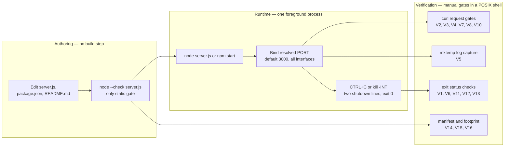

| Operational property | Value |
|----------------------|-------|
| Processes | One per host; no cluster, worker pool or supervisor |
| Restart procedure | Stop with `SIGINT`, start again; no drain window, no health gate, no rollback machinery beyond redeploying the previous file set |
| Rollback | Copy back the previous `server.js`, `package.json`, `README.md` and restart |
| Configuration | `PORT` only, read once at startup; no config file, no `.env`, no secret store (`README.md` L653) |
| Network exposure | `server.listen(port)` passes no host, so the bind covers every interface, not loopback only; there is no TLS, authentication or rate limiting, so a fronting firewall or proxy is the deployer's responsibility (`README.md` L53–L77, L645–L646) |
| Exit-status contract | `0` for a clean `SIGINT`; `1` for invalid configuration, a privileged port or any bind failure; a post-bind server error is reported on stderr without setting the status (`server.js` L103–L114, L151) |
| Log handling | stdout and stderr only; retention, rotation and shipping are the operator's (`README.md` L649) |

### 3.6.6 Component and Version Baseline

| Component | Version baseline | Source of truth | Notes |
|-----------|------------------|-----------------|-------|
| Node.js runtime | `>=18.0.0`; `>=18.2.0` for the complete shutdown path | `package.json` `engines.node`; `README.md` L28, L654; guards at `server.js` L130, L135 | Verified on v22.23.4; supported lines are 22.x, 24.x and 26.x, with 18.x and 20.x end-of-life |
| `node:http` | Bundled with the runtime; no independent version | `server.js` L3 | Its version is the Node.js version |
| Application code | `server.js`, 6,538 bytes, 176 lines | Repository ref `10d5d2ce` | CommonJS, ASCII, single `require(` |
| Package manifest | `package.json`, 352 bytes, `version` `1.0.0` | Repository ref `10d5d2ce` | Seven fields only; gate V14 pins them |
| npm CLI | npm 10 (Node.js 18–22) or npm 11 (Node.js 24) | Runtime installation | Used only for `npm start` and `npm pkg get` |
| Documentation | `README.md`, 31,415 bytes, 654 lines | Repository ref `10d5d2ce` | Carries the sixteen verification gates |
| `curl` | Any release supporting `--write-out` with `%{http_code}`, `%{content_type}`, `%{size_download}`, `%{time_total}` | `README.md` L117, L152, L421 | Required for verification, not at run time |
| POSIX shell and utilities | Host-provided `sh`/`bash`, `mktemp`, `ps`, `seq`, `kill` | `README.md` L39, L378, L429, L439–L443 | Required for verification only |
| Git | Any version | Repository root | Version control only; no hooks, no tags |

### 3.6.7 Integration Requirements Between Stack Components

| Component | Requires | Why |
|-----------|----------|-----|
| `server.js` process | A Node.js runtime ≥ 18.0.0, one free TCP port in `1024`–`65535`, writable stdout and stderr | The port is bound without a host argument and both streams carry the observability contract |
| `npm start` | A Node.js runtime and a `package.json` in the working directory | The script is `node server.js`, resolved from that directory |
| `npm pkg get` (gate V14) | A `package.json` in the working directory; no registry access | Manifest fields are read locally |
| `curl` gates | A server already listening on the expected port | Gates V2–V4, V7–V10 assert the wire contract |
| Shell gates (V5, V6, V8, V9, V11–V13) | A POSIX shell plus `mktemp`, `ps`, `seq`, `kill` | Signal delivery, log capture and measurement are performed by the shell, not the program |
| Any CI runner or container image | All of the above, minus the interactive steps | The gates must be reproduced, not assumed (`README.md` L307–L311) |


## 3.7 Default Stack Reconciliation

The default technology stack supplied with this specification describes a multi-tier product with a browser front end, native clients, an identity provider, a document database, cloud hosting and a CI/CD pipeline. The repository implements none of it. The reconciliation below records, for every prescribed element, whether it is present and what occupies its role; the governing rule is that the repository's own architectural decisions — the dependency-free premise in `README.md` L7–L24 and the boundaries in L637–L654 — take precedence over the default, because those decisions are enforced by release gates V14, V15 and V16.

### 3.7.1 Element-by-Element Reconciliation

| Default stack element | Role in the default stack | Adopted | Observed position in this system |
|-----------------------|---------------------------|---------|----------------------------------|
| AWS (cloud platform) | Managed compute, storage, networking | No | One host, one foreground process; no cloud provider referenced in any delivered file |
| Docker (containerization) | Image build and runtime packaging | No | Copy three files and run `node server.js`; `README.md` L642 states no `Dockerfile` and no compose file exist |
| Terraform (infrastructure as code) | Declarative infrastructure | No | Nothing to provision; no infrastructure definition in the delivered set |
| GitHub Actions (CI/CD) | Automated build, test, deploy | No | Verification is the manual gates V1–V16 under `README.md` L307–L591 |
| Python (backend language) | Application runtime | No — substituted | JavaScript on Node.js (3.1); the runtime floor `>=18.0.0` is the only declared version constraint |
| Flask (backend framework) | HTTP routing and WSGI serving | No — substituted | `node:http` from the Node.js standard library (3.2); routing is the `ROUTES` object literal at L70–L72 |
| Auth0 (authentication) | Identity, tokens, sessions | No | No authentication, authorisation, session or token at all; the endpoint is anonymous (`README.md` L645) |
| MongoDB (database) | Document persistence | No | No database, no persistence, no data at rest (3.5; `README.md` L644) |
| LangChain (AI framework) | LLM orchestration | No | No AI, model, prompt or inference capability anywhere; zero dependencies |
| React with TypeScript (web front end) | Browser UI | No | No front end, no HTML, no CSS, no static file route; every non-`GET /hello` request answers `404` |
| TailwindCSS (CSS framework) | Styling | No | No stylesheet and no markup to style |
| React Native with TypeScript (mobile) | Cross-platform mobile client | No | No mobile client |
| Swift (iOS) | Native iOS application | No | No native application of any kind |
| Kotlin (Android) | Native Android application | No | Same |
| Objective-C (macOS) | Native macOS application | No | Same |
| ElectronJS (desktop) | Desktop shell | No | Same |

### 3.7.2 Closest Functional Analogue for Each Prescribed Layer

| Prescribed layer | What actually fills that role here | Consequence for an adopter |
|------------------|-----------------------------------|----------------------------|
| Application platform | The Node.js runtime, installed as a prerequisite rather than provisioned | No platform to manage; the runtime's patch level is the only maintenance surface (3.1.3) |
| Language and HTTP framework | JavaScript plus `node:http`; one `require(` at `server.js` L3 | No framework idiom, middleware or dependency tree to learn |
| Compute and hosting | Any host that can run one process and free one TCP port ≥ `1024` | Exposure control, TLS and supervision move to the deployer (3.6.5) |
| Infrastructure as code | Nothing; the deployable is a three-file copy of 38,305 bytes | Environment drift is limited to the runtime version and the `PORT` value |
| Packaging and containerization | Copy of the three files, or an adopter-built image | The repository supplies no image contract |
| Build and CI/CD | `node --check server.js` plus the sixteen manual gates | No pipeline exists to be inherited; the gate list is the acceptance suite (3.6.4) |
| Persistence | None — process memory only | State lives in the operator's stdout redirection, if anywhere |
| Identity and access | None — anonymous, read-only, plain HTTP | Adopting any exposure model requires new code, not configuration |
| Presentation layers (web, mobile, desktop, native) | None — the only client interface is an HTTP/1.1 endpoint | There is no client-side stack to adopt or maintain |

### 3.7.3 Why the Default Stack Is Not Adopted

Each default element fails against at least one documented gate or boundary, so adopting it would require redesigning the release contract rather than adding configuration:

- **Any dependency-managed framework, database client, SDK or AI library** — Flask, MongoDB, LangChain, the React toolchain, Auth0's SDK — requires `dependencies` (or a full toolchain) in `package.json`, which gate V14 asserts is absent and which the `npm pkg get` output in `README.md` L524–L551 prints as `deps? false false false`.
- **Any build or package step** — React with TypeScript, TailwindCSS, React Native, ElectronJS — requires a transpiler, bundler or installer, which `README.md` L651 excludes and gate V16 would fail because the delivered set must remain three files with one `require(`.
- **Any infrastructure or pipeline artifact** — Terraform modules, a `Dockerfile`, a GitHub Actions workflow — adds files to the delivered set, fails V16's footprint count, and contradicts `README.md` L642–L643.
- **Any external service** — AWS managed services, Auth0, a hosted MongoDB deployment — makes gate V15 unreachable, because V15 requires every documented command to work on a machine with only Node.js ≥ 18.0.0 and `curl`, and it would also require a credential that the delivered files deliberately never contain (3.4.2).
- **Any client application** — web, mobile, macOS, iOS, Android or desktop — contradicts `README.md` L647, which fixes the endpoint surface at `GET /hello` plus the catch-all `404` and excludes static file routes, redirects and health checks.

The single substitution the repository makes, Python/Flask for JavaScript on `node:http`, is the one the tutorial's purpose is built on: `README.md` L7–L24 presents the absence of a framework as the thing the reader studies, and gate V16 makes that absence auditable in one line.


## 3.8 References

All repository paths below were read at ref `origin/blitzy-8a4de345-c459-434b-a545-c8cf76a5f502`, commit `10d5d2ce05f177635ed928a01e9ed593ae550aa3`, which is the only ref carrying the delivered implementation; the checked-out `main` at `17c8b88` holds no source.

**Repository artifacts**

- `README.md` — the reader documentation and the normative statement of the stack: prerequisites and the Node.js `18.0.0` floor (L26–L40), the no-installation premise (L41–L51), the bind-exposure note (L53–L77), request logging (L192–L212), shutdown (L213–L242), `PORT` configuration and refusals (L243–L306), the sixteen verification gates V1–V16 (L307–L591), and the scope and non-goals that exclude dependencies, frameworks, containers, CI, persistence, client applications and any build step (L637–L654).
- `package.json` — the only manifest: `name`, `version` `1.0.0`, `description`, `main` `server.js`, `scripts.start` `node server.js`, `engines.node` `>=18.0.0`, five `keywords`, and the absence of `dependencies`, `devDependencies`, `type`, `license`, `author`, `repository` and `private`.
- `server.js` — the single executable artifact (176 lines): the one `require('node:http')` (L3), the port constants (L5–L7), `escapeNonPrintable` (L10–L12), `resolvePort` (L15–L39), `logRequest` (L42–L44), `ignoreBrokenStdio` (L47–L50), `sendPlainText` (L53–L56), the two handlers (L59–L68), `ROUTES` (L70–L72), `requestListener` (L75–L91), `createServer` (L94–L100), `onServerError` (L103–L114), `shutdown` with the 18.2.0 `typeof` guards and the five-second failsafe (L117–L153) and `start` (L156–L174).
- Repository root folder `""` — established the checkout shape on `main`: `README.md` (9 bytes, the single line `# IWNewGH`) and nothing else, with no `.blitzyignore`, no sub-folder, no lockfile and no configuration file.

**Web sources**

- [web] Node.js Release Working Group, release schedule — current status of each line and the support end dates used in 3.1.3 and 3.6.6: 26.x active LTS, 24.x to 2028-04-30, 22.x to 2027-04-30, 20.x end-of-life 2026-04-30, 18.x end-of-life 2025-04-30.
- [web] nodejs.org, previous releases and release-status page — corroborated the LTS and end-of-life classification of the same lines.
- [web] nodejs.org download archive pages for 18.20.8, 20.20.2, 22.23.4 and 24.22.3 — the bundled npm major per line (npm 10 for Node.js 18–22, npm 11 for Node.js 24) recorded in 3.3.1 and 3.6.6.
- [web] nodejs.org, Node.js 24.0.0 release announcement — confirmation that Node.js 24 ships npm 11.
- [web] endoflife.date, Node.js — independent corroboration of the four end-of-life dates.


# 4. Process Flowchart

## 4.1 System Workflows

The delivered program (`server.js`, 176 lines) executes four workflows and nothing else: it resolves a port, serves requests, refuses bad configuration, and shuts down on `SIGINT`. Every diagram in this section is derived from the control flow of that single file at commit `10d5d2ce05f177635ed928a01e9ed593ae550aa3` on branch `origin/blitzy-8a4de345-c459-434b-a545-c8cf76a5f502`, and every workflow references the feature IDs of 2.1.1 and the gates of `README.md` "Verification" (V1–V16).

### 4.1.1 Core Business Processes

#### 4.1.1.1 Journey Catalog

All four journeys are driven from a POSIX shell; the system has no user interface, account, session or role (1.3.1.1), and the only runtime consumer is an anonymous HTTP client.

| Journey | Trigger | Terminal outcome | Features | Gates |
|---------|---------|------------------|----------|-------|
| J1 Start and serve | `node server.js` or `npm start` | Listener bound, `Server listening on port <port>` on stdout, process in the foreground | F-005, F-006, F-009 | V1, V10, V14 |
| J2 Request and respond | Any HTTP request to the bound port | Response on the wire plus exactly one stdout log line | F-001–F-004 | V2, V3, V4, V5, V7, V8, V9 |
| J3 Configure and refuse | `PORT` set to an invalid, privileged or held value | One stderr line, exit status `1`, no bind and no startup line | F-005, F-006 | V11, V12, V13 |
| J4 Stop | `SIGINT` (interactive `CTRL+C` or `kill -INT <pid>`) | Two shutdown lines on stdout, exit status `0` | F-007, F-008 | V6 |

#### 4.1.1.2 End-to-End System Interaction

The diagram below places the four journeys in swim lanes. The operator lane is the entry and exit touchpoint for every journey; the server lane holds all decision points; the client lane carries J2 only.

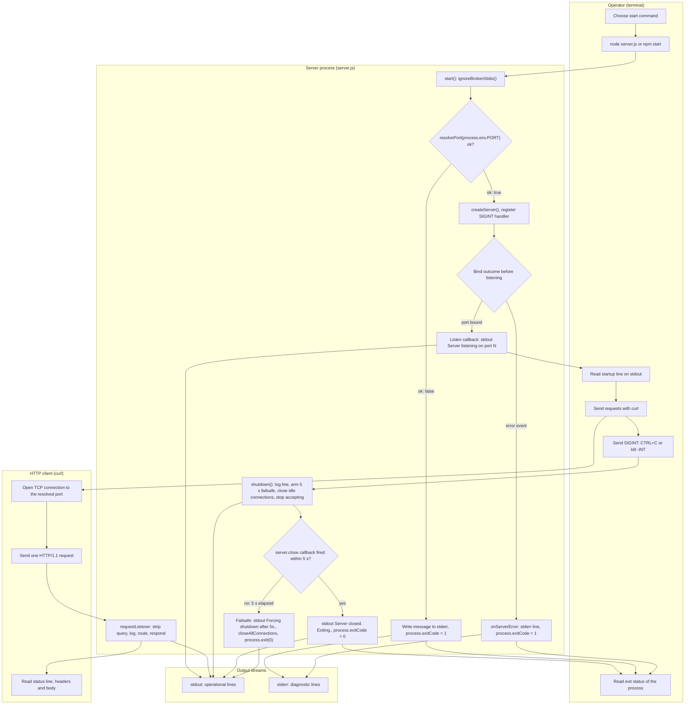

#### 4.1.1.3 Journey Narratives

**J1 — Start and serve.** `start()` runs as the last statement of the file (L176) and its first action is `ignoreBrokenStdio()` (L157), which installs the no-op `'error'` listeners on `process.stdout` and `process.stderr` before anything is written. `resolvePort(process.env.PORT)` (L159) then returns either the resolved port or a refusal message; on success `createServer()` (L167) builds the `http.Server` and attaches the `'error'` listener (L97), the `SIGINT` handler is registered (L169), and `server.listen(resolved.port, …)` (L171) begins the bind. The startup line is printed from the listen callback (L172), not from the statement after `listen()`, so its appearance is the only proof that the port is bound — `README.md` "Running the server" states this explicitly, and the Troubleshooting entry "Nothing is printed on startup" tells the reader to check `$?` instead. The bind takes the port alone with no host argument, so every interface is covered, not loopback only.

**J2 — Request and respond.** `requestListener` (L75–91) receives every request: it cuts the query string with `req.url.split('?')[0]` (L79), logs the method and the stripped path (L81), composes the lookup key `${req.method} ${pathname}` (L83) and dispatches to the `ROUTES` entry or to `handleNotFound` (L85–90). Both handlers write through the single writer `sendPlainText` (L53–56), which sets the status and `Content-Type: text/plain`, then ends the response with a fixed literal. No request-dependent value reaches the response, so J2 has exactly two observable outcomes: `200` with `Hello world` (11 bytes) and `404` with `Not Found` (9 bytes).

**J3 — Configure and refuse.** A refusal is reached before any socket exists. `resolvePort` (L15–39) trims the raw value, tests it against `/^[0-9]+$/`, then applies the privileged-port and range checks against `MIN_PORT`/`MAX_PORT`; `start()` writes the returned message to stderr, sets `process.exitCode = 1` and returns (L161–165). With no listener created and no handle left, the event loop drains and the process ends with status `1`. The fourth refusal — a port already held — happens after `listen()` is attempted: `onServerError` (L103–114) matches `error.code === 'EADDRINUSE'`, writes one line naming `error.port` and sets `process.exitCode = 1`. Because validation precedes the bind, the privileged-port refusal needs no root and produces no permission error; it is a validation outcome, not a failed bind.

**J4 — Stop.** The `SIGINT` handler calls `shutdown(server)` (L117–153), which logs `Received SIGINT. Shutting down gracefully.`, arms a single 5000 ms failsafe timer, closes idle keep-alive connections when the API exists, and calls `server.close()` so no new connection is accepted while in-flight responses finish. Whichever of the two completions happens first decides the ending: the close callback clears the timer, logs `Server closed. Exiting.` and sets `process.exitCode = 0` without calling `process.exit`, so the line is not truncated; or the failsafe writes `Forcing shutdown after 5s.`, closes remaining connections and calls `process.exit(0)` from its write callback. Both endings report `0`.

#### 4.1.1.4 System Interactions

Each row is a synchronous in-process call; no IPC, no network hop and no queue sits between the components.

| From | To | Payload | Guarantee |
|------|----|---------|-----------|
| `http.Server` | `requestListener` | `req`, `res` parsed by Node's HTTP parser | Listener is not invoked for a request line the parser rejects; such a request is answered `400` by the runtime and produces no log line |
| `requestListener` | `logRequest` | `req.method`, query-stripped `pathname` | Runs before the route lookup, so every request is logged exactly once regardless of outcome |
| `requestListener` | `ROUTES` | Key `${req.method} ${pathname}` | Exact, case-sensitive object property lookup; one entry, `'GET /hello'` |
| `handleHello` / `handleNotFound` | `sendPlainText` | `res`, fixed status and body | Both responses share one writer, so framing and headers cannot diverge |
| `http.Server` | `onServerError` | Emitted `Error` with `code`, `port`, `syscall`, `message` | Attached at creation (L97), so a bind failure cannot become an unhandled `'error'` event |
| `process` (signal) | `shutdown` | The `http.Server` instance | Registered once at startup (L169); the handler is never removed, so each further `SIGINT` re-enters `shutdown` |

#### 4.1.1.5 Decision Points

`server.js` contains ten conditionals and one timing race. They are listed exhaustively; no other branch exists in the file.

| ID | Condition (line) | True branch | False branch |
|----|------------------|-------------|--------------|
| D1 | `rawValue === undefined \|\| rawValue.trim() === ''` (L16) | Select `DEFAULT_PORT` 3000 | Continue to D2 |
| D2 | `!/^[0-9]+$/.test(value)` (L24) | Refuse: range message, exit `1` | Continue to D3 |
| D3 | `port !== 0 && port < MIN_PORT` (L30) | Refuse: privileged-port message, exit `1` | Continue to D4 |
| D4 | `port === 0 \|\| port > MAX_PORT` (L34) | Refuse: range message, exit `1` | Accept `{ok: true, port}` |
| D5 | `!resolved.ok` (L161) | Write message to stderr, `exitCode = 1`, return | Continue to bind |
| D6 | `handler === undefined` (L85) | `handleNotFound` → `404` | `handler(req, res)` → `200` |
| D7 | `error.code === 'EADDRINUSE'` (L104) | Held-port message, `exitCode = 1` | Continue to D8 |
| D8 | `error.syscall === 'listen'` (L106) | `Failed to start server: <message>`, `exitCode = 1` | `Server error while serving: <message>`, return without setting an exit code |
| D9 | `typeof server.closeAllConnections === 'function'` (L130) | Call it in the failsafe | Skip it; the failsafe's `process.exit(0)` still ends the process |
| D10 | `typeof server.closeIdleConnections === 'function'` (L135) | Call it before `server.close()` | Skip it; `server.close()` and the failsafe still complete the shutdown |
| R1 | Race: close callback (L139) versus 5000 ms timer (L126) | Close callback first → `Server closed. Exiting.`, `exitCode = 0` | Timer first → `Forcing shutdown after 5s.`, `process.exit(0)` |

D1–D4 form the configuration gate and are reached once per process; D5 is the single point at which a refusal message becomes a stderr line; D6 is the only branch in the request path; D7–D8 classify a bind failure; D9–D10 exist because `closeIdleConnections()` and `closeAllConnections()` arrived in Node 18.2.0, above the declared `>=18.0.0` floor. No decision point reads the request body, headers, cookies or query parameters — the request stream is never read.

#### 4.1.1.6 Error Handling Paths

| ID | Condition | Observable | Exit status | Recovery |
|----|-----------|------------|-------------|----------|
| E1 | `PORT` unparseable or out of range (`abc`, `3000.5`, `0x1F90`, `1e3`, `+3000`, `-1`, `0`, `65536`) | `Invalid PORT value "<value>": must be an integer between 1024 and 65535.` on stderr; no startup line | `1` | Set a port in `1024`–`65535`, e.g. `PORT=4000 node server.js` |
| E2 | `PORT` privileged (`1`–`1023`, e.g. `80`) | `Invalid PORT value "<value>": privileged ports 1-1023 are not permitted; choose a port between 1024 and 65535.` on stderr | `1` | Choose a port at or above `1024`; no override variable and no root is needed |
| E3 | Port held by another process | `Port <port> is already in use. Stop the process using it or set PORT to a free port.` on stderr | `1` | Stop the holder, or start on another port (`PORT=3001 node server.js` verified) |
| E4 | Any other listen failure | `Failed to start server: <error message>`, where the message is the runtime's own text | `1` | Act on the runtime message; no gate poses this case because inducing it depends on the host |
| E5 | Error after the port is bound | `Server error while serving: <error message>` on stderr; the process keeps serving | Not set by the handler (L110–111) | No recovery path is defined; the message is the only signal |
| E6 | Request line the HTTP parser rejects (bytes outside its accepted set, e.g. `0x7F`, `0xFF`, `0x01`) | `HTTP/1.1 400 Bad Request` written by the Node runtime; `requestListener` never runs, so no log line and no `ROUTES` consultation | — (server continues) | Client corrects the request; the server has no recovery step |
| E7 | Matched path absent from `ROUTES` (any method/path but `GET /hello`) | `404`, `text/plain`, `Not Found` (9 bytes); no path echo, no error detail, no stack trace; `0` bytes on a `HEAD` response | — (server continues) | Deliberately indistinguishable: the client cannot learn which check failed |
| E8 | Write failure on stdout or stderr (consumer gone) | The `'error'` handler of `ignoreBrokenStdio` (L48–49) swallows it, so no stack trace replaces a line | The program's own `0`/`1` contract is preserved | None required; output is simply lost |

E1–E4 and E6 are the four refusal paths the README enumerates for startup ("When the port is refused" covers E1–E4); E7 is the runtime failure contract of F-002.

### 4.1.2 Integration Workflows

#### 4.1.2.1 Integration Surface

The system integrates with nothing outside its own process and host. Its complete surface is five runtime touchpoints, consistent with 1.2.1.3.

| Touchpoint | Direction | Data exchanged | Failure mode |
|------------|-----------|----------------|--------------|
| `PORT` environment variable | Inbound, read once in `resolvePort` (L159) | One string; trimmed and validated | E1/E2: refusal before any bind |
| `SIGINT` | Inbound signal | None; triggers `shutdown` | Re-entry on repeated signal (see 4.3.1.4) |
| Stdout | Outbound | Startup line, one line per request, two shutdown lines, or the failsafe line | E8: swallowed by `ignoreBrokenStdio` |
| Stderr | Outbound | One diagnostic line per refusal or bind failure | E8: swallowed by `ignoreBrokenStdio` |
| TCP listener | Inbound network | HTTP/1.1 request in, response out; no TLS, no access control | E6: parser-level `400`; E5: post-bind error event |

No database, cache, queue, broker, secret store, identity provider, metrics agent or orchestrator is contacted; `server.js` contains exactly one `require(` call and it names `node:http`.

#### 4.1.2.2 Data Flow Between Systems

Data moves through four stages with no transformation of meaning at any of them:

1. **Configuration in.** `process.env.PORT` enters as an untrusted string and leaves `resolvePort` as either a number in `1024`–`65535` or a message. Nothing else is read from the environment.
2. **Request in.** Only `req.method` and `req.url` are read. `req.url` is reduced to `pathname` by `split('?')[0]`, which cannot throw on a malformed target — the reason `server.js` L76–78 records for using `split` instead of `new URL`. The request stream, headers, cookies and body are never read.
3. **Observability out.** `logRequest` composes one line from `Date.prototype.toISOString()`, the method and the pathname, both passed through `escapeNonPrintable`, so a byte outside `0x20`–`0x7E` becomes `\uXXXX` and the line always stays three space-separated tokens.
4. **Response out.** The status and the fixed body reach `sendPlainText`, which writes `Content-Type: text/plain` and ends the response. `Date`, `Connection`, `Keep-Alive` and the framing header are added by the runtime and are outside the contract.

#### 4.1.2.3 API Interaction Flow

There is one endpoint and one catch-all, and both are plain request/response: no streaming, no callback registration, no long-polling and no webhook.

| Request | Status | `Content-Type` | Body | Log line |
|---------|--------|----------------|------|----------|
| `GET /hello` | `200` | `text/plain` | `Hello world`, 11 bytes, no trailing newline | `<ISO> GET /hello` |
| `GET /hello?anything=1` | `200` | `text/plain` | Same 11 bytes (query string removed before comparison) | `<ISO> GET /hello` |
| `GET /hello/`, `GET /Hello`, `GET /HELLO`, `GET /hello%2F`, `GET /` | `404` | `text/plain` | `Not Found`, 9 bytes | `<ISO> GET <pathname>` |
| `POST`, `PUT`, `DELETE`, `OPTIONS` on `/hello` | `404` | `text/plain` | `Not Found`, 9 bytes | `<ISO> <METHOD> /hello` |
| `HEAD /hello` | `404` | `text/plain` | None on the wire (0 bytes); the runtime omits the body of a `HEAD` response | `<ISO> HEAD /hello` |
| Request line the parser rejects | `400` | Added by the runtime | Runtime-generated | None — the listener is never called |

Ordering is fixed by the code: the log line is written before the route lookup (L81 before L83), so a log line proves reception, never completion. A client therefore cannot use the log as delivery evidence, and the README's V5 counts requests, not responses.

#### 4.1.2.4 Event Processing Flows

The program is event-driven but has no event bus, queue or dispatcher: three event sources are wired directly to handlers.

| Event source | Handler | Behaviour |
|--------------|---------|-----------|
| `'request'` on the `http.Server` | `requestListener` (L95) | Per-request pipeline of 4.2.2.2; one synchronous pass, no async work beyond `res.end` |
| `'error'` on the `http.Server` | `onServerError` (L97) | Three-way classification of D7/D8; exits `1` for listen failures, stays alive for serve-time errors |
| `'SIGINT'` on `process` | anonymous closure calling `shutdown(server)` (L169) | Shutdown sequence of 4.2.2.3 |
| `'error'` on `process.stdout` / `process.stderr` | no-op listeners (L48–49), plus a one-shot listener before the failsafe write (L127) | Prevents an unhandled event from replacing a log line with a stack trace (E8) |

Signals are the only asynchronous input other than network traffic; there is no `SIGTERM` or `SIGHUP` handler, so a supervisor sending `SIGTERM` terminates the process without the two shutdown lines and without the documented `0`. Timer events are limited to the single 5000 ms failsafe.

#### 4.1.2.5 Batch Processing Sequences

The server has no batch mode, no scheduler and no job queue: every request is handled and answered independently, and nothing is accumulated between requests. Two batch-shaped sequences exist only as documented verification procedures in `README.md` "Verification", driven from the shell rather than by the system:

| Sequence | Shape | Documented expectation |
|----------|-------|------------------------|
| V8 burst | 50 `curl` processes backgrounded, one `wait` | All 50 answer `200` within a single 7 ms window on the verifying host, with 50 corresponding log lines |
| V9 batches | Two sequential loops of 5,000 requests, with `ps -o rss=` sampled before, between and after | Third reading within 10 MB of the second (`47384`, `59604`, `62180` KB observed), all 10,000 requests logged; each batch takes a couple of minutes |
| V5 counting | Start with stdout redirected to a `mktemp` file, two requests, `kill -INT` by pid, then `grep -c 'Z '` and `wc -l` | `2` request lines and `5` total lines, `exit=0`, log file removed afterwards |

Because nothing is retained per request, steady state is reached during the first batch; the JavaScript heap is collected on its own schedule, which is why V9 measures stability across batches rather than an absolute figure. The keep-alive window the client observes is the runtime's `Keep-Alive: timeout=5`, not a program-controlled idle timeout.

## 4.2 Flowchart Requirements

Every workflow in this section is small enough to be read end to end, which is the artifact's teaching premise. The requirements below fix what each flow must show so that the diagrams remain complete against the code: no workflow has a step, branch or timing constraint that is missing from its diagram.

### 4.2.1 Workflow Anatomy Requirements

#### 4.2.1.1 W1 — Startup and Configuration

| Element | Requirement in the flow |
|---------|-------------------------|
| Start point | `node server.js`, or `npm start`, whose `scripts.start` is the literal string `node server.js` (`package.json`) |
| End point (success) | Listener bound; `Server listening on port <port>` on stdout, written from the listen callback (L171–173) and never from the statement after `listen()` |
| End point (failure) | One stderr line and exit status `1` before any bind (E1, E2) or after a failed bind (E3, E4) |
| Process steps | `ignoreBrokenStdio()` → `resolvePort(process.env.PORT)` → `createServer()` → register `SIGINT` → `server.listen(port, callback)` |
| Decision diamonds | D1 (default), D2 (digits only), D3 (privileged), D4 (range), D5 (refusal gate), D7 (`EADDRINUSE`), D8 (`syscall === 'listen'`), D9/D10 (`typeof` guards, later in shutdown) |
| System boundary | Inside: the Node process, its environment, its two output streams. Outside: the operating system's port table, which decides whether a bind succeeds |
| User touchpoints | The start command, the stdout startup line, the exit status in `$?` |
| Error states and recovery | E1/E2 → set a valid port; E3 → stop the holder or set another port; E4 → act on the runtime message; E5 → message only, process keeps serving |
| Timing and SLA | No startup deadline is enforced. `README.md` gates wait with `sleep 1` before driving the server, which is a procedure, not a constraint. The only hard timer in the program belongs to shutdown |

#### 4.2.1.2 W2 — Request Handling

| Element | Requirement in the flow |
|---------|-------------------------|
| Start point | A request line received on the bound port, or a parser-level rejection that produces `400` before the listener runs |
| End point | Response written (`writeHead` + `end`) and one stdout log line per accepted request |
| Process steps | Strip the query string → log → compose the `ROUTES` key → dispatch to `handleHello` or `handleNotFound` → `sendPlainText` |
| Decision diamonds | D6 only (`handler === undefined`). Method, path casing, trailing slash and percent-encoding are settled inside the single exact string comparison, so they are not branches of the flow but inputs to one lookup |
| System boundary | Inside: `requestListener` and the two handlers. Outside: Node's HTTP parser, the TCP connection and the requesting client |
| User touchpoints | The `curl` command and the bytes it prints; the server's stdout line for the same request |
| Error states and recovery | E6 (parser `400`, no log line), E7 (`404` catch-all, indistinguishable across causes), E8 (stdout write failure swallowed), E5 (serve-time error event, no exit-status change) |
| Timing and SLA | No per-request timer, timeout or deadline exists in the code. The documented target is V7: five samples each below `0.010` s over loopback, against `0.000478`–`0.000523` s observed |

#### 4.2.1.3 W3 — Graceful Shutdown

| Element | Requirement in the flow |
|---------|-------------------------|
| Start point | `SIGINT` delivered to the process (interactive `CTRL+C` or `kill -INT <pid>`) |
| End point | Exit status `0`, by one of two routes: close callback with `Server closed. Exiting.`, or failsafe with `Forcing shutdown after 5s.` |
| Process steps | Log the received signal → arm the timer → close idle connections (guarded) → `server.close()` → clear the timer and log, **or** force-close all connections and `process.exit(0)` |
| Decision diamonds | D10 (`closeIdleConnections` present), R1 (close callback versus the 5000 ms timer), D9 (`closeAllConnections` present) |
| System boundary | Inside: the server's connection set and the process exit status. Outside: open sockets held by clients, and the terminal or supervisor that delivers the signal |
| User touchpoints | The signal itself, the two stdout lines, and the exit status the shell reports through `wait $pid; echo "exit=$?"` |
| Error states and recovery | A connection that will not finish is bounded by the failsafe; a departed stdout consumer is covered by the one-shot `'error'` listener (L127) so the exit remains `0`; an unresponsive process under another signal (`SIGTERM`) has no handler and no recovery |
| Timing and SLA | Hard bound of `5000` ms (L126, L133). The success path is unbounded in the source but is normally milliseconds; the failsafe is the only guaranteed completion time |

#### 4.2.1.4 W4 — Configuration Refusal

| Element | Requirement in the flow |
|---------|-------------------------|
| Start point | A `PORT` value supplied on the command line, plus the case of a port already bound by another process |
| End point | One stderr line, no startup line on stdout, exit status `1`, nothing left listening |
| Process steps | Trim → digits-only test → privileged test → range test → stderr write → `process.exitCode = 1` → return from `start()` |
| Decision diamonds | D2, D3, D4, D5 for the value cases; D7, D8 for the bind case |
| System boundary | The refusal is entirely inside the process for E1 and E2 (no socket, no privileges needed); E3 depends on the host's port table |
| User touchpoints | The stderr line, which quotes the offending value verbatim, and the `1` the shell reports |
| Error states and recovery | Recovery is a corrected command (`PORT=4000 node server.js`); no retry happens inside the program |
| Timing and SLA | Immediate — the refusal precedes any network side effect, which is why it produces no permission error and needs no root |

#### 4.2.1.5 Timing Constraints Summary

| Constraint | Value | Enforced by | Consequence if missed |
|------------|-------|-------------|----------------------|
| Shutdown failsafe | 5000 ms | `setTimeout` in `shutdown` (L126–133) | The failsafe fires: `Forcing shutdown after 5s.`, connections closed, exit `0` |
| Keep-alive idle window | `timeout=5` seconds | The Node HTTP runtime, reported in the response's `Keep-Alive` header | The runtime closes the idle socket; no program code runs |
| Request latency target | Each of five samples < `0.010` s | Documented gate V7 (`curl --write-out '%{time_total}'`) | The gate's threshold is missed; the server has no timer of its own |
| Burst window | 50 concurrent requests inside one 7 ms window on the verifying host | Documented gate V8 | Recorded as host behaviour, not a program guarantee |
| Memory stability window | Third RSS within 10 MB of the second across two 5,000-request batches | Documented gate V9 | Recorded as host behaviour; nothing is retained per request |
| Bind wait in documented gates | `sleep 1` before requests | `README.md` gate commands | A request may arrive before the bind and fail at the client |

No service-level agreement, availability target, throughput commitment or recovery-time objective exists anywhere in the delivered files, and `README.md` states the system is "deliberately at tutorial scale rather than a production service". The values above are the complete set of timing behaviour the code or the documentation fixes.

### 4.2.2 Detailed Process Flows

#### 4.2.2.1 Startup and Configuration Flow (W1, W4)

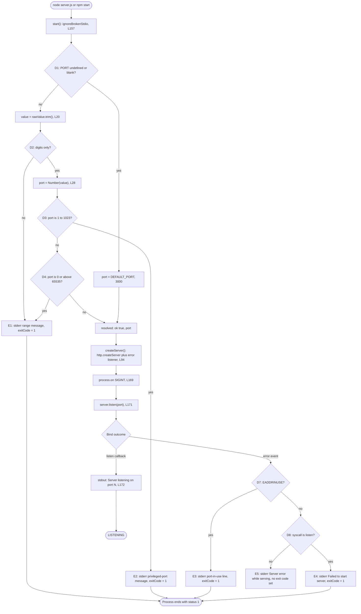

Two properties of this flow matter for reading the rest of the section. First, every refusal path ends `start()` with `return` and leaves no handle, so the process exits naturally with the `1` already written to `process.exitCode` — there is no `process.exit()` call on any refusal. Second, the startup line is emitted inside the listen callback, so its presence is the only in-band evidence that the bind completed; the Troubleshooting entry "Nothing is printed on startup" tells the reader to check `$?` instead of waiting.

#### 4.2.2.2 Request Lifecycle Flow (W2)

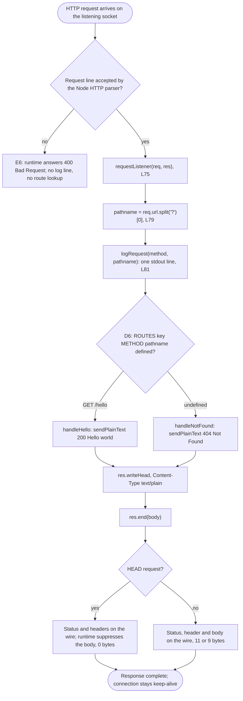

The log step sits before the lookup by design, so the flow reads as "accept → record → decide → answer" and a `404` is as visible on stdout as a `200`. Because the request stream is never read, there is no branch for a body, a content type, an `Expect` header or a partial upload: those never enter the flow.

#### 4.2.2.3 Graceful Shutdown Flow (W3)

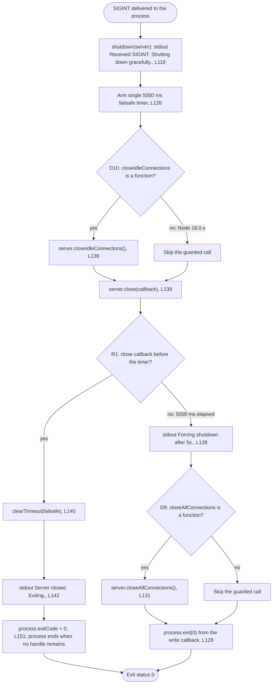

`process.exit(0)` appears only on the failsafe branch, because on the success branch an immediate exit would truncate the pending `Server closed. Exiting.` write — the line that proves the shutdown was clean. On Node 18.0.x, where neither connection-closing API exists, the failsafe is the only guaranteed route to termination, and it still reports `0`.

### 4.2.3 Validation Rules

#### 4.2.3.1 Business Rules at Each Step

| Step | Rule | Implementation | On violation |
|------|------|----------------|--------------|
| Resolve the port | An unset, empty or whitespace-only value means `3000` | `rawValue === undefined \|\| rawValue.trim() === ''` (L16) | Not a violation; the default applies |
| Resolve the port | Surrounding whitespace is trimmed before any test | `rawValue.trim()` (L20) | `PORT=" 4000 "` resolves to `4000` |
| Resolve the port | Only decimal digits are accepted; no `0x`, exponent, sign or decimal point | `/^[0-9]+$/` (L24) | E1 refusal; `0x1F90`, `1e3`, `+3000`, `3000.5`, `abc` are refused rather than reinterpreted |
| Resolve the port | Ports 1–1023 are refused as a policy rule, not as a permission failure | `port !== 0 && port < MIN_PORT` (L30) | E2 refusal, achieved without root |
| Resolve the port | `0` and anything above `65535` are out of range; `0` is not read as "any free port" | `port === 0 \|\| port > MAX_PORT` (L34) | E1 refusal |
| Bind | A bind that fails must be reported, never thrown | `server.on('error', onServerError)` (L97) | E3/E4 message and exit `1`; no stack trace, no unhandled `'error'` event |
| Route | The method and the query-stripped path must both match exactly and case-sensitively | Key `${req.method} ${pathname}` (L83) against `ROUTES` (L70–72) | E7: `404` with the fixed `Not Found` body |
| Route | The query string is removed before comparison and before logging | `req.url.split('?')[0]` (L79) | `GET /hello?x=1` is a `200`, and logs `GET /hello` |
| Route | Every accepted request is logged exactly once, before routing | `logRequest` at L81, before L83 | No code path skips the log on an accepted request |
| Respond | The body is a fixed literal; no request value is echoed | `sendPlainText(res, status, literal)` (L53–56, L62, L67) | No path echo, no error code, no stack trace, no runtime detail |
| Respond | The `Content-Type` is exactly `text/plain`, with no charset parameter | `writeHead(statusCode, {'Content-Type': 'text/plain'})` (L54) | V2's one-line check prints `200 text/plain 11` |
| Log | One line, three space-separated tokens | `toISOString()`, method, pathname (L43) | A byte outside `0x20`–`0x7E` is escaped as `\uXXXX` by `escapeNonPrintable` (L10–12), so the line cannot be split or injected into |
| Shutdown | `SIGINT` must end with status `0` and both lines | `shutdown` (L117–153) | The failsafe guarantees termination and status `0` when `server.close` cannot complete |

#### 4.2.3.2 Data Validation Requirements

The program validates exactly one input, and it validates it once, at startup.

- **`PORT` — validated, strictly.** Untrusted string in, discriminated result out: `{ ok: true, port }` or `{ ok: false, message }` (`resolvePort`, L15–39). The offending value is echoed through `escapeNonPrintable` (L22) so a control character in an environment variable cannot break the refusal line. No other environment variable is read — there is no `HOST`, no configuration file, no secret store, and no CLI argument parsing.
- **Request data — not validated, but not interpreted.** `req.method` and `req.url` are read and compared literally. The query string is cut, not parsed, so no percent-decoding, no parameter binding and no `new URL` call exist; `server.js` L76–78 records that `split` cannot throw on a malformed target. `GET /hello%2F` therefore matches nothing and answers `404` rather than decoding to `/hello`.
- **Request bodies and headers — never read.** No size limit, no content-type check and no `Expect` handling exist, consistent with the absence of any body-taking route.
- **Parser-level rejection — delegated.** A request line carrying bytes the Node HTTP parser rejects is answered `400` by the runtime before `requestListener` runs, so it produces no log line and never reaches the routing comparison.
- **Log integrity — sanitised output.** `logRequest` and the refusal messages pass external values through `escapeNonPrintable`, which keeps every operational line a single three-token line and prevents terminal injection.

#### 4.2.3.3 Authorization Checkpoints

None exist. The single endpoint is anonymous: `server.js` contains no authentication, session, cookie, token, CORS or CSRF handling, reads no credential and performs no origin check, and `README.md` "Scope and non-goals" declares "No authentication, authorisation, sessions, cookies, CORS, CSRF or TLS". There is no privileged route, no administrative surface, no role and no tenant, so the request flow of 4.2.2.2 has no authorization decision diamond — the `ROUTES` lookup is the only gate, and it is a path-and-method comparison rather than an access-control check. The listener binds every interface because `server.listen(resolved.port, …)` passes no host argument, which `README.md` "Running the server" states plainly.

#### 4.2.3.4 Regulatory Compliance Checks

No compliance control is implemented, and none can be inferred: the program stores no personal data, writes no file, opens no database connection, keeps no audit trail and transmits no data to any third party. Its only data flows are an environment variable in and stdout/stderr lines out. Two boundaries are compliance-relevant for an adopter and are documented rather than enforced — transport is plain HTTP with no TLS, and the access log is a bare stdout line with no retention, rotation or tamper protection; V5's counting procedure even redirects that log to a `mktemp` file outside the repository (mode `0600`) and deletes it afterwards. Any regulatory obligation would therefore have to be met by surrounding infrastructure that the delivered set does not include.

## 4.3 Technical Implementation

The program keeps no durable state and no cross-request state; its lifecycle is four states wide, decided by conditions in a 176-line file. The implementation facts below are the mechanics behind the flows of 4.1 and 4.2.

### 4.3.1 State Management

#### 4.3.1.1 State Inventory

| State | Kind | Where it lives | Lifetime |
|-------|------|----------------|----------|
| `DEFAULT_PORT`, `MIN_PORT`, `MAX_PORT` | Constants (3000, 1024, 65535) | `server.js` L5–7 | Process lifetime; never assigned after initialisation |
| `ROUTES` | Constant object literal, one key `'GET /hello'` | `server.js` L70–72 | Process lifetime; never mutated after definition |
| Resolved port | Number inside the `resolved` object returned by `resolvePort` | `start()` scope, captured by the listen callback (L172) | Process lifetime |
| `exitCode` | `process.exitCode`, the process's terminal status carrier | Node process | Set at most once per ending path: `1` on a refusal or listen failure, `0` on a clean close |
| Open connections | The `http.Server`'s own socket set | Node runtime, not program code | From accept to close; closed by `server.close()`/`closeIdleConnections()`/`closeAllConnections()` |
| Failsafe timer handle | `const failsafe` inside a single `shutdown` invocation (L126) | `shutdown` scope | From `SIGINT` until `clearTimeout` or the process exits; a second invocation gets its own handle |
| `req`/`res` objects | Per-request objects created by the runtime | `requestListener` and handler scope | One request; nothing is retained afterwards |

There is no session store, no counter, no cache entry and no shared mutable object that outlives a request. Nothing in the program writes a file, opens a database, or allocates a data structure that grows with request count, which is why V9 observes a resident set that reaches steady state during the first 5,000-request batch.

#### 4.3.1.2 Process Lifecycle States

| State | Entered by | Observable evidence | Exit transitions |
|-------|------------|---------------------|------------------|
| `CONFIGURING` | `start()` at L176; `ignoreBrokenStdio()` and `resolvePort` run here | Nothing on stdout | → `LISTENING` when `resolvePort` returns `ok`; → `REFUSED` when it does not |
| `BINDING` | `createServer()` then `server.listen()` (L167, L171) | Nothing on stdout yet, by design | → `LISTENING` on the listen callback; → `BIND_FAILED` on an `'error'` event |
| `LISTENING` | The listen callback (L171–173) | `Server listening on port <port>` | → `SHUTTING_DOWN` on `SIGINT`; stays in `LISTENING` after a serve-time error (E5) |
| `SHUTTING_DOWN` | `shutdown(server)` (L169 → L117) | `Received SIGINT. Shutting down gracefully.` | → `CLOSED` on the close callback; → `FORCED_CLOSED` when the 5000 ms timer fires |
| `CLOSED` | Close callback (L139–152) | `Server closed. Exiting.`, exit status `0` | Terminal |
| `FORCED_CLOSED` | Failsafe callback (L126–133) | `Forcing shutdown after 5s.`, exit status `0` | Terminal |
| `REFUSED` | `start()` refusal (L161–165) | One stderr line, no stdout line | Terminal, exit status `1` |
| `BIND_FAILED` | `onServerError` listen branches (L104–113) | One stderr line | Terminal, exit status `1` |

#### 4.3.1.3 State Transitions and Their Triggers

| Transition | Trigger | Side effects |
|------------|---------|--------------|
| `CONFIGURING` → `REFUSED` | `resolved.ok === false` | stderr write; `process.exitCode = 1`; `start()` returns; no listener, so the event loop drains and the process ends |
| `CONFIGURING` → `BINDING` | `resolved.ok === true` | `http.createServer(requestListener)`; `'error'` listener attached; `SIGINT` handler registered; `listen()` called |
| `BINDING` → `BIND_FAILED` | `'error'` with `code === 'EADDRINUSE'` or `syscall === 'listen'` | stderr write; `process.exitCode = 1`; no socket remains, so the process ends |
| `BINDING` → `LISTENING` | Listen callback | stdout startup line naming the resolved port |
| `LISTENING` → `LISTENING` | Any request, or a serve-time `'error'` | One stdout log line and one response per request; for E5, one stderr line and no exit-status change |
| `LISTENING` → `SHUTTING_DOWN` | `SIGINT` | stdout line; failsafe armed; idle connections closed (guarded); `server.close()` called |
| `SHUTTING_DOWN` → `CLOSED` | Close callback before the timer | `clearTimeout(failsafe)`; stdout line; `process.exitCode = 0`; the process ends once no handle remains |
| `SHUTTING_DOWN` → `FORCED_CLOSED` | 5000 ms elapsed | stdout `Forcing shutdown after 5s.`; `closeAllConnections()` (guarded); `process.exit(0)` from the write callback |
| `SHUTTING_DOWN` → `SHUTTING_DOWN` | Another `SIGINT` | The handler is never removed (L169), so `shutdown` runs again: the first line is logged again and another 5000 ms timer is armed |

#### 4.3.1.4 Re-entrancy

`shutdown` has no "already shutting down" guard and the `SIGINT` listener is registered once and never removed. Running the delivered file on Node `v22.23.4` with an incomplete request holding a socket open and sending `SIGINT` three times produced three `Received SIGINT. Shutting down gracefully.` lines and a single `Forcing shutdown after 5s.` before the process ended with status `0`; with all connections idle, three rapid signals produced one line pair and status `0`, because the process exits on the close callback before the later signals are handled. The observable consequences are therefore duplicate operational lines and additional pending timers during a slow shutdown — never a different exit status. No gate exercises repeated signalling, and `README.md` "Stopping the server" documents a single `SIGINT`.

#### 4.3.1.5 Persistence Points, Caching and Transaction Boundaries

- **Persistence points: none.** No database, no cache, no file write and no cookie exist; `README.md` "Scope and non-goals" states "No persistence. No database, no cache, no file writes: nothing survives a request or a process exit." The only artifacts that outlive the process are stdout and stderr lines, and only if the operator redirected them — V5's counting procedure does exactly that, into a `mktemp` file it deletes at the end.
- **The response is not committed to durable state.** The status and body are written to a socket, so an in-flight response is lost if the peer disconnects; nothing records the outcome. The request log line is written before routing, so a log line is evidence of reception, not of delivery or completion.
- **Caching: none.** There is no memoisation, no cache layer and no cache-related response header — no `ETag`, `Last-Modified`, `Cache-Control` or `Expires`. Each response carries a fresh runtime-generated `Date`, so two identical requests are never byte-identical. The `ROUTES` object is read once per request via property lookup and is never mutated; the resolved port is a captured number rather than a re-read of `process.env.PORT`, so a changed environment after startup has no effect.
- **Transaction boundaries: one request.** Each request is an independent unit with no cross-request side effect; the only paired operations are `res.writeHead(...)` and `res.end(...)` inside `sendPlainText`, and the only per-request external write is the single `console.log`. Because handlers are synchronous and hold no shared mutable state, concurrent requests cannot interleave partial work, and no lock, queue or connection pool is needed.
- **Terminal-state boundary.** `process.exitCode` is the one value that carries the outcome out of the process. Refusals set `1` and return; the clean close sets `0`. The success path deliberately avoids `process.exit()` so that the pending stdout write of `Server closed. Exiting.` is not truncated, and only the failsafe calls `process.exit(0)` — from inside the write callback, for the same reason.

### 4.3.2 Error Handling

#### 4.3.2.1 Error Classification and Handling Mechanism

| Class | Detection | Handler | Stream | Exit status |
|-------|-----------|---------|--------|-------------|
| Invalid or out-of-range configuration | `resolvePort` returns `{ok: false}` (L24, L34) | `start()` L161–165 | stderr, one line quoting the value | `1` |
| Privileged port | `resolvePort` L30 | `start()` L161–165 | stderr, one line | `1` |
| Port already in use | `onServerError`, `code === 'EADDRINUSE'` (L104) | `onServerError` | stderr, one line naming `error.port` | `1` |
| Other bind failure | `onServerError`, `syscall === 'listen'` (L106) | `onServerError` | stderr, `Failed to start server: <runtime message>` | `1` |
| Serve-time error after bind | `onServerError`, else branch (L108–111) | `onServerError` | stderr, `Server error while serving: <runtime message>` | Deliberately not set — `return` precedes `process.exitCode = 1` |
| Malformed request line | Node's HTTP parser, before the listener | Runtime | Runtime-generated `400` response | — |
| Unmatched route | `ROUTES` lookup `undefined` (L85) | `handleNotFound` | Response body `Not Found`; no stderr output | — |
| Closed output stream | `'error'` event on `process.stdout`/`process.stderr` | No-op listeners (L48–49); one-shot listener before the failsafe write (L127) | None; the failure is swallowed | The program's own `0`/`1` contract is preserved |

No stack trace is produced on any path, and no error detail reaches a response body: every refusal is exactly one stderr line, and every client-visible failure is the fixed 9-byte `Not Found`.

#### 4.3.2.2 Retry Mechanisms

None. The program contains no retry loop, no backoff, no reconnection and no re-attempt of a bind or a write.

| Operation | Retried | Reason |
|-----------|---------|--------|
| Bind the port | No | A failed bind ends `start()`; the remedy is an operator action, and `README.md` V13 documents the companion `PORT=3001 node server.js` |
| Resolve the port | No | Validation is deterministic; the same value would produce the same refusal |
| Write a log line or a response | No | A failed stdout write is swallowed by `ignoreBrokenStdio`; a response write to a gone peer has no recovery in scope |
| Serve a request that failed | No | The catch-all answers `404`; there is no upstream dependency to retry against |
| Complete a shutdown | No, but bounded | The failsafe is a deadline, not a retry: after 5000 ms it forces completion and exits `0` |

#### 4.3.2.3 Fallback Processes

| Fallback | Covers | Behaviour when engaged |
|----------|--------|------------------------|
| Catch-all `handleNotFound` | Any method/path pair not in `ROUTES` | `404`, `text/plain`, `Not Found`; identical for every cause, so the client cannot learn which check failed |
| Five-second failsafe timer | A connection that will not finish during shutdown | `Forcing shutdown after 5s.`, `closeAllConnections()` when available, `process.exit(0)` |
| `typeof` guards on the connection-closing APIs | A runtime at the declared `>=18.0.0` floor, where `closeIdleConnections()`/`closeAllConnections()` do not exist | The guarded call is skipped and the failsafe still guarantees termination with status `0` |
| `ignoreBrokenStdio` | A consumer of stdout or stderr that has gone away | The `'error'` event is swallowed, so a log line cannot become a stack trace or change the exit status |
| `escapeNonPrintable` | A control character in a log token or a refusal message | The byte is rendered as `\uXXXX`, keeping every line a single three-token line |
| Exact-match table with a single entry | Unsupported HTTP semantics (trailing slash, casing, percent-encoding, other methods) | The request falls to the catch-all rather than being reinterpreted |

#### 4.3.2.4 Error Notification Flows

Notification is limited to the process's two output streams and its exit status; nothing contacts a monitoring system, sends an alert or writes an error file.

- **Stream separation.** Operational output — the startup line, every request line and the shutdown lines — goes to stdout; diagnostics go to stderr. The two can therefore be separated by redirection without parsing prefixes, which is what V5's counting procedure relies on: `grep -c 'Z '` counts request lines while `wc -l` counts all five lines of a two-request session.
- **Exit status as the machine-readable signal.** `README.md` "Exit statuses" fixes the contract to `0` for a clean `SIGINT` and `1` for invalid configuration, a privileged port and any bind failure. Because refusals set `process.exitCode` rather than calling `process.exit`, a caller reading `$?` immediately after the command sees the correct value.
- **Diagnostic-to-remedy mapping.** The Troubleshooting section pairs each message with its fix: the range message and the privileged message both resolve to a port choice at or above `1024`; the port-in-use message resolves to stopping the holder or setting a free port; `Failed to start server:` resolves to acting on the runtime's own message; and "Nothing is printed on startup" resolves to reading `$?`, since a `1` means the cause is named on stderr.
- **Silent localisation.** Every client-visible failure body is the fixed literal `Not Found`, so notifications never disclose whether the method, the casing, the trailing slash or the path was wrong — a deliberate property `README.md` records under "Matching semantics": "Every non-matching request receives the identical response, which does not reveal which check failed."

#### 4.3.2.5 Recovery Procedures

| Failure | Procedure |
|---------|-----------|
| E1 — unparseable or out-of-range `PORT` | Correct the value; for example `PORT=4000 node server.js`. The process has already exited `1` and holds no socket |
| E2 — privileged `PORT` | Choose a port at or above `1024`. No root is required and no permission error is produced, because the refusal precedes any bind |
| E3 — port held | Stop the process holding the port, or start on another one; the documented companion check `PORT=3001 node server.js` prints `Server listening on port 3001` while `3000` is still held |
| E4 — other bind failure | Read the runtime's message in the diagnostic line and act on it; rule the configuration out with the override form |
| E5 — serve-time error | No procedure is defined. The message is written and the process keeps serving with no exit-status change |
| E6 — parser-level `400` | Correct the request on the client; the server needs no action |
| E7 — unexpected `404` | Check the method and the query-stripped path against the exact-match rules: `/hello` matches while `/hello/`, `/Hello`, `/HELLO`, `/hello%2F`, `POST /hello` and `HEAD /hello` do not, and `/hello?anything=1` does |
| Stalled shutdown | Wait for the five-second failsafe; the process ends with status `0` after `Forcing shutdown after 5s.` |
| Closed output consumer | None required; output is lost and the exit-status contract still holds |

#### 4.3.2.6 Ordering Properties Worth Knowing

Two consequences of the statement order in `start()` are visible to anyone reading the flows, and neither is exercised by a gate.

- **The `SIGINT` handler is registered before the bind** (L169 precedes L171). A signal delivered in the narrow window between a failed bind and the process's natural exit would therefore run `shutdown`, whose success branch sets `process.exitCode = 0` unconditionally (L151), overriding the `1` that `onServerError` had set. In normal operation the socket-free process exits first with `1`, which is what V13 observes.
- **The startup line is written from the listen callback, not after `listen()`** (L172). A process that starts but never prints the line has failed to bind, and the diagnostic is on stderr; the Troubleshooting entry "Nothing is printed on startup" encodes exactly this reading.

## 4.4 Required Diagrams

This sub-section consolidates the diagrams that carry a system-wide view: the component-level workflow, the integration sequences, the error-handling decision tree and the process state machine. Diagrams that belong to a single workflow — the journey swimlane and the three detailed process flows — are in 4.1.1.2, 4.2.2.1, 4.2.2.2 and 4.2.2.3, and 4.4.5 indexes them all.

### 4.4.1 High-Level System Workflow

Figure 4-5 shows the whole system at component level: three external actors and inputs on the left, the process boundary with its nine functions, and the four observable outputs on the right. The diagram makes the artifact's central property visible — every output is either a line on a stream, a response on a socket, or an exit status, and every one of them has a named producer inside the boundary.

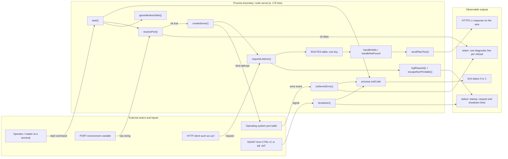

### 4.4.2 Integration Sequence Diagrams

Three sequences cover every interaction the program has with anything outside itself: a request, a startup that may fail to bind, and a signal-driven shutdown. The participants are the operator's shell, the HTTP client, the Node runtime, the program's own functions, and the two output streams.

#### 4.4.2.1 Request and Response Sequence

Figure 4-6 fixes the ordering that matters for observability: the log line is emitted before the route lookup and before any response byte is written.

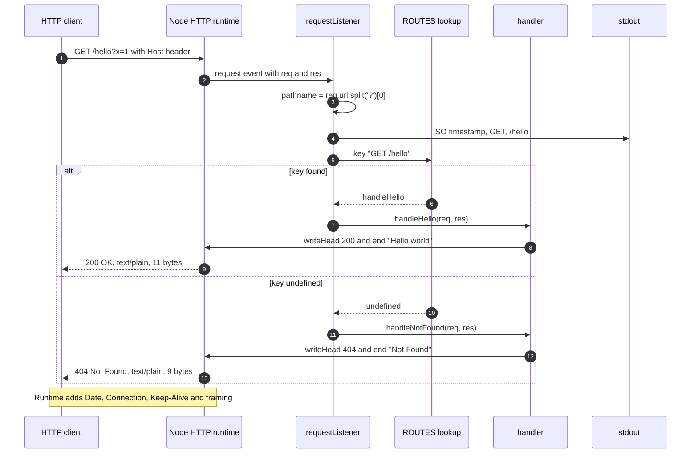

#### 4.4.2.2 Startup and Bind Sequence

Figure 4-7 places the four refusal outcomes in order and shows that the startup line is a callback effect, not a statement effect.

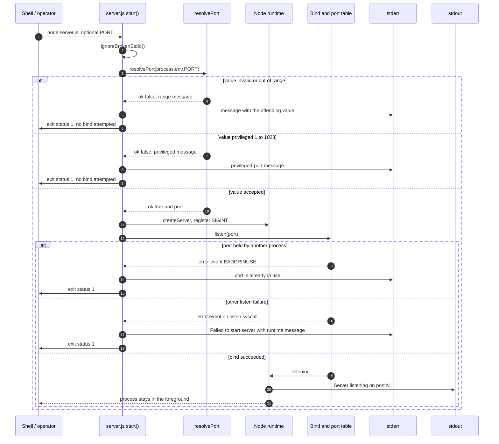

#### 4.4.2.3 Signal Shutdown Sequence

Figure 4-8 shows the race between the close callback and the five-second failsafe, and where `process.exit(0)` may and may not appear.

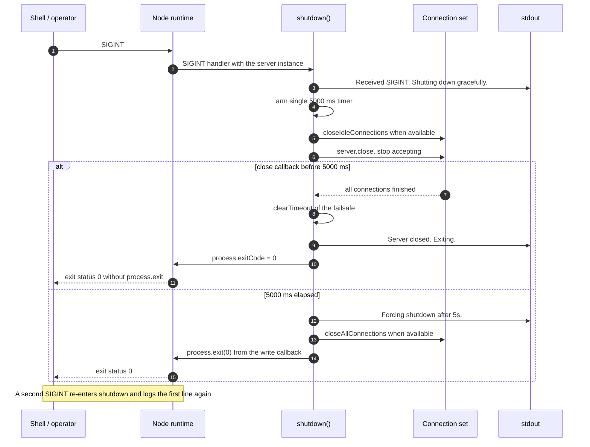

### 4.4.3 Error Handling Flowchart Set

Figure 4-9 is the single decision tree over every error the program can observe, classified by where it arose. Each leaf carries the observable effect and the documented recovery, so the diagram doubles as the troubleshooting index.

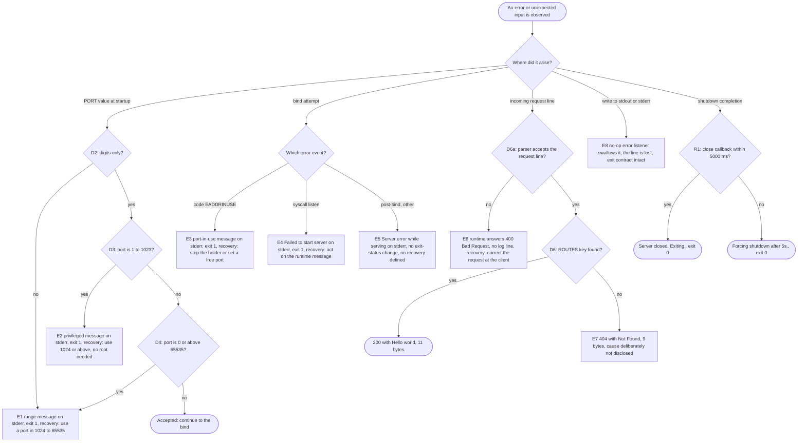

### 4.4.4 State Transition Diagram

Figure 4-10 is the process state machine of 4.3.1.2 and 4.3.1.3. It has two terminal states that report `1` and two that report `0`; no other exit status is reachable, and `LISTENING` is the only state in which the program does useful work.

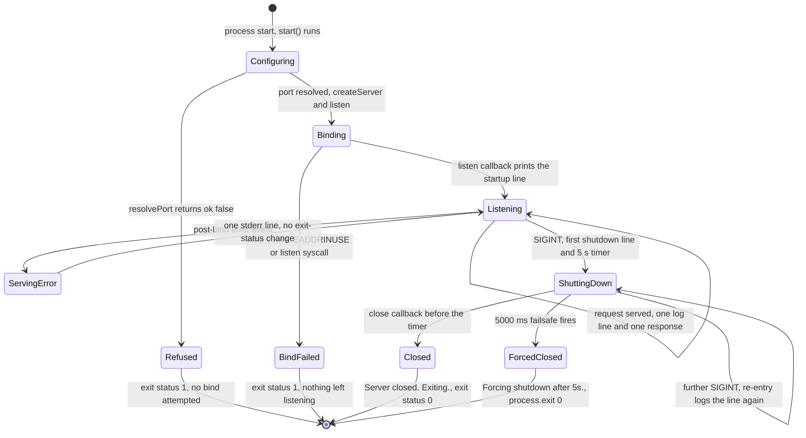

### 4.4.5 Diagram Inventory and Cross-Reference

| Required diagram | Figure | Location | Scope |
|------------------|--------|----------|-------|
| High-level system workflow | 4-5 | 4.4.1 | Actors, process boundary, nine functions, four output channels |
| End-to-end journey swimlanes | 4-1 | 4.1.1.2 | J1–J4 across operator, server, client and stream lanes |
| Detailed process flow — startup and configuration | 4-2 | 4.2.2.1 | D1–D5, D7–D8 with all four refusals |
| Detailed process flow — request lifecycle | 4-3 | 4.2.2.2 | Parser gate, query strip, log, D6 dispatch, body suppression for `HEAD` |
| Detailed process flow — graceful shutdown | 4-4 | 4.2.2.3 | R1 race, D9–D10 guards, both terminal routes to exit `0` |
| Integration sequence — request and response | 4-6 | 4.4.2.1 | Log-before-route ordering, `200`/`404` alternatives |
| Integration sequence — startup and bind | 4-7 | 4.4.2.2 | `PORT` validation alternatives, bind failure alternatives, startup line as callback effect |
| Integration sequence — signal shutdown | 4-8 | 4.4.2.3 | Close callback versus failsafe, where `process.exit(0)` is permitted |
| Error handling flowchart | 4-9 | 4.4.3 | E1–E8 plus R1, each with its recovery |
| State transition diagram | 4-10 | 4.4.4 | Eight states, two exit statuses, re-entry edge |

Every decision diamond named in these figures is drawn from the exhaustive register in 4.1.1.5 (D1–D5, D6, D7–D8, D9–D10, and the race R1), and every error leaf is drawn from the register in 4.1.1.6 (E1–E8). Neither register has an entry that is missing from the diagrams, and no diagram introduces a branch that is absent from `server.js`.

Reading the figures together yields the properties that no single diagram states: the program has exactly one listening state, one request branch, one timer and one exit-status carrier; its actors never exceed five runtime touchpoints (1.2.1.3); and its feature coverage is complete against F-001–F-010, since every featured behaviour appears as a labelled step in at least one figure.

## 4.5 References

- `server.js` (branch `origin/blitzy-8a4de345-c459-434b-a545-c8cf76a5f502`, commit `10d5d2ce05f177635ed928a01e9ed593ae550aa3`, 176 lines) — the sole source of every workflow, decision point, error path and timing constraint in this section. Specific evidence: `resolvePort` L15–39 (D1–D4, E1–E2 messages), `escapeNonPrintable` L10–12, `logRequest` L42–44, `ignoreBrokenStdio` L47–50, `sendPlainText` L53–56, `handleHello` L59–63, `handleNotFound` L66–68, `ROUTES` L70–72, `requestListener` L75–91 (query strip L79, log L81, lookup L83, fallthrough L85–90), `createServer` L94–100, `onServerError` L103–114 (D7–D8, E3–E5), `shutdown` L117–153 (failsafe L126–133, guarded closes L130–136, close callback L139–152), `start` L156–174 (refusal L161–165, `SIGINT` L169, `listen` L171, startup line L172), invocation L176.
- `package.json` (same commit, 352 bytes) — established `scripts.start` as the literal `node server.js`, `main` as `server.js`, and `engines.node` as `>=18.0.0`, which is the basis for the guarded-API fallbacks D9–D10 and the single start command of W1.
- `README.md` (same commit, 654 lines) — established the documented workflows and their expectations: "Running the server" L53–78 (bind, no host argument, startup line from the listen callback), "Verifying the endpoints" L79–212 (matching semantics, runtime-added headers), "Request logging" L192–212 (three-token format, stream separation), "Stopping the server" L213–242 (two shutdown lines, failsafe), "Configuration" L243–302 (default, range, trimming, the four refusals), "Exit statuses" L303–306, "Verification" L307–592 (gates V1–V16, including V5 counting, V7 `0.010` s, V8 50-request burst and 7 ms window, V9 batches and 10 MB tolerance), "Troubleshooting" L593–636 (diagnostic-to-remedy mapping), "Scope and non-goals" L637–654 (no persistence, no authentication, no `SIGTERM`, no batch surface).
- Repository root folder `""` — established that the checked-out `main` at commit `17c8b88` contains only `README.md` (9 bytes, `# IWNewGH`), with no source, manifest, test, CI or container file, and no `.blitzyignore` exclusion; all documented behaviour therefore rests on the delivery branch named above.
- Branch and commit refs `origin/main` (`17c8b88`) and `origin/blitzy-8a4de345-c459-434b-a545-c8cf76a5f502` (`10d5d2c`, twelve commits, series `bf884ad`, `63152f0`, `7c7142c`, `7f5e9e7`, `b7a0b94`, `8b4fe4a`, `bc93b97`, `4dba479`, `8be576f`, `fed7b96`, `0ef1865`, `10d5d2c`) — fixed the exact revision this section describes and the absence of any other ref carrying code.
- Runtime probes against an unmodified copy of the three delivered files, executed on Node.js `v22.23.4` in a scratch directory outside the checkout — established the observed flow behaviour cited in 4.1.1 and 4.3.1.4: logging before routing, `200`/`11` bytes and `404`/`9` bytes on the wire, `400` from the parser for rejected request lines, exit `1` with one stderr line on a held port, exit `0` with both shutdown lines on `SIGINT`, `Forcing shutdown after 5s.` with a held connection, whitespace-only `PORT` selecting `3000`, and three `Received SIGINT. Shutting down gracefully.` lines from three signals during one slow shutdown.
- Internal cross-references within this specification: 1.2.1.3 (five runtime integration touchpoints), 1.2.2.2 and 1.2.2.3 (component names and core technical approach), 1.3.1.1 and 1.3.2.1 (in-scope journeys and the excluded capabilities that bound the flows), 2.1.1 (feature IDs F-001–F-010 referenced throughout).
- No web source was consulted: every fact in this section derives from the three delivered files, the repository's git refs, or the runtime probes listed above, and no external version, standard or third-party behaviour is asserted.

# 5. System Architecture

## 5.1 High-Level Architecture

### 5.1.1 System Overview

The delivered system is a **single-process, single-file, dependency-free HTTP server**. Its complete executable surface is `server.js`: 176 lines, twelve top-level function declarations (`server.js` L10–L174), one dispatch table (`ROUTES`, L70–L72), one `require('node:http')` call (L3) and one invocation of `start()` as the file's last statement (L176). The runtime architecture is therefore a flat procedural monolith whose only concurrency comes from the Node.js event loop: every handler is synchronous, holds no shared mutable state and completes in one pass.

The architectural style is deliberate, and `README.md` states the reason: the artifact is teaching material that must be readable end to end ("A minimal, dependency-free Node.js HTTP server you can read end to end", `README.md` L3; "no framework, no middleware, no routing library and no third-party package of any kind", L9). Within the single file the code still follows an ordered layering, and that order is the read order: constants and escaping (L5–L12), configuration validation (L15–L39), observability (L42–L50), response writing and handlers (L53–L68), dispatch table and listener (L70–L91), server construction and error classification (L94–L114), shutdown (L117–L153), startup (L156–L174). A component may call downward in that order but never upward, which keeps the dependency direction acyclic without modules to enforce it.

**Key architectural principles and patterns**

| Principle | How it is realised | Evidence |
|-----------|--------------------|----------|
| One file, one read order | Every construct is defined before it is used; the only side-effecting entry point is the final statement | `server.js` L176; component order above |
| Single response writer | Both handlers funnel through `sendPlainText`, so status, header set and framing cannot diverge between routes | L53–L56 called from L62 and L67 |
| Table-driven dispatch | `ROUTES` is an object literal keyed by `"METHOD pathname"`; the listener builds the same key from the request | L70–L72, L83–L90 |
| Validate before side effects | Port validation completes before `http.createServer` and `listen`; a refusal creates no socket at all | L159 → L167 → L171; refusal path L161–L165 |
| Observe before route | The log line is written before the dispatch lookup, so a logged request is a received request | L81 precedes L83 |
| One failure surface | Every unmatched method/path yields the identical 9-byte `Not Found` body, disclosing nothing about which check failed | L66–L68; `README.md` L186 |
| Exit-status discipline | Success paths set `process.exitCode` and let the process end naturally; `process.exit` appears only in the five-second failsafe | L113, L151, L163; `process.exit(0)` only at L128 |
| Defensive runtime-floor guards | APIs added after the declared `>=18.0.0` floor are reached behind `typeof` checks | L130, L135 |
| No request parsing | The query string is cut with `split('?')[0]`, which cannot throw; the request stream, headers and body are never read | L79 with the comment at L76–L78 |
| One module boundary | A single `require` names a built-in using the `node:` prefix, so no package can shadow it | L3 |

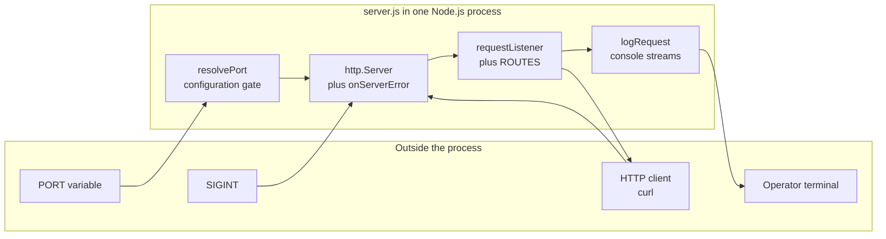

**System boundaries and major interfaces**

| Boundary | What crosses it | Mechanism |
|----------|-----------------|-----------|
| Process configuration | One string, `PORT`, read once | `process.env.PORT` at L159, validated by `resolvePort` |
| Network ingress and egress | HTTP/1.1 requests and responses, plaintext | Single-argument `server.listen(resolved.port, callback)` at L171; verified to bind the IPv6 wildcard, i.e. every interface, matching `README.md` L77 |
| Operational output | Line-oriented text on two streams | `console.log` / `console.error`; stdout for operational lines, stderr for diagnostics (`README.md` L211) |
| Process lifecycle in | `SIGINT` only | `process.on('SIGINT', …)` at L169 |
| Process lifecycle out | Exit status `0` or `1` | `process.exitCode` at L113, L151, L163 |
| Extension | New endpoints | One `ROUTES` entry plus one handler; nothing else changes (`README.md` L24) |

**Deployment and scaling shape.** One process serves one port for one anonymous endpoint. There is no clustering, no worker pool, no shared state and no external service, so the only scale-out axis is running additional independent processes on distinct ports; a second process on the same port fails at bind with `Port <port> is already in use` (`server.js` L104–L105, `README.md` L290). Concurrency within a process is the event loop's, measured by gate V8 (50 concurrent requests answered together, `README.md` L426–L432). These limits are stated as boundaries rather than gaps in `README.md` "Scope and non-goals" (L637–L654).

### 5.1.2 Core Components Table

The system has nine in-process components, all in `server.js`, plus two non-executable artifacts. Component boundaries follow function boundaries exactly, because the file defines no nesting beyond helper calls.

| Component Name | Primary Responsibility | Key Dependencies | Integration Points |
|----------------|------------------------|-------------------|--------------------|
| Configuration gate (`resolvePort`, `escapeNonPrintable`, `DEFAULT_PORT`/`MIN_PORT`/`MAX_PORT`) | Turn the raw `PORT` string into a validated port number or a refusal message | `String.prototype.trim`, two regular expressions, `Number` (L15–L39) | Called once from `start()` (L159); returns a discriminated result to it |
| Lifecycle controller (`start`, `createServer`) | Order startup: stdio protection, configuration, server construction, signal registration, bind | `http.createServer` (L95), `process.on` (L169), `server.listen` (L171) | Reads `process.env.PORT`; hands the `http.Server` to `onServerError` and `shutdown` |
| Bind-error classifier (`onServerError`) | Convert a server `'error'` event into one stderr line and an exit status | `error.code`, `error.port`, `error.syscall`, `error.message` (L103–L114) | Attached to the server `'error'` event at L97 |
| Request dispatcher (`requestListener`, `ROUTES`) | Strip the query string, log, build the lookup key, choose a handler, default to the catch-all | `req.method`, `req.url`; the `ROUTES` object (L70–L72) | Invoked per request by `http.Server`; calls `logRequest` and one handler |
| Request handlers (`handleHello`, `handleNotFound`) | Decide the status and the fixed body for the matched and unmatched cases | `sendPlainText` (L53) | Called only by the dispatcher (L86, L90) |
| Response writer (`sendPlainText`) | Write status, `Content-Type: text/plain` and the body; the only writer in the program | `res.writeHead`, `res.end` (L53–L56) | Reached from both handlers; the runtime adds `Date`, `Connection`, `Keep-Alive` and the framing header |
| Observability (`logRequest`, `escapeNonPrintable`) | Emit exactly one three-token stdout line per request with non-printable bytes escaped | `Date.prototype.toISOString`, `String.prototype.replace` (L10–L12, L42–L44) | Called from the dispatcher before the lookup (L81) |
| Stdio protection (`ignoreBrokenStdio`, one-shot listener) | Keep a gone stdout/stderr consumer from turning a log write into an unhandled `'error'` event | `process.stdout`, `process.stderr` (L47–L50, L127) | Installed at the top of `start()` (L157) and inside the failsafe |
| Shutdown controller (`shutdown`) | On `SIGINT`, stop accepting, close idle connections, bound the wait to five seconds, exit `0` | `server.close`, `closeIdleConnections`, `closeAllConnections`, `setTimeout`/`clearTimeout` (L117–L153) | Invoked from the `SIGINT` handler at L169 with the server instance |
| Package manifest (`package.json`) | Name, version, entry point, start script and engine floor; declares no dependencies | npm manifest format | Read by `npm start` and by gate V14 (`README.md` L524–L551) |
| Documentation and verification harness (`README.md`) | Purpose, run/verify/stop instructions, `PORT` reference, sixteen gates, troubleshooting, scope | Node.js ≥ 18.0.0 and `curl` on the host | Executed by a human or a shell; asserts the contracts of every other component |

**Critical considerations per component**

| Component | Critical consideration | Evidence |
|-----------|------------------------|----------|
| Configuration gate | Rejects by producing a message instead of throwing, so a refusal can never surface as a stack trace; `1024` floor is enforced in validation rather than by privileges | L25, L31, L35; `README.md` L301 |
| Lifecycle controller | The startup line is printed from the listen callback, so its absence means the bind failed | L171–L173 |
| Bind-error classifier | A post-bind error is reported but deliberately does not set an exit status; only listen failures do | L108–L113 |
| Request dispatcher | Matching is exact and case-sensitive on method and query-stripped path; no trailing-slash tolerance, no URL decoding, no `405` | L79–L90; `README.md` L169–L186 |
| Request handlers | `req` is unused in `handleHello` and retained only so every `ROUTES` entry shares one signature | L60–L62 |
| Response writer | Sets `text/plain` with no charset parameter, so the contract does not depend on runtime charset defaulting | L54; gate V2 asserts `200 text/plain 11` |
| Observability | Escaping guarantees the three-token line can never be broken by a crafted request target | L11, L43 |
| Stdio protection | A swallowed write failure must not alter the `0`/`1` exit contract | L46–L50 comment; L127 |
| Shutdown controller | `close()` on Node 18 keeps existing connections, so idle keep-alive sockets are closed explicitly and the timer is the final guarantee | L120–L136 comment |
| Manifest | Absence of `dependencies`, `devDependencies` and `type` is part of the contract, not an oversight | `README.md` L551; gate V14 |

### 5.1.3 Data Flow Description

All data movement is synchronous and in-process, except the socket itself. Four flows exist; nothing else in the program moves data.

**F1 — Configuration flow (once per process).** `process.env.PORT` is read exactly once, at L159, and passed as a raw string into `resolvePort`. The function trims it, treats unset or empty as the default `3000` (L16–L18), tests the trimmed value against `/^[0-9]+$/` (L24), refuses privileged values 1–1023 (L30) and refuses `0` or anything above 65535 (L34). The result is a discriminated object — `{ ok: true, port }` or `{ ok: false, message }` — not an exception. `start()` either writes the message to stderr and sets `process.exitCode = 1` (L161–L165), or passes the number to `server.listen` (L171). No transformation of meaning occurs after validation: the number is captured in the listen closure, and a later change to the environment has no effect.

**F2 — Request flow (per request).** A TCP connection accepted on the bound port is parsed by Node's HTTP parser, which constructs `req` and `res` and calls `requestListener` (L75). The dispatcher reads only two request fields: `req.method` and `req.url`. `req.url` is reduced to `pathname` by `split('?')[0]` (L79) — chosen over `new URL` precisely because `split` cannot throw on a malformed target (comment at L76–L78). The pathname and method go to `logRequest` (L81), which prefixes an ISO-8601 UTC timestamp from `Date.prototype.toISOString()` and escapes both tokens through `escapeNonPrintable`, then the same two values are concatenated into the lookup key `${req.method} ${pathname}` (L83). An undefined lookup calls `handleNotFound` (L86); otherwise the matched handler runs (L90). Both handlers call `sendPlainText(res, statusCode, body)` (L53–L56), which writes the status line plus `Content-Type: text/plain` and ends the response at once. The runtime then adds `Date`, `Connection`, `Keep-Alive` and the framing header — `Transfer-Encoding: chunked` on the verifying runtime — none of which the program sets (`README.md` L188–L190; observed on Node v22.23.4).

**F3 — Shutdown flow (once per signal).** `SIGINT` invokes `shutdown(server)` (L169 → L117). It writes `Received SIGINT. Shutting down gracefully.`, arms one 5000 ms failsafe timer, closes idle keep-alive connections when the API exists (L135–L137), and calls `server.close()` (L139), which stops new accepts while in-flight responses finish. Whichever completes first decides the ending: the close callback clears the timer, writes `Server closed. Exiting.` and sets `process.exitCode = 0` (L139–L152); or the failsafe writes `Forcing shutdown after 5s.`, closes remaining connections and calls `process.exit(0)` from the write callback (L126–L133).

**F4 — Diagnostic flow.** A refusal or listen failure produces exactly one stderr line (L105–L109, L162) and never a stdout line, so the two streams can be separated by redirection without parsing prefixes (`README.md` L211). The exit status is the machine-readable residue of the flow.

| Transformation point | Input | Transformation | Output |
|----------------------|-------|----------------|--------|
| Configuration gate (L15–L39) | Raw environment string | Trim; default on empty; digit test; privileged and range checks | Port number or refusal message |
| Query strip (L79) | `req.url` | Cut at the first `?`; no decoding, no normalisation | `pathname` |
| Log token escaping (L10–L12, L43) | Method and pathname | Every character outside `0x20`–`0x7E` replaced with `\uXXXX` | Three-token stdout line |
| Route key (L83) | `req.method`, `pathname` | Concatenation with a single space | Object property key compared against `ROUTES` |
| Response framing (L53–L56) | Status code and body literal | `writeHead` with one header, then `end` | HTTP/1.1 response with runtime-added headers |

**Data stores and caches.** None. The program opens no database, writes no file, sets no cookie and holds no cache; the request stream is never read. The only values retained across a request are module-level immutable ones — the three constants (L5–L7) and the `ROUTES` table (L70–L72) — plus the resolved port captured in the listen closure and `process.exitCode`. Per-request objects (`req`, `res`) are released when the response ends, which is why gate V9 observes a resident set that reaches steady state during the first 5,000-request batch (`README.md` L434–L447). No cache-related response header (`ETag`, `Last-Modified`, `Cache-Control`, `Expires`) is ever written, and each response carries a fresh `Date`, so two identical requests are never byte-identical. Section 4.3.1.5 carries the full state and persistence inventory.

### 5.1.4 External Integration Points

The system integrates with nothing beyond its own process and host. Every row below was confirmed in `server.js` and, where observable, exercised on Node v22.23.4.

| Integration Point | Integration Type and Direction | Data Exchange Pattern | Protocol/Format and Availability Expectation |
|-------------------|--------------------------------|-----------------------|----------------------------------------------|
| HTTP client (e.g. `curl`) | Network, inbound request and outbound response | Synchronous request/response on a keep-alive TCP connection; one request produces one response plus one log line | HTTP/1.1 over plaintext TCP on the resolved port, all interfaces, no TLS and no access control. Availability equals the process lifetime; no uptime target is stated, because the process is started and stopped by hand (`README.md` L643) |
| `PORT` environment variable | Process configuration, inbound | Read once at startup; surrounding whitespace trimmed; validated before any bind | Single trimmed string from `process.env`; unset or empty selects `3000`; accepted range `1024`–`65535`. A rejected value terminates the process with status `1` and no bind (`server.js` L15–L39, L159–L165) |
| `SIGINT` | Process signal, inbound | One signal triggers one shutdown sequence; the handler is never removed, so a repeat re-enters it | POSIX signal delivered by the terminal or `kill -INT`; completion bounded at 5000 ms by the failsafe (L126–L133). No `SIGTERM` or `SIGHUP` handler exists (`README.md` L650) |
| stdout consumer (terminal, file, pipe) | Operational output, outbound | Append-only, line-oriented; one startup line, one line per request, up to two shutdown lines | UTF-8 text lines of exactly three space-separated tokens for requests (`README.md` L194–L209). A consumer that stops reading is tolerated: its `'error'` event is swallowed (L47–L50), so output is lost and the exit contract holds |
| stderr consumer | Diagnostic output, outbound | One line per refusal or bind failure, never more | Free-form text naming the offending value or the runtime message (L105–L109, L162). Same broken-pipe tolerance as stdout |
| Host clock | Environmental, inbound | Read per request for the log timestamp and per response by the runtime for `Date` | `Date.prototype.toISOString()` — UTC with milliseconds and `Z`; the format is the only timestamp contract (`README.md` L207) |
| npm CLI | Build/tooling, inbound | `npm start` executes `scripts.start` (`node server.js`) in a child shell | npm manifest field lookup; adds banner lines before the server's output (`README.md` L64–L67, L524–L551) |
| Process supervisor | Not integrated | — | No listener for `SIGTERM`, no health endpoint, no readiness probe and no restart policy; a supervisor would terminate the process without the documented shutdown lines (1.2.1.2, `README.md` L643, L650) |

**SLA posture.** No availability or latency commitment is contractual. The only performance figures the delivered system documents are tutorial-scale measurements taken on the verifying host: five loopback samples of `GET /hello` each below 0.010 s (V7, observed 0.000466–0.000523 s), 50 concurrent requests all answered `200` within a single 7 ms window (V8), and a resident-set rise of 2,576 KB across two 5,000-request batches (V9, `README.md` L415–L448). `README.md` L22 states plainly that the system is "deliberately at tutorial scale rather than a production service", and section 5.4.5 treats those figures as verification thresholds rather than service levels.


## 5.2 Component Details

### 5.2.1 Configuration Gate

**Purpose and responsibilities.** Convert the single untrusted startup input into a port number or a refusal message, and do it before any side effect exists. `resolvePort` (L15–L39) is total: it returns `{ ok: true, port }` or `{ ok: false, message }` for every possible string, including the empty one, and never throws. Five decisions produce that outcome — default selection on unset/empty (L16–L18), digit-only syntactic test (L24), privileged-port refusal for 1–1023 (L30), refusal of `0` and of values above 65535 (L34), acceptance otherwise (L38). `escapeNonPrintable` (L10–L12) belongs to this component because it sanitises the value before the refusal message quotes it back.

**Interfaces.** `resolvePort(rawValue)` where `rawValue` is `process.env.PORT` (possibly `undefined`); the discriminated result is consumed only by `start()` at L159–L165. `escapeNonPrintable(value)` is shared with the logging component. Module constants `DEFAULT_PORT = 3000`, `MIN_PORT = 1024`, `MAX_PORT = 65535` (L5–L7) are the only tunables.

**Technologies.** Language built-ins only: `String.prototype.trim`, two `RegExp` literals, `Number`, `String.prototype.replace` with a `padStart`-formatted escape.

**Persistence requirements.** None. The resolved port lives in the `start()` closure for the process lifetime; a change to the environment after startup has no effect because the environment is never re-read.

**Scaling considerations.** Independent of load: evaluated once per process. The range check is what makes the privileged-port refusal reproducible as an unprivileged user, since the refusal precedes any bind (`README.md` L301).

### 5.2.2 Lifecycle Controller

**Purpose and responsibilities.** Order startup deterministically: protect stdio (L157), resolve configuration (L159), construct the server (L167), register the signal handler (L169), then bind (L171). `createServer` (L94–L100) is the construction half: it calls `http.createServer(requestListener)` and attaches `onServerError` to the `'error'` event at L97, so a bind failure cannot become an unhandled event. `start()` is invoked as the file's final statement (L176), making startup a single entry point with no argument parsing and no framework bootstrap.

**Interfaces.** `start()` takes no arguments and returns `void`; its observable outputs are the stderr refusal line, the exit status, and the startup line written from the listen callback (L171–L173). `createServer()` returns an `http.Server` whose `'request'` listener is `requestListener` and whose `'error'` listener is `onServerError`.

**Technologies.** `node:http` (`createServer`, `listen`), `process.on`, `process.env`, `console`.

**Persistence requirements.** None beyond the server handle, which is passed to `shutdown` through the signal closure. No pid file, no socket file, no state directory.

**Scaling considerations.** One server instance per process; the port is bound with a single argument, so the listener covers every interface rather than loopback only (`README.md` L77; confirmed as an IPv6 wildcard listen socket). Two instances on one port are mutually exclusive at bind time.

### 5.2.3 Bind-Error Classifier

**Purpose and responsibilities.** Turn a server `'error'` event into exactly one diagnostic line and, where appropriate, a terminal exit status. Three cases are separated at L104–L111: `code === 'EADDRINUSE'` names the held port and advises stopping the holder or changing `PORT`; any other error with `syscall === 'listen'` is a startup failure reported with the runtime's own message; every remaining case is a serve-time error that is reported and then returned from **without** setting an exit status, so the process keeps serving. `process.exitCode = 1` is reached only through the two listen branches (L113).

**Interfaces.** `onServerError(error)` consumes the emitted `Error`, reading only `code`, `port`, `syscall` and `message`. It is attached once, at server creation (L97), and is not removable afterwards.

**Technologies.** `EventEmitter` semantics of `http.Server`, `console.error`, `process.exitCode`.

**Persistence requirements.** None. The classification is stateless; the only residue is the stderr line and, for listen failures, the exit status.

**Scaling considerations.** Independent of request volume — only lifecycle errors reach it. Its deliberate asymmetry is a documented boundary: a post-bind error is visible on stderr but changes no exit status (`README.md` L299 names the four refusing conditions).

### 5.2.4 Request Dispatcher

**Purpose and responsibilities.** The single per-request entry point. `requestListener` (L75–L91) performs four steps in a fixed order: reduce `req.url` to `pathname` (L79), log method and pathname (L81), compose the key `${req.method} ${pathname}` and look it up in `ROUTES` (L83), then invoke the matched handler or `handleNotFound` (L85–L90). `ROUTES` (L70–L72) holds one entry, `'GET /hello'`; the lookup is a plain object property read, so matching is exact and case-sensitive with no pattern, parameter, wildcard or decoding semantics.

**Interfaces.** `requestListener(req, res)` is the `'request'` callback supplied to `http.createServer` (L95). It reads only `req.method` and `req.url`; headers, cookies, the query string and the body are never consulted, and the request stream is never read. `ROUTES` is the documented extension interface: one entry plus one handler adds an endpoint (`README.md` L24).

**Technologies.** Object property lookup, template-literal key construction, `String.prototype.split`.

**Persistence requirements.** None; `ROUTES` is never mutated after definition, and nothing derived from a request outlives it.

**Scaling considerations.** O(1) dispatch per request with no allocation beyond the key string and the log line. Because handlers are synchronous, requests cannot interleave partial work, so 50 concurrent requests are accepted and answered together (gate V8). The table size is the only growth axis, and a larger table weakly changes lookup cost without changing the code path.

### 5.2.5 Request Handlers

**Purpose and responsibilities.** Fix the two — and only two — observable outcomes. `handleHello` (L59–L63) answers `200` with the 11-byte body `Hello world`; `handleNotFound` (L66–L68) answers `404` with the 9-byte body `Not Found`. The 404 handler is the catch-all for every unmatched method and path, including a method mismatch, a trailing slash, a case variant, a percent-encoded path and `HEAD /hello`; there is no `405` branch and no path echo, so the response never reveals which check failed.

**Interfaces.** Both take `(req, res)` and return `void`, sharing one signature so that every `ROUTES` entry is interchangeable (comment at L60–L61). Neither reads `req`. Both call the shared writer with a literal status and body.

**Technologies.** Two string literals and one function call each; no templating, no serialisation and no content negotiation.

**Persistence requirements.** None.

**Scaling considerations.** Constant time and constant allocation per request; the response body is a literal held in the source, not built per request. Body size and status are fixed, so the handler is not a throughput variable — the runtime's socket handling dominates.

### 5.2.6 Response Writer

**Purpose and responsibilities.** The program's only writer (L52–L56). `sendPlainText(res, statusCode, body)` calls `res.writeHead(statusCode, { 'Content-Type': 'text/plain' })` and then `res.end(body)`. Centralising the write is what keeps the two responses identical except in status line and body, and what keeps the header set free of a charset parameter.

**Interfaces.** Called twice in the program: from `handleHello` (L62) and `handleNotFound` (L67). It never inspects the request, so it cannot leak request data into a response. Everything else on the wire — `Date`, `Connection`, `Keep-Alive`, `Transfer-Encoding` or `Content-Length` — is added by the runtime and is outside the contract (`README.md` L188–L190).

**Technologies.** `ServerResponse.writeHead`, `ServerResponse.end`; implicit chunked framing for a single `end` write on the verified runtime.

**Persistence requirements.** None; the response is written to a socket and not recorded.

**Scaling considerations.** One write pair per request with a fixed body, so memory per in-flight response is bounded by the runtime's buffers. No streaming API is used, and a `HEAD` response's body is suppressed by the runtime rather than by this writer — a `HEAD /hello` therefore reaches the 404 handler and observes 0 body bytes.

### 5.2.7 Observability and Stdio Protection

**Purpose and responsibilities.** Produce exactly one log line per request, before routing, and keep output failures from altering program behaviour. `logRequest` (L42–L44) composes three space-separated tokens — `Date.prototype.toISOString()`, the method, the pathname — passing the two request-derived tokens through `escapeNonPrintable` (L10–L12) so any byte outside `0x20`–`0x7E` becomes `\uXXXX` and the line cannot be broken into more tokens. `ignoreBrokenStdio` (L47–L50) installs no-op `'error'` listeners on `process.stdout` and `process.stderr` at the very top of `start()` (L157), and the failsafe adds a one-shot listener before its own write (L127), so a consumer that has gone away loses output but cannot change the `0`/`1` exit contract.

**Interfaces.** `logRequest(method, pathname)` is called from the dispatcher (L81); it has no return value and no failure channel. `escapeNonPrintable(value)` is shared with the configuration gate.

**Technologies.** `console.log` / `console.error`, `Date`, `String.prototype.replace` and `padStart`.

**Persistence requirements.** None in the program: lines go to file descriptors 1 and 2. Persistent retention exists only if the operator redirects the streams, as gate V5 does with a `mktemp` file it deletes (`README.md` L376–L394).

**Scaling considerations.** One synchronous line per request; the program holds no buffer, no ring and no file handle. Because the line is written before the response, throughput of logging bounds request throughput only at the console's own speed, and there are no levels or filters to disable it.

### 5.2.8 Shutdown Controller

**Purpose and responsibilities.** End the process cleanly on `SIGINT`. `shutdown(server)` (L117–L153) logs the signal, arms a single 5000 ms failsafe (L126–L133), closes idle keep-alive connections when the API exists (L135–L137), then calls `server.close()` (L139) so no new connection is accepted while in-flight responses finish. The close callback clears the timer, logs `Server closed. Exiting.` and sets `process.exitCode = 0` without calling `process.exit`, because an immediate exit would truncate the very line that evidences a clean shutdown (comment at L144–L150). The failsafe is the only `process.exit` in the program, and it fires from inside its own write callback (L128).

**Interfaces.** `shutdown(server)` is invoked by the anonymous `SIGINT` closure registered at L169. It depends on `server.close`, `server.closeIdleConnections` and `server.closeAllConnections`, the latter two reached behind `typeof` guards because they arrived in Node 18.2.0, above the declared `>=18.0.0` floor.

**Technologies.** `setTimeout`/`clearTimeout`, the server's close semantics, `process.exitCode` and one `process.exit(0)`.

**Persistence requirements.** None; no drain file, no state snapshot and no last-request record.

**Scaling considerations.** Termination latency is bounded at five seconds regardless of open connections, and the controller is not re-entrancy-guarded: the `SIGINT` listener is never removed, so a repeated signal re-enters `shutdown` and arms another timer (4.3.1.4). Idle connections must be closed explicitly because `close()` on Node 18 keeps existing sockets open.

### 5.2.9 Required Diagrams

#### 5.2.9.1 Component Interaction

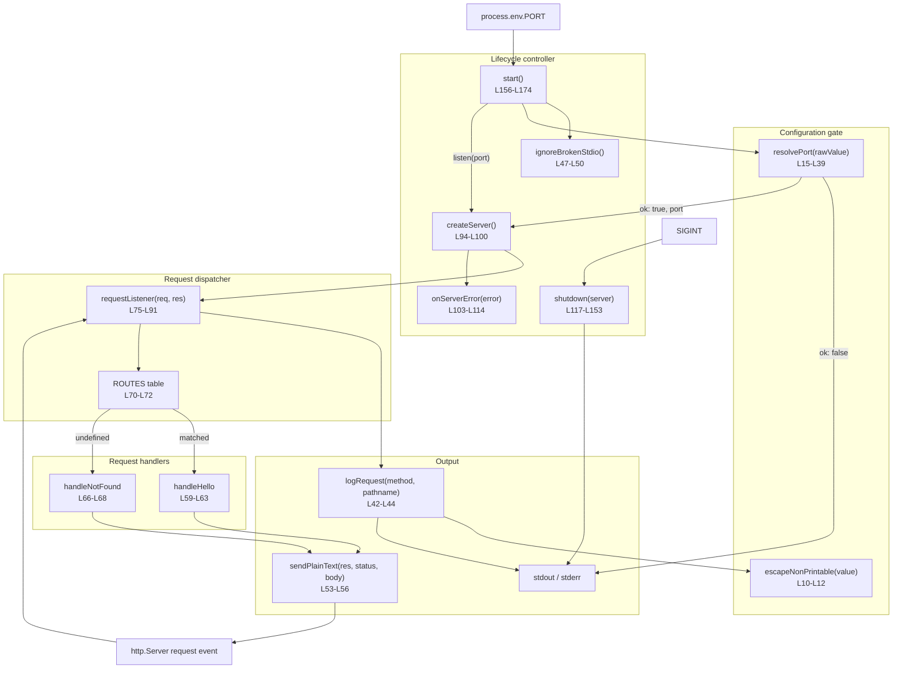

#### 5.2.9.2 Process State Transitions

State names and transition triggers follow the inventory of 4.3.1.2; the diagram adds the ordering, the two terminal failures and the fact that `LISTENING` is a self-loop for every served request and for post-bind errors.

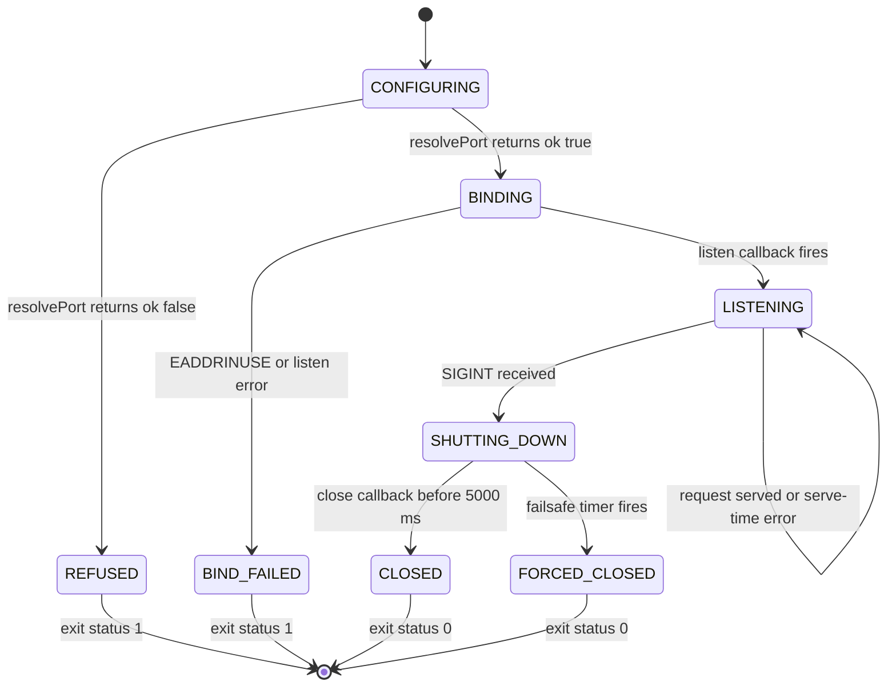

#### 5.2.9.3 Request Sequence

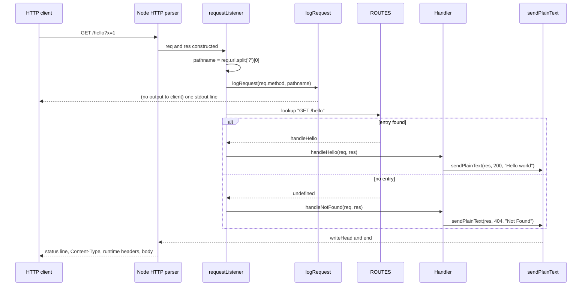

#### 5.2.9.4 Startup and Shutdown Sequence

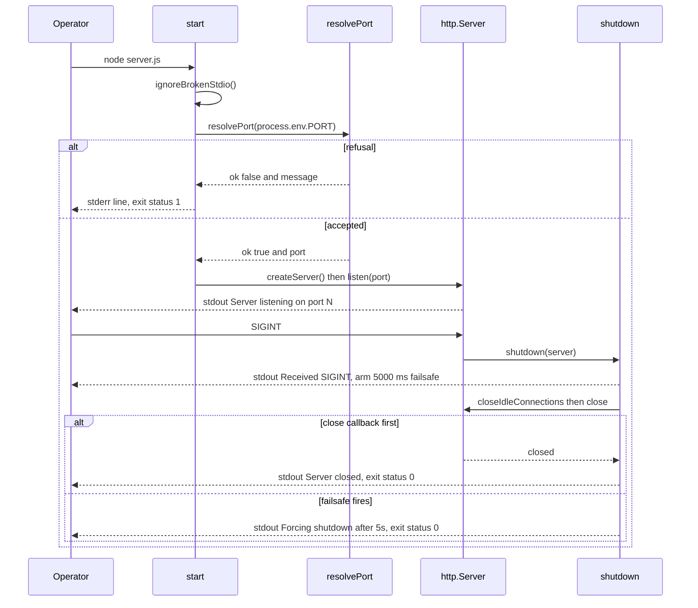


## 5.3 Technical Decisions

### 5.3.1 Architecture Style Decisions

The system is a **flat procedural monolith in one file**, executed as a single foreground process, with a dispatch table as its only extension point. The style was chosen to satisfy one requirement that outranks all others: a reader must be able to hold the whole program in view. `README.md` L3 states the goal ("you can read end to end") and L20–L24 states the consequence: the functional surface is two responses and one console line per request, and adding an endpoint changes the `ROUTES` table and nothing else.

| Candidate style | What it would require | Why it was not chosen |
|-----------------|-----------------------|------------------------|
| Framework application (Express/Koa/Fastify) | A dependency tree, a lockfile, an install step and middleware ordering semantics | Breaks the no-installation story (`README.md` L41–L51), gate V14 (no dependency keys) and gate V16 (one `require(`); 3.2.4 records the same decision from the stack perspective |
| Multi-file modular service | Module boundaries, a resolution graph and cross-file navigation for a 176-line program | Adds a navigation cost with no ownership or reuse benefit at this size; `README.md` L651 excludes any build or bundling layer |
| Class-based layered architecture (controllers, services, repositories) | Layers with no payload to carry — there is no persistence, no domain model and no external service | Every layer would be a pass-through, and the tutorial's teaching point is the handler itself |
| Serverless handler | A platform, a deployment artifact and a cold-start model | `README.md` L642–L643 declares no deployment automation and no containers |
| Event-bus or worker-pool topology | Broker or cluster module, plus serialisation of state | Nothing to distribute; the work per request is one string comparison and one write |

**Principle-to-constraint mapping.** Each architectural principle of 5.1.1 exists because a documented gate would fail without it: the single writer keeps the byte-exact contract of V2/V3; the escaping rule keeps V5's three-token line; validation before side effects makes V11/V12 pass without root; exit-status discipline makes V6 read `exit=0`; and the runtime-floor guards keep the `>=18.0.0` claim of V14 true on 18.0.x.

**Accepted trade-offs.** No layering means no dependency-injection seam and no unit-test harness — the verification story is sixteen shell gates instead (`README.md` L307–L591). A single process means one port and no failover. A literal-body handler means no content negotiation and no template layer. Each is declared as a boundary in `README.md` "Scope and non-goals" (L637–L654) rather than left implicit.

### 5.3.2 Communication Pattern Choices

| Decision | Pattern adopted | Alternatives rejected | Rationale |
|----------|-----------------|-----------------------|-----------|
| Component-to-component calls | Synchronous in-process function calls; no queues, promises or callbacks beyond the runtime's own events | Async message passing, promise chains, worker threads | Handlers hold no shared state, so a request completes in one pass; async machinery would add failure modes without concurrency benefit (`server.js` L75–L91, L53–L56) |
| Client-facing protocol | HTTP/1.1 plaintext on one port, one request per response, keep-alive left to the runtime | HTTP/2, TLS termination, WebSockets, gRPC | `node:http` supplies HTTP/1.1 without configuration; TLS and HTTP/2 would need either certificates or additional modules, both excluded by `README.md` L645 |
| Dispatch | Table lookup on the composed key `"METHOD pathname"` | Router library, regex route table, middleware chain | Makes the method-plus-path match visible as data (L70–L72, L83) and keeps a method mismatch a `404` rather than a `405` |
| Path handling | Manual query strip with `split('?')[0]` | `new URL`, `querystring`, `URLSearchParams` | `split` cannot throw on a malformed request target, so request data never reaches a parser (comment at L76–L78) |
| Response construction | One `writeHead` plus one `end` per response, with implicit framing | Explicit `Content-Length`, streaming writes, compression | The contract is status line, `Content-Type` and body only; framing is the runtime's (`README.md` L188–L190) |
| Operational notification | Two text streams plus the process exit status | Structured log shipping, metrics endpoint, alerting hook | No collector, agent or endpoint exists; stream separation is enough for the documented counting procedure (V5) |
| Lifecycle signalling | `SIGINT` only, with a bounded asynchronous shutdown | `SIGTERM`, `SIGHUP`, supervisor protocol, health-check endpoint | The process is started and stopped by hand (`README.md` L643, L650); the five-second failsafe bounds the one signal that is handled |

**Consequence of the in-process choice.** Because no call crosses a process boundary, there is no serialisation, no retry, no timeout and no partial-failure semantics in application code. The only asynchrony is the socket, the timer and the signal, which is why the program's failure surface collapses to four startup refusals, one catch-all response and one swallowed stream error (4.1.1.6).

### 5.3.3 Data Storage Solution Rationale

**The system stores nothing.** No database driver, ORM, file write, cookie, session or in-memory record exists in `server.js`; the single `require` names `node:http` and nothing else, and the process opens no descriptor besides its listening socket and the three standard streams.

| Capability | Present | How the design replaces it |
|------------|---------|----------------------------|
| Durable record of requests | No | One stdout line per request, retained only if the operator redirects stdout; V5 does exactly that with a `mktemp` file it deletes (`README.md` L376–L394) |
| Configuration store | No | One environment variable read once at startup (L159); the resolved number is captured in the listen closure |
| Application state | No | Two immutable module-level structures: the three port constants (L5–L7) and the `ROUTES` table (L70–L72) |
| Migration or schema management | No | Nothing to migrate; a fresh process has the same state as any other |
| Backup and restore | No | Nothing to back up; the deliverable is three tracked files |

**Why the absence is architectural rather than unfinished.** The endpoint is a constant: `GET /hello` returns a literal and reads no input, so there is nothing to persist. Adding persistence would require a driver (violating the zero-dependency constraint of V14/V16), an installation step (violating V15's clean-machine promise) and a lifecycle for connections and migrations that the five-state process model of 4.3.1.2 does not have. `README.md` L644 states the boundary as a non-goal. The trade-off is accepted explicitly: nothing survives a request or a process exit, which is why the system cannot serve as a record of anything it did — the log line proves reception only, since it is written before routing (L81 precedes L83).

### 5.3.4 Caching Strategy Justification

**There is no cache layer, and no cache semantics are exposed to clients.** The program writes one response header — `Content-Type: text/plain` (L54) — and sets no `Cache-Control`, `Expires`, `ETag`, `Last-Modified` or `Vary`. Every response therefore carries whatever default behaviour the client and any intermediary apply to a plain `200` with no freshness information, and the documented contract deliberately says nothing about caching (`README.md` L188–L190 lists only the runtime-added headers).

| Caching layer | Present | Reasoning |
|---------------|---------|-----------|
| Client-side HTTP cache | Not controlled | Only status and `Content-Type` are set; a `GET` with no freshness header is heuristically cacheable by some clients, which is harmless because the body is a constant — but the system makes no promise either way |
| Shared or proxy cache | Not applicable | The server binds plaintext HTTP on every interface with no proxy configuration, no `Vary` and no TLS |
| Server-side response cache | None | The body is a literal evaluated per request; memoisation would add state to save one property lookup and one string reference |
| Route table cache | None needed | `ROUTES` is a constant object read by property lookup; a cache would be a second copy of it |
| Connection cache (keep-alive) | Runtime-owned | The runtime keeps sockets alive with `Keep-Alive: timeout=5` and the program neither reads nor sets it; shutdown closes idle sockets explicitly so they cannot hold the process open (L135–L137) |
| Configuration cache | Not needed | The resolved port is read once and captured; re-reading the environment would add a failure mode, not save work |

The measured consequence supports the decision: with nothing retained per request, resident memory reaches steady state during the first 5,000-request batch and grows by 2,576 KB between the second and third sample (V9, `README.md` L447). Section 4.3.1.5 records the same finding as "Caching: none".

### 5.3.5 Security Mechanism Selection

The system's security posture is deliberately minimal, and the mechanisms it does implement are chosen to be the smallest set that keeps the documented contract honest.

| Mechanism | Implementation | Threat it addresses | Evidence |
|-----------|----------------|---------------------|----------|
| Configuration validation before any bind | Digit-only test, privileged-port refusal, range check, all before `listen()` | Accidental privileged exposure and reliance on ambient privileges; a refusal cannot be mistaken for a permission error | L24–L37, L159–L165; `README.md` L301 |
| Uniform failure response | One literal `Not Found` for every unmatched method and path | Enumeration through differential errors: a client cannot learn whether the method, the casing, the trailing slash or the path was wrong | L66–L68; `README.md` L186 |
| Token escaping before output | Non-printable bytes rendered as `\uXXXX` in the log line and in refusal messages | Log injection, terminal escape injection and line-splitting through a crafted request target or `PORT` value | L10–L12, L43, L22 |
| No request parsing | Query string cut by `split`, request stream never read, no `new URL` | Parser-exploit and body-handling surface: no deserialisation, no decompression and no size limit to bypass | L76–L79 |
| No dynamic evaluation | `eval`, `Function` and `vm` absent; request data reaches only a property lookup and a log line | Code-injection sink | 3.1.3 |
| Broken-pipe tolerance | No-op `'error'` listeners on both streams; one-shot listener before the failsafe write | Output write turning into an unhandled event and masking the exit contract | L47–L50, L127 |
| Single module boundary | `require('node:http')` with the `node:` prefix | Supply-chain compromise and built-in shadowing by a same-named package | L3; gate V16 asserts exactly one `require(` |

**Mechanisms absent by design.** No authentication, authorisation, session, cookie, CORS, CSRF token, TLS, rate limit, quota or request-size limit exists; `README.md` L645–L646 declares each as a boundary. The accepted risk is stated in the same place: the endpoint is anonymous, read-only and plaintext, and the bind covers every interface (L77), so any host able to reach the port can read the one response. Because no request input influences the response body or status beyond the match/no-match decision, the absence of input validation in the request path carries no injection risk — the only request-derived data that leaves the process is the escaped log line.

**What the design does not protect.** The server is not hardened against denial of service: it imposes no per-connection cap, no timeouts of its own and no body limits, and the runtime's keep-alive window is the only idle policy in play. `README.md` L22 and L645 state that the system is not a production service, which is the operative constraint on this section's mechanisms.

### 5.3.6 Decision Trees

**Request-path decision tree.** Exactly one branch decides a response, and it is taken after the log line is written, so every request that reaches the listener is logged regardless of outcome.

```mermaid
flowchart TD
    T0["Request arrives on the bound port"] --> T1{"HTTP parser accepts the request line?"}
    T1 -->|"no"| T2["Runtime answers 400<br/>listener not called<br/>no log line"]
    T1 -->|"yes"| T3["pathname = req.url.split('?')[0]"]
    T3 --> T4["Write one stdout log line"]
    T4 --> T5{"ROUTES key METHOD plus pathname defined?"}
    T5 -->|"yes: GET /hello"| T6["handleHello"]
    T5 -->|"no"| T7["handleNotFound"]
    T6 --> T8["200, text/plain, Hello world, 11 bytes"]
    T7 --> T9["404, text/plain, Not Found, 9 bytes"]
    T2 --> T10["Client observes 400"]
    T8 --> T10
    T9 --> T10
```

**Startup decision tree.** Configuration is decided before the bind, and the bind errors are classified into exactly three outcomes.

```mermaid
flowchart TD
    S0["start()"] --> S1{"PORT unset or empty?"}
    S1 -->|"yes"| S7["port = 3000"]
    S1 -->|"no"| S2{"trimmed value is digits only?"}
    S2 -->|"no"| R1["stderr: integer between 1024 and 65535<br/>exit 1"]
    S2 -->|"yes"| S3{"value 1-1023?"}
    S3 -->|"yes"| R2["stderr: privileged ports not permitted<br/>exit 1"]
    S3 -->|"no"| S4{"value is 0 or above 65535?"}
    S4 -->|"yes"| R1
    S4 -->|"no"| S7
    S7 --> S8["createServer, attach error handler, register SIGINT"]
    S8 --> S9{"bind outcome"}
    S9 -->|"EADDRINUSE"| R3["stderr: port already in use<br/>exit 1"]
    S9 -->|"other listen error"| R4["stderr: failed to start server<br/>exit 1"]
    S9 -->|"bound"| S10["stdout: Server listening on port N"]
    S10 --> S11{"SIGINT received?"}
    S11 -->|"yes"| S12["shutdown sequence, exit 0"]
    S11 -->|"no"| S13["serve requests until a signal arrives"]
```

### 5.3.7 Architecture Decision Records

| ID | Decision | Context and rationale | Consequences |
|----|----------|-----------------------|--------------|
| ADR-001 | Single-file procedural monolith | The artifact is teaching material read top to bottom (`README.md` L3, L20–L24); no reuse, team split or deployment unit requires modules | No module boundary, no dependency injection and no unit-test seam; extension is confined to `ROUTES` |
| ADR-002 | Zero third-party dependencies; `node:http` only | Removes install, lockfile and supply-chain surface; makes the clean-machine and footprint gates possible (V15, V16) | No framework features: no middleware, parameterised routes, body parsing, static files or TLS helpers |
| ADR-003 | Table lookup instead of a router | The teaching point is the method-plus-path match itself; one entry plus one handler is the extension mechanism (L70–L72) | Exact, case-sensitive matching only; no wildcards, parameters or trailing-slash tolerance; a method miss is a `404`, never `405` |
| ADR-004 | Single response writer `sendPlainText` | Guarantees both responses share headers and framing, so the contract can only drift in one place (L53–L56) | No per-route header control; content negotiation impossible without changing the writer |
| ADR-005 | Validate configuration before creating a server | Makes the privileged-port refusal a validation outcome instead of a permission error, and guarantees no partial startup (`README.md` L301) | The refusal message is the program's own text rather than the runtime's, so it is a maintained string |
| ADR-006 | Discriminated result instead of exceptions in `resolvePort` | Removes a throw-based failure path from startup and keeps every refusal to exactly one stderr line | Every caller must inspect `ok`; a future caller could ignore it, though only `start()` exists |
| ADR-007 | `split('?')[0]` instead of `new URL` | A malformed request target cannot make the dispatch path throw (comment L76–L78) | No percent-decoding, no normalisation and no query access; `/hello%2F` is a `404` |
| ADR-008 | Exit-status discipline; `process.exit` only in the failsafe | An immediate exit truncates the stdout write that evidences a clean shutdown (comment L144–L150) | The process must reach a state with no live handle to terminate; that is why idle connections are closed explicitly |
| ADR-009 | `typeof` guards around `closeIdleConnections` and `closeAllConnections` | Both arrived in Node 18.2.0, above the declared `>=18.0.0` floor (comment L120–L125) | On 18.0.x the guarded calls are skipped and the five-second failsafe is what ends the process |
| ADR-010 | Escape non-printable bytes in every reflected token | Keeps the log line at three tokens and prevents terminal escape injection from a crafted target or `PORT` value | Reflected values are not byte-identical to what the client sent, which is why the escaping rule is documented (V5) |
| ADR-011 | Uniform catch-all failure with a fixed literal body | Prevents disclosure of which matching rule failed (`README.md` L186) | Diagnostics exist only in server-side logging; a client cannot self-correct from the response |
| ADR-012 | No persistence, cache or auth; `SIGINT` as the only signal | Each would require infrastructure the tutorial excludes (`README.md` L644–L650) | No durability, no multi-instance coordination, no zero-downtime restart and no protection against real traffic |
| ADR-013 | Sixteen shell gates instead of a test framework | Keeps the artifact at three files with no `devDependencies`, while still asserting byte-exact behaviour | Verification is manual and serial; V7–V9 are host-dependent measurements rather than assertions |

**Recorded architectural assumptions.**

| Assumption | Basis | Effect if it fails |
|------------|-------|--------------------|
| The host provides Node.js ≥ 18.0.0 and `curl`; nothing else is installed | `package.json` `engines.node`; `README.md` L26–L39 | Below 18.0.0, unguarded APIs may be missing and behaviour is undocumented; the floor is advisory only, since no `process.versions.node` check exists |
| The process runs in the foreground under a human operator | `README.md` L643 | Under a supervisor sending `SIGTERM`, the process dies without the shutdown lines and without the documented `0` |
| Only one instance of the server needs a given port on a host | Single-argument `listen` (L171); EADDRINUSE path L104 | A second instance exits `1`; there is no port negotiation or clustering |
| Requests are anonymous, read-only and plaintext | `README.md` L645 | No identity, TLS or access rule exists to fall back on if that assumption is dropped |
| The response body is a constant, so cache semantics do not matter | Literal bodies at L62 and L67 | Any dynamic body would need explicit `Cache-Control` and `Vary`, which the writer does not set |
| A five-second shutdown window is acceptable | Failsafe constant at L126 | A longer drain need would require changing the constant; no configuration variable exists |


## 5.4 Cross-Cutting Concerns

### 5.4.1 Monitoring and Observability

The observability surface is three signals and nothing else: **one stdout line per request**, **one stderr line per refusal or bind failure**, and the **process exit status** (`0` clean shutdown, `1` refusal or bind failure). There is no metrics endpoint, no health or readiness route, no tracing agent, no log level, no log file and no rotation, which `README.md` L649 records as a boundary ("No structured logging, log levels or log files. One line per request on stdout is the whole observability surface").

| Signal | Producer | What it proves | What it does not prove |
|--------|----------|----------------|------------------------|
| Startup line `Server listening on port <port>` | Listen callback, L171–L173 | The port is bound and accepting; the value is the resolved port, not the default | That a client can reach it across the network |
| Request line `<ISO> <METHOD> <pathname>` | `logRequest`, L42–L44 via L81 | The request reached the listener and was logged before routing | That the response was written or received — the line precedes the route lookup and the write |
| Shutdown lines `Received SIGINT…` / `Server closed. Exiting.` | `shutdown`, L118, L142 | The signal was handled and the server closed within the five-second window | Anything about in-flight responses beyond the close callback having fired |
| Exit status | `process.exitCode` at L113, L151, L163 | Which ending occurred, at the granularity the README fixes | The cause, which is named only on stderr |
| Stderr line | `start` L162, `onServerError` L105–L109 | The specific refusal or bind failure | — |

**Detection practice encoded in the repository.** The documented procedures are the monitoring story, and they are expressed as shell commands rather than agents: counting request lines against a redirected log (`grep -c 'Z '`, V5), sampling resident memory with `ps -o rss=` around two 5,000-request batches (V9), timing loopback requests with `curl --write-out '%{time_total}'` (V7), asserting a concurrency burst with backgrounded `curl` plus shell `wait` (V8), and reading `$?` after start or stop (V6, V11–V13). Startup liveness is inferred from the presence of the startup line, and the Troubleshooting entry "Nothing is printed on startup" makes that inference explicit (`README.md` L623–L631).

**Gaps that follow.** No probe a supervisor can call, no counter an aggregator can scrape, and no alert path exist; the process cannot report its own state except through text. There is also no per-connection visibility — active connections, request duration and error counts are invisible — so capacity questions can only be answered from outside with host tools.

### 5.4.2 Logging and Tracing Strategy

**Logging.** Exactly one line per request, written before routing, in a fixed three-token shape: `Date.prototype.toISOString()` (UTC, milliseconds, `Z`), the request method, and the query-stripped pathname (L42–L44). Both request-derived tokens pass through `escapeNonPrintable`, so any character outside `0x20`–`0x7E` becomes `\uXXXX` and the line can never gain a fourth token or inject a terminal escape sequence. Stream separation is part of the contract: operational lines (startup, requests, shutdown) go to stdout and diagnostics (refusals, bind errors) go to stderr, so a consumer can separate them by redirection rather than by parsing prefixes (`README.md` L211).

| Logging aspect | Decision in this system | Consequence |
|----------------|-------------------------|-------------|
| Format | Space-separated text, no delimiters or quoting beyond escaping | Greppable by token and by the `Z ` boundary V5 uses; not safely parseable if a free-form field is ever added |
| Timestamp | Host clock, per request, ISO-8601 UTC | Ordering within one process is observable; cross-host correlation inherits clock skew |
| Level | None | Every request is logged; there is no way to raise or lower verbosity at runtime |
| Destination | File descriptors 1 and 2 | Retention depends entirely on the operator's redirection; the program opens no file |
| Correlation | None — no request ID, no session, no trace context | Log lines cannot be joined to a specific client beyond timestamp plus method plus path |
| Write behaviour | `console.log`; synchronous on a TTY or file, asynchronous on a pipe | Because a piped write is asynchronous, the shutdown path avoids `process.exit` and lets the pending line flush (comment at L144–L150) |

**Tracing.** None exists and none can be observed. Incoming headers are never read, so a `traceparent` or correlation header sent by a client is ignored; no span, timing field or response-time value is emitted, and responses carry no diagnostic header. The only duration information available is client-side (V7's `%{time_total}`). Distributed tracing has no meaning here because there is no second service and no outbound call.

**What the strategy is designed for.** Byte-exact comparison by a human or a shell script — the log format exists so that V5 can assert two requests produce exactly two matching lines inside a five-line session. Formality was traded for verifiability: a structured logger would break gate V5 and add a dependency that gates V14 and V16 forbid.

### 5.4.3 Error Handling Patterns

Four patterns cover every failure in the program, and each is applied consistently rather than case by case.

| Pattern | Where applied | Behaviour |
|---------|---------------|-----------|
| Fail fast before side effects | Configuration gate (L24–L37) and `start()` refusal path (L161–L165) | A message is returned, one stderr line is written, `process.exitCode = 1` is set, and no server or socket is ever created |
| Fail closed with a uniform response | Request dispatcher (L85–L90) | Any unmatched method or path yields the identical `404`, body `Not Found`, 9 bytes — no path echo, no error code, no stack trace |
| Best-effort write, never escalate | `ignoreBrokenStdio` (L47–L50), one-shot listener before the failsafe write (L127) | A gone stdout/stderr consumer loses output; the process neither throws nor changes its exit status |
| Bounded termination | Failsafe timer (L126–L133) | A connection that will not finish cannot hold the process past five seconds; `closeAllConnections` (guarded) and `process.exit(0)` complete the shutdown |

**Classification and channel.** Every failure is classified into one of eight cases (E1–E8 in 4.1.1.6; 4.3.2.1 adds the mechanism view): configuration refusals, privileged port, port held, other listen failure, serve-time error, parser-level `400` raised by the runtime before the listener, unmatched route, and output-stream failure. The notification channel is fixed by class — startup and lifecycle failures speak on stderr with exit status `1`; client-visible failures speak on the socket with a fixed body and no stderr output; output failures speak nowhere. There is no retry, backoff, circuit breaker or fallback service anywhere in the program, because there is no dependency to retry against and no state to reconcile.

```mermaid
flowchart TD
    X0["Failure observed"] --> X1{"Which stage?"}
    X1 -->|"Configuration"| C1{"Value digits only and within 1024-65535?"}
    C1 -->|"no"| Y1["stderr refusal line<br/>process.exitCode = 1<br/>no bind attempted"]
    C1 -->|"yes"| Y2["Continue to createServer and listen"]
    X1 -->|"Bind"| C2{"EADDRINUSE?"}
    C2 -->|"yes"| Y3["stderr port already in use<br/>exit status 1"]
    C2 -->|"other listen error"| Y4["stderr failed to start server<br/>exit status 1"]
    C2 -->|"no error"| Y5["Listen callback prints startup line"]
    X1 -->|"Serve time"| C3{"Server error event?"}
    C3 -->|"yes"| Y6["stderr server error line<br/>exit status unchanged<br/>keeps serving"]
    C3 -->|"no"| C4{"Route matched?"}
    C4 -->|"yes"| Y7["200 text/plain Hello world"]
    C4 -->|"no"| Y8["404 text/plain Not Found"]
    X1 -->|"Output stream"| C5{"Consumer still reading?"}
    C5 -->|"no"| Y9["Error event swallowed<br/>output lost, exit contract kept"]
    C5 -->|"yes"| Y10["Line written to stdout or stderr"]
    X1 -->|"Shutdown"| C6{"Server closed within 5000 ms?"}
    C6 -->|"yes"| Y11["Server closed. Exiting.<br/>exit status 0"]
    C6 -->|"no"| Y12["Forcing shutdown after 5s<br/>exit status 0"]
```

### 5.4.4 Authentication and Authorization Framework

**There is none, by design.** No credential is read, no header is inspected, no token is validated and no principal exists; the request handler reads only `req.method` and `req.url` (L79–L83), and the request stream and headers are never touched. `README.md` L645 declares the boundary: "No authentication, authorisation, sessions, cookies, CORS, CSRF or TLS. The endpoint is anonymous, read-only and plain HTTP."

| Control | Status | Architectural consequence |
|---------|--------|---------------------------|
| Identity and authentication | Absent | Every request is the same anonymous caller; no rate attribution is possible |
| Authorisation | Absent | The single endpoint returns the same body to every caller; there is no protected resource and no ownership model |
| Session management | Absent | No cookie, store or expiry exists; each request is independent (5.1.3) |
| Transport security | Absent | Plaintext HTTP/1.1; the bind covers every interface, so any reachable host can read the response (`README.md` L77) |
| Abuse controls | Absent | No rate limit, quota, request-size limit or timeout of the program's own; only the runtime's `Keep-Alive: timeout=5` applies to idle connections |
| Cross-origin exposure | Not configured | No CORS header is written, and no browser-facing surface is documented; the response carries only `Content-Type` plus runtime headers |

Because the response does not vary by caller, there is nothing for an access decision to protect, and the absence of input validation in the request path carries no injection risk: the only request-derived data leaving the process is the escaped log line (ADR-010). The load-bearing security mechanisms are therefore the ones of 5.3.5 — validation before bind, the uniform failure body, token escaping and the single `node:`-prefixed module boundary. Any deployment that needs identity would require a reverse proxy or an added component; the program offers no seam for either, which is why `README.md` L22 states it is not a production service.

### 5.4.5 Performance Requirements and SLAs

| Requirement | Stated target | Basis and measurement |
|-------------|---------------|-----------------------|
| `GET /hello` latency over loopback | Five samples, each below 0.010 s after one warm-up request | Gate V7 via `curl --write-out '%{time_total}'`; 0.000478, 0.000522, 0.000466, 0.000523, 0.000518 s observed on the verifying host (`README.md` L415–L424) |
| Burst concurrency | 50 concurrent requests, all `200`, with 50 matching log lines | Gate V8: backgrounded `curl` loop plus shell `wait`; all 50 answered within one 7 ms window on the verifying host |
| Memory stability | Third RSS reading within 10 MB of the second across 10,000 logged requests | Gate V9: 47,384 → 59,604 → 62,180 KB observed, a 2,576 KB rise |
| Startup readiness | Startup line appears once the port is bound; a refusal produces no startup line | Listen callback (L171–L173); V1, V11, V12, V13 |
| Shutdown bound | Process ends within 5 s of `SIGINT` even with an unfinished connection | Failsafe at L126–L133; V6 covers the normal path |
| Throughput, availability, error rate | **No target** | No benchmark, no capacity figure and no uptime commitment is stated; `README.md` L22 fixes the system as "deliberately at tutorial scale rather than a production service" |

**Where the performance actually goes.** The per-request work in application code is one `split`, one `toISOString`, one regex pass over two short strings, one object property lookup and one `writeHead`/`end` pair — the program's own share is negligible against the client's process start and host scheduling, which is why V7 measures client-side and takes five samples. Two structural limits bound scaling: a single-threaded event loop, so one process uses one core, and one synchronous stdout line per request, so a slow log consumer becomes the throughput ceiling. Concurrency is the runtime's, not the program's — handlers hold no shared state and never read the request stream, so requests cannot interleave partial work. The five-second shutdown window and the runtime's keep-alive window are the only time constants in the system; the program sets no request, header or body timeouts of its own.

**SLA posture.** None of the figures above is a service level. They are reproducibility thresholds for a reader on an idle host, they vary with the host, and V7 documents the host-contention caveat explicitly. Any adopter needing availability guarantees would need redundancy, probes and timeouts, none of which this architecture provides.

### 5.4.6 Disaster Recovery Procedures

The system has no data, so recovery means restoring the process, not restoring state: a restart re-establishes exactly the same behaviour because the deliverable is three tracked files with no configuration beyond one environment variable. Recovery point objective is not applicable (nothing is written or retained); recovery time objective is the time to run `node server.js` on a host with Node.js ≥ 18.0.0.

| Failure | Observable evidence | Recovery procedure |
|---------|--------------------|--------------------|
| Process killed or crashed | No shutdown lines; exit status other than the documented `0`/`1` | Start again with `node server.js` or `npm start`. No state to reconcile and no lock left behind — the listening socket is released with the process |
| Host reboot | No startup line after reboot | Nothing restarts automatically: there is no service unit, no supervisor and no container (`README.md` L642–L643). Start the process by hand |
| Port still held after an unclean stop | `Port <port> is already in use…` on stderr, exit `1` (V13) | Stop the process holding the port, or start on another one: `PORT=3001 node server.js` prints `Server listening on port 3001` while `3000` remains held |
| Unresponsive shutdown | `Forcing shutdown after 5s.` on stdout | None required: the failsafe closes remaining connections and exits `0`. If the process is still alive, terminate it — nothing can be corrupted, since nothing is written |
| Configuration regressed on restart | One stderr refusal line naming the offending value, exit `1`, no startup line | Correct `PORT` to a value in `1024`–`65535` and restart; the refusal precedes any bind, so no partial state exists |
| Log evidence lost | Log file absent, or a `'error'` swallowed by the stdio guard | Not recoverable: the program keeps no copy. Only an operator-side redirection retains output, and V5 shows the documented way to keep it outside the repository |
| Unparseable traffic | Runtime-generated `HTTP/1.1 400 Bad Request`, no log line, server continues | No server-side action; the client must correct the request |
| Serve-time error after bind | `Server error while serving: <message>` on stderr, process still serving, exit status unchanged | No recovery procedure is defined; the message is the only signal, and the process keeps running in its current state |

**Deliberate recovery boundaries.** No backup, restore, replication, failover, snapshot or health-check mechanism exists, and none is meaningful without persisted state. The two properties that make this acceptable are that the process holds no lock or lease that could outlive it, and that a restart is idempotent — the same three files produce the same endpoint and the same log format on any host meeting the engine floor of `package.json`. Graceful restart in an orchestrated environment is not supported: `SIGTERM` is unhandled, so a supervisor's stop is abrupt and produces neither shutdown line nor the documented exit status (`README.md` L650).


## 5.5 References

The architecture documented above was read from ref `origin/blitzy-8a4de345-c459-434b-a545-c8cf76a5f502` at commit `10d5d2ce`, which carries the delivered system (`main` at `17c8b88` holds only the nine-byte `README.md` skeleton `# IWNewGH`).

- `server.js` — the entire executable architecture: 176 lines, twelve top-level functions, the `ROUTES` dispatch table (L70–L72), the single response writer `sendPlainText` (L53–L56), the configuration gate `resolvePort` (L15–L39), the escaping and logging pair (L10–L12, L42–L44), stdio protection (L47–L50), the bind-error classifier `onServerError` (L103–L114), the bounded shutdown sequence (L117–L153) and the startup order in `start()` (L156–L174) invoked at L176. Every line reference, interface, dependency and state transition in this section derives from it.
- `package.json` — the manifest: `name` `nodejs-tutorial-hello-world`, `version` `1.0.0`, `main` `server.js`, `scripts.start` `node server.js`, `engines.node` `>=18.0.0`, five keywords, and the absence of `dependencies`, `devDependencies` and `type` that underpins the zero-dependency and no-build architecture decisions.
- `README.md` — the documented contract the architecture is built to satisfy: purpose and read order (L3, L7–L24), bind behaviour across all interfaces (L77), matching semantics (L169–L186), runtime-added headers (L188–L190), request-log format (L192–L211), shutdown behaviour (L213–L241), `PORT` configuration and refusal messages (L243–L305), verification gates V1–V16 (L307–L591), troubleshooting (L593–L635) and Scope and non-goals (L637–L654).
- repository root folder — established that the deliverable is exactly three files with no sub-folders, no lockfile, no tests, no CI workflow and no container definition, confirming the single-process, single-artifact architecture of 5.1.1.

No web sources were consulted; every external fact is the documented behaviour of the Node.js standard library as observed on the verifying runtime.


# 6. SYSTEM COMPONENTS DESIGN

## 6.1 Core Services Architecture

### 6.1.1 Applicability Determination

**Core Services Architecture is not applicable for this system.**

The delivered system is one process running one file. `server.js` is 176 lines with twelve top-level function declarations, a single dispatch table and a single `require('node:http')` call (`server.js` L3, L70–L72, L156–L176); it is started with `node server.js` and stopped with `SIGINT`. There is no independently deployable unit besides that process, no network hop inside the system, no shared infrastructure and no second component for a service boundary to separate. The process boundary and the unit of deployment are the same thing, and there is exactly one of them.

A text search of `server.js` confirms the absence rather than inferring it: no occurrence of `cluster`, `worker_threads`, `child_process`, `net.connect`, `http.request`, `https`, `dns`, `redis`, `sqlite`, `mongo`, `pg`, `mysql`, `retry`, `backoff`, `circuit`, `breaker`, `try`, `catch`, `uncaughtException`, `unhandledRejection`, `SIGTERM`, `health`, `metrics` or `X-Forwarded`. The program's complete event registrations are five: two no-op stdio `'error'` listeners (L48–L49), the server `'error'` classifier (L97), a one-shot stdout listener inside the shutdown failsafe (L127) and the `SIGINT` handler (L169). Its only timer is the 5000 ms shutdown failsafe (L126, cleared at L140).

| Core-services criterion | What it would require | What this repository contains | Verdict |
|-------------------------|-----------------------|-------------------------------|---------|
| Independently deployable services | Two or more processes or containers with separate lifecycles | One process; the delivered set is exactly `README.md`, `package.json`, `server.js` | Absent |
| Inter-service communication | RPC, HTTP or messaging between services | No outbound call of any kind; the sole `require` names `node:http` for the server | Absent |
| Service discovery | Registry, DNS lookup or config service | None; one port from `PORT` (L159) and a bind with no host argument (L171) | Absent |
| Load balancing | A balancer, or client-side balancing across instances | None; a second bind on a held port fails with `EADDRINUSE` (L104–L105, gate V13) | Absent |
| Circuit breaking, retries, fallbacks | Timeout budgets, retry policies, alternate paths | None; the only timer is the shutdown failsafe (L126) | Absent |
| Health, readiness or metrics surface | Probe endpoints an orchestrator can call | No health check, no metrics, no status route (`README.md` L647) | Absent |
| Orchestration and scheduling | Container image, compose file, pipeline, service unit | No `Dockerfile`, no compose file, no workflow, no process manager (`README.md` L642–L643) | Absent |

The absence is a stated design decision, not unfinished work. `README.md` L5 and L22 describe the artifact as teaching material that "is deliberately at tutorial scale rather than a production service", and L637–L654 enumerate each boundary as deliberate. A service split would contradict the artifact's stated purpose — a server "you can read end to end" (`README.md` L3) — and would add the dependency and build surface that gates V14 and V16 forbid (`README.md` L41–L51, L551, L585–L591).

The remainder of this section therefore documents the closest applicable analogues, each grounded in the delivered code rather than in a hypothetical decomposition:

| Sub-section | What it documents for this system | Why it is the applicable analogue |
|-------------|-----------------------------------|-----------------------------------|
| 6.1.2 | The nine in-process components and the one module boundary | Function boundaries are the only decomposition that exists |
| 6.1.3 | The single remote interface and the absence of discovery and balancing | One HTTP ingress replaces all inter-service channels |
| 6.1.4 | Single-axis scaling: one core per process, additional processes per port | Concurrency is the event loop's; scale-out is process count |
| 6.1.5 | Fail-fast startup, bounded shutdown and the degradation ladder | Lifecycle behaviour is where this system's fault tolerance lives |
| 6.1.6 | Labelled service interaction, scalability and resilience diagrams | Required diagrams, each mapped to the discussion it illustrates |

Architectural style and component internals are specified in 5.1.1 and 5.2; deployment and operations in 3.6.5; error classification, observability and recovery procedures in 5.4.3, 5.4.1 and 5.4.6.


### 6.1.2 Service Components and Boundaries

The unit of deployment is one Node.js process running `server.js`, and there is one such unit. The externally visible service is correspondingly narrow: a single operation, `GET /hello`, answered `200` with an 11-byte `text/plain` body, plus one catch-all that answers every other method and path with `404` and a 9-byte body (`server.js` L59–L68; `README.md` L79–L186). Both responses are written by one function, `sendPlainText` (L53–L56), so the header set cannot diverge between the two routes.

**In-process components.** Component boundaries follow function boundaries exactly, because the file defines no nesting beyond helper calls; component internals are specified in 5.2.1–5.2.8. The failure-containment column records how far a fault inside each component can travel, which is the property a service boundary would normally provide.

| Component (`server.js`) | Responsibility in service terms | Interface to the rest of the program | Failure containment |
|-------------------------|---------------------------------|--------------------------------------|---------------------|
| Configuration gate, `resolvePort` L15–L39 (5.2.1) | Admit only a bindable port before any side effect exists | `resolvePort(rawValue)` returns `{ ok, port }` or `{ ok, message }` | Total function; a refusal ends the process before a server is constructed (L159–L165) |
| Lifecycle controller, `start` L156–L174, `createServer` L94–L100 (5.2.2) | Fix the startup order and own the single server instance | `start()` takes no arguments, returns `void` | Refusal path returns before `createServer` is reached (L161–L167) |
| Bind-error classifier, `onServerError` L103–L114 (5.2.3) | Convert a lifecycle error into one stderr line and, for listen failures, exit status `1` | Attached once to the server `'error'` event (L97) | Post-bind branch returns without setting an exit status, so serving continues (L108–L111) |
| Request dispatcher, `requestListener` L75–L91, `ROUTES` L70–L72 (5.2.4) | The single per-request entry point and the only routing decision | `requestListener(req, res)` supplied to `http.createServer` (L95) | An unmapped key invokes the catch-all rather than raising (L85–L90) |
| Request handlers, `handleHello` L59–L63, `handleNotFound` L66–L68 (5.2.5) | Fix the two observable outcomes | `(req, res) -> void`, one signature for both | Bodies are literals; no request field is read, so there is no input to reject |
| Response writer, `sendPlainText` L53–L56 (5.2.6) | The program's only writer | `sendPlainText(res, statusCode, body)` | One header set for every route; a charset cannot differ between them |
| Observability, `logRequest` L42–L44 and `escapeNonPrintable` L10–L12 (5.2.7) | Emit exactly one three-token line per request, before routing | `logRequest(method, pathname)` returns `void` | Escaping keeps a crafted target from adding a token (L11, L43) |
| Stdio protection, `ignoreBrokenStdio` L47–L50, listener at L127 (5.2.7) | Contain output-stream failures | Installed at the top of `start()` (L157) | A gone consumer loses output and cannot change the `0`/`1` exit contract |
| Shutdown controller, `shutdown` L117–L153 (5.2.8) | Bound termination after `SIGINT` | `shutdown(server)` invoked by the handler at L169 | Failsafe closes remaining connections and exits `0` at 5000 ms (L126–L133) |

**Where the system's boundaries actually run.** Only four things cross the process boundary, and each has one mechanism. There is no internal API to version, no schema, no serialization layer and no contract between components other than their call signatures, which are restated as one-line JSDoc comments above each declaration (L9, L14, L41, L46, L52, L58, L65, L74, L93, L102, L116, L155).

| Boundary | Direction | Mechanism and evidence |
|----------|-----------|------------------------|
| HTTP over TCP | Inbound request, outbound response | Single-argument `server.listen(resolved.port, callback)` (L171), so the bind covers every interface; HTTP/1.1 plaintext only, no TLS (`README.md` L77, L645) |
| Process configuration | Inbound, once | `process.env.PORT` read at L159 and never re-read; the only variable, with no `HOST` (`README.md` L653) |
| stdout and stderr | Outbound | `console.log` for operational lines and `console.error` for diagnostics (L43, L105–L109, L118, L142, L162, L172; `README.md` L211) |
| Process lifecycle | Inbound signal, outbound status | `SIGINT` handled at L169; `process.exitCode` set at L113, L151, L163, plus the failsafe's `process.exit(0)` at L128 |

**Composition rules that hold the single component together.** Exactly one `require` exists and it names a built-in with the `node:` prefix (L3), so no package can shadow `http` and there is no dependency graph to resolve. `ROUTES` is the documented extension interface: one entry plus one handler adds an endpoint while logging, the response writer, configuration and shutdown stay untouched (`README.md` L24). Because everything shares one process, there is no service registry to update, no second artifact to version and no compatibility matrix between components; the deployment unit and the artifact are the same three files (`README.md` L3, L51). Service interaction across these components is diagrammed as Figure 6.1-1 in 6.1.6.


### 6.1.3 Inter-Service Communication, Discovery and Load Distribution

Every concern the prompt raises under service components has a definite answer here, and in five of the six cases the answer is that the mechanism does not exist because the condition that would require it does not exist. The table states each one; the paragraphs that follow give the mechanism and its evidence.

| Concern | Mechanism in this system | Evidence |
|---------|--------------------------|----------|
| Service boundaries and responsibilities | One process, nine in-process components; no boundary crosses a network | `server.js` L1–L176; 6.1.2 |
| Inter-service communication | Direct synchronous function calls inside one event loop; no IPC, RPC or messaging | No `net`, `dns`, outbound `http`, broker client or child process in `server.js` |
| Service discovery | None; the address is communicated out of band and the resolved port is printed once | L172; `README.md` L77 |
| Load balancing | None in the program; no balancer descriptor and no proxy-header parsing | `server.js` never reads `req.headers` or `req.socket` |
| Circuit breaker | None; there is no downstream dependency to protect | No outbound call exists to break a circuit over |
| Retry and fallback | None server-side; the catch-all `404` is a route fallback, not a service fallback | L85–L90; L104–L113 for the terminal bind failures |

**Inter-service communication patterns.** The only communication in the system is a call graph, and it is entirely synchronous within one event loop. Node's HTTP parser constructs `req` and `res` and emits `'request'`, invoking the listener supplied at L95; the dispatcher reduces `req.url` to a pathname (L79), calls `logRequest` (L81), composes the key `${req.method} ${pathname}` and reads it from `ROUTES` (L83), then calls one handler (L86 or L90), which calls `sendPlainText` (L62 or L67). Each call is in-line, one-way, passes object references rather than serialized messages, and returns before the next step begins. Nothing is queued, buffered or handed to another thread, and no component waits on another: there is no `await`, no promise chain and no callback between components except the listener binding at L95. A request therefore either completes in one pass or, if the runtime aborts the socket, is discarded with no compensating action.

**Service discovery mechanisms.** There are none, and there is nothing to discover: one instance exists, its port is chosen by the operator through `PORT` (L159) and announced once on stdout from the listen callback (L172), which is why the absence of that line is the documented signal that the bind failed (`README.md` L623–L631). Clients are addressed out of band — the README documents `http://localhost:3000` and notes that the host argument is omitted, so the bind covers every interface (`README.md` L77). No registry, DNS record, SRV lookup, sidecar or config service participates, and because the program exposes no health, readiness or status route (`README.md` L647), a discovery layer or orchestrator would have no endpoint to poll for membership. A second instance is discovered the same way a first one is: by being told its port.

**Load balancing strategy.** The program contains no balancer and no balancing-aware behaviour. It does not read `req.headers`, so `X-Forwarded-For`, `Forwarded`, `Host` and `Connection` are all ignored; it does not read `req.socket.remoteAddress`, so no log line can attribute a request to a client, a proxy or a balancer hop. A deployer placing a balancer in front would therefore get connection-level distribution and nothing more, and would have to supply the health signal itself, since the only liveness evidence the program produces is the startup line and the request log. Distribution inside one process is not balancing at all: a single listening socket feeds one event loop, so the classic 50-request burst is served by one core, all 50 answered `200` within a single 7 ms window on the verifying host (gate V8, `README.md` L426–L432).

**Circuit breaker patterns.** No circuit breaker, bulkhead or timeout budget exists, because the program has no downstream dependency against which to break a circuit: the only `require` is `node:http` (L3), and no outbound connection is ever opened. The nearest analogue is the fail-fast posture at startup — an invalid `PORT` is refused before any side effect (L24–L37, L159–L165) and a failed bind is terminal rather than retried (L104–L113) — but that is startup validation, not runtime circuit breaking. The program likewise configures no request, header or socket timeouts of its own; `setTimeout` appears once, at L126, for the shutdown failsafe.

**Retry and fallback mechanisms.** Neither is implemented, on either side of the wire. Server-side, each accepted request is answered exactly once: the handler writes a status and a body and returns, and there is no code path that repeats a write, re-runs a handler or compensates for a response the client never received. Failure of an output write is swallowed rather than retried (L47–L50, L127). Client-side retry would be safe — `GET /hello` is idempotent and the process holds no state between requests (`README.md` L644) — but no retry policy is defined or documented, and a repeated request simply produces a second log line and a second identical body. The one fallback that does exist is at the routing level: an unmapped method-and-path key falls through to `handleNotFound` instead of failing or erroring (L85–L90), which keeps every request answerable. Client-visible request handling and its documented outcomes are catalogued in 4.3.


### 6.1.4 Scalability Design

Scaling in this system has exactly one dimension that works and one that does not. Within a process there is nothing to scale: there is no cluster module, no `worker_threads`, no `child_process`, no thread pool of the program's own and no shared cache to widen. Across processes there is a clean, stateless replication story, constrained only by the rule that each instance needs its own port. Figure 6.1-2 in 6.1.6 diagrams this model.

| Scaling axis | Approach available in this system | Consequence and evidence |
|--------------|-----------------------------------|--------------------------|
| Vertical (scale up) | Not available: one event loop on one core, with no worker or cluster facility | Additional cores on the host are unused; a 50-request burst is served by one process and answered together (gate V8, `README.md` L426–L432) |
| Horizontal (scale out) | Run additional independent processes, each on its own port | Verified: `PORT=4000 node server.js` and `PORT=3001 node server.js` both start while another instance holds `3000` (`README.md` L449–L522) |
| Same-port duplication | Refused at bind | `EADDRINUSE` produces `Port <port> is already in use…` on stderr and exit status `1` (L104–L105; gate V13, `README.md` L497–L514; reproduced during this review) |
| State to coordinate | None exists | No database, cache, session store or file write (`README.md` L644), so replicas are interchangeable and need no affinity, lock or leader |

**Auto-scaling triggers and rules.** None exist. There is no metrics endpoint, no health or readiness route and no status route (`README.md` L647), no supervisor or process manager (L643), and no workflow, container or orchestrator descriptor (L642). An autoscaler would have nothing to scrape and nothing to restart. The only capacity signals the deliverable defines are the manual measurement gates: loopback latency via `curl --write-out '%{time_total}'` (V7), a 50-way concurrency burst asserted through backgrounded `curl` plus shell `wait` (V8), and resident-set samples taken with `ps -o rss=` around two 5,000-request batches (V9, `README.md` L415–L447). Any trigger added by a deployer must be built on host-level observation of that kind, not on a signal the program emits.

**Resource allocation strategy.**

| Resource | How it is allocated or bounded | Evidence |
|----------|-------------------------------|----------|
| CPU per request | One core per process; every handler is synchronous and completes in one pass | `server.js` L59–L91; `README.md` L432 |
| Memory | No cap or limit in the program; heap reaches steady state during the first batch | V9: 47,384 → 59,604 → 62,180 KB across 10,000 requests, third reading within 10 MB of the second (`README.md` L434–L447) |
| Concurrent connections | No `server.maxConnections` and no connection accounting; the host's file-descriptor and process limits are the practical ceiling | `README.md` L432 |
| Port | One validated port per process, accepted only in `1024`–`65535` | `server.js` L24–L37; `README.md` L247–L251 |
| Output | One unbounded line stream on stdout, no buffer, level, rotation or file handle | L43; `README.md` L649 |

**Performance optimization techniques actually present in the code.** These are the whole of the program's performance design, and they matter because the code is small enough that they can be enumerated exactly.

| Technique | Where | Effect |
|-----------|-------|--------|
| Constant-time dispatch | `ROUTES` object keyed by `"METHOD path"`, one property read (L70–L72, L83) | No pattern matching, no parameter parsing, no allocation beyond the key string |
| Literal response bodies | `'Hello world'` and `'Not Found'` held in source (L62, L67) | Nothing is built, formatted or serialized per request |
| Single write pair per response | `writeHead` then `end` in one function (L53–L56) | One header construction and one body write; no streaming |
| Request stream and headers untouched | Only `req.method` and `req.url` are read (L79–L83) | No body parsing, no header copy, no content negotiation |
| Cheaper, non-throwing normalisation | `req.url.split('?')[0]` chosen over `new URL` (comment at L76–L78) | Cannot throw on a malformed target, so no error path is required |
| Bounded escaping | Regex pass over two short tokens only (L11, L43) | Log-line safety at fixed, small cost |
| Statelessness | No per-request retention; nothing outlives the response | Enables V9's flat memory profile and trivial replication |

Two structural ceilings bound any further tuning, and neither can be removed without changing the design: a single-threaded event loop, so one process uses one core; and one log line written per request before routing (L81), so a slow stdout consumer becomes the throughput ceiling. The program's own per-request work is a `split`, a `toISOString`, one short regex pass, one property lookup and one `writeHead`/`end` pair — measured client-side at 0.000466–0.000523 s over loopback in five samples (V7, `README.md` L415–L424).

**Capacity planning guidelines.** The deliverable states no throughput, availability or error-rate target and describes itself as "deliberately at tutorial scale rather than a production service" (`README.md` L22; SLA posture in 5.4.5). The following rules follow from measured behaviour and from the code, and are the basis on which an adopter can size an instance.

| Planning rule | Basis |
|---------------|-------|
| Size each process at roughly the measured steady-state footprint (~62 MB after 10,000 requests) plus GC headroom, and add processes rather than expecting a process to grow | V9 readings; single-threaded event loop |
| Give each instance its own port in `1024`–`65535`, and reserve the range before starting anything | Refusal and `EADDRINUSE` are the only outcomes otherwise (L24–L37, L104–L105) |
| Keep the stdout consumer as fast as the traffic: redirect to a file or TTY and a synchronous line lands on the event-loop path, so slow output lowers request throughput | One line per request written before routing (L43, L81); stream handling described in 5.4.2 |
| Raise host file-descriptor limits with expected concurrency and budget one socket per in-flight connection; 50 concurrent requests are inside any default | `README.md` L432 |
| Budget up to 5 s for termination per instance, and expect an abrupt stop if a supervisor sends `SIGTERM` | Failsafe at L126–L133 (observed to fire with a held connection); no `SIGTERM` handler, so a terminated process exits `143` with no shutdown lines (`README.md` L650) |
| Treat horizontal distribution as deployer-supplied: the program offers no balancer, no probe and no shared address | `README.md` L642–L647; 3.6.5 |


### 6.1.5 Resilience Patterns

Resilience in this system is concentrated in its lifecycle rather than in its request path. There is no upstream to fail over to and no state to reconcile, so the mechanisms that exist all answer one question: how does a single process start, keep serving and stop without producing a partial or ambiguous outcome? Figure 6.1-3 in 6.1.6 diagrams the complete ladder.

**Fault tolerance mechanisms.** Six mechanisms exist, and each was verified in the code and, where observable, by exercising the running server on Node v22.23.4.

| Mechanism | Trigger | Behaviour | Evidence |
|-----------|---------|-----------|----------|
| Fail-fast startup validation | `PORT` is non-numeric, privileged or out of range | Message returned, one stderr line, exit status `1`, no server or socket ever created | L24–L37, L159–L165; observed `abc`, `0` and `80` all refused with exit `1` |
| Bind-error classification | Server `'error'` event | `EADDRINUSE` names the held port; other listen failures report the runtime message; both set exit status `1` | L103–L113; second instance on a held port produced the port-in-use line and exit `1` |
| Post-bind error containment | Server `'error'` after the bind | One stderr line, exit status deliberately unchanged, serving continues | L108–L111 |
| Uniform failure surface | Any unmatched method or path | Identical `404` with a 9-byte `Not Found` body; no path echo, no error code, no stack trace | L66–L68, L85–L90; `README.md` L186 |
| Output-stream fault containment | stdout or stderr consumer goes away | `'error'` event swallowed, output lost, exit contract preserved | L47–L50, L127; rationale in 5.4.3 |
| Bounded termination | `SIGINT`, with or without unfinished connections | Graceful close, or forced close at 5000 ms, exit status `0` either way | L117–L153; the failsafe path was observed to fire after 5 s with one connection held open |

Two further properties reduce the need for defensive code. Every handler is synchronous and reads only two request fields, so no request-derived value can throw: the path is cut with `split('?')[0]` precisely because it cannot throw on a malformed target (comment at L76–L78), and the log tokens are escaped before they are printed (L11, L43). And the two connection-closing calls are reached behind `typeof` guards, so a Node 18.0.x runtime that lacks them still completes the shutdown through the failsafe (L130, L135; `README.md` L28). What the program does not have is any in-program recovery from an unexpected throw: it installs no `uncaughtException` or `unhandledRejection` handler and contains no `try`/`catch`, so a fault outside the four designed cases has no recovery path within the process.

**Disaster recovery procedures.** There is no state to recover, only a process to restart: nothing is written to disk, no database or cache exists, and no request outlives its response (`README.md` L644). Recovery point objective is not applicable; recovery time objective is the time to run `node server.js` on a host with Node.js ≥ 18.0.0 and a free port. A restart is idempotent because the deliverable is three tracked files with one environment variable and no other configuration (`README.md` L653; component baseline in 3.6.6). Termination releases the listening socket with the process, which is why the documented remedy for a held port is simply to stop the holder or choose another port (gate V13). The failure-by-failure recovery table, including host reboot and lost log evidence, is in 5.4.6.

**Data redundancy approach.** None, and none is meaningful: the system holds no data to replicate. No file is written, no cookie is set, no cache or ETag is produced, and the request stream is never read (`server.js` L59–L91; `README.md` L644, L648). The only artifacts that could be described as redundant are the source files themselves, whose recovery mechanism is version control and whose release identity is `package.json` `version` `1.0.0` plus the commit reference (3.6.6).

**Failover configurations.** There are none. One process serves one port, so that process is a single point of failure for the endpoint, and the program supplies none of what failover needs: no replica coordination (no shared state, so none is required), no health or readiness route for a switch to consult (`README.md` L647), no standby mechanism, and no `SIGTERM` or `SIGHUP` handler, so a supervisor's stop is abrupt. That last point is observable rather than theoretical: sending `SIGTERM` to the running server produced no shutdown line and exit status `143`, against `0` with two shutdown lines for `SIGINT`. A restart under a supervisor is therefore a cold start with in-flight requests dropped, and the five-second graceful window applies only to `SIGINT` (`README.md` L650).

**Service degradation policies.** Degradation is a fixed ladder with no runtime tuning: refuse before the bind, keep serving after a serve-time error, and bound the shutdown.

| Condition | Program response | Client-observable effect |
|-----------|------------------|--------------------------|
| Invalid or privileged `PORT` | One stderr refusal line, exit status `1`, no bind attempted | Connection refused; nothing is listening |
| Port already held, or another listen failure | One stderr line naming the cause, exit status `1` | No service on that port; the holder is unaffected |
| Serve-time server error after the bind | One stderr line, exit status unchanged | Service continues; the fault is visible only to the operator |
| Unmatched method or path | `404` with the fixed `Not Found` body | A uniform failure that discloses nothing about which check failed |
| stdout or stderr consumer gone | Error swallowed, output lost | Responses unaffected; the operational record is lost, not the service |
| Request still in flight at shutdown | Graceful close; forced close at 5000 ms | A request cut off at the five-second boundary rather than a hanging process |
| Any signal other than `SIGINT` | No handler; the runtime terminates the process | Abrupt loss of in-flight requests and of the shutdown evidence |
| Slow or numerous peers | No request timeout, no connection cap and no rate limiting are configured by the program | Sockets are held at the host's file-descriptor budget; there is no load-shedding behaviour to fall back on |

The last two rows are the boundaries an adopter must cover elsewhere: a fronting proxy for timeouts, connection limits and shedding, and a supervisor whose stop signal the program actually handles. `README.md` L646 and L650 state both as deliberate non-goals rather than gaps, and 5.4.3 records the error-handling patterns that produce the responses above.


### 6.1.6 Required Diagrams

Three diagrams are required for this section and all three are supplied below. Each is labelled, and each is anchored to the sub-section whose evidence it renders; between them they replace the service-topology, scaling and failover diagrams a distributed system would need, since the only topology here is one process, the only scale axis is process count, and the only failover is a restart.

| Figure | Depicts | Illustrates |
|--------|---------|-------------|
| 6.1-1 | Service interaction: the complete call graph and the four process boundaries | 6.1.2, 6.1.3 |
| 6.1-2 | Scalability architecture: independent single-threaded instances, no shared state, same-port refusal | 6.1.4 |
| 6.1-3 | Resilience implementations: fail-fast start, bind classification, serve-time containment, bounded shutdown | 6.1.5 |

**Figure 6.1-1 — Service interaction diagram.** Every arrow is either an in-process function call or one of the four process boundaries (HTTP socket, `PORT`, stdout/stderr, `SIGINT`). There is no inter-service channel to draw.

```mermaid
flowchart LR
    Client["HTTP client<br/>curl over loopback or network"]
    subgraph Runtime["Runtime layer inside the process"]
        ServerObj["http.Server<br/>one listening socket"]
        Parser["node:http parser<br/>builds req and res"]
    end
    subgraph App["Application components in server.js"]
        Dispatcher["requestListener L75-L91"]
        Router["ROUTES lookup L83"]
        Logger["logRequest L42-L44"]
        Hello["handleHello L59-L63"]
        NotFound["handleNotFound L66-L68"]
        Writer["sendPlainText L53-L56"]
    end
    subgraph Edge["Process boundaries"]
        PortVar["process.env.PORT L159"]
        SigInt["SIGINT L169"]
        Stdout["stdout: startup, request, shutdown lines"]
        Stderr["stderr: refusal and bind-error lines"]
    end
    PortVar -->|"validated port, once"| ServerObj
    Client -->|"HTTP/1.1 request"| ServerObj
    ServerObj --> Parser
    Parser -->|"request event"| Dispatcher
    Dispatcher --> Logger
    Logger --> Stdout
    Dispatcher --> Router
    Router -->|"key matched"| Hello
    Router -->|"key absent"| NotFound
    Hello --> Writer
    NotFound --> Writer
    Writer -->|"HTTP/1.1 response"| Client
    SigInt -->|"shutdown(server)"| ServerObj
    ServerObj -.->|"refusal or bind failure"| Stderr
```

Deliberate omissions: no service registry, broker, queue, proxy, sidecar or second service appears, because none exists in the delivered set (6.1.1, 6.1.3).

**Figure 6.1-2 — Scalability architecture.** Scale-out is additional independent processes on distinct ports; the same port cannot be shared, and no instance holds state another must see.

```mermaid
flowchart TB
    subgraph Access["Client access - address supplied out of band"]
        C1["Client A"]
        C2["Client B"]
        C3["Client C"]
    end
    subgraph Host["One host - no state shared between instances"]
        I1["Instance 1<br/>node server.js<br/>PORT=3000<br/>one event loop, one core"]
        I2["Instance 2<br/>node server.js<br/>PORT=3001<br/>one event loop, one core"]
        I3["Instance 3<br/>node server.js<br/>PORT=3002<br/>one event loop, one core"]
        Dup["Second bind on a held port<br/>EADDRINUSE<br/>exit status 1"]
        NoState["No database, no cache,<br/>no session store, no file writes"]
    end
    C1 -->|"explicit host and port"| I1
    C2 -->|"explicit host and port"| I2
    C3 -->|"explicit host and port"| I3
    I1 -.->|"port already held"| Dup
    I1 -.-> NoState
    I2 -.-> NoState
    I3 -.-> NoState
```

Deliberate omissions: no load balancer, no autoscaler, no health probe and no replica set is drawn, because the program provides none (`README.md` L642–L647; 6.1.4).

**Figure 6.1-3 — Resilience pattern implementations.** The complete set of endings the process can reach, including the two shutdown outcomes and the two signals the program does not handle.

```mermaid
flowchart TD
    Start["Process start<br/>start() L156"] --> Cfg{"resolvePort accepts the value?<br/>L24-L37"}
    Cfg -->|"no"| Refuse["stderr refusal line<br/>exit status 1<br/>no socket created"]
    Cfg -->|"yes"| Bind{"listen(port) succeeds?<br/>L171"}
    Bind -->|"EADDRINUSE"| Held["stderr port in use<br/>exit status 1"]
    Bind -->|"other listen failure"| BindFail["stderr failed to start<br/>exit status 1"]
    Bind -->|"yes"| Serving["Serving requests<br/>one log line per request"]
    Serving --> Match{"ROUTES key found?"}
    Match -->|"yes"| Ok["200 text/plain<br/>Hello world"]
    Match -->|"no"| NotFound["404 text/plain<br/>Not Found"]
    Serving --> SrvErr{"server error event<br/>after the bind?"}
    SrvErr -->|"yes"| Reported["stderr line<br/>exit status unchanged<br/>keeps serving"]
    Serving --> Signal{"Which signal arrives?"}
    Signal -->|"SIGTERM or SIGHUP"| Abrupt["No handler<br/>runtime terminates process<br/>exit 143 observed"]
    Signal -->|"SIGINT"| Drain{"close callback within 5000 ms?"}
    Drain -->|"yes"| Clean["Server closed. Exiting.<br/>exit status 0"]
    Drain -->|"no"| Forced["Forcing shutdown after 5s.<br/>closeAllConnections<br/>exit status 0"]
```

Deliberate omissions: no retry loop, circuit breaker or fallback service is drawn, because no downstream dependency exists against which any of them would act (6.1.3); and no replica to fail over to is drawn, because the single process is the whole deployment (6.1.5). Process-state and startup/shutdown sequences, which decompose the same lifecycle at a finer grain, are in 5.2.9.


### 6.1.7 References

- `server.js` (blitzy branch, repository ref `10d5d2ce`, 176 lines) - The system's entire executable surface and the primary evidence for this section: twelve top-level function declarations (L10–L174), the single `require('node:http')` (L3), the `ROUTES` table (L70–L72), the dispatcher (L75–L91), the shared response writer (L53–L56), the request logger (L42–L44), configuration validation (L15–L39), the bind-error classifier (L103–L114), the five registered event listeners (L48–L49, L97, L127, L169), the single timer (L126), the `SIGINT` shutdown and five-second failsafe (L117–L153) and the single-argument bind at L171. Confirms the absence of clusters, workers, outbound calls, retries, circuit breakers and timeout configuration.
- `package.json` (blitzy branch, 13 lines) - The deployment unit's manifest: name `nodejs-tutorial-hello-world`, version `1.0.0`, `main` `server.js`, `scripts.start` `node server.js` and the `>=18.0.0` engine floor; declares no dependencies, which is why no service, package or lockfile can form part of the architecture.
- `README.md` (blitzy branch, 654 lines) - The documented operating contract: purpose and tutorial-scale statement (L3, L5, L22), bind exposure over every interface (L77), matching semantics and the uniform `Not Found` response (L169–L186), the five-second failsafe (L241), exit statuses (L305), the V6–V9 and V13 measurement and lifecycle gates with their recorded figures (L398–L447, L497–L522), and the Scope and non-goals list that fixes containers, process management, persistence, rate limiting, health checks, structured logging and `SIGTERM` as absent by design (L637–L654).
- Repository root folder - Contained the three-file delivered set and established that the system has one deployment unit and no service, module or configuration directory; the checked-out `main` commit carries only `README.md`, while the implementation cited above is at repository ref `10d5d2ce`.
- Runtime observation on Node v22.23.4 - Confirmed the documented contracts by execution: 50 concurrent `GET /hello` requests all `200` with 50 log lines; `SIGINT` producing both shutdown lines and exit status `0`; a held connection forcing the five-second failsafe and still exiting `0`; `SIGTERM` producing no shutdown line and exit status `143`; three configuration refusals with exit status `1`; and a second instance refused with `Port <port> is already in use…` and exit status `1`.


## 6.2 Database Design

### 6.2.1 Applicability Determination

**Database Design is not applicable to this system.**

The delivered system is one Node.js process that reads a single environment variable and answers two fixed responses. It opens no connection to a data store, retains no record between requests, and creates no file of its own. `server.js` contains exactly one `require`, and it names a built-in: `const http = require('node:http')` (`server.js` L3). `package.json` declares neither `dependencies` nor `devDependencies` (`package.json` L1-L13), so no driver, ORM, migration tool, cache client or storage SDK can be installed, let alone referenced. Of the twelve top-level functions in the file, none performs input or output against a store.

The absence is established three ways: a text search of every delivered code and manifest byte, the complete path history of the repository, and direct observation of a running instance.

| Criterion | What a database design would require | What this repository contains | Verdict |
|-----------|--------------------------------------|-------------------------------|---------|
| Storage engine | A database product or embedded engine that owns data files | No engine is named anywhere: zero occurrences of `sqlite`, `mongo`, `postgres`, `mysql`, `redis`, `leveldb` or `etcd` in `server.js` or `package.json` | Absent |
| Driver, ORM or model layer | A client library, model classes, generated DDL | The only imported module is `node:http` (L3); no model, schema or migration artifact exists to search for | Absent |
| Connection configuration | Host, port, credentials, pool size, TLS options | `PORT` is the only variable read (L159) and the only variable documented (`README.md` L245, L653); no connection string, user, password or certificate appears | Absent |
| Persisted schema | Tables, columns, keys, indexes, constraints | No `.sql`, model, seed or migration file on any of the 13 commits in the repository's history | Absent |
| Query surface | Statements, a query builder, result mapping | No query text, no `JSON.parse`, no `Buffer` and no row or column handling in either code file | Absent |
| Durable write path | `fs`, `writeFile`, `createWriteStream`, a journal or WAL | The program's only output side effect is `console.log` and `console.error` (L43, L105-L109, L118, L142, L162, L172) | Absent |
| Runtime data footprint | A data file, a log file, a lock or journal file | The delivered set is three text files totalling 38,305 bytes; a running instance created no new file | Absent |

**This is a stated boundary, not unfinished work.** `README.md` L644 records it under Scope and non-goals: "No persistence. No database, no cache, no file writes: nothing survives a request or a process exit." L639 of the same section states that each item there is "a deliberate boundary of this tutorial rather than unfinished work." L22 frames the artifact as teaching material "deliberately at tutorial scale rather than a production service." Adding a store would contradict that purpose and would break the footprint boundary that gate V16 asserts, where the working tree must contain exactly `README.md`, `package.json` and `server.js` with no `node_modules`, no lockfile and no generated data (`README.md` L557-L591).

**How the absence was confirmed.** Every file the system delivers was searched for the vocabulary a database design would leave behind — data-definition and data-manipulation statements, driver names, ORM names, migration and seeding terms, index and constraint terms, pooling, batching, caching directives such as `Cache-Control` and `ETag`, and the `fs` write surface. The search returned zero matches for all of them. The only incidental hits were the word "throw" inside two comments (L77, L149) and the substring "table" inside `printable` and `escapeNonPrintable` (L9, L10, L22, L43). The repository's history is equally bare: 13 commits across all refs, and every path ever added is `README.md`, `package.json` or `server.js`. A runtime check on Node v22.23.4 answered three requests, produced three log lines and exited cleanly on `SIGINT` while leaving no file behind beyond the shell redirections the operator supplied.

**What the remainder of this section documents.** Each area the prompt names has a nearest applicable analogue in the delivered code, and each is documented as what the system actually does rather than as a design it lacks.

| Prompt area | Sub-section | The analogue documented there |
|-------------|-------------|-------------------------------|
| Schema design | 6.2.2 | The three record-shaped structures the program fixes — the log line, the route entry and the response contract — with their cardinality, keys and lookup |
| Data management | 6.2.3 | The lifecycle of module-scope constants and per-request locals, the versioned delivered artifact, and the operator-owned log stream |
| Compliance | 6.2.4 | The absence of collected personal data, the audit line, and the access posture created by an unauthenticated wildcard bind |
| Performance | 6.2.5 | The dispatch and response-write patterns that stand in for query optimisation, with the measured latency and memory figures |

The data-store inventory is tabulated in 3.5.1, the storage rationale in 5.3.3 and the caching justification in 5.3.4; the single-process structure that makes a database unnecessary is specified in 6.1.1 and 6.1.2. Where those sections enumerate what is absent, this one describes the state model that replaces it.


### 6.2.2 Schema Design

No persisted schema exists. What the program does fix, exactly and immutably, are four record-shaped structures: one written per request, one defined once as a routing table, one returned to the client, and one consumed at startup. They are the complete data model of the system, and they are the reason a schema, an index and a constraint set can be enumerated here at all.

| Structure | Fields | Cardinality | Lifetime |
|-----------|--------|-------------|----------|
| Request log line, `logRequest` L42-L44 | ISO-8601 UTC timestamp (`toISOString`), HTTP method, query-stripped path | One per request, unbounded over the process lifetime | Written to stdout once; the program retains nothing |
| Route entry, `ROUTES` L70-L72 | Key `"<METHOD> <pathname>"`; value, a handler function | Exactly one entry: `'GET /hello'` | Module scope for the process lifetime; never mutated |
| Response record, `sendPlainText` L53-L56 with handlers L59-L68 | Status code, `Content-Type: text/plain`, body | Two distinct records: `200` with `Hello world`, `404` with `Not Found` | String literals held in the source |
| Configuration result, `resolvePort` L15-L39 | Either `{ ok: true, port }` or `{ ok: false, message }` | At most one, resolved once at startup | Local to `start()`; discarded after the bind |

**Entity relationships.** There are none in the referential sense: no structure carries an identifier, no field references another structure, and nothing is stored to be joined later. The one correlation worth naming is textual rather than foreign-keyed. `requestListener` derives two values from the request — the method and the query-stripped path (L79) — passes them to `logRequest` (L81), then concatenates the same two values into the key it reads from `ROUTES` (L83). The log line's second and third tokens therefore spell the route key that was looked up, which is what lets an operator reconstruct a request's outcome from stdout alone (`README.md` L194-L209). No constraint enforces that correlation, because no store holds either side.

**Data models and structures.** The program uses no serialization format and no object mapping. `ROUTES` is a plain object literal used as a dictionary (L70-L72); response bodies are string literals (L62, L67); the timestamp is the only constructed value (L43); and the only structured return anywhere is `resolvePort`'s tagged union of `{ ok: true, port }` and `{ ok: false, message }` (L15-L39), whose discrimination at L161 decides whether the process binds or refuses. Nothing is parsed from a request: the query string is cut with `split('?')[0]` (L79) precisely so that request data stays "a plain method and path comparison and never reaches a parser" (comment L76-L78), and the request stream is never read (`README.md` L648).

**Indexing strategy.** The only associative access in the system is the route lookup, and it is a single property read on an object literal — an average-constant hash lookup with no scan, no ordering and no second candidate. With a maximum of one entry, no index structure could improve on it, which is why the program defines none.

| Access path | Mechanism | Cost | Evidence |
|-------------|-----------|------|----------|
| Route dispatch | Property read on the `ROUTES` object by exact string key | One hash lookup; no comparison chain, no regex, no parameter extraction | L83 |
| Configuration validation | Sequential predicate tests, not a lookup | Four fixed checks at startup only | L24-L36 |
| Response body | Direct reference to a string literal | No assembly, formatting or serialization | L62, L67 |
| Log token derivation | One `split`, one `toISOString`, one bounded regex pass | Fixed, in proportion to two short tokens | L11, L43, L79 |

**Partitioning approach.** None, and none is meaningful: there is no store whose rows could be split, no growth to shard, and no range, hash or list dimension to partition on. Each process holds the same constants, so distributing state across instances would distribute nothing. The only axis on which the system can be divided at all is process per port, documented in 6.1.4; that divides load, not data.

**Replication configuration.** There is no primary, no replica, no log shipping and no consistency model, because there is no data to replicate. Two instances of the program are byte-identical by construction — both run the same three files and read the same one variable — so a second instance is a replica of the artifact rather than of any state. Nothing must be coordinated between them: no leader election, no write ordering, no conflict resolution and no read-your-writes guarantee, because no request observes state another request created.

**Backup architecture.** Nothing requires a backup procedure, but three assets are worth naming against it, and each has a different custodian.

| Asset | How it is recovered | Evidence |
|-------|---------------------|----------|
| Module-scope constants and literals | Recreated on every start from the source files; no restore step exists | L5-L7, L70-L72, handler bodies L62, L67 |
| The request log stream | Only as far as the operator's own redirection retained it; the program neither buffers nor rotates | L43; `README.md` L211, L649 |
| The delivered artifact | Version control; release identity is `package.json` `version` `1.0.0` plus the commit reference | `package.json` L3; 13 commits, three paths |

**Constraints.** The program's rules are enforced at the three points where a value enters it, and each is a hard rule rather than a soft default.

| Constraint | Enforcement | Evidence |
|------------|-------------|----------|
| `PORT` must be decimal digits only | `/^[0-9]+$/` rejects `3000.5`, `0x1F90`, `1e3`, `+3000`, `-1` rather than reinterpreting them | L24-L26; `README.md` L273-L279 |
| `PORT` must lie in `1024`-`65535` | Privileged range refused separately; `0` and values above `65535` refused as out of range | L30-L36; `README.md` L281-L285 |
| Unset or empty `PORT` defaults to `3000` | Explicit branch before validation; whitespace-only is trimmed to empty and takes the default | L16-L20; `README.md` L249, L267 |
| A request must match method and path exactly | Exact string equality of the composed key; every miss falls to one uniform `404` | L83-L90; `README.md` L635 |
| A log line must stay one line of three tokens | Every byte outside printable ASCII is rendered `\uXXXX` in the method and path tokens | L11, L43; `README.md` L208-L209 |
| Response bodies are fixed | Literals with no interpolation, so a 404 discloses neither the path nor which check failed | L62, L67; `README.md` L186 |
| One instance per port | The runtime refuses a second bind with `EADDRINUSE`, reported and exited `1` | L104-L105, L113 |

There is no uniqueness constraint, foreign key, check constraint or trigger beyond these, because there is no table for them to apply to. The equivalent of referential integrity here is total: a route key that does not exist cannot produce a partial result, only the fixed `Not Found` record.


### 6.2.3 Data Management

Nothing in the system is migrated, versioned as data, archived or retrieved from a store, because nothing it holds outlives the process. Each of the five concerns still has a definite answer in terms of what the program and its documentation actually do.

**Migration procedures.** There is no schema to migrate, no migration tool in `package.json`, no migration directory and no version marker anywhere in the delivered set, so no migration step can exist. Change is applied by editing the source and restarting the process, and because a restart discards no state, no data step accompanies it. The documented extension path is the same: adding an endpoint is one entry in `ROUTES` plus one handler function, "and nothing else in the program changes" (`README.md` L24, `server.js` L70-L72).

| Change | Procedure | Data step |
|--------|-----------|-----------|
| Add an endpoint | One `ROUTES` entry and one handler; restart | None |
| Change a response body | Edit the string literal at L62 or L67; restart | None |
| Change a validation rule | Edit `resolvePort` (L15-L39); restart | None |
| Change the delivered set | Commit; redeploy the three files | None |

**Versioning strategy.** The system carries two versions, neither of them a data version.

| Dimension | Version identity | Mechanism |
|-----------|------------------|-----------|
| The artifact | `1.0.0` | `package.json` `version` (L3), with the commit reference as the finer-grained identity |
| The change history | 13 commits | Version control; no changelog file exists in the delivered set |
| The wire contract | Unversioned | Status, `Content-Type` and a literal body; no API version prefix (`README.md` L647) |
| The data | Not applicable | No stored data, no schema version, no migration numbering |

Because the contract is unversioned, any change to a status code or a body is observable to a client on the next request. The `>=18.0.0` engine floor is the one compatibility statement the artifact makes, and `README.md` L654 records that it is not to be relaxed; the two connection-closing calls used during shutdown are runtime-detected rather than assumed (L130, L135), which is how the code keeps that floor honest on Node 18.0.x.

**Archival policies.** There is nothing inside the program to archive: no history table, no audit trail of its own, no snapshot and no export path. The only accumulating output is the stdout line stream, and the program writes no log file to archive — `README.md` L649 states that "no structured logging, log levels or log files" exist, and L211 separates the operational stream from the diagnostics stream on stderr. Retention of that output is entirely the operator's decision. The documented measurement procedure shows the archival boundary explicitly: gate V5 starts the server with stdout redirected to a `mktemp` file created outside the repository, counts the lines, and then removes the file with `rm -f`, "nothing is left behind" (`README.md` L376-L396). Whatever survives a run is whatever the operator chose not to delete.

**Data storage and retrieval mechanisms.** Four media are involved in a request, and only the last is outside the process.

| State | Medium | How it is read back |
|-------|--------|---------------------|
| Constants, the route table, response literals | Process memory, module scope (L5-L7, L70-L72) | Direct reference at the point of use; never looked up by name |
| Request method, pathname and the resolved port | Stack locals inside `requestListener` and `start()` | Within the same synchronous pass only, then discarded |
| Configuration | `process.env.PORT`, read once at L159 | Never re-read; the resolved value is captured by the caller |
| Log and lifecycle lines | The stdout stream (L43, L118, L142, L172) | Only by the operator's own reader or redirection |

Retrieval is therefore a direct memory reference or a stream write, never a query, a fetch or a deserialization. The persistence boundary is visible in the verification procedure itself: the program creates no file, so the counting block has to create one for it (`README.md` L378).

**Caching policies.** No cache exists at any layer, and no caching directive is emitted.

| Layer | Present | Evidence |
|-------|---------|----------|
| Server-side cache or memoisation | None; immutable constants are reused, which is not a cache | L5-L7, L70-L72 |
| HTTP caching headers | None: `sendPlainText` writes `Content-Type` and the status only | L53-L56 |
| Conditional requests | None: `If-None-Match` and `If-Modified-Since` are never read; no request header is accessed | L79-L83 |
| Invalidation path | Not applicable: no retained value can become stale, and a restart is the only state change | Nothing survives a request (`README.md` L644) |

The `Keep-Alive` header a client sees describes reuse of the TCP connection by the runtime. It is a transport property, not a cache, and the program does not set it (`README.md` L188-L190). With no store behind the responses and no caching directive in front of them, there is no freshness window to tune and no staleness to bound.


### 6.2.4 Compliance Considerations

The compliance posture follows directly from having no store: nothing is retained, so no retention schedule, erasure obligation or data-residency question attaches to stored data. Three things do bear on compliance, and each is governed by the code rather than by policy — the single log line, the privacy of what that line captures, and the access posture the bind creates.

**Data retention rules.** The program retains nothing, so retention is a property of the operator's redirection rather than of the system.

| Data category | Retained by the program | Retention control |
|---------------|-------------------------|-------------------|
| Request log line | No: written to stdout once and never buffered, rotated or re-read | The operator's `>` redirection or log collector (L43; `README.md` L211) |
| Resolved port and configuration | Only for the process lifetime, as a captured local | Ends with the process (L159-L172) |
| Response bodies and route table | Yes, but as source literals rather than as records | The delivered artifact (L62, L67, L70-L72) |
| Client identity, session or credentials | No: never captured, because no header, cookie or body is read | Not applicable (L79-L83; `README.md` L645, L648) |

Because no record of a person is stored, there is no data-subject record to locate, export or erase inside the system. The one caveat an adopter must own concerns the log sink: the third token is the client-supplied path, taken verbatim except for non-printable bytes (L43, L79; `README.md` L209), so a request such as `GET /users/alice` writes that text wherever stdout is directed. Any retention obligation attaches to that operator-held file, not to the process, and the program supplies no field-level redaction beyond the `\uXXXX` escaping of control bytes.

**Backup and fault tolerance policies.** There is no backup policy because there is no backup target, and fault tolerance is limited to bounding termination and containing output failures.

| Failure | Effect on retained data | Recovery |
|---------|-------------------------|----------|
| Process crash or kill | None: nothing was retained to lose | Restart `node server.js`; identical behaviour, no reconciliation step |
| Abrupt stop (`SIGTERM`, `SIGHUP`) | In-flight requests dropped; no shutdown lines written | Restart; the program handles only `SIGINT` (`README.md` L650) |
| Connection that will not finish at shutdown | Forced close at 5000 ms; process still exits `0` | Restart; failsafe at L126-L133 |
| Output consumer gone (pipe closed, log collector lost) | Output is lost silently, by design | Restart with a live consumer; error swallowed at L47-L50 |

The last row is the significant one for evidence: `ignoreBrokenStdio` (L47-L50) and the one-shot listener at L127 deliberately prevent a broken stdout or stderr from changing the exit contract, which means a lost log is not reported as a failure. `README.md` L239 and L144-L150 explain the related choice not to call `process.exit(0)` on the clean path, precisely so that pending stdout writes are not truncated and the shutdown evidence survives.

**Privacy controls.** The controls that exist are all minimisation controls, and they are structural rather than configurable.

| Control | Mechanism | Evidence |
|---------|-----------|----------|
| Data minimisation | No header, cookie, body or query value is read or logged; only the method and the query-stripped path | L79-L83; `README.md` L648 |
| Log-injection resistance | Every byte outside `0x20`-`0x7E` is rendered `\uXXXX`, so a crafted target cannot forge or split a line | L11, L43; `README.md` L208-L209 |
| Non-disclosure on failure | The 404 body is the fixed literal `Not Found`: no path echo, no error detail, no stack trace | L66-L68; `README.md` L186, L355 |
| Authenticity of responses | Both routes are written by one function with one header set, so the contract cannot diverge | L53-L56 |

Two exposures are stated rather than mitigated, and both belong in any privacy assessment of a deployment. The bind passes no host argument (`server.listen(port)`, L171), so it covers every interface rather than loopback alone, and `README.md` L77 records that any machine able to reach the host can reach the endpoint. And there is no TLS (`README.md` L645), so the request path travels in cleartext — including any text a client puts in it. An adopter needing confidentiality must terminate TLS in front of the process, since the program offers no hook for it.

**Audit mechanisms.** The system produces an operational log, not an audit trail. One line is emitted per request, before routing (L81 precedes the lookup at L83), so a rejected request is recorded exactly like an accepted one — verified by observation, where `POST /hello` produced a log line and a `404`.

| Audit property | Present | Evidence |
|----------------|---------|----------|
| Every request recorded, including failures | Yes, because logging precedes dispatch | L81-L83 |
| Who made the request | No: no identity, address, agent or session is captured | L79-L83 |
| What the outcome was | Not directly: the line carries no status code, so the outcome is inferred from the path | `README.md` L197-L205 |
| Timestamp quality | UTC, millisecond precision, `Z` suffix, matching `^\d{4}-\d{2}-\d{2}T\d{2}:\d{2}:\d{2}\.\d{3}Z$` | L43; `README.md` L207 |
| Tamper evidence or durable retention | None: plain lines on stdout, lost if the consumer goes away | L43, L47-L50; `README.md` L649 |

The absence of a status field is what makes the correlation in 6.2.2 load-bearing: the logged method and path are the same two values composed into the route key, so an auditor re-applies the matching rule of `README.md` L635 to determine whether a line was answered `200` or `404`. Any requirement for attributable, tamper-evident records has to be met by a fronting proxy or a host log pipeline, not by this process.

**Access controls.** No access control exists at any layer, which is a documented boundary rather than an omission.

| Layer | Control | Evidence |
|-------|---------|----------|
| Network and transport | None: wildcard bind, plain HTTP, no TLS, no IP allow-list | L171; `README.md` L77, L645 |
| Authentication and authorisation | None: no credential is read, and both routes are anonymous and read-only | L59-L91; `README.md` L645 |
| Storage-level access | Not applicable: no store, no user, no grant, no secret to rotate | No driver or credential in either file |
| Input validation | Configuration only: `PORT` is validated before use | L24-L37; `README.md` L301 |

The `PORT` checks at L24-L37 are a configuration guard that prevents a privileged bind, not an authorisation mechanism, and `README.md` L301 states there is no override for the `1024` floor. Beyond that, the only request-level decision the program makes is whether the method-and-path key exists; everything else receives the same fixed answer. `README.md` L646 records that no rate limiting, quota or request-size limit is applied, for the stated reason that there is no protected resource and no request body to limit.


### 6.2.5 Performance Optimization

With no store, there is no query to plan, no index to choose and no result set to stream. The performance design that does exist is a set of data-access patterns: how a request's two values are reduced, matched, logged and answered. They are few enough to enumerate completely, and each is measured by a gate in `README.md`.

**Query optimisation patterns.** The equivalents here are the dispatch and response-write paths, each chosen so that per-request work is fixed and small.

| Pattern | Where | Effect on cost |
|---------|-------|----------------|
| Keyed dispatch on a single property read | `ROUTES[...]` at L83 | No scan, no pattern match, no parameter extraction; one allocation for the key string |
| Literal response bodies | L62, L67 | Nothing is serialized, formatted or interpolated per request |
| One header construction, one body write | `writeHead` then `end` at L54-L55 | No streaming, no chunk assembly by the program |
| Request headers and body never read | Only `req.method` and `req.url` at L79 | No parsing, no buffering, no header copy, no content negotiation |
| `split` preferred over `new URL` | L79, with the rationale at L76-L78 | Cannot throw on a malformed target, so the request path needs no error branch |
| Bounded escaping of two short tokens | L11 applied at L43 | Fixed small cost that keeps the log line single-line |
| No per-request retention | Nothing survives the response | The heap reaches steady state rather than growing with traffic |

The measured results of that design are the V7, V8 and V9 gates: five loopback latency samples of `0.000466`-`0.000523` s (`README.md` L415-L424); 50 concurrent requests all answered `200` within a single 7 ms window (`README.md` L432); and resident-set readings of `47,384`, `59,604` and `62,180` KB across 10,000 logged requests, a 2,576 KB rise well inside the 10 MB tolerance (`README.md` L447).

**Caching strategy.** None, at any layer: no result cache, no prepared-statement cache, no HTTP caching directive and no conditional-request handling (6.2.3). The only reuse the program performs is of immutable values — the three port constants, the one route entry and the two body literals — which were resolved once at parse time and are referenced directly. A cache would need both something expensive to reuse and an event that invalidates it; neither exists here, since every request is answered from a literal in a single pass.

**Connection pooling.** There is no pool because there is no downstream connection to pool: the single `require` is `node:http` (L3) and no outbound socket is ever opened. On the inbound side the program configures no `server.maxConnections`, no request, header or socket timeout and no keep-alive tuning, so the practical concurrency ceiling is the host's file-descriptor and process limits — which `README.md` L432 names as the only host-dependent factor, noting that 50 concurrent requests sit well inside any default. Connection reuse that a client observes (`Connection: keep-alive`, `Keep-Alive: timeout=5`) is supplied by the runtime and is outside the program's contract (`README.md` L188-L190).

**Read/write splitting.** Not applicable: there is no replication topology to split across, and no write path to separate.

| Workload | Volume per request | Evidence |
|----------|--------------------|----------|
| Reads | One property read on the route table, plus one literal body | L62, L67, L83 |
| Writes to a store | Zero | No `fs` surface, no query, no driver |
| Writes to any medium | One stdout line before routing | L43, L81 |

The workload is entirely read-only, so a read/write split has no second side. Adding a replica would serve no purpose either, since a second instance already answers identically from the same source (6.1.4).

**Batch processing approach.** The program has no batching mechanism: no queue, no job, no scheduler, no bulk endpoint and no transaction that groups work. Each request is handled individually and synchronously, in one pass, and completed before the event loop takes the next. The two batches in the delivered documentation are load patterns rather than program features, and both are driven from the shell.

| Batch mechanism | Present | Note |
|-----------------|---------|------|
| Concurrent-request burst | No program feature | Gate V8 issues 50 backgrounded `curl` calls and collects them with the shell's `wait` (`README.md` L426-L432) |
| Sustained-volume loop | No program feature | Gate V9 drives two 5,000-request shell loops around `ps -o rss=` samples (`README.md` L434-L447) |
| Deferred, queued or scheduled work | None | No timer other than the shutdown failsafe at L126 |

**Where the ceiling is.** Two structural limits bound any further tuning and neither can be removed without changing the design: one event loop per process, so a process uses one core; and one log line written to stdout before routing, so a slow output consumer becomes the throughput ceiling. The per-request work itself is a `split`, a `toISOString`, one short regex pass, one property lookup and one `writeHead`/`end` pair. Capacity sizing, scaling axes and the measurement procedure behind these figures are specified in 6.1.4 and 5.4.5.


### 6.2.6 Required Diagrams

Three diagrams are required for this section: a schema diagram, a data flow diagram and a replication architecture. All three are supplied below. Each renders a property that exists, and each states what it deliberately omits, because the honest schema of this system is a set of record shapes with no persistence, the honest data flow ends at a stream rather than a store, and the honest replication story is that the artifact is copied while no state is.

| Figure | Depicts | Illustrates | Omits by design |
|--------|---------|-------------|-----------------|
| 6.2-1 | The four record shapes and the one correlation between them | 6.2.2 | Every table, column type, foreign key and index a database schema would hold |
| 6.2-2 | The path a request's data takes, from parser to stdout to response | 6.2.3, 6.2.5 | Any write to disk by the program, any cache, any second hop |
| 6.2-3 | Independent instances cloned from one artifact, sharing no state | 6.2.3, 6.2.4 | Primary, replica, log shipping, quorum and conflict resolution |

**Figure 6.2-1 — Record-shape diagram (entity-relationship notation).** The entities below are the complete set of record-shaped structures the program defines (6.2.2). The notation is used for record shape only: none of these is a table, none has a primary key, and none is ever persisted. The one relationship drawn that carries meaning is the textual correlation between the log line and the route key, which is composed from the same two request values rather than enforced by a reference.

```mermaid
erDiagram
    REQUEST_LOG_LINE {
        string timestamp "ISO-8601 UTC, millisecond"
        string method "escaped to printable ASCII"
        string pathname "query stripped, escaped"
    }
    ROUTE_ENTRY {
        string key "GET /hello - exactly one entry"
        handler value "handleHello"
    }
    RESPONSE_RECORD {
        int status_code "200 or 404"
        string content_type "text/plain"
        string body "Hello world or Not Found"
    }
    CONFIGURATION_RESULT {
        bool ok
        int port "1024-65535"
        string refusal_message
    }
    ROUTE_ENTRY ||--o| RESPONSE_RECORD : "handler selects"
    REQUEST_LOG_LINE }o--|| ROUTE_ENTRY : "tokens spell the key"
```

Deliberate omissions: no persistence marker, no key column, no index, no cardinality beyond one, and no entity for a client, a session or a user, because the program records none of them.

**Figure 6.2-2 — Data flow diagram.** Each request's data enters at the parser, is reduced to a method and a path (L79), is written to stdout as one three-token line before routing (L81), and is then matched against a constant held in process memory (L83) to select a literal response (L62, L67, L54-L55). The only durable medium in the picture lies outside the process and belongs to the operator.

```mermaid
flowchart TD
    Client["HTTP client<br/>curl over loopback or network"]
    subgraph Proc["Inside the process"]
        Parser["node:http parser<br/>builds req and res"]
        Dispatch["requestListener L75-L91"]
        Reduce["Reduce to method and<br/>query-stripped path L79"]
        Logger["logRequest L42-L44"]
        Lookup["ROUTES lookup L83"]
        Hello["handleHello L59-L63"]
        NotFound["handleNotFound L66-L68"]
        Writer["sendPlainText L53-L56"]
    end
    subgraph Media["Data media"]
        Mem["Module-scope constants<br/>process memory, process lifetime"]
        Stdout["stdout line stream<br/>outside the process"]
        Sink["Operator redirection<br/>the only durable medium"]
    end
    Client -->|"HTTP request"| Parser
    Parser --> Dispatch
    Dispatch --> Reduce
    Reduce -->|"two values"| Logger
    Logger -->|"one 3-token line"| Stdout
    Stdout -.->|"survives only if redirected"| Sink
    Reduce --> Lookup
    Mem -.->|"read, never written"| Lookup
    Lookup -->|"key present"| Hello
    Lookup -->|"key absent"| NotFound
    Hello --> Writer
    NotFound --> Writer
    Writer -->|"200 or 404 with a literal body"| Client
```

Deliberate omissions: no database, cache, queue or file node inside the process, because the program touches none; and no reverse arrow from `Sink` back into the process, because nothing the program writes is ever read back.

**Figure 6.2-3 — Replication architecture.** What replicates is the artifact, not any state. Instances are cloned from the same three files, each holds its own copy of the constants, and no channel exists between them — which is why a second instance on a held port is refused rather than coordinated with.

```mermaid
flowchart TB
    subgraph Src["Single source of truth"]
        Git["Version control<br/>README.md, package.json, server.js"]
    end
    subgraph Run["Host - instances share no state"]
        I1["Instance 1<br/>PORT=3000<br/>own copy of constants"]
        I2["Instance 2<br/>PORT=3001<br/>own copy of constants"]
        Dup["Second bind on a held port<br/>EADDRINUSE, exit status 1"]
    end
    subgraph Absent["Replication concerns that do not arise"]
        NoData["No dataset to replicate"]
        NoSync["No primary, replica or log shipping"]
        NoCoord["No quorum, leader or conflict resolution"]
    end
    Git -->|"cloned, byte-identical"| I1
    Git -->|"cloned, byte-identical"| I2
    I1 -.->|"same port requested"| Dup
    NoData -.-> NoSync
    NoData -.-> NoCoord
    I1 -.-> NoData
    I2 -.-> NoData
```

Deliberate omissions: no replication link, replica lag, failover target or consistency model is drawn, because no data crosses between instances; and no load balancer or health probe appears, since the process exposes neither (`README.md` L642-L647). Process-state transitions and the request sequence, which decompose the same flow at finer grain, are in 5.2.9.


### 6.2.7 References

- `server.js` (branch `blitzy-8a4de345-c459-434b-a545-c8cf76a5f502`, ref `10d5d2ce`, 176 lines) - The system's entire executable surface and the primary evidence that no store exists: the single `require('node:http')` (L3), the three port constants (L5-L7), `escapeNonPrintable` (L10-L12), `resolvePort` and its tagged-union result (L15-L39), `logRequest` (L42-L44), `ignoreBrokenStdio` (L47-L50), `sendPlainText` as the only writer (L53-L56), the two handlers with literal bodies (L59-L68), the single-entry `ROUTES` table (L70-L72), the dispatcher that reduces and logs before routing (L75-L91), the bind-error classifier (L103-L114), the shutdown with its 5000 ms failsafe (L117-L153) and the single-argument bind at L171. Every record shape, constraint and performance pattern in 6.2.2 and 6.2.5 is cited to these lines.
- `package.json` (13 lines) - The manifest that rules out a persistence dependency: name `nodejs-tutorial-hello-world`, `version` `1.0.0` (the only version identity, cited in 6.2.3), `main` `server.js`, `scripts.start`, the `>=18.0.0` engine floor, and the absence of any `dependencies` or `devDependencies` key, so no driver, ORM, migration tool or cache client can be installed.
- `README.md` (654 lines) - The documented data contract: "No persistence. No database, no cache, no file writes" (L644) and the Scope and non-goals list that fixes the boundaries (L637-L654); the tutorial-scale statement (L22); the wildcard bind and absent access control (L77); the request log format and its escaping rule (L192-L211); the retention boundary shown by gate V5's `mktemp` redirection and `rm -f` (L376-L396); exit statuses (L305); the V7 latency samples (L415-L424), V8 concurrency burst (L426-L432) and V9 memory readings (L434-L447); the footprint boundary of gate V16 (L557-L591); and the uniform `Not Found` contract that carries no path echo (L186, L355).
- Repository root folder and its git history - Established the delivered set as exactly `README.md`, `package.json` and `server.js`, with the checked-out `main` commit carrying only `README.md` and the implementation at ref `10d5d2ce`. The history of 13 commits across all refs adds no other path, which is the basis for stating that no schema, migration, seed or data file has ever existed.
- Runtime observation on Node v22.23.4 - Confirmed the claims by execution: three requests (`GET /hello`, `GET /nope`, `POST /hello`) produced three log lines including the rejected method, answered `200`, `404` and `404`; `SIGINT` produced both shutdown lines and exit status `0`; stderr stayed empty; and the program created no file, the only new paths being the shell's own stdout, stderr and pid redirections. This is the evidence behind the "no durable write path" verdict in 6.2.1 and the audit properties in 6.2.4.


## 6.3 Integration Architecture

### 6.3.1 Applicability Determination

**Integration Architecture is not applicable for this system** in every outbound direction: the program never calls another system. It opens no outbound socket, subscribes to no broker, holds no database connection, reads no credential and contacts no identity provider, gateway or third-party API. Its entire executable surface is `server.js`, whose one import is a built-in (`const http = require('node:http')`, L3), and its manifest declares no `dependencies` and no `devDependencies` (`package.json` L1–L13), so no client library for any external system could even be installed.

The section is not empty, however, because one integration surface runs the other way: **external clients call this server**. That surface is an API, and it is the subject of 6.3.2. The distinction matters for how the rest of this section should be read — the system is an API provider with no API consumer of its own, so its integration architecture consists of the contract it offers and the message path that honours it, not of adapters it operates.

| Prompt area | Applicable here | Basis |
|-------------|-----------------|-------|
| API Design | Yes — inbound only | One exact-match operation plus a uniform catch-all, both written by one response function (L53–L68, L70–L72) |
| Message Processing | No | No queue, broker, stream pipeline, scheduler or batch job exists; five event listeners and one timer are the entire asynchronous surface (L48, L49, L97, L127, L169, L126) |
| External Systems | No | No third-party service, legacy interface, gateway configuration or vendor contract appears in any of the three delivered files (`README.md` L637–L654; 3.4) |

**Why the absence is architectural rather than unfinished.** The boundaries are enumerated as deliberate in `README.md` L637–L654 — "Each item below is a deliberate boundary of this tutorial rather than unfinished work" (L639) — and each integration-relevant item is named there: no persistence (L644), no authentication, authorisation, sessions, cookies, CORS, CSRF or TLS (L645), no rate limiting, quotas or request-size limits (L646), no endpoint besides `GET /hello` and the catch-all (L647), no request-body or query-string parsing and no content negotiation (L648), no `SIGTERM` or `SIGHUP` handling (L650), no environment variable other than `PORT` (L653). The absence is also load-bearing: a single third-party package would break the installation story (`npm install` never runs, L45–L49) and the footprint gate V16, which requires the delivered set to be exactly three files with one `require(` call (`README.md` L557–L591). Any future integration is therefore a code change rather than a configuration switch — a new built-in import, new code in `server.js`, and a new environment variable if the service needs an endpoint or a credential (3.4.5).

**The integration surface that does exist.** Seven channels connect the process to something outside it. Six concern the operator or the runtime; one concerns a remote caller, and only that one is an API.

| Direction | Counterparty | Channel | Specified in |
|-----------|--------------|---------|--------------|
| Inbound, per request | Any HTTP client that can reach the host | Plaintext HTTP/1.1 on the resolved port, every interface (L171) | 6.3.2 |
| Outbound, per request | The same client | Status line, `Content-Type`, literal body, plus runtime headers (L53–L56) | 6.3.2.2 |
| Inbound, once at startup | Operator or shell | `PORT` environment variable, read once (L159) | 6.3.4.4 |
| Inbound, once per stop | Operator terminal or `kill` | `SIGINT` only (L169) | 6.3.4.4 |
| Outbound, per event | Operator's stdout consumer | Startup, one line per request, shutdown lines (L43, L118, L142, L172) | 6.3.3.3 |
| Outbound, per failure | Operator's stderr consumer | One refusal or bind-error line (L105–L109, L162) | 6.3.3.5 |
| Inbound, per request and response | Host clock | `toISOString()` for the log line; `Date` added by the runtime | 6.3.4.4 |

No CI system, registry, secret store, identity provider, message broker, monitoring agent or orchestrator is referenced by any of the three delivered files. The repository history supports the claim from the other side: across 13 commits on all refs, the only paths ever added are `README.md`, `package.json` and `server.js`, so no integration configuration, credential file or infrastructure definition has ever existed.

**What the remainder of this section documents.** Each prompt area has a nearest applicable analogue in the delivered code, and each is documented as what the system actually does.

| Sub-section | Documents for this system |
|-------------|---------------------------|
| 6.3.2 | The API contract a client integrates against: protocol, operations, authentication, traffic control, versioning and documentation standards |
| 6.3.3 | The message path behind that contract: the single event, the queues that exist only in the kernel, the two streams, and the error-handling strategy |
| 6.3.4 | The external-system inventory: absent integration patterns, absent legacy interfaces, the gateway configuration the program lacks, and the contracts it does depend on |
| 6.3.5 | Three diagrams: API architecture, the integration flow for a 200 and a 404, and the in-process message flow |


### 6.3.2 API Design

The API is two operations and one header set, all fixed at source level. `sendPlainText` (L53–L56) is the only response writer in the program, so both outcomes share a status line and a single `Content-Type` header, and everything else a client observes on the wire — `Date`, `Connection`, `Keep-Alive`, the framing header — is added by the Node runtime and sits outside the contract (`README.md` L188–L190).

#### 6.3.2.1 Protocol Specification

The wire protocol is plaintext HTTP/1.1 over TCP, chosen implicitly by the single `require('node:http')` (L3) and bound by one call that passes a port and a callback and no host argument: `server.listen(resolved.port, …)` (L171). No protocol option is configured anywhere in the program.

| Aspect | Specification | Source |
|--------|---------------|--------|
| Transport | TCP, plaintext; no TLS, no ALPN, no certificate or key anywhere | L171; `README.md` L645 |
| Bind scope | Port only, no host argument, so every interface is covered | L171; `README.md` L77 |
| Request parsing | Performed entirely by the runtime; the program reads two fields, `req.method` and `req.url` | L79–L83 |
| Request headers | Never read; the identifiers `headers`, `authorization`, `host`, `accept`, `origin` and `cookie` each occur zero times in `server.js` | Text search of `server.js` |
| Request target | Query string cut with `split('?')[0]`, no URL decoding, no trailing-slash tolerance, case-sensitive | L79; `README.md` L169–L186 |
| Request body | Never read — the stream is never touched, so no body, encoding or length is parsed | L75–L91; `README.md` L648 |
| Program-set header | `Content-Type: text/plain`, with no charset parameter, for both outcomes | L54 |
| Runtime headers | `Date`, `Connection`, `Keep-Alive: timeout=5`, `Transfer-Encoding: chunked` | `README.md` L188–L190; observed |
| Connection reuse | Supported by the runtime; two consecutive client requests were observed on one TCP connection ("Re-using existing connection") | Observed on Node v22.23.4 |
| Response version | Always `HTTP/1.1`, even for an HTTP/1.0 request, which was answered `HTTP/1.1 200 OK` with `Connection: close` | Observed on Node v22.23.4 |

| Protocol feature | Status | Evidence |
|------------------|--------|----------|
| Content negotiation | Absent: `Accept: application/json` still returns `text/plain` | Observed; `README.md` L648 |
| CORS | Absent: an `OPTIONS` preflight with `Origin` and `Access-Control-Request-Method` returned `404` with no `Access-Control-*` header | Observed; L70–L72 has no `OPTIONS` key |
| Conditional requests, ranges, compression | Absent: no request header is read and no such response header is written | L53–L56, L79–L83 |
| HTTP/2, WebSocket upgrade | Absent: one `node:http` server, no `upgrade` listener among the five registrations (L48, L49, L97, L127, L169) | `server.js` |
| Size and framing limits | None set by the program; the runtime rejects oversized targets and headers with `431` before the listener runs, and writes no log line | Observed with a 20 KB path and a 20 KB header value |
| Malformed request syntax | Rejected by the runtime parser with `400 Bad Request` before the listener, so no log line and no routing occur | Observed with a malformed header line; 4.3.2.1 |

Because headers and bodies are never inspected, the protocol surface a client can rely on is narrower than HTTP/1.1 itself: method, request target, and the response status with its one header and literal body. Every other HTTP capability is either supplied by the runtime without the program's involvement or absent entirely.

#### 6.3.2.2 Operation and Response Contract

Two operations make up the whole API. They are distinguishable only by an exact string comparison: the dispatcher composes the key `` `${req.method} ${pathname}` `` and reads it from a one-entry table, and an undefined lookup falls through to the catch-all (L83–L90).

| Operation | Method and target | Status, type and body | Source |
|-----------|-------------------|-----------------------|--------|
| Read the greeting | `GET /hello` | `200 OK`, `text/plain`, `Hello world` — 11 bytes, no trailing newline | L59–L63, L54 |
| Everything else | Any other method and path | `404 Not Found`, `text/plain`, `Not Found` — 9 bytes, no trailing newline | L66–L68 |

| Status | Written by | Trigger | Body |
|--------|------------|---------|------|
| `200` | Program, L62 via L54 | Method and query-stripped path are exactly `GET` and `/hello` | `Hello world` |
| `404` | Program, L67 via L54 | Every other method-and-path pair, including a method mismatch | `Not Found` |
| `400` | Runtime parser | A request the parser cannot parse, raised before the listener | Runtime-generated |
| `431` | Runtime parser | Header block or request target over the runtime's size limit | Runtime-generated |

| Response header | Set by | Contract status |
|-----------------|--------|-----------------|
| `Content-Type: text/plain` | Program, L54 | Contractual — asserted by gates V2 and V3 as exactly `text/plain`, with no charset parameter (`README.md` L340, L355) |
| `Date` | Runtime | Not contractual; changes on every response (`README.md` L112) |
| `Connection`, `Keep-Alive: timeout=5` | Runtime | Not contractual; describes transport reuse (`README.md` L188–L190) |
| `Transfer-Encoding: chunked` or `Content-Length` | Runtime | Not contractual; the framing the runtime chooses (`README.md` L190) |
| `Access-Control-Allow-*`, `WWW-Authenticate`, `Cache-Control`, `ETag` | Nobody | Absent — never written by program or runtime |

| Request | Response | Note |
|---------|----------|------|
| `GET /hello` | `200`, `Hello world` | The only success case |
| `GET /hello?anything=1` | `200`, `Hello world` | Query string removed before comparison, and before logging |
| `GET /hello/`, `GET /Hello`, `GET /HELLO` | `404` | No trailing-slash tolerance, no case folding |
| `GET /hello%2F` | `404` | No percent-decoding |
| `POST`, `PUT`, `HEAD /hello` | `404` | Method must match exactly; a `HEAD` response carries no body on the wire |
| `GET /`, any other path | `404` | Same fixed body and header set |

**Obligations an integrating client takes on.** Each follows from the code rather than from convention:

- Address the endpoint as `http://<host>:<resolved port>/hello`; the port is the `PORT` value in force (default `3000`) and is announced once on stdout as `Server listening on port <port>` (L172; `README.md` L249–L265).
- Send no credential and expect no challenge — no `401` or `403` exists on any path (6.3.2.3).
- Do not depend on any header other than `Content-Type`, and do not depend on the presence of a body delimiter: framing is the runtime's choice.
- Treat `404` as the answer to every unrecognised request, and do not attempt to distinguish a wrong method from a wrong path: the response is identical by design, so "the response does not reveal which check failed" (`README.md` L186).
- Accept `400` and `431` as possible answers that never appear in the program's log, so a client-side failure count and the server's request-line count can legitimately differ.
- `GET /hello` is idempotent and the process holds no state between requests, so a client-side retry is safe; no retry, backoff or retry-after signal is defined by the server (`README.md` L644; 4.3.2.2).

#### 6.3.2.3 Authentication and Authorization

Neither exists, at any layer, and the absence is verifiable rather than merely undeclared. `README.md` L645 states it — "No authentication, authorisation, sessions, cookies, CORS, CSRF or TLS. The endpoint is anonymous, read-only and plain HTTP" — and the code confirms it: no request header is read, no credential is compared, and no `401`, `403` or challenge header is produced anywhere.

| Control | Status | Evidence |
|---------|--------|----------|
| Authentication | Absent | `Authorization` and `X-Api-Key` were sent on `GET /hello`; the response was the ordinary `200` with no `WWW-Authenticate` header (observed) |
| Authorisation | Absent | Both routes are answered without a principal; there is no protected resource and no ownership model |
| Sessions, cookies | Absent | `cookie` and `setHeader` occur zero times; no state survives a request (`README.md` L644) |
| Transport security | Absent | Plaintext HTTP; the bind covers every interface, so any host that reaches the port can read the response (L171; `README.md` L77) |
| Cross-origin access | Not granted | No `Access-Control-Allow-Origin` is ever written, so a browser blocks a cross-origin read even though the server answers `200` |

**What this means for an integrator.** There is no credential to provision, rotate or leak, and no auth failure to code against — so the whole identity layer must be supplied in front of the process if it is needed at all. The program offers no seam for that either: it does not read a header, a cookie or `req.socket.remoteAddress`, so a fronting proxy can authenticate a caller but the program cannot enforce the result, cannot attribute a request to a principal, and cannot vary its answer by caller. Browser-delivered clients are limited further than non-browser ones: because no CORS header is written and `OPTIONS` is not a route, a cross-origin `fetch` from another origin cannot read the response, whereas `curl` or a server-side client is unaffected. The same absence is recorded from the security angle in 5.4.4 and from the data-retention angle in 6.2.4.

#### 6.3.2.4 Rate Limiting and Traffic Control

No rate limit, quota, request-size limit, timeout or connection cap is implemented by the program. `README.md` L646 declares it — "No rate limiting, quotas or request-size limits. No protected resource and no request body to limit" — and no counter, timestamp comparison, token bucket or `server.maxConnections` assignment exists in `server.js`.

| Control | Present | What actually bounds the traffic |
|---------|---------|----------------------------------|
| Per-client rate limit or quota | No | Nothing; requests are answered as fast as the event loop takes them |
| Request or header timeout | No | Only the runtime's keep-alive idle window (`Keep-Alive: timeout=5`) applies, and only to idle sockets |
| Request-size limit | No | The program never reads a body, so no size is checked; the runtime's header-block limit applies and returns `431` (observed) |
| Connection cap | No | Host file-descriptor and process limits (`README.md` L432) |
| Accept queue | Not configured | No `backlog` argument is passed to `listen` (L171), so the runtime default applies |
| Throughput ceiling | Not configured | One event loop, plus one synchronous stdout line written before every route lookup (L81, L43) |
| Measured concurrency | — | 50 concurrent requests all answered `200` inside one 7 ms window (gate V8, `README.md` L426–L432) |

Two integration consequences follow. First, any load control an integrator requires — client-side rate limiting, retry pacing, circuit breaking, concurrency caps — has to be built on the client side or in a fronting proxy, because the server neither signals limits nor sheds load: it accepts until the host runs out of descriptors. Second, the practical throughput limit is not the request handler but the log sink: one line is written to stdout before the route lookup (L81), so a slow or blocked stdout consumer lowers request throughput, and a vanished consumer silently loses the record while responses continue (L47–L50).

#### 6.3.2.5 Versioning Approach

The API is unversioned on the wire. There is no path prefix, no version header, no media-type parameter and no query parameter; `README.md` L647 fixes the boundary explicitly — "No endpoints besides `GET /hello` and the catch-all 404 … no redirect and no API version prefix." A client therefore cannot ask for, or detect, a contract version at request time.

| Dimension | Mechanism | Visible to a client | Evidence |
|-----------|-----------|---------------------|----------|
| API contract | Unversioned: one path, one method, no version element anywhere | No | `README.md` L647; `ROUTES` L70–L72 |
| Artifact | `package.json` `version` `1.0.0`, plus the commit reference | No — not exposed on the wire | `package.json` L3; `README.md` L541–L551 |
| Change history | Version control only; no changelog file | No | 13 commits, three paths ever added |
| Engine floor | `engines.node` `>=18.0.0`, a server-side compatibility statement | No | `package.json` L9–L11; `README.md` L654 |

**Consequence: every contract change is a simultaneous breaking change.** Because there is no negotiation and no version selector, any edit to a value a client can observe is immediately in force for every consumer at once, with no deprecation window and no way to run two contract versions side by side.

| Edit | Observable effect on an existing client |
|------|----------------------------------------|
| A response body literal (L62, L67) or the header set (L54) | Byte-level contract change; gates V2, V3 and V5 fail against the new output |
| A `ROUTES` key (L70–L72) or the matching rule (L79) | A request that answered `200` may answer `404`, or the reverse |
| A new `ROUTES` entry | The one non-additive change that looks additive: the answer for that method-and-path moves from `404` to `200`, so a client relying on the catch-all sees a different status |
| The engine floor or a shutdown constant | Operational rather than wire-visible; no client impact, but the documented lifecycle contract changes (`README.md` L654) |

The release identity an integrator can pin to is therefore the artifact, not the API: a specific `version` value with its commit, re-verified against gates V1–V16 after any upgrade. Because all sixteen gates compare output literally (`README.md` L309), a contract drift is detectable before release even though it is invisible on the wire.

#### 6.3.2.6 Documentation Standards

The documentation is prose plus executable gates, and it is normative: `README.md` is the contract of record, and gates V1–V16 are its acceptance tests. There is no machine-readable specification of any kind — no OpenAPI or Swagger document, no AsyncAPI document, no JSON Schema, no request collection and no generated reference — which is consistent with the dependency-free premise: a generator would add tooling that gates V14 and V16 forbid (`README.md` L551, L585–L591).

| Artifact | Standard applied | What it fixes |
|----------|------------------|---------------|
| `README.md` | Narrative reference with literal expected outputs and a verification section | Purpose, prerequisites, run, verify, stop, `PORT` reference, exit statuses, troubleshooting, scope (`README.md` L7–L654) |
| Gates V1–V16 | Executable acceptance criteria, compared literally | Startup, both responses, method mismatch, log format, shutdown, latency, concurrency, memory, port override, three refusals, manifest, clean-machine documentation, footprint (`README.md` L313–L591) |
| `server.js` | One-line JSDoc comment above each of the twelve declarations, giving the signature and the effect | The call contract between components, e.g. `sendPlainText(res, statusCode, body) -> void` (L52), `resolvePort(rawValue) -> { ok… }` (L14), `shutdown(server) -> void` (L116) |
| `package.json` | npm manifest fields | Identity, entry point, start script, engine floor, keywords (`README.md` L539–L549) |

| Integrator need | Where the delivered documentation answers it |
|-----------------|---------------------------------------------|
| How to call the endpoint | "Verifying the endpoints" with `curl` commands and byte-exact expected output (`README.md` L79–L190) |
| What counts as a match | "Matching semantics" table, plus the Troubleshooting entry for an unexpected `404` (L169–L186, L633–L635) |
| What may vary between responses | "Runtime-added headers" (L188–L190) and the request-logging format (L192–L211) |
| How to configure the port | "Configuration" and "When the port is refused" (L243–L301) |
| How to detect that the server is ready | The startup line, written from the listen callback; its absence means the bind failed (L69–L77, L623–L631) |

What the documentation does not provide is equally definite: no schema, no version marker to negotiate, no error-code catalogue beyond the two responses and the troubleshooting messages, no SDK and no changelog. An integrating team reads the README sections above, then adopts the gates as its regression suite — which is exactly what gate V15 asserts, that every documented command reproduces its output on a machine with only Node.js ≥ 18.0.0 and `curl` (`README.md` L553–L555).


### 6.3.3 Message Processing

There is no message-processing layer. The unit of work is one HTTP request answered by one synchronous function, and the program holds no queue, no worker, no scheduler and no intermediate representation of a message. What follows documents the message path as it exists: one event type, queues that belong to the kernel and the runtime, two output streams, no batching, and an error strategy built on four fixed patterns.

| Prompt pattern | Present | Nearest fact in this system |
|----------------|---------|-----------------------------|
| Event processing | One event type | `'request'` invokes `requestListener` (L95); the program registers five listeners in total (L48, L49, L97, L127, L169) |
| Message queue | No broker | Only kernel-level queues: the TCP accept backlog and per-socket buffers; no backlog argument is passed to `listen` (L171) |
| Stream processing | No pipeline | The request stream is never read (L75–L91); responses are written in one `writeHead`/`end` pair (L53–L56) |
| Batch processing | No job or scheduler | The two load patterns in the documentation are shell loops beside the server (V8, V9; `README.md` L426–L447) |
| Error handling | Four fixed patterns | Fail fast before side effects, fail closed with one uniform response, swallow output failures, bound termination (5.4.3) |

#### 6.3.3.1 Event Processing Patterns

The program is event-driven only in the narrow sense that the runtime calls it when something happens. One event carries all application meaning — the server's `'request'` event — and its handler runs to completion without yielding.

| Source | Listener | Effect | Evidence |
|--------|----------|--------|----------|
| `http.Server` `'request'` | `requestListener` | Log, route, write one response | L95 → L75–L91 |
| `http.Server` `'error'` | `onServerError` | One stderr line; exit status only for listen failures | L97 → L103–L114 |
| `process` `'SIGINT'` | anonymous handler | `shutdown(server)`, never removed | L169 |
| `process.stdout` `'error'` | no-op | A gone consumer cannot raise an unhandled error | L48 |
| `process.stderr` `'error'` | no-op | Same, for diagnostics | L49 |
| `process.stdout` `'error'` (one-shot, armed at shutdown only) | no-op then `process.exit(0)` | Lets the failsafe message flush before exit | L127 |

Three properties define the pattern, and each is observable rather than stylistic. **Handling is synchronous**: no `await`, promise chain or callback exists between components, so a request either completes in one pass or, if the socket dies, is discarded with no compensating action (6.1.3). **Fan-out is one**: a request produces exactly one log line and one response, with no derived events, observers or subscribers — the only side channel is the stdout line. **Ordering is fixed by statement order**: `logRequest` (L81) precedes the route lookup (L83), so a log line proves reception, never completion; that distinction matters to any integrator reconciling client-side successes against the server's line count (5.4.1).

Two further behaviours follow from the same source. Because the `SIGINT` handler is registered before the bind (L169 precedes L171) and is never removed, a repeated signal re-enters `shutdown` and can print the first shutdown line again, while a signal arriving in the window between a failed bind and process exit could run the clean-shutdown branch that sets `process.exitCode = 0` over the `1` set by `onServerError` (4.3.1.4, 4.3.2.6). An operator who treats the exit status as the lifecycle verdict should therefore signal once.

#### 6.3.3.2 Message Queue Architecture

No queue, broker, topic, subscription, producer, consumer, acknowledgement, dead-letter path or delivery guarantee exists. The program imports one built-in (L3), and its only timer is the shutdown failsafe (L126); nothing in it can enqueue work for later.

| Queue-like element | Owner | Boundary behaviour |
|--------------------|-------|--------------------|
| TCP accept backlog | Kernel, behind the single listening socket | The program passes no `backlog` argument (L171), so the runtime default applies; beyond it, connection attempts are refused by the operating system, not by the program |
| Per-connection socket buffers | Kernel and runtime | Filled by the client; the program reads only the parsed method and target and never consumes the body (L79–L83) |
| stdout line stream | The operator's consumer, via the pipe or file | Append-only and unbounded from the program's side; a slow consumer becomes the throughput ceiling, a vanished one loses lines silently (L43, L47–L50) |
| Shell-side collections | The reader's shell | Gate V8 collects 50 backgrounded `curl` jobs with `wait`; that queue is the shell's, not the server's (`README.md` L426–L432) |

**Delivery semantics.** Each accepted request is answered at most once, and the program makes no attempt to confirm delivery: the response is written to the socket and the outcome is not recorded anywhere (`README.md` L644; 4.3.1.5). There is no retry, no redelivery, no ordering guarantee across connections and no deduplication. Requests on one connection are handled in arrival order by the runtime, one at a time, because each handler completes synchronously before the next event is dispatched; across connections, ordering depends entirely on arrival. Concurrency within that model was measured at 50 simultaneous requests answered together (gate V8).

**Why no queue exists.** A queue decouples a producer from a consumer, buffers work across a slow or absent dependency, and buys retry or fan-out. This system has no downstream dependency, no work that outlives a request, and nothing to fan out to, so every property a queue would add has no subject. The absence is deliberate in the same sense as the rest of the boundary list (`README.md` L639–L654) and follows structurally from the single synchronous call graph in 6.1.2.

#### 6.3.3.3 Stream Processing Design

Three streams reach the program and each is handled with a single decision: ignore it, write to it once, or append a line.

| Stream | Direction | How the program uses it | Evidence |
|--------|-----------|-------------------------|----------|
| HTTP request body | Inbound | Never read; a `POST` carrying a JSON body was answered `404` without the body being consumed | L75–L91; observed; `README.md` L648 |
| HTTP response body | Outbound | One `res.end(body)` with an 11-byte or 9-byte literal; no incremental writes, no streaming, no flush logic | L54–L55 |
| stdout | Outbound | One three-token line per request before routing, plus startup and shutdown lines | L43, L118, L142, L172 |
| stderr | Outbound | One line per refusal or bind failure; nothing on a successful request | L105–L109, L162 |

There is no transform stage, no windowing, no aggregation, no watermark, no checkpoint or offset, and no per-message state that a pipeline would need to recover. Two design consequences are worth stating because they bound any integration built on top of the system. First, **backpressure is unmanaged**: the program never awaits a drain event and never buffers output itself, so a slow stdout consumer slows request handling rather than growing a buffer, while a consumer that has gone away loses output and leaves the exit contract intact (L47–L50, L127). Second, **response framing is chosen by the runtime**, not by the program: `writeHead` followed by `end` with a small string produced `Transfer-Encoding: chunked` on the verifying runtime (`README.md` L188–L190), so a client must rely on the runtime's framing rather than on a length the program declares.

Byte safety is the one streaming property the program actively enforces. Request-derived log tokens pass through `escapeNonPrintable`, which renders every byte outside `0x20`–`0x7E` as `\\uXXXX` (L10–L12, L43), so a crafted target cannot split a line, add a token or inject a terminal escape sequence — the mechanism that lets the three-token log format stay parseable without quoting (5.4.2).

#### 6.3.3.4 Batch Processing Flows

No batch processing exists: no scheduled job, no timer other than the shutdown failsafe (L126), no worker, no bulk endpoint, no aggregation window and no idempotency key. Every request is an independent unit, completed in one pass, with no cross-request side effect.

| Batch mechanism | Present in the program | What the documentation actually does |
|-----------------|------------------------|--------------------------------------|
| Concurrent burst | No | Gate V8 issues 50 backgrounded `curl` requests and collects them with the shell's `wait` (`README.md` L426–L432) |
| Sustained volume | No | Gate V9 drives two 5,000-request shell loops around `ps -o rss=` samples (`README.md` L434–L447) |
| Deferred or scheduled work | No | No interval, cron expression or queue consumer exists; the failsafe timer is a deadline, not a job |
| Bulk or partial-failure semantics | No | One request, one response; a failed request is answered `404` or by the runtime, never merged into a batch result |

For an integrator, the only batching that can occur is client-side: a caller may fan out many requests, but it must expect N independent answers and N log lines, with no ordering across connections and no batch-level acknowledgement to reconcile.

#### 6.3.3.5 Error Handling Strategy

Four patterns cover every failure, and each is applied uniformly rather than case by case: fail fast before side effects (L24–L37, L161–L165), fail closed with one uniform response (L85–L90), swallow output failures rather than escalate them (L47–L50, L127), and bound termination with a five-second failsafe (L126–L133). The error classification is enumerated in 4.3.2.1 and the patterns in 5.4.3; the integration view is what a counterparty observes.

| Failure class | Detected by | What the caller observes | Exit status |
|---------------|-------------|--------------------------|-------------|
| Invalid or out-of-range `PORT` | `resolvePort` (L24, L34) | Nothing — no socket ever exists; the operator sees one stderr line | `1` |
| Privileged `PORT` 1–1023 | `resolvePort` (L30) | Nothing; refused before any bind, so no permission error is produced | `1` |
| Port already in use | `onServerError`, `EADDRINUSE` (L104) | Connection refused by the operating system; stderr names the held port | `1` |
| Other listen failure | `onServerError`, `syscall === 'listen'` (L106) | Connection refused; stderr carries the runtime's message | `1` |
| Serve-time server error after bind | `onServerError`, else branch (L108–L111) | Nothing; service continues, fault visible only to the operator | Unchanged |
| Unparseable request syntax | Runtime parser, before the listener | `400 Bad Request`, no log line, no route lookup (observed) | — |
| Oversized target or header block | Runtime parser | `431`, no log line (observed with a 20 KB path and a 20 KB header) | — |
| Unmatched method or path | `ROUTES` lookup returns `undefined` (L85) | `404 Not Found`, 9-byte body, no path echo, no error code | — |
| stdout or stderr consumer gone | `'error'` event | Nothing; output is lost and the `0`/`1` contract holds | Unchanged |

**What is deliberately absent.** No retry, backoff, circuit breaker, fallback service, dead-letter path, compensation or rollback exists, and none is implementable as written: there is no downstream call to retry, no state to compensate and no queue to dead-letter (4.3.2.2, 4.3.2.3, 6.1.3). Errors are never structured: a client-visible failure is a fixed 9-byte literal with no status field, no error code, no message identifier and no correlation ID, so a caller cannot distinguish a wrong method from a wrong path (`README.md` L186). No stack trace reaches a response body on any path, and no error detail is echoed.

**Consequences an integrator inherits.** Because `GET /hello` is idempotent and stateless, a client-side retry is safe and is the only recovery mechanism available; because `404` is also the answer to a method mismatch, a retry with a corrected method is not distinguishable from a retry of the identical request. Because the runtime answers `400` and `431` without logging, the server's own request count can legitimately be lower than the client's attempt count — a reconciliation trap worth designing around rather than investigating. And because a serve-time error leaves the exit status untouched and serving continues, an operator's health signal should come from the responses themselves, not from process liveness alone.


### 6.3.4 External Systems

No external system is integrated in any pattern, and no interface to a legacy system exists. The program's only counterparty is an HTTP client that calls it. This sub-section documents each prompt category as a determinate absence with its evidence, then states the edge configuration and dependency contracts a deployer actually has to supply.

| External-system area | Status | Evidence |
|----------------------|--------|----------|
| Third-party integration patterns | None | No outbound client, no vendor SDK, no dependency in `package.json` |
| Legacy system interfaces | None | Greenfield: 13 commits, and the only paths ever added are `README.md`, `package.json`, `server.js` |
| API gateway configuration | None delivered | No proxy, ingress, TLS, or routing descriptor in any of the three files |
| External service contracts | Four local dependencies, no vendor | Node.js ≥ 18.0.0, a free TCP port, stdout/stderr consumers, host clock (`package.json` L9–L11) |

#### 6.3.4.1 Third-Party Integration Patterns

The recognised integration patterns are all absent, and in each case the nearest fact in the delivered code shows why the pattern has no subject.

| Pattern | Present | Nearest fact in this system |
|---------|---------|-----------------------------|
| Synchronous outbound request/response | No | The single `require` is `node:http` used as a server (L3, L95); no `fetch`, `http.request`, `http.get` or `https` occurrence exists in `server.js` |
| Asynchronous messaging, publish/subscribe | No | No broker client, no topic, no producer or consumer, no connection string |
| Webhook or callback registration | No | There is no startup call to any URL; startup consists of stdio protection, validation, `createServer`, `listen` (L156–L174) |
| File transfer, shared database, ETL | No | No filesystem write, no driver, no dataset (`README.md` L644) |
| Third-party SDK of any kind | No | `package.json` declares no dependency, so no package exists to import (`README.md` L45–L49) |

The processes the documented workflow involves are host utilities run *beside* the server, never called by it: `curl` for the request gates, `mktemp` and `ps` and `seq` for the measurement gates, `npm` for the start script, and a POSIX shell for job control (`README.md` L29–L39, L376–L396, L426–L447). They form part of the reader's verification procedure, not an integration surface of the system. The complete touchpoint inventory, with direction and contract for each, is in 5.1.4 and restated for the service view in 3.4.1.

#### 6.3.4.2 Legacy System Interfaces

There is no legacy interface, no adapter, no protocol bridge, no shim, no data migration and no coexistence period with an earlier service. The system is greenfield: the initial commit `17c8b88` on `main` contains `README.md` alone, the implementation arrives on branch `blitzy-8a4de345-c459-434b-a545-c8cf76a5f502` in commit `bf884ad` (manifest) and `63152f0` (server), and across all 13 commits the only paths ever added are the three delivered files.

| Legacy-interface concern | Status | Evidence |
|--------------------------|--------|----------|
| Adapter or anti-corruption layer | Absent | All twelve declarations in `server.js` are called in-process; no translation layer exists between the request and a handler |
| Protocol bridging (SOAP, EDI, fixed-width, file drop) | Absent | Only `node:http` is imported; the request target is compared as a plain string (L79–L83) |
| Data migration or cut-over | Not applicable | No store, no export, no import (`README.md` L644; 6.2.1) |
| Compatibility with a predecessor contract | Not applicable | No predecessor system or earlier API version exists |

An integrator therefore faces no version-skew, no dual-run and no data reconciliation: the contract it reads in `README.md` is the only contract that has ever existed for this artifact.

#### 6.3.4.3 API Gateway and Edge Configuration

The delivered set contains no gateway, ingress, reverse-proxy, load-balancer or mesh configuration — no `nginx.conf`, no route manifest, no TLS material, no virtual-host mapping. `README.md` L642–L643 records the boundary: "No CI/CD and no containers" and "No deployment automation and no process manager."

That absence is not neutral for an integrator, because the program supplies none of what an edge normally relies on and imposes several constraints on where an edge may be placed.

| Edge concern | Program provides | What a fronting component must supply |
|--------------|------------------|----------------------------------------|
| Transport security | Plaintext HTTP only, no TLS or certificate handling | TLS termination and certificate lifecycle |
| Caller identity | No header, cookie or address is read; no `401`/`403` exists | Authentication, authorisation and, if needed, credential injection |
| Abuse control | No rate limit, quota, size limit or timeout (6.3.2.4) | Rate limiting, connection caps and request timeouts |
| Health signal | No health, readiness or status route; every path except `/hello` answers `404` (`README.md` L647) | A probe strategy — the only `200` the program can produce is `GET /hello` |
| Request correlation | No request ID, no `traceparent` handling, no client address in the log line | Correlation ID injection and its own access log, since the program's line carries only timestamp, method and path |
| Protocol translation | HTTP/1.1 only, one server, no `upgrade` listener | HTTP/2 or HTTP/3 on the client side, translated down to HTTP/1.1 |

**Placement constraints that follow from the code.** Matching is exact and case-sensitive on the query-stripped path with no decoding and no trailing-slash tolerance (`README.md` L173–L182), so an edge must mount the service at the root path or rewrite the target: a prefix such as `/api/hello` reaches the dispatcher as `/api/hello` and is answered `404`, and `/hello/` is equally a `404`. Because no request header is read (L79–L83), `Host`, `X-Forwarded-For`, `Forwarded` and `X-Forwarded-Proto` are ignored, so no virtual-host routing, client-IP attribution or scheme-dependent behaviour can be built on the program's side of the edge; all of it must be decided at the edge itself. And because the bind passes a port but no host argument (L171), the process listens on every interface and is directly reachable without the edge — an operator must restrict reachability with a firewall or network policy, not with a loopback bind the program does not make (`README.md` L77).

**Edge behaviours that are safe.** `GET /hello` is idempotent and the process holds no state between requests, so an edge may retry it, and a retried request produces one additional response and one additional log line with no other effect. A gateway may equally cache the response, since the body is a fixed literal — but the program emits no caching directive, so freshness is entirely the edge's decision (6.2.3).

#### 6.3.4.4 External Service Contracts and Dependency Inventory

No vendor contract, service-level agreement, credential, certificate, API key or DNS name is involved, so there is no secret to rotate, no certificate to renew and no provider deprecation to track. The dependencies that do exist are all local, and each has a defined failure mode.

| Dependency | Type | Constraint | Failure mode if unmet |
|------------|------|------------|------------------------|
| Node.js runtime | Platform | `engines.node` `>=18.0.0` (`package.json` L9–L11); the two APIs added in 18.2.0 are reached behind `typeof` guards (L130, L135) | The program will not run; on 18.0.x it still shuts down cleanly via the failsafe |
| Free TCP port | Host resource | `1024`–`65535`, from `PORT` or the default `3000` (L5–L7, L24–L36) | Refusal with exit status `1` and one stderr line, before any bind |
| stdout consumer | Operator | A readable stream; a TTY, file or pipe | Output lost; the process neither throws nor changes its exit status (L47–L50) |
| stderr consumer | Operator | Same | Diagnostics lost, same tolerance |
| Host clock | Environment | Used per request for the log timestamp and per response for `Date` | Timestamps drift with the host clock; no other behaviour depends on it |
| POSIX shell, `curl`, `ps`, `seq`, `mktemp`, `npm` | Reader-side tooling | Node.js ≥ 18.0.0 and `curl` are the only prerequisites for the documented procedure (`README.md` L26–L39) | The gates cannot be executed; the server itself is unaffected |

| Contract | Counterparty | Shape | Specified in |
|----------|--------------|-------|--------------|
| Request/response contract | Any HTTP client | `GET /hello` → `200` `text/plain` `Hello world` (11 bytes); everything else → `404` `Not Found` (9 bytes) | `README.md` L79–L190; 6.3.2.2 |
| Configuration contract | Operator | One variable, `PORT`, read once, trimmed, digits only, `1024`–`65535` | `README.md` L243–L301 |
| Lifecycle contract | Operator or supervisor | `SIGINT` → two shutdown lines → exit `0`; refusal or bind failure → one stderr line → exit `1`; `SIGTERM` unhandled | `README.md` L213–L241, L305, L650 |
| Operational contract | Operator's log consumer | One stdout line per request, three tokens, preceding the route lookup | `README.md` L192–L211 |
| Compatibility contract | Node.js runtime | `>=18.0.0`, not to be relaxed | `package.json` L9–L11; `README.md` L654 |

**Contract gaps a deployment must close.** Three things an enterprise integration normally assumes are absent from every contract above: an availability or latency commitment (the only figures are tutorial-scale measurements, 5.4.5), a machine-readable interface description (6.3.2.6), and any signal a supervisor or orchestrator can poll — `SIGTERM` is unhandled, so a supervised stop is abrupt and produces neither shutdown line nor the documented exit status (`README.md` L650). Each gap is closed by the deployment layer, not by the program, which is why the artifact describes itself as "deliberately at tutorial scale rather than a production service" (`README.md` L22).


### 6.3.5 Required Diagrams

Three diagrams are required for this section — an API architecture diagram, an integration flow diagram and a message flow diagram — and all three are supplied below. Each renders a property that exists, and each states what it omits, since the honest API architecture has no edge tier the program configured, the honest integration flow is one request and one response, and the honest message flow ends at a stream rather than at another system.

| Figure | Depicts | Illustrates |
|--------|---------|-------------|
| 6.3-1 | API architecture: the client, the runtime layer, the program's two operations, and the edge tier the program does not contain | 6.3.1, 6.3.2.1 |
| 6.3-2 | Integration flow: one `200` exchange and one `404` exchange, plus the two runtime-generated answers | 6.3.2.2, 6.3.3.5, 6.3.4.3 |
| 6.3-3 | Message flow: the single event, the ordering invariant, the three streams and the absent outbound boundary | 6.3.3.1, 6.3.3.3 |

**Figure 6.3-1 — API architecture.** The client is separated from the program by exactly one boundary: a plaintext HTTP/1.1 socket on a port the program binds with no host argument. Inside, the runtime parses and supplies the framing headers; the program decides only the status, the one header and the body. The third subgraph holds what an edge would supply, drawn as supplied by the deployer and not by the artifact.

```mermaid
flowchart LR
    subgraph Callers["Callers"]
        Browser["Browser client<br/>blocked by absent CORS"]
        Script["curl or server-side client<br/>the documented path"]
        EdgeHost["Host that can reach the port<br/>wildcard bind, no TLS"]
    end
    subgraph EdgeTier["Edge tier - deployer supplied, not in the artifact"]
        Tls["TLS termination"]
        AuthN["Authentication and rate limiting"]
        Rewrite["Root-path mount or rewrite"]
        Probe["Synthetic health probe<br/>only GET /hello answers 200"]
    end
    subgraph RuntimeLayer["Runtime layer inside the process"]
        Sock["http.Server<br/>one listening socket L171"]
        Parser["node:http parser<br/>invalid syntax to 400<br/>oversize to 431"]
        Framing["Framing and Date headers<br/>outside the contract"]
    end
    subgraph ApiSurface["Program API surface in server.js"]
        Dispatch["requestListener L75-L91<br/>exact key lookup"]
        Hello["GET /hello<br/>200 text/plain 11 bytes"]
        CatchAll["catch-all L66-L68<br/>404 text/plain 9 bytes"]
        Writer["sendPlainText L53-L56<br/>Content-Type only"]
        Log["logRequest L42-L44<br/>one line per request"]
    end
    subgraph Sinks["Outbound sinks"]
        StdoutSink["stdout line stream"]
        StderrSink["stderr diagnostics"]
    end
    Script -->|"HTTP/1.1 request"| EdgeTier
    Browser -.->|"cross-origin read blocked"| EdgeTier
    EdgeHost -->|"direct, unmediated"| Sock
    EdgeTier -->|"HTTP/1.1, paths preserved"| Sock
    Sock --> Parser
    Parser -->|"request event"| Dispatch
    Parser -.->|"400 or 431, no log line"| Script
    Dispatch --> Log
    Log --> StdoutSink
    Dispatch -->|"key GET /hello"| Hello
    Dispatch -->|"key absent"| CatchAll
    Hello --> Writer
    CatchAll --> Writer
    Writer --> Framing
    Framing -->|"status, type, literal body"| EdgeTier
    Dispatch -.->|"refusal or bind failure"| StderrSink
```

Deliberate omissions: no API gateway node inside the process, no SDK, no client library and no outbound arrow of any kind, because the program operates none of them; and no auth, rate-limit or health mechanism inside the program's own subgraph, because none exists there (6.3.2.3, 6.3.2.4, 6.3.4.3).

**Figure 6.3-2 — Integration flow for the two contract exchanges.** The log line is written before the route lookup, so the sequence shows reception and completion as distinct moments. The runtime's `400` and `431` answers appear as branches that never reach the dispatcher, which is why they produce no log line.

```mermaid
sequenceDiagram
    participant Client as HTTP client
    participant Sock as TCP socket
    participant Parser as node:http parser
    participant Dispatch as requestListener
    participant Log as logRequest and stdout
    participant Route as ROUTES lookup
    participant Write as sendPlainText
    Client->>Sock: connect to resolved port, plaintext TCP
    Sock->>Parser: request line, headers and any body
    alt request syntax invalid or header block oversized
        Parser-->>Client: 400 or 431 generated by runtime, no log line
    else parsable request
        Parser->>Dispatch: request event with req and res
        Dispatch->>Dispatch: pathname equals req.url split at question mark
        Dispatch->>Log: method and query-stripped pathname
        Log-->>Client: no client-visible effect
        Log->>Log: timestamp plus two escaped tokens on stdout
        Dispatch->>Route: key of method and space and pathname
        alt key is GET /hello
            Route->>Write: handleHello with status 200
            Write-->>Client: 200 OK, Content-Type text/plain, Hello world
        else key absent
            Route->>Write: handleNotFound with status 404
            Write-->>Client: 404 Not Found, Content-Type text/plain, Not Found
        end
        Client->>Sock: optional reuse of the same connection
    end
```

Deliberate omissions: no outbound call, no retry, no queue hop and no second service appears, because the request path contains none (6.3.3.2); and no authentication step, since no credential is ever read (6.3.2.3).

**Figure 6.3-3 — Message flow through the program.** Everything between the accept and the response write is synchronous and in-process. Two channels leave the process — the socket and the line streams — and neither is read back, which is what makes the system an API provider with no consumer of its own.

```mermaid
flowchart TB
    subgraph Inbound["Inbound message"]
        Req["HTTP/1.1 request<br/>method, target, headers, body"]
    end
    subgraph Sync["Synchronous in-process pass - no queue, no yield"]
        Accept["socket accepted<br/>kernel backlog then runtime"]
        Reduce["reduce to method and<br/>query-stripped pathname L79"]
        Emit["write one stdout line L81<br/>before the route lookup"]
        Match{"ROUTES key present?<br/>L83"}
        Body200["status 200<br/>literal body L62"]
        Body404["status 404<br/>literal body L67"]
        Single["one writeHead and one end<br/>L54-L55"]
    end
    subgraph Outbound["Outbound channels"]
        Wire["HTTP/1.1 response on the socket<br/>program header plus runtime headers"]
        StdoutOut["stdout line stream<br/>retained only by redirection"]
        StderrOut["stderr diagnostics<br/>refusals and bind failures"]
    end
    subgraph Absent["Integration channels that do not exist"]
        NoCall["No outbound HTTP, gRPC or SDK call"]
        NoBroker["No queue or topic producer"]
        NoStore["No database, cache or file write"]
    end
    Req --> Accept
    Accept --> Reduce
    Reduce --> Emit
    Emit --> StdoutOut
    Reduce --> Match
    Match -->|"yes"| Body200
    Match -->|"no"| Body404
    Body200 --> Single
    Body404 --> Single
    Single --> Wire
    Emit -.->|"output consumer gone"| StderrOut
    Sync -.-> NoCall
    Sync -.-> NoBroker
    Sync -.-> NoStore
```

Deliberate omissions: no queue, stream pipeline, batch stage or downstream system is drawn inside the synchronous pass, because the program contains none (6.3.3.1–6.3.3.4); and no return arrow from any outbound channel back into the process, because nothing the program writes is ever read back.


### 6.3.6 References

- `server.js` (branch `blitzy-8a4de345-c459-434b-a545-c8cf76a5f502`, ref `10d5d2ce`, 176 lines) - The system's entire executable surface and the primary evidence for every API, message and error claim in this section: the single `require('node:http')` (L3), the three port constants (L5–L7), the escaping rule (L10–L12), the configuration gate and its refusal messages (L15–L39), the one-line JSDoc signature comments (L9, L14, L41, L46, L52, L58, L65, L74, L93, L102, L116, L155), `logRequest` (L42–L44), the stdio guards (L47–L50, L127), `sendPlainText` as the only response writer (L53–L56), the two handlers with literal bodies (L59–L68), the single-entry `ROUTES` table (L70–L72), the dispatcher whose log precedes the lookup (L75–L91), the bind-error classifier (L103–L114), the bounded shutdown (L117–L153) and the host-less bind at L171. Also the basis for the absence claims: zero occurrences of `headers`, `authorization`, `host`, `accept`, `origin`, `cookie`, `fetch`, `http.request`, `https`, `tls`, `net.`, `dns`, `child_process`, `json`, `queue`, `retry`, `timeout`, `maxConnections`, `proxy`, `Forwarded` and `setHeader`, and five event registrations in total (L48, L49, L97, L127, L169).
- `package.json` (13 lines) - The integration-relevant manifest facts: name `nodejs-tutorial-hello-world`, `version` `1.0.0` as the only release identity, `main` `server.js`, `scripts.start` `node server.js`, the `engines.node` `>=18.0.0` floor, and the absence of `dependencies`, `devDependencies` and `type`, which is why no vendor client, driver or SDK can exist.
- `README.md` (654 lines) - The contract of record and the source for the declared boundaries: the tutorial-scale statement (L22), the extension point (L24), prerequisites (L26–L39), the installation and no-dependency story (L41–L51), the endpoint contract with status lines and byte counts (L79–L167), matching semantics (L169–L186), the statement that a non-match discloses nothing (L186), runtime-added headers (L188–L190), the request-logging format and escaping rule (L192–L211), shutdown and exit statuses (L213–L241, L305), the `PORT` reference and refusal messages (L243–L301), gates V1–V16 with their literal expectations and recorded figures (L313–L591), troubleshooting (L593–L635), and the Scope and non-goals list that fixes the absences this section reports (L637–L654, especially L644–L648, L650, L653).
- Repository root folder and its git history - Established the delivered set as exactly `README.md`, `package.json` and `server.js` on branch `blitzy-8a4de345-c459-434b-a545-c8cf76a5f502`, with checked-out `main` carrying `README.md` alone and initial commit `17c8b88`; 13 commits in total and only those three paths ever added, which is the evidence for the greenfield verdict in 6.3.4.2 and for the absence of any gateway, credential or infrastructure descriptor.
- Runtime observation on Node v22.23.4 - Confirmed the integration behaviours claimed in this section by execution from the delivered files: `Authorization` and `X-Api-Key` headers plus a query string on `GET /hello` returned the ordinary `200` with no challenge header (6.3.2.3); an `OPTIONS` preflight with `Origin` and `Access-Control-Request-Method` returned `404` with no `Access-Control-*` header; a `POST` with a JSON body returned `404` without the body being read; `HEAD /hello` returned `404` with no body on the wire; `Accept: application/json` with an HTTP/1.0 request returned `HTTP/1.1 200 OK`, `Content-Type: text/plain` and `Connection: close`; a malformed header line produced a runtime `400 Bad Request` with no log line; a 20 KB request target and a 20 KB header value each produced `431` with no log line; two consecutive requests reused one TCP connection; and the session produced exactly one three-token log line per parsable request with an empty stderr and the two documented shutdown lines on `SIGINT`.
- Cross-referenced specification sections - 1.2.1.3 and 5.1.4 for the integration-point inventory, 3.4 for the third-party service verdict, 3.4.5 for future-integration requirements, 4.3.2 for the failure classification, 5.4.1 through 5.4.6 for observability, logging, error handling, authentication, performance and recovery, 6.1 for service boundaries and 6.2 for the persistence verdict; each is cited where this section delegates rather than repeats its scope.


## 6.4 Security Architecture

### 6.4.1 Applicability Determination

**Detailed Security Architecture is not applicable for this system.**

The delivered system is one Node.js process that reads a single environment variable, answers two fixed responses, and writes one line per request to stdout. There is no principal to authenticate, no protected resource to authorise, no persisted data to encrypt, and no credential, key or certificate to manage. `server.js` contains exactly one `require`, and it names a built-in — `const http = require('node:http')` (L3) — so no security library, cryptography module, session store or identity-provider client can be present. `package.json` declares neither `dependencies` nor `devDependencies`, so none could be installed.

The absence is a documented boundary rather than unfinished work. `README.md` L645 states that there is "No authentication, authorisation, sessions, cookies, CORS, CSRF or TLS"; L646 adds "No rate limiting, quotas or request-size limits"; L648 records that no request body or query string is parsed. L639 of the same section states that each item there is "a deliberate boundary of this tutorial rather than unfinished work", and L22 frames the artifact as "deliberately at tutorial scale rather than a production service".

The determination is made three ways: a text search of every delivered byte, the complete path history of the repository, and direct observation of a running instance. The text search returned zero occurrences of `jwt`, `oauth`, `saml`, `password`, `hash`, `bcrypt`, `argon`, `salt`, `encrypt`, `crypto`, `tls`, `https`, `keystore`, `kms`, `vault`, `secret`, `credential`, `bearer`, `role`, `csrf`, `helmet`, `compliance` and `mask` across `README.md`, `package.json` and `server.js`. Across all 13 commits on all refs, the only paths ever added are those same three files, so no credential file, key material or security policy document has ever existed. A running instance on Node v22.23.4 answered an unauthenticated `GET /hello` with `200` and no challenge header, and wrote no cookie.

| Security domain | Applicable | Basis |
|-----------------|------------|-------|
| Authentication | No | No identity source exists: `headers`, `remoteAddress` and `req.socket` occur zero times; only `req.url` (L79) and `req.method` (L81) are read |
| Authorization | No | The single access decision is a route-key lookup (L83); no principal, no ownership model, no protected resource |
| Data protection | No data at rest | No `fs` write path, no database, no cache; the only output is `console.log` and `console.error` |
| Transport security | No | Plaintext HTTP/1.1 on a bind that passes a port and no host (L171), so every interface is covered |

**What is documented here instead.** The system does implement a small, deliberate set of security-relevant mechanisms, and those are the subject of this section: configuration validation that refuses privileged ports before any bind, a uniform failure response that discloses nothing, token escaping that prevents log injection, the absence of any request parser, the absence of third-party dependencies, and broken-stream tolerance. Section 5.3.5 selects them and names the threat each addresses; section 5.4.4 records the same posture from the cross-cutting angle; 6.3.2.3 records what an integrating client must assume. This section documents the security architecture at depth: each prompt area is treated as a determinate absence with its evidence, the controls that do exist are given a control matrix in 6.4.5, and 6.4.7 enumerates the standard security practices that must accompany any deployment. The authentication and authorization flows and the security zone boundaries are drawn in 6.4.8.

| Prompt area | Treated in | Verdict for this system |
|-------------|------------|-------------------------|
| Authentication framework | 6.4.2 | Absent in all five sub-areas: identity, MFA, sessions, tokens, passwords |
| Authorization system | 6.4.3 | Absent, except one non-identity route gate and one operational log line |
| Data protection | 6.4.4 | Absent cryptographically; contained structurally by minimisation and non-reflection |
| Control matrix and compliance | 6.4.5, 6.4.6 | Mechanisms tabulated with evidence; no compliance regime claimed or met |


### 6.4.2 Authentication Framework

No authentication mechanism exists at any layer. There is no credential to present, no challenge to answer and no principal to establish, and the program cannot distinguish one caller from another because it never reads anything that could identify one. The request handler consumes exactly two request properties — `req.method` (L81) and `req.url` (L79) — and the identifiers that would carry identity each occur zero times in `server.js`: `headers`, `authorization`, `cookie`, `remoteAddress` and `req.socket` (the only occurrence of the string `socket` is inside the comment at L124).

The single credential-bearing header a client may send has no effect. Verified on Node v22.23.4, a request carrying `Authorization: Bearer SECRET-TOKEN-123`, `Cookie: sid=abcdef` and `X-Api-Key: KEY-999` was answered with the ordinary `200 text/plain Hello world`, and the resulting log line was `2026-11-12T19:58:34.838Z GET /hello` — the credential values appear nowhere in the output. The response carried no `WWW-Authenticate` header, no `Set-Cookie` header, and none of `X-Frame-Options`, `X-Content-Type-Options`, `Strict-Transport-Security` or `Content-Security-Policy`. The only header the program ever writes is `Content-Type: text/plain` (L54); everything else a client observes is added by the Node runtime and lies outside the contract (`README.md` L188–L190).

| Authentication concern | Status | Evidence |
|------------------------|--------|----------|
| Credential acceptance | Absent | No header, cookie, body or socket property is read; only method and target (L79–L83) |
| Challenge or rejection response | Absent | No `401` or `403` exists; every unmatched request is answered `404` with a fixed body (L66–L68) |
| Authenticated state between requests | Absent | Nothing survives a request; the process holds no per-client record (`README.md` L644) |
| Failure mode on absent credential | Not applicable | The endpoint is anonymous, so there is no failure to produce (L59–L63) |

**Why the absence is architectural rather than unfinished.** The endpoint is a constant: `handleHello` reads neither `req` nor `res` beyond writing to `res`, and its comment at L60–L61 records that the request object is deliberately unused. A credential check would need a store to compare against, an install step for a hashing library, and an error path with a status the tutorial does not define — each of which would break the zero-dependency boundary asserted by gates V14 and V16 (`README.md` L557–L591). The accepted risk is stated in `README.md` L77: the bind covers every interface, so any machine able to reach the host reaches an anonymous endpoint over plain HTTP.

#### 6.4.2.1 Identity Management

No identity exists, is created, is stored or is propagated. The system has no user directory, no principal object, no tenant concept, no service-account concept and no notion of "who" is calling. Neither the request nor the response carries an identifier of any kind: responses contain one header and a literal body, and the log line carries no user field.

| Identity element | Present | Evidence |
|------------------|---------|----------|
| Principal or subject | No | No structure in `server.js` holds a caller identifier; the twelve top-level declarations (L10–L174) are constants, pure helpers, handlers and lifecycle functions |
| Identity source consulted | No | `headers`, `remoteAddress` and `req.socket` are never accessed; only `req.url` (L79) and `req.method` (L81) |
| Identity store | No | No database, cache or file; `README.md` L644 records no persistence as a boundary |
| Identity propagated downstream | No | There is no downstream call to propagate to (6.3.1) |

**The nearest analogue is the log line.** `logRequest` (L42–L44) records the timestamp, the method and the query-stripped path, so a request is attributable to a *moment and a target* but never to a caller. The timestamp is `Date.prototype.toISOString()`, giving UTC with millisecond precision and a `Z` suffix (`README.md` L207). No client address is captured even though the runtime exposes one, which is a genuine privacy property: the program emits no network-layer identifier of the person making the request (6.4.4.3).

#### 6.4.2.2 Multi-Factor Authentication

Multi-factor authentication is not implemented, and no authentication factor of any kind exists to combine. There is no password factor, no possession factor, no inherence factor, no one-time code, no push notification and no recovery mechanism. Consequently there is no factor-selection, factor-enrolment, factor-reset or step-up challenge flow to document.

| Factor category | Present | Nearest fact in the code |
|-----------------|---------|--------------------------|
| Knowledge (password, PIN) | No | The word `password` occurs zero times in all three delivered files |
| Possession (OTP device, hardware token) | No | No `token`, `otp` or `mfa` construct; the word `token` appears only as a description of the log line's space-separated fields (`README.md` L194, L209) |
| Inherence (biometric) | No | No identity assertion of any kind is read from the request |
| Federation assertion (SAML, OIDC) | No | No `saml`, `oauth`, `oidc` or `jwt` occurrence; no identity provider is contacted (6.3.4.1) |

Because there is no first factor, a second factor has no subject. Any deployment needing MFA must assert it at a fronting proxy and must accept that the process cannot verify the assertion, cannot attribute a request to the resulting principal and cannot vary its answer by caller (6.3.4.3).

#### 6.4.2.3 Session Management

There is no session. Each request is handled independently in one synchronous pass, and nothing about a request is retained for the next one. No session identifier is minted, no session store exists, no expiry or idle timeout is tracked by the program, and no cookie is ever set or read.

| Session property | Status | Evidence |
|------------------|--------|----------|
| Session creation | None | No identifier is generated anywhere; the only constructed value is the log timestamp (L43) |
| Session transport | None | `Set-Cookie` and `Cookie` are never written or read; `setHeader` occurs zero times, and `writeHead` is called once with `Content-Type` only (L54) |
| Session store and expiry | None | Nothing is retained between requests (`README.md` L644); no timer exists except the shutdown failsafe (L126) |
| Fixation, rotation, revocation | Not applicable | No session identifier exists to fix, rotate or revoke |

**What a client does observe is transport reuse, not a session.** The runtime keeps a TCP connection alive and advertises `Connection: keep-alive` with `Keep-Alive: timeout=5` (`README.md` L188–L190), and two consecutive requests were observed reusing one connection. That window belongs to the runtime, not the program, and carries no state: a second request on a reused connection is answered exactly as if it had arrived on a fresh one. The `SIGINT` handler is the only process-level state transition that outlives a request (L169), and it concerns shutdown rather than any caller.

#### 6.4.2.4 Token Handling

No token is issued, validated, refreshed or revoked. The system has no bearer token, API key, JWT, opaque session token, refresh token or signed assertion. `jwt`, `bearer`, `apikey` and `Authorization` each occur zero times across the delivered files, and no cryptographic primitive is available to sign or verify one — `crypto`, `hash`, `hmac` and `encrypt` are all absent, and the single import is `node:http` (L3).

| Token concern | Status | Evidence |
|---------------|--------|----------|
| Issuance and format | None | No token is produced by any code path; responses carry one header and a literal body (L54, L62, L67) |
| Validation and signature check | None | No comparison against a credential value exists; the only string comparison is the route-key lookup (L83) |
| Lifetime, rotation, revocation | Not applicable | No token exists to expire, rotate or revoke |
| Token leakage into logs | Prevented structurally | Headers are never read, so a supplied token cannot reach the log (verified: three credential headers sent, none logged) |

**The one token-shaped construct is not a credential.** The request log line is described in `README.md` L194 and L209 as "three space-separated tokens": a timestamp, the method and the path. The word describes fields of a diagnostic line, not an authentication artefact. Those two request-derived fields pass through `escapeNonPrintable` (L11, applied at L43), which renders every byte outside `0x20`–`0x7E` as `\uXXXX` so the line always stays three tokens — the log-integrity control documented in 6.4.4.3, chosen by ADR-010.

#### 6.4.2.5 Password Policies

No password policy exists, because no password is ever received, stored, compared or reset. There is no password field, no credential store, no hashing function, no salt, no complexity rule, no length rule, no expiry rule, no lockout counter and no rotation schedule. `password`, `bcrypt`, `argon`, `salt`, `hash` and `scrypt` each occur zero times in all three delivered files.

| Policy element | Status | Nearest fact in the system |
|----------------|--------|----------------------------|
| Password storage and hashing | None | No store and no cryptographic import; the only module is `node:http` (L3) |
| Complexity, length, expiry | None | No credential is accepted, so no rule can be applied to one |
| Attempt throttling and lockout | None | No counter or per-client state exists; no rate limiting of any kind (`README.md` L646) |
| Reset and recovery | Not applicable | There is no account to recover |

The only value the program validates is the `PORT` environment variable, and it is a configuration guard rather than a secret: `resolvePort` (L15–L39) requires decimal digits only, refuses the privileged range `1`–`1023`, and refuses `0` and values above `65535`. That validation is documented in 6.4.4.2 as the system's nearest analogue to secret handling, and it is selected as a security mechanism in 5.3.5. Nothing about it is confidential — the value appears in the startup line (`Server listening on port <port>`, L172) and in the refusal messages.


### 6.4.3 Authorization System

No access-control system exists. There is no principal to grant a permission to, no protected resource to grant access to, and no policy store to consult. What the system does have is a single dispatch decision — whether the composed key `"<METHOD> <pathname>"` exists in the `ROUTES` table — and that decision is a routing lookup, not an authorization check: it compares no identity, consults no ownership and produces a fixed answer that is byte-identical for every caller.

| Authorization concern | Status | Evidence |
|-----------------------|--------|----------|
| Access-control model | None | No `role`, `permission`, `grant`, `acl` or `policy` construct exists; no decorator or middleware is possible in a program with no framework |
| Policy store | None | The only table is `ROUTES` (L70–L72), one entry deep, holding a handler function rather than a rule |
| Decision input | Method and path only | `ROUTES[\`${req.method} ${pathname}\`]` (L83); no identity, no context, no attributes |
| Decision output | Match or catch-all | `handleHello` (L59–L63) or `handleNotFound` (L66–L68); no `403` exists anywhere |

**The distinction that matters for a reader.** A routing table answers "does this endpoint exist", and an authorization system answers "may this caller use it". This system asks only the first question, so its answer cannot vary with caller — and because the catch-all response is one fixed literal, the system also declines to disclose *which* part of the key failed (`README.md` L186). That property, recorded as ADR-011, is the reason the absence of authorization does not create an enumeration oracle: `GET /Hello`, `GET /hello/` and `POST /hello` receive the same nine-byte body.

#### 6.4.3.1 Role-Based Access Control

No role-based access control exists. There is no role definition, no role assignment, no role hierarchy, no group and no subject-role binding. The word `role` occurs zero times in all three delivered files.

| RBAC element | Present | Nearest fact in the system |
|--------------|---------|----------------------------|
| Role catalogue | No | No enumerated set of roles exists; the only enumerated set is the one route key (L70–L72) |
| Subject-to-role assignment | No | There is no subject to assign (6.4.2.1) |
| Role-to-permission mapping | No | No permission object exists; a route maps to a handler function, not to a grant |
| Role inheritance or separation of duties | No | No hierarchy, no constraint and no conflict rule to apply |

Because both responses are anonymous and read-only, there is no operation a role could distinguish. `GET /hello` returns a constant to everyone and the catch-all returns a constant to everyone; no caller receives anything another caller would not. The nearest structural analogue is the one-entry `ROUTES` table, which a reader can extend with an additional key and handler (`README.md` L24) — but that extension adds an endpoint, not an access rule, and the new endpoint would be equally anonymous.

#### 6.4.3.2 Permission Management

No permission is defined, stored, granted, revoked or audited. The system has no permission catalogue, no grant table, no delegation, no consent record and no administrative interface through which any of these could be changed. There is no endpoint for administration: `README.md` L647 records that there is "No endpoint besides `GET /hello` and the catch-all 404", and explicitly no health check, metrics route or API version prefix.

| Permission element | Present | Evidence |
|--------------------|---------|----------|
| Permission catalogue | No | No enumeration of actions or resources exists in `server.js` |
| Grant and revocation path | No | No write path of any kind; the program opens no file and holds no store (`README.md` L644) |
| Administrative interface | No | Two responses only: `200` at L62 and `404` at L67 |
| Permission evaluation | No | The only lookup is by request key (L83), never by principal |

**The only configurable decision surface is the `PORT` floor.** `resolvePort` refuses `1`–`1023` (L30–L32) and `README.md` L301 records that "There is no override variable for privileged ports — the `1024` floor is the explicit configuration, and no second environment variable exists." That is a fixed policy the operator cannot grant away, which is why it is documented in 6.4.4.2 as a privilege control rather than as a permission.

#### 6.4.3.3 Resource Authorization

No resource is authorized, because no resource is protected and no resource is owned. The system's two responses are constants held in source: `'Hello world'` (L62) and `'Not Found'` (L67). Neither is derived from a store, a tenant, a filesystem path or another caller's data, so there is no ownership relationship against which an access decision could be made and no object-level or row-level filter to apply.

| Resource class | Protected | Why no decision is possible |
|----------------|-----------|-----------------------------|
| The endpoint `GET /hello` | No | Anonymous and read-only; the same eleven-byte body goes to every caller (L62) |
| Filesystem or path-addressed data | No such resource | No `fs` import and no path resolution; a request target is compared as a string and never opened (`GET /../etc/passwd` returned `404`, verified) |
| Stored records of any kind | No such resource | No database, cache or file write (`README.md` L644) |
| Operational output | No | stdout and stderr belong to the operator; the program exposes neither over the socket |

**Resource-existence is the only gate, and it is exact.** Matching is case-sensitive, does not tolerate a trailing slash, performs no percent-decoding and strips the query string before comparison (L79; `README.md` L169–L186). Verified on Node v22.23.4: `POST /hello`, `GET /Hello`, `GET /hello/` and `OPTIONS /hello` each returned `404`, while `GET /hello?x=1` returned `200`. Two consequences are worth stating as security properties rather than as quirks. First, a crafted target cannot reach a filesystem or a parser, so path traversal and decoder-confusion attacks have no mechanism — `GET /ok%0aFAKE` was logged literally as `GET /ok%0aFAKE` and answered `404`. Second, because a method mismatch is a `404` rather than a `405`, a caller learns nothing about which methods the resource supports.

#### 6.4.3.4 Policy Enforcement Points

Exactly one enforcement point exists, and it is the dispatcher's key lookup in `requestListener` (L83–L90). It is a choke point in the strict sense — both handlers and every response in the system are reached through it — but the policy it enforces is resource existence, not access. There is no second enforcement point anywhere: no middleware chain, no decorator, no guard, no interceptor and no gateway inside the process, because the program has no framework and one imported module (L3).

| Enforcement point | Location | Policy applied | Outcome |
|-------------------|----------|----------------|---------|
| Route gate | `ROUTES[...]` at L83, branch at L85–L88 | Exact method-and-path match against a one-entry table | `handleHello` or `handleNotFound` |
| Configuration gate | `resolvePort` L24–L36, refusal branch L161–L165 | Decimal digits only; `1024`–`65535`; no privileged ports | Bind proceeds, or one stderr line and exit `1` before any socket exists |
| Output-sanitisation gate | `escapeNonPrintable` L11, called at L43 and L22 | Every byte outside `0x20`–`0x7E` rendered `\uXXXX` | Log line stays three tokens; refusal message stays one line |

**The route gate fails closed.** An absent key yields `undefined` at L83, and the explicit branch at L85–L88 answers the catch-all rather than falling through to a default handler, so a request for an endpoint that does not exist can never reach code that does exist. The order of operations is part of the architecture: the log line is written at L81, **before** the lookup at L83, so the enforcement decision cannot suppress its own record (6.4.3.5).

**The configuration gate precedes every side effect.** Validation completes at L161–L165 before `createServer()` (L167) and before `listen()` (L171), which is why the privileged-port refusal is a validation outcome rather than a failed bind that might require or appear to require elevated privileges (`README.md` L301). Verified: `PORT=80` produces the refusal message and exit status `1` as an unprivileged user.

**What no enforcement point covers.** Nothing inspects the request beyond two fields, so there is no header validation, no content-type check, no body-size limit, no origin check, no rate limit and no authentication assertion to enforce. Verified: an `OPTIONS` request with an `Origin` header returned `404` with no `Access-Control-*` header, so the absence of CORS enforcement is total rather than restrictive-by-default at a layer the program controls.

#### 6.4.3.5 Audit Logging

The system emits an operational log line per request; it does not emit an audit trail in the sense an access-controlled system requires. The distinction is precise and follows from the code. `logRequest` (L42–L44) writes exactly one line for every request that reaches the listener, and it is called at L81 before the route lookup at L83, so a request that will be denied is recorded exactly like one that will be served. It records the timestamp, the method and the query-stripped path — and nothing else.

| Audit property | Status | Evidence |
|----------------|--------|----------|
| Coverage of denied requests | Yes | Log precedes dispatch: `POST /hello`, `GET /Hello`, `GET /hello/` and `OPTIONS /hello` all produced lines (verified) |
| Attribution to a subject | No | No identity, address, user agent or session is captured (6.4.2.1) |
| Outcome recorded | Not directly | No status code in the line; the outcome is inferred by re-applying the matching rule (`README.md` L197–L205, L635) |
| Integrity and durability | None | Plain lines on stdout, lost if the consumer goes away (`README.md` L649); no chain, signing, rotation or retention |

**Format and the injection defence.** Each line is three space-separated tokens: an ISO-8601 UTC timestamp matching `^\d{4}-\d{2}-\d{2}T\d{2}:\d{2}:\d{2}\.\d{3}Z$`, the HTTP method and the query-stripped path, with the method and path passed through `escapeNonPrintable` (L43; `README.md` L208–L209). This is what keeps a hostile request target from forging a second log entry: verified, `GET /ok%0aFAKE` appears on one line exactly as sent, because `req.url` is never percent-decoded and the escape rule would neutralise a literal newline regardless. For request lines the runtime parser rejects a raw control byte before the listener runs and answers `400`, which is defence in depth rather than the primary control.

**Stream separation.** Operational lines — the startup line (L172), the request line (L43) and the two shutdown lines (L118, L142) — go to stdout; diagnostics — the four refusal and bind-error messages (L105, L107, L109, L162) — go to stderr. `README.md` L211 makes the separation part of the contract, so an operator can redirect the two streams independently without parsing prefixes. No request-derived value ever reaches stderr, because the only stderr writes concern configuration and binding.

**The documented coverage gap.** Two failure classes produce no log line at all: a request the runtime parser rejects with `400` (verified with a raw control byte and a non-ASCII byte in the request target) and one it rejects with `431` for an oversized header block. In both cases `requestListener` is never called, so the request is invisible to the audit record while the client still receives an answer. Any reconciliation between a client's attempt count and the server's line count must allow for this (`README.md` L648; 6.3.3.5).

**What an auditor cannot obtain.** There is no `200`/`404` field, no response size, no duration, no request identifier, no tenant, no client address and no tamper evidence. Any requirement for attributable, integrity-protected records must be met by a fronting proxy or a host log pipeline; the program offers no hook for either, and its exit-status signalling (L113, L151, L163) is a lifecycle verdict, not an audit event.


### 6.4.4 Data Protection

The system protects no data cryptographically, because it stores none and secures no transport. What it does do is contain data structurally: it reads two request fields, writes one escaped log line, and returns literals that echo nothing back. Those containment properties are genuine controls and are documented below with their evidence; the cryptographic controls that a data-protection architecture normally specifies are determinately absent.

| Data-protection domain | Status | Evidence |
|------------------------|--------|----------|
| Data at rest | None exists | No `fs`, `writeFile` or `createWriteStream`; no database or cache (`README.md` L644) |
| Data in transit | Cleartext | Plaintext HTTP/1.1, no TLS; `tls`, `https` and `certificate` occur zero times (L3, L171) |
| Sensitive-data containment | Structural | Headers, cookies and bodies are never read, so credentials cannot be logged or reflected (verified) |
| Key and secret material | None exists | `kms`, `vault`, `keystore`, `secret`, `credential` and `apikey` occur zero times in all three files |

#### 6.4.4.1 Encryption Standards

No encryption is applied anywhere, and no cryptographic algorithm, mode, key size or library is specified — there is nothing in the system for an algorithm to act on. The single imported module is `node:http` (L3); `crypto` is never required, and `encrypt`, `decrypt`, `cipher`, `hash`, `hmac`, `bcrypt` and `argon` each occur zero times across `server.js`, `package.json` and `README.md`.

| Encryption surface | Standard applied | Basis |
|--------------------|------------------|-------|
| Data at rest | None | No store, no file write, no cache; a running instance creates no data file |
| Data in transit | None | Cleartext HTTP/1.1 on the resolved port; no TLS, ALPN or SNI configuration exists (L171) |
| Credential or secret storage | None | No credential is received, stored or compared (6.4.2.1, 6.4.4.2) |
| Integrity protection of records | None | Log lines are plain text with no hash, signature or chain (6.4.3.5) |

**Why no encryption standard can be named.** Encrypting at rest presupposes a medium the program writes, and it writes none: its only output side effect is `console.log` and `console.error` in eight statements (L43, L105, L107, L109, L118, L142, L162, L172). Encrypting in transit presupposes control of the transport, and `http.createServer` (L95) supplies plain HTTP by construction; adding TLS would need either `node:https` with certificate material or a terminating proxy, and the program configures neither. The one confidentiality property that does hold is a negative one worth recording precisely: because no request header or body is ever read, no credential a client transmits can enter the program's own output paths (verified in 6.4.4.3).

#### 6.4.4.2 Key Management

No key or secret is generated, stored, rotated, escrowed or revoked, and there is no secret store, HSM, KMS, vault or environment-based secret to manage. The system reads exactly one environment variable — `process.env.PORT` (L159), the only occurrence of `process.env` in the file — and `README.md` L653 makes the single-variable rule a boundary: "No environment variables other than `PORT`, and no `HOST` variable: the server binds the port alone."

| Key-management element | Present | Nearest fact in the system |
|------------------------|---------|----------------------------|
| Secret inventory | Empty | No credential, token, certificate or private key in any delivered file; a pattern search for private-key blocks, `AKIA`, `ghp_`, `sk-`, `password=` and `secret=` returned no match |
| Rotation or expiry | Not applicable | Nothing to rotate; the only time constant is the 5000 ms shutdown failsafe (L126) |
| Storage or escrow | None | No file is read at runtime and no external store is contacted (6.3.4.4) |
| Historical exposure | None | Across all 13 commits the only paths ever added are the three delivered files, and no file was ever deleted, so no credential was committed and later removed |

**The nearest analogue is configuration validation, and it is a privilege control rather than a secrecy control.** `resolvePort` (L15–L39) requires the value to be decimal digits only (L24), refusing `3000.5`, `0x1F90`, `1e3` and `+3000` rather than reinterpreting them; refuses the privileged range `1`–`1023` (L30–L32); and refuses `0` and values above `65535` (L34–L36). Its purpose is to prevent a bind that would need elevated privileges and to make any refusal a validation outcome rather than a permission error (`README.md` L301). The value is not confidential: it is announced in the startup line (L172) and quoted in refusal messages (L25, L31, L35).

**One log-file handling rule belongs here.** Gate V5 in `README.md` L396 shows the only documented handling of a file the program's output lands in: the counting block obtains its log path from `mktemp` with an explicit template in `${TMPDIR:-/tmp}`, because `mktemp` "creates the file itself with a random name and owner-only permissions (mode `0600`), whereas a fixed name in the shared temporary directory can be pre-placed as a file or a symlink for the server's output to be written into." That is sound practice for the operator, and it is the program's only confidentiality control over its own output.

#### 6.4.4.3 Data Masking Rules

No masking, tokenisation, pseudonymisation, field-level redaction or format-preserving substitution is applied, because no personal or sensitive attribute is collected to mask. No identity, client address, user agent, cookie, header value or request body is read (6.4.2.1), so the data-minimisation control is upstream of any masking need: the program cannot leak what it never touches.

| Masking concern | Status | Evidence |
|-----------------|--------|----------|
| Personal identifiers in output | None captured | `remoteAddress` and `headers` are never accessed; the log line carries timestamp, method and path only (L43) |
| Credential masking in logs | Not needed, structurally | Verified: `Authorization`, `Cookie` and `X-Api-Key` values sent by a client appear nowhere in the log |
| Response reflection of input | None | Both bodies are literals (L62, L67); no interpolation of any request value exists |
| Field-level redaction control | None | No configuration knob, no allow-list and no redaction hook exists |

**The one sanitisation rule that does exist, and what it is for.** `escapeNonPrintable` (L10–L12) replaces every character outside `0x20`–`0x7E` with a `\uXXXX` escape and is applied to the logged method and path (L43) and to the `PORT` value quoted in refusal messages (L22). It is a log-integrity and terminal-safety control, not a masking control — chosen as ADR-010 to address "log injection, terminal escape injection and line-splitting" (5.3.5). Verified on both paths: a request target containing `%0a` was logged as the literal text `GET /ok%0aFAKE` on a single line, and `PORT` containing a newline produced the single line `Invalid PORT value "80\u000aFAKE-LOG-LINE": must be an integer between 1024 and 65535.` A raw control byte in the request target never reaches the program at all: the runtime parser answers `400` before the listener runs.

**What is not masked, stated plainly.** The third log token is the client-supplied path, taken verbatim apart from the escaping rule. A request such as `GET /users/alice` therefore writes that text wherever stdout is directed (`README.md` L209; 6.2.4). The program supplies no redaction beyond `\uXXXX`, so any retention obligation attaches to the operator-held sink rather than to the process.

**No reflection means no injection sink.** Verified: `GET /%3Cscript%3Ealert(1)%3C/script%3E` returned the fixed nine-byte body `Not Found`, and `/aaaa` and `/zzzz` returned byte-identical bodies. Combined with the single program-set header `Content-Type: text/plain` (L54), there is no reflected cross-site scripting sink and no content-type confusion to exploit: the response never carries request data, so nothing a caller sends can be rendered as markup.

#### 6.4.4.4 Secure Communication

No secure communication channel exists. The server speaks plaintext HTTP/1.1 on a single TCP port and passes no host argument to `listen` (L171), so the bind covers every interface rather than loopback alone. `README.md` L77 states the consequence as part of the contract: "while the server runs, any machine that can reach this host can reach the endpoint too, over plain HTTP, with no authentication, no access control and no rate limiting."

| Communication control | Status | Evidence |
|-----------------------|--------|----------|
| Transport encryption (TLS) | Absent | `tls`, `https`, `ssl`, `certificate` and `keystore` occur zero times; `http.createServer` only (L95) |
| Bind scope restriction | Absent | Single-argument `listen` (L171); `/proc/net/tcp6` showed a LISTEN socket on the all-zero address, confirming every interface |
| Security response headers | Absent | Verified absent on the wire: no `Strict-Transport-Security`, `Content-Security-Policy`, `X-Frame-Options`, `X-Content-Type-Options` |
| Cross-origin policy | Not configured | No `Access-Control-*` header is ever written; an `OPTIONS` preflight with `Origin` returned `404` (6.3.2.1) |

**Where trust must be established instead.** Confidentiality and channel authentication — certificate validation, HSTS, protocol version floors — have to be supplied by a terminating proxy or a network policy, because the program exposes no seam for either: it does not read `X-Forwarded-Proto`, `Forwarded` or `Host`, so it cannot vary behaviour by scheme, and it does not read `req.socket`, so it cannot restrict by peer address (6.3.4.3). The practical mitigation available to an operator today is reachability control — a firewall or network policy in front of the wildcard bind — since a loopback bind is not something the program makes. One availability property in the cleartext path is worth noting: `ignoreBrokenStdio` (L47–L50) and the one-shot listener at L127 keep a vanished output consumer from crashing the process, so an aborted log pipeline degrades evidence rather than service.

#### 6.4.4.5 Compliance Controls

No compliance regime is claimed, referenced or evidenced. `gdpr`, `pci`, `hipaa`, `soc2`, `iso27001`, `compliance`, `audit` and `retention` each occur zero times in all three delivered files, and no policy document, control register, data-processing statement or security appendix exists in the repository. The program therefore cannot satisfy a formal control set, and it does not purport to: `README.md` L22 describes it as "deliberately at tutorial scale rather than a production service."

| Control category | Position in this system | Effect on a compliance assessment |
|------------------|-------------------------|-----------------------------------|
| Personal-data processing | None: no identifier, address, cookie or body is read or stored | No data-subject record exists inside the system to locate, export or erase (6.2.4) |
| Data retention and deletion | Operator-held only | Retention policy applies to the redirected log file, not to the process (`README.md` L649) |
| Access control and attribution | None | No attributable record and no access rule, so no access-review evidence can be produced |
| Logging integrity and retention | Operational only | One escaped line per request, no tamper evidence, no rotation and no status field (6.4.3.5) |

**The obligations that do attach, and to whom.** Three are ordinary and are met by operating the artifact correctly rather than by changing it: run it as an unprivileged user, which the `1024` floor supports by design (L30–L32); protect the sink the log is redirected into, for which `README.md` L396 documents the owner-only `mktemp` pattern; and control reachability of the wildcard bind, which `README.md` L77 states as a fact of the deployment. Each is a host or operator control, not a program control.

**Where the regime mapping belongs.** Which frameworks would apply to a deployment, which of their controls this system satisfies, and which must be added in front of it, are set out in 6.4.6, so that this sub-section states only what the code does to the data it handles. The structural reason no regime can be evidenced from the artifact is the one recorded in 6.4.1: with no identity, no protected resource and no stored data, most control objectives have no subject here at all.


### 6.4.5 Security Control Matrix

The control matrix below is the complete security-relevant inventory of the system: seven controls that exist, the threats they address, and the evidence for each. It consolidates what 6.4.2 to 6.4.4 establish and corresponds to the mechanism selection recorded in 5.3.5, which names the same controls from the decision angle.

| Control | Implementation | Threat controlled | Evidence |
|---------|----------------|-------------------|----------|
| Configuration validation before bind | Digits-only test, privileged-port refusal, range check, all before `createServer` and `listen` | Accidental privileged exposure; a refusal cannot be confused with a permission error | L24–L36, L161–L167 |
| Uniform failure response | One literal `Not Found`, nine bytes, for every unmatched method and path | Enumeration through differential errors; disclosure of which check failed | L66–L68; `README.md` L186 |
| Output token escaping | Non-printable bytes rendered `\uXXXX` in the log line and in refusal messages | Log injection, terminal escape injection, line splitting | L10–L12, L22, L43 |
| No request parsing | Query string cut by `split`, stream never read, no `new URL` | Parser exploit, deserialisation, decompression and body-handling surface | L76–L79; `README.md` L648 |
| No dynamic evaluation | `eval`, `Function` and `vm` absent; request data reaches only a property lookup and a log line | Code injection through a request value | `server.js` text search |
| Zero third-party dependencies | One `node:http` import with the `node:` prefix; no dependency keys in the manifest | Supply-chain compromise and built-in shadowing by a same-named package | L3; `package.json`; gate V16 |
| Broken-stream tolerance | No-op `'error'` listeners on stdout and stderr, one-shot listener before the failsafe write | An output write becoming an unhandled event and masking the exit contract | L47–L50, L127 |

| Control that a reader may expect | Status | Consequence accepted | Deferred to |
|----------------------------------|--------|----------------------|-------------|
| Authentication, sessions, tokens | Absent by design | Any reachable host reads the one response anonymously | 6.4.2; `README.md` L645 |
| Authorization, RBAC, permissions | Absent by design | No access rule and no attribution; nothing to protect | 6.4.3 |
| Transport encryption and PKI | Absent by design | Request and response travel in cleartext on every interface | 6.4.4.4; `README.md` L645 |
| Rate limiting, quotas, size limits | Absent by design | No load shedding; abuse resistance is absent | `README.md` L646; 6.3.2.4 |
| Security response headers | Absent by design | No HSTS, CSP or frame-options guidance to a browser | 6.4.4.4 |
| Audit trail with attribution | Absent by design | Operational line only; no subject, status or tamper evidence | 6.4.3.5 |
| Secret and key management | Not applicable | No credential, key or certificate exists to manage | 6.4.4.2 |
| Data-at-rest protection | Not applicable | Nothing is persisted, so nothing rests | `README.md` L644; 6.2.1 |

**Reading the matrix.** Three properties distinguish it from a conventional control matrix. First, every "present" row is verifiable by reading a handful of lines, and each was additionally confirmed by execution where the behaviour is observable on the wire. Second, the "absent" rows are not gaps to be closed later — `README.md` L639 states that each boundary is deliberate, and closing any of them would break either the zero-dependency rule (ADR-002) or the three-file footprint gate V16. Third, the controls that exist are all *containment* controls: they bound what the program does with untrusted input rather than admitting or denying a caller, which is why the matrix has no subject column.

**Residual risk, stated once.** The system cannot resist denial of service: it sets no request timeout, no connection cap and no size limit, so it accepts until the host runs out of descriptors, and the practical throughput ceiling is the stdout consumer rather than the handler (6.3.2.4). Combined with the wildcard cleartext bind, that makes exposure beyond a trusted network an unmitigated risk that no control in the matrix addresses. `README.md` L22 and L77 state it; 6.4.7 records what a deployment must add.


### 6.4.6 Compliance Requirements

No compliance framework is claimed, and the artifact provides no evidence for one. This sub-section records the framework position explicitly, so that an adopter is not left to infer certification from the presence of a control matrix. It documents what would be required of any deployment that must answer to a regime, and it delegates the data-handling facts to 6.4.4.5 and the storage facts to 6.2.4 rather than repeating them.

| Framework | Position for this system | Requirement it cannot meet as delivered |
|-----------|--------------------------|------------------------------------------|
| GDPR or comparable privacy law | Not assessed; no data-subject processing exists inside the process | No subject access, erasure or processing record to produce; retention sits with the operator's log sink |
| PCI DSS | Out of scope by design | No cardholder data path and, decisively, no transport encryption on any interface |
| HIPAA or health-data regimes | Out of scope by design | No protected health information path; no access control, audit control or encryption control |
| SOC 2 or ISO/IEC 27001 | Not applicable | No access reviews, no attributable audit trail, no change-control or monitoring evidence |
| Internal security baseline of a host organisation | Adoptable only as a partial item set | Most baseline items — identity, encryption, logging integrity, vulnerability management — have no subject here |

**Compliance requirements the code does satisfy.** Four requirements are genuinely met, and each is met by structure rather than by policy, which makes them stable under misuse:

| Requirement | How it is met | Evidence |
|-------------|---------------|----------|
| Privilege minimisation at startup | Privileged ports `1`–`1023` are refused, with no override variable, so the program cannot require root | L30–L32; `README.md` L301 |
| Data minimisation | No header, cookie, body or query value is captured; only method and query-stripped path | L79–L83; `README.md` L648 |
| Log-integrity control | Every byte outside printable ASCII escaped, so a line can never be forged or split | L11, L22, L43; `README.md` L208–L209 |
| Non-disclosure on failure | Fixed nine-byte body; no path echo, no error code, no stack trace on any client-visible path | L66–L68; `README.md` L186 |

**Requirements that must be satisfied outside the process.** Each row names a control objective that the artifact leaves entirely to the deployer; the corresponding gaps are catalogued in 6.3.4.3 and 6.4.5.

| Control objective | Why the process cannot meet it | Where it must be met |
|-------------------|--------------------------------|----------------------|
| Encryption in transit | `http.createServer` is plain by construction; no certificate or TLS option is configured | Terminating proxy or service mesh in front of the port |
| Caller authentication and attribution | No header, cookie or address is read, so the program cannot enforce or record an identity | Reverse proxy or API gateway performing authentication |
| Access control and least privilege | No principal and no protected resource; the route gate decides existence, not permission | Gateway policy, or network policy restricting the wildcard bind |
| Abuse and availability control | No rate limit, quota, timeout or connection cap exists | Gateway rate limiting and upstream request timeouts |
| Log retention, integrity and monitoring | Lines are plain text on stdout, lost if the consumer goes away; no rotation or signing | Host log pipeline with protected, retained storage |
| Health and readiness attestation | No health route; only `GET /hello` answers `200` | Synthetic probe against `GET /hello` |

**Compliance statements this section does not make.** It does not assert that the system is secure, hardened, certified or production-ready; `README.md` L22 states the opposite. It does not assert that a deployment inheriting these files inherits any control above the process boundary, because none is delivered — there is no gateway configuration, no TLS material, no container definition and no deployment automation in the repository (`README.md` L642–L643; 6.3.4.3). And it makes no claim about the operator's log sink, which is the only medium where anything the system observes comes to rest, and whose confidentiality and retention are governed by how the operator redirects and protects it (`README.md` L396, L649).


### 6.4.7 Standard Security Practices Applied Instead

Because detailed security architecture does not apply, the practices below are the standard security practices that apply instead. Each is either already enforced by the code — in which case the enforcement point is given — or is an operator obligation that follows directly from a property of the code, not from general advice. Adopting them requires no change to the three delivered files.

| Practice | Enforced by | Operator action |
|----------|-------------|-----------------|
| Run unprivileged, on a port above 1023 | `resolvePort` refuses `1`–`1023` with no override (L30–L32) | Start as a non-root user; do not front the process with a setuid wrapper |
| Treat the host as the trust boundary | No authentication, no TLS, wildcard bind (L171; `README.md` L77) | Place a firewall or network policy in front of the port; do not expose it to an untrusted network |
| Terminate TLS before the process | `http.createServer` only (L95); no TLS configuration exists | A reverse proxy supplying HTTPS, certificate lifecycle and HSTS |
| Authenticate and authorise at the edge | No header, cookie or address is read (L79–L83) | Gateway or proxy performing authentication and rate limiting; accept that the process cannot enforce or attribute the result |
| Protect the log sink | Output is plain lines on stdout (L43); no file, rotation or retention | Redirect deliberately and restrict the file: owner-only creation as `README.md` L396 documents with `mktemp` |
| Pin and verify the artifact | Zero dependencies; three files; `version` `1.0.0` | Verify gates V1–V16 against the new output after any change, since the contract is unversioned (`README.md` L313–L591) |
| Keep the engine floor | `engines.node` `>=18.0.0`; runtime features are `typeof`-guarded (L130, L135) | Patch the Node.js runtime promptly; the artifact asserts no minimum patch level |
| Monitor responses, not just liveness | No health route; a serve-time error leaves the exit status unchanged (L108–L111) | Poll `GET /hello` for liveness and alert on non-`200`, since the process can stay up while failing |

**Practices the artifact already embodies, and why they count.** No third-party package is present, so there is no dependency to audit, no lockfile to reconcile and no transitive supply-chain surface — the one import carries the `node:` prefix, which prevents a same-named package from shadowing a built-in (ADR-002). No request body, query value or header is parsed, so input-handling vulnerabilities of that class have no code path. No dynamic evaluation exists, so no request value can reach an interpreter. No secret, key or certificate exists, so there is nothing to leak, rotate or revoke — a materially smaller attack surface than a credential-bearing service of comparable size. And the uniform failure body means the endpoint is not an enumeration oracle.

**Practices deliberately not adopted, with the reason.** Testing frameworks, linters, container images, CI pipelines and dependency scanners are all absent, and `README.md` L637–L654 records each as a boundary rather than an omission: the sixteen shell gates are the test suite (`README.md` L307–L591), `node --check server.js` is the only static check, and gate V16 asserts the delivered set is exactly three files with one `require(` call and no `node_modules`, no lockfile, no test file and no CI file. Any organisation adopting the artifact inherits the verification procedure rather than a pipeline, and must supply its own scanning, packaging and release controls on top.

**The practices that cannot be deferred.** Two follow from the code so directly that ignoring them is a defect rather than a hardening gap. The first is reachability: the process listens on every interface with no authentication and no encryption, so an operator who starts it on a networked host has published an anonymous plaintext endpoint, which is exactly what `README.md` L77 documents. The second is log protection: the only record the system produces is a client-controlled path written to whatever stdout is redirected into, so an unprotected sink both loses evidence (`ignoreBrokenStdio` swallows the failure, L47–L50) and retains client-supplied text indefinitely under the operator's custody. Detailed deployments concerns for each are in 6.3.4.3 and 6.4.6.


### 6.4.8 Required Diagrams

Three diagrams are required for this section — an authentication flow, an authorization flow and a security zone diagram — and all three are supplied below. Each renders a property that exists rather than one that was designed and not built: the honest authentication flow is a single path that establishes no identity, the honest authorization flow is one table lookup that consults no principal, and the honest security zone diagram has no authenticated zone to draw.

| Figure | Depicts | Illustrates |
|--------|---------|-------------|
| 6.4-1 | The one authentication path: credentials offered, headers discarded, no identity established | 6.4.2, 6.4.2.1–6.4.2.5 |
| 6.4-2 | The authorization flow through the single enforcement point, with the audit line preceding it | 6.4.3.3–6.4.3.5, 6.4.5 |
| 6.4-3 | Five trust zones, and which of them the artifact actually occupies | 6.4.4.4, 6.4.6, 6.4.7 |

**Figure 6.4-1 — Authentication flow.** Every request takes the same path regardless of what credentials it carries. The program reads two fields and establishes no principal, so the flow has no branch that could admit one caller and refuse another; the only rejections in the picture are the runtime parser's, which happen before the listener and therefore before any log line.

```mermaid
flowchart TD
    A0["Client sends request<br/>with or without credentials"] --> A1{"node:http parser accepts<br/>request line and headers?"}
    A1 -->|"no"| A2["Runtime answers 400 or 431<br/>listener never called<br/>no log line written"]
    A1 -->|"yes"| A3["requestListener invoked L75"]
    A3 --> A4["Only two fields read<br/>req.method L81, req.url L79"]
    A4 --> A5["Headers never accessed<br/>Authorization, Cookie, X-Api-Key<br/>all discarded unread"]
    A5 --> A6["No identity established<br/>no principal, no session, no token"]
    A6 --> A7["Audit line written L81<br/>timestamp, method, path only"]
    A7 --> A8{"Route key defined L83?"}
    A8 -->|"yes"| A9["200 text/plain<br/>Hello world, 11 bytes"]
    A8 -->|"no"| A10["404 text/plain<br/>Not Found, 9 bytes"]
    A6 -.->|"no challenge is ever issued"| A11["Absent on every path<br/>401, 403, WWW-Authenticate,<br/>Set-Cookie"]
```

Deliberate omissions: no credential-verification step, no factor check, no session store and no token validation, because none exists (6.4.2); and no `401` branch, since the endpoint is anonymous and unreachable by an authentication failure.

**Figure 6.4-2 — Authorization flow.** The decision is one hash lookup on a composed key, taken after the audit line is written, with a fail-closed default. No principal, role, permission or ownership is consulted, so the two outcomes are the only two the system can produce and both bodies are literals.

```mermaid
flowchart TD
    B0["Request reaches dispatcher L75"] --> B1["pathname equals<br/>req.url.split('?')[0] L79"]
    B1 --> B2["Audit line emitted L81<br/>before the decision is taken"]
    B2 --> B3{"ROUTES key<br/>METHOD plus pathname<br/>defined at L83?"}
    B3 -->|"yes: GET /hello"| B4["handleHello L59-L63"]
    B3 -->|"undefined: fail closed"| B5["handleNotFound L66-L68"]
    B4 --> B6["200 with literal body L62"]
    B5 --> B7["404 with literal body L67"]
    B6 --> B8["One writeHead L54<br/>Content-Type text/plain only"]
    B7 --> B8
    B8 --> B9["Identical answer for every caller"]
    B3 -.->|"no subject consulted"| B10["Absent: role, permission,<br/>ownership, tenant, deny branch"]
```

Deliberate omissions: no policy decision point, no policy store, no role resolution and no `403` outcome, because the only rule is resource existence (6.4.3.4); and no second enforcement point besides the configuration gate that runs before the bind rather than per request.

**Figure 6.4-3 — Security zone diagram.** Zone 4 is the only zone the artifact occupies. Zone 2 holds the controls a deployer must supply, Zone 3 the reachability control an operator must apply, and Zone 5 everywhere the system's only record comes to rest — which is why the confidentiality of the log sink is an operator obligation rather than a program control.

```mermaid
flowchart LR
    subgraph ZoneUntrusted["Zone 1 - untrusted network"]
        AnyHost["Any host able to reach the port"]
        CraftedTarget["Crafted target: traversal,<br/>encoded CRLF, control bytes"]
    end
    subgraph ZoneEdge["Zone 2 - deployer supplied, absent from artifact"]
        TlsTerm["TLS termination"]
        AuthEdge["Authentication, attribution<br/>and rate limiting"]
        Restrict["Reachability restriction"]
    end
    subgraph ZoneHost["Zone 3 - host and kernel"]
        SockListen["Listening socket<br/>every interface, plaintext"]
        PrivFloor["Unprivileged port floor 1024"]
    end
    subgraph ZoneProcess["Zone 4 - process trust boundary"]
        ParserNode["node:http parser<br/>rejects malformed input"]
        DispatchNode["requestListener<br/>single route-key gate"]
        EscapeNode["escapeNonPrintable<br/>log and message integrity"]
        LiteralNode["Literal bodies<br/>nothing reflected"]
    end
    subgraph ZoneOperator["Zone 5 - operator custody"]
        StdoutSink["stdout line stream"]
        StderrSink["stderr diagnostics"]
        LogFile["Log file, mode 0600<br/>created via mktemp"]
    end
    AnyHost -->|"direct, unmediated"| SockListen
    CraftedTarget -.->|"rejected by parser<br/>or escaped in the log"| ParserNode
    TlsTerm --> AuthEdge
    AuthEdge -.->|"would front the port"| Restrict
    Restrict -.->|"not provided by the program"| SockListen
    PrivFloor --> SockListen
    SockListen --> ParserNode
    ParserNode -.->|"400 or 431, no log line"| AnyHost
    ParserNode --> DispatchNode
    DispatchNode --> EscapeNode
    EscapeNode --> StdoutSink
    DispatchNode --> LiteralNode
    LiteralNode -->|"200 or 404, fixed bytes"| AnyHost
    StdoutSink --> LogFile
    DispatchNode -.->|"refusal or bind failure"| StderrSink
```

Deliberate omissions: no authenticated zone, no demilitarised zone and no key-store zone, because no identity, certificate or secret exists in the artifact (6.4.2, 6.4.4.2); no egress arrow, because no outbound connection is ever made (6.3.1); and no trust crossing from Zone 1 into Zone 4 that carries a credential, because none is read. The request path itself, at finer grain, is sequenced in 5.3.6 and 6.3.5.


### 6.4.9 References

- `server.js` (branch `blitzy-8a4de345-c459-434b-a545-c8cf76a5f502`, ref `10d5d2ce`, 176 lines) - The system's entire executable surface and the primary evidence for every absence and every control in this section: the single `require('node:http')` with its `node:` prefix (L3), the three port constants (L5–L7), `escapeNonPrintable` (L10–L12) and its two call sites (L22, L43), `resolvePort` with its digit-only test and refusal messages (L15–L39, especially the privileged range at L30–L32), `logRequest` (L42–L44), `ignoreBrokenStdio` (L47–L50), `sendPlainText` as the only writer with `Content-Type: text/plain` as the only program-set header (L53–L56), the two handlers with literal bodies (L59–L68), the single-entry `ROUTES` table (L70–L72), the dispatcher whose log line precedes the route lookup (L75–L91), the bind-error classifier (L103–L114), the bounded shutdown with its stdio guards and failsafe (L117–L153), and the port-only bind at L171. Also the basis for every absence claim: `headers`, `authorization`, `cookie`, `remoteAddress`, `req.socket`, `setHeader`, `https`, `tls`, `crypto`, `fs`, `eval`, `role` and `password` each occur zero times, the only occurrence of `socket` is inside the comment at L124, `process.env` occurs once at L159, and all eight output statements are at L43, L105, L107, L109, L118, L142, L162 and L172.
- `package.json` (13 lines) - The manifest that rules out any security dependency: name `nodejs-tutorial-hello-world`, `version` `1.0.0` as the release identity for artifact pinning, `main` `server.js`, `scripts.start` `node ${...}` running `server.js`, the `engines.node` `>=18.0.0` floor cited in 6.4.7, and the absence of both `dependencies` and `devDependencies`, which is why no authentication, cryptography, session or key-management library can exist.
- `README.md` (654 lines) - The contract of record and the source for the declared security boundaries: the tutorial-scale statement (L22), the wildcard bind and the statement that any reachable host reaches an anonymous plaintext endpoint with no access control and no rate limiting (L77), the guarantee that a non-match discloses nothing (L186), runtime-added headers as non-contractual (L188–L190), the request-log format with its escaping rule and stream separation (L192–L211, especially L208–L209), the `PORT` reference and the four refusal messages (L243–L301), the statement that the privileged-port floor has no override and is a validation outcome rather than a permission error (L301), exit statuses (L305), the sixteen verification gates including the `mktemp` mode-`0600` log-file pattern (L396) and the three-file footprint gate (L557–L591), troubleshooting (L593–L635), and the Scope and non-goals list that fixes each absence this section reports (L637–L654, especially L639, L644–L648, L650, L653).
- Repository root folder and its git history - Established the delivered set as exactly `README.md`, `package.json` and `server.js` on the `blitzy-8a4de345-c459-434b-a545-c8cf76a5f502` branch at ref `10d5d2ce`, with the checked-out `main` commit `17c8b88` carrying a nine-byte `README.md` alone and no `.blitzyignore` anywhere in the tree. Across all 13 commits on all refs the only paths ever added are those three files and none was ever deleted, which is the evidence for the "no credential was ever committed or removed" finding in 6.4.4.2; a pattern search for private-key blocks, `AKIA`, `ghp_`, `sk-`, `password=`, `secret=` and `token=` found no match in any delivered file.
- Runtime observation on Node v22.23.4 - Confirmed the security behaviours claimed above by execution from the delivered files, with the server started on `PORT=3099`: an unauthenticated `GET /hello` returned `200 text/plain` with no `WWW-Authenticate`, no `Set-Cookie` and none of `Strict-Transport-Security`, `Content-Security-Policy`, `X-Frame-Options` or `X-Content-Type-Options`; `Authorization: Bearer SECRET-TOKEN-123`, `Cookie: sid=abcdef` and `X-Api-Key: KEY-999` produced the ordinary response and appeared nowhere in the log, which contained only `2026-11-12T19:58:34.838Z GET /hello`; `/proc/net/tcp6` showed the listening socket on the all-zero address, confirming the bind covers every interface; `POST /hello`, `GET /Hello`, `GET /hello/` and `OPTIONS /hello` each returned `404` and each produced an audit line, while `GET /hello?x=1` returned `200`; a raw `0x01` byte and a non-ASCII byte in the request target each drew a runtime `400` with no log line; `GET /ok%0aFAKE` was logged on one line as literal text and answered `404`; `GET /../etc/passwd` returned `404`; `GET /%3Cscript%3Ealert(1)%3C/script%3E` returned the fixed nine-byte `Not Found` body; and `PORT` values containing `0x01` and a newline produced single-line refusals reading `abc\u0001def` and `80\u000aFAKE-LOG-LINE`, both with exit status `1`.
- Cross-referenced specification sections - 5.3.5 for the security mechanism selection and the threats each addresses, 5.4.4 for the cross-cutting authentication and authorization posture, 5.3.7 for ADR-002 (zero dependencies), ADR-005 (validate before bind), ADR-010 (escape non-printable bytes) and ADR-011 (uniform catch-all), 6.2.4 for retention, privacy and audit considerations over the same log line, 6.3.2.3 and 6.3.2.4 for the integrator's view of authentication, authorisation and traffic control, 6.3.4.3 for the edge controls a deployer must supply, and 6.3.5 and 5.3.6 for the request-path diagrams this section's figures decompose from the security angle.


## 6.5 Monitoring and Observability

### 6.5.1 Applicability Determination

**Detailed Monitoring Architecture is not applicable for this system.**

The delivered system is one Node.js process that answers two fixed responses, appends one line per request to stdout, and sets an exit status. It has no metric to publish, no span to propagate, no threshold to evaluate and no channel through which an alert could leave the process. `server.js` is 176 lines with exactly one `require` — `const http = require('node:http')` (L3) — so no metrics client, tracing SDK or alerting transport can be present; `package.json` declares neither `dependencies` nor `devDependencies`, so none could be installed. The whole output surface is eight statements: `console.log` at L43, L118, L142 and L172, and `console.error` at L105, L107, L109 and L162.

`README.md` states the boundary in the same terms the code demonstrates. L649 records "**No structured logging, log levels or log files.** One line per request on stdout is the whole observability surface"; L647 records "**No endpoints besides `GET /hello` and the catch-all 404.** No health check, no metrics, no favicon or static file route, no redirect and no API version prefix"; L639 opens that list by stating that each item is "a deliberate boundary of this tutorial rather than unfinished work", and L22 frames the artifact as "deliberately at tutorial scale rather than a production service".

The determination rests on four independent lines of evidence rather than on the prose alone.

| Evidence class | Finding | Consequence for monitoring |
|----------------|---------|----------------------------|
| Dependency surface | One `node:`-prefixed import (L3); no dependency keys in `package.json` | No exporter, agent, SDK or webhook client can exist or be added without breaking gate V16's one-`require(` rule |
| Text search of all three files | Zero occurrences of `prometheus`, `statsd`, `opentelemetry`, `otel`, `jaeger`, `zipkin`, `datadog`, `newrelic`, `sentry`, `grafana`, `kibana`, `fluentd`, `logstash`, `filebeat`, `/metrics`, `healthz`, `liveness`, `readiness`, `memoryUsage`, `perf_hooks`, `process.hrtime`, `uptime`, `throughput`, `scrape`, `alert`, `dashboard`, `on-call`, `runbook`, `incident`, `postmortem`, `escalation`, `pager`, `SLA`, `SLO`, `capacity` | The vocabulary of the monitoring discipline is absent, not merely unimplemented — the only `trace` hits are four "stack trace" phrases, and the only `sla` hit is the substring inside "trailing-`sla`sh tolerance" at L177 |
| Runtime probes on Node v22.23.4 | `GET /healthz`, `/health`, `/healthz/`, `/metrics`, `/status`, `/readyz`, `/livez` and `/-/health` each answered `404 text/plain` with a 9-byte body | No probe or scrape route exists to be discovered; every monitoring-style path falls through to the catch-all |
| Repository history | Thirteen commits across all refs; the only paths ever added are `README.md`, `package.json` and `server.js` | No dashboard definition, alert rule, scrape configuration, agent configuration or log pipeline has ever existed on any branch |

| Monitoring domain | Present | Basis |
|-------------------|---------|-------|
| Metrics collection and export | No | No counter, gauge or histogram is maintained; no scrape route (probes above); no `perf_hooks` or `process.memoryUsage` call |
| Log aggregation | No | Output is file descriptors 1 and 2; no file is opened, no rotation, no shipping agent (`README.md` L649) |
| Distributed tracing | No | One process, no outbound call, request headers never read (only `req.url` L79 and `req.method` L81) |
| Alert management | No | No threshold, no rule, no notification transport, no severity vocabulary anywhere in the code |
| Dashboards | No | No metric store exists to feed one; the only visual surface is the operator's terminal |
| Health checks | No | `README.md` L647 names this absence explicitly; the nearest probe is `GET /hello` |
| SLA monitoring | No | No SLI, SLO, error budget or uptime commitment is stated; 5.4.5 records the same posture |
| Capacity tracking | No | No request counter, connection gauge, event-loop lag measure or timeout of the program's own |
| Incident process | No | No runbook file, escalation path, pager integration or post-mortem record store in the repository |

**What this section documents instead.** The system does have an observability surface — three signals and the lifecycle verdict that frames them — and that surface is the subject of the rest of this section: the basic practices that replace instrumentation (6.5.2), the infrastructure those practices run on and the determinate absence of each conventional tier (6.5.3), the observability patterns that remain meaningful for a two-response server (6.5.4), the incident-response loop that the documented procedures already encode (6.5.5), metric definitions and an alert threshold matrix derived only from numbers the repository states (6.5.6), and the diagrams those findings support (6.5.7). Section 5.4.1 inventories the same three signals from the cross-cutting angle, 6.4.3.5 and 6.4.6 record the audit and health-attestation gaps, and 5.4.6 records the recovery procedures this section's incident-response material builds on.

**Why instrumentation was not added, stated as a constraint rather than a preference.** Four gates would fail if it were. V5 asserts that two requests produce exactly two log lines of three space-separated tokens inside a five-line session, so any structured or additional field breaks it (`README.md` L365–L396). V16 asserts exactly one `require(` call in `server.js`, no dependency key and a three-file delivered set (`README.md` L557–L591), so an exporter import or a new file breaks it. V14 asserts the seven declared manifest fields and the absence of `dependencies` (`README.md` L524–L551). V1 asserts that stdout carries exactly one line at startup, so a second startup-time emission breaks it. The observability design is therefore fixed by the verification contract, and this section documents that design rather than proposing a replacement for it.


### 6.5.2 Basic Monitoring Practices Followed Instead

Because detailed monitoring architecture does not apply, these are the basic monitoring practices that apply instead. Each one is already written down in `README.md` as a runnable command with a literal expected result, each is reproducible with nothing but `node` ≥ 18.0.0, `curl` and a POSIX shell (`README.md` L27–L39), and each requires no change to the three delivered files. They are performed by the operator on demand and per change rather than by an agent continuously.

| Practice | Command shape | Pass criterion | Source |
|----------|---------------|----------------|--------|
| Startup liveness | `node server.js` | One stdout line `Server listening on port <port>`, stderr empty, process stays in the foreground | V1, `README.md` L313–L325 |
| Clean-shutdown evidence | `node server.js & pid=$!; sleep 1; kill -INT $pid; wait $pid; echo "exit=$?"` | Both shutdown lines present, `exit=0`, no forced kill | V6, L398–L413 |
| Request accounting | Redirect stdout to a file outside the repository, drive requests, then `grep -c 'Z ' "$LOG"` | The count equals the number of requests issued, because exactly one line is written per request | V5, L376–L396 |
| Contract conformance probe | `curl -s -o /dev/null -w '%{http_code} %{content_type} %{size_download}\n' http://host:port/hello` | Output is exactly `200 text/plain 11` | `README.md` L114–L124 |
| Latency sampling | One warm-up request, then five `curl -w '%{time_total}'` samples | Every sample below `0.010` s | V7, L415–L424 |
| Burst concurrency | 50 backgrounded `curl` requests plus shell `wait` | 50 × `200`, and 50 matching log lines for the same window | V8, L426–L432 |
| Memory stability | `ps -o rss= -p <pid>` before, between and after two 5,000-request batches | Third reading within 10 MB of the second | V9, L434–L447 |
| Exit-status verdict | `echo $?` immediately after the start or stop command | `0` for a clean `SIGINT`, `1` for a refusal or bind failure, nothing else | `README.md` L303–L305 |
| Diagnostic attribution | Read the single stderr line | The line names one of the four conditions: invalid value, privileged port, port in use, other listen failure | `README.md` L269–L301, L593–L631 |
| Reachability control | Network policy or firewall in front of the wildcard bind | Only intended hosts reach the port | `README.md` L77 |

**The precondition that makes the rest possible: capture stdout.** The program opens no file, so every practice above that inspects history depends on the operator owning the sink. V5 documents the pattern: obtain the path from `mktemp` with an explicit template in `${TMPDIR:-/tmp}` because `mktemp` "creates the file itself with a random name and owner-only permissions (mode `0600`), whereas a fixed name in the shared temporary directory can be pre-placed as a file or a symlink for the server's output to be written into" (`README.md` L396). Without that redirection the request record exists only for as long as the terminal scrollback holds it, and a vanished consumer loses lines silently — verified: with stdout piped to a consumer that exited after the first line, the server went on answering `GET /hello` with `200` and wrote nothing to stderr, because `ignoreBrokenStdio` (L47–L50) turns the write failure into a no-op.

**What these practices cannot do.** They are executed, not scheduled; they hold no history beyond the file the operator keeps; they cannot correlate a request with its outcome, because no log line carries a status, a duration or an identifier; and nothing in the system can initiate them. An unattended deployment therefore inherits no detection at all until the operator wraps one of them in a timer — for example a periodic `curl` probe whose non-zero exit feeds a CI job or a scheduler notification, which is the pattern 6.5.3.4 describes as the only alert path available.

| Blind spot | Why the practice misses it | Nearest substitute |
|------------|---------------------------|--------------------|
| Post-bind serve-time errors | `Server error while serving: <message>` goes to stderr and leaves the exit status unchanged (L108–L111), so the process keeps running while failing | Tail stderr, or probe the endpoint and compare the body with the contract |
| Requests rejected by the HTTP parser | A malformed request target or oversized header block is answered `400`/`431` by the runtime before `requestListener` runs, so no log line is written | None inside the process; compare client attempt counts against line counts and allow for the difference |
| Method-mismatch traffic | `HEAD /hello` is a `404` with a 0-byte body, so a probe using `HEAD` reports failure on a healthy server | Probe with `GET` only (`README.md` L181, L184) |
| Request duration | The log line carries no timing field; the only duration available is client-side | V7's `%{time_total}`, which includes `curl`'s own process start |
| Per-connection state | Active connection counts, keep-alive reuse and queue depth are never observed | Host-level socket inspection outside the program |

**Cadence and ownership.** The practices run at three moments the repository already defines: before accepting a change (V15, "this README on a clean machine", `README.md` L553–L555); when the documented behaviour is in doubt (the Troubleshooting section, L593–L635); and when an operator restarts the process after any incident. There is no monitoring service, no on-call rotation and no retention obligation inside the artifact — the retention of the only record is exactly the operator's redirection policy.


### 6.5.3 Monitoring Infrastructure

No monitoring infrastructure is deployed with this system: there is no collection tier, no transport, no store and no presentation tier. The infrastructure that stands in its place is the one the host already provides — file descriptors 1 and 2, the process exit status, and the shell that reads them. Each prompt area below is therefore treated as a determinate absence with its evidence, followed by the nearest mechanism that does exist and what it can and cannot yield.

#### 6.5.3.1 Metrics Collection

No metric is collected, aggregated or exported by the program. There is no counter, gauge, histogram, summary or label set; no registry, no exporter and no scrape endpoint — eight monitoring-style paths (`/metrics`, `/healthz`, `/health`, `/healthz/`, `/status`, `/readyz`, `/livez`, `/-/health`) each answered `404 text/plain` with a 9-byte body on Node v22.23.4. The only import is `node:http` (L3), and the identifiers that would produce a metric in-process — `perf_hooks`, `process.hrtime`, `process.memoryUsage`, `process.uptime` — occur zero times in `server.js`.

What does exist is derivation from outside, using the same three signals the process emits. Every quantity below is computed by a shell command over the redirected stream or by a host tool against the pid, and none of them is published by the program.

| Quantity | Derivation | Resolution | Verified value |
|----------|-----------|-----------|----------------|
| Requests served | `grep -c 'Z ' <log>` over the redirected stdout | One per request, exactly | 4,064 lines for 4,064 requests in one session |
| Request rate | Two request-line counts divided by the interval between them | Operator's sampling interval | 50 requests recorded as a delta of exactly 50 across one burst |
| Resident memory | `ps -o rss= -p <pid>` before and after batches | One sample per invocation | 56,320 → 58,880 → 59,232 KB over two 2,000-request batches |
| Response latency | `curl -w '%{time_total}'` per request | One sample per request, client-side | Five samples: 0.000554, 0.000310, 0.000500, 0.000381, 0.000296 s |
| Contract conformance | `curl -w '%{http_code} %{content_type} %{size_download}'` | Per request | `200 text/plain 11` |
| Lifecycle verdict | `echo $?` after the process ends | One value per process lifetime | `0` clean `SIGINT`, `1` refusal or bind failure |

**The three quantities a metrics pipeline would report first are not derivable.** Success ratio cannot be read from the record, because no log line carries a status code — a `200` and a `404` produce byte-identical line shapes, and a grep for ` 200 ` or ` 404 ` across a 4,064-line session returns nothing. Request duration is absent for the same reason: the line is three tokens, none of them numeric beyond the timestamp. Active connection count is never observed at all, because `req.socket` and `remoteAddress` are never accessed.

**Reconstruction is possible only for the success ratio, and only by rule.** The dispatcher's matching rule is deterministic and documented (`README.md` L169–L186): a line whose third token is `/hello` and whose second token is `GET` was answered `200`; any other pair was answered `404`. That allows a post-hoc count of unmatched traffic from the log, at the cost of trusting the rule rather than the record. Two classes escape even that: `HEAD /hello` is a `404` that looks exactly like a successful `GET`, and requests the runtime parser rejects (`400`, `431`) never produce a line.

**Why no in-process counter was added.** It would have to be emitted somewhere, and every available destination is closed: a new stdout field breaks V5's three-token assertion (`README.md` L365–L396), a second stdout line at startup breaks V1, an HTTP route breaks V16's endpoint boundary and L647's stated non-goal, and an import of any client library breaks V16's one-`require(` rule. Section 6.5.6.1 defines the eleven signals that remain measurable under that constraint.

#### 6.5.3.2 Log Aggregation

There is no aggregation. No file is opened by the program, no record is buffered, no rotation or retention policy exists, and no shipping agent is referenced anywhere in the three delivered files. Output is written to the two standard file descriptors and the operating system's redirection decides where it goes; `README.md` L649 states the boundary as "No structured logging, log levels or log files".

| Aspect | Decision in this system | Evidence |
|--------|------------------------|----------|
| Destination | File descriptors 1 (operational) and 2 (diagnostic); nothing else | Eight output statements, L43, L105, L107, L109, L118, L142, L162, L172 |
| Record format | Three space-separated tokens: ISO-8601 UTC timestamp, escaped method, escaped query-stripped path | L43; `README.md` L192–L211 |
| Delivery semantics | `console.log` — synchronous on a TTY or file, asynchronous on a pipe | The shutdown comment at L144–L150 depends on this distinction |
| Retention and rotation | None in the program; entirely the operator's redirection and file policy | V5's `mktemp` block, `README.md` L376–L396 |
| Failure handling | A vanished consumer loses lines silently; the process neither throws nor changes exit status | `ignoreBrokenStdio` L47–L50, one-shot guard L127 |

**Volume is small and linear.** Measured over a 4,064-request session, the request record was 146,317 bytes — an average of 36.0 bytes per line including its newline, which is the timestamp (24 characters), a space, the method, a space and the path. Aggregation is therefore not a scale problem in this system; the constraint is that nothing retains the stream unless the operator redirects it.

**Stream separation is the one aggregator-friendly property.** Operational lines go to stdout and diagnostics to stderr, and `README.md` L211 makes that part of the contract: "so the two streams can be separated without parsing prefixes". An operator can route operational volume to a long-lived file and send the four diagnostic messages on stderr to a monitored destination without writing a parser.

**Two loss mechanisms are designed in, and both must be allowed for in any reconciliation.** The first is the swallowed write failure described above; the probe is repeatable — with stdout piped to a consumer that exited after its first line, the server continued answering `GET /hello` with `200` and wrote nothing to stderr, so the loss was invisible from inside the process. The second is the parser-level gap: a request whose target or header block the runtime rejects is answered `400` or `431` before `requestListener` runs, so no line is written at all (recorded in 6.4.3.5). Any count of client attempts will exceed the server's line count by these two classes.

#### 6.5.3.3 Distributed Tracing

There is no distributed tracing, and none is meaningful here: the system is one process with no outbound call, no downstream service and no asynchronous work, so there is no second hop for a trace to span. What is worth recording precisely is that trace context cannot enter the system at all.

| Tracing element | Status | Nearest fact |
|-----------------|--------|--------------|
| Trace-context ingestion | Absent | `req.headers` never accessed (zero occurrences); a `traceparent` header sent by a client is discarded unread |
| Span creation and propagation | Absent | No span, no context object, no correlation identifier anywhere in 176 lines |
| Timing instrumentation | Absent | No `perf_hooks`, no `process.hrtime`, no `Date.now()` pair; the only clock read is the log timestamp (L43) |
| Trace-correlated output | Absent | No identifier in any response header or log line; the single program-set header is `Content-Type: text/plain` (L54) |

Verified on Node v22.23.4: `GET /hello` carrying `traceparent: 00-4bf92f3577b34da6a3ce929d0e0e4736-00f067aa0ba902b7-01` returned `200` with an 11-byte body, the resulting log line was exactly `2026-11-12T20:04:20.992Z GET /hello`, and the trace identifier appears zero times in the log. A tracing deployment would therefore observe a complete blackout rather than partial coverage: the request enters, is answered, and leaves no correlatable record.

**The only duration information in the system is client-side.** `README.md` L424 measures `GET /hello` with `curl --write-out '%{time_total}'` after a warm-up and records 0.000478–0.000523 s on the verifying host, noting that the figure "includes curl's own process start and host scheduling; the server's own share is one string comparison and one `end()` write". Any per-request duration an operator reports is measured from outside the process and includes the client's own overhead.

#### 6.5.3.4 Alert Management

No alerting subsystem exists. There is no rule, no threshold expression, no severity, no deduplication, no suppression window, no notification transport and no recipient list. The program cannot name a condition to alert on, because it evaluates no condition beyond a route-table lookup and a port range check.

The alert paths that do exist are the three signals, and each reaches a human only if something outside the process watches it.

| Signal | Observable when | Who can observe it | Detection latency |
|--------|-----------------|--------------------|-------------------|
| Exit status `1` | Immediately at process end | The shell that started the process, a CI job, a supervisor | Immediate, but only on the transition that ends the process |
| Stderr diagnostic line | At the moment of refusal or bind failure | The owner of descriptor 2 | Immediate if stderr is watched; otherwise lost with the terminal |
| Absence of the startup line | Once the expected start has passed | Whoever reads stdout after starting the process | Manual, or the polling interval of an external watchdog |
| Unexpected response to `GET /hello` | At probe time | A probe client such as `curl` from a scheduler or CI job | One probe interval |
| Serve-time error line on stderr | When a `server` `'error'` event fires after bind | The owner of descriptor 2 | Immediate if stderr is watched; the process keeps running and the exit status never changes |

**What an alert would have to be built on.** Any alerting for this system is external by necessity: a scheduled `curl` probe that fails when the response is not `200 text/plain 11`; a wrapper that treats a non-zero exit status from the start command as a failure; or a log-watching rule that fires when a shutdown line is absent after a stop request. The threshold matrix in 6.5.6.2 states the conditions and severities those external rules would use, and 6.5.7.2 and 6.5.7.3 draw the flows they follow. The properties that make this possible at all are the ones the code guarantees: stream separation without prefixes (`README.md` L211), a deterministic and documented exit-status vocabulary (`README.md` L303–L305), exactly one startup line (V1) and exactly one request line per request (V5).

**Two conditions cannot raise an alert on their own.** A silent log loss raises nothing, because the write failure is deliberately swallowed (L47–L50, verified). A serve-time error raises nothing either: the branch at L108–L111 writes one stderr line and returns without touching `process.exitCode`, so the process stays alive and its eventual exit status says nothing about the error. Both require an observer that compares expected evidence against evidence received.

#### 6.5.3.5 Dashboard Design

No dashboard exists and none can be fed: there is no time-series store, no metric endpoint and no queryable history. The presentation surface the system actually has is the operator's terminal — one startup line, one line per request, two shutdown lines, and the exit status printed by the shell.

The nearest documented substitute is the "measured in one line" form that `README.md` gives twice: `curl -s -o /dev/null -w '%{http_code} %{content_type} %{size_download}\n'` printing `200 text/plain 11` for the success contract (L114–L124) and `404 text/plain 9` for the failure contract (L149–L159). A dashboard built for this system is a small set of those one-line readings, each refreshed by re-running a command — which is why every panel in 6.5.7.4 is specified with the command that produces it rather than with a query language.

| Candidate panel | Data source | Realistic refresh | Fidelity limit |
|-----------------|-------------|-------------------|----------------|
| Liveness and contract | `curl -w '%{http_code} %{content_type} %{size_download}'` against `GET /hello` | One probe interval | Detects a dead listener or a changed route table, not a slow one |
| Request volume | `grep -c 'Z '` over the redirected log | Operator sampling interval | Counts requests only; no per-path breakdown without a second `grep` |
| Latency | Five `curl -w '%{time_total}'` samples after a warm-up | Per sampling run | Client-side timing, host contention included |
| Resident memory | `ps -o rss= -p <pid>` | Per sampling run | A single instantaneous sample; the JavaScript heap is collected on its own schedule |
| Lifecycle events | The startup line, the two shutdown lines and `exit=$?` | Per process lifetime | No history unless the operator keeps the log |
| Diagnostics | `tail` of stderr | Per sampling run | Only four message shapes exist; a serve-time error appears once and is not repeated |

**A dashboard is a derived artifact, not a delivered one.** Nothing in the repository defines a panel, a layout or a refresh rule, and `README.md` L647 excludes a metrics route as a non-goal so that the tutorial's surface stays two responses. The layout in 6.5.7.4 is therefore documented as the structure an operator's screen would take using the six sources above, not as a component of the delivered system.


### 6.5.4 Observability Patterns

The patterns below are the observability patterns that remain meaningful for a two-response server. Each is stated in terms of what can actually be observed, with the measurement that establishes it, and each names the part of a conventional pattern that has no subject here.

#### 6.5.4.1 Health Checks

No health, readiness or liveness endpoint exists — `README.md` L647 lists their absence as a deliberate non-goal, and the runtime probe confirms it: `/healthz`, `/health`, `/healthz/`, `/-/health`, `/readyz`, `/livez` and `/status` each returned `404 text/plain` with a 9-byte body, and each of those probes wrote a request line indistinguishable from a served request.

The de facto health check is the documented success contract, and it is a stricter probe than a dedicated health route because it exercises the route table, the response writer and the body:

```bash
curl -s -o /dev/null -w '%{http_code} %{content_type} %{size_download}\n' http://host:port/hello
```

`200 text/plain 11` proves that the process is listening, that `ROUTES['GET /hello']` still resolves to `handleHello`, that `sendPlainText` wrote the header `Content-Type: text/plain` without a charset parameter, and that the body is the 11-byte literal (L53–L63, `README.md` L114–L124).

| Check | Probe | Pass criterion | What it establishes |
|-------|-------|----------------|---------------------|
| Startup liveness | Read stdout after starting the process | Exactly one line `Server listening on port <port>` | The port is bound; the line comes from the listen callback (L171–L173), not from the statement after the call |
| Startup failure | Read stderr and the exit status | One diagnostic line and exit `1` | Which condition refused the start; no startup line is printed on any refusal |
| Serving health | `curl` the exact path `GET /hello` | `200 text/plain 11` | Listener, route table, header and body are all intact |
| Shutdown health | `kill -INT <pid>`, then read stdout and `$?` | Both shutdown lines present and exit `0` | `SIGINT` was handled and the close callback fired within the five-second window |
| Bound shutdown | The same stop against a held connection | `Forcing shutdown after 5s.` and exit `0` | The failsafe at L126–L133 closed the remaining connection rather than hanging |

**Four probe-design constraints follow from the matching rules** (`README.md` L169–L186). The path must be exactly `/hello`: a trailing slash, different case or a percent-encoded form answers `404`. The method must be `GET`: `HEAD /hello` is a `404` whose body the runtime omits, so a `HEAD` probe reports failure on a healthy server. The expected output must include the content type and the body size, because a 9-byte `404` body is the only alternative and a status-code-only probe would still distinguish the two — but a probe that checks only that the connection succeeded would not. And the probe path itself appears in the log, so a frequent probe adds one line per interval to the request record.

**Liveness and readiness are the same event here.** The process is ready exactly when `server.listen` completes, and there is nothing to warm: no cache, no connection pool, no lazily loaded route table and no dependency to reach. The startup line is therefore both the readiness and the liveness signal at start, and `GET /hello` is the liveness signal afterwards. The Troubleshooting entry "Nothing is printed on startup" (`README.md` L623–L631) makes the start-up inference explicit and tells the reader to check `$?` immediately.

**What a health check cannot reveal.** A serve-time `'error'` event is reported once on stderr and leaves the process running with its exit status unchanged (L108–L111), so a probe that only asserts `200` will report health while the process is logging errors. Nothing in the process exposes queue depth, in-flight request count or event-loop lag, so a probe cannot distinguish an idle server from a saturated one.

#### 6.5.4.2 Performance Metrics

Three performance measurements are defined, all as reproducibility thresholds rather than service levels, and each is taken with a host tool from outside the process.

| Measurement | Threshold | Method | Observed on the verifying host |
|-------------|-----------|--------|-------------------------------|
| `GET /hello` latency | Each of five samples below `0.010` s after one warm-up | `curl -w '%{time_total}'` over loopback | 0.000478–0.000523 s (`README.md` L424); 0.000296–0.000554 s in a second run |
| Burst concurrency | 50 concurrent requests, all `200`, with 50 matching log lines | Backgrounded `curl` loop plus shell `wait` | 50 × `200` within a single 7 ms window (`README.md` L432); log delta exactly 50 in a second run |
| Memory stability | Third RSS reading within 10 MB of the second across 10,000 requests | `ps -o rss=` before, between and after two 5,000-request batches | 47,384 → 59,604 → 62,180 KB, a 2,576 KB rise (`README.md` L447); 56,320 → 58,880 → 59,232 KB over two 2,000-request batches in a second run |

**What cannot be measured, and why.** Throughput in requests per second, p50/p95/p99 duration, error rate, active connections and event-loop lag are all unavailable. There is no counter, no histogram and no timing primitive in the program (`perf_hooks`, `process.hrtime` and `process.memoryUsage` occur zero times), and the log line carries neither a duration nor a status. The only duration the system produces is the client-side figure above, which includes `curl`'s own process start and host scheduling.

**Two structural ceilings bound any performance work.** The program is single-threaded, so one process uses one core and there is no worker, cluster or child process anywhere in it. And it writes one synchronous stdout line per request before routing (L81), so a slow or blocked log consumer becomes the throughput ceiling rather than the handler — the comment at L144–L150 depends on that write being asynchronous when stdout is a pipe.

**The runtime's own time bounds are the only others in play.** A bare `http.createServer()` on Node v22.23.4 carries `requestTimeout` 300,000 ms, `headersTimeout` 60,000 ms, `keepAliveTimeout` 5,000 ms and `server.timeout` 0 (no socket idle timeout); the program sets none of them and adds only its 5,000 ms shutdown failsafe (L126). Those defaults are what bound a hung or slow client, not any application-level timeout — `README.md` L646 records that there is no rate limiting, quota or request-size limit of the program's own.

#### 6.5.4.3 Business Metrics

There is no business domain to measure. The endpoint answers a constant 11-byte string to every caller, the catch-all answers a constant 9-byte string, nothing is stored and no caller is identified, so the conventional business metric set has no subject: no unique users (no identity or address is read), no conversion (no state changes), no per-tenant volume (no tenant concept), no revenue and no customer-specific error budget.

The only business-shaped quantities are endpoint usage and its conformity to the published contract, both derivable from the record the program already writes.

| Candidate metric | Derivation | Command shape | Caveat |
|------------------|-----------|---------------|--------|
| `/hello` requests served | Count lines whose third token is `/hello` | `awk '$3=="/hello"' <log> \| wc -l` | Misses `HEAD` probes, which log the same path with a `404` outcome |
| Unmatched requests | Count lines whose key is not `GET /hello` | `grep -vc ' GET /hello$' <log>` | Includes every non-`GET` method on the same path |
| Share of unintended traffic | The two counts as a ratio | Operator calculation | Derived by re-applying the matching rule, not read from the record |
| Contract conformance | The one-line `curl` reading, per probe | `curl -w '%{http_code} %{content_type} %{size_download}'` | Point-in-time only; a `404` and a `200` are indistinguishable in the log |

**The system's real success measure is documented as a gate, not as a business metric.** `README.md` fixes the endpoint contract (V2, V3, V4), the log contract (V5), the lifecycle contract (V6), the three performance measurements (V7–V9) and the documentation contract (V15); the artifact's purpose is to be read and reproduced, so conformance to those gates is the outcome that matters. Anything that would be reported upward as a business KPI — availability, latency percentiles, request volume trends — requires the external collection described in 6.5.3.1 and the operator-defined thresholds in 6.5.6.2.

#### 6.5.4.4 SLA Monitoring

No service level agreement, objective, indicator or error budget is defined, stated or implied. `README.md` L22 fixes the position: the artifact is "deliberately at tutorial scale rather than a production service". The numeric thresholds the document does state (0.010 s per latency sample, 10 MB of RSS tolerance, 50 concurrent requests) are reproducibility conditions for a reader on an idle host, not commitments to a consumer — 5.4.5 records the same distinction.

| SLA element | Stated in the artifact | Consequence |
|-------------|------------------------|-------------|
| Availability target | None | No uptime commitment exists; the process runs in the foreground on the operator's machine (`README.md` L643) |
| Latency objective | A reproducibility threshold of 0.010 s per sample (V7), with the host-contention caveat at L424 | Measured client-side; not a percentile and not a commitment |
| Error budget and burn rate | None | Nothing to consume and nothing to monitor |
| Throughput or capacity commitment | None | 50 concurrent requests is a check that the burst is not serialised, not a capacity figure |
| Recovery time objective | Not stated numerically; in practice the time to start the process again | 5.4.6 records recovery as process restoration, with no data to restore |
| Reporting cadence and breach notification | None | No report, recipient or escalation exists (6.5.5.2) |

**The one service indicator the system can enforce.** Contract conformance is checkable per request and per probe: `GET /hello` must return `200`, `Content-Type: text/plain` with no charset parameter, and an 11-byte body; every other method and path must return `404` with a 9-byte body. That indicator is binary, deterministic and measurable indefinitely with one `curl` command, which makes it the natural SLI for any deployment of these files: availability measured as the fraction of probes returning exactly `200 text/plain 11`.

**What an adopter must add if an SLA is required.** Every element below is an operator obligation, and none of it changes the three delivered files.

| Requirement | Why the artifact cannot meet it | Where it must be met |
|-------------|--------------------------------|----------------------|
| Availability target and measurement | No probe route and no scheduler; the process reports nothing continuously | External synthetic probe at a fixed interval, with its own success criterion |
| Latency objective expressed as a percentile | No duration is recorded, so percentiles cannot be computed from the log | Client-side measurement, aggregated by the probe runner |
| Error budget and breach reporting | No error count, status field or notification path | Probe runner plus the operator's reporting process |
| Availability during a supervisor stop | `SIGTERM` is unhandled: verified exit `143`, startup line only, no shutdown lines | Clean stops must use `SIGINT`; otherwise the stop is abrupt and unrecorded (`README.md` L650) |
| Evidence retention for an audit | Lines exist only in the operator's redirection; no rotation or retention | Durable log sink with a defined retention period (6.5.3.2) |

#### 6.5.4.5 Capacity Tracking

No capacity is tracked, modelled or enforced. There is no request counter, no connection gauge, no concurrency limit, no rate limit, no quota and no request-size limit (`README.md` L646), and no timeout of the program's own: the runtime's `requestTimeout` of 300,000 ms and `headersTimeout` of 60,000 ms are the only bounds on a slow client, with `server.timeout` at 0 so an idle keep-alive socket is closed by `keepAliveTimeout` (5,000 ms) rather than by an idle timeout.

The capacity facts that can be established are structural and few, and each is answerable only from outside the process.

| Dimension | Value or characteristic | Source | Headroom |
|-----------|------------------------|--------|----------|
| Process and core count | One process, one thread, one core used | `server.js` contains no cluster, worker_threads or child_process | Unknown — no saturation signal exists |
| Concurrency accepted | Unbounded at the listener; no cap, backlog argument or connection limit set | `server.listen(resolved.port, …)` L171 passes no options; `maxRequestsPerSocket` 0 | Bounded by host file-descriptor and process limits, which `README.md` L432 names as "the only host-dependent factors" for the 50-request check |
| Memory per request | Nothing is retained per request; RSS reaches steady state during the first batch | V9 (`README.md` L447); 56,320 → 58,880 → 59,232 KB over 4,000 requests | Bounded by the JavaScript heap, which no signal reports |
| Log volume | 36.0 bytes per request on average, linear and unbounded | 146,317 bytes for 4,064 lines | Bounded by the operator's disk, not by the program |
| Throughput ceiling | The stdout consumer, then the single core | One synchronous `console.log` per request before routing (L81, L144–L150) | Unmeasurable in-process; observable only as client-side latency growth |
| Connection lifetime | 5,000 ms keep-alive window owned by the runtime | `Keep-Alive: timeout=5` on every response (`README.md` L188–L190) | Fixed by the runtime, not configurable from the program |

**The practical consequence for an operator.** Because no gauge exists, capacity questions can only be answered by watching the host while driving load with the documented commands: sample `ps -o rss=` for memory, watch client-side `%{time_total}` for the onset of queuing, and count log lines for volume. The README itself performs exactly this shape of measurement in V7, V8 and V9, which is why those three gates are the closest thing the repository has to a capacity procedure. A deployment that must hold a given request rate needs a fronting limiter and a probe, because the process will accept whatever arrives until the host runs out of descriptors (6.4.5 records the same residual risk).


### 6.5.5 Incident Response

No incident-response process is deployed. There is no incident definition, severity scheme, pager integration, on-call rota, runbook file, post-mortem template or action tracker in the repository. What exists is a documented procedure for each failure the program can produce — written as commands with literal expected outputs — and the four signals that make those procedures triggerable. This sub-section documents that procedure as the incident-response mechanism of record.

#### 6.5.5.1 Alert Routing

Nothing routes an alert, because nothing emits one. The routing that does exist is structural: each signal has a fixed channel, and the channel determines who can see it. `README.md` L211 makes the split contractual — operational output on stdout, diagnostics on stderr — and L303–L305 fixes the exit-status vocabulary, so a consumer can route on stream and status without parsing a single message prefix.

| Condition | Signal and channel | Natural consumer | Routing rule an operator applies |
|-----------|-------------------|------------------|----------------------------------|
| Start refused (invalid or privileged `PORT`) | One stderr line, exit `1`, no startup line | Whichever job or shell started the process | Fail the start attempt; do not retry until the offending value is corrected |
| Port already held | `Port <port> is already in use…` on stderr, exit `1` | Same | Free the port or start on another; retrying unchanged is pointless |
| Other bind failure | `Failed to start server: <message>` on stderr, exit `1` | Same | Act on the runtime's message; configuration is already ruled out |
| Serve-time `server` error after bind | `Server error while serving: <message>` on stderr, exit status unchanged | The owner of descriptor 2 | Treat as degraded-but-running; the process will not exit on its own |
| Process died or was stopped | Absence of the shutdown line pair; exit status other than `0`/`1` | The starter or supervisor | Restart with `node server.js`; nothing to reconcile |
| Endpoint not answering the contract | A `curl` probe whose output is not `200 text/plain 11` | A scheduler, CI job or external probe runner | Page or notify the operator; collect stderr and the exit status first |
| Log evidence lost | No signal at all — the write failure is swallowed (L47–L50) | Nobody, unless an external check compares expected against received line counts | Detect out of band; the process cannot report this |

**Properties that make external routing possible.** Four guarantees in the code are what an alerting layer would rest on: stream separation without prefixes (`README.md` L211), exactly one startup line from the listen callback (L171–L173, V1), exactly one request line per request written before routing (L81, V5), and a two-value exit-status vocabulary documented as `0` and `1` with nothing else (`README.md` L305). Because those are asserted by gates, an external rule written against them fails loudly when the contract drifts.

**What is missing for routing to be automatic.** There is no receiver registry, no severity field, no deduplication, no suppression window, no grouping and no escalation target inside the artifact; a probe runner or a supervisor has to supply all of it. The flow those external rules follow is drawn in 6.5.7.2 for availability and 6.5.7.3 for lifecycle signals, and the conditions and severities are tabulated in 6.5.6.2.

#### 6.5.5.2 Escalation Procedures

There is no escalation path: no tiers, no rota, no paging service, no time-based re-notification and no management notification. The artifact assumes a single-operator model in which the person who started the process is the person who responds, and it encodes the response in the message itself rather than in an escalation policy.

Each diagnostic message names both the condition and the corrective action, which is what makes a single-tier procedure sufficient: `Invalid PORT value "<value>": must be an integer between 1024 and 65535.` (L25, L35), `Invalid PORT value "<value>": privileged ports 1-1023 are not permitted; choose a port between 1024 and 65535.` (L31), `Port <port> is already in use. Stop the process using it or set PORT to a free port.` (L105), and `Failed to start server: <message>` (L107).

| Failure | First action | If the first action does not resolve it | Time bound |
|---------|--------------|----------------------------------------|------------|
| Invalid or privileged `PORT` | Correct `PORT` to a value in `1024`–`65535` and restart | Compare the value against V11/V12's accepted and refused examples | None; the refusal is immediate and precedes any bind |
| Port held | Stop the holding process, or start on another port (`PORT=3001`) | Confirm the new port answers `GET /hello` before declaring recovery | None |
| Other bind failure | Act on the runtime's message text | Move to a different port to rule configuration out entirely | None |
| Unresponsive shutdown | Wait for `Forcing shutdown after 5s.`; the process exits `0` | Terminate the process by other means; nothing can be corrupted, because nothing is written | 5,000 ms failsafe (L126–L133) |
| Serve-time error | Read the stderr line; the process keeps serving | Restart the process and re-run the contract probe | None defined |
| Log evidence lost | Redirect stdout to a durable file before the next start | Accept the gap; the program keeps no copy | Detection is retrospective only |

**The only hard time bound is the shutdown failsafe.** Five seconds after `SIGINT`, the timer at L126 closes remaining connections and writes `Forcing shutdown after 5s.` before exiting `0` (`README.md` L241). Nothing else in the system is time-bounded by the program; the runtime's `requestTimeout` (300,000 ms) and `headersTimeout` (60,000 ms) bound a slow client, and `keepAliveTimeout` (5,000 ms) bounds an idle connection.

**The one escalation that matters at the boundary of the artifact.** Clean stops require `SIGINT`: `SIGTERM` is unhandled (`README.md` L650), and verified on Node v22.23.4 it produces exit `143` with the startup line as the only output — no shutdown lines, no exit-status verdict from the program. A supervisor that stops the process with `SIGTERM` therefore escalates nothing and records nothing; the operator must know that the absence of shutdown lines after a supervisor restart is expected rather than an anomaly.

#### 6.5.5.3 Runbooks

`README.md` is the runbook. Its procedure sections are written to be executed rather than read: "Running the server" (L53–L77), "Stopping the server" (L213–L241), "Configuration" and "When the port is refused" (L243–L301), "Exit statuses" (L303–L305), the sixteen verification gates (L307–L591) and "Troubleshooting" (L593–L635). Every entry gives a symptom, the command that reproduces it, the literal expected output and the corrective action.

| Runbook entry | Symptom | Procedure | Source |
|---------------|---------|-----------|--------|
| Invalid port value | `Invalid PORT value "<value>": must be an integer between 1024 and 65535.` | Choose a port in range, for example `PORT=4000 node server.js` | L595–L601, V11 |
| Privileged port refused | `Invalid PORT value "<value>": privileged ports 1-1023…` | Choose a port at or above 1024; no root is needed and no override exists | L603–L605, V12 |
| Port already in use | `Port <port> is already in use…` | Stop the holder or start elsewhere (`PORT=4000 node server.js`) | L607–L613, V13 |
| Other listen failure | `Failed to start server: <error message>` | Rule configuration out with an override port and act on the runtime's message | L615–L621 |
| Nothing printed at startup | No startup line | Check `echo $?`; a status of `1` means stderr names the cause | L623–L631 |
| Unexpected 404 | `404` on a request believed valid | Compare the request against the exact-match table: path case, trailing slash, percent-encoding, method | L633–L635 |
| Unverifiable request count | Log-line count lower than the requests issued | Confirm only the server received `SIGINT`, then allow for parser-level rejections that never reach the listener | L374–L396, L648 |
| Unclean stop | Shutdown lines absent, exit status not `0` | Confirm the signal was `SIGINT`; `SIGTERM` produces no shutdown lines by design | L650, 5.4.6 |

**What the runbook covers well.** Every failure that ends the process: each of the four refusal conditions produces one stderr line naming the cause and the fix, and each has a gate that reproduces it (V11, V12, V13). Startup liveness has its own entry, and the request-matching rules are tabulated exhaustively in "Matching semantics" (L169–L186).

**What the runbook does not cover.** There is no recovery procedure for a post-bind serve-time error beyond reading the single stderr line (5.4.6 records this), no procedure for a hung client beyond waiting for the runtime's timeouts, no procedure for evidence already lost, and no procedure for a host reboot — nothing restarts the process automatically, because there is no service unit, supervisor or container (`README.md` L642–L643).

#### 6.5.5.4 Post-Mortem Processes

No post-mortem process exists: there is no incident log, review template, blameless-review convention, action-item register or follow-up tracker in the repository, and the only durable record of an incident is whatever the operator redirected while it happened.

The record the system leaves is nonetheless sufficient for a narrow class of reviews, because the timestamps are absolute and millisecond-precise and the lifecycle lines delimit a session unambiguously.

| Post-mortem input | Available | What to collect |
|-------------------|-----------|-----------------|
| Window boundaries | Yes | The startup line's time, the two shutdown lines' times, and the `exit=` value from `wait` |
| Request sequence | Yes, minus two specific classes | The redirected stdout: one line per request, ordered, with ISO-8601 UTC timestamps (`README.md` L207) |
| Failure classification | Partly | The stderr line and its four message shapes; a serve-time error is a single line with no repeat |
| Outcome per request | No | The record has no status code, so the `200`/`404` split must be re-derived from the matching rule |
| Duration or timeline of degradation | No | No duration field exists; only probe measurements taken during the window can supply it |
| Unobserved failures | No | Parser-level `400`/`431` rejections and any log line lost to a vanished consumer leave no trace |

**Reconstruction limits worth stating in any write-up.** A line carries no host or process identifier, so records from two hosts or two instances of the program interleave indistinguishably; correlation across hosts therefore inherits clock skew and needs an operator-supplied marker. A line carries no status, so a post-mortem cannot state how many requests failed without trusting the matching rule. And because a serve-time error neither changes the exit status nor repeats, the interval between the first error and the eventual restart is invisible unless stderr was captured.

**The minimal template the code supports.** Four fields can always be filled from the artifact: the window (startup to shutdown timestamps), the evidence (log excerpt, stderr line, exit status), the cause class (one of the eight failure classes catalogued in 4.1.1.6 and 5.4.3), and the corrective action (the runbook entry in 6.5.5.3 that applied). Anything richer — impact, duration of user-visible degradation, affected callers — requires the external probe history that 6.5.4.4 describes.

#### 6.5.5.5 Improvement Tracking

No improvement backlog, defect tracker or metric-trending mechanism exists in the repository. The repository's own improvement mechanism is the pair of artifacts it does deliver: the sixteen verification gates, re-run against every change, and the commit log, whose messages state the defect and the fix in one line.

| Improvement input | Mechanism in the repository | Cadence |
|-------------------|----------------------------|---------|
| Behaviour changed unexpectedly | V2–V5 and V16 fail on any drift in the response bodies, header, log format or file set | Every change |
| Documentation drifted from code | V15 requires every documented command to reproduce its output on a clean machine | Every change |
| Operational defect found | A commit whose message names it, followed by a gate or README change that pins it | Per defect |
| Observation gap discovered | Added as a Troubleshooting entry or as a comment in `server.js` | Per discovery |

**The history shows the mechanism working on observability itself.** The thirteen commits on the branch include changes made specifically to the request record and to the procedures that read it: `7f5e9e7` documented the verification gates and aligned `server.js` with the tutorial's read order; `b7a0b94` neutralized control characters in the `PORT` refusal messages so a refusal stays one line; `bc93b97` fixed the README's log-counting commands and reported post-bind errors accurately; `0ef1865` clarified the request-log rendering and completeness claims; `fed7b96` tightened request logging and docstrings; and `10d5d2c` kept the server's console output alive when its reader goes away — the change that added `ignoreBrokenStdio` and the one-shot guard at L127. Each of those is an observability defect found in the record itself and closed with a change that a gate now guards.

**The drift guard is the load-bearing part.** Because V2, V3 and V5 assert byte-exact bodies, an exact header and a three-token log line, and V16 asserts the three-file footprint with exactly one `require(`, the observability surface cannot change silently. Any future alerting, dashboard or instrumentation work would fail those gates first, which is the intended outcome: the artifact's monitoring story is its verification story, and the improvement loop is a gate run rather than a metric to trend.


### 6.5.6 Metrics Definitions and Alert Threshold Matrix

The definitions below fix what each signal means, how it is derived and what it cannot show, so that two operators observing the same system report the same quantity. Every definition is satisfiable with `node`, `curl`, a POSIX shell and `ps` — the tool set `README.md` L27–L39 already requires — and none of them presumes an agent inside the process.

#### 6.5.6.1 Signal Inventory and Metric Definitions

| ID | Signal | Definition and derivation | Resolution |
|----|--------|---------------------------|------------|
| M-01 | Startup liveness | Whether stdout contains exactly one line `Server listening on port <port>`, written from the listen callback (L171–L173) | Per process start; V1 |
| M-02 | Lifecycle verdict | The `$?` value after the process ends: `0` clean `SIGINT`, `1` refusal or bind failure, `143` on `SIGTERM` | Per process lifetime |
| M-03 | Request count | Lines in the redirected stdout matching the request shape, `grep -c 'Z '` | One per request; V5 |
| M-04 | Request rate | Difference between two M-03 readings divided by the interval between them | Per operator sampling interval |
| M-05 | Contract conformance | Output of `curl -s -o /dev/null -w '%{http_code} %{content_type} %{size_download}\n'` against `GET /hello`, expected `200 text/plain 11` | Per probe |
| M-06 | Unmatched-request count | Lines whose composed key is not `GET /hello`, derived by re-applying the matching rule (`README.md` L169–L186) | Per log segment |
| M-07 | Latency sample | `curl -w '%{time_total}'` for `GET /hello`, taken after one warm-up request | Per request, client-side |
| M-08 | Resident memory | `ps -o rss= -p <pid>` in kilobytes | Instantaneous sample |
| M-09 | Shutdown evidence | Presence of `Received SIGINT. Shutting down gracefully.` and `Server closed. Exiting.`, or of `Forcing shutdown after 5s.` on the failsafe path | Per stop |
| M-10 | Diagnostics count | Lines written to stderr, classified into the four documented message shapes (L25, L31, L35, L105, L107, L109, L162) | Per event |
| M-11 | Listening state | The socket's presence and state (`0A` = LISTEN) on the resolved port, on the wildcard address | Per inspection |
| M-12 | Log volume | Bytes written to the redirected stdout; 36.0 bytes per request line measured over 4,064 lines | Per log segment |

**The conventional metric families have no definition here**, because the values they would describe are never produced. Each row below names the missing value and the structural reason, so that a reader does not mistake absence for a gap in the definitions.

| Metric family | Why no definition is possible |
|---------------|-------------------------------|
| Success ratio and error rate | No status code is recorded; a `200` line and a `404` line are byte-identical in shape, and a search for ` 200 ` or ` 404 ` across a 4,064-line session returns nothing |
| Duration histogram and percentiles | No duration field, no clock pair, no timing primitive (`perf_hooks`, `process.hrtime`, `process.memoryUsage` all occur zero times) |
| Active and queued connection counts | `req.socket` and `remoteAddress` are never read; the listener keeps no per-connection state |
| Event-loop lag and GC behaviour | No instrumentation exists and no diagnostic channel is opened |
| Per-caller or per-tenant volume | No identity, address, cookie or header is read, so no dimension to group by exists |
| Trace-correlated latency | Request headers are never read, so a supplied `traceparent` is discarded unread (verified: the trace id appears zero times in the log) |

#### 6.5.6.2 Alert Threshold Matrix

Two matrices follow. The first holds only thresholds the artifact itself fixes, so a breach is a defect against the published contract rather than a matter of operator judgement. The second holds thresholds an operator must choose; they are marked as proposed, and each names the documented figure it derives from.

| Condition (contract-fixed) | Threshold or criterion | Severity | Response |
|----------------------------|------------------------|----------|----------|
| Start produces no startup line and a non-zero status | M-01 absent and M-02 `1` | P1 | Read the single stderr line; apply the matching Troubleshooting entry (6.5.5.3) |
| Start produces a startup line but stdout shows two or more | M-01 count ≠ 1 | P2 | Contract drift against V1; change the code back or amend the contract deliberately |
| `GET /hello` does not answer `200 text/plain 11` | M-05 any other value | P1 | Treat as an outage of the endpoint contract; collect stderr and M-02, then restart |
| Exit status other than `0`, `1` or `143` on a graceful stop | M-02 not in `{0, 1, 143}` | P2 | Preserve the terminal output; investigate an unhandled failure path |
| `SIGINT` produces neither shutdown line | M-09 absent after the signal | P2 | Confirm the signal reached the server pid only, then check the failsafe line |
| `Forcing shutdown after 5s.` appears | M-09 failsafe variant present | P3 | Expected behaviour for a held connection; note the client that held it |
| `Server error while serving:` appears on stderr | M-10 serve-time shape | P2 | The process keeps running and its exit status stays unchanged; restart before it degrades silently |
| Request lines are missing relative to requests issued | M-03 < requests attempted minus parser-level rejections | P2 | Check the stdout consumer; a vanished reader loses lines silently (L47–L50) |

| Condition (operator-proposed) | Threshold | Severity | Response |
|-------------------------------|-----------|----------|----------|
| Latency sample above the documented reproducibility figure | Any M-07 sample ≥ `0.010` s | P3 | Re-sample five times; a single outlier on an idle host points at host contention (`README.md` L424) |
| Sustained latency above the figure | All five M-07 samples ≥ `0.010` s | P2 | Investigate the stdout consumer and host load; the program's own share is one comparison and one `end()` |
| Burst no longer served concurrently | Fewer than 50 of 50 concurrent requests answered `200` | P2 | Check descriptor and process limits first — `README.md` L432 names them as the only host-dependent factors |
| Memory growth beyond the documented tolerance | Third M-08 reading more than 10 MB above the second | P3 | Re-measure after a further batch; steady state is expected after the first (`README.md` L447) |
| Log volume growth without traffic growth | M-12 rising while M-03 is flat | P3 | Look for repeated diagnostics on stderr rather than request lines |
| Continued liveness without contract conformance | M-01 present and M-05 wrong | P2 | The listener is up but the route or writer changed; restart and re-run V2 |

**Severity vocabulary for this system.** No severity scheme is defined in the artifact; the three levels below describe the escalation each condition warrants and are the classification the operator applies when routing (6.5.5.1).

| Severity | Meaning | Expected response |
|----------|---------|-------------------|
| P1 | The endpoint does not answer the published contract, or the process will not start | Restore service first: correct the cause, restart, re-run V2 and V5 |
| P2 | The contract is intact but a documented guarantee is breached: exit-status drift, lost evidence, serve-time errors | Investigate before the next change; the breach is already outside the contract |
| P3 | A reproducibility measurement drifted or a failsafe path engaged on a busy host | Re-measure; act only if the condition persists across samples |

#### 6.5.6.3 Threshold Derivation

Every threshold in the first matrix and every derived figure in the second has a specific origin, and none of them is a service level. Stating the origin matters, because three of the numbers are explicitly host-dependent and one is an acknowledged engineering choice rather than a measured limit.

| Threshold | Value | Origin | Host-dependent |
|-----------|-------|--------|----------------|
| Endpoint latency per sample | `0.010` s | V7 (`README.md` L415–L424), five samples after a warm-up | Yes; L424 states a sample above it on an idle host points at host contention |
| Burst concurrency | 50 requests, all `200` | V8 (L426–L432) | Partly; the check itself, with descriptor limits as the stated variable |
| Memory tolerance | 10 MB between the second and third RSS reading | V9 (L434–L447), described there as "the figure chosen for this check" | Yes; the JavaScript heap is collected on its own schedule |
| Shutdown bound | 5,000 ms after `SIGINT` | The failsafe timer at L126–L133 | No |
| Exit-status vocabulary | `0` and `1`, nothing else | `README.md` L303–L305 | No |
| Success body and header | `200`, `text/plain`, 11 bytes | V2 (L327–L340); L62 | No |
| Failure body | `404`, `text/plain`, 9 bytes | V3 (L342–L355); L67 | No |
| Log line shape | Exactly three space-separated tokens | V5 (L365–L396); L43 | No |
| Slow-client bounds | 300,000 ms request timeout, 60,000 ms header timeout, 5,000 ms keep-alive | Node v22.23.4 runtime defaults for a bare `http.createServer()`; the program sets none | Yes; they can change with the Node major version |
| Log volume per request | 36.0 bytes including newline | Measured over 4,064 lines (146,317 bytes) | No, for paths of similar length |

**How to read the derived thresholds.** The 0.010 s and 10 MB figures are reproducibility conditions for a reader, not limits the system defends: V7 documents its host-contention caveat, and V9 documents that stability across batches is the property being checked rather than an absolute number. Any alerting built on them therefore needs two consecutive samples before it is treated as a real signal, which is why the operator-proposed matrix distinguishes a single outlier (P3) from a sustained condition (P2).

**What no threshold can cover.** There is no threshold on request rate, connection count, queue depth or error ratio, because no baseline, counter or status field exists to compare against. A threshold invented for any of those quantities would be un anchored in the artifact — it could not be derived from a gate, could not be verified by a reader, and would drift with the host. That is the substantive reason the alert matrix stops where it does.


### 6.5.7 Required Diagrams

Four diagrams are required for this section: a monitoring architecture, an alert flow for the availability probe, an alert flow for lifecycle signals, and a dashboard layout. Each depicts a property of the delivered system plus the external layer an operator supplies; the absent layer is drawn as absent rather than omitted, because where instrumentation would sit is itself part of the architecture.

| Figure | Depicts | Illustrates |
|--------|---------|-------------|
| 6.5-1 | The three signals, the two streams, the exit status and the six absent tiers | 6.5.1, 6.5.3.1, 6.5.3.2 |
| 6.5-2 | The availability alert flow from probe to restart to disposition | 6.5.2, 6.5.4.1, 6.5.5.1 |
| 6.5-3 | The lifecycle alert flow for a refused start and for a stop | 6.5.4.1, 6.5.5.2, 6.5.5.3 |
| 6.5-4 | Six panels sourced only from commands the README documents | 6.5.3.5, 6.5.6.1 |

#### 6.5.7.1 Monitoring Architecture

Figure 6.5-1 shows the whole monitoring path of the delivered system: a request enters `requestListener`, a line is written to stdout before routing, a response leaves, and the operator's redirection plus shell carries the record. Diagnostics take the stderr branch, the lifecycle verdict leaves through the exit status, and every conventional tier is drawn as absent with the change that would be needed to create it.

```mermaid
flowchart TD
    Client["HTTP client or probe"]
    subgraph InProcess["Process boundary: server.js, 176 lines"]
        Listener["requestListener L75-L91"]
        LogLine["logRequest L42-L44<br/>one stdout line per request"]
        Writer["sendPlainText L53-L56<br/>200 or 404 only"]
        Lifecycle["start L156-L174 and shutdown L117-L153<br/>startup and shutdown lines"]
        Diag["onServerError L103-L114, refusal L162<br/>one stderr line"]
        ExitCode["process.exitCode at L113, L151, L163"]
    end
    subgraph Absent["Absent from the artifact"]
        MetricsRoute["No metrics or health route"]
        AgentLib["No metrics or tracing client"]
        Collector["No shipping, rotation or retention"]
        Store["No time-series store"]
        Alerting["No alert rules or transport"]
        Panels["No dashboard"]
    end
    subgraph Operator["Operator custody: host shell"]
        Redirect["stdout redirected to a durable file<br/>mktemp with mode 0600, README L378"]
        Checks["Shell checks: line count, resident memory,<br/>client-side latency, exit status"]
        Human["Operator reads and decides"]
    end
    Client -->|"request"| Listener
    Listener --> LogLine
    Listener --> Writer
    Writer -->|"200 or 404 response"| Client
    LogLine --> Redirect
    Lifecycle --> Redirect
    Redirect --> Checks
    Checks --> Human
    Diag -->|"stderr, four message shapes"| Human
    ExitCode -->|"verdict after the process ends"| Human
    Listener -.->|"would need a route entry"| MetricsRoute
    LogLine -.->|"would need an import"| AgentLib
    Redirect -.->|"nothing ships or rotates it"| Collector
    Checks -.->|"no store behind the readings"| Store
    Store -.-> Alerting
    Store -.-> Panels
```

Deliberate omissions: no collector, store, alert engine or dashboard node inside the process boundary, because none exists and none can be added without breaking gate V16's one-`require(` rule; and no egress arrow from the process, because no outbound connection is ever made. The request path itself, at finer grain, is sequenced in 5.3.6 and 6.3.5.

#### 6.5.7.2 Alert Flow for Availability Signals

Figure 6.5-2 traces the only continuous monitoring path available: a scheduled probe against `GET /hello` whose output is compared with the documented contract. Every branch terminates in a documented procedure rather than in an invented one, and the measurement commands are the ones V2 and V5 define.

```mermaid
flowchart TD
    Tick["Monitoring tick<br/>scheduler or operator"] --> Probe["curl the exact path GET /hello<br/>capture status, content type and size"]
    Probe --> Compare{"Output equals 200, text plain, 11 bytes?"}
    Compare -->|yes| Healthy["No action<br/>keep the sample if history is wanted"]
    Compare -->|no| Which{"What was observed?"}
    Which -->|"connection refused"| Down["Nothing is listening"]
    Which -->|"404 with a 9-byte body"| Drift["Route table changed, or the path is not exact"]
    Which -->|"200 with another size"| Contract["Body or writer changed"]
    Which -->|"no answer"| Slow["Accepted but not answered"]
    Down --> Evidence["Collect evidence: stderr tail,<br/>exit status, startup and shutdown lines"]
    Drift --> Evidence
    Contract --> Evidence
    Slow --> Evidence
    Evidence --> Restart["Restart with node server.js or npm start"]
    Restart --> Recheck["Re-run the probe, then gates V2 and V5"]
    Recheck --> Pass{"Probe passes now?"}
    Pass -->|yes| Record["Record the cause class and the applied fix"]
    Pass -->|no| Escalate["Hand the collected evidence to the operator"]
```

Deliberate omissions: no deduplication, suppression or notification node, because no alert transport exists inside the artifact (6.5.3.4); and no automatic restart step, because nothing supervises the process — `README.md` L643 records the absence of a process manager.

#### 6.5.7.3 Alert Flow for Lifecycle Signals

Figure 6.5-3 covers the discrete events rather than the continuous probe: a refused start, which is the only failure the program reports proactively, and a stop, which is the only evidence that a shutdown was clean. The four refusal conditions map one-to-one onto the four stderr messages, and the stop branches onto the documented exit statuses.

```mermaid
flowchart TD
    StartCmd["Start: node server.js or npm start"] --> Wait["Read stdout for the startup line"]
    Wait --> Started{"Startup line printed exactly once?"}
    Started -->|yes| Running["Serving<br/>monitor with the availability probe and the line count"]
    Started -->|no| Status{"Exit status after the start command"}
    Status -->|"1, invalid PORT value"| FixPort["Correct PORT to 1024-65535 and restart"]
    Status -->|"1, privileged port message"| FixPriv["Choose a port at or above 1024<br/>no root and no override exist"]
    Status -->|"1, port already in use"| FixHeld["Stop the holder or set PORT to a free port"]
    Status -->|"1, failed to start server"| FixOther["Act on the runtime message<br/>rule PORT out with an override"]
    Status -->|"still running, no line"| Silent["Read stderr<br/>the startup line comes from the listen callback"]
    FixPort --> StartCmd
    FixPriv --> StartCmd
    FixHeld --> StartCmd
    FixOther --> StartCmd
    StopCmd["Stop: send SIGINT to the server pid"] --> Lines{"Which shutdown lines appeared?"}
    Lines -->|"both lines, exit 0"| Clean["Clean shutdown<br/>evidence complete"]
    Lines -->|"failsafe line only, exit 0"| Forced["Failsafe closed a held connection<br/>within five seconds"]
    Lines -->|"neither line"| Stopped["Not a SIGINT stop<br/>SIGTERM exits 143 with no lines"]
```

Deliberate omissions: no branch for a serve-time `'error'` event beyond reading stderr, because the process keeps running and its exit status stays unchanged (L108–L111); and no escalation tier, because none is defined (6.5.5.2).

#### 6.5.7.4 Dashboard Layout

Figure 6.5-4 is the layout an operator's screen takes when it is built only from quantities the system can produce. Each panel is a command with a pass criterion, the refresh is the operator's sampling interval, and the disposition step points back at the runbook rather than at an automated action.

```mermaid
flowchart LR
    subgraph PanelA["Panel 1: liveness and contract"]
        A1["Probe GET /hello<br/>expect 200, text plain, 11 bytes"]
    end
    subgraph PanelB["Panel 2: request volume"]
        B1["Count request lines in the redirected log"]
    end
    subgraph PanelC["Panel 3: latency"]
        C1["Five client-side samples after a warm-up<br/>threshold 0.010 s each"]
    end
    subgraph PanelD["Panel 4: memory"]
        D1["Resident set size per sampling run<br/>tolerance 10 MB across batches"]
    end
    subgraph PanelE["Panel 5: lifecycle"]
        E1["Startup line, shutdown pair,<br/>exit status, failsafe line"]
    end
    subgraph PanelF["Panel 6: diagnostics"]
        F1["Tail of stderr<br/>four documented message shapes"]
    end
    A1 --> Verdict{"Any panel outside its criterion?"}
    B1 --> Verdict
    C1 --> Verdict
    D1 --> Verdict
    E1 --> Verdict
    F1 --> Verdict
    Verdict -->|yes| Runbook["Apply the matching Troubleshooting entry<br/>and re-run the affected gate"]
    Verdict -->|no| Idle["No action"]
```

Deliberate omissions: no time-series panels, rate graphs, percentile heatmaps or trend lines, because no metric store or duration data exists (6.5.6.1); and no threshold colouring beyond pass or fail, because every threshold in 6.5.6.2 is single-sample.


### 6.5.8 References

- `server.js` (branch `blitzy-8a4de345-c459-434b-a545-c8cf76a5f502`, ref `10d5d2ce`, 176 lines) - The system's entire executable surface and the primary evidence for every absence and every signal in this section: the single `require('node:http')` (L3), the three port constants (L5–L7), `escapeNonPrintable` and its two call sites (L10–L12, L22, L43), `resolvePort` with the four refusal messages (L15–L39, especially L25, L31, L35), `logRequest` writing the three-token line (L42–L44), `ignoreBrokenStdio` (L47–L50), `sendPlainText` as the only writer with `Content-Type: text/plain` (L53–L56), the two handlers with literal bodies (L59–L68), the one-entry `ROUTES` table (L70–L72), the dispatcher whose log line precedes the route lookup (L75–L91), the bind-error classifier whose serve-time branch leaves the exit status unchanged (L103–L114), the bounded shutdown with its stdio guards and 5,000 ms failsafe (L117–L153), and the port-only bind with the startup line in its callback (L156–L174). Also the basis for every "zero occurrences" claim: `console.log` at L43, L118, L142, L172 and `console.error` at L105, L107, L109, L162 are the only output statements; the only event registrations are L48, L49, L97, L127 and L169; the only timer is L126; `process.env` occurs once at L159; and `req.headers`, `headers`, `traceparent`, `remoteAddress`, `res.setHeader`, `performance`, `hrtime` and `memoryUsage` each occur zero times.
- `package.json` (13 lines) - The manifest that rules out any monitoring dependency and any lifecycle script other than the start command: name `nodejs-tutorial-hello-world`, `version` `1.0.0`, `main` `server.js`, `scripts.start` `node server.js`, `engines.node` `>=18.0.0`, five keywords, and no `dependencies`, `devDependencies` or `type` key.
- `README.md` (654 lines) - The contract of record and the source of every documented practice and threshold cited here: the tutorial-scale statement (L22), the wildcard bind (L77), the matching semantics that fix probe design (L169–L186), runtime-added headers as non-contractual (L188–L190), the request-logging contract with its escaping rule and stream separation (L192–L211, especially L207–L211), the shutdown procedure and the failsafe line (L213–L241), the `PORT` reference, the four refusal messages and the exit-status vocabulary (L243–L305), the sixteen gates V1–V16 including the `mktemp` mode-`0600` log-capture pattern (L376–L396), the three performance measurements (L415–L447), the manifest gate (L524–L551), Troubleshooting (L593–L635) and the Scope and non-goals list that fixes each absence reported in this section (L637–L654, especially L639, L642–L643, L646–L650).
- Repository root folder and its git history - Established the delivered set as exactly `README.md`, `package.json` and `server.js` on the `blitzy-8a4de345-c459-434b-a545-c8cf76a5f502` branch at ref `10d5d2ce`, with the checked-out `main` commit `17c8b88` carrying a nine-byte `README.md` alone and no `.blitzyignore` anywhere in the tree. Across all thirteen commits on all refs the only paths ever added are those three files, which is the evidence that no dashboard, alert rule, scrape configuration, agent configuration or log pipeline has ever existed; the commit messages `7f5e9e7`, `b7a0b94`, `bc93b97`, `4dba479`, `8be576f`, `fed7b96`, `0ef1865` and `10d5d2c` are the record of observability defects found and closed, cited in 6.5.5.5.
- Runtime observation on Node v22.23.4 - Confirmed the monitoring behaviours claimed here by execution from the delivered files. On `PORT=4321`: the startup line `Server listening on port 4321` with empty stderr; `/healthz`, `/health`, `/healthz/`, `/metrics`, `/status`, `/readyz`, `/livez` and `/-/health` each returned `404 text/plain` with a 9-byte body and each wrote one request line indistinguishable from a served request; five latency samples after a warm-up were 0.000554, 0.000310, 0.000500, 0.000381 and 0.000296 s; fifty concurrent requests returned 50 × `200` with a log delta of exactly 50; resident memory was 56,320 → 58,880 → 59,232 KB across two 2,000-request batches; the session produced 4,064 request lines and 146,317 bytes, an average of 36.0 bytes per line; a grep for ` 200 ` or ` 404 ` over that record returned nothing. The listen socket appeared on the wildcard address in `/proc/net/tcp6` with state `0A`. `SIGINT` produced both shutdown lines and exit `0`; `SIGTERM` produced exit `143` with the startup line as the only output; `PORT=abc`, `PORT=80` and a second instance on a held port each produced one stderr line and exit `1`. A `traceparent` header was discarded unread: the body was `200`/11 bytes, the log line was `2026-11-12T20:04:20.992Z GET /hello`, and the trace identifier appeared zero times. With stdout piped to a consumer that exited, the server kept answering `200` and wrote nothing to stderr. A bare `http.createServer()` on this runtime reported `requestTimeout` 300000, `headersTimeout` 60000, `keepAliveTimeout` 5000, `timeout` 0 and `maxRequestsPerSocket` 0.
- Cross-referenced specification sections - 1.2 System Overview for the component inventory this section observes, 5.4.1 for the three-signal inventory and 5.4.5 for the performance and SLA posture this section's thresholds derive from, 5.4.6 for the recovery procedures behind 6.5.5, 6.1 for the single-process fact that removes distributed tracing, 6.4.3.5 for the audit-logging analysis and the parser-level gap, 6.4.5 for the residual availability risk, and 6.4.6 for the health-attestation gap that 6.5.4.1 answers with the `GET /hello` probe. No web source was consulted: every claim in this section rests on the three delivered files, the repository history, or execution of those files.


## 6.6 Testing Strategy

### 6.6.1 Applicability Determination

**Detailed Testing Strategy is not applicable for this system.** The repository contains no test framework, no test runner, no test file, no assertion library, no coverage instrumentation, no mocking library and no CI pipeline, and `README.md` L641 states this as a deliberate boundary rather than unfinished work: "No tests and no test framework. The gates under Verification are the test suite: they are commands you run and compare, and no test file or test dependency exists in the repository." What the system has instead is a written, numbered verification procedure — sixteen gates `V1`–`V16` at `README.md` L307–L591 — that a reader executes by hand and compares literally. This section therefore documents that gate procedure as the system's testing strategy, and states explicitly, per topic, where the standard framework machinery has no counterpart.

| Capability | Status in this repository | Evidence |
|------------|---------------------------|----------|
| Test framework or runner | Absent; `scripts` holds `start` only, and there are no `devDependencies` | `package.json`; `README.md` L641 |
| Test files or test directory | None; no path matching `test`, `spec` or `__tests__` was ever added to the repository | Full `git log --all --diff-filter=A --name-only` history |
| Assertion library | Absent; comparison is visual against documented expected output | `README.md` L309 ("compare the output literally") |
| Coverage instrumentation | Absent; no `nyc`, `c8`, `istanbul` or `--experimental-test-coverage` use | Zero occurrences in all three delivered files |
| Mocking or fixture library | Absent; there are no doubles and no fixture files | `package.json`; `README.md` L637–L654 |
| CI workflow or pipeline | Absent; stated as a boundary | `README.md` L642 ("There is no workflow file, no `Dockerfile` and no compose file") |
| Linter or formatter | Absent; `node --check server.js` is the only static check | `README.md` L652 |
| What stands in their place | Sixteen numbered gates, grouped by concern, each with a command and literal expected output | `README.md` L307–L591 |

**Why the framework machinery does not fit.** The delivered set is three files — `server.js` (176 lines), `package.json` (13 lines) and `README.md` (654 lines) — and its teaching claim is that a reader can read the whole program in one sitting (`README.md` L3, L9). Four of the gates exist specifically to protect that claim, and each one a test dependency would break: `V14` asserts that `package.json` has no `dependencies`, no `devDependencies` and no `type` field (`README.md` L526–L551); `V16` asserts that the repository holds exactly `README.md`, `package.json` and `server.js`, with "no `node_modules`, no `package-lock.json`, no test file and no CI file" (`README.md` L579–L585); `V15` asserts that every documented command runs on a machine with only Node.js and `curl` (`README.md` L553–L555); and the "Installation" section states that `npm install` is unnecessary and is not part of any step (`README.md` L41–L51). Adding Jest, Mocha or Mocha-style tooling would require a lockfile, a `node_modules` tree and an install step, failing `V14`, `V15` and `V16` simultaneously.

**What the system does commit to testing.** The gates are not decorative: they are the release criterion. `README.md` L5 states that "every response, log line and exit status documented here is what the delivered code produces", and the gate set covers five concerns — the two response contracts, the log line, the four startup refusals and their exit statuses, the shutdown exit status, three performance and stability measurements, the manifest, the documentation's own runnability, and the three-file footprint (`README.md` L313–L591, grouped in 3.6.2 of this specification). All sixteen were re-executed against the delivered files on Node.js v22.23.4 while this section was written; every exact-match gate produced the documented output, and the three measurement gates landed inside their documented thresholds (6.6.4).

| Consequence of the boundary | Effect on this strategy |
|-----------------------------|-------------------------|
| No regression safety net | Behaviour is protected only when a reader re-runs the gates; there is no automatic check on commit |
| No isolation harness | Units are reachable only through the process boundary — env var in, HTTP in, stdout out, exit status out |
| No coverage number | Coverage is expressed as contract coverage: which documented behaviours a numbered gate pins (6.6.4.1) |
| No report artifact | The report is terminal output compared against the README's expected-output blocks (6.6.3.4) |
| Manual, ordered execution | Gate order and port ownership are part of the procedure (`README.md` L309–L311) and are documented in 6.6.2.2 |


### 6.6.2 Testing Approach

The approach is gate-based verification: each of the sixteen gates is a shell command, a literal expected output and a prose pass criterion, run against a real process on a real TCP socket. The three conventional tiers survive in a reduced form. Static checks play the part of unit testing, because the only isolation the program permits is parse-level. Requests over loopback play the part of integration testing, because every unit is otherwise reachable only through the process boundary. The documented reader journey — read `README.md` from the top on a clean machine — is the end-to-end test, and it is gate `V15`.

| Tier | Counterpart in this repository | Gates |
|------|--------------------------------|-------|
| Unit | Parse and text checks against `server.js`; behaviour reached only through env, HTTP and exit status | `V16` |
| Integration | Real HTTP/1.1 requests against a listening process; real `SIGINT` delivery | `V1`–`V6`, `V10`–`V14` |
| End-to-end | The documented journey from prerequisites to shutdown on a clean machine | `V15` |
| Measurement | Host-tool sampling of latency, concurrency and resident memory | `V7`, `V8`, `V9` |

#### 6.6.2.1 Unit Testing

**Frameworks and tools.** There is no unit-test framework: `package.json` declares `scripts.start` and nothing else, so even `npm test` does not exist. The nearest equivalent is the static block of gate `V16` (`README.md` L557–L591), and it is the only check in the repository that examines the code without running it.

| Static check | Command (`README.md` L560–L564) | Required result |
|--------------|--------------------------------|-----------------|
| Syntax validity | `node --check server.js` | No output; exit status `0` |
| Unfinished-work markers | `grep -n "TODO\|FIXME\|XXX\|TBD\|placeholder" server.js` | No match |
| Dependency surface | `grep -c "require(" server.js` | `1`, and it names `node:http` |
| Delivered footprint | `ls -A` and `find . -maxdepth 1 -type f -printf '%f\n' \| sort` | The three delivered files, no test file, no lockfile |

**Test organization structure.** The program is a single CommonJS file with thirteen top-level declarations, so there is no module tree to mirror in a test tree, and none exists. Organization is by gate number and by the port the gate needs, which `README.md` L309–L311 fixes: `V2`, `V3`, `V4` and the in-terminal half of `V5` expect a server already listening on `3000`; `V1`, `V5`'s counting block, `V6`, `V9`, `V13` and `V14`'s `npm start` each start their own server on `3000` and therefore require that port to be free; `V10` binds `4000`; `V11` and `V12` refuse before any bind; `V16` binds nothing.

| Gate group | Gates | Port expectation |
|------------|-------|------------------|
| Static and footprint | `V16` | None; binds nothing |
| Request-only | `V2`, `V3`, `V4`, `V5` (terminal half), `V7`, `V8` | An already-running server on `3000` |
| Self-starting on the default port | `V1`, `V5` (counting block), `V6`, `V9`, `V13`, `V14` | `3000` free |
| Independent port or no bind | `V10`; `V11`, `V12`, `V15` | `4000`; or no bind at all |

The unit inventory below is what a suite would have to cover if one were ever added; the right-hand column records how each unit is reached today. Twelve top-level functions and one table exist in `server.js`, and only two of them are pure functions that take all their input as arguments.

| Unit (`server.js`) | Kind | Reached today through | Gate |
|--------------------|------|-----------------------|------|
| `escapeNonPrintable` (L10–L12) | Pure string transform | `PORT` refusal messages, log-line escaping | None |
| `resolvePort` (L15–L39) | Pure, argument-injected | `process.env.PORT` at L159 | `V1`, `V10`, `V11`, `V12` |
| `logRequest` (L42–L44) | stdout side effect | One line per request on stdout | `V5`, `V8`, `V9` |
| `ignoreBrokenStdio` (L47–L50) | Stream error guard | Broken stdout consumer | None |
| `sendPlainText` (L53–L56) | Response writer | All responses | `V2`, `V3`, `V4` |
| `handleHello` (L59–L63) | Handler | `GET /hello` | `V2` |
| `handleNotFound` (L66–L68) | Handler | Any unmatched request | `V3`, `V4` |
| `requestListener` (L75–L91) | Router | Any request | `V2`–`V4` |
| `createServer` (L94–L100) | Server factory | Process start | `V13` |
| `onServerError` (L103–L114) | Error path | Bind failures | `V13` |
| `shutdown` (L117–L153) | Lifecycle | `SIGINT` | `V6` |
| `start` (L156–L174) | Orchestration | Process start | `V1`, `V10`–`V13` |

**Mocking strategy.** No test doubles exist, and none is needed for the gates, because the gates exercise the real collaborators: the real `node:http` server, the real socket, the real `process.stdout`, the real `SIGINT`. Two design properties make the code ready for doubles if a suite were introduced. `resolvePort(rawValue)` takes the raw value as a parameter and returns a plain `{ ok, port }` or `{ ok: false, message }` object (L15–L39), so the environment is injected at one call site (L159) and can be substituted without touching the function. `sendPlainText(res, statusCode, body)` and both handlers take the response object as an argument (L53, L59, L66), so a fake exposing `writeHead` and `end` would record the status, the header and the body.

| Seam | Collaborator it isolates | Substitute that fits today's signatures |
|------|--------------------------|-----------------------------------------|
| `resolvePort(rawValue)` | `process.env.PORT` | A literal string argument; no double required |
| `sendPlainText(res, …)` | `ServerResponse` | Object with `writeHead(status, headers)` and `end(body)` |
| `requestListener(req, res)` | Request parsing | Object with `method` and `url` properties only |
| `shutdown(server)` | Socket and timer lifetime | Object with `close`, `closeIdleConnections`, `closeAllConnections` |
| `logRequest` output | Console stream | Capture of `process.stdout`; `V5` does this with a `mktemp` redirect |

**Code coverage requirements.** No line, branch or function coverage is measured or required; there is no instrumentation and no threshold. Coverage is instead asserted as contract coverage — every documented response, log shape and exit status is pinned by a numbered gate — and the uncovered surface is enumerated in 6.6.4.1 rather than left implicit. The operative requirement is therefore stricter than a percentage: no gate may change its expected output, because each expected output is quoted in the document that `V15` itself validates.

**Test naming conventions.** A gate is named `V<n> — <behaviour>`, and the three measurement gates carry a `(measurement)` suffix that marks them as host-dependent rather than exact (`README.md` L309, L415, L426, L434). The heading is followed by the command block and then by prose that states the pass criterion, so the name states the behaviour under test rather than the implementation.

| Gate heading (`README.md`) | Naming pattern shown |
|----------------------------|----------------------|
| `V1 — starts on the default port` | Behaviour, present tense, no implementation detail |
| `V5 — request logging` | Feature under test |
| `V7 — GET /hello under 10 ms (measurement)` | Threshold plus the `(measurement)` marker |
| `V16 — completeness and the footprint boundary` | Non-behavioural check, named by its concern |

**Test data management.** There are no fixtures, no golden files and no seed data. Every input is a literal inside the gate command: the `PORT` values (`V11` enumerates `abc`, `3000.5`, `0x1F90`, `1e3`, `+3000`, `-1`, `65536`, `0`; `V12` enumerates `80`, `1`, `1023`), the request paths, and the timestamps that are matched by regular expression rather than by value (`README.md` L207, L374). The one piece of data a gate writes is `V5`'s log, and it is deliberately placed outside the repository: `mktemp "${TMPDIR:-/tmp}/http-server.XXXXXX"` creates the file with a random name and owner-only mode `0600`, the block ends with `rm -f "$LOG"`, and `V16` would otherwise count the file as a footprint failure (`README.md` L378–L396, L579–L585). Measurement results live in prose as illustrative figures of the verifying host, never as expected values a later run must reproduce (`README.md` L415–L448).

#### 6.6.2.2 Integration Testing

**Service integration test approach.** There is no service-to-service integration to test: the delivered set is one process, `package.json` declares no dependency, and `server.js` makes no outbound call — `http.request`, `https` and `fetch` do not appear in the file. The integration boundary that the gates do exercise is process-to-operating-system, and they exercise it for real rather than in simulation.

| Integration boundary | Exercised by | What is asserted |
|----------------------|--------------|------------------|
| TCP bind on the resolved port | `V1`, `V10`, `V13` | Startup line names the bound port; a held port is refused with exit `1` |
| Environment variable intake | `V10`, `V11`, `V12` | `PORT` overrides the default, or the value is refused before any bind |
| HTTP request/response | `V2`, `V3`, `V4` | Status line, `Content-Type` and byte-exact body |
| stdout stream | `V5`, `V8`, `V9` | One three-token line per request, in order, at the documented volume |
| Signal delivery | `V6`, `V13` | `SIGINT` produces two shutdown lines and exit status `0` |

**API testing strategy.** The response contract is three elements — status code, `Content-Type: text/plain` with no charset parameter, and a byte-exact body — and the gates assert exactly those, never the runtime-added `Date`, `Connection`, `Keep-Alive` or framing headers, which `README.md` L188–L190 excludes from the contract. Two forms of assertion are used: `curl -si` for a human-readable status line and headers, and a single-line `--write-out` probe for the machine-checkable triple.

| Gate | Command form (`README.md`) | Exact expected output |
|------|---------------------------|-----------------------|
| `V2` | `curl -s -o /dev/null -w '%{http_code} %{content_type} %{size_download}\n' …/hello` | `200 text/plain 11` |
| `V3` | Same probe against `…/invalid` | `404 text/plain 9` |
| `V4` | `curl -si -X POST …/hello` | `404 Not Found`, body `Not Found` |
| `V10` | Same probe against `…:4000/hello` | The `V2` contract on port `4000` |

The API cases themselves are enumerated as a matching-semantics table (`README.md` L169–L184) rather than as gates: exact and case-sensitive comparison on the query-stripped path, no trailing-slash tolerance, no percent-decoding, no `HEAD`-as-`GET` treatment. Only three of those rows are pinned by a numbered gate (`GET /hello`, an unknown path, `POST /hello`); the remaining rows are documented behaviour whose absence of a gate is recorded in 6.6.4.1. Re-executing all eight rows against the delivered files confirmed every documented outcome, including `HEAD /hello` returning `404` with a 0-byte body.

**Database integration testing.** Not applicable. The system has no database, no cache, no file write and no persistence of any kind — `README.md` L644 states it as a boundary ("nothing survives a request or a process exit") — and `package.json` declares no driver, ORM or migration tool. There is no schema to migrate and no seed data to load.

**External service mocking.** Not applicable. There is no external service call, no message broker, no third-party API and no network egress in the request path, so nothing needs stubbing. The one external dependency, the Node.js runtime, is exercised for real in every gate; its behaviour is part of what is under test, which is why the runtime floor is a test-environment requirement (6.6.5) and not a mocked constant.

**Test environment management.** An environment is managed by preconditions rather than by provisioning: the gates assume the host already satisfies `README.md` L26–L40, and they fail visibly when it does not.

| Precondition | Required by | Failure symptom if missing |
|--------------|-------------|----------------------------|
| Node.js `>= 18.0.0` (`>= 18.2.0` for the untruncated shutdown path) | Every gate | Syntax or API error at start |
| `curl` with `%{http_code}`, `%{content_type}`, `%{size_download}`, `%{time_total}` | `V2`, `V3`, `V10`, `V7`–`V9` | Unsupported `--write-out` variable prints nothing |
| POSIX shell with `$!`, `$?`, `kill -INT`, redirection | `V1`, `V5`, `V6`, `V9`, `V11`–`V13` | Job control and exit-status checks unavailable |
| `mktemp`, `ps`, `seq` | `V5`; `V9`; `V8`, `V9` | Log capture, memory sampling or loop generation fails |
| A free port in `1024`–`65535`, with `3000` free for self-starting gates | The `3000` group | The gate prints `Port 3000 is already in use…` and exits `1` instead of its expected output |
| Writable working directory outside the repository for logs | `V5` | A log written into the tree fails `V16` |

Port ownership is the only environment state that must be sequenced, and `README.md` L311 states the rule in full: stop the server started for `V2`–`V4` before running any self-starting gate, and start a server again before `V7` and `V8`, which issue requests only but follow the self-starting group. Cleanup is part of each gate rather than a separate step: the self-starting gates end with `kill -INT <pid>` and `wait`, `V5` removes its log, and nothing else is created. Re-running the whole set on Node.js v22.23.4 during this analysis left the workspace unchanged apart from the operator's own redirects.

#### 6.6.2.3 End-to-End Testing

**E2E test scenarios.** Each gate is end-to-end in the sense that it starts at the operator's shell and ends at observable process output — a status code on the wire, a line on stdout, or an exit status — with no internal inspection at any point. The scenarios group by the concern a reader would be checking.

| Scenario | Gates | Success criterion |
|----------|-------|-------------------|
| Cold start on the default port | `V1` | Exactly one stdout line `Server listening on port 3000`; stderr empty; process stays in the foreground |
| Success contract on the wire | `V2` | `200 OK`, `Content-Type: text/plain`, body `Hello world`, 11 bytes |
| Failure contract on the wire | `V3`, `V4` | `404 Not Found`, body `Not Found`, 9 bytes, for an unknown path and for a method mismatch |
| Operator-visible logging | `V5` | Two request lines in order; `grep -c 'Z '` prints `2`; `wc -l` prints `5` |
| Lifecycle termination | `V6` | Both shutdown lines, no forced kill, `exit=0` |
| Load, latency and stability | `V7`, `V8`, `V9` | Samples below `0.010 s`; 50 of 50 answered `200`; third RSS reading within 10 MB of the second |
| Configuration acceptance and refusal | `V10`, `V11`, `V12`, `V13` | Port `4000` serves the contract; each refusal writes its message to stderr and exits `1` |
| Release integrity | `V14`, `V15`, `V16` | Manifest fields and start script as declared; the document runs as written on a clean machine; three files, one `require(` |

**UI automation approach.** Not applicable. The system has no user interface, no HTML, no static assets and no rendering: the only program-set response header is `Content-Type: text/plain` (`server.js` L54), and both bodies are fixed literals (`server.js` L62, L67). There is nothing for a browser driver to assert, and no PhantomJS, Playwright, Puppeteer or Selenium reference exists anywhere in the repository. The human-facing artifact is `README.md` itself, and gate `V15` is the automated-equivalent check of it: follow the document from the top on a machine with only Node.js and `curl`, and confirm that every documented command produces the output shown (`README.md` L553–L555).

**Test data setup and teardown.** Setup and teardown are shell work, performed by the gate itself, and the same four idioms recur.

| Step | Idiom | Gates |
|------|-------|-------|
| Start a server and keep its pid | `node server.js & pid=$!` | `V6`, `V9`, `V13` |
| Wait for the bind to complete | `sleep 1` before the first request | `V5`, `V6`, `V9`, `V13` |
| Deliver the signal to the server only | `kill -INT $pid; wait $pid; echo "exit=$?"` | `V5`, `V6`, `V9`, `V13` |
| Capture and remove output | `mktemp` outside the repository, then `rm -f "$LOG"` | `V5` |

**Performance testing requirements.** The three measurement gates are the only performance tests, and each states a threshold together with the figures observed on the host that verified the README, so a later reading can be classified as inside or outside the documented range.

| Gate | Threshold (`README.md`) | Documented observation | Observed on v22.23.4 |
|------|-------------------------|------------------------|----------------------|
| `V7` | Five samples, each below `0.010 s` after one warm-up request | `0.000478`–`0.000523 s` (L424) | `0.000478`–`0.000933 s` |
| `V8` | 50 background requests, all `200`, plus 50 matching log lines | All 50 answered within one 7 ms window (L432) | 50 of 50 `200`; exactly 50 log lines |
| `V9` | Third RSS reading within 10 MB of the second | `47,384` → `59,604` → `62,180` KB; rise `2,576` KB (L447) | `47,328` → `60,064` → `61,300` KB; rise `1,236` KB |

`V9` drives 10,000 requests through two batches of 5,000 and completes in well under a minute per batch on the verifying host, although `README.md` L447 allows "a couple of minutes". No load generator, no benchmark harness and no profiling tool is involved: `curl`, `seq` and `ps -o rss=` are the entire performance toolchain.

**Cross-browser testing strategy.** Not applicable. The contract is plaintext HTTP/1.1 with no rendering, no scripting and no content negotiation; `README.md` L190 fixes the contract so that the runtime's choice of `Transfer-Encoding: chunked` or `Content-Length` cannot affect a result. The client matrix therefore reduces to one requirement: a `curl` release that supports the four `--write-out` variables the gates read. `HEAD` is worth noting as a client-behaviour case rather than a browser case — the program answers `404` to `HEAD /hello` like any unmatched request, and the runtime suppresses the body, so a `HEAD` probe observes 0 bytes where the same request as `GET` observes 9.

#### 6.6.2.4 Security Testing Requirements

Security verification is a small, fully enumerated set of properties, because the attack surface is small: the program reads `req.url` and `req.method` and nothing else — no headers, no body, no query parse, no socket address (`server.js` L79, L81; `req.headers` and `req.socket` appear zero times). The properties below are the security tests a reviewer must perform; none of them is a numbered gate, and each was re-verified against the delivered files.

| Property | How it is exercised | Result observed |
|----------|--------------------|-----------------|
| Refusal messages cannot be forged or split by control characters | `PORT` set to a value containing `0x01`, or to `80` followed by a newline and text | Messages print `\u0001` and `\u000a` escapes on a single line; exit `1` (`server.js` L10–L12, L22) |
| A request cannot inject a second log line | `GET /ok%0aFAKE` | Logged literally as one three-token line; `req.url` is never percent-decoded (L79) |
| Client credentials never reach the log | `Authorization`, `Cookie` and `X-Api-Key` headers on a request | Zero occurrences of the sent values in stdout; headers are never read |
| No request data is reflected | Paths such as `/%3Cscript%3E…`, `/aaaa`, `/zzzz` | All return the identical `Not Found` literal, so no reflected-content sink exists |
| Parser-level rejects are observable but not logged | Raw request target containing a control byte | Runtime answers `HTTP/1.1 400 Bad Request`; no request line is written — an audit gap a test must record |
| Privileged ports are refused without privilege | `PORT=80`, `PORT=1`, `PORT=1023` as an unprivileged user | Validation precedes `listen()`, so the refusal needs no root and produces no permission error (L301) |
| Anonymous access is the design, not a gap | Any request with no credentials | `200` with the success contract; no `WWW-Authenticate`, no `Set-Cookie`, no CORS headers |
| Bind exposure is host-wide, not loopback | Inspect the listening socket while the server runs | Wildcard listen address, matching `README.md` L77; a deployment test must account for it |
| Operator log files are not world-readable | `V5`'s `mktemp` template usage | File created with mode `0600` |

Two further security obligations are documentation-level rather than behavioural: the deliverable must not add authentication, TLS or rate limiting without withdrawing the non-goals at `README.md` L645–L646, and the sixteen gates contain no security assertions of their own, so a change to any of the properties above would not be caught by re-running them. That is the clearest cost of having no test file, and 6.6.3.2 records how the gate sequence must be extended if security properties are to be regression-checked.


### 6.6.3 Test Automation

Nothing in the repository automates the sixteen gates. There is no workflow file, no test script, no job runner, no report artifact and no exit-status aggregator: a person opens a shell, runs the commands in the documented order, and compares output. What follows records that state precisely, together with the constraints an automation layer would inherit if one were added — the stack-level requirements for a pipeline are already enumerated in 3.6.4 of this specification and are cross-referenced rather than repeated here.

| Automation capability | Status | Evidence |
|-----------------------|--------|----------|
| CI/CD pipeline | Absent | `README.md` L642; no workflow, pipeline or container file was ever added to the repository |
| Test script in the manifest | Absent | `package.json` `scripts` holds `start` only |
| Scheduled or commit-triggered run | Absent | No hooks, no watcher, no cron definition, no `devDependencies` |
| Machine-readable report | Absent | Output is terminal text compared against documented expected output |
| Aggregate pass/fail status | Absent | Each gate is judged independently; the operator reads exit statuses and printed values |

#### 6.6.3.1 CI/CD Integration

There is no CI/CD integration, and the gate set is deliberately hostile to the usual one. A pipeline that ran `npm ci`, `npm test` and a coverage upload would fail three gates at once: `V14` requires `package.json` to have no `dependencies` and no `devDependencies` (`README.md` L551), `V15` requires every documented command to work on a machine with only Node.js and `curl` (L555), and `V16` requires the workspace to hold exactly three files with no `node_modules`, no lockfile and no CI file (L579–L585). An integration that respects those boundaries must invoke the shell commands directly, capture stdout outside the workspace and compare strings — which 3.6.4 already specifies as a requirement set.

| Constraint a pipeline inherits | Consequence for the job definition |
|-------------------------------|-----------------------------------|
| No package resolution step | Skip install entirely; provide Node.js `>= 18.0.0` from the image or the host |
| Gates need real ports | Reserve `3000` for the self-starting group and `4000` for `V10`; refuse to run if either is held |
| Measurements are host-dependent | Treat `V7`–`V9` as advisory on shared runners, never as exact matches |
| Output comparison is textual | Assert on the one-line probes (`200 text/plain 11`, `404 text/plain 9`) and on exit statuses rather than scraping prose |
| Nothing may land in the tree | Redirect every log to a temporary directory, as `V5` does |

#### 6.6.3.2 Automated Test Triggers

No trigger is automated. The documented trigger is a human decision to follow `README.md` from the top, which is exactly what `V15` describes (`README.md` L553–L555). Two internal triggers are visible in the repository's own history and are the practical rules a maintainer follows: a change to `server.js` requires re-running the gates that pin the changed behaviour, and a change to any documented output requires editing the corresponding expected-output block in the same change. The delivery branch shows that pattern — of its thirteen commits, seven revise `README.md` and seven revise `server.js`, and two revise both together (`bc93b97`, `7f5e9e7`).

| Trigger | Automated | Documented procedure it maps to |
|---------|-----------|--------------------------------|
| Any edit to `server.js` | No | Re-run `V1`–`V16`; `V16` re-checks parse validity and the `require(` count |
| Any edit to a documented output | No | Re-run the owning gate and update its expected-output block; `V15` then re-verifies the document |
| Edit to `package.json` | No | `V14` prints the seven fields and the `deps?` line |
| New file or directory in the repository | No | `V16`'s `ls -A` and `find` lists it, failing the footprint check |
| Release or hand-off | No | `V15`: the whole document on a clean machine, then `V16` |

#### 6.6.3.3 Parallel Test Execution

The gates are executed one at a time. Parallelism is blocked by a shared resource rather than by tooling: the self-starting gates all want port `3000`, and the log-counting gates read a single stdout stream whose line count is the assertion, so any concurrent request would corrupt the count. `README.md` L311 turns this into an ordering rule, and `V5`'s own text explains why even a pipeline is unsafe — a terminal `SIGINT` reaches every process in the foreground process group, so a counting filter such as `grep -c` dies before it prints its total (L396).

| Gate class | May run concurrently with | Reason |
|------------|---------------------------|--------|
| Self-starting on `3000` (`V1`, `V5` block, `V6`, `V9`, `V13`, `V14`) | Nothing else that binds `3000` | A held port turns the gate into a refusal with exit `1` |
| Request-only on `3000` (`V2`–`V4`, `V7`, `V8`) | Requests only, and only while no counting gate is measuring | `V5` and `V8` assert exact log-line counts |
| `V10` (`4000`) | The `3000` group | Different port, different process |
| `V11`, `V12`, `V15`, `V16` | Anything | `V11` and `V12` refuse before any bind; `V15` and `V16` bind nothing |

The one place concurrency appears is `V8`, and it is a property under test rather than parallel test execution: 50 `curl` processes are launched in the background so that the server's accept loop is observed under simultaneous load, and all 50 responses plus all 50 log lines must appear. A note for anyone scripting `V8` in a single shell: the documented block uses a bare `wait`, which collects the background `curl` jobs only when the server runs in a separate shell as `README.md` L311 instructs; when the same shell also owns the server, `wait` blocks on the server process as well and the gate must wait on the recorded `curl` pids instead.

#### 6.6.3.4 Test Reporting Requirements

No report is produced; the report is the terminal transcript compared against the document. Three report shapes appear in the gates, and each is written so a human can judge it at a glance.

| Report shape | Where it appears | What the operator compares |
|--------------|------------------|----------------------------|
| Expected-output block in a code fence | `V1`, `V6`, `V10`–`V13`, `V16` | The literal lines, in order, including blank-line absence |
| One-line measurement tuple | `V2`, `V3`, `V10` (`200 text/plain 11`) | The three fields exactly |
| Counter or sample set | `V5` (`2` and `5`), `V7` (five floats), `V8` (50 lines), `V9` (three RSS values) | The count exactly; the samples against the threshold |

The reporting rule that does bind is negative: no gate may leave an artifact in the repository. `V16` lists the working tree and expects the three delivered files, so a report written to disk — a JUnit XML, a coverage directory, a log file, a screenshot — would be reported as a footprint failure by the next run (`README.md` L579–L585). Any future reporting must therefore be printed or written outside the tree.

#### 6.6.3.5 Failed Test Handling

There are no retries, no quarantine lists and no automatic triage. A failed gate is handled by reading the failure against the document, and `README.md` L593–L635 supplies the mapping: each diagnostic message the program can print has a Troubleshooting entry naming the cause and the fix, and `V11`'s and `V12`'s expected stderr are quoted verbatim in those entries so a mismatch is immediately visible. Failure handling is therefore manual, but not undocumented.

| Failure | Classification (`README.md`) | Handling |
|---------|------------------------------|----------|
| Startup line missing | Contract failure | Read the exit status, then the stderr message (L623–L631) |
| Refusal message differs in wording | Contract failure | Compare against L595–L621; the message text is part of the documented contract |
| `Port 3000 is already in use…` from a self-starting gate | Environment failure | Stop the server started for `V2`–`V4`; the gate is not at fault (L311) |
| Counting filter exits without printing a total | Environment failure | Signal the server by pid instead of through a pipeline (L396) |
| Latency, concurrency or RSS outside threshold | Measurement, host-dependent | Re-run on an idle host; the figures describe the verifying host (L424, L432, L447) |

#### 6.6.3.6 Flaky Test Management

The exact-match gates are deterministic and cannot flake; the risk is concentrated in the three measurement gates and in the two gates that depend on signal and stream delivery. The mitigations are written into the gates themselves rather than held in a separate flakiness policy.

| Flakiness source | Why it can vary | Mitigation written into the gate |
|------------------|-----------------|----------------------------------|
| Loopback latency (`V7`) | Host scheduling and `curl` process start dominate the measurement | One warm-up request, then five samples with a threshold an order of magnitude above the observed values (L415–L424) |
| Burst concurrency (`V8`) | File-descriptor and process limits are host-dependent | 50 requests, "well inside any default"; the shell's own `wait` collects the jobs (L426–L432) |
| Heap growth (`V9`) | The JavaScript heap is collected on its own schedule | Stability across batches, not an absolute number, with a 10 MB tolerance and 10,000 requests (L434–L447) |
| Log-line counting (`V5`) | A pipeline delivers `SIGINT` to the counting filter too | Start the server with output redirected, signal by pid, count afterwards (L376–L396) |
| Timestamp values | `Date.prototype.toISOString()` changes every run | Matched by regular expression `^\d{4}-\d{2}-\d{2}T\d{2}:\d{2}:\d{2}\.\d{3}Z$`, never by literal value (L207) |
| Runtime-added headers | `Date` and the framing header vary by request and runtime | Excluded from the contract by definition (L188–L190) |


### 6.6.4 Quality Metrics

Quality is judged against the sixteen gates, not against instrumented metrics. There is no coverage percentage, no pass-rate history and no defect-tracking feed to report from; what exists is a stable set of expected values, three measurement thresholds, and a release gate that requires all of them to hold at once. This sub-section states each metric as the repository defines it and names the behaviours that no gate covers.

#### 6.6.4.1 Code Coverage Targets and Contract Coverage

No line, branch or function coverage target is stated, measured or enforceable, because no instrumentation exists: the delivered files contain no reference to `nyc`, `c8`, `istanbul`, `--experimental-test-coverage` or any reporting flag, and there is no test file for such a tool to instrument. Coverage is instead expressed as contract coverage — the share of documented behaviours that a numbered gate pins — and that share is measurable by reading the document against the gate list.

| Behaviour group (documented in `README.md`) | Gate | Coverage |
|--------------------------------------------|------|----------|
| Default-port startup (L53–L75) | `V1` | Full |
| Success contract: `200`, `text/plain`, `Hello world`, 11 bytes (L79–L124) | `V2` | Full |
| Unknown-path `404` contract (L126–L159) | `V3` | Full |
| Method mismatch answered `404` (L161–L167) | `V4` | Full |
| Query string stripped before matching (L176, L209) | `V2` only by implication | Partial |
| Trailing slash, case variants, `%2F`, root, `HEAD` (L177–L182) | None numbered | None |
| Log line format, order and volume (L192–L211) | `V5`, `V8` | Full |
| Non-printable byte escaping in log and refusal text (L208–L209) | None numbered | None |
| Clean `SIGINT` shutdown (L213–L239) | `V6` | Full |
| Five-second shutdown failsafe (L241) | None numbered | None |
| `PORT` default, override and whitespace trimming (L243–L267) | `V1`, `V10`; trimming ungated | Partial |
| Non-integer and out-of-range refusals, eight values (L273–L279) | `V11` | Full |
| Privileged-port refusal, three values (L281–L285) | `V12` | Full |
| Port already in use (L287–L291) | `V13` | Full |
| Generic listen failure, `Failed to start server:` (L293–L299) | None; L299 states it | None |
| Post-bind server error (`server.js` L108–L110) | None | None |
| Exit-status contract `0` and `1` (L303–L305) | `V6`, `V11`–`V13` | Full |
| Latency threshold (L415–L424) | `V7` | Full, as a measurement |
| Concurrency without blocking (L426–L432) | `V8` | Full, as a measurement |
| Memory stability across 10,000 requests (L434–L447) | `V9` | Full, as a measurement |
| Manifest fields and start script (L524–L551) | `V14` | Full |
| Documentation runnable on a clean machine (L553–L555) | `V15` | Full, by manual judgement |
| Footprint, parse validity, markers, `require(` count (L557–L591) | `V16` | Full |

Of the 23 documented behaviour groups enumerated above, 16 are pinned by an exact gate or a measurement threshold, 2 are partly pinned, and 5 have no numbered gate at all. The five unguarded groups are the honest coverage gap of this strategy, and each is documentary rather than hypothetical: `README.md` L299 itself records that no gate poses the generic listen failure, L241 notes that the failsafe line will not appear on a normal `CTRL+C`, and the matching-semantics rows at L177–L182 are stated as behaviour without a corresponding command.

| Uncovered behaviour | Nearest existing check | Risk if it regresses |
|---------------------|------------------------|----------------------|
| Trailing slash, case, `%2F`, root, `HEAD` | `V3` pins only `/invalid` | The documented matching table would become false while `V3` still passes |
| Non-printable escaping in log and refusals | `V11`/`V12` use plain ASCII values only | Log-line integrity against control bytes would go unnoticed |
| Five-second failsafe | `V6` covers only the clean path | A hung shutdown would be caught only by a reader who held a connection open |
| Generic listen failure | `V13` covers `EADDRINUSE` only | The `Failed to start server:` branch would be untested |
| Post-bind server error | None | The branch that deliberately sets no exit status would be untested |

#### 6.6.4.2 Test Success Rate Requirements

The required success rate is 100 percent of the exact gates, with no tolerance and no allowance for a known failure. The reason is documentary: `README.md` L5 asserts that "every response, log line and exit status documented here is what the delivered code produces", so a single failing gate falsifies the deliverable's central claim rather than merely lowering a score. The three measurement gates are exempt from exactness but not from their thresholds: five latency samples below `0.010 s`, 50 of 50 concurrent requests answered `200` with 50 matching log lines, and a third resident-set reading within 10 MB of the second.

| Gate class | Required result | Tolerance |
|------------|-----------------|-----------|
| Exact-match gates (`V1`–`V6`, `V10`–`V14`, `V16`) | Documented output reproduced literally, including exit status | None |
| Documentation gate (`V15`) | Every documented command produces its documented output | None, but judged by a person |
| Measurement gates (`V7`–`V9`) | Each threshold met | Host-dependent values; thresholds fixed |

#### 6.6.4.3 Performance Test Thresholds

| Metric | Threshold | Basis in `README.md` |
|--------|-----------|----------------------|
| `GET /hello` latency | Five samples, each below `0.010 s`, after one warm-up | L415–L424 |
| Concurrency | 50 background requests, all `200`, all within one burst window, 50 log lines | L426–L432 |
| Memory stability | Third RSS reading within 10 MB of the second, across 10,000 requests | L434–L447 |

The documentation also records the figures it measured, which are illustrative of the verifying host rather than thresholds: `0.000466`–`0.000523 s` latency, a single 7 ms window for the 50-request burst, and RSS of `47,384`, `59,604` and `62,180` KB (L424, L432, L447). Re-running the three gates on Node.js v22.23.4 for this specification produced `0.000478`–`0.000933 s`, a burst whose 50 responses were all `200`, and RSS of `47,328`, `60,064` and `61,300` KB — a rise of `1,236` KB, inside the 10 MB tolerance. No throughput, error-rate or saturation threshold exists, because the system has no traffic contract to defend.

#### 6.6.4.4 Quality Gates

The release gate is the whole gate set, run in the documented order against a clean three-file workspace. `V15` and `V16` are the two gates that cannot be satisfied by the code alone, and they are what make a release releasable: the document must run as written, and the repository must contain nothing beyond the three files.

| Quality gate | Gates | Blocking condition |
|--------------|-------|--------------------|
| Response contract holds | `V2`, `V3`, `V4` | Any status, content type or body length differs |
| Lifecycle is operable | `V1`, `V5`, `V6` | Startup, logging or shutdown output differs from the document |
| Configuration contract holds | `V10`, `V11`, `V12`, `V13` | Any refusal message or exit status differs; refusals must precede the bind |
| Performance is within stated bounds | `V7`, `V8`, `V9` | A sample or reading breaches its threshold on an idle host |
| Release integrity | `V14`, `V15`, `V16` | Manifest fields differ, the document does not run as written, or the workspace holds more than three files |

#### 6.6.4.5 Documentation Requirements

Documentation is a test artifact in this system, so it carries requirements of its own. `V15` requires that eight topics be covered — purpose, prerequisites, installation, execution, testing, expected output, shutdown and `PORT` configuration — and that every documented command produce its documented output on a machine with only Node.js and `curl` (`README.md` L555). The eight topics map to the document's top-level sections from "Purpose" (L7) to "Configuration" (L243), with the testing topic satisfied by "Verifying the endpoints" (L79) and "Verification" (L307).

| Documentation requirement | Enforced by | Consequence of a breach |
|--------------------------|-------------|-------------------------|
| Eight topics present and current | `V15` | The document no longer teaches the system it describes |
| Every documented command reproducible with its shown output | `V15` | The claim at L5 is false |
| Every response, log line and exit status match the code | `V1`–`V14` | A gate fails, and the expected-output block is the defect |
| No marker words left in code | `V16` | The unfinished-work check fails |
| Exactly three files, one `require(` | `V16` | The footprint boundary fails |
| Changes to code and to documented output in the same change | Practice, visible in history (`bc93b97`, `7f5e9e7`) | Document and program diverge silently until the next run |


### 6.6.5 Test Strategy Matrices, Test Environment and Resource Requirements

The matrices below consolidate what 6.6.2 and 6.6.3 established: which gate tests at which level, which tools are needed, what the environment must provide and what a run consumes. Every entry is derived from `README.md` L307–L591 and from re-execution of the gates on Node.js v22.23.4.

#### 6.6.5.1 Test Strategy Matrix

| Gate | Level | Assertion type | Runs against |
|------|-------|----------------|--------------|
| `V1` | Integration | Exact stdout line | Self-started server on `3000` |
| `V2` | Integration | Exact triple `200 text/plain 11` | Running server on `3000` |
| `V3` | Integration | Exact triple `404 text/plain 9` | Running server on `3000` |
| `V4` | Integration | Exact status and body | Running server on `3000` |
| `V5` | Integration | Exact line count and format | Self-started server on `3000` |
| `V6` | Integration | Exact two lines plus `exit=0` | Self-started server on `3000` |
| `V7` | Measurement | Five samples below threshold | Running server on `3000` |
| `V8` | Measurement | 50 of 50 `200`, 50 log lines | Running server on `3000` |
| `V9` | Measurement | RSS delta within 10 MB | Self-started server on `3000` |
| `V10` | Integration | Exact stdout line plus contract | Self-started server on `4000` |
| `V11` | Integration | Exact stderr plus `exit=1` | No bind; eight values |
| `V12` | Integration | Exact stderr plus `exit=1` | No bind; three values |
| `V13` | Integration | Exact stderr plus `exit=1` | Two servers on `3000` |
| `V14` | Integration | Exact manifest values | `npm` and `node` only |
| `V15` | End-to-end | Manual equivalence check | Clean machine, Node.js and `curl` |
| `V16` | Unit (static) | Exact file list, parse, counts | Read-only workspace |

#### 6.6.5.2 Tool and Framework Inventory

| Tool | Version or source | Role in the strategy | Gates |
|------|-------------------|----------------------|-------|
| Node.js | `>= 18.0.0` declared; `>= 18.2.0` for the untruncated shutdown path; verified on v22.23.4 | Runs the program and the `--check` parser | All |
| `curl` | Any release supporting the four `--write-out` variables | Issues every request and reports status, type, size, time | `V2`–`V4`, `V7`–`V10` |
| POSIX shell (`sh`/`bash`) | Host-provided | Job control, `$!`, `$?`, `kill -INT`, redirects, loops | `V1`, `V5`, `V6`, `V8`, `V9`, `V11`–`V13` |
| npm CLI | npm 10 on Node.js 18–22; npm 11 on Node.js 24 | `npm start` and `npm pkg get` | `V14` |
| `mktemp` | Host-provided | Creates the `V5` log outside the tree with mode `0600` | `V5` |
| `ps` | Host-provided | Samples resident memory with `-o rss=` | `V9` |
| `seq` | Host-provided | Generates the request loops | `V8`, `V9` |
| Test framework, runner, assertion library | Not used; none present | — | None |
| Mocking, fixture or coverage tool | Not used; none present | — | None |
| Linter or formatter | Not used; `node --check` is the only static check | — | `V16` |

#### 6.6.5.3 Test Environment Requirements Matrix

| Environment aspect | Requirement | Gates affected |
|--------------------|-------------|----------------|
| Runtime | Node.js `>= 18.0.0`; `>= 18.2.0` for `closeIdleConnections`/`closeAllConnections`, guarded at `server.js` L130–L136 | All |
| Network | Loopback only; no external egress needed | All request gates |
| Ports | `3000` free for self-starting gates, `4000` for `V10`, an alternative such as `3001` for `V13`'s companion check | `V1`, `V5`–`V6`, `V9`–`V10`, `V13`, `V14` |
| Shell | POSIX semantics for signals, exit statuses and redirection | `V1`, `V5`, `V6`, `V8`, `V9`, `V11`–`V13` |
| Working directory | The repository root, so `node server.js` and `npm` resolve the manifest | All |
| Writable temp space | A `mktemp` file outside the repository, removed at the end of the gate | `V5` |
| Privileges | Unprivileged user; the privileged-port refusal is validation, not a bind attempt | `V12` |
| Client behaviour | `curl` must not follow a body-less `HEAD` expectation; `HEAD /hello` legitimately yields 0 bytes | Not gated; behavioural note |

#### 6.6.5.4 Resource Requirements

| Resource | Requirement | Observed or documented basis |
|----------|-------------|------------------------------|
| Process count | One server per gate; two simultaneously for `V13` only | `README.md` L497–L522 |
| Ports | One at a time for `3000`-based gates; `4000` for `V10` | `README.md` L309–L311 |
| Resident memory | Roughly 47–62 MB for the server process | RSS readings at L447 and in this analysis |
| Wall-clock time | Seconds for `V1`–`V8` and `V10`–`V16`; `V9` dominates at 10,000 requests | L447 allows "a couple of minutes"; measured under a minute per batch here |
| Disk | One temporary log of a few hundred bytes for `V5`; no artifacts in the tree | `README.md` L579–L585 |
| CPU | Idle host for the measurement gates; no parallelism from the harness | `V7`–`V9` thresholds |

#### 6.6.5.5 Example Test Patterns

The three patterns below are the shapes the strategy actually uses. The first two are reproductions of documented gates; the third is illustrative only, and cannot run against the delivered code because `server.js` exports nothing.

```bash
# Contract probe: status, content type and body size in one line

curl -s -o /dev/null -w '%{http_code} %{content_type} %{size_download}\n' http://localhost:3000/hello
# Expect: 200 text/plain 11

```

```bash
# Lifecycle gate: bind, signal the server by pid, read the exit status

node server.js & pid=$!; sleep 1; kill -INT $pid; wait $pid; echo "exit=$?"
# Expect the two shutdown lines, then exit=0

```

```js
// Illustrative only: no test file exists, and server.js exports nothing today
const { test } = require('node:test');
const assert = require('node:assert/strict');
test('resolvePort refuses a privileged port', () => assert.equal(resolvePort('80').ok, false));
```

If a unit suite were ever introduced, the only runner compatible with the repository's own gates is the built-in one, because `V14` forbids `devDependencies` and `V16` forbids extra files beyond the delivered set. That constraint shapes the choice precisely: the `node:test` module exists from Node.js 18.0.0, the `node --test` command-line runner from 18.1.0, and the runner became stable in Node.js 20.0.0, so the declared `>=18.0.0` floor admits the module but the CLI flag requires 18.1.0 or later. Instrumented coverage through the built-in runner (`--experimental-test-coverage`, with `--test-coverage-lines` and siblings) remains experimental and would itself breach the zero-dependency posture only if it pulled in a reporter, not by being used. Any such suite would also need `resolvePort`, `escapeNonPrintable` and the handlers exported from `server.js`, which today exposes nothing — `server.js` L176 calls `start()` and ends.


### 6.6.6 Required Diagrams

Three diagrams capture the strategy: the order in which the gates must run and where they can stop, the components a run needs on the host, and the path test data takes from an inline literal to a compared expected value.

#### 6.6.6.1 Test Execution Flow

The flow follows `README.md` L307–L311 literally. Static checks run first and need nothing bound. The self-starting group requires `3000` free, so a running server must be stopped before it. The request-only gates then need a server started again. The port-independent gates follow, and the run ends with the two integrity questions that make a release releasable.

```mermaid
flowchart TD
    Begin([Begin release verification]) --> Check{Host prerequisites met?}
    Check -->|"no"| FailEnv([Stop: provide Node.js 18+,<br/>curl and a POSIX shell])
    Check -->|"yes"| StaticEntry
    subgraph StaticChecks["Static checks - V16"]
        StaticEntry["node --check server.js"]
        Markers["marker grep: no match"]
        Requires["require count is 1"]
        Footprint["file list: three files"]
        StaticEntry --> Markers --> Requires --> Footprint
    end
    Footprint --> FreePort{"Port 3000 free?"}
    FreePort -->|"no"| FailPort([Stop: CTRL+C the server<br/>started for V2-V4])
    FreePort -->|"yes"| SelfGroup
    subgraph SelfStart["Self-starting gates on 3000"]
        SelfGroup["V1: listening line"]
        V5["V5: log counts 2 and 5"]
        V6["V6: shutdown lines, exit 0"]
        V9["V9: RSS within 10 MB"]
        V13["V13: held port, exit 1"]
        V14["V14: manifest fields"]
        SelfGroup --> V5 --> V6 --> V9 --> V13 --> V14
    end
    V14 --> ReqGroup
    subgraph RequestGates["Request and measurement gates"]
        ReqGroup["Restart server on 3000"]
        V2["V2: 200 text/plain 11"]
        V3["V3: 404 text/plain 9"]
        V4["V4: method mismatch 404"]
        V7["V7: five samples below 0.010 s"]
        V8["V8: 50 of 50 200, 50 log lines"]
        ReqGroup --> V2 --> V3 --> V4 --> V7 --> V8
    end
    V8 --> IndGroup
    subgraph PortFree["Port-independent gates"]
        IndGroup["V10: contract on port 4000"]
        V11["V11: invalid PORT, exit 1"]
        V12["V12: privileged PORT, exit 1"]
        IndGroup --> V11 --> V12
    end
    V12 --> Compare{"Every output matches<br/>the document?"}
    Compare -->|"no"| Fix([Correct the code or the<br/>expected-output block, re-run])
    Compare -->|"yes"| Clean{"Three files and<br/>no artifacts?"}
    Clean -->|"no"| Remove([Remove the artifact, re-run V16])
    Clean -->|"yes"| Pass([Pass: document and<br/>program agree])
```

#### 6.6.6.2 Test Environment Architecture

A run needs four collaborating parts on one host: the runtime that executes the program, the server process that owns the socket and both streams, the HTTP clients that drive requests, and the operator's shell that delivers signals, captures output and compares it. Nothing sits between them — no runner, no broker, no container, no logging agent — which is what makes the environment describable in a single diagram.

```mermaid
flowchart LR
    subgraph Host["Verifying host (unprivileged user)"]
        Runtime["Node.js >= 18.0.0 runtime"]
        Proc["Server process: node server.js"]
        Sock["TCP socket on 3000 or 4000,<br/>all interfaces"]
        Curl["curl client with --write-out"]
        Burst["50 background curl processes (V8)"]
        Sig["Operator shell: kill -INT by pid,<br/>wait, read exit status"]
        Log["mktemp log file, mode 0600"]
        Count["grep -c and wc -l"]
        Readme["README expected-output blocks"]
    end
    Runtime -->|executes| Proc
    Proc -->|binds, no host argument| Sock
    Curl -->|"HTTP/1.1 request over loopback"| Sock
    Burst -->|"50 parallel requests"| Sock
    Sock -->|"status line, Content-Type, body"| Curl
    Proc -->|"one line per request on stdout"| Log
    Sig -->|SIGINT to the pid| Proc
    Log --> Count
    Count --> Readme
    Curl --> Readme
```

#### 6.6.6.3 Test Data Flow

Test data is entirely inline: environment values, request lines and one signal. The diagram follows those literals through the three code paths that consume them — port resolution, routing and shutdown — to the two observable outputs, the wire response and the stdout line, and then to the comparison that decides pass or fail.

```mermaid
flowchart TD
    subgraph Inputs["Inputs: inline literals, no fixtures"]
        EnvVals["PORT values: unset, 4000,<br/>abc, 80, 65536, 0"]
        ReqVals["Request lines: GET /hello,<br/>GET /invalid, POST /hello, HEAD /hello"]
        SigVal["SIGINT, with zero or one<br/>connection open"]
    end
    EnvVals --> Resolve["resolvePort L15-L39:<br/>ok with port, or refusal message"]
    ReqVals --> Listener["requestListener L75-L91:<br/>method and query-stripped path"]
    SigVal --> Shutdown["shutdown L117-L153:<br/>close, then exit code 0"]
    Listener --> LogLine["logRequest L42-L44:<br/>timestamp, method, path"]
    Listener --> Route["ROUTES lookup L83"]
    Route --> Resp["sendPlainText L53-L56:<br/>status, text/plain, body"]
    LogLine --> Stdout["stdout: one three-token line"]
    Resp --> Wire["Wire: status line,<br/>Content-Type, body bytes"]
    Shutdown --> Stdout
    Stdout --> TempLog["mktemp log, counted then removed"]
    Wire --> Tuple["curl --write-out tuple"]
    Tuple --> Expect["Expected: 200 text/plain 11,<br/>404 text/plain 9, exit 0 or 1"]
    TempLog --> Expect
    Resolve --> Expect
```


### 6.6.7 References

- `server.js` (176 lines, branch `origin/blitzy-8a4de345-c459-434b-a545-c8cf76a5f502` at `10d5d2c`) — the single program under test; established the thirteen top-level units, their line ranges, `ROUTES` at L70–L72, the `SIGINT` handler at L169, the guarded connection-closing calls at L130–L136, the five-second failsafe at L126–L133, and the fact that only `req.url` (L79) and `req.method` (L81) are read from a request.
- `package.json` (13 lines, same ref) — established that `scripts` holds only `start`, that there are no `dependencies`, `devDependencies` or `type` field, and that `engines.node` is `>=18.0.0`; it is also the object of gate `V14`.
- `README.md` (654 lines, same ref) — the test specification of record: gates `V1`–`V16` at L307–L591 (headings at L313, L327, L342, L357, L365, L398, L415, L426, L434, L449, L463, L483, L497, L524, L553, L557), gate grouping and port discipline at L309–L311, matching semantics at L169–L184, runtime-added headers at L188–L190, log format at L192–L211, refusal messages at L269–L301, exit statuses at L303–L305, Troubleshooting at L593–L635, and the non-goals that make this a manual strategy at L637–L654.
- `README.md` L26–L40 — prerequisites (Node.js `>= 18.0.0`, `curl`, POSIX shell, `mktemp`, `ps`, `seq`) that define the test environment.
- Repository ref `origin/blitzy-8a4de345-c459-434b-a545-c8cf76a5f502` (`10d5d2ce05f177635ed928a01e9ed593ae550aa3`, 13 commits) — established the complete history: only `README.md`, `package.json` and `server.js` were ever added, seven commits revise `README.md` and seven revise `server.js`, and `bc93b97` and `7f5e9e7` revise both.
- Repository root at `main` (`17c8b88`) — established that the checkout holds only a `README.md` stub reading `# IWNewGH`, so every statement above rests on the delivery branch.
- [web] Node.js Test runner documentation — confirmed `node:test` was added in v18.0.0 (backported to v16.17.0), that the `node --test` CLI was added in v18.1.0, and that the runner became stable in v20.0.0.
- [web] Node.js Command-line API documentation — confirmed `--experimental-test-coverage` (added v19.7.0 / v18.15.0, usable with `--test` from v20.1.0 / v18.17.0) and the `--test-coverage-lines`, `--test-coverage-branches` and `--test-coverage-functions` thresholds (v22.8.0), all still experimental.
- [web] Node.js Release Working Group schedule and release-status pages — confirmed that on 2026-11-12 the supported lines are 26.x (Active LTS), 24.x and 22.x (Maintenance LTS), with 18.x and 20.x end-of-life, which is why the declared `>=18.0.0` floor admits unsupported runtimes and the gates were verified on v22.23.4.


# 7. User Interface Design

## 7.1 No User Interface Required

**No user interface required.**

The system is a headless HTTP/1.1 service. Its entire consumer-facing surface is two `text/plain` response bodies — `Hello world` (11 bytes, status `200`) and `Not Found` (9 bytes, status `404`) — written by the program's single response writer in `server.js` (L52–L68). A consumer reaches it with an HTTP client such as `curl`; what a person then sees is that client's own rendering of the response, together with the server's stdout log lines. The repository neither styles, scripts nor templates either of them.

| UI concern | Finding | Evidence |
|------------|---------|----------|
| Core UI technologies | None. No browser framework, component library, CSS system, template engine, bundler or transpiler is used. The only rendering primitive in the program is a string literal passed to `res.end`. | `package.json` declares seven keys (`name`, `version`, `description`, `main`, `scripts`, `engines`, `keywords`) and no `dependencies`, `devDependencies`, `peerDependencies`, `browserslist` or `type`; `server.js` L53–L56 |
| UI use cases | None beyond observing one HTTP response. The four documented reader workflows — start, verify the success contract, verify the failure contract, configure and stop — are shell commands, not screens. | `README.md` "Verification" (V1–V16); `server.js` L156–L174 |
| UI/backend interaction boundary | The boundary is the HTTP response itself: status line, `Content-Type: text/plain` and a byte-exact body. No HTML document, client-side state, `fetch`/XHR call, session, cookie, token or request body exists, so there is no client-server interaction beyond one request and one response. Headers other than `Content-Type` (`Date`, `Connection`, `Keep-Alive`, framing) are added by the Node.js runtime, not by the program. | `server.js` L53–L56, L70–L72; `README.md` "Runtime-added headers" |
| UI schemas | None. No form, payload, view model, component contract, route parameter or serialisation format is defined. The router is one object literal with one string key. | `server.js` L70–L72 |
| Screens required | None. The complete request surface is `GET /hello` plus a uniform catch-all `404`; no page, view, panel, navigation target, empty state or error screen exists. | `server.js` L70–L72, L85–L90 |
| User interactions | None. The program reads only `req.method` and `req.url`, never reads the request stream, and answers identically regardless of who asks. The only interactive inputs a reader has are the documented shell commands and `SIGINT` (`CTRL+C`). | `server.js` L75–L91, L169; `README.md` "Scope and non-goals" |
| Visual design considerations | None. There is no colour, typography, spacing, iconography, layout, responsive breakpoint, accessibility attribute or localisation, because no presentation layer is produced. Both bodies are fixed ASCII literals. | `server.js` L62, L67 |

**Why the determination is conclusive.** The absence is a declared boundary, not an omission. `README.md` "Scope and non-goals" states the program has "no favicon or static file route" and no build, bundler or transpiler step, and asks the reader to treat each exclusion as deliberate; the specification's own 1.3.2.1 lists "Static assets, browser front-ends or cross-origin calls" as out of scope, 3.2.2 records the template-engine substitute as "two fixed string literals", and 5.2.5 records that neither handler reads `req`.

The finding rests on a text search of all three delivered files — the complete set — rather than on absence of evidence. That search returns zero occurrences of `<!DOCTYPE`, `<html`, `<div`, `<script`, `stylesheet`, `style=`, `class=`, `.jsx`, `.tsx`, `.vue`, `.svelte`, `React`, `Angular`, `Vue`, `Bootstrap`, `Tailwind`, `text/html`, `viewport`, `aria-`, `onclick`, `public/` and `assets/`. The single occurrence of "favicon" and the two of "static" all sit inside README prose declaring those things out of scope, not in code that serves them.

**Consequence for readers.** Any artefact presented as part of a visual interface for this system — a stylesheet, a component, a screen, a screenshot or a design token — has no counterpart in the repository and cannot be traced to it. The only documented extension mechanism is the `ROUTES` table (`server.js` L70–L72), which holds one entry and no presentation layer; adding an endpoint there yields another plain-text response, not a rendered view. The request and response contract that stands in place of a UI is specified in 5.2.4, 5.2.5 and 5.2.6, and the operator-visible terminal output in 5.2.7.


## 7.2 References

- `server.js` — the only code file, 176 lines; establishes that the program emits exactly one content type (`Content-Type: text/plain`, L54), exactly two response bodies (`'Hello world'` L62, `'Not Found'` L67), one route key (`'GET /hello'`, L70–L72), one module dependency (`node:http`, L3) and no presentation, template or asset-serving code; request handling at L75–L91 reads only `req.method` and `req.url`.
- `package.json` — establishes the absence of any UI toolchain: seven keys (`name`, `version`, `description`, `main`, `scripts`, `engines`, `keywords`) and no `dependencies`, `devDependencies`, `peerDependencies`, `browserslist` or `type`; `scripts.start` is `node server.js` with no build or asset step.
- `README.md` — establishes the declared boundary: "Scope and non-goals" states there is no favicon or static file route, no build step, no bundler and no transpiler; "Runtime-added headers" fixes the response contract to status code, `Content-Type: text/plain` and byte-exact body; the V1–V16 verification gates document the reader workflows as shell commands.
- `origin/blitzy-8a4de345-c459-434b-a545-c8cf76a5f502` (branch) — the delivered tree, exactly three files (`README.md`, `package.json`, `server.js`); `main` at commit `17c8b88` holds only the nine-byte `README.md`, so the branch is the authoritative source for every claim in this section.
- Repository root folder — enumerated in full; contains no source directory, asset directory, build or configuration file, manifest beyond `package.json`, or UI project of any kind, and no `.blitzyignore` file.


# 8. Infrastructure

## 8.1 Deployment Environment

**Detailed Infrastructure Architecture is not applicable for this system.** The delivered set is three files at the repository root — `server.js` (176 lines, 6,538 bytes), `package.json` (13 lines, 352 bytes) and `README.md` (654 lines, 31,415 bytes) — on branch `origin/blitzy-8a4de345-c459-434b-a545-c8cf76a5f502` at commit `10d5d2ce05f177635ed928a01e9ed593ae550aa3`. There is nothing to provision, host, scale or fail over: the "infrastructure" is one foreground `node server.js` process on a host the reader already owns. What follows therefore documents the minimal build and distribution requirements — the environment the process needs, the resources it consumes, how it is configured, how it is backed up and recovered, and what any deployment automation or hosting layer added around it must satisfy.

### 8.1.1 Applicability Determination

The determination rests on four facts, each verifiable from the delivered files rather than from prose.

| Infrastructure domain | Status | Evidence |
|-----------------------|--------|----------|
| Deployable artifact | None; `server.js` is executed in place | `package.json` `main` and `scripts.start` are `server.js` and `node server.js`; no build, bundle or output directory |
| Persistence tier | None; no database, cache or file write | `README.md` L644 ("No persistence… nothing survives a request or a process exit"); no `fs` import beyond the single `require('node:http')` at `server.js` L3 |
| External service dependency | None | `package.json` declares no `dependencies` or `devDependencies`; `server.js` makes no outbound call |
| Hosting descriptor | None | No `Dockerfile`, compose file, orchestration manifest, IaC module or CI workflow has ever existed — across all thirteen commits on all refs the only paths ever added are `README.md`, `package.json` and `server.js` |

`README.md` L642–L643 states the same boundaries in the artifact's own words: "**No CI/CD and no containers.** There is no workflow file, no `Dockerfile` and no compose file; the program runs with `node server.js` on your own machine", and "**No deployment automation and no process manager.** One foreground process, started and stopped by you."

The infrastructure surface this section documents is therefore exactly six things: the runtime prerequisite, the listening socket, the two output streams, the process instance count, the free port the process needs, and the operator's start/stop procedure. Every hosting layer above those — cloud account, container image, scheduler, load balancer, pipeline — is an adopter-supplied addition, and 8.2 through 8.5 state what each would have to satisfy if one is added.

**Cross-section scope.** Section 3.6 already records the development and deployment toolchain from the stack angle, section 5.1 the single-process runtime shape, section 6.5 the observability surface, and section 6.6 the gate procedure. This section does not restate them; it converts them into the operator-facing infrastructure decisions they imply: environment type, sizing, configuration, promotion, backup, recovery, pipeline constraints, cost and monitoring duties.

### 8.1.2 Target Environment Assessment

#### 8.1.2.1 Environment Type

The target environment is a **single-host, operator-provided environment** — a developer's workstation, a tutorial machine, a lab host or one small server. It is not a cloud-native architecture, not hybrid and not multi-cloud, because the system holds no cloud resource, no managed service and no distributed component.

| Environment property | Value | Basis |
|---------------------|-------|-------|
| Hosting model | Single host, single foreground process | `README.md` L643; `server.js` L176 invokes `start()` once |
| Cloud dependence | None | No SDK, no credential, no endpoint in any delivered file; only `node:http` is imported (L3) |
| Process topology | One process, one event loop thread, seven threads in the measured runtime | Measured on Node v22.23.4: `nlwp=7` for a single `server.js` process |
| Tenancy | Single tenant, anonymous callers | `README.md` L645 (no auth, no sessions); no identity is read from a request |
| Operating system | Any OS carrying a Node.js ≥ 18.0.0 runtime and a POSIX shell | `README.md` L39 requires POSIX shell semantics for the documented procedures |

The only host capability the program depends on is a working TCP stack and a writable stdout/stderr pair. A `PORT` value therefore has to be available on the host, and the process binds **every interface**, not loopback alone: `server.listen(resolved.port, …)` at `server.js` L171 passes no host argument, which `README.md` L77 records as making the endpoint reachable by any machine that can reach the host, "over plain HTTP, with no authentication, no access control and no rate limiting". Host-level network policy is consequently the only access control in the deployment, and it is the operator's to supply.

#### 8.1.2.2 Geographic Distribution Requirements

There are none, and none is possible without adding a layer. The system has no region, locale, currency or timezone logic; both response bodies are fixed ASCII literals (`Hello world`, `Not Found` at `server.js` L62 and L67), and the only timestamp is `Date.prototype.toISOString()` UTC with milliseconds (`README.md` L207). The delivered design is one instance serving one port on one host.

| Distribution aspect | Position | Consequence |
|--------------------|----------|-------------|
| Regions or availability zones | Not addressed; single host | No failover; a host outage is a total outage until the process is restarted elsewhere |
| Instances per host | One per port; a second process on the same port fails at bind | `server.js` L104–L105 writes `Port <port> is already in use…` and sets exit code `1` |
| Multi-instance fan-out | Possible only on distinct ports; each instance is fully independent | Nothing is shared — no session, no cache, no lock — so any instance answers identically |
| Cross-instance coordination | None | Nothing to coordinate: no leader, no queue, no shared state (5.1.3) |
| Client latency sensitivity | Loopback figures only | V7 measured 0.000466–0.000523 s on the verifying host (`README.md` L424); WAN latency is entirely a function of where the host sits |

Because instances are stateless and identical, geographic placement is an operational choice rather than a system requirement: an adopter who wants two regions runs two copies on two hosts and routes between them, but must accept that no health-check contract exists beyond `GET /hello` (8.4.2).

#### 8.1.2.3 Resource Requirements and Sizing Guidelines

Compute, memory and storage requirements are small and were measured rather than estimated. The program allocates nothing per request and reaches steady state during the first burst of traffic; `README.md` V9 establishes that property over 10,000 requests.

| Resource | Measured or documented value | Basis |
|----------|------------------------------|-------|
| Process count per host | 1 (2 transiently only for gate V13's port-collision check) | `README.md` L497–L522 |
| CPU | 1 core; single-threaded event loop, no cluster, worker or child process | `server.js` contains no `cluster`, `worker_threads` or `child_process` reference |
| Resident memory, idle | 47,276 KB (≈46 MB) | Measured on Node v22.23.4 at start, RSS 47,276 KB and VSZ 760,492 KB |
| Resident memory, serving | 57,780 KB after 200 requests; 58,428 KB after 2,200 | Same measurement run |
| Resident memory ceiling observed | 62,180 KB at the third sample of V9 | `README.md` L447 (`47,384` → `59,604` → `62,180` KB) |
| Disk, delivered set | 38,305 bytes total, of which 31,415 is documentation | `server.js` 6,538 + `package.json` 352 + `README.md` 31,415 |
| Disk, log growth | 36.0 bytes per request line including the newline | Measured: 79,230 bytes for 2,201 lines; `README.md` L207 fixes the format |
| Network, per request | One HTTP/1.1 request and one response; bodies of 11 or 9 bytes | `server.js` L62, L67; `README.md` L188–L190 (framing header chosen by the runtime) |
| Network, exposure | One listening TCP port in `1024`–`65535`, all interfaces, plaintext only | `server.js` L6–L7, L171; `README.md` L77 |

Sizing guidelines are derived from those figures with an explicit headroom rule rather than from a capacity model, and they are guidance for an adopter, not claims the repository makes:

| Deployment shape | vCPU | Memory | Basis |
|------------------|------|--------|-------|
| Single reader on a workstation | Any | 128 MiB (2× the 62 MB observed peak) | Holds the 62,180 KB peak with the runtime's own heap headroom |
| Shared lab or tutorial host | 1 | 256 MiB | Same ceiling plus room for a shell, `curl` and a second instance on another port |
| Fronted instance with log capture | 1 | 256 MiB | Log bytes go to disk, not memory; 1 GiB of logs ≈ 29 million request lines at 36.0 bytes |

The log figure is the only dimension that grows without bound: no rotation exists (`README.md` L649), so the operator's disk is the retention limit. At 36.0 bytes per line, one million requests produce ≈36 MB, and a five-year retention of ten million requests per year would require ≈1.8 GB of log space — a number the operator must size, because the program never rotates or prunes.

#### 8.1.2.4 Compliance and Regulatory Requirements

No compliance regime is stated, attested or supported by the delivered set, and the code shows why the processed-data surface is nearly empty: a request contributes only `req.url` (L79) and `req.method` (L81), the request stream is never read, and `req.headers` and `req.socket` appear zero times. No personal data, credential, cookie or address is read, echoed, stored or transmitted; the bodies are fixed literals, so nothing request-derived is ever reflected.

| Regulatory concern | Position in this system | Consequence |
|--------------------|------------------------|-------------|
| Personal or sensitive data | None processed; no header, body or address is read | No data-protection record-keeping surface exists inside the artifact |
| Data at rest | None; nothing is written to disk (`README.md` L644) | No encryption-at-rest obligation inside the artifact |
| Data in transit | Plaintext HTTP/1.1 only; no TLS (`README.md` L645) | Regulated traffic requires an adopter-supplied TLS terminator in front; the process itself cannot serve HTTPS |
| Audit trail | One stdout line per request with no status code; parser-level `400`/`431` rejections write nothing | An audit obligation cannot be met from the artifact alone (6.5.3.2 records the same gap) |
| Access control | None: anonymous, read-only, wildcard bind | A host firewall is the only available control (`README.md` L77) |
| Licensing statement | Absent: `package.json` carries no `license` field and no `LICENSE` file exists | Redistribution terms are undeclared; see 3.3.2 |
| Runtime supply chain | One built-in module, no package resolution | No registry, lockfile or post-install risk to attest |

The practical compliance rule for any adopter is therefore narrow and mechanical: nothing regulated may traverse this process, and anything regulated placed in front of it — TLS, authentication, an access log with status codes — belongs to the fronting layer, not to these three files.

### 8.1.3 Environment Management

#### 8.1.3.1 Infrastructure as Code

No IaC approach exists. There is no Terraform, Pulumi, CloudFormation, Ansible playbook, Helm chart, Kubernetes manifest or shell provisioning script in the delivered set, and none has ever existed in the repository history; a case-insensitive search of all three delivered files for `terraform`, `ansible`, `cloudformation`, `pulumi`, `helm`, `kubernetes`, `k8s` and `docker` returns only the two non-goal statements at `README.md` L642 and L645.

The provisioning procedure the artifact defines is a copy: `README.md` L51 — "Copy or clone the three files — `server.js`, `package.json` and `README.md` — and you are ready to run the server". In infrastructure terms that is a one-step, idempotent, non-destructive deployment whose entire declaration is the git ref of three tracked files; the repository ref `10d5d2ce` is the only immutable identity a deployment can be pinned to, since `package.json` `version` `1.0.0` is documentation identity and the repository carries no tags.

#### 8.1.3.2 Configuration Management Strategy

Exactly one configuration input exists: the `PORT` environment variable, read once at `server.js` L159 and validated before any bind. There is no configuration file, no `.env` loader, no secret store, no command-line flag and no second variable — `README.md` L653 records "**No environment variables other than `PORT`**, and no `HOST` variable: the server binds the port alone."

| Setting | Accepted value | Behaviour on violation | Evidence |
|---------|----------------|------------------------|----------|
| `PORT` unset or empty | Defaults to `3000` | — | `server.js` L16–L18 |
| `PORT` in `1024`–`65535` | Used as given; surrounding whitespace trimmed | — | `server.js` L20, L24–L38; `README.md` L267 |
| `PORT` not all digits (`abc`, `1e3`, `0x1F90`, `+3000`, `3000.5`, `-1`) | Refused | One stderr line, exit `1`, no socket created | `server.js` L24–L26; V11 |
| `PORT` in `1`–`1023`, or `0`, or above `65535` | Refused | One stderr line, exit `1`, no socket created | `server.js` L30–L36; V11, V12 |

Three properties make this configuration strategy unusually safe to operate: the value is validated **before** the socket is created, so a refusal can never leave a half-bound listener; the refusal path needs no privilege, so `PORT=80` fails identically for root and for an unprivileged user (`README.md` L301); and `escapeNonPrintable` (L10–L12) renders any non-printable byte in the offending value as `\uXXXX`, so a hostile value cannot split the diagnostic line. Because `PORT` is the only variable, two environments can differ in exactly one value — there is no configuration drift to detect, diff or reconcile.

#### 8.1.3.3 Environment Promotion Strategy

The repository defines no environments: no dev, staging or production tier, no environment-specific file, no branching strategy and no promotion gate. What it defines is a single procedure that is identical in every environment, plus the gate set that proves it holds.

If an adopter introduces tiers, promotion is a promotion of the same three files by git ref, and the only value that may differ between tiers is `PORT`. The strategy that follows from the artifact is therefore config-free promotion with per-tier verification:

| Promotion step | Action | Verification | Rollback unit |
|----------------|--------|--------------|---------------|
| Dev → candidate | Edit `server.js` or `README.md` on a branch | `node --check server.js`; gates V2–V5, V16 | Git revert of the change |
| Candidate → staging | Deploy the same three files with `PORT` set for the tier | V1 startup line, V2 `200 text/plain 11`, V5 line count, V6 `exit=0` | Previous three-file set |
| Staging → production | Deploy the identical three files; only `PORT` changes | The same four checks, run against the production host before traffic is admitted | Previous three-file set, restored and restarted |
| Post-release confirmation | Re-run V2 and V5 against the live instance | Byte-exact body and one log line per request | Same |

No promotion step involves a migration, a schema change, a cache flush, a secret rotation or a dependency install, because none of those mechanisms exists. Section 8.5.3 records the deployment and rollback mechanics in full, and 8.8.3 draws the flow.

#### 8.1.3.4 Backup and Disaster Recovery

There is nothing to back up inside the running system: no database, no cache, no uploaded file and no state that survives a request or a process exit (`README.md` L644). The only durable assets are the three source files, whose backup is the git repository itself.

| DR property | Value | Basis |
|-------------|-------|-------|
| Recovery point objective (RPO) | Not applicable; no mutable state exists | No write path in any delivered file |
| Recovery time objective (RTO) | The time to copy three files and start one process — the documented bind completes inside the one-second `sleep 1` every gate uses | `README.md` L382, L438, L503; startup line emitted from the listen callback at `server.js` L171–L173 |
| Backup artefact | The git ref of the three files; no archive format, snapshot or export exists | Repository history contains only those three paths |
| Restore procedure | Copy the three files to the host, run `node server.js` or `npm start`, confirm the startup line | `README.md` L53–L77 |
| Configuration restore | Set `PORT`, or omit it to bind `3000` | `server.js` L16–L18, L159 |
| Data loss on abrupt termination | None: an in-flight response is lost, nothing else | No persistence; `README.md` L644 |
| Bounded shutdown | Any held connection is force-closed 5 seconds after `SIGINT` | Failsafe timer at `server.js` L126–L133 |
| Log evidence after a crash | Only what the operator redirected; the program keeps no copy | `README.md` L649; 6.5.3.2 |

Two DR gaps must be documented plainly because they are consequences of the design rather than oversights. **First, nothing restarts the process**: there is no service unit, supervisor, container restart policy or orchestration health probe, so a crash or a host reboot leaves the endpoint down until a person starts it again (`README.md` L643). **Second, `SIGTERM` is not handled**: verified behaviour on Node v22.23.4 is exit status `143` with the startup line as the only output, so a supervisor configured with the default termination signal ends the process abruptly and without the two shutdown lines (`README.md` L650). A DR procedure built on this artifact must therefore deliver `SIGINT` and must add its own supervision if unattended recovery is required.


## 8.2 Cloud Services

The system does not use cloud services, and this section is therefore limited to stating why. No cloud provider is selected, no managed service is consumed, and no credential, endpoint or SDK reference exists anywhere in the delivered set.

### 8.2.1 Non-Applicability Determination

| Cloud capability | Present | Evidence |
|------------------|---------|----------|
| Provider SDK, client library or CLI invocation | No | The only import is `const http = require('node:http')` (`server.js` L3); `package.json` declares no dependency |
| Managed compute, container service or function runtime | No | Deployment is `node server.js` in the foreground (`README.md` L53–L77) |
| Managed database, cache, queue or object store | No | No persistence of any kind (`README.md` L644); no write path in any file |
| Managed identity, secret store or KMS | No | The only configuration input is `PORT` (`README.md` L653); no secret, token or certificate appears in any delivered file |
| Cloud network service (load balancer, CDN, API gateway, DNS) | No | `server.listen(port)` binds the host's own interfaces (`server.js` L171; `README.md` L77) |
| Cloud observability (metrics, log shipping, tracing) | No | Output is stdout/stderr only; no agent or exporter (`README.md` L649; 6.5.3) |
| IaC or provider configuration | No | No Terraform, CloudFormation, Pulumi or provider descriptor has ever existed in the repository history |

The runtime evidence is consistent: the process makes no outbound connection, reads no environment value other than `PORT` (`server.js` L159), and holds a single inbound socket. There is consequently no cloud provider to justify, no core service version to pin, no high-availability design, no cost-optimisation lever inside the system and no provider-side compliance control to configure.

### 8.2.2 Cloud Obligations an Adopter Inherits

The system's absence of cloud dependence does not prevent an adopter from running it on cloud infrastructure; it means every such decision is external to these three files. The constraints in 8.3.2, 8.4.2 and 8.5 are what any cloud hosting choice has to satisfy, and the reference prices for the smallest viable options — a 1 vCPU / 1 GB virtual machine at roughly $5–$7 per month, or a scale-to-zero container platform whose free monthly grant covers tutorial-scale traffic — are recorded with their sources in 8.6.3.


## 8.3 Containerization

The system does not use containers. There is no `Dockerfile`, no compose file, no image reference, no registry, no `.dockerignore` and no build context in the delivered set — `README.md` L642 states it as a boundary: "**No CI/CD and no containers.** There is no workflow file, no `Dockerfile` and no compose file". This section records that determination and then the constraints any deployer-supplied container would have to satisfy, because those constraints follow from the code rather than from preference.

### 8.3.1 Non-Applicability Determination

| Container capability | Present | Evidence |
|----------------------|---------|----------|
| Image build definition | No | No `Dockerfile`, `Containerfile` or compose file has ever existed across the repository's thirteen commits |
| Image registry, tags or digests | No | Nothing is published; distribution is a copy of three files (`README.md` L51) |
| Layer or build cache strategy | No | No build step exists to cache (`README.md` L651) |
| Image security scanning or signing | No | No image exists to scan; there is also no dependency manifest to scan inside one |
| Container runtime configuration | No | Deployment is `node server.js` as a foreground process (`README.md` L643) |

One consequence deserves emphasis because it constrains how containerization may be introduced: **a `Dockerfile` committed to the repository would fail gate V16.** That gate lists the working tree and requires exactly `README.md`, `package.json` and `server.js`, stating "no `node_modules`, no `package-lock.json`, no test file and no CI file" (`README.md` L579–L585). A container definition is therefore necessarily a deployer-side artifact held outside the delivered set.

### 8.3.2 Deployer-Supplied Container Requirements

Containerizing the system changes nothing in the three files and everything in what the surrounding platform must supply. Each requirement below is derived from a documented behaviour.

| Requirement | Why | Source |
|-------------|-----|--------|
| Base image carrying Node.js ≥ 18.0.0 | The manifest declares `engines.node` `>=18.0.0`, and the shutdown path reaches `closeIdleConnections`/`closeAllConnections` only above 18.2.0 | `package.json`; `server.js` L130, L135; `README.md` L28 |
| No install layer | `package.json` has no dependency keys, so `npm install` would create a `node_modules` tree nothing needs | `README.md` L41–L51 |
| `PORT` at or above `1024` | Lower values are refused by validation before any bind, so a container port below 1024 fails at startup with exit `1` | `server.js` L30–L32; `README.md` L281–L285 |
| `SIGINT` as the stop signal | `SIGTERM` has no handler: verified exit `143`, startup line only, no shutdown lines | `README.md` L650; 6.5.4.4 |
| stdout/stderr capture by the runtime | The program opens no file; the container runtime owns retention and rotation | `README.md` L649 |

On that basis the minimal viable image is a Node.js base image plus a single `COPY` of `server.js` and `package.json`, `EXPOSE` on the chosen port, `STOPSIGNAL SIGINT`, and `CMD ["node", "server.js"]`. Two properties make this image unusually cheap to maintain: no layer needs to be cached, because nothing is compiled or resolved; and the process can run as a non-root user without any adjustment, because the `1024` floor in `server.js` L6 means it never needs a privileged port.

Image versioning is likewise determined by what the repository actually offers: `package.json` `version` `1.0.0` is documentation identity, the repository carries no tags, and the only immutable identifier is the commit ref (for the delivered state, `10d5d2ce`). Tagging an image by that ref is the only scheme that makes an image traceable back to its exact source. Security scanning has a single meaningful target — the base image — since the application layer contributes no third-party code; and a container health check must issue an HTTP `GET /hello` and expect the `200`/11-byte contract, because no health, readiness or metrics route exists (`README.md` L647) and the image is not guaranteed to carry `curl`. Section 3.6.3 records the same three supply items from the toolchain angle.


## 8.4 Orchestration

The system does not require orchestration. There is no cluster, no scheduler, no manifest and no service registry: one process serves one port, holds no shared state and needs nothing coordinated with a peer. `README.md` L643 records the position — "**No deployment automation and no process manager.** One foreground process, started and stopped by you."

### 8.4.1 Non-Applicability Determination

| Orchestration concern | Status | Evidence |
|-----------------------|--------|----------|
| Orchestration platform (Kubernetes, ECS, Nomad, Swarm) | Absent | No manifest, chart, task definition or service descriptor has ever existed |
| Cluster architecture, node pools or scheduling policy | Not applicable | One process on one host; no replica, no affinity, no topology |
| Service discovery or internal load balancing | Not applicable | The only integration is one HTTP listener on a resolved port (`server.js` L171) |
| Auto-scaling configuration | Absent | No metric is published and no capacity signal exists (6.5.3.1) |
| Resource allocation policy (limits, requests, priorities) | Absent | No CPU or memory setting in any delivered file; the runtime's own defaults apply |
| Health or readiness gate | Absent | No probe route exists; `GET /hello` is the only probe surface (`README.md` L647) |
| Graceful drain on replacement | Partial, and bounded at 5 seconds | `shutdown()` stops accepts, closes idle connections and finishes in-flight responses (`server.js` L117–L153) |

### 8.4.2 Scale-Out and Lifecycle Semantics in Place of Orchestration

What an orchestrator would normally provide is replaced here by process multiplicity and by two behaviours the code already guarantees. Stating them precisely is what makes any orchestrated deployment safe to attempt.

| Property | Behaviour | Consequence for an orchestrator |
|----------|-----------|--------------------------------|
| Horizontal scale unit | One independent process serving one port | Any replica count works; no leader election, no shard, no coordination is needed or possible |
| Port as a resource | A second process on an occupied port refuses with `Port <port> is already in use…` and exit `1` (`server.js` L104–L105) | Replicas must not share a network namespace; in separate namespaces each may use the default `3000` |
| Startup readiness | The listener is ready when `server.listen` completes, and the startup line is written from that callback (`server.js` L171–L173) | No warm-up exists; there is no cache, pool or lazy route table to prime, so "ready" and "listening" are the same instant |
| Terminal readiness signal | `GET /hello` answering `200 text/plain 11` | An orchestrator probe must use exactly that path and method; `HEAD /hello` is a `404` with a 0-byte body (`README.md` L181, L184) |
| Deregistration and drain | `SIGINT` stops new accepts, closes idle keep-alive connections, waits for in-flight responses, then exits `0` | A pre-stop hook must send `SIGINT`, not `SIGTERM` |
| Drain bound | Five seconds, after which remaining connections are force-closed and the process exits `0` | A termination grace period shorter than five seconds truncates the documented shutdown |
| Stop-signal handling | `SIGTERM` is unhandled: verified exit `143`, no shutdown lines | A platform's default stop signal produces an unrecorded, non-graceful termination |
| Capacity per replica | One core, one event loop thread, unbounded accepted connections, no rate limit or request-size limit of its own | Replica sizing is a per-core decision; there is no internal queue to overflow |
| Scale signal | None published; the only signals are the request-line count on stdout and a client-side latency probe | Autoscaling must be driven by an external probe or by host metrics, never by the process |
| Idle connection handling | The runtime closes idle keep-alive sockets after 5,000 ms (`Keep-Alive: timeout=5`) | A load balancer idle timeout below five seconds will race the runtime's own timer |

**Resource allocation policy.** Nothing in the three files requests, limits or reserves a resource; the values that bound a replica are the runtime's defaults for a bare `http.createServer()` — on Node v22.23.4, `requestTimeout` 300,000 ms, `headersTimeout` 60,000 ms, `keepAliveTimeout` 5,000 ms, `server.timeout` 0 and `maxRequestsPerSocket` 0 (6.5.4.2). Those defaults are why a memory limit can be set from the measured resident set rather than from guesswork: 62,180 KB was the highest RSS observed across 10,000 requests (`README.md` L447), and 47,276 KB was the idle value measured for this section, so a 128 MiB limit leaves the JavaScript heap roughly twice its observed working set.

**What orchestration cannot fix.** Two gaps remain regardless of platform: there is no endpoint an orchestrator can scrape for depth, saturation or error rate, and no counter to scale on; and a post-bind server error is written once to stderr while the process keeps running with an unchanged exit status (`server.js` L108–L111), so a restart policy will never fire on it. Both must be covered by an external probe (6.5.4.1), which is the same conclusion 8.6.1 reaches from the monitoring side.


## 8.5 CI/CD Pipeline

No CI/CD pipeline exists in the repository: there is no workflow file, no pipeline definition, no build job, no artifact publication, no environment promotion and no deployment automation, which `README.md` L642–L643 states as deliberate boundaries. What replaces the pipeline is the sixteen-gate verification procedure (`README.md` L307–L591), executed by a person on a shell. This section documents the two pipeline halves as **requirements a pipeline added by an adopter must satisfy** — derived from the gates and from the program's runtime contract — and then the deployment procedure the delivered set already defines.

### 8.5.1 Pipeline Applicability and Current State

| Pipeline element | Status | Evidence |
|------------------|--------|----------|
| CI workflow or job definition | Absent | No workflow file exists; `README.md` L642 records it explicitly |
| Automated test job | Absent | `package.json` `scripts` holds only `start`; there is no test script, runner or framework (`README.md` L641) |
| Build job | Absent, and unnecessary | `server.js` is the executable artifact (`README.md` L651) |
| Artifact publication | Absent | Nothing is packaged or published; distribution is a copy of three files (`README.md` L51) |
| Deployment automation | Absent | One foreground process, started by the operator (`README.md` L643) |
| Release gate that exists today | Present, manual | Gates V1–V16 are the release criterion (6.6.4.4) |

Three gates are directly hostile to a conventional pipeline and must be understood before one is written. **V14** requires `package.json` to declare seven fields and no `dependencies`, `devDependencies` or `type` (`README.md` L524–L551), so any pipeline that adds tooling to the manifest fails it. **V15** requires every documented command to work on a machine with only Node.js and `curl` (`README.md` L553–L555), so any pipeline-only dependency breaks the documentation contract. **V16** requires the working tree to hold exactly three files (`README.md` L557–L591), so any report, coverage directory, lockfile, workflow file or `node_modules` written into the checkout fails the footprint gate. A pipeline therefore has to run out of tree and compare strings.

### 8.5.2 Build Pipeline

#### 8.5.2.1 Source Control Triggers

No trigger is configured: the repository has no hooks, no branch protection file, no scheduled job and no CI configuration. The practical trigger set is visible in the delivery branch's own history, where thirteen commits produced seven revisions of `README.md`, seven of `server.js` and two that changed both (`bc93b97`, `7f5e9e7`), which is the pattern a trigger set should mirror.

| Change detected | Gates that must run | Reason |
|-----------------|---------------------|--------|
| `server.js` modified | V16 (parse, `require(` count), then V1–V6 | Behaviour and footprint are both pinned to that file |
| A documented output block modified | The owning gate, then V15 | An expected-output block is part of the contract |
| `package.json` modified | V14 | Seven fields and the absence of dependency keys are asserted literally |
| A new file or directory present | V16 | The footprint gate lists the tree |
| Any change at all, before merge | V2, V3, V5 | Response bodies, header and log format are byte-exact contracts |
| Release or hand-off | V1–V16 in the documented order | The whole document must reproduce on a clean machine (V15) |

#### 8.5.2.2 Build Environment Requirements

The pipeline image must provide the runtime and the shell utilities the gates use — nothing else.

| Requirement | Detail | Needed by |
|-------------|--------|-----------|
| Node.js ≥ 18.0.0 | Ideally a supported LTS line; the gates were verified on v22.23.4 while `engines.node` admits end-of-life 18.x and 20.x | Every gate |
| `curl` with `--write-out` | `%{http_code}`, `%{content_type}`, `%{size_download}`, `%{time_total}` | V2–V4, V7–V10 |
| POSIX shell plus `mktemp`, `ps`, `seq` | Job control, `$!`, `$?`, `kill -INT`, loops, memory sampling | V1, V5, V6, V8, V9, V11–V13 |
| npm CLI (optional) | npm 10 on Node.js 18–22, npm 11 on Node.js 24; only for `npm start` and `npm pkg get` | V14 |
| Free ports `3000` and `4000` | `3000` for the self-starting group, `4000` for V10; a held port converts a gate into a refusal with exit `1` | V1, V5, V6, V9, V10, V13, V14 |

The working directory must be the repository root, because `node server.js` and `npm start` resolve from it, and the runner must be able to deliver a signal to a specific pid — a pipeline that signals through a process group kills its own counting filters, which `README.md` L396 documents as the reason V5 is written the way it is.

#### 8.5.2.3 Dependency Management

There is nothing to resolve. `package.json` declares no `dependencies`, no `devDependencies`, no `peerDependencies` and no `optionalDependencies`, so the pipeline must **never** run `npm install`, `npm ci` or any registry fetch: those commands would create `node_modules` and a lockfile that nothing needs and that V16's file listing would then fail. The single import is a built-in (`const http = require('node:http')`, `server.js` L3), so the dependency graph of a pipeline run is the runtime image plus the six shell utilities in 8.5.2.2. This is the strongest cost and reliability property a pipeline can have: no registry availability, authentication or version-resolution risk exists at any stage.

#### 8.5.2.4 Artifact Generation and Storage

No build produces an artifact. The deployable unit is the three-file tree itself, and the only immutable identity for it is the commit ref — for the delivered state, `10d5d2ce`. A pipeline that needs a stored artifact can produce an archive of exactly those three paths and keep it outside the checkout, but it may not materialise that archive, a log, a report or a coverage directory inside the repository, because V16 lists the tree and requires exactly `README.md`, `package.json` and `server.js`. Version identity is consequently the commit ref, optionally with `package.json` `version` (`1.0.0`) as a documentation label; the repository carries no tags.

#### 8.5.2.5 Quality Gates

The gate set is the quality gate, and it is unusually strict because its assertions are literal strings rather than aggregated metrics. The four blocking quality gates and their pass conditions are:

| Quality gate | Gates | Blocking condition |
|--------------|-------|--------------------|
| Contract conformance | V2, V3, V4 | Any deviation from `200 text/plain 11` or `404 text/plain 9`, or any body larger or smaller |
| Lifecycle operability | V1, V5, V6 | Startup line count ≠ 1, a log line that is not three tokens, or a shutdown without both lines and `exit=0` |
| Configuration contract | V10, V11, V12, V13 | Any refusal message differing, any refusal that binds first, or any exit status other than `1` |
| Release integrity | V14, V15, V16 | Manifest fields differ, a documented command does not reproduce its output, or the tree holds more or fewer than three files |

Three gates are measurements rather than exact matches and must be configured as advisory on shared runners: V7 (five latency samples below 0.010 s), V8 (50 concurrent requests all `200`, with 50 matching log lines) and V9 (third resident-set reading within 10 MB of the second). `README.md` L424 states that a single sample above the threshold on an idle host points at host contention, and L447 states that stability across batches is the property checked rather than an absolute number. A pipeline that treats them as hard failures on a noisy runner will flake; one that ignores them loses the only performance signal the system has. Section 6.6.3 records the same constraint from the testing angle.

A minimal job shape that respects every constraint, run from the repository root with output redirected outside the tree:

```bash
node --check server.js && test "$(grep -c 'require(' server.js)" = 1
node server.js & pid=$!; sleep 1; curl -s -o /dev/null -w '%{http_code} %{content_type} %{size_download}\n' http://localhost:3000/hello
```

Expected `200 text/plain 11`, then the same probe against `/invalid` expecting `404 text/plain 9`, and finally `kill -INT $pid; wait $pid` yielding `exit=0`.

### 8.5.3 Deployment Pipeline

#### 8.5.3.1 Deployment Strategy

The delivered deployment strategy is **replace-and-restart**: stop the running process with `SIGINT`, copy the three files, start `node server.js` or `npm start`, and wait for the startup line. There is no blue-green switch, no canary weighting and no rolling replacement inside the artifact, because there is nothing to drain beyond five seconds and no state to migrate.

| Strategy | Supported by the artifact | Mechanism and limit |
|----------|---------------------------|---------------------|
| Replace-and-restart | Yes, and it is the documented procedure | `CTRL+C`, copy, `node server.js`, confirm the startup line (`README.md` L53–L77, L213–L241) |
| Rolling replacement of independent instances | Yes, with an external router | Start a second instance on another port or host and route to it; no shared state to reconcile |
| Blue-green | Only externally | Both colours would be separate processes and ports; the artifact contributes no switch, no probe and no drain beyond `SIGINT` |
| Canary | Only externally | Traffic weighting is entirely a routing decision; the instance publishes no error rate to weight on |
| In-place hot reload | No | Nothing watches files; the process serves until stopped (`README.md` L643) |

Two operational rules govern any of them. Clean stops require `SIGINT`: `SIGTERM` is unhandled and yields exit `143` with no shutdown lines (`README.md` L650). And a drain window shorter than five seconds truncates the documented shutdown, because that is the failsafe bound at `server.js` L126–L133.

#### 8.5.3.2 Environment Promotion Workflow

The repository defines no environments, so the promotion workflow is the one in 8.1.3.3 stated as pipeline stages: the same three files move between tiers by git ref, and the only input that may differ is `PORT`. Nothing else can drift — no dependency version, no schema, no secret, no feature flag — which is what makes the promotion path trivially auditable: a tier's state is a commit ref plus one integer.

| Stage | Action | Pass condition before the next stage |
|-------|--------|--------------------------------------|
| Commit | Change to `server.js`, `package.json` or `README.md` | `node --check server.js` silent; V16's `require(` count is `1` |
| Candidate verification | Run the gate group of 8.5.2.1 in a clean workspace | Every exact-match gate reproduces its documented output |
| Staging deploy | Copy the three files to the staging host, set `PORT` | Exactly one startup line; stderr empty |
| Staging validation | V2, V3, V5, V6 against the staging instance | `200 text/plain 11`, `404 text/plain 9`, one line per request, `exit=0` |
| Production deploy | Copy the identical three files; only `PORT` changes | Same four checks pass on the production host before traffic is admitted |
| Production confirmation | V2 and V5 against the live instance | Byte-exact body and one log line per request |

#### 8.5.3.3 Rollback Procedures

Rollback is a copy of the previous three files and a restart, because nothing else changed. There is no migration to reverse, no cache to invalidate and no data to reconcile — the only artefact a deployment leaves behind is whatever the operator redirected to a log file.

| Rollback case | Procedure | Verification after rollback |
|---------------|-----------|-----------------------------|
| Behaviour change rejected | Restore `server.js` from the prior commit, restart with `SIGINT` then `node server.js` | Startup line, then V2 (`200 text/plain 11`) and V5 (one line per request) |
| Documentation change rejected | Restore `README.md`; no restart needed, since the file is not executed | V15: the restored document's commands reproduce their output |
| Manifest change rejected | Restore `package.json`; restart only if `scripts.start` changed | V14 prints the seven fields |
| Port misconfiguration | Stop, set `PORT` back to the working value, start | Startup line names the resolved port (`server.js` L172) |
| Startup failure after deploy | Read the single stderr line; if the cause is the new file set, restore the previous one | The four refusal messages name the cause (`README.md` L269–L301) |

The rollback unit is therefore the commit ref, and the only variant that requires no restart at all is a `README.md`-only rollback.

#### 8.5.3.4 Post-Deployment Validation

Validation after a deploy is five checks, all of which the gates already define, and all of which are cheap enough to run on every deployment.

| Check | Command shape | Pass criterion |
|-------|---------------|----------------|
| Bind succeeded | Start the process and read stdout | Exactly one line `Server listening on port <port>`, stderr empty |
| Contract holds | `curl -s -o /dev/null -w '%{http_code} %{content_type} %{size_download}\n' …/hello` | `200 text/plain 11` |
| Failure contract holds | The same probe against a path that is not `/hello` | `404 text/plain 9` |
| Logging is live | Count request lines in the redirected log after two requests | Two new lines, each three space-separated tokens |
| Stop is clean | `kill -INT <pid>; wait <pid>; echo $?` | Both shutdown lines and `0` |

No smoke test beyond these is meaningful: there is no dependency to reach, no cache to warm and no readiness state to converge, so a passing probe plus a passing stop check establishes the whole contract. Two failure modes can survive the checks and should be watched for: a post-bind server error writes one stderr line while leaving the exit status unchanged (`server.js` L108–L111), and a vanished stdout consumer silently loses log lines (`server.js` L47–L50).

#### 8.5.3.5 Release Management Process

Release management is a single-person procedure bounded by three artefacts: a commit, the sixteen gates, and the operator's start/stop commands.

| Release attribute | Value in this system | Basis |
|-------------------|----------------------|-------|
| Version scheme | `1.0.0` in `package.json`; no tags, no changelog, no release notes file | `package.json`; empty tag list in the repository |
| Release identity | The commit ref — `10d5d2ce` for the delivered state | Repository history |
| Release criterion | All sixteen gates pass in the documented order | `README.md` L307–L591; 6.6.4.4 |
| Change description | The commit message states defect and fix in one line | Thirteen commit messages on the branch, e.g. `b7a0b94`, `bc93b97`, `10d5d2c` |
| Approval | None defined; the reader or maintainer decides | No CODEOWNERS, review rule or approval gate |
| Distribution | Copy of three files, or a clone of the repository | `README.md` L51 |
| Post-release evidence | The operator's log file plus the exit statuses observed | `README.md` L303–L305, L365–L396 |

Because a release carries no runnable machinery and no dependency graph, the only release risk that matters is the divergence of documentation from behaviour — which is exactly what V15 exists to catch, and why `README.md` L5 claims that "every response, log line and exit status documented here is what the delivered code produces."


## 8.6 Infrastructure Monitoring

No monitoring infrastructure is deployed with this system. The program publishes no metric, exposes no probe route and writes to no log file; its entire output surface is eight statements — `console.log` at `server.js` L43, L118, L142, L172 and `console.error` at L105, L107, L109, L162 — plus one exit status. Section 6.5 already analyses the observability surface, the absent tiers, the metric definitions and the alert matrix in full. This section documents the **infrastructure-side duties** those findings create for whoever operates the host, and it prices them.

### 8.6.1 Resource Monitoring

Resource monitoring is performed by the host, against the process, using tools the README already requires. No agent, exporter or resource limit exists inside the program, so the operator samples the process from outside.

| Resource | Method | Observed baseline |
|----------|--------|-------------------|
| Resident memory | `ps -o rss= -p <pid>` before, between and after request batches | 47,276 KB idle; 58,428 KB after 2,200 requests; 62,180 KB documented peak (V9) |
| Process liveness | Presence of the `node server.js` process plus a `GET /hello` probe | Probe output `200 text/plain 11` |
| Listening socket | Host socket inspection on the resolved port | One listener on the wildcard address (`server.js` L171; `README.md` L77) |
| Threads and CPU | `ps` thread count and host CPU accounting | 7 threads, one event-loop thread doing the work |
| Log volume | Bytes of the redirected stdout, divided by 36.0 bytes per request line | 79,230 bytes for 2,201 lines measured |
| Disk | Free space on the log filesystem | Unbounded growth, no rotation (`README.md` L649) |

Two monitoring facts complete this picture and are the ones most often missed. Memory stability is a property the system already has — nothing is retained per request, so the resident set reaches steady state during the first batch of traffic, which V9 asserts as a third reading within 10 MB of the second across 10,000 requests — so a rising RSS curve indicates an operator-side log problem or host memory pressure rather than a leak in `server.js`. And the process cannot report its own saturation: there is no connection gauge, no request counter and no event-loop lag measure, so a monitoring design built on the program's own output cannot distinguish an idle instance from a saturated one (6.5.4.5 records the same limit).

### 8.6.2 Performance Metrics Collection

Three measurements are defined, each a reproducibility threshold rather than a service level, and each taken with host tools from outside the process.

| Measurement | Threshold | Method |
|-------------|-----------|--------|
| Request latency | Five samples, each below 0.010 s, after one warm-up | `curl -w '%{time_total}'` over loopback |
| Burst concurrency | 50 concurrent requests, all `200`, with 50 matching log lines | Backgrounded `curl` loop plus the shell's `wait` |
| Memory stability | Third RSS reading within 10 MB of the second, across 10,000 requests | `ps -o rss=` around two 5,000-request batches |

The documented figures belong to the host that verified the README (`README.md` L415–L447): 0.000466–0.000523 s per sample, 50 responses inside a single 7 ms window, and RSS of 47,384 → 59,604 → 62,180 KB. Nothing else is measurable from the process: there is no throughput counter, no percentile and no error rate, because no duration or status is recorded and no timing primitive is called. For host-level protection, the only thresholds available are therefore the ones an operator sets from outside — a probe interval, a latency ceiling from the V7 figure, and a disk ceiling from the 36.0-bytes-per-request growth rate.

### 8.6.3 Cost Model and Estimates

The delivered system costs nothing to run beyond the host it sits on: there is no licence fee, no registry, no managed service, no support contract and no telemetry bill. `package.json` declares no dependency, so no subscription or per-seat cost can attach to it, and the repository states no license at all (3.3.2), which is a redistribution question rather than a cost one.

| Cost category | Amount | Basis |
|---------------|--------|-------|
| Software licences | $0 | No dependency; `package.json` has no dependency key |
| Runtime licences | $0 | Node.js is MIT-licensed and supplied by the host |
| Managed services (database, cache, queue, CDN) | $0 | None used (8.2) |
| Container registry, build minutes, CI runner | $0 in the delivered state | No image, no build, no pipeline |
| Verification cost | Operator time only | V1–V16 are shell commands; V9 alone drives 10,000 requests |
| Host cost | Operator's existing machine, or a purchased server | Whatever the adopter chooses |

For an adopter who must buy a host, the smallest viable options at list prices are these — external market figures, cited as estimates and not as claims of the repository:

| Option | Approximate monthly list price | Fit for this system |
|--------|-------------------------------|---------------------|
| 1 vCPU / 1 GB virtual machine (DigitalOcean $6.00; Akamai/Linode $5.00; Vultr $5.00; Hetzner CPX02 €6.49 excl. VAT) | $5–$7 | Comfortably above the 62 MB peak; predictable, always-on |
| AWS Lightsail 2 vCPU / 1 GB with public IPv4 | $7.00 | Same shape, fewer cores than needed but simple to operate |
| AWS Fargate, 0.25 vCPU / 0.5 GB, always on | ≈$9.01 | Fits the single-core model; no free allowance exists for Fargate |
| Google Cloud Run, scale-to-zero | $0 inside the monthly free grant (180,000 vCPU-seconds, 360,000 GiB-seconds, 2M requests) | Best fit for tutorial traffic: the process has no warm-up, so a cold start costs only the runtime boot |
| Azure Container Apps, scale-to-zero | $0 inside the monthly free grant (180,000 vCPU-seconds, 360,000 GiB-seconds) | Equivalent fit to Cloud Run |
| Oracle Always Free Ampere A1 allowance | $0 | The only perpetual free 1 GB-class server found |

Cost optimisation reduces to four levers, all of which the system's design already favours: **scale to zero when idle** (readiness equals listening — no cache, pool or lazy initialisation — so a cold start needs no warm-up); **one small instance** (single-threaded, 62 MB peak, no cluster); **no egress beyond responses** (11-byte and 9-byte bodies, no outbound calls, no CDN need); and **no managed data tier to pay for**. The one cost that grows with traffic is log storage, at 36.0 bytes per request line with no rotation, so retention policy — not compute — is the budget lever an operator must actually set. AWS App Runner is deliberately excluded from the table: it stopped accepting new customers on 30 April 2026, so it is not a viable choice for a new deployment.

### 8.6.4 Security Monitoring

The system performs no security monitoring; there is no intrusion detection, no anomaly rule, no access log with outcomes and no authentication event, because no identity is ever established. What exists is a small set of security-relevant properties an operator must monitor from the host, plus three design facts that reduce the exposure.

| Security property | Position | Operator action |
|-------------------|----------|-----------------|
| Transport | Plaintext HTTP/1.1; no TLS, no certificate, no key (`README.md` L645) | Terminate TLS in front, or restrict reachability to a trusted network |
| Reachability | Wildcard bind: every host interface, not loopback only (`README.md` L77) | Host firewall or network policy is the only access control |
| Authentication and rate limiting | None; anonymous, read-only, no quota (`README.md` L645–L646) | Fronting proxy if any control is required |
| Refusal message integrity | `escapeNonPrintable` renders control bytes as `\uXXXX`, so a hostile `PORT` cannot split the diagnostic line | None; property holds (`server.js` L10–L12, L22) |
| Log-line integrity | Method and path are escaped, so a crafted request target cannot forge a second log line | None; property holds (L43) |
| Credential exposure | No header is read, so `Authorization`, `Cookie` and `X-Api-Key` never reach the log | None; property holds |
| Privileged-port exposure | `PORT` below `1024` is refused before any bind, so the process never needs privilege | Run as an unprivileged user |
| Log file permissions | V5's `mktemp` template creates the log with mode `0600` | Keep the pattern; do not write logs with default umask |
| Silent failure surfaces | A vanished stdout consumer loses lines silently; a post-bind error leaves the exit status unchanged | Watch stderr and compare expected line counts against requests issued |

The security posture is therefore a network-boundary posture: the process trusts its caller completely, so everything that matters — firewall rules, TLS, authentication, request-size limits — sits outside the three files. Section 6.4 records the security architecture analysis, and 6.5.3.4 the alert paths those host-level checks would feed.

### 8.6.5 Compliance Auditing

No compliance auditing is supported by the system. The record it produces is one stdout line per request carrying a UTC timestamp, the method and the query-stripped path — and nothing else. There is no status code, no client identity, no source address, no duration and no correlation identifier.

| Audit question | Answerable from the artifact | Limitation |
|----------------|------------------------------|------------|
| When did a request arrive | Yes | ISO-8601 UTC with milliseconds (`README.md` L207) |
| Which method and path | Yes | Escaped so the line always has three tokens |
| Was it served or refused | Only by re-applying the routing rule | A `200` on `/hello` and a `404` on any other path are byte-identical in shape; `HEAD /hello` is indistinguishable from a successful `GET` |
| Who sent it | No | No address, header or identity is ever read |
| What the outcome was, per request | No | No status field exists |
| That nothing was lost | No | Parser-level `400`/`431` rejections and a vanished stdout consumer both write nothing |
| That the record is intact | No | No hash, signature or append-only guarantee; the log is a plain file the operator owns |

Audit retention is entirely the operator's redirection policy — the program never opens a file, rotates, prunes or ships (`README.md` L649). Any audit obligation therefore requires three operator-side additions: durable capture to a controlled sink, a retention period, and a separate record of outcomes, since the status of each request cannot be recovered from the log for `HEAD` traffic and is only inferred by rule for the rest. Sections 6.4.3.5 and 6.5.3.2 record the same gap from the security and observability angles.


## 8.7 Operational Maintenance and Scalability

Operating the delivered system is a small, fully documented routine: start one process, redirect its output, watch the exit status, and repeat the verification gates after any change. This sub-section collects those duties in one place and states the scalability limits that no amount of operational care can move.

### 8.7.1 Maintenance Procedures

Every procedure below uses only commands the README already documents, and none of them requires a change to the three delivered files.

| Procedure | Trigger | Steps |
|-----------|---------|-------|
| Start | New host, or after a stop | `node server.js` or `npm start`; confirm exactly one `Server listening on port <port>` line; leave the process in the foreground |
| Stop | Any change or host shutdown | `CTRL+C`, or `kill -INT <pid>`; confirm both shutdown lines and `exit=0` |
| Restart | Configuration or file change | Stop with `SIGINT`, replace the files, start, then run the four post-deploy checks in 8.5.3.4 |
| Port conflict resolution | `Port <port> is already in use…` | Stop the holder, or start with `PORT=<free port>`; re-probe on the new port |
| Log capture | Every start on a non-interactive host | Redirect stdout and stderr to a file outside the working tree, owned by the operator (mode `0600`, as V5's `mktemp` pattern does) |
| Log rotation | Disk pressure, or a retention policy | Rotate the operator's own log file with an external rotator; the program never rotates, prunes or reopens anything |
| Disk-full response | Write errors on stdout | The process keeps serving; lines are lost silently because `ignoreBrokenStdio` swallows the write error (`server.js` L47–L50), so this must be caught by host monitoring rather than by the program |
| Runtime patch | A Node.js security or patch release | Install the new runtime, restart, re-run V1–V16; the engine floor stays `>=18.0.0` (`README.md` L654) |
| Documentation upkeep | Any change to a documented output | Update the expected-output block in the same change, then re-run V15 and the owning gate |

Two maintenance facts bound all of the above. **Nothing restarts the process automatically** — there is no service unit, supervisor, container policy or scheduler (`README.md` L643) — so a host reboot, an OOM kill or a crash leaves the endpoint down until a person acts; unattended operation requires a supervisor the adopter supplies. And **the only graceful stop signal is `SIGINT`**: a supervisor configured with `SIGTERM` terminates the process with exit `143` and no shutdown lines (`README.md` L650).

### 8.7.2 Runtime Version Maintenance

The runtime is the system's only maintained component, which makes its patch level the whole of the dependency-upgrade obligation (3.3.3).

| Runtime concern | Position | Effect on maintenance |
|-----------------|----------|----------------------|
| Declared floor | `>=18.0.0` (`package.json` `engines.node`; `README.md` L28) | Admits end-of-life lines; the operator, not the manifest, enforces currency |
| Shutdown-path floor | `>=18.2.0` for `closeIdleConnections` and `closeAllConnections`, both `typeof`-guarded at `server.js` L130, L135 | On 18.0.x the failsafe timer still ends the process at exit `0`, but connection closing is coarser |
| Verified runtime | Node.js v22.23.4 | Every measurement and gate result in this specification was taken there |
| Supported lines at the time of writing | 22.x and 24.x maintenance, 26.x active LTS; 18.x and 20.x end-of-life | A floor-only reading of `engines.node` permits unsupported runtimes, so the upgrade policy must come from the operator |
| Upgrade verification | Restart, then V1–V16, watching V7–V9 as measurements | No compatibility shim exists or is needed: the single import is a built-in (`server.js` L3`) |

Because nothing is compiled, an upgrade carries no rebuild, no lockfile revalidation and no transitive break — the risk is confined to built-in behaviour, and the gates are the check on it.

### 8.7.3 Scalability Requirements and Limits

The system's scalability is bounded by three structural facts, each visible in the code rather than inferred: one event loop thread does all the work; one synchronous stdout line is written before every request is routed; and one process owns one port. Within those bounds it is remarkably hard to saturate on memory, because nothing is retained per request.

| Dimension | Limit or characteristic | Basis |
|-----------|------------------------|-------|
| CPU per instance | One core; no cluster, worker thread or child process | `server.js` contains no `cluster`, `worker_threads` or `child_process` |
| Memory per instance | 47 MB idle, 58 MB after traffic, 62,180 KB documented peak | Measured; `README.md` L447 |
| Throughput ceiling | The stdout consumer, then the single core — one synchronous log write precedes routing | `server.js` L81; shutdown comment at L144–L150 |
| Accepted concurrency | Unbounded at the listener; no backlog argument, no connection cap, no rate limit | `server.listen(port, cb)` L171; `README.md` L646 |
| Demonstrated burst | 50 concurrent requests all `200` within a single 7 ms window | V8, `README.md` L432 |
| Idle connection lifetime | 5,000 ms keep-alive window owned by the runtime | `Keep-Alive: timeout=5` on every response (`README.md` L188–L190) |
| Slow-client bounds | `requestTimeout` 300,000 ms, `headersTimeout` 60,000 ms, no socket idle timeout | Node v22.23.4 defaults; the program sets none |
| Instances per host | One per port; a collision is a refused start with exit `1` | `server.js` L104–L105 |

Two scale-out axes exist and neither needs coordination. **Vertical** scaling stops at one core, so a larger host buys nothing beyond headroom. **Horizontal** scaling means additional independent processes on distinct ports or hosts, which is possible precisely because the system is stateless — and it is the only way to raise single-host throughput. A load balancer in front must probe `GET /hello` (there is no health route), must expect idle sockets to close at five seconds, and must accept that the replicas cannot be told apart in the log, since a request line carries no host or instance identifier (6.5.5.4).

**Requirements for growth.** If the deployment must hold a sustained request rate or a strict latency ceiling, three things are needed and none of them exists in the artifact: a fronting rate limiter (the process has no quota of its own), an external probe with a scheduler to detect degradation (no alert path leaves the process), and a log sink with rotation (growth is 36.0 bytes per request line with no built-in pruning). Beyond that, scalability requirements can only be expressed against the three documented measurements, because they are the only performance quantities the system has ever been shown to hold.


## 8.8 Required Diagrams

Four diagrams are required for this section: the infrastructure architecture, the deployment workflow, the environment promotion flow, and the network architecture. Each depicts the delivered runtime plus the operator-supplied layer around it, and each draws the absent tiers explicitly rather than omitting them, because where a cloud account, image, scheduler or pipeline would sit is itself part of the architecture.

| Figure | Depicts | Illustrates |
|--------|---------|-------------|
| 8-1 | Host, runtime, one process, one wildcard socket, two streams, and the absent tiers | 8.1.1, 8.1.2, 8.2, 8.3, 8.4 |
| 8-2 | The replace-and-restart deployment with its verification and rollback branches | 8.5.3, 8.7.1 |
| 8-3 | Promotion of the same three files across operator-defined tiers, differing only by `PORT` | 8.1.3.3, 8.5.3.2 |
| 8-4 | Inbound reachability, the wildcard bind, the refused privileged ports and the absent fronting controls | 8.1.2.1, 8.1.2.4, 8.6.4 |

### 8.8.1 Infrastructure Architecture

Figure 8-1 shows the whole deployed shape: an operator-provided host carrying a Node.js runtime and one `server.js` process, which owns one listening socket and writes to two streams; the operator's custody layer around the process; and the tiers the delivered set does not contain, each drawn with the change that would be needed to create it.

```mermaid
flowchart TD
    Caller["HTTP client: curl, browser or probe"]
    subgraph HostBox["Operator-provided host"]
        OS["Operating system<br/>TCP stack and POSIX shell"]
        Runtime["Node.js >= 18.0.0<br/>verified on v22.23.4"]
        Files["Delivered set<br/>server.js, package.json, README.md<br/>38,305 bytes"]
        Proc["server.js process<br/>1 core, 7 threads, 47-62 MB RSS"]
        Sock["Listening socket<br/>wildcard address, port 1024-65535<br/>default 3000"]
        Streams["stdout and stderr<br/>8 output statements, 36.0 bytes per request line"]
    end
    subgraph Custody["Operator custody"]
        LogFile["Redirected log file outside the tree<br/>mode 0600, no rotation"]
        Probe["External probe or scheduler<br/>GET /hello every interval"]
        Supervisor["Optional supervisor<br/>must send SIGINT, not SIGTERM"]
    end
    subgraph AbsentTiers["Not present in the delivered set"]
        NoCloud["No cloud account, SDK or managed service"]
        NoImage["No Dockerfile, image or registry"]
        NoCluster["No scheduler, cluster or autoscaler"]
        NoPipeline["No workflow file or deployment automation"]
        NoFront["No TLS, authentication, rate limit or health route"]
    end
    OS --> Runtime
    Runtime --> Proc
    Files --> Proc
    Proc --> Sock
    Sock -->|"response: 200 or 404"| Caller
    Caller -->|"HTTP/1.1 plaintext request"| Sock
    Proc --> Streams
    Streams -->|"redirected by the operator"| LogFile
    Probe -->|"GET /hello"| Sock
    Supervisor -->|"SIGINT by pid, 5 s failsafe"| Proc
    Proc -.->|"would need a provider SDK and credentials"| NoCloud
    Proc -.->|"would need an image built outside the tree"| NoImage
    Proc -.->|"would need a health and metrics route"| NoCluster
    Files -.->|"a workflow file in the tree fails gate V16"| NoPipeline
    Sock -.->|"would need a fronting terminator"| NoFront
```

Two properties of the picture are load-bearing. There is **no outbound arrow** from the process: it makes no egress call to any service, so nothing in the host needs a route to the internet on its behalf. And there is **no state node**: the process holds only constants, the `ROUTES` table and the resolved port, so a restart loses nothing and two instances cannot diverge.

### 8.8.2 Deployment Workflow

Figure 8-2 is the deployment procedure the delivered set defines, in the order the README gives it, with the verification steps of 8.5.3.4 and the rollback of 8.5.3.3 as branches. Every terminal state is a documented outcome: a startup line, one of the four refusal messages with exit `1`, or the two shutdown lines with exit `0`.

```mermaid
flowchart TD
    Edit["Edit server.js, package.json or README.md"] --> Static["node --check server.js<br/>only static gate"]
    Static --> Footprint{"V16: exactly three files,<br/>one require?"}
    Footprint -->|"no"| FixTree["Remove the extra file or artifact"] --> Static
    Footprint -->|"yes"| Copy["Copy the three files to the host"]
    Copy --> Port["Set PORT, or omit it for 3000"]
    Port --> Start["Start: node server.js or npm start"]
    Start --> Bound{"Exactly one startup line<br/>on stdout?"}
    Bound -->|"no"| Refuse["One stderr line and exit 1<br/>invalid PORT, privileged port,<br/>port in use, or listen failure"]
    Refuse --> Correct["Apply the matching Troubleshooting fix"] --> Start
    Bound -->|"yes"| Probe{"GET /hello returns<br/>200 text/plain 11?"}
    Probe -->|"no"| Rollback["Restore the previous three files"] --> Start
    Probe -->|"yes"| Serve["Serving, with stdout captured<br/>to a file outside the tree"]
    Serve --> Change{"Change required?"}
    Change -->|"no"| Observe["Watch stderr, probe output<br/>and request-line count"]
    Change -->|"yes"| Stop["Stop: CTRL+C or kill -INT by pid"]
    Stop --> Clean{"Both shutdown lines<br/>and exit 0?"}
    Clean -->|"yes"| Edit
    Clean -->|"no"| Failsafe["SIGTERM leaves exit 143 and no lines;<br/>check the failsafe line after 5 s"]
    Failsafe --> Edit
```

Deliberate omissions: no build, packaging, image or upload step, because none exists; and no parallel-instance switch, because a deployment here replaces one foreground process.

### 8.8.3 Environment Promotion Flow

Figure 8-3 shows promotion when an adopter defines tiers. The files are identical at every tier and the only input that differs is `PORT` — the single configuration value the program reads (`server.js` L159) — so promotion carries no drift risk beyond that integer. The verification gates move with the files and are run at each tier.

```mermaid
flowchart LR
    subgraph Authoring["Commit"]
        Change["Change to server.js,<br/>package.json or README.md"]
        Gate1["node --check<br/>V16 parse and footprint"]
        Change --> Gate1
    end
    subgraph Dev["Dev tier, operator-defined"]
        DevDeploy["Same three files<br/>PORT=3001"]
        Gate2["V2 and V3 probes,<br/>V5 line count"]
        DevDeploy --> Gate2
    end
    subgraph Staging["Staging tier, operator-defined"]
        StageDeploy["Same three files<br/>PORT=3080"]
        Gate3["V1 startup line, V2, V5,<br/>V6 shutdown exit 0"]
        StageDeploy --> Gate3
    end
    subgraph Prod["Production tier, operator-defined"]
        ProdDeploy["Same three files<br/>PORT=3000"]
        Gate4["Probe 200 text/plain 11<br/>and one log line per request"]
        ProdDeploy --> Gate4
    end
    Gate1 -->|"commit ref promoted"| DevDeploy
    Gate2 -->|"same ref, only PORT changes"| StageDeploy
    Gate3 -->|"same ref, only PORT changes"| ProdDeploy
    Gate4 -->|"failure"| Restore["Restore the previous commit ref<br/>and restart with SIGINT"]
    Restore --> ProdDeploy
```

Deliberate omissions: no migration, schema, cache-warm or secret-rotation step, because the system has no database, no cache and no secret; and no approval gate, because the repository defines no review rule.

### 8.8.4 Network Architecture

Figure 8-4 shows the network surface, which is one inbound TCP socket on every interface of the host. The process binds no host argument (`server.js` L171), so reachability is decided entirely by host and network policy; it refuses any port below `1024`, so a public endpoint on 80 or 443 requires a fronting terminator; and it opens no outbound connection, so the host needs no egress for the program's sake.

```mermaid
flowchart TD
    Client["Client on the network<br/>curl, probe or browser"] --> Policy{"Host firewall or<br/>network policy allows the port?"}
    Policy -->|"no"| Blocked["Connection refused or dropped<br/>no log line, no response"]
    Policy -->|"yes"| Nic["Host interface, wildcard bind<br/>0.0.0.0 and IPv6 any"]
    Nic --> Sock["Listener on resolved port<br/>1024-65535, default 3000"]
    Sock --> Proc["requestListener<br/>query string stripped, then logged"]
    Proc -->|"200 text/plain, 11 bytes"| Client
    Proc -->|"404 text/plain, 9 bytes"| Client
    subgraph Refused["Refused before any bind"]
        Priv["PORT 1-1023<br/>privileged port message, exit 1"]
        NonInt["PORT not all digits<br/>or outside 1024-65535, exit 1"]
        Held["Port already held<br/>EADDRINUSE message, exit 1"]
    end
    subgraph NeverPresent["Not on the network path"]
        Tls["No TLS termination or certificate"]
        Lb["No load balancer, WAF or CDN"]
        Auth["No authentication or access control"]
        Limit["No rate limit or request-size limit"]
    end
    Priv -.->|"validation runs first"| Sock
    NonInt -.->|"validation runs first"| Sock
    Held -.->|"bind failure"| Sock
    Nic -.->|"would need a proxy binding 80 and 443"| Tls
    Nic -.->|"would need external routing"| Lb
    Nic -.->|"would need a fronting layer"| Auth
    Proc -.->|"would need a fronting limiter"| Limit
```

The consequences an operator must carry are therefore three: **exposure is host-wide** unless a firewall narrows it, since the bind covers every interface rather than loopback (`README.md` L77); **transport is plaintext**, so anything crossing an untrusted network needs a terminator in front; and **privileged ports are unavailable**, which follows from validation rather than from privileges — `PORT=80` is refused before `listen()` is called, so no amount of running as root changes the outcome (`README.md` L281–L285, L301).


## 8.9 References

- `server.js` (branch `origin/blitzy-8a4de345-c459-434b-a545-c8cf76a5f502`, ref `10d5d2ce`, 176 lines, 6,538 bytes) - The complete runtime surface and the primary evidence for every environment constraint in this section: the single built-in import `const http = require('node:http')` (L3); the port constants `DEFAULT_PORT` `3000`, `MIN_PORT` `1024`, `MAX_PORT` `65535` (L5–L7); `escapeNonPrintable` (L10–L12, used at L22 and L43); `resolvePort` with the four refusal conditions and their messages, all evaluated before any socket exists (L15–L39); `logRequest` writing the three-token line (L42–L44); `ignoreBrokenStdio` swallowing a vanished consumer's write error (L47–L50); `sendPlainText` as the only writer, setting `Content-Type: text/plain` (L53–L56); the two fixed bodies `Hello world` and `Not Found` (L62, L67); the one-entry `ROUTES` table (L70–L72); the dispatcher reading only `req.url` (L79) and `req.method` (L81); `onServerError` reporting `EADDRINUSE` and listen failures with exit code `1` while leaving a post-bind error's status unchanged (L103–L114); `shutdown` with the guarded `closeIdleConnections`/`closeAllConnections` calls and the 5,000 ms failsafe (L117–L153); and `start` reading `process.env.PORT` once (L159), registering the `SIGINT` handler (L169) and binding the port with no host argument, writing the startup line from the listen callback (L171–L173).
- `package.json` (13 lines, 352 bytes, same ref) - Established the manifest as the whole of the build and distribution contract: `name` `nodejs-tutorial-hello-world`, `version` `1.0.0`, `description`, `main` `server.js`, `scripts.start` `node server.js` as the only script, `engines.node` `>=18.0.0`, and five keywords, with no `dependencies`, `devDependencies`, `type`, `license`, `repository`, `private`, `files` or `bin` field — the basis for the zero-dependency, no-build, no-artifact and no-registry findings.
- `README.md` (654 lines, 31,415 bytes, same ref) - The operational contract of record: prerequisites and the POSIX-shell requirement (L26–L40); the no-installation, copy-three-files distribution model (L41–L51); the foreground start command and the wildcard-bind exposure statement (L53–L77); the `PORT` reference, the four refusal messages and the `0`/`1` exit-status vocabulary (L243–L305); the sixteen gates V1–V16 with the `mktemp` mode-`0600` log-capture pattern and the port-ownership rules (L307–L396, L557–L591); the latency, concurrency and memory measurements used for sizing (L415–L447); the parameterised-message substitutions (L271); Troubleshooting (L593–L635); and the Scope and non-goals list that fixes every absence reported here — no CI/CD or containers (L642), no deployment automation or process manager (L643), no persistence (L644), no TLS or authentication (L645), no rate limiting (L646), no health or metrics endpoint (L647), no structured logging or log files (L649), no `SIGTERM` or `SIGHUP` handling (L650), no build step (L651), no linter (L652), no variable other than `PORT` and no `HOST` (L653), and an unchanged `>=18.0.0` floor (L654).
- Repository root folder (`""`, checkout of `main` at `17c8b88`) - Contained exactly one file, a nine-byte `README.md` reading `# IWNewGH`, with no source directory, manifest, workflow, container file or IaC module, and no `.blitzyignore` anywhere in the tree. This established that the infrastructure facts above rest on the delivery branch rather than on the checked-out tree, and that the checkout itself offers no deployment surface.
- Repository git history and refs - Established the delivered set as exactly `README.md`, `package.json` and `server.js` at ref `10d5d2ce`, that only those three paths have ever been added across thirteen commits, that no tag exists, and that no container, pipeline, chart, IaC module or provisioning script has ever existed on any branch. The commit sequence also supplied the change-pattern used for the source-control trigger table (`bc93b97` and `7f5e9e7` revise both code and documentation; seven commits revise each file).
- Runtime measurement on this host (Node.js v22.23.4, Linux, 64 cores, 506,332 MiB RAM), executing the delivered `server.js` on `PORT=4521` - Established the resource and cost baselines: idle RSS 47,276 KB with VSZ 760,492 KB across 7 threads; 57,780 KB after 200 requests; 58,428 KB after 2,200 requests; 79,230 bytes for 2,201 log lines (36.0 bytes per line); and a `SIGINT` stop producing `Received SIGINT. Shutting down gracefully.`, `Server closed. Exiting.` and exit status `0`.
- Cross-referenced specification sections - 1.3 for the in-scope and out-of-scope boundary, 3.3 for the dependency and licensing posture, 3.6 for the toolchain and the container and CI requirement lists, 5.1 for the single-process runtime shape, 6.5 for the observability surface, metric definitions and alert matrix, 6.6 for the gate procedure and the pipeline constraints, and 6.4 for the security architecture. Where those sections already state a fact, this section cites it rather than restating it.
- [web] DigitalOcean Droplet pricing (digitalocean.com/pricing/droplets) - Confirmed the $6.00/month 1 vCPU / 1 GB tier and $4.00/month 512 MiB tier used in the cost table.
- [web] Akamai (Linode) cloud CPU pricing (akamai.com/cloud/pricing/cpu) and Vultr pricing (vultr.com/pricing) - Confirmed the $5.00/month 1 vCPU / 1 GB entry tiers.
- [web] Hetzner Cloud regular-performance and cost-optimised plans (hetzner.com/cloud) - Confirmed CPX02 at €6.49/month excluding VAT for 1 vCPU / 1 GB.
- [web] Amazon Lightsail instance bundles (docs.aws.amazon.com/lightsail) - Confirmed the $7.00/month 2 vCPU / 1 GB bundle with public IPv4.
- [web] AWS Fargate pricing (aws.amazon.com/fargate/pricing) - Confirmed $0.04048 per vCPU-hour plus $0.004445 per GB-hour, giving the ≈$9.01/month always-on figure for 0.25 vCPU / 0.5 GB, and confirmed that no free allowance applies.
- [web] Google Cloud Run pricing (cloud.google.com/run/pricing) - Confirmed the per-second rates and the monthly free grant of 180,000 vCPU-seconds, 360,000 GiB-seconds and 2 million requests used for the scale-to-zero recommendation.
- [web] Azure Container Apps billing and the Azure Retail Prices API - Confirmed the per-second active rate and the equivalent monthly free grant used in the cost table.
- [web] Oracle Always Free resources (docs.oracle.com/iaas) - Confirmed the perpetual free Ampere A1 allowance cited as the zero-cost option.
- [web] AWS App Runner pricing and product notice (aws.amazon.com/apprunner) - Confirmed that App Runner stopped accepting new customers on 30 April 2026, which is why it is excluded from the hosting options.


# 9. Appendices

## 9.1 Additional Technical Reference

This appendix tabulates reference material that sections 1 to 8 rely on but state only in prose or in scattered citations: the exact identity of the delivered files, the commit genealogy that produced them, the complete catalogue of strings the program can emit, the escaping rule, the documented route-extension recipe, a command card, and the identifier conventions used throughout this specification. Every entry is read from the delivery branch `origin/blitzy-8a4de345-c459-434b-a545-c8cf76a5f502` at commit `10d5d2ce05f177635ed928a01e9ed593ae550aa3`, or observed by executing those files on Node.js v22.23.4.

### 9.1.1 Delivered Artifact Identity

| File | Size and length | Git blob at `10d5d2c` | Role |
|------|-----------------|------------------------|------|
| `README.md` | 31,415 bytes, 654 lines, 5,029 words | `978d6b6589953f3ae03579ab2466e660f3f972b2` | Reader documentation and the sixteen gates V1–V16 |
| `package.json` | 352 bytes, 13 lines, 35 words | `098b012810a3bd049ecbad91bc8868fd2638be7b` | Seven-field manifest; no dependency keys |
| `server.js` | 6,538 bytes, 176 lines, 911 words | `496e239be39db0d1569d31190eecc725f7adce08` | The only executable code |

All three blobs are recorded with mode `100644`, the delivered set totals 38,305 bytes, and `git ls-tree -r` on the ref returns nothing else. `server.js` is printable ASCII throughout — a scan for bytes outside `0x20`–`0x7E` finds none — so the response bodies and every message are byte-identical on any locale.

The checked-out `main` branch (`17c8b88`) holds only a nine-byte `README.md` reading `# IWNewGH`, with no source, manifest or configuration file; every statement in this specification therefore rests on the delivery branch, as 1.1.1 and 1.2.1 record. Two further tree facts complete the picture: there is no `.blitzyignore` anywhere in the repository, and gate V16's own text (`README.md` L567–L577) notes that the working tree the repository was built in also carried a pre-existing `blitzy/` research directory holding no deliverable, which is explicitly not a footprint failure. In a clean clone of the three tracked files that directory is absent, and `find . -maxdepth 1 -type f` lists exactly the three delivered files.

### 9.1.2 Commit Genealogy

Thirteen commits exist across all refs, and none is on a topic branch: the delivery branch is the only branch that carries content.

| Commit | Date | Paths | What it established |
|--------|------|-------|---------------------|
| `17c8b88` | 2026-10-22 | `README.md` | Initial commit: the one-line stub `# IWNewGH` |
| `bf884ad` | 2026-10-26 | `package.json` | The seven-field manifest, with no dependency key |
| `63152f0` | 2026-10-26 | `server.js` | The whole program in 153 lines: routing, logging, port validation, error reporting, `SIGINT` shutdown |
| `7c7142c` | 2026-10-26 | `README.md` | Purpose, prerequisites, run, verify, stop, configuration, and gates V1–V16 (595 lines added) |
| `7f5e9e7` | 2026-10-26 | `README.md`, `server.js` | Documented the gates; aligned `server.js` with the tutorial's read order |
| `b7a0b94` | 2026-10-26 | `server.js` | Neutralised control characters in the `PORT` refusal messages |
| `8b4fe4a` | 2026-10-26 | `server.js` | Completed JSDoc return values for `logRequest`, `sendPlainText`, `onServerError`, `start` |
| `bc93b97` | 2026-10-26 | `README.md`, `server.js` | Fixed the log-counting commands, reported post-bind errors accurately, kept the failsafe's line |
| `4dba479` | 2026-10-26 | `README.md` | Made the verification gates runnable as written |
| `8be576f` | 2026-10-26 | `README.md` | Clarified `HEAD` semantics, bind exposure and the counting annotation |
| `fed7b96` | 2026-10-26 | `server.js` | Tightened request logging, docstrings and shutdown comments |
| `0ef1865` | 2026-10-26 | `README.md` | Clarified the request-log rendering and completeness claims |
| `10d5d2c` | 2026-10-26 | `server.js` | Kept console output alive when its reader goes away (`ignoreBrokenStdio` and the one-shot guard) |

Twelve commits follow the initial one: three create the delivered files and nine refine them. Read by path, `README.md` is touched seven times and `server.js` seven times counting the commits that created them, and two commits revise both (`7f5e9e7`, `bc93b97`) — the figures 6.6.3.2 and 2.1.1 use. `server.js` grew from 153 lines at creation to 176, and `README.md` from 595 lines at `7c7142c` to 654. One earlier statement needs correcting against this table: 1.2.1.1 counts "eleven subsequent commits", where the history shows twelve.

### 9.1.3 Message Catalogue

The program emits ten message shapes in total — five on stdout, five on stderr — from exactly eight output statements plus the composed log line. `<value>` and `<port>` below are substitutions the program fills; no angle brackets reach a stream except the two literal `<error message>` renderings of the runtime's own text.

| Emitted text | Stream | Where it is written | Exit status |
|--------------|--------|--------------------|-------------|
| `Server listening on port <port>` | stdout | `server.js` L172, inside the listen callback | `0` when later stopped cleanly |
| `<ISO-8601 timestamp> <method> <pathname>` | stdout | `server.js` L43, once per request, before routing | unchanged |
| `Received SIGINT. Shutting down gracefully.` | stdout | `server.js` L118, first line of `shutdown` | `0` |
| `Server closed. Exiting.` | stdout | `server.js` L142, inside the close callback only | `0` |
| `Forcing shutdown after 5s.` | stdout | `server.js` L128, five-second failsafe timer | `0` |
| `Invalid PORT value "<value>": must be an integer between 1024 and 65535.` | stderr | `server.js` L25 and L35 | `1`, no bind attempted |
| `Invalid PORT value "<value>": privileged ports 1-1023 are not permitted; choose a port between 1024 and 65535.` | stderr | `server.js` L31 | `1`, no bind attempted |
| `Port <port> is already in use. Stop the process using it or set PORT to a free port.` | stderr | `server.js` L105, on `EADDRINUSE` | `1` |
| `Failed to start server: <error message>` | stderr | `server.js` L107, any other `listen` failure | `1` |
| `Server error while serving: <error message>` | stderr | `server.js` L109, a post-bind `'error'` event | unchanged by design |

Three properties of that catalogue are easy to miss and are load-bearing. First, the failsafe path and the clean path are mutually exclusive in their final line: the clean path prints both shutdown lines, whereas the failsafe prints `Received SIGINT. Shutting down gracefully.` and `Forcing shutdown after 5s.` and never reaches the close callback, so `Server closed. Exiting.` is absent — verified with a socket holding a `POST /hello` whose 100-byte body never arrived, where the second line appeared 5,021 ms after the signal and the process exited `0`. Second, no request-derived value ever reaches stderr: all five stderr shapes concern configuration, binding or the server object. Third, the only message that carries request data is the log line, and both request-derived tokens are escaped before writing.

```mermaid
flowchart TD
    Env["process.env.PORT at L159"] --> Unset{"unset, empty or whitespace-only?"}
    Unset -->|yes| Def["port 3000, no message"]
    Unset -->|no| Trim["trim, then test digits only at L24"]
    Trim -->|"not digits"| MInt["stderr: Invalid PORT value ... must be an integer between 1024 and 65535.<br/>exit 1, no bind"]
    Trim -->|digits| Priv{"port is not 0 and is below 1024?"}
    Priv -->|yes| MPriv["stderr: privileged ports 1-1023 are not permitted ...<br/>exit 1, no bind"]
    Priv -->|no| Range{"port is 0 or above 65535?"}
    Range -->|yes| MInt2["stderr: same integer message at L35<br/>exit 1, no bind"]
    Range -->|no| Bind["listen on the resolved port"]
    Bind -->|"listen callback"| Started["stdout: Server listening on port N"]
    Bind -->|"EADDRINUSE"| MHeld["stderr: Port N is already in use ...<br/>exit 1"]
    Bind -->|"other listen error"| MOther["stderr: Failed to start server: message<br/>exit 1"]
```

### 9.1.4 Non-Printable Escaping Reference

`escapeNonPrintable` (`server.js` L10–L12) replaces every character outside `U+0020`–`U+007E` with a backslash, `u` and the character's four-digit lowercase UTF-16 code unit. It is applied at exactly two places: the `PORT` value quoted in a refusal message (L22) and the method and pathname of the log line (L43).

| Input | Emitted | Verified example |
|-------|---------|------------------|
| `U+0001` (control) | `\u0001` | `PORT=$'a\x01b'` gives `Invalid PORT value "a\u0001b": ...` |
| `U+0009` (tab) | `\u0009` | `PORT=$'80\tx'` keeps the message on one line |
| `U+000A` (newline) | `\u000a` | `PORT=$'80\nx'` cannot split the message into two lines |
| `U+007F` (delete) | `\u007f` | `PORT=$'\x7f'` gives `"\u007f"` |
| `U+00E9` (é) | `\u00e9` | `PORT='é'` gives `"\u00e9"` |
| `U+1F600` (emoji) | `\ud83d\ude00` | A surrogate pair yields two escapes, not one |
| Undecodable byte `0xFF` | `\ufffd` | The runtime decodes it to `U+FFFD` first; escaping operates on code units, not bytes |

Characters in `0x20`–`0x7E` pass through unchanged, so ordinary methods, paths and port values are unaffected. Two consequences follow, and both are documented as contract: the control cannot break the three-token log line or the one-line refusal message, and it cannot emit a terminal escape sequence. The escaping is a line-integrity control, not a masking or encoding control — a path such as `/users/alice` is logged verbatim apart from this rule.

### 9.1.5 Adding an Endpoint: Minimal Change Recipe

`README.md` L24 names the `ROUTES` table as the extension point: adding an endpoint is one table entry plus one handler, and nothing else in the program changes. The recipe below is that statement made executable, and the invariants under it are what a change must not disturb.

1. Write a handler with the shared `(req, res)` signature that ends in `sendPlainText(res, status, body)` and nothing else, so framing and the single program-set header stay in one place (`server.js` L53–L56).
2. Add one key to `ROUTES` in the form `'METHOD /exact/path'` (`server.js` L70–L72); the dispatcher composes the same shape from `${req.method} ${pathname}` at L83.
3. Leave the dispatcher, the logger, `resolvePort`, `onServerError` and `shutdown` untouched — none of them is route-aware.
4. Add a documentation gate to `README.md` and re-run V1–V16, because V5 asserts one log line per request and V16 asserts the three-file footprint and a single `require(`.

| Invariant the change must preserve | Enforced by | Effect of the new route |
|------------------------------------|-------------|------------------------|
| One `require(` call and three delivered files | V16, `README.md` L557–L591 | Unaffected: a handler adds no import and no file |
| One log line per request, three tokens | V5, `README.md` L365–L396 | Automatically satisfied: the route is logged before it is dispatched |
| Uniform `404` for anything unmatched | `requestListener` L85–L88 | Unaffected: an unmatched path still falls to `handleNotFound` |
| `Content-Type: text/plain` as the only program-set header | `sendPlainText` L53–L56 | Preserved only if the new handler uses the shared writer |
| No dependency in the manifest | V14, `README.md` L524–L551 | Breached the moment the handler needs a library |

Two limits apply to every future route. Matching stays exact, case-sensitive and undecoded, so a parameterised or wildcard path cannot be expressed without changing the dispatcher itself. And the request stream is never read, so a handler cannot receive a body or a query value without new parsing code — which is precisely the boundary `README.md` L648 declares.

### 9.1.6 Command Card

The commands below are the ones this specification cites, collected once in the order an operator uses them. Each was executed against the delivered files on Node.js v22.23.4.

| Purpose | Command | Expected result |
|---------|---------|-----------------|
| Start on the default port | `node server.js` | `Server listening on port 3000`, then the foreground wait |
| Start through the manifest | `npm start` | npm's two banner lines, then the same startup line |
| Start on another port | `PORT=4000 node server.js` | `Server listening on port 4000` |
| Probe the success contract | `curl -s -o /dev/null -w '%{http_code} %{content_type} %{size_download}\n' http://localhost:3000/hello` | `200 text/plain 11` |
| Probe the failure contract | The same command against `/invalid` | `404 text/plain 9` |
| Count requests | Redirect stdout to a `mktemp` file, then `grep -c 'Z ' "$LOG"` | One line per request; two requests print `2`, and `wc -l` prints `5` |
| Stop cleanly and read the verdict | `node server.js & pid=$!; sleep 1; kill -INT $pid; wait $pid; echo "exit=$?"` | Both shutdown lines, then `exit=0` |
| Verify the manifest | `npm pkg get name version main scripts.start engines.node` | The five values, with no dependency key |
| Verify the static surface | `node --check server.js` and `grep -c "require(" server.js` | No output; then `1` |
| Verify the footprint | `ls -A` | The three delivered files beside `.git` |

Two of these carry a caveat worth restating: `grep -c 'Z '` counts request lines only because the timestamp is the sole token ending in `Z `, and the counting must be done after the server has been signalled by pid rather than through a pipeline, since `SIGINT` reaches every process in a terminal's foreground group (`README.md` L396).

### 9.1.7 Identifier Conventions Used in This Specification

| Scheme | Meaning | Range in use | Defined in |
|--------|---------|--------------|------------|
| `V1`–`V16` | Verification gate in `README.md` | 16 gates | 6.6.2.1, `README.md` L307–L591 |
| `F-001`–`F-010` | Feature identifier | 10 features | 2.1.1 |
| `ADR-001` onward | Architecture decision record | Cited here: 002, 005, 010, 011 | 5.3 |
| `M-01`–`M-12` | Observable signal definition | 12 signals | 6.5.6.1 |
| `E1`–`E8` | Failure class | 8 classes | 4.1.1.6, 5.4.3 |
| `X.Y-n` | Figure number, section-scoped | Per section | 6.4.8, 6.5.7 |

Section references in this document are given as `X.Y` or `X.Y.Z` and always point at the same numbering used in the table of contents. Line references of the form `L<n>` are line numbers in the named file at commit `10d5d2c`; they are the primary citation form for both `server.js` and `README.md`, and they move only when the file does.

### 9.1.8 Verification Performed for This Appendix

| Check | Method | Result observed |
|-------|--------|-----------------|
| Escaping rule | `PORT` set to values containing `0x01`, tab, newline, `0x7F`, `é`, an emoji and an invalid byte | Each produced the escape shown in 9.1.4 on a single line, exit `1` |
| Refusal set | Twelve `PORT` values covering digits, decimals, hex, exponent, sign, out-of-range and privileged | Eight integer refusals, three privileged refusals, `1024` and `65535` accepted |
| Wire format | `curl -si` against `GET /hello` | `200 OK`, `Content-Type: text/plain`, CRLF framing, `Transfer-Encoding: chunked`, 11-byte body |
| Matching rules | Eight paths and methods including `HEAD`, a trailing slash, mixed case and `%2F` | Only `GET /hello` and `GET /hello?x=1` answered `200`; `HEAD` answered `404` with 0 bytes |
| Failsafe ordering | `SIGINT` with one connection holding an unfinished body | `Forcing shutdown after 5s.` at 5,021 ms, no `Server closed. Exiting.`, exit `0` |
| Footprint and static checks | `node --check`, marker grep, `require(` count, `ls -A` | Silent, no match, `1`, three files |


## 9.2 Glossary

Terms below are defined as this specification uses them, which is sometimes narrower than their general meaning. Each definition names the file or gate that makes it concrete.

| Term | Meaning in this specification |
|------|------------------------------|
| Artifact (delivered set) | The three tracked files at commit `10d5d2c` — `server.js` (176 lines), `package.json` (13 lines), `README.md` (654 lines). Nothing else is delivered, and V16 asserts the boundary. |
| Boundary (non-goal) | An absence the repository declares deliberate rather than unfinished, listed in `README.md` L637–L654. A boundary is closed by design, so adding the missing capability is a redesign rather than a fix. |
| Byte-exact | Held to a fixed byte length and content with no trailing newline: 11 bytes for `Hello world`, 9 for `Not Found`. `Content-Type: text/plain` carries no charset parameter, so the header is byte-exact too. |
| Catch-all | The single failure path: any request whose composed route key is absent from `ROUTES` is answered `404` with the literal `Not Found` (`server.js` L66–L68, L85–L88). There is no `405` and no per-case error text. |
| Cleartext (plain HTTP) | HTTP/1.1 with no TLS on the socket. The program creates the server with `http.createServer` only (`server.js` L95) and configures no certificate. |
| Contract | The three elements a client may rely on: the status code, the header `Content-Type: text/plain`, and the byte-exact body. Runtime-added headers are explicitly outside it (`README.md` L188–L190). |
| Delivery branch | `origin/blitzy-8a4de345-c459-434b-a545-c8cf76a5f502` at `10d5d2c`, the only branch carrying content. The checked-out `main` holds a nine-byte README stub. |
| Discriminated result | The return shape of `resolvePort`: either `{ ok: true, port }` or `{ ok: false, message }` (`server.js` L15–L39). Validation therefore needs no exceptions and no out-parameters. |
| Escape (`\uXXXX`) | The rendering `escapeNonPrintable` applies to any character outside `0x20`–`0x7E`: backslash, `u`, and four lowercase hex digits of the UTF-16 code unit. Applied to refusal text (L22) and to the log line's method and path (L43). |
| Extension point | The `ROUTES` object literal (`server.js` L70–L72). One entry plus one handler adds an endpoint and changes nothing else (`README.md` L24; recipe in 9.1.5). |
| Failsafe | The single five-second timer inside `shutdown` (`server.js` L126–L133). If the close callback has not fired, it closes remaining connections, writes `Forcing shutdown after 5s.` and exits `0`. |
| Footprint | The three-file, one-`require(`, no-lockfile, no-`node_modules` shape of the repository, asserted by V16 with `ls -A`, `node --check`, a marker grep and `grep -c "require("`. |
| Gate | A numbered verification step `V1`–`V16` in `README.md` L307–L591: a command, a literal expected output and a pass criterion, executed by a person. The gate set is the system's test suite. |
| Guard (`typeof` guard) | The feature test used before calling `closeIdleConnections()` and `closeAllConnections()` (`server.js` L130, L135), because both arrived in Node 18.2.0 while the declared floor is 18.0.0. |
| Keep-alive | Reuse of one TCP connection for successive requests, bounded by the runtime's `Keep-Alive: timeout=5` window. It carries no application state; the program sets no such header and keeps no session. |
| Listen callback | The function passed to `server.listen` (`server.js` L171–L173). It runs only once the port is bound, which is why the startup line is proof of a successful bind rather than of an attempted one. |
| Loopback | The `localhost` path every documented probe uses. It reaches only the local host, whereas the bind itself covers every interface because `listen` receives no host argument. |
| Manifest | `package.json`, with exactly seven fields: `name`, `version`, `description`, `main`, `scripts.start`, `engines.node`, `keywords`, and no `dependencies`, `devDependencies` or `type`. Pinned by V14. |
| Marker word | Any of `TODO`, `FIXME`, `XXX`, `TBD` or `placeholder`. V16 greps `server.js` for them and finds none; the words that appear in the README sit inside documented examples, not in code. |
| Pathname (query-stripped) | The value `req.url.split('?')[0]` (`server.js` L79): the request target with the query string removed and nothing else decoded. It is both the routing key and the logged path. |
| Read order | The single-file structure of `server.js`, which proceeds constants, escaping, configuration, logging, stdio guard, response writer, handlers, route table, dispatcher, server creation, error handling, shutdown, then `start()` as the final statement. |
| Refusal | A startup rejection produced by validation or binding: exactly one stderr line, `process.exitCode = 1`, no startup line and, for the two `PORT` refusals, no bind attempt at all. |
| Resident set size (RSS) | The memory reading `ps -o rss= -p <pid>` returns in kilobytes, sampled three times by V9 with a 10 MB tolerance between the second and third readings. |
| Response writer | `sendPlainText(res, statusCode, body)` (`server.js` L53–L56), the only code that writes a response: one `writeHead` with `Content-Type: text/plain`, then `end`. |
| Route key | The string `"<METHOD> <pathname>"` composed at `server.js` L83 and looked up in `ROUTES`. Matching is exact and case-sensitive; an absent key fails closed to the catch-all. |
| Runtime-added header | `Date`, `Connection`, `Keep-Alive` and the framing header (`Transfer-Encoding: chunked` on the verifying runtime, or `Content-Length` where the runtime sets it). Added by Node, not the program, and outside the contract. |
| Startup line | `Server listening on port <port>`, written once by the listen callback (`server.js` L172). It names the resolved port, not the default, and its absence is the first symptom of any refusal. |
| Stream separation | Operational output (startup, request lines, shutdown lines) on stdout; diagnostics (the five stderr shapes) on stderr. Part of the contract, so a consumer can split the streams by redirection alone (`README.md` L211). |
| Stub | The nine-byte `README.md` on `main` reading `# IWNewGH`. It contains no description, manifest or code and is not part of the delivered set. |
| Token (log token) | One of the three space-separated fields of a request line: timestamp, method, pathname. The word refers to a field, never to a credential; the program issues and accepts no tokens. |
| Wildcard bind | Binding the port with no host argument (`server.js` L171), which covers every interface rather than loopback. `README.md` L77 states the consequence: any machine that can reach the host reaches the endpoint. |
| Wire | The bytes actually sent over the TCP connection, as observed with `curl -si`. Distinct from the contract: the wire carries runtime headers and framing the contract excludes. |
| Zero-dependency | No `dependencies`, no `devDependencies`, no install step, no `node_modules` and no lockfile; one `require('node:http')` call with the `node:` prefix at `server.js` L3. |


## 9.3 Acronyms

Acronyms and abbreviations appear in three forms: technology names, standards bodies and regimes, and compact names of values or signals. Every entry below is used in this specification or in the files it describes. Identifier schemes such as `V1`–`V16`, `F-001` and `ADR-nnn` are catalogued in 9.1.7 rather than here.

### 9.3.1 Acronyms and Abbreviations

| Acronym | Expansion | Where it arises |
|---------|-----------|-----------------|
| ACL | Access Control List | Searched for and absent; there is no access-control construct (6.4.3) |
| ADR | Architecture Decision Record | The decision records referenced across 5.3 and 6.4 |
| ALPN | Application-Layer Protocol Negotiation | Named among the TLS negotiation features the program does not configure (6.4.4.1) |
| API | Application Programming Interface | Absent as a served surface; no API version prefix exists (`README.md` L647) |
| ASCII | American Standard Code for Information Interchange | The printable range `0x20`–`0x7E` that escaping preserves |
| CD | Continuous Delivery (or Deployment) | The second half of CI/CD, absent from the repository |
| CI | Continuous Integration | Absent; verification is the manual gate set |
| CJS | CommonJS | The module format of `server.js`: no `type` field, one `require(` |
| CLI | Command-Line Interface | The `node` and `npm` command surfaces a reader uses |
| CORS | Cross-Origin Resource Sharing | Declared absent; no `Access-Control-*` header is ever written (`README.md` L645) |
| CRLF | Carriage Return, Line Feed | The `\r\n` pair that terminates each HTTP header line on the wire |
| CSRF | Cross-Site Request Forgery | Declared absent as a class of defence, since no session or cookie exists (`README.md` L645) |
| CSP | Content Security Policy | One of the security response headers verified absent (6.4.4.4) |
| CSS | Cascading Style Sheets | Named among the front-end technologies the repository does not contain (3.7) |
| DNS | Domain Name System | Searched for and absent: the program resolves no hostname |
| EOL | End of Life | The status of Node.js 18.x and 20.x, which the `>=18.0.0` floor still admits (3.1.3) |
| ES | ECMAScript | The language standard; `ES2017` is the oldest feature the source relies on (`padStart`) |
| ESM | ECMAScript Module | The module format not used: no `import` or `export` anywhere |
| GC | Garbage Collection | The reason V9 measures stability across batches rather than an absolute figure |
| GDPR | General Data Protection Regulation (EU 2016/679) | The privacy regime assessed and not claimed (6.4.6) |
| HIPAA | Health Insurance Portability and Accountability Act | A health-data regime assessed as out of scope (6.4.6) |
| HMAC | Hash-based Message Authentication Code | Named among the cryptographic constructs that occur zero times |
| HSM | Hardware Security Module | Absent; there is no key material to hold (6.4.4.2) |
| HSTS | HTTP Strict Transport Security | A security header verified absent from every response (6.4.4.4) |
| HTML | Hypertext Markup Language | Absent; the only program-set content type is `text/plain` |
| HTTP | Hypertext Transfer Protocol | The protocol served: HTTP/1.1 only, cleartext, no HTTP/2 |
| HTTPS | HTTP Secure, i.e. HTTP over TLS | Not served; no TLS configuration exists |
| ISO | International Organization for Standardization | `ISO-8601` timestamps and `ISO/IEC 27001` in the compliance assessment |
| JSDoc | The documentation-comment convention for JavaScript | Commit `8b4fe4a` completed JSDoc return values in `server.js` |
| JSON | JavaScript Object Notation | The manifest format, and the output shape of `npm pkg get` |
| JWT | JSON Web Token | A token format that occurs zero times; no token is issued or validated |
| KB | Kilobyte, as reported by `ps -o rss=` | The unit of the three V9 memory readings |
| KMS | Key Management Service | Absent; no secret or key exists to manage |
| KPI | Key Performance Indicator | The 1.2.3.3 indicator set — latency, concurrency, memory, log completeness |
| LTS | Long-Term Support | The Node.js release lines that satisfy or exceed the declared floor (3.1.3) |
| MB | Megabyte | The 10 MB tolerance V9 applies between the second and third readings |
| MFA | Multi-Factor Authentication | Absent in all factor categories; there is no first factor to combine (6.4.2.2) |
| OIDC | OpenID Connect | One of the federation protocols that occur zero times |
| OTP | One-Time Password | Absent; no possession factor exists |
| PCI DSS | Payment Card Industry Data Security Standard | Assessed as out of scope, decisively because no transport encryption exists |
| PID | Process Identifier | The value `$!` captures so that `kill -INT` signals the server alone |
| PKI | Public Key Infrastructure | Absent; no certificate, key or authority is involved |
| POSIX | Portable Operating System Interface | The shell semantics — `$!`, `$?`, `kill -INT`, `mktemp` — the gates depend on |
| RBAC | Role-Based Access Control | Absent; no role, assignment or permission exists (6.4.3.1) |
| RSS | Resident Set Size | The `ps -o rss=` memory measure V9 reads three times |
| SAML | Security Assertion Markup Language | A federation standard that occurs zero times |
| SHA | Secure Hash Algorithm | The hashing scheme behind commit and blob identifiers such as `10d5d2c` |
| SIGINT | Signal Interrupt | The one signal handled, bound to `shutdown` at `server.js` L169 |
| SIGHUP | Signal Hangup | Declared unhandled; a terminal hangup is not a clean stop (`README.md` L650) |
| SIGTERM | Signal Terminate | Declared unhandled; a supervisor stop exits `143` with no shutdown lines |
| SLA | Service Level Agreement | Not defined; the performance figures are reproducibility thresholds, not commitments |
| SLI | Service Level Indicator | The natural indicator named in 6.5.4.4: probes returning exactly `200 text/plain 11` |
| SLO | Service Level Objective | Not defined, for the same reason as the SLA |
| SNI | Server Name Indication | Named among the TLS features the program does not configure |
| SOC 2 | System and Organization Controls 2 | An attestation framework assessed as not applicable |
| SQL | Structured Query Language | Named among the languages absent from the delivered set |
| TCP | Transmission Control Protocol | The transport under HTTP; the bind is a TCP listen on one port |
| TLS | Transport Layer Security | Absent; the served protocol is cleartext HTTP/1.1 |
| TTY | Teletypewriter, i.e. an interactive terminal | The case in which `console.log` is synchronous; on a pipe it is asynchronous |
| UI | User Interface | The system has none: no HTML, no static route, no rendering (section 7) |
| URL | Uniform Resource Locator | Read as `req.url` and cut at `?`; never parsed with `new URL` |
| UTC | Coordinated Universal Time | The zone of every log timestamp, marked by the trailing `Z` |
| UTF-8 | Unicode Transformation Format, 8-bit form | The encoding of the delivered files; `server.js` is ASCII-only within it |
| UTF-16 | Unicode Transformation Format, 16-bit form | The code-unit domain the escaping rule operates on, including surrogate pairs |
| XSS | Cross-Site Scripting | No reflected sink exists: both response bodies are literals (6.4.4.3) |
| npm | The Node.js package manager bundled with Node.js | Runs `start`, and `pkg get` for V14; never used to install anything here |

### 9.3.2 Units, Field Markers and Client Variables

| Symbol or variable | Meaning | Where it is used |
|--------------------|---------|------------------|
| `ms`, `s` | Milliseconds and seconds | The 5,000 ms failsafe bound and the 0.010 s latency threshold |
| `KB` | Kilobytes, as `ps` reports them | RSS readings `47384`, `59604`, `62180` in V9 |
| `0x20`–`0x7E` | Hexadecimal bounds of printable ASCII | The escaping rule at `server.js` L11 |
| `<name>` | A substitution the reader or program fills, not literal text | Refusal messages, `README.md` L271 |
| `%{http_code}` | `curl` write-out variable holding the response status | V2, V3, V10 probes |
| `%{content_type}` | `curl` write-out variable holding the header value | The same probes; distinguishes `text/plain` from a charset variant |
| `%{size_download}` | `curl` write-out variable holding the body byte count | The same probes; asserts 11 and 9 bytes |
| `%{time_total}` | `curl` write-out variable holding the client-side total time | V7 latency sampling |


## 9.4 References

- **`server.js`** (176 lines, 6,538 bytes, branch `origin/blitzy-8a4de345-c459-434b-a545-c8cf76a5f502` at `10d5d2c`, blob `496e239`) — the source of every message in 9.1.3 and every rule in 9.1.4 and 9.1.5: the three port constants (L5–L7), `escapeNonPrintable` (L10–L12) and its two call sites (L22, L43), the four refusal branches of `resolvePort` (L15–L39), `logRequest` (L42–L44), `ignoreBrokenStdio` (L47–L50), `sendPlainText` as the only writer (L53–L56), the two handlers with literal bodies (L59–L68), the one-entry `ROUTES` table (L70–L72), the dispatcher (L75–L91), `onServerError` with its three stderr shapes (L103–L114), `shutdown` with the five-second failsafe (L117–L153), and `start` with the listen callback and startup line (L156–L174).
- **`package.json`** (13 lines, 352 bytes, blob `098b012`) — established the manifest's seven fields — `name` `nodejs-tutorial-hello-world`, `version` `1.0.0`, `description`, `main` `server.js`, `scripts.start` `node server.js`, `engines.node` `>=18.0.0`, five keywords — and the absence of `dependencies`, `devDependencies` and `type`, which 9.1.1 and the coherence entry in 9.2 record.
- **`README.md`** (654 lines, 31,415 bytes, blob `978d6b6`) — the source of the documented contract and of the gate set: the tutorial-scale and extension-point statements (L22–L24), prerequisites (L26–L39), installation (L41–L51), the run and startup instructions (L53–L77), the two response contracts and the matching-semantics table (L79–L190), the request-log contract with its escaping rule and stream separation (L192–L211), stopping and the failsafe line (L213–L241), the `PORT` reference and its four refusal messages (L243–L301), exit statuses (L303–L305), gates V1–V16 (L307–L591) including the `mktemp` log pattern (L378–L396) and the footprint commands (L557–L591), the note that the build tree carried a pre-existing `blitzy/` research directory (L567–L577), Troubleshooting (L593–L635) and Scope and non-goals (L637–L654).
- **Repository root folder** — established the checked-out tree as `README.md` alone: nine bytes reading `# IWNewGH`, no manifest, no source, no configuration, no sub-folder and no `.blitzyignore`. The node in the code graph carries the project name only, with no dependency or reference edges.
- **Ref `origin/blitzy-8a4de345-c459-434b-a545-c8cf76a5f502`** (`10d5d2ce05f177635ed928a01e9ed593ae550aa3`) and its full `git log --reverse --name-status` and `git ls-tree -r -l` output — established the thirteen-commit genealogy, dates, touched paths and insertion counts in 9.1.2, the blob identifiers, modes and byte counts in 9.1.1, and the fact that only the three delivered files were ever added, with none ever deleted.
- **Runtime execution of the delivered files on Node.js v22.23.4 (npm 11.21.0)** — confirmed every observable claim in this appendix: the seven escape mappings in 9.1.4; the twelve `PORT` cases with their exact stderr text and exit statuses; the wire format including CRLF framing, `Transfer-Encoding: chunked` and the 11-byte body; the matching outcomes for eight paths and methods including `HEAD` at 0 bytes; the failsafe firing at 5,021 ms with `Forcing shutdown after 5s.`, no `Server closed. Exiting.` and exit `0`; a second instance on a held port exiting `1`; the `npm start` banner, `npm pkg get`, `node --check`, marker grep and `require(` count on the command card.
- **`specification sections cross-referenced above`** — 1.1.1 and 1.2.1 for the delivery-branch baseline, 1.2.3.3 for the indicator set, 2.1.1 for the feature identifiers and the nine-commit refinement count, 3.1.3 for the runtime release facts, 3.7 for the default-stack reconciliation, 4.1.1.6 and 5.4.3 for the E1–E8 failure classes, 5.3 for the ADR identifiers, 6.4 for the security acronyms and the absent controls, 6.5.6.1 for the M-01–M-12 signal identifiers, 6.6 for the gate inventory, port discipline and automation constraints, and section 7 for the absence of a user interface.

No web source was consulted for this appendix: every statement rests on the three delivered files, the repository history, or execution of those files.


