# Technical Specification

# 1. Introduction

## 1.1 Executive Summary

**Taskboard** is a self-contained, server-rendered task-management web application for a single project. It is distributed as the Python package `taskboard` version 0.1.0, described in `pyproject.toml` as "A simple local task-management web application for a single project", and it runs as one Flask 3.1 process backed by one SQLite file. A user creates tasks, hands them to team members, moves them through the closed status set `pending` / `in_progress` / `completed`, gives them optional date-only deadlines, discusses them in comments, keeps one project record, and reads four dashboard counts. There is no JSON API, no client-side JavaScript, no build step, no ORM and no external service: every interaction is a link or an HTML form post against the application's own twelve-endpoint HTTP surface (`README.md`, `app/blueprints/`).

The repository is explicitly a **test project**: `README.md` states that "a sample dataset, deliberate empty states and an automated suite are part of the deliverable rather than extras" (`README.md:5-7`). Its value is therefore twofold — a working board for one delivery team, and a compact, fully verifiable reference implementation whose every stated behaviour is either exercised by a test or listed as unverified.

### Core Business Problem

A single project's work is normally spread across a spreadsheet of tasks, a chat thread of discussion and a separate list of due dates, with no single place that answers "what is in progress, who owns it, and what is late". Taskboard consolidates exactly that record set — one project, its team members, its tasks and the comments on them (`app/schema.sql:22-82`) — behind five screens and one filterable list, and derives every figure it shows from those rows on each request rather than storing it. The problem it solves is bounded on purpose: one project, one team, one machine, no accounts.

### Key Stakeholders and Users

| Audience | Relationship to the system | What they depend on |
|---|---|---|
| The project's delivery team (the roles the sample data models: Product Owner, Frontend Engineer, Backend Engineer, Designer, QA Engineer — `seed.py:57-80`) | Day-to-day users. They create and edit tasks, assign work, change status, set deadlines and comment, through the dashboard at `/`, the list at `/tasks`, the task form, the task detail page and `/project`. | The twelve HTML endpoints, the four dashboard counts that link into filtered rows, and the three AND-combined filters (`README.md:203-227`). |
| The installing operator or developer | Creates the environment, installs, seeds, serves and tests with five commands, and may set `DATABASE` and `SECRET_KEY` (`README.md:66-121`). | Automatic schema bootstrap at start-up, the `init-db` and `seed-db` CLI commands (`app/db.py`), and defaults that let the application start with neither environment variable set (`app/config.py:53-59`). |
| The reviewer or acceptance tester | Works through the documented manual UI checklist and the twelve-row route contract to confirm each control by hand (`README.md:379-414`). | A deterministic seeded board (dashboard reads Total 12, Completed 3, Pending 5, In progress 4), the exact flash and empty-state wording, and the in-shell 400, 404 and 500 pages (`app/templates/errors/`). |
| The maintainer | Changes code and templates under a coverage gate, and configures the suite's runner from one manifest. | The pytest suite in `tests/` (503 cases) and the `fail_under = 85` branch-coverage floor in `pyproject.toml:20-30`; single-home rules for messages (`app/validation.py`) and for date/status rendering (`app/templating.py`). |

### Business Impact and Value Proposition

| Value | How the delivered code provides it |
|---|---|
| Minimal operational footprint — nothing to provision, compile or call out to | Seven exact runtime pins in `requirements.txt` (Flask 3.1.3 and its closure), a single hand-written stylesheet (`app/static/css/app.css`), no JavaScript, no bundler, no database server and no third-party service (`README.md:56-64`). |
| A demonstrable board in four commands | `seed-db` writes one project, five members, twelve tasks and eight comments idempotently, resolving deadlines as day offsets from the run date so the overdue, due-today and due-this-week buckets are always populated (`seed.py:1-23`; output line `Seeded 1 project, 5 members, 12 tasks, 8 comments.`). |
| Figures that cannot go stale | Dashboard counts are derived per request from one grouped aggregate plus one `COUNT(*)` (`app/services/metrics.py`), and the schema's `CHECK (status IN (...))` makes the three status buckets exhaustive, so Total always equals Pending + In progress + Completed (`app/schema.sql:67-68`). |
| One home per rule, so screens cannot disagree | Every submission is parsed and every message worded in `app/validation.py`; dates, timestamps, status labels and deadline states are rendered only through `app/templating.py`, which both the list and the detail page call (divergence-free by construction, per the module docstrings). |
| Verifiable behaviour rather than asserted behaviour | 503 automated cases pass on this checkout (`python3 -m pytest`, 503 passed in 24.74 s on CPython 3.12.3 with Flask 3.1.3); the recorded run reports 99.62% branch coverage over `app/` against the enforced 85% floor (`blitzy/documentation/Project Guide - edb81910-6bfc-43b6-9d36-98820f6a276c.md`). Each write path is checked twice — in the page the reviewer lands on and again in the database (`tests/`). |
| A complete, honest failure surface | Malformed closed-set values answer 400 naming the parameter, unknown task ids answer 404 before the posted body is inspected, and unexpected failures render the application's own 500 page inside the shell instead of a traceback (`app/__init__.py:182-214`, `README.md:229-257`). |
| Accessibility and layout as structure, not decoration | Every control carries a visible `<label for>`, inline errors are bound with `aria-describedby` and `aria-invalid`, the current navigation link carries `aria-current="page"`, status meaning is carried in words beside colour, and one 640 px breakpoint reflows the board (`README.md:368-377`). |

The delivered value is scoped to a **local, single-user application**. The same documentation that records the 196 of 215 hours delivered and all 52 scoped requirements met also records the boundary plainly: the system is "ready as a local, single-user test application, and not yet ready as a shared service", because accounts, CSRF protection, a production WSGI server, migrations, monitoring and a pipeline were deliberately excluded (`README.md:489-495`; `blitzy/documentation/Project Guide - edb81910-6bfc-43b6-9d36-98820f6a276c.md`, Sections 6 and 8). Those exclusions, and the nine robustness and documentation items that remain open, are enumerated in 1.3.

## 1.2 System Overview

Taskboard is a greenfield, single-process application whose entire architecture is declared by three files: the application factory (`app/__init__.py`), the four-table schema (`app/schema.sql`) and the seven-pin manifest (`requirements.txt`). This sub-section describes where the system sits, what it is made of, and how its success is measured.

### 1.2.1 Project Context

#### Business Context and Market Positioning

The repository contains no commercial framing, no license field, no classifiers and no build backend: `[project]` in `pyproject.toml` declares only `name = "taskboard"`, `version = "0.1.0"`, a one-line `description` ("A simple local task-management web application for a single project") and `requires-python = ">=3.12"`. The positioning is stated in behaviour rather than in marketing copy, and it is deliberately narrow:

| Positioned as | Explicitly not | Evidence |
|---|---|---|
| A local board for exactly one project and its team | A multi-project or portfolio tracker — `CHECK (id = 1)` makes a second project row impossible | `app/schema.sql:22-36` |
| A server-rendered HTML application | An API product — "There is no JSON API"; every request is `application/x-www-form-urlencoded` and answers an HTML page | `README.md:203-212` |
| Seven pinned runtime packages with no framework beyond Flask and no asset toolchain | A platform with an ORM, a form or CSS framework, a bundler, or any external service | `requirements.txt`; `README.md:56-64` |
| A loopback-bound, single-reviewer tool | A shared or networked service — every documented command binds `127.0.0.1` | `README.md:147-152`; `README.md:482-483` |

The README describes the deliverable as a test project, where the sample dataset, the deliberate empty states and the automated suite are part of the deliverable rather than extras (`README.md:3-7`). Its competitive proposition is therefore transparency: small dependency surface, one home per rule, and every claim in the README matched by a test or listed as unverified.

#### Current System Limitations

The repository contains no evidence of a predecessor system: there is no migration script, no import or export path, no legacy adapter and no data-mapping module anywhere in `app/`, `seed.py` or `tests/`. The only data-loading path is `seed.py`'s `seed_database`, which drops the four tables, re-applies `app/schema.sql` and inserts the sample rows. "Current limitations" therefore refers to the boundaries of this implementation, each of which is a deliberate design decision recorded in the code or in the delivery report:

| Limitation | Consequence | Evidence |
|---|---|---|
| One SQLite file, and writes that cannot take the lock wait up to 30 seconds before failing | A write blocked past the timeout surfaces as the 500 page instead of a retry message; concurrency is that of one file, not a database server | `app/db.py:57-62`; Project Guide Section 6 |
| The task list's result count and its rows are read in two statements | A write landing between the two reads can render a count that disagrees with the table for one request | Project Guide Sections 1.4 and 6 |
| No accounts, no sign-in, no authorization, and therefore no CSRF tokens | Every write endpoint is open to anyone who can reach the port; the cookie carries flash text only | `README.md:489-495`; `app/config.py:53-59` |
| One project row per database, and members that are read-only | The application offers no member administration; the five members arrive with the sample data | `app/schema.sql:23`; `app/services/members.py:1-4` |
| The only run mode is Flask's development server | No production WSGI server, container, pipeline, migration path or monitoring exists | Project Guide Sections 6 and 8 |
| Coverage is enforced on the total only | A single module can erode while every run stays green | `pyproject.toml:20-30`; Project Guide Section 1.4 |

#### Integration with the Existing Enterprise Landscape

There is nothing to integrate with, and the repository makes that a property of the code rather than an omission. The complete set of contact points is:

- **Two environment variables.** `DATABASE` (default `instance/taskboard.sqlite3`, a relative value resolved against the repository root) and `SECRET_KEY` (a visibly fake development fallback) are the only settings read; no `.env` file ships and the application reads no other variable (`app/config.py:53-59`, `README.md:112-121`).
- **The Flask CLI.** `flask --app app run`, `flask --app app init-db` and `flask --app app seed-db` are the only operational entry points; the two database commands are registered by `app/db.py` (`app/__init__.py:145-147`).
- **One SQLite file on disk.** Any SQLite tool can read it; `seed.py` opens its own connection to the path it is handed, outside any application context (`seed.py:19-22`).
- **No outbound integration.** No HTTP client, message broker, mail transport or identity provider appears in `requirements.txt` or anywhere in `app/`; the delivery report states the application "has no external integrations — no third-party API, message broker or network service".

One integration gap is recorded rather than solved: the shell's link builder (`app_path` in `app/templating.py`) is exercised at the URL root only, so mounting the application behind a reverse proxy under a `SCRIPT_NAME` prefix is untested (Project Guide Section 3, "Not Covered").

### 1.2.2 High-Level Description

#### Primary System Capabilities

Eight capabilities define the product, each with one control and one place it is tested (`README.md:16-35`; `tests/`):

| Capability | Control | Rule enforced |
|---|---|---|
| Create a task with title, optional description, assignee, status and deadline | `GET /tasks/new` renders the form, `POST /tasks` writes it | Title required and capped at 200 characters; description at 2000; a deadline before the project start date is rejected (`app/validation.py:132-147`) |
| Assign a task to a team member, or clear the assignment | `POST /tasks/<id>/assign`, or the assignee field on either form | The posted id must resolve to a `member` row; empty clears it and every screen then reads "Unassigned" |
| Move a task through `pending`, `in_progress`, `completed` | `POST /tasks/<id>/status`, from a list row or the detail page | The status set is closed by a schema `CHECK` and every transition is allowed in both directions, so completed work can be reopened |
| Set an optional date-only deadline | The create and edit forms | Stored as ISO-8601 `YYYY-MM-DD`; a deadline earlier than the project start date is rejected |
| Comment on a task | `POST /tasks/<id>/comments` | Author must be a member and body is required and capped at 1000 characters; the conversation reads oldest first with author and timestamp |
| Keep the single project record | `GET`/`POST /project` | Name required and capped at 120 characters; an end date before the start date is rejected with nothing written; one upsert covers first save and later edits (`app/services/projects.py:63-71`) |
| Read four dashboard counts | `GET /` | Total, Completed, Pending and In progress are derived per request, and each card links into the list filtered to the rows behind it (`app/services/metrics.py`) |
| Filter the task list by status, assignee and deadline | `GET /tasks?status=&assignee=&deadline=` | The three apply together in one `AND`-combined `WHERE` with bound parameters; a value outside a control's allowed set answers 400 naming the parameter (`README.md:346-359`) |

Around those capabilities the system ships five views (`dashboard.html`, `tasks/list.html`, `tasks/form.html`, `tasks/detail.html`, `project.html`), five shared partials (`_metric_card`, `_filter_bar`, `_task_table`, `_flash`, `_field_errors`) and three in-shell failure pages (`errors/400.html`, `errors/404.html`, `errors/500.html`) — `app/templates/`.

#### Major System Components

| Component | Location | Responsibility |
|---|---|---|
| Application factory | `app/__init__.py` (218 lines) | The single composition root: configuration, resolved database path and its folder, data layer, template filters and globals, schema bootstrap, three blueprints and the 400/404/500/405 handlers, wired in that order (`app/__init__.py:90-218`) |
| Configuration | `app/config.py` (95 lines) | The five-key default mapping (`DATABASE`, `SECRET_KEY`, `SESSION_COOKIE_SAMESITE`, `SESSION_COOKIE_HTTPONLY`, `TESTING`) and the helper that resolves a relative database path against the repository root |
| Data access | `app/db.py` (292 lines) and `app/schema.sql` (89 lines) | The only `sqlite3` entry point under `app/`. One connection per request cached on `flask.g`, `sqlite3.Row` rows, `PRAGMA foreign_keys = ON`, WAL journal mode and a 30-second busy timeout; the DDL for `project`, `member`, `task` and `comment` plus four indexes |
| Domain services | `app/services/` (5 modules, 818 lines) | HTTP-free business and persistence rules: `tasks`, `comments`, `projects`, `members` (read-only) and `metrics`. They reach SQLite only through `db.get_db()` and return the dataclasses from `app/models.py` rather than raw rows |
| Value objects and vocabulary | `app/models.py` (180 lines) | Frozen dataclasses `Project`, `Member`, `Task`, `Comment`, plus `TASK_STATUSES`, `STATUS_LABELS` and `DEADLINE_FILTER_LABELS` — the one statement of each vocabulary |
| Input boundary | `app/validation.py` (691 lines) | Five parsers, one per submission shape, returning `(values, errors)`; every user-visible message as a module constant; the member-existence check shared by the assignee field, the assignee filter and the comment author |
| HTTP layer | `app/blueprints/` (3 blueprints, 700 lines) | Parse the request, call exactly one service, then either flash a message and redirect or re-render the template with per-field errors; twelve method-and-path shapes over eleven URL rules |
| Presentation vocabulary | `app/templating.py` (347 lines) | Four Jinja filters (`format_date`, `format_datetime`, `status_label`, `deadline_state`), the `format_deadline` global both screens render, the `app_path` global the shell and error pages link with, and `reference_day` — today, read once per request |
| Screen templates and styling | `app/templates/` (14 templates) and `app/static/css/app.css` (898 lines) | The page shell, the five views, the partials and the failure pages; one hand-written stylesheet declaring every value as a custom property on `:root` with a single 640 px breakpoint |
| Sample dataset | `seed.py` (450 lines) | `SAMPLE_DATA` and `seed_database(db_path)`: one project, five members, twelve tasks, eight comments, deadlines as day offsets from the run date, shared by the `seed-db` command and the test fixtures |
| Verification suite | `tests/` (9 files, ~8,200 lines) | `conftest.py` plus eight modules; one temporary SQLite database per test, and every write checked in the page and again in the database |

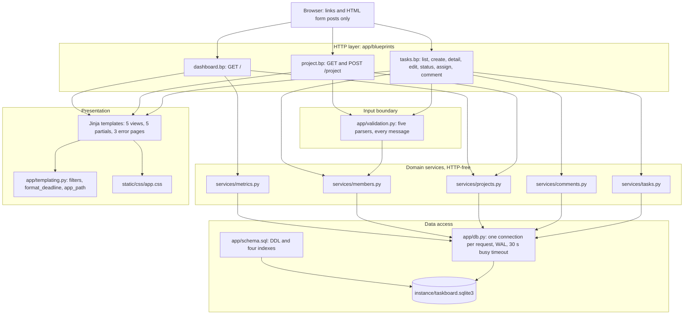

#### Core Technical Approach

- **Application factory, not import-time global state.** `create_app(test_config=None)` is the only place the application is assembled, so the Flask CLI and each test build an application on demand and a test can hand it a temporary database path (`app/__init__.py:90-121`). Nothing runs at import time beyond defining the function.
- **Strict layering with no web objects below the HTTP layer.** Blueprints parse and delegate; `app/services/` imports no Flask object and owns its own parameterized SQL through `app/db.get_db()`; `app/validation.py` takes plain mappings, never `request`. This is what lets the parsers and services be unit-tested with no request and no client (`tests/test_validation.py`).
- **One connection per request.** `get_db()` caches the handle on `flask.g` and teardown closes it, so a page that reads a task, its comments and its assignee uses one handle; `PRAGMA foreign_keys = ON` makes the schema's `REFERENCES` and `ON DELETE CASCADE` real, and WAL plus the 30-second timeout is the read/write contention pair (`app/db.py:1-31`).
- **Schema bootstrap instead of a migration tool.** Executing `app/schema.sql` is idempotent — the file carries its own drops — so start-up creates a missing schema, `init-db` resets the board and `seed-db` restores the sample data through the same DDL (`app/schema.sql:1-14`, `app/db.py`).
- **Derived figures, never stored counters.** The dashboard runs one grouped aggregate plus one `COUNT(*)` per request inside a single read transaction (`app/services/metrics.py`), so no write can leave a stale number on screen.
- **One reference day per request.** `templating.reference_day` reads today once and `services.tasks.list_tasks` accepts it as a keyword, which is why the deadline indicator and the deadline filter cannot disagree about which work is late or imminent (`app/templating.py`, `app/services/tasks.py`).
- **Post/redirect/get for every successful write, in-place re-render for every rejected one.** A success answers 302 with one flash message; a rejection re-renders the same form at 200 with the submitted values retained and one message beside each offending field; a value outside a closed set (the three filters, the two quick actions) answers 400 naming the parameter, and an unknown task id answers 404 before the posted body is inspected (`README.md:229-257`, `app/blueprints/tasks.py`).
- **No JavaScript and no asset pipeline.** Every interaction is a link or a form post, the filter bar submits only through its Apply control, and one 898-line stylesheet holds every design token on `:root` behind `var()` with a single `@media (max-width: 640px)` block (`README.md:368-377`, `app/static/css/app.css`).
- **Escape by default and parameterize everything.** Every template is `.html`, so Jinja autoescaping is on and no template applies `|safe` or `Markup` to a submitted value; every SQL statement binds its values through `sqlite3` (`README.md:472-478`).

### 1.2.3 Success Criteria

#### Measurable Objectives

| Objective | Target as stated in the repository | How it is verified |
|---|---|---|
| The whole product is reachable through one documented HTML contract | Twelve method-and-path shapes over eleven URL rules, all form-encoded, with no `next` or request-supplied redirect target | The route table in `README.md:203-227` against the 11 `@bp.route` decorators in `app/blueprints/` |
| The suite is green and the run itself enforces quality | Zero failures; branch coverage over `app/` at or above `fail_under = 85` with `precision = 2` so an 84.5–85% total cannot round into a pass | `pyproject.toml:7-30`; `python3 -m pytest` on this checkout passed 503 cases in 24.74 s |
| The seeded board is deterministic and exercises every rule | Exactly `Seeded 1 project, 5 members, 12 tasks, 8 comments.`, and a dashboard reading Total 12, Completed 3, Pending 5, In progress 4 | `README.md:123-159`; `tests/test_seed.py`; `tests/test_dashboard.py` |
| A fresh checkout works without a manual setup step | Start-up applies the schema whenever `task` is missing, so an unseeded board renders zero counts and its own empty states | `app/__init__.py:162-172`; `README.md:154-157` |
| One stated message per outcome, asserted verbatim | Success flashes such as "Task created.", "Task updated.", "Status updated to Completed.", "Assignee updated.", "Task unassigned.", "Comment added.", "Project details saved."; empty states "No tasks yet.", "No tasks match these filters.", "No project details yet.", "No comments yet." | `app/blueprints/*.py`; `app/templates/`; message literals duplicated deliberately in `tests/` |
| Every test is isolated from the real database | No test reads or writes `instance/taskboard.sqlite3`; each gets its own file under pytest's `tmp_path` | `tests/conftest.py:1-32` |
| The failure surface stays inside the application shell | 400, 404 and 500 render the application's own pages, including under a malformed `Host`; a read of a write-only task action redirects to that task's page | `app/__init__.py:180-214`; Project Guide Section 4 |

No latency, throughput, availability or data-volume target appears anywhere in the repository. The only time bound the code itself states is the 30-second SQLite busy timeout (`app/db.py:57-62`), and the delivery report's runtime validation is a functional pass over ten flows rather than a performance measurement.

#### Critical Success Factors

| Factor | Why the system's promises depend on it | Where it is enforced |
|---|---|---|
| One home per rule and per vocabulary | The list cell and the detail value, the status badge and the status filter, the deadline indicator and the deadline bucket can only stay in agreement if each reads one definition | `app/models.py`, `app/validation.py`, `app/templating.py` |
| A closed, exhaustive status set | The dashboard's four figures reconcile (Total = Pending + In progress + Completed) only because status cannot hold a fourth value | `app/schema.sql:67-68` |
| A single reference day per request | "Due in N days" and the Due this week filter describe the same seven-day window only if both read the same `today` | `app/templating.py`, `app/services/tasks.py` |
| Post/redirect/get on every successful write | A refresh must re-read a page instead of resubmitting the write | `app/blueprints/*.py` |
| Template-supplied text is never trusted or unescaped | Submitted titles, descriptions and comment bodies render as text | `README.md:472-478` |
| A disposable database | The board can be rebuilt at any time by one idempotent command, so no state in the repository is precious | `seed.py`, `app/db.py`, `.gitignore`'s `instance/` entry |
| Loopback binding | The absence of authentication and CSRF tokens is only acceptable because nothing is reachable from the network | `README.md:147-152`, `README.md:482-495` |

#### Key Performance Indicators

| Indicator | Target or baseline | Observed value |
|---|---|---|
| Automated cases passing | Zero failures | **503 passed, 0 failed** in 24.74 s on this checkout (CPython 3.12.3, Flask 3.1.3); the delivery report records the same 503 cases in 24.83 s |
| Branch coverage over `app/` | ≥ 85%, enforced by the run | **99.62%** recorded against the floor, with the run reporting "Required test coverage of 85.0% reached" |
| Test modules and their scope | One module per risk area | 9 files: `conftest.py` plus `test_dashboard` (25 cases), `test_tasks` (130), `test_comments` (18), `test_filters` (107), `test_validation` (141), `test_project` (28), `test_seed` (38), `test_config` (16) |
| External contract size | Small and fully documented | 12 method-and-path shapes over 11 URL rules across 3 blueprints |
| Dependency surface | Pinned exactly, nothing unpinned | 7 runtime pins and 7 test-time pins (`requirements.txt`, `requirements-dev.txt`) |
| Seeded board reconciliation | Total = Pending + In progress + Completed | 12 = 5 + 4 + 3 (`README.md:159`, `README.md:302-307`) |
| Implementation size | — | 12,159 lines across `app/`, `seed.py` and `tests/`, of which roughly 8,167 lines are the suite |

## 1.3 Scope

The boundary of this release is defined by what a request can reach. Anything a user can do through the application's twelve-endpoint HTTP surface is in scope and verified; everything else is either recorded in the repository as a deliberate exclusion or listed by the delivery report as remaining work. The two lists below separate those cases rather than blurring them.

### 1.3.1 In-Scope

#### Core Features and Functionalities

**Must-have capabilities.** Each of the eight capabilities is a stated project requirement (`README.md:16-35`), has one control, and is exercised by the suite:

| Capability | What must hold | Delivered in |
|---|---|---|
| Create a task | Title required (≤200 characters), description optional (≤2000), assignee, status and deadline accepted; a valid post answers 302 to the new task with the flash "Task created."; an invalid one re-renders the form at 200 and writes nothing | `app/blueprints/tasks.py`, `app/validation.py:98-147` |
| Assign or clear an assignment | The posted id must resolve to a `member` row (an empty value clears it); an unknown id answers 400 naming `assignee_id`; every screen reads "Unassigned" for a task with no assignee | `app/services/tasks.py` (`set_assignee`), `app/services/members.py` |
| Change status | Only `pending`, `in_progress`, `completed` are accepted; every transition is allowed in both directions, so a completed task can be reopened; the flash names the new status | `app/models.py:31-39`, `app/schema.sql:67-68` |
| Set a deadline | Optional, date-only, stored as ISO-8601 `YYYY-MM-DD`; a date earlier than the project start date is rejected with `MSG_DEADLINE_BEFORE_PROJECT_START` | `app/validation.py`, `app/schema.sql:69` |
| Comment on a task | Author must be a member and body is required (≤1000 characters); the conversation renders oldest first with author and timestamp; a missing author or blank body is refused in place | `app/services/comments.py`, `app/validation.py:105-106` |
| Keep the project record | One row with name (≤120 characters), description, start date and end date; an end date before the start date is rejected with nothing written; one upsert covers the first save and every later edit | `app/services/projects.py:63-71`, `app/schema.sql:22-36` |
| Read the dashboard | Total, Completed, Pending and In progress derived per request; each card links into the list filtered to its rows; a board with no tasks reads zeros and "No tasks yet." | `app/services/metrics.py`, `app/templates/dashboard.html` |
| Filter the task list | Status, assignee (including Unassigned) and deadline applied together with `AND` in one parameterized `WHERE`; the result line states how many of how many match; a value outside a control's allowed set answers 400 naming the parameter | `app/services/tasks.py` (`list_tasks`), `app/templates/partials/_filter_bar.html` |

**Primary user workflows.** Each workflow is a path a reviewer can walk in the documented manual checklist (`README.md:379-414`):

| Workflow | Path through the application | Outcome |
|---|---|---|
| Plan work | `/tasks/new` → `POST /tasks` → redirect to `/tasks/<id>` | The task exists, appears in the list and moves the dashboard counts; a rejection keeps every typed value beside its message |
| Hand work over | Task detail or a list row → assignee select → `POST /tasks/<id>/assign` | The assignee line and the list cell update; the flash reads "Assignee updated." or "Task unassigned." |
| Move work forward | A list row's status select or the detail page → `POST /tasks/<id>/status` | The badge, the deadline word and the dashboard figures all follow; a list-origin action returns to the same filters |
| Triage by date | `/tasks?deadline=overdue` (or `today`, `week`, `none`) | Exactly the rows in that bucket; completed work is never listed as overdue |
| Discuss a task | Task detail → comment form → `POST /tasks/<id>/comments` | The comment appears last with its author and timestamp and the row's comment count rises |
| Keep the project record current | `/project` → `POST /project` | The stored details and the dashboard's project panel both show the new values |
| Read the board at a glance | `/` | Four counts, each card linking to the rows behind its number |

**Essential integrations.** There are no external integrations; the four internal contract points are the complete list:

| Integration point | Contract | Source |
|---|---|---|
| `DATABASE` environment variable | Absolute path used as given; a relative one resolved against the repository root; default `instance/taskboard.sqlite3` | `app/config.py:34-35`, `app/config.py:65-95` |
| `SECRET_KEY` environment variable | Signs the session cookie that carries flash messages; a visibly fake development fallback ships so the application starts unconfigured | `app/config.py:29-32`, `app/config.py:55` |
| Flask CLI | `flask --app app run`, `flask --app app init-db`, `flask --app app seed-db` | `app/db.py`, `app/__init__.py:145-147` |
| The SQLite file on disk | Readable and writable by any SQLite tool; rebuilt by `seed-db`, ignored by `.gitignore`'s `instance/` entry | `seed.py:19-22`, `README.md:460-466` |

**Key technical requirements.** These are the constraints a change must not break:

| Requirement | Value or constraint | Source |
|---|---|---|
| Runtime | CPython ≥ 3.12 (`requires-python`), measured on 3.12.3; SQLite 3.45.1 through the standard-library `sqlite3` module | `pyproject.toml:5`, `README.md:42-57` |
| Dependency set | Seven exact runtime pins (Flask 3.1.3 and its closure) and seven exact test-time pins; no ORM, form framework, CSS framework, bundler or external service | `requirements.txt`, `requirements-dev.txt`, `README.md:56-64` |
| HTTP contract | Twelve method-and-path shapes over eleven URL rules, `application/x-www-form-urlencoded` in and HTML out, no JSON endpoint and no request-supplied redirect target | `README.md:203-257`, `app/blueprints/` |
| Driver rules | Every successful write answers 302; every rejected data-entry post re-renders its own form at 200; an out-of-set closed value answers 400 naming the parameter; an unknown task id answers 404 before the body is inspected; an unexpected failure answers 500 in the shell | `app/blueprints/*.py`, `app/__init__.py:180-214` |
| Data integrity | `CHECK (status IN (...))`, `CHECK (id = 1)` on the project, unique member email, `ON DELETE CASCADE` on comments, ISO-8601 date checks in the schema, and `PRAGMA foreign_keys = ON` on every connection | `app/schema.sql`, `app/db.py:122-132` |
| Interface | No JavaScript and no build step; every `.html` template autoescapes; one stylesheet with all values as `:root` custom properties and a single 640 px breakpoint | `README.md:368-377`, `app/static/css/app.css` |
| Quality gate | Branch coverage over `app/` with `fail_under = 85` at `precision = 2`, applied by the default `addopts`; every test on its own temporary database | `pyproject.toml:7-30`, `tests/conftest.py` |

#### Implementation Boundaries

**System boundaries.** The application owns one process, one SQLite file, the folder that holds it, its templates and its stylesheet — nothing else. It starts no background job, holds no queue, makes no outbound network call, accepts no file upload and writes no file other than the database. Its only output channel besides HTML is the CLI's one-line confirmation (`Seeded 1 project, 5 members, 12 tasks, 8 comments.`) and the logging records the factory emits at start-up (`app/__init__.py:41-53`, `app/__init__.py:216-217`).

**User groups covered.** One person at a browser, acting on behalf of any member of the single project's team. The five roles the sample data models — Product Owner, Frontend Engineer, Backend Engineer, Designer and QA Engineer (`seed.py:57-80`) — are all served by the same undifferentiated interface: there is no sign-in, so no session identity, no role check and no distinction between an assignee, a comment author and a browser operator (`README.md:489-495`).

**Geographic and market coverage.** One host, one locale, one clock:

| Dimension | Coverage | Source |
|---|---|---|
| Reachability | Loopback only — every documented command binds `127.0.0.1`; nothing is served on the network | `README.md:147-152` |
| Language | English only; month names come from a fixed tuple rather than the process locale exactly so the rendered date cannot change with the host's `LC_TIME` | `app/templating.py:53-69` |
| Time | Timestamps are stored as UTC text by SQLite and displayed as written, with no time-zone conversion; deadlines are date-only with no clock component | `README.md:323-345` |
| Scale | One SQLite file and one writer at a time, with a read snapshot (WAL) and a 30-second lock wait as the whole contention strategy | `app/db.py:57-62` |

**Data domains included.** Four entities, and only four:

| Entity | Cardinality | Fields of note | Rules |
|---|---|---|---|
| `project` | Exactly one row | `name`, `description`, `start_date`, `end_date`, `created_at`, `updated_at` | `CHECK (id = 1)`; both dates ISO-8601 text for a real day |
| `member` | The five seeded rows | `name`, `role`, `email` (unique), `created_at` | Read-only in the application; `name` and `role` bounded to 1–80 characters in the schema |
| `task` | Unbounded | `title`, `description`, `assignee_id`, `status`, `deadline`, timestamps | Status closed to three values; `assignee_id` nullable means unassigned; `deadline` nullable |
| `comment` | Unbounded | `task_id`, `author_id`, `body`, `created_at` | Author required; `ON DELETE CASCADE` keeps no comment alive after its task |

Four indexes cover the read paths — one each for the status filter and dashboard aggregate, the assignee filter, the deadline buckets and a task's comment list (`app/schema.sql:84-89`).

### 1.3.2 Out-of-Scope

#### Explicit Exclusions

| Excluded capability | Why it is out of scope | Where recorded |
|---|---|---|
| Accounts, sign-in and any authorization layer | A loopback-only test project holds no credential to protect; a session exists only as the signed cookie carrying flash messages | `README.md:489-495`; Project Guide Section 6 (High severity, accepted by design) |
| CSRF tokens | Follows from having no authenticated session to forge | `README.md:489-495` |
| More than one project | `CHECK (id = 1)` makes a second project row impossible, so cross-project reporting cannot exist | `app/schema.sql:23` |
| Member administration (create, edit, deactivate) | "The request names no member administration"; the five members arrive with the sample data | `app/services/members.py:1-4` |
| Task, comment and project deletion | No `DELETE` statement exists anywhere under `app/`; the schema's cascade only tidies comments if a task were ever removed out of band | `app/services/` (no delete path) |
| A JSON or other machine API | "There is no JSON API"; every response is an HTML page and every request is form-encoded | `README.md:203-212` |
| Client-side JavaScript, a build step, a CSS framework | The interface is links and form posts only; one hand-written stylesheet is the entire asset payload | `README.md:62-64`, `README.md:372-377` |
| Search, sorting, pagination and bulk actions | The list has three filters, fixed `ORDER BY t.id`, and no page-size control; there is no search parameter anywhere in the contract | `app/services/tasks.py:231`, `app/blueprints/tasks.py:307` |
| Attachments, notifications, email, comments on anything but a task | No upload handling, no mail transport and no message entity exists | `requirements.txt`, `app/schema.sql` |
| An ORM, a migration framework, import/export tooling | `app/schema.sql` is the whole DDL; the schema is re-applied rather than migrated, and the only load path is the sample dataset | `app/schema.sql:1-14`, `seed.py` |
| A production WSGI server, container, pipeline, monitoring or structured logging | Outside plan scope; the only run mode is Flask's development server and the factory emits two start-up records and nothing else | Project Guide Sections 6 and 8; `app/__init__.py:41-53` |
| Multi-language UI or time-zone conversion | The interface ships in English only and prints stored wall-clock timestamps as written | `app/templating.py:53-69`, `README.md:323-345` |

#### Future Phase Considerations

The delivery report accounts for 196 of 215 scoped hours (91%) and lists nine remaining items totalling 19 hours. Every requirement is delivered; each item is a robustness gap, an accepted caveat or a documentation reconciliation:

| Remaining item | Priority | Hours |
|---|---|---|
| Read the task list's rows and its result count consistently (currently two statements) | High | 2 |
| Answer an exhausted SQLite write-lock timeout without the 500 page | High | 4 |
| Cover the two uncovered lines (`app/db.py:216`, `app/services/members.py:57`) | Medium | 1.5 |
| Enforce the coverage floor per module rather than only in total | Medium | 3 |
| Decide and apply touch-target sizing against the 44 px house figure | Medium | 3 |
| Give the filter-bar form and the per-row status forms accessible names | Low | 1 |
| Reconcile the plan text and README with the delivered interface, file inventory and dataset | Low | 1 |
| Verify the shell's link builder under a `SCRIPT_NAME` URL prefix | Low | 2 |
| Bring changed templates' single-line markup inside the 88-column house width | Low | 1.5 |

Beyond those items, the delivery report states plainly that production posture is new scope rather than unfinished work: accounts and CSRF tokens, a production WSGI server, a pipeline, migrations and monitoring would each have to be added before any shared deployment (Project Guide Section 8).

#### Integration Points Not Covered

- **Reverse-proxy mounting under a URL prefix.** `app_path` is exercised at the root only; the `SCRIPT_NAME` case is untested (Project Guide Section 3, "Not Covered").
- **Any identity provider, SSO or LDAP.** No authentication module exists to integrate one with.
- **Email, chat or webhook notification.** The application produces no outbound event of any kind.
- **Any third-party API, broker or message queue.** Nothing in `requirements.txt` could speak to one.
- **A second database engine.** Data access is `sqlite3`-specific: WAL, `datetime('now')`, `GLOB` checks and `INSERT … ON CONFLICT` are all SQLite constructs (`app/schema.sql`, `app/services/projects.py:63-71`).
- **Import from an existing tracker or export to one.** No serialization, mapping or bulk-load path exists apart from `seed.py`.

#### Unsupported Use Cases

| Scenario | What happens today |
|---|---|
| Two projects tracked side by side | Impossible: the schema admits one project row, and every task's `project_id` either points at it or is `NULL` |
| Two people editing the same board at once, or a write during another write | Writes serialize against the file; a writer that cannot take the lock within 30 seconds ends on the 500 page rather than in a retry |
| Serving the board to a colleague over the network | Nothing is bound beyond `127.0.0.1`; doing so would expose unauthenticated write endpoints with no CSRF defence |
| Distinguishing who did what | No actor is recorded: a task's assignee and a comment's author are form fields, validated against the member table but never tied to a session |
| A deadline time, a recurring task, a subtask, a dependency, a priority or a label | No such field exists in `app/schema.sql`; a deadline is a date with no clock component |
| Undoing a mistaken task or comment | No delete, archive or history path exists — only edit, re-status, reassign and comment |
| Checking rendered appearance, focus order or touch-target sizes automatically | No browser automation exists by design; those are covered by the manual checklist (`README.md:379-414`) |
| Independently running one module below the coverage floor | The floor compares the total only, so a single module can erode while the run stays green (Project Guide Section 1.4) |

## 1.4 References

- `README.md` — the project's external contract and operating manual: the capability list and screen inventory (lines 16-38), the seven runtime pins and the explicit absence of ORM, form or CSS framework, bundler and external service (lines 40-64), the five-command workflow and the two environment variables (lines 66-121), the seed line and idempotency (lines 123-159), the start-up schema bootstrap and the seeded 12/3/5/4 figures (lines 145-159), the twelve-endpoint route table and the response conventions (lines 203-257), the dataset and its reconciling counts (lines 259-317), the interface conventions (lines 319-377), the manual UI checklist (lines 379-414), the project layout and `.gitignore` coverage (lines 416-466), and the security notes including the deliberate absence of accounts and CSRF tokens (lines 468-495).
- `pyproject.toml` — distribution metadata (`taskboard` 0.1.0, one-line description, `requires-python = ">=3.12"`, no license, classifiers, dependencies or build system) and the pytest/coverage configuration (`addopts` with `--cov=app --cov-branch`, `fail_under = 85`, `precision = 2`, branch measurement).
- `requirements.txt` — the seven exact runtime pins and the role noted for each.
- `requirements-dev.txt` — the seven exact test-time pins layered over `requirements.txt` by reference.
- `.gitignore` — the `instance/` and `*.sqlite3*` rules that make the local database disposable, plus the environment, bytecode, build and coverage output that is never committed.
- `seed.py` — `SAMPLE_DATA` and `seed_database(db_path)`: the single project, five members with their roles, twelve tasks, eight comments, offset-based deadlines and the idempotent drop-and-recreate load (module docstring lines 1-23; dataset from line 48).
- `app/__init__.py` — the application factory: configuration, repository-root database resolution, schema bootstrap, the five template globals, blueprint registration, the 400/404/500/405 handlers and the two start-up logging records.
- `app/config.py` — the five-key default mapping, the two environment lookups with their defaults, and `resolve_database_path`'s repository-root resolution.
- `app/db.py` — the single SQLite access point: one connection per request on `flask.g`, `sqlite3.Row`, `PRAGMA foreign_keys = ON`, WAL mode, `BUSY_TIMEOUT_SECONDS = 30.0`, and the `init-db`/`seed-db` commands.
- `app/schema.sql` — the four tables with their `CHECK` constraints (`id = 1`, the three-value status set, ISO-8601 date checks), the `UNIQUE` member email, the comment cascade, and the four read-path indexes.
- `app/models.py` — the four frozen dataclasses and the shared vocabularies `TASK_STATUSES`, `STATUS_LABELS` and `DEADLINE_FILTER_LABELS`.
- `app/validation.py` — the five parsers returning `(values, errors)`, every user-visible message as a constant, `FIELD_LIMITS` (120/200/2000/1000), `ASSIGNEE_UNASSIGNED`, `DEFAULT_STATUS` and the shared member resolution.
- `app/templating.py` — `format_date`, `format_datetime`, `status_label`, `deadline_state`, the `format_deadline` global, the `app_path` global, `reference_day`, and the English-only `MONTHS` tuple.
- `app/blueprints/` — the three blueprints and every route in the HTTP contract (11 `@bp.route` decorators yielding twelve method-and-path shapes) plus the flash messages each successful write emits.
- `app/services/` — the five HTTP-free domain modules and their signatures: `tasks` (`list_tasks` with its `ORDER BY t.id`), `comments`, `projects` (the single `INSERT … ON CONFLICT` upsert), the read-only `members`, and `metrics` (one grouped aggregate plus one `COUNT(*)`).
- `app/templates/` — the page shell, the five views, the five partials and the three in-shell failure pages, including the empty-state strings and the "Unassigned"/"No deadline" fallbacks.
- `app/templates/partials/_filter_bar.html` — the three-filter form whose Apply control is the only submit path.
- `app/static/css/app.css` — 898 lines of hand-written CSS with every value as a `:root` custom property and the single `@media (max-width: 640px)` breakpoint.
- `tests/` — `conftest.py` plus the eight test modules: the per-test temporary database and the `app`, `client` and `seeded_client` fixtures, the read-back discipline, and the 503 cases distributed 25 / 130 / 18 / 107 / 141 / 28 / 38 / 16.
- `tests/conftest.py` — the isolation contract (a SQLite file under `tmp_path` for every test) and the fixtures built on Flask's own test client.
- `blitzy/documentation/Project Guide - edb81910-6bfc-43b6-9d36-98820f6a276c.md` — the delivery report and operator manual: the 196 of 215 hours (91%) and 52 scoped requirements, the 503-case / 99.62% coverage run, the nine open items (19 hours), the accept/exception compliance matrix and its sixteen documented divergences, the risk register, the runtime validation including the "ready as a local, single-user test application" verdict, and the "Not Covered" list.

No external web sources were consulted; every statement in this section rests on the repository sources listed above.

# 2. Product Requirements

## 2.1 Feature Catalog

This section decomposes Taskboard into the seventeen features the repository actually delivers, and states each one as a testable record. The inventory is not invented: it is the union of the eight capabilities the product states for itself (`README.md:16-35`), the twelve method-and-path shapes of its HTTP contract (`README.md:203-227`), the five screens and three failure pages it ships (`app/templates/`), and the two CLI commands plus the start-up bootstrap that make the board exist (`app/db.py`, `app/__init__.py:162-172`). Nothing outside that evidence appears here; capabilities the repository excludes are recorded in Section 1.3.2 and are not features.

**Conventions used throughout Section 2.**

| Convention | Rule |
|---|---|
| Feature ID | `F-001` to `F-017`, assigned in the order the product's own capability list states them, then the supporting features. Every requirement under a feature is `F-XXX-RQ-YYY`, three digits in both parts, so an ID is stable and greppable. |
| Priority | **Critical** — a capability the product is defined by, whose absence would make the delivered board a different product. **High** — required for the contract's integrity (a rule, a recovery path, an operator entry point) but not itself one of the stated capabilities. **Medium** — a recovery or collateral behaviour whose loss degrades the experience without breaking a stated capability. |
| Status | All seventeen features read **Completed**: each is implemented in the files cited and exercised by `tests/`. The summary in Section 2.1.1 omits the column only because the value is uniform; every feature record states it. |
| Priority and complexity in requirement tables | Rendered as one cell, `<Must-Have\|Should-Have\|Could-Have> / <High\|Medium\|Low>`, so each table stays inside the four-column limit. |
| Evidence | Each record cites the file paths and line ranges that establish it. Where a behaviour is stated in the README as a promise, the code that keeps the promise is cited beside it. |

Feature groups follow the screen and layer boundaries the code already has, so a reader can move from a feature to its implementation in one step: task lifecycle (`app/blueprints/tasks.py`, `app/services/tasks.py`), workflow control (assignment, status, deadline), collaboration and the project record, reporting and discovery, integrity and resilience, operations and the data lifecycle, and the interface plus the verification suite.


### 2.1.1 Catalog Summary

| ID | Feature Name | Category | Priority |
|---|---|---|---|
| F-001 | Task Creation | Core Task Management | Critical |
| F-002 | Task Editing | Core Task Management | High |
| F-003 | Task Listing and Detail Viewing | Core Task Management | Critical |
| F-004 | Task Assignment and Unassignment | Workflow Control | Critical |
| F-005 | Task Status Transitions | Workflow Control | Critical |
| F-006 | Deadline Capture | Workflow Control | High |
| F-007 | Deadline State Presentation | Workflow Control | High |
| F-008 | Task Comments | Collaboration | Critical |
| F-009 | Project Record Management | Collaboration | Critical |
| F-010 | Dashboard Metrics | Reporting | Critical |
| F-011 | Task List Filtering | Reporting | Critical |
| F-012 | Submission Validation and Rejection Rendering | Data Integrity | Critical |
| F-013 | HTTP Error Handling and Method Recovery | Resilience | Medium |
| F-014 | Database Lifecycle and Sample Dataset | Operations | High |
| F-015 | Configuration and Start-up Diagnostics | Operations | High |
| F-016 | Presentation Conventions and Accessibility | Interface | High |
| F-017 | Automated Verification and Coverage Gate | Quality | High |

Every stated capability maps to exactly one primary feature, which is how the catalog stays closed against the requirement list it comes from:

| Stated capability (`README.md:19-35`) | Feature | HTTP control that delivers it |
|---|---|---|
| Create a task with a title, optional description, assignee, status and deadline | F-001 | `GET /tasks/new`, `POST /tasks` |
| Assign a task to a team member, or clear the assignment | F-004 | `POST /tasks/<id>/assign`, plus `assignee_id` on both forms |
| Update a task's status through the closed set of three values | F-005 | `POST /tasks/<id>/status`, plus `status` on both forms |
| Set an optional, date-only deadline | F-006 | `deadline` on `POST /tasks` and `POST /tasks/<id>` |
| Add a comment attributed to a team member | F-008 | `POST /tasks/<id>/comments` |
| Keep the project details — name, description, start and end date | F-009 | `GET`/`POST /project` |
| Read four dashboard counts, each linking into its rows | F-010 | `GET /` |
| Filter the task list by status, assignee and deadline | F-011 | `GET /tasks?status=&assignee=&deadline=` |

Three features exist because the eight capabilities cannot be delivered without them rather than because the capability list names them: F-012 (every field rule and every message), F-003 (the list and detail pages the other features act through, and the read half of both save pairs), and F-007 (the deadline indicator, which the product specifies as its own wording and window). F-002 is promoted on the same grounds: the twelve-endpoint contract carries a dedicated edit pair (`GET /tasks/<id>/edit` and `POST /tasks/<id>`), so editing a stored task is a contract feature and not merely a second use of creation.


### 2.1.2 Task Lifecycle Features

The three features below are the read and write halves of the task entity itself. They share one projection (`_TASK_SELECT` in `app/services/tasks.py:93-100`), so a task reads identically in the list, on the detail page and after a write.

**F-001 · Task Creation** — *Core Task Management · Critical · Completed*

| Field | Value |
|---|---|
| Feature ID | F-001 |
| Feature Name | Task Creation |
| Category | Core Task Management |
| Priority | Critical |
| Status | Completed |
| Overview | A reviewer opens `GET /tasks/new`, receives a form whose Status select is already set to Pending, and stores the task with `POST /tasks` (`app/blueprints/tasks.py:353-385`). Five fields are accepted: `title` (required, ≤200 characters), `description` (optional, ≤2000), `assignee_id` (optional, resolved against the `member` table), `status` (closed set, default `pending`) and `deadline` (optional ISO-8601 date). |
| Business Value | This is the entry point of the product's whole value chain: no other feature has anything to act on until a task exists. The board's counts, filters and conversations are all derived from `task` rows this feature writes. |
| User Benefits | One short form creates work in a single step; every field except the title is optional, so a task can be captured in seconds and refined later through F-002, F-004, F-005 and F-006. A rejected submission returns the same form with the typed values intact and one message beside the offending field (`app/validation.py:542-604`). |
| Technical Context | The view tests `request.method != "POST"` rather than `== "GET"` because Flask adds HEAD to every GET rule, so a HEAD probe receives the form and not the write branch. `parse_task_form(request.form, projects.get_project())` is the only parser call; `tasks.create_task` is the only service call; the accepted write flashes `Task created.` and answers 302 to `url_for("tasks.detail", task_id=task.id)`. The parser produces no `project_id`: a task is attached to the current project record by the service at insert time (`app/services/tasks.py:285-301`), or to `NULL` when no project exists yet. |
| Prerequisite Features | None. Task creation is the only feature with no prerequisite; it works on a freshly bootstrapped empty database (`app/db.py:196-218`). |
| System Dependencies | `app/validation.py` (parsing and messages), `app/services/tasks.py` (`create_task`), `app/services/projects.py` (`get_project`, for the deadline rule), `app/services/members.py` (`get_member`, for the assignee check), `app/schema.sql` (`task` table and status `CHECK`). |
| External Dependencies | Flask 3.1.3 (routing, `flash`, `redirect`, `url_for`) and the standard-library `sqlite3` — both pinned in `requirements.txt`. No external service is contacted. |
| Integration Requirements | Registered on the `tasks` blueprint with no `url_prefix`; the create link and the form action are built with `url_for("tasks.create")` and `url_for("tasks.create", _method="POST")` so the read rule and the write rule are reached from one endpoint name (`app/templates/tasks/form.html:72`, `app/templates/dashboard.html:69`). |

**F-002 · Task Editing** — *Core Task Management · High · Completed*

| Field | Value |
|---|---|
| Feature ID | F-002 |
| Feature Name | Task Editing |
| Category | Core Task Management |
| Priority | High |
| Status | Completed |
| Overview | `GET /tasks/<id>/edit` renders the form prefilled from the stored row and `POST /tasks/<id>` saves an edited one (`app/blueprints/tasks.py:411-443`). The same five fields as F-001 are accepted through the same parser, so the two forms cannot enforce different rules. |
| Business Value | Without an edit path a task's title, description or deadline would be fixed at creation, which would make F-006 a create-time-only constraint and would leave a mistyped title permanently wrong in a product that has no delete. |
| User Benefits | The stored values arrive already filled in, so a correction touches one field. A rejected edit re-renders the form at 200 with the submitted values, the per-field messages and the stored task still behind the heading. |
| Technical Context | The task is read before the method is inspected, so an unknown id is the 404 page whether the reviewer is opening the form or posting a corrected one. `tasks.update_task` binds all five fields plus `updated_at = datetime('now')`; an omitted or empty `status` is written as `pending` rather than left alone, because SQLite applies a column `DEFAULT` on `INSERT` only (`app/services/tasks.py:310-345`). The accepted write flashes `Task updated.` and answers 302 to the detail page. |
| Prerequisite Features | F-001 (a task must exist), F-003 (the detail page is the redirect target and carries the Edit link). |
| System Dependencies | `app/validation.py` (`parse_task_form`), `app/services/tasks.py` (`get_task`, `update_task`), `app/services/projects.py` (`get_project`), `app/models.py` (`Task`). |
| External Dependencies | Flask 3.1.3 and the standard-library `sqlite3`. |
| Integration Requirements | The read and write rules are two shapes over one path pair (`/tasks/<id>/edit` and `/tasks/<id>`), registered on the `tasks` blueprint beside F-001's pair; the form action is `url_for("tasks.edit", task_id=..., _method="POST")`. |

**F-003 · Task Listing and Detail Viewing** — *Core Task Management · Critical · Completed*

| Field | Value |
|---|---|
| Feature ID | F-003 |
| Feature Name | Task Listing and Detail Viewing |
| Category | Core Task Management |
| Priority | Critical |
| Status | Completed |
| Overview | `GET /tasks` renders the whole board as a table with a filter bar and a result line; `GET /tasks/<id>` renders one task with its status and assign controls and its comment conversation (`app/blueprints/tasks.py:307-345`, `:388-404`). An unknown id is the 404 page. |
| Business Value | This is where the board is read. Every other capability either acts from one of these two screens or returns to one: the quick actions are posted from a list row or the detail page, and every successful write redirects to the detail page or back to the filtered list. |
| User Benefits | The list answers "what is the state of this project" in one screen — status badge, assignee, deadline with its relative word, comment count — and the detail page answers "what is this task" with its full description and conversation. Both render from the same projection, so a row and its detail page never disagree. |
| Technical Context | The list reads `parse_task_filters(request.args)`, then `tasks.list_tasks(filters, today=reference_day())`, `members.list_members()` for the filter bar's select and `metrics.total_task_count()` for the "N of M tasks" line — one `COUNT(*)` rather than a second dashboard aggregate. The detail view calls `tasks.get_task`, `comments.list_comments` and `members.list_members`. Both pages render the deadline through the `format_deadline` global, so the word beside a date is decided in `app/templating.py:259-301` only. |
| Prerequisite Features | F-001 for content; F-016 for the rendering vocabulary both screens use. |
| System Dependencies | `app/services/tasks.py` (`list_tasks`, `get_task`), `app/services/comments.py` (`list_comments`), `app/services/members.py` (`list_members`), `app/services/metrics.py` (`total_task_count`), `app/templating.py` (`reference_day`, `format_deadline`), `app/templates/tasks/list.html`, `app/templates/tasks/detail.html`, `app/templates/partials/_task_table.html`. |
| External Dependencies | Flask 3.1.3 and the standard-library `sqlite3`; no pagination, search or sorting dependency exists. |
| Integration Requirements | The table partial is the single owner of a row's markup, including the per-row status form and both empty states; the list template deliberately restates neither (`app/templates/tasks/list.html:23-38`). The list's result-line count uses `tasks|length` for matches and `total_count` for the board, so the two numbers cannot be confused. |


### 2.1.3 Assignment, Status and Deadline Features

Assignment, status and deadline are the three attributes a task carries besides its text. Each has a write path and a shared rendering, and each is defined once — in `app/models.py` for the vocabulary, `app/validation.py` for the rule, `app/services/tasks.py` for the statement and `app/templating.py` for the wording.

**F-004 · Task Assignment and Unassignment** — *Workflow Control · Critical · Completed*

| Field | Value |
|---|---|
| Feature ID | F-004 |
| Feature Name | Task Assignment and Unassignment |
| Category | Workflow Control |
| Priority | Critical |
| Status | Completed |
| Overview | A task carries at most one assignee, chosen from the five `member` rows. Three controls write it — the `assignee_id` field on the create and edit forms, and the assign select on the detail page posted to `POST /tasks/<id>/assign` (`app/blueprints/tasks.py:478-513`) — and an empty value is how an assignment is cleared. |
| Business Value | The board's central question is who owns a piece of work. Assignment also makes the assignee filter (F-011) meaningful and supplies the one row the sample data leaves unassigned, which proves the "Unassigned" state end to end (`seed.py:251-261`). |
| User Benefits | Handing work over is one select and one button, from either the list or the detail page, and the change is confirmed in words: `Assignee updated.` or `Task unassigned.`. A task nobody owns reads "Unassigned" on every screen instead of showing a blank cell. |
| Technical Context | The id is resolved by `app.validation.resolve_member_id`, the same rule the task form's Assignee field, the assignee filter and the comment author go through, so all four controls accept exactly the same spellings (`app/validation.py:334-376`). A non-empty value that resolves to no member answers 400 with the description `assignee_id: Select a team member from the list.`, decided after the 404 check and before the write. `tasks.set_assignee` binds `member_id` directly, so clearing is `None` rather than a second statement (`app/services/tasks.py:370-389`). |
| Prerequisite Features | F-001 (a task exists), F-003 (the rows and screens that host the controls). |
| System Dependencies | `app/services/members.py` (`get_member`, `list_members`), `app/services/tasks.py` (`set_assignee`), `app/validation.py` (`resolve_member_id`), `app/schema.sql` (`assignee_id INTEGER REFERENCES member(id)`, nullable). |
| External Dependencies | None beyond Flask's form parsing and `sqlite3`. |
| Integration Requirements | `PRAGMA foreign_keys = ON` must be set on the connection (`app/db.py:128`) for the `REFERENCES member(id)` clause to be enforced; the sample loader enables it for its own connection for the same reason (`seed.py:353`). |

**F-005 · Task Status Transitions** — *Workflow Control · Critical · Completed*

| Field | Value |
|---|---|
| Feature ID | F-005 |
| Feature Name | Task Status Transitions |
| Category | Workflow Control |
| Priority | Critical |
| Status | Completed |
| Overview | A task holds exactly one of `pending`, `in_progress` or `completed`, and moves between them by the `status` field on the two forms, the per-row select on the list (`app/templates/partials/_task_table.html:97`) or the status form on the detail page posted to `POST /tasks/<id>/status` (`app/blueprints/tasks.py:446-475`). Every transition is allowed in both directions, so completed work can be reopened. |
| Business Value | The closed, exhaustive status set is what makes the dashboard's four figures reconcile: Total always equals Pending + In progress + Completed. It is the schema's `CHECK (status IN (...))` that guarantees the three buckets are mutually exclusive and exhaustive (`app/schema.sql:67-68`), not the interface's discipline. |
| User Benefits | One select moves work forward or back, from the list or the detail page, and the confirmation names the new state: `Status updated to Completed.` A list-origin change returns the reviewer to the same filtered list rather than to the detail page. |
| Technical Context | `is_valid_status` answers a value outside the set with 400 and the description `status: Select a valid status.`, after the task read (404) and before the write. `tasks.set_status` stores the value as given and re-reads the row, so the response shows stored state. Because the dashboard recomputes counts per request (F-010), a status change cannot leave a stale figure anywhere on screen. |
| Prerequisite Features | F-001, F-003. |
| System Dependencies | `app/models.py` (`TASK_STATUSES`, `STATUS_LABELS`), `app/schema.sql` (status `CHECK` and `idx_task_status`), `app/services/tasks.py` (`set_status`), `app/services/metrics.py` (the aggregate a change moves). |
| External Dependencies | None. |
| Integration Requirements | The status vocabulary is published to Jinja as a global (`app/__init__.py:154-160`), so the three templates that offer a status select iterate the same tuple the parser and the schema enforce. |

**F-006 · Deadline Capture** — *Workflow Control · High · Completed*

| Field | Value |
|---|---|
| Feature ID | F-006 |
| Feature Name | Deadline Capture |
| Category | Workflow Control |
| Priority | High |
| Status | Completed |
| Overview | A task's deadline is optional, date-only and stored as ISO-8601 `YYYY-MM-DD` text. It is submitted by the `deadline` field on the create and edit forms and validated in `app/validation.py:421-451`. |
| Business Value | Deadlines are what the last two dashboard-adjacent behaviours are built on: the Overdue, Due today, Due this week and No deadline filters (F-011) and the deadline indicator (F-007). Without a stored date there is nothing to bucket or to describe. |
| User Benefits | A deadline can be set at creation or added later, and can be left blank. A date that cannot be read comes back beside the field as `Enter a valid date (YYYY-MM-DD).` with the typed text still in place, and a deadline before the project start is refused with `Deadline cannot be earlier than the project start date.` |
| Technical Context | `parse_iso_date` requires exactly ten characters, ASCII digits and hyphens at positions 4 and 7 before `date.fromisoformat` is tried, because that call also accepts `20261026` and the ISO week form `2026-W43-1`, neither of which compares correctly as stored text (`app/validation.py:196-257`). The lower bound is the project's `start_date` and is compared as parsed dates, not text; a deadline later than the project's `end_date` is accepted, because the end date describes the project rather than limiting it. While no project record exists, no start date constrains the deadline. |
| Prerequisite Features | F-001 (the create form is one of the two capture points). |
| System Dependencies | `app/validation.py` (`parse_iso_date`, `_deadline_value`), `app/services/projects.py` (`get_project`, for the start date), `app/schema.sql` (`deadline` `GLOB` check and `idx_task_deadline`). |
| External Dependencies | None; the browser's `type="date"` input is a hint that the server-side rule does not rely on (`app/templates/tasks/form.html:118`). |
| Integration Requirements | The parser accepts a `models.Project | None`, so a task can be created before the project details are recorded; the project record's own dates are validated separately by F-009. |

**F-007 · Deadline State Presentation** — *Workflow Control · High · Completed*

| Field | Value |
|---|---|
| Feature ID | F-007 |
| Feature Name | Deadline State Presentation |
| Category | Workflow Control |
| Priority | High |
| Status | Completed |
| Overview | Every deadline renders as its absolute date plus, for unfinished work inside a seven-day window, one relative word: `Overdue`, `Due today` or `Due in N days`. The whole indicator is produced by the `format_deadline` global, with the CSS modifier supplied by the `deadline_state` filter (`app/templating.py:222-301`). |
| Business Value | The product states that a deadline's word and the Due this week filter must never disagree about which work is imminent. Both read one definition — `SOON_WINDOW_DAYS = 6` in `app/templating.py:75` and `_WEEK_WINDOW_DAYS = 6` in `app/services/tasks.py:81` — so the filter and the indicator describe the same seven days (`README.md:334-345`). |
| User Benefits | A row's date says what it means without arithmetic: finished work shows only its date, because finished work is not late; a task with no deadline reads "No deadline" rather than a blank cell; an unreadable stored value is shown as stored so the reviewer can see what the row actually holds. |
| Technical Context | `deadline_state` returns `overdue`, `today`, `soon` or the empty string, and suppresses every state for a `completed` task. `format_deadline` joins date and word with the middle dot `\u00b7`, using the count form `Due in 1 days`, which is the wording the interface specifies. Both read `reference_day()`, which caches today on `flask.g`, so a list rendered across midnight labels every row against one day and the filter that selected a row measured from the same value. |
| Prerequisite Features | F-006 (there must be a stored deadline). |
| System Dependencies | `app/templating.py` (`reference_day`, `deadline_state`, `format_deadline`, `MONTHS`), `app/static/css/app.css` (the `.deadline--overdue`, `--today`, `--soon` modifiers), `app/templates/partials/_task_table.html:87`, `app/templates/tasks/detail.html:75`. |
| External Dependencies | None; month names come from a fixed tuple rather than `strftime("%b")` so the rendered date cannot follow the host locale. |
| Integration Requirements | The task list and the detail page both render `format_deadline`, so a deadline reads identically on both; the deadline filter passes the same `reference_day()` value into `list_tasks(today=...)`. |


### 2.1.4 Collaboration and Project Features

**F-008 · Task Comments** — *Collaboration · Critical · Completed*

| Field | Value |
|---|---|
| Feature ID | F-008 |
| Feature Name | Task Comments |
| Category | Collaboration |
| Priority | Critical |
| Status | Completed |
| Overview | Each task carries a conversation of comments, each written on the detail page and posted to `POST /tasks/<id>/comments` with two fields: `author_id` (required, one of the `member` rows) and `body` (required, ≤1000 characters) (`app/blueprints/tasks.py:516-541`, `app/validation.py:607-636`). |
| Business Value | The product's only record of discussion and of why work is in its current state. Because there are no accounts, the author is an explicit form field validated against the member table — which is also why the feature can attribute a comment without a session (`README.md:489-495`). |
| User Benefits | The conversation reads oldest first, each entry with its author's name and its timestamp in the interface's one date format. A missing author or a blank body is refused in place with the typed body preserved, and a task with no comments says "No comments yet." rather than showing an empty section. |
| Technical Context | `comments.list_comments` joins `member` for `author_name` and orders `created_at ASC, id ASC`, so two comments written in the same second still come back deterministically (`app/services/comments.py:41-43`). `comments.add_comment` checks the task exists before inserting, so an unknown task is `None` rather than a foreign-key exception; the row is re-read after commit to pick up the database-written timestamp. The list's comment count comes from a correlated subquery inside the shared `_TASK_SELECT` projection, so no per-row query is issued. |
| Prerequisite Features | F-001 (a task exists), F-003 (the detail page hosts the form and the list shows the count). |
| System Dependencies | `app/services/comments.py`, `app/validation.py` (`parse_comment_form`), `app/services/members.py` (author existence), `app/schema.sql` (`comment` table, `idx_comment_task`, `ON DELETE CASCADE`), `app/templating.py` (`format_datetime`). |
| External Dependencies | None. |
| Integration Requirements | The member existence check is shared with F-004 through `_resolve_member`, so the author select and the assignee select accept the same values; the seeded comments give the ordering and the count real content (`seed.py:93-260`). |

**F-009 · Project Record Management** — *Collaboration · Critical · Completed*

| Field | Value |
|---|---|
| Feature ID | F-009 |
| Feature Name | Project Record Management |
| Category | Collaboration |
| Priority | Critical |
| Status | Completed |
| Overview | The application keeps exactly one project record with four editable fields — `name` (required, ≤120 characters), `description` (optional, ≤2000), `start_date` and `end_date` (both required ISO dates) — viewed and saved at `GET`/`POST /project` (`app/blueprints/project.py:71-103`, `app/validation.py:476-539`). |
| Business Value | The project record is both the board's identity and a rule input: its `start_date` is the floor a task deadline may not precede (F-006). It is the one record in the product that is edited in place rather than as a row of a table. |
| User Benefits | One screen shows and edits the project's details; a first save and every later save take the same action, and the confirmation `Project details saved.` follows either. The dashboard's project panel shows the same four values through the same `format_date` filter, so the two screens cannot disagree. |
| Technical Context | One statement does both cases: `INSERT ... ON CONFLICT(id) DO UPDATE SET name = ..., description = ..., start_date = ..., end_date = ..., updated_at = datetime('now')`, with `created_at` deliberately absent from the update list (`app/services/projects.py:68-75`, `:91-131`). The row is pinned by `_PROJECT_ID = 1` and by the schema's `CHECK (id = 1)`, so "one project" is a rule rather than a convention. `end_date` before `start_date` is rejected only when both dates parsed, so the reviewer sees one message per field. |
| Prerequisite Features | None for the first save; F-003 for the dashboard panel that renders the stored values. |
| System Dependencies | `app/services/projects.py` (`get_project`, `save_project`), `app/validation.py` (`parse_project_form`), `app/schema.sql` (`project` table, `CHECK (id = 1)`, date `GLOB` checks, `GLOB`-and-`date()` validity), `app/templates/project.html`. |
| External Dependencies | SQLite 3.24 or later for `ON CONFLICT … DO UPDATE`; the pinned runtime is 3.45.1 (`README.md:56-57`). |
| Integration Requirements | `check_same_thread`/serialization is not involved: the save runs inside the request's single connection from `app/db.get_db()`. While no project row exists, the page renders an empty form rather than "None", because `_values_from(None)` returns empty strings (`app/blueprints/project.py:38-68`). |


### 2.1.5 Reporting and Discovery Features

**F-010 · Dashboard Metrics** — *Reporting · Critical · Completed*

| Field | Value |
|---|---|
| Feature ID | F-010 |
| Feature Name | Dashboard Metrics |
| Category | Reporting |
| Priority | Critical |
| Status | Completed |
| Overview | `GET /` renders four counts — Total tasks, Completed, Pending and In progress — where each card is a link into the task list filtered to the rows behind it, alongside a create control and the project panel (`app/blueprints/dashboard.py:37-55`, `app/templates/dashboard.html`). |
| Business Value | The dashboard is the product's first screen and its only at-a-glance view. It is also the reconciliation proof for the whole data model: because status is closed to three values, Total always equals Pending + In progress + Completed, and the seeded board reads 12 = 5 + 4 + 3 (`README.md:302-307`). |
| User Benefits | One number per question, each click-through to the rows: Completed opens `/tasks?status=completed`, Total opens the unfiltered list. A board with no tasks reads four zeros and "No tasks yet." with a create control, and the project panel states its own empty condition independently. |
| Technical Context | `metrics.dashboard_metrics()` returns exactly the keys `total`, `completed`, `pending` and `in_progress`, taken from `TASK_STATUSES` so an empty bucket is `0` and never absent (`app/services/metrics.py:43-117`). The figures are derived on every request from one grouped aggregate plus one `COUNT(*)`, run inside a single `BEGIN DEFERRED` read snapshot that the service opens only when the caller has no transaction open — so nothing stored can go stale. The template performs no arithmetic and holds no literal figure. |
| Prerequisite Features | F-001 and F-005 (rows and their statuses are the inputs). |
| System Dependencies | `app/services/metrics.py`, `app/services/projects.py` (`get_project` for the panel), `app/schema.sql` (`idx_task_status`), `app/templates/partials/_metric_card.html`. |
| External Dependencies | None. |
| Integration Requirements | The card links pass the database enum values (`completed`, `pending`, `in_progress`) that `parse_task_filters` accepts, so a card's link is always a valid filter request (F-011). |

**F-011 · Task List Filtering** — *Reporting · Critical · Completed*

| Field | Value |
|---|---|
| Feature ID | F-011 |
| Feature Name | Task List Filtering |
| Category | Reporting |
| Priority | Critical |
| Status | Completed |
| Overview | The task list accepts three optional query parameters — `status`, `assignee` and `deadline` — applied together with `AND` in one `WHERE` clause and carried in the query string so a filtered list can be linked and survives a row's status change (`app/services/tasks.py:129-234`, `app/validation.py:639-691`). |
| Business Value | Filtering is how the board answers the questions the counts raise: which work is late, whose work it is, what is due this week. Keeping the filters in the URL rather than in the session is what makes a filtered list addressable and what lets the two quick actions return the reviewer to the exact view they acted from. |
| User Benefits | Three selects and one Apply button; the result line states how many of how many match ("3 of 12 tasks match these filters"), a filter that matches nothing says "No tasks match these filters." with a Clear filters link, and the Overdue bucket never lists finished work. |
| Technical Context | Allowed values are closed sets: `STATUS_FILTERS` = `TASK_STATUSES`, `assignee` = a member id or the sentinel `unassigned`, `deadline` ∈ {`overdue`, `today`, `week`, `none`}. An absent or empty value is a legitimate "All" and applies no clause; any other out-of-set value is a malformed request answered with 400 naming the parameter (`Invalid value for filter 'status'.`). The buckets are predicates, not comparisons: overdue is `deadline < today AND status <> 'completed'`, week is `today <= deadline <= today + 6`, and `list_tasks` raises `ValueError` on an unrecognised bucket so the query can never fail open into an unfiltered read. Every value is bound, and the only string assembly is fixed clause fragments joined with `AND`. |
| Prerequisite Features | F-003 (the list this feature narrows), F-005 and F-006 (the stored values it filters on), F-007 (the same reference day). |
| System Dependencies | `app/services/tasks.py` (`list_tasks`, `_WEEK_WINDOW_DAYS`), `app/validation.py` (`parse_task_filters`, `DEADLINE_FILTERS`, `ASSIGNEE_UNASSIGNED`), `app/models.py` (`DEADLINE_FILTER_LABELS`), `app/templates/partials/_filter_bar.html`. |
| External Dependencies | None. |
| Integration Requirements | The filter bar is a GET form with an explicit Apply control — no select submits itself. The two quick actions carry the applied filters back as `filter_status`, `filter_assignee` and `filter_deadline` and re-validate them with this same parser before writing, so the redirect target is rebuilt from validated values and never taken from the request. |


### 2.1.6 Integrity and Resilience Features

**F-012 · Submission Validation and Rejection Rendering** — *Data Integrity · Critical · Completed*

| Field | Value |
|---|---|
| Feature ID | F-012 |
| Feature Name | Submission Validation and Rejection Rendering |
| Category | Data Integrity |
| Priority | Critical |
| Status | Completed |
| Overview | Every submission the application accepts — the task create and edit forms, the comment form, the project form and the three task-list filters — is read by one module, `app/validation.py`, which returns a pair `(values, errors)`: typed values for the service, and one message per offending field for the form (`app/validation.py:1-42`). |
| Business Value | The product promises that a rejected write changes nothing and that the reviewer corrects one field rather than retyping the form. Both promises hold because rejection is decided before any service call, and because the parser returns the submitted text as well as the messages, so the re-rendered form keeps what was typed. |
| User Benefits | Inline, field-level feedback with the offending input preserved: `Enter a task title.`, `Task titles are limited to 200 characters.`, `Enter a valid date (YYYY-MM-DD).`, `End date cannot be earlier than the start date.`, `Select a comment author.` Each message is linked to its control through `aria-describedby` and `aria-invalid`, so the error is announced with the field. |
| Technical Context | Bounds live once, as module constants and as `FIELD_LIMITS` published to Jinja, so a form's `maxlength` cannot disagree with the sentence beside it: project name 120, task title 200, description 2000, comment body 1000. `_trim` removes surrounding whitespace and the NUL character before measuring, because SQLite's text functions end a value at a NUL and the stored string must equal the one the parser accepted. Only `messages` are literals: "errors empty" is the single success signal, so no caller tests whether `values` looks complete. The module imports no Flask object and executes no SQL; its one service call is the read-only `members.get_member` used by the three member-resolving controls (`app/validation.py:24-41`). |
| Prerequisite Features | None; every write feature (F-001, F-002, F-008, F-009) and the filtering feature (F-011) depends on it. |
| System Dependencies | `app/models.py` (vocabularies), `app/services/members.py` (`get_member`), `app/templates/partials/_field_errors.html` (the message markup and its ARIA wiring), `app/templates/tasks/form.html`, `app/templates/project.html`, `app/templates/tasks/detail.html`. |
| External Dependencies | None. |
| Integration Requirements | The same parser serves the callers that must agree: `parse_task_form` backs both the create and the edit form, and `resolve_member_id` backs the assignee field, the assignee filter, the comment author and the assign quick action. Filters are the one shape whose errors a view answers differently — a 400 page rather than a re-rendered form. |

**F-013 · HTTP Error Handling and Method Recovery** — *Resilience · Medium · Completed*

| Field | Value |
|---|---|
| Feature ID | F-013 |
| Feature Name | HTTP Error Handling and Method Recovery |
| Category | Resilience |
| Priority | Medium |
| Status | Completed |
| Overview | The application renders its own 400, 404 and 500 pages inside the page shell, and redirects a read of a write-only task action to that task's page (`app/__init__.py:182-214`, `app/templates/errors/`). |
| Business Value | The failure surface stays inside the product: a malformed filter, an unknown task id or an unexpected exception shows a page with the navigation, the reason and a way back, rather than Werkzeug's bare page or a traceback. This is also what keeps the shell usable when a request arrives with a `Host` header the URL adapter cannot encode. |
| User Benefits | Each page states what happened and offers the way out — `Back to the dashboard`, and for a 404 also `Back to tasks`. A bookmark or reload of `/tasks/<id>/status` (a POST-only address) lands on the task it belongs to instead of a 405 page outside the shell. |
| Technical Context | Handlers are registered on the application object rather than a blueprint, because an error raised while building a URL, or before a blueprint is chosen, must still reach them. The 405 handler matches the request path against the application's own URL map as the POST it would answer (`_task_id_for_write_action`), and only for the three write-only endpoints `tasks.set_assignee`, `tasks.set_status` and `tasks.add_comment`; it trusts `arguments["task_id"]` only when it is an `int`, and every other method mismatch keeps Werkzeug's default response because no page for it is part of the product. The error pages build their links with the `app_path` global, which binds the URL map to the literal server name `localhost` and therefore does not read the request's `Host` (`app/templating.py:304-330`). |
| Prerequisite Features | F-016 (the shell and `app_path`). |
| System Dependencies | `app/__init__.py` (the four handlers), `app/templates/errors/400.html`, `404.html`, `500.html`, `app/templating.py` (`app_path`), Werkzeug 3.1.9 (`HTTPException`). |
| External Dependencies | Werkzeug's exception classes only; no page is served by an external error service. |
| Integration Requirements | The 400 page's description is supplied by the raising site — the filter parser's message, or the quick actions' `<parameter>: <sentence>` form — so the page names the parameter the request got wrong (`app/blueprints/tasks.py:104-190`). |


### 2.1.7 Operations and Data Lifecycle Features

**F-014 · Database Lifecycle and Sample Dataset** — *Operations · High · Completed*

| Field | Value |
|---|---|
| Feature ID | F-014 |
| Feature Name | Database Lifecycle and Sample Dataset |
| Category | Operations |
| Priority | High |
| Status | Completed |
| Overview | Three paths build the database, all through the same DDL: the factory applies the schema at start-up when the `task` table is missing (`app/db.py:196-218`), `flask --app app init-db` drops and recreates it (`app/db.py:249-254`), and `flask --app app seed-db` rebuilds it and loads one project, five members, twelve tasks and eight comments (`app/db.py:257-280`, `seed.py:322-449`). |
| Business Value | A fresh checkout serves the dashboard, the task list and the project screen with zero counts and their empty states before anyone runs a command, and the sample board can be restored at any time. Because `instance/` and `*.sqlite3` are ignored (`.gitignore`), no state in the repository is precious: the database is disposable and rebuilt by one idempotent command. |
| User Benefits | No migration step and no setup script. `seed-db` prints exactly one line — `Seeded 1 project, 5 members, 12 tasks, 8 comments.` — and re-running it restores the documented board instead of duplicating rows, because the four tables are dropped and `app/schema.sql` re-applied first. Deadlines are day offsets resolved against the run date, so the overdue, due-today and due-this-week buckets are populated whenever the command runs. |
| Technical Context | `app/schema.sql` carries its own child-first `DROP TABLE IF EXISTS` statements, so executing the file twice succeeds and leaves the same four tables and four indexes; that is what makes one DDL file serve bootstrap, reset and seed. `seed_database(db_path)` imports nothing from the application package, needs no application context and opens its own connection with `PRAGMA foreign_keys = ON`; members are referenced by `email` (the one `UNIQUE` column) and task ids are read back in insertion order because `task.title` is not unique. The `seed-db` command translates a missing top-level `seed` module into one actionable line — `seed.py was not found at the repository root; run this command from there.` — while an import failure inside `seed.py` keeps its traceback. |
| Prerequisite Features | F-015 (the `DATABASE` setting decides which file is built). |
| System Dependencies | `app/db.py` (`ensure_schema`, `init_db`, the two CLI commands), `app/schema.sql`, `seed.py` (`SAMPLE_DATA`, `seed_database`), `app/__init__.py:140-172` (folder creation and the bootstrap call). |
| External Dependencies | The standard-library `sqlite3` and Click 8.5.0 (via `flask.cli`). Nothing is downloaded or fetched; the dataset is a literal in `seed.py`. |
| Integration Requirements | The same `seed_database` function is called by the test fixtures, so the rows the application starts on and the rows the suite asserts against are the same rows by construction (`tests/conftest.py:89`). Registering the two commands happens only in `db.init_app`, because a second registration makes `flask --app app` fail with "Command already registered". |

**F-015 · Configuration and Start-up Diagnostics** — *Operations · High · Completed*

| Field | Value |
|---|---|
| Feature ID | F-015 |
| Feature Name | Configuration and Start-up Diagnostics |
| Category | Operations |
| Priority | High |
| Status | Completed |
| Overview | The application reads two environment variables — `DATABASE` (default `instance/taskboard.sqlite3`) and `SECRET_KEY` (a visibly fake development fallback) — and starts with neither set. `create_app` resolves the database path, creates its folder, applies the schema and reports an unusable configuration as one line of text (`app/config.py`, `app/__init__.py:90-172`). |
| Business Value | A reviewer can run the documented commands with no configuration at all, and a misconfigured `DATABASE` becomes a readable message instead of a library traceback — which matters because `run`, `init-db` and `seed-db` all depend on the same resolved path. |
| User Benefits | One line names the setting, the resolved path, the library's reason and the fix: `DATABASE '<path>' cannot be used: <reason>. Point DATABASE at a path this process can create and write; if that file exists and is not a SQLite database, delete it and re-run `flask --app app seed-db` …`. The CLI exits with status 1 and leaves the rejected file untouched. |
| Technical Context | `config_mapping(test_config)` returns a fresh five-key dict — `DATABASE`, `SECRET_KEY`, `SESSION_COOKIE_SAMESITE = "Lax"`, `SESSION_COOKIE_HTTPONLY = True`, `TESTING = False` — with an empty environment variable treated as unset and a caller's mapping layered over the defaults. `resolve_database_path` joins a relative value onto `os.path.dirname(app.root_path)` — the repository root, deliberately not `app.instance_path`, which shifts to `<prefix>/var/app-instance` for an installed distribution — and returns an absolute value unchanged. Both failure points (folder creation, schema application) raise `db.unusable_database_error`, a `click.ClickException` chained from the original error so the cause stays available to a debugger without being printed. |
| Prerequisite Features | None; this feature runs before every other one. |
| System Dependencies | `app/config.py`, `app/db.py` (`unusable_database_error`), `app/__init__.py`, `click`, `sqlite3`. |
| External Dependencies | The process environment (`DATABASE`, `SECRET_KEY`); no `.env` file is shipped or read. |
| Integration Requirements | The policy that `SECRET_KEY` only signs the flash-carrying session cookie is what makes the shipped fallback acceptable (`README.md:489-495`); `TESTING` is the switch the fixture layer flips, not a production setting. Logging adds no handler: the factory raises `app.logger` from `NOTSET` to `INFO` only when a caller has not already set a level, so an INFO record names the event and a DEBUG record carries the resolved path. |


### 2.1.8 Interface and Quality Features

**F-016 · Presentation Conventions and Accessibility** — *Interface · High · Completed*

| Field | Value |
|---|---|
| Feature ID | F-016 |
| Feature Name | Presentation Conventions and Accessibility |
| Category | Interface |
| Priority | High |
| Status | Completed |
| Overview | Every screen renders stored values through one presentation vocabulary: four Jinja filters and two globals in `app/templating.py`, five view templates, five partials and three error pages in `app/templates/`, and one hand-written stylesheet with every value declared as a custom property on `:root` (`app/static/css/app.css`, 898 lines). No page ships a script and there is no build step. |
| Business Value | The interface's credibility rests on values being formatted in exactly one place: the status badge, the deadline column and the deadline filter read the same vocabularies, so they cannot drift apart. Accessibility is structural rather than bolted on, which is what makes the board usable by keyboard and screen reader without a separate mode. |
| User Benefits | Dates read `26 Oct 2026`, timestamps `26 Oct 2026, 14:03`, deadlines carry one of `Overdue`, `Due today`, `Due in N days`, and each outcome has its own wording: a success flashes one message under the header with `role="status"`, a rejection puts its message beside the field. At 375 px the metric cards stack, the three filter selects take a line each and the table scrolls inside its wrapper while the page itself does not. |
| Technical Context | Filters: `format_date`, `format_datetime`, `status_label`, `deadline_state`; globals: `format_deadline` and `app_path`. Each filter returns a string for any input, so one bad row cannot replace a page with the error view, and month names come from a fixed `MONTHS` tuple so rendering cannot follow the host locale. ARIA: every control has a visible `<label for>`, an inline error is bound with `aria-describedby` and `aria-invalid`, the current navigation link carries `aria-current="page"`, the task table has a caption and column headers, and repeated row controls are distinguished by `aria-label` naming their task. Layout: a single 1080 px content column (`--container-max`) and exactly one `@media (max-width: 640px)` block. |
| Prerequisite Features | None functionally; F-001, F-003, F-007, F-009, F-010 and F-011 all render through it. |
| System Dependencies | `app/templating.py` (`init_app` registers four filters and two globals), `app/models.py` (`STATUS_LABELS`, `DEADLINE_FILTER_LABELS`), `app/validation.py` (`FIELD_LIMITS`, `ASSIGNEE_UNASSIGNED`), `app/static/css/app.css`. |
| External Dependencies | Jinja2 3.1.6 and MarkupSafe 3.0.4, both pinned; no CSS framework, font, image or bundler. |
| Integration Requirements | Autoescaping is on for every `.html` template and no template applies `|safe` or `Markup` to a submitted value, so a task title, description or comment body renders as text. Templates read named values and preformatted strings, never raw rows, and perform no formatting of their own. |

**F-017 · Automated Verification and Coverage Gate** — *Quality · High · Completed*

| Field | Value |
|---|---|
| Feature ID | F-017 |
| Feature Name | Automated Verification and Coverage Gate |
| Category | Quality |
| Priority | High |
| Status | Completed |
| Overview | The repository ships a pytest suite — `tests/conftest.py` plus eight modules, 225 test functions — and the run itself enforces a branch-coverage floor over `app/` (`pyproject.toml:7-30`, `tests/`). |
| Business Value | The suite is part of the deliverable rather than an extra: every capability claim in this section is checked through the application's own HTTP surface, and a change that drops the package below the floor fails the run instead of being reported afterwards. |
| User Benefits | A reviewer can reproduce every acceptance criterion in this section with one command, `python -m pytest`, on a temporary database per test. Message literals are deliberately duplicated in the tests, so rewording a sentence fails the suite and gets reviewed. |
| Technical Context | `addopts = "--cov=app --cov-branch --cov-report=term-missing"` applies coverage to every invocation, and the floor is configured once in `[tool.coverage.report] fail_under = 85` with `precision = 2`, so a total between 84.5% and 85% cannot round up into a pass. Each fixture points the application at a file inside pytest's `tmp_path`, so no test reads or writes `instance/taskboard.sqlite3`. Writes are verified twice — in the page the reviewer lands on and again through a read of the database — which catches both a page reporting a change nothing stored and a row that changed while the page says nothing did. Three modules reach past HTTP only where no request can prove the point: `test_validation.py` drives the parsers directly, `test_seed.py` opens its own connection, and `test_config.py` drives `app/config.py` and the factory. |
| Prerequisite Features | F-001 to F-016 (the suite verifies them). |
| System Dependencies | `tests/conftest.py` (fixtures `db_path`, `app`, `client`, `seeded_client`), `pyproject.toml`, `seed.py` (`seed_database` used by the seeded fixture). |
| External Dependencies | pytest 9.1.1, pytest-cov 7.1.0, coverage 7.17.0, iniconfig 2.3.1, packaging 26.3, pluggy 1.7.0, Pygments 2.21.0 — the seven exact test-time pins in `requirements-dev.txt`, which include `requirements.txt` by reference. |
| Integration Requirements | `pythonpath = ["."]` keeps `app`, `seed` and `conftest` importable under both `python -m pytest` and a bare `pytest`; `testpaths = ["tests"]` keeps collection inside the suite. A single module can still be iterated on with `--no-cov`. |


## 2.2 Functional Requirements

Every feature in Section 2.1 is decomposed here into numbered requirements. Each feature carries two tables so that the four named groups of detail fit the four-column limit without dropping a field:

| Table | Columns | What it answers |
|---|---|---|
| Requirement details | Requirement ID, description, acceptance criteria, `priority / complexity` | *What must be true*, and how a reviewer confirms it |
| Technical specifications and validation rules | Requirement ID, input parameters and output/response, business and data validation rules, performance and security requirements | *How the system delivers it, and what it refuses* |

Requirement IDs are `F-XXX-RQ-YYY`, where the first part is the owning feature. Acceptance criteria are written to be checkable through the application's own HTTP surface unless a criterion names a direct call, and each is exercised by the test module given in the traceability matrix (Section 2.5). Messages appear in the cells exactly as the constants in `app/validation.py` and the flashes in `app/blueprints/` spell them, because the suite asserts those sentences verbatim.

Two conventions keep the requirements testable rather than aspirational:

- **Rejection is part of the requirement, not a footnote.** Wherever a write exists, the requirement states what a rejected submission returns and that it writes nothing, because the product promises that a rejection changes no stored data.
- **A closed set is stated as a closed set.** Statuses, deadline buckets and filter values are enumerated, so a test can prove that a value outside the set is answered rather than silently accepted.

No latency, throughput or availability target is stated anywhere in the repository; the performance row therefore records the constraints the code actually carries — the 30-second SQLite busy timeout (`app/db.py:57-62`), the per-request derived metrics, the indexed read paths and the single `sqlite3` statement shapes — rather than an invented budget.


### 2.2.1 Task Lifecycle Requirements

**F-001 · Task Creation**

| Requirement ID | Description | Acceptance criteria | Priority / Complexity |
|---|---|---|---|
| F-001-RQ-001 | Render the empty create form | `GET /tasks/new` answers 200; title, description and deadline are empty; the status select offers exactly `pending`, `in_progress`, `completed` with Pending selected; the assignee select offers "Unassigned" plus every stored member | Must-Have / Low |
| F-001-RQ-002 | Store a valid new task | `POST /tasks` with an acceptable title answers 302 to `/tasks/<new id>` and flashes `Task created.`; the stored row carries the submitted title, description, assignee, status and deadline; `created_at` and `updated_at` are written by SQLite; `project_id` is the current project's id, or `NULL` when no project record exists | Must-Have / Medium |
| F-001-RQ-003 | Require a bounded title | A blank or spaces-only title re-renders the form at 200 with `Enter a task title.`; a 201-character title re-renders with `Task titles are limited to 200 characters.`; neither writes a row | Must-Have / Low |
| F-001-RQ-004 | Accept only a real member as assignee | A non-empty `assignee_id` that names no stored member re-renders the form with `Select a team member from the list.`; an empty value stores `NULL`, which every screen renders as "Unassigned" | Must-Have / Low |
| F-001-RQ-005 | Reject without writing and repopulate | A rejected submission answers 200 with every submitted value still in its field, one message beside each offending field, `aria-invalid="true"` and `aria-describedby` naming that message, and leaves the task count unchanged | Must-Have / Medium |

| Requirement ID | Input parameters · Output/response | Business and data validation rules | Performance · Security |
|---|---|---|---|
| F-001-RQ-001 | Input: none. Output: `text/html` form at 200 | The form posts to `url_for("tasks.create", _method="POST")`; the default status equals the parser's and the schema's default | One `SELECT … FROM member ORDER BY name, id` populates the select; every value renders escaped |
| F-001-RQ-002 | Input: form `title`, `description`, `assignee_id`, `status`, `deadline` (`application/x-www-form-urlencoded`). Output: 302 plus one `role="status"` flash, or 200 on rejection | Description optional ≤2000; status defaults to `pending` when the key is absent and is rejected when present but outside the set; deadline optional and not earlier than the project start date; `project_id` is never taken from the request | One `INSERT` plus one read-back of the row; all values bound as parameters; no submitted string reaches SQL as text |
| F-001-RQ-003 | Input: `title`. Output: message beside the field | Trimmed before measuring; whitespace-only counts as empty; the NUL character is removed so the stored string equals the accepted one | Form `maxlength` reads `FIELD_LIMITS.title`, so the browser hint cannot disagree with the message |
| F-001-RQ-004 | Input: `assignee_id`. Output: message beside the field, or a stored id | The value must be a run of ASCII digits naming a stored member; leading zeros are not significant; a run longer than 19 digits names no row | Resolution is one indexed primary-key read through `members.get_member`; the table's own `REFERENCES` clause is enforced by `PRAGMA foreign_keys = ON` |
| F-001-RQ-005 | Input: any rejected form. Output: 200 re-render, no write | `errors` empty is the only success signal; a field the parser could not type (an unreadable date) contributes its raw text back | Rejection is decided before the service call, so no partial row can exist; templates autoescape every repopulated value |

**F-002 · Task Editing**

| Requirement ID | Description | Acceptance criteria | Priority / Complexity |
|---|---|---|---|
| F-002-RQ-001 | Render the edit form prefilled | `GET /tasks/<id>/edit` answers 200 with the stored values in the five fields, dates in `YYYY-MM-DD` form, and the stored task behind the heading; an unknown id answers 404 | Must-Have / Low |
| F-002-RQ-002 | Save an edited task | `POST /tasks/<id>` with acceptable values answers 302 to the detail page, flashes `Task updated.`, overwrites all five fields, refreshes `updated_at` and preserves `created_at` | Must-Have / Medium |
| F-002-RQ-003 | Treat an omitted status as `pending` | A submission carrying no `status` key stores `pending`, overwriting whatever the row held, because SQLite applies a column default on `INSERT` only | Should-Have / Low |
| F-002-RQ-004 | Refuse an edit to a missing task before reading the body | An unknown id answers 404 on both the read and the write shape, and a rejected edit re-renders at 200 with the messages and writes nothing | Must-Have / Low |

| Requirement ID | Input parameters · Output/response | Business and data validation rules | Performance · Security |
|---|---|---|---|
| F-002-RQ-001 | Input: path `<int:task_id>`. Output: 200 form or 404 page | The task is read before the method is inspected, so the 404 is decided independently of the payload | One primary-key read through the shared `_TASK_SELECT` projection |
| F-002-RQ-002 | Input: same five form fields as F-001-RQ-002. Output: 302 plus flash, or 200 on rejection | Identical rules to creation, because the same parser is called with the same project record | One `UPDATE … WHERE id = ?` plus a read-back; the row count of the statement is not consulted, so a no-change edit is still a success |
| F-002-RQ-003 | Input: form without `status`. Output: stored `pending` | `_DEFAULT_STATUS` is bound in Python on both write paths, so creation and editing agree | No conditional statement is issued; one `UPDATE` covers both cases |
| F-002-RQ-004 | Input: path id plus form. Output: 404 page or 200 re-render | An id outside SQLite's signed 64-bit range is answered as a missing row rather than raising at the bind | `is_sqlite_integer` guards every key before it reaches a statement |

**F-003 · Task Listing and Detail Viewing**

| Requirement ID | Description | Acceptance criteria | Priority / Complexity |
|---|---|---|---|
| F-003-RQ-001 | Render the complete board | `GET /tasks` answers 200 with one row per task ordered by `id`, each showing its status label, its assignee's name or "Unassigned", its deadline indicator or "No deadline", and its comment count | Must-Have / Medium |
| F-003-RQ-002 | Render one task with its controls and conversation | `GET /tasks/<id>` answers 200 with the task's fields, a status form, an assign form and the comments oldest first with author and timestamp; an unknown id answers 404 | Must-Have / Medium |
| F-003-RQ-003 | State which empty situation applies | A board with no tasks reads "No tasks yet." with exactly one create control; a filter that matched nothing reads "No tasks match these filters." with a Clear filters link | Must-Have / Low |
| F-003-RQ-004 | State the match count correctly | The result line reads `12 tasks` for the seeded board, `3 of 12 tasks match these filters` for a filtered list, and `1 of 12 tasks matches these filters` for a single match | Should-Have / Medium |
| F-003-RQ-005 | Answer HEAD like GET | A HEAD of either read endpoint returns the same status and headers with no body, and never takes a write branch | Should-Have / Low |

| Requirement ID | Input parameters · Output/response | Business and data validation rules | Performance · Security |
|---|---|---|---|
| F-003-RQ-001 | Input: optional query `status`, `assignee`, `deadline`. Output: 200 list, or 400 when a filter value is outside its set | Rows come filtered and ordered from SQL; nothing in the template sorts, filters or formats | One task query with an indexed filter, one member query for the bar, one `COUNT(*)` for the total; the comment count is a correlated subquery, not a per-row query |
| F-003-RQ-002 | Input: path `<int:task_id>`. Output: 200 detail page or 404 page | `get_task` returning `None` is the only path to the 404; the conversation is read by a second indexed query | Two indexed reads (`task` by primary key, `comment` by `idx_comment_task`) plus one member list |
| F-003-RQ-003 | Input: rendered rows and the unfiltered total. Output: one of the two sentences plus its control | The toolbar's Create link renders only while the board holds a task, so a screen never shows two create controls and never shows none | The distinction is made from `total_count` and `tasks|length` only — no extra query |
| F-003-RQ-004 | Input: rendered rows and the unfiltered total. Output: the count sentence | The noun counts the board and the verb counts the matches, so singular and plural are chosen independently | `total_count` is a single `COUNT(*)`; the numerator is the length of the already-fetched rows |
| F-003-RQ-005 | Input: HEAD request. Output: status and headers, empty body | The views branch on `request.method != "POST"` precisely because Flask adds HEAD to every GET rule | No additional statement is executed for a HEAD request |


### 2.2.2 Assignment, Status and Deadline Requirements

**F-004 · Task Assignment and Unassignment**

| Requirement ID | Description | Acceptance criteria | Priority / Complexity |
|---|---|---|---|
| F-004-RQ-001 | Assign a task from the detail page or a list row | `POST /tasks/<id>/assign` with a member id answers 302, flashes `Assignee updated.`, stores the new `assignee_id` and refreshes `updated_at` | Must-Have / Low |
| F-004-RQ-002 | Clear an assignment | An empty `assignee_id` stores `NULL`, flashes `Task unassigned.`, and every screen then reads "Unassigned" for that task | Must-Have / Low |
| F-004-RQ-003 | Reject an id that names no member | A non-empty value that does not resolve answers 400 with the description `assignee_id: Select a team member from the list.` and writes nothing | Must-Have / Low |
| F-004-RQ-004 | Return the reviewer to the filtered list | With `origin=list`, the response is 302 to `/tasks` carrying the same three filters; any other or missing origin redirects to the task's detail page | Must-Have / Medium |
| F-004-RQ-005 | Apply one member-resolution rule everywhere | The assign action, the create and edit forms' `assignee_id`, the assignee filter and the comment author accept exactly the same spellings | Should-Have / Medium |

| Requirement ID | Input parameters · Output/response | Business and data validation rules | Performance · Security |
|---|---|---|---|
| F-004-RQ-001 | Input: form `assignee_id`, `origin`, and `filter_status`/`filter_assignee`/`filter_deadline` when `origin=list`. Output: 302 plus flash | The task is read first (404), the id is resolved second (400), the carried filters are validated third, all before the write | One primary-key read, one indexed member read, one `UPDATE`, one read-back |
| F-004-RQ-002 | Input: `assignee_id` empty or absent. Output: 302 plus flash | Clearing and assigning share one statement: the value is bound, so `None` clears and a member id assigns | No second statement shape exists, so the two cases cannot drift |
| F-004-RQ-003 | Input: `assignee_id`. Output: 400 page inside the shell | Leading zeros are not significant, a run longer than 19 digits names no row, and an out-of-range integer names no row | The rejected value never reaches a bind, so an unrepresentable integer cannot raise `OverflowError` |
| F-004-RQ-004 | Input: `origin`, three `filter_*` values. Output: 302 with a rebuilt query string | The carried filters are re-validated with `parse_task_filters` before the write, so a malformed request about where to return cannot change a row; no `next` or other target is accepted | The redirect is built with `url_for` from validated values only, so the open-redirect pattern is absent rather than mitigated |
| F-004-RQ-005 | Input: any member control. Output: a resolved id or a refusal | The five members are read-only; the application offers no member administration, so no control can create or alter one | One shared function is the authority, so the four controls cannot disagree about who exists |

**F-005 · Task Status Transitions**

| Requirement ID | Description | Acceptance criteria | Priority / Complexity |
|---|---|---|---|
| F-005-RQ-001 | Change a task's status | `POST /tasks/<id>/status` with `pending`, `in_progress` or `completed` answers 302 and flashes `Status updated to <Label>.` — for example `Status updated to Completed.` | Must-Have / Low |
| F-005-RQ-002 | Enforce the closed status set | A value outside the set answers 400 with the description `status: Select a valid status.` and writes nothing | Must-Have / Low |
| F-005-RQ-003 | Allow every transition in both directions | Reopening a completed task to `pending` succeeds, and so does any other pair of the three values; no transition is refused | Must-Have / Low |
| F-005-RQ-004 | Keep the dashboard correct after a change | A status change moves exactly the cards it should on the next `GET /`, because the counts are derived per request | Must-Have / Medium |
| F-005-RQ-005 | Decide the unknown id before the payload | An unknown task id answers 404 whatever status the body names | Should-Have / Low |

| Requirement ID | Input parameters · Output/response | Business and data validation rules | Performance · Security |
|---|---|---|---|
| F-005-RQ-001 | Input: form `status`, `origin`, plus the three `filter_*` values when `origin=list`. Output: 302 plus flash, to the detail page or the filtered list | The stored `updated_at` is refreshed; the row is re-read so the response shows stored state | One `UPDATE … WHERE id = ?` on the primary key plus one read-back |
| F-005-RQ-002 | Input: `status`. Output: 400 page | Membership in `TASK_STATUSES` is the whole rule; the interface only ever offers the three, so an outside value means a malformed request | The schema's `CHECK (status IN (...))` is the last line of defence; a violation would raise `sqlite3.IntegrityError` rather than be swallowed |
| F-005-RQ-003 | Input: any of the three values against any stored value. Output: the stored new value | No transition table exists in the code or the schema, which is what makes the rule "every transition" true | The number of statements is constant regardless of the pair |
| F-005-RQ-004 | Input: none in the change; the effect is read on `GET /`. Output: four recomputed counts | Total equals Pending + In progress + Completed because `status` cannot hold a fourth value | Counts come from one grouped aggregate plus one `COUNT(*)` inside one deferred read transaction; nothing is stored |
| F-005-RQ-005 | Input: path id plus body. Output: 404 page | The task read precedes the status check, so the two refusals cannot be confused | One primary-key read; the body is not parsed on the 404 path |

**F-006 · Deadline Capture**

| Requirement ID | Description | Acceptance criteria | Priority / Complexity |
|---|---|---|---|
| F-006-RQ-001 | Accept an optional date-only deadline | A valid `YYYY-MM-DD` value is stored as ISO-8601 text and renders on the detail page and in the list | Must-Have / Low |
| F-006-RQ-002 | Refuse a value that is not a calendar date | `2026-02-30`, `20261026`, `2026-W43-1`, a timestamp and stray text each re-render the form with `Enter a valid date (YYYY-MM-DD).` and the typed text retained | Must-Have / Medium |
| F-006-RQ-003 | Refuse a deadline before the project start date | A parsed deadline earlier than the stored `start_date` re-renders with `Deadline cannot be earlier than the project start date.` and writes nothing | Must-Have / Low |
| F-006-RQ-004 | Accept a blank deadline and a deadline after the project end | A blank value stores `NULL`; a date later than `end_date` is accepted | Must-Have / Low |
| F-006-RQ-005 | Accept any calendar date while no project record exists | With no project row, a deadline of any valid date is accepted, because there is no start date to compare against | Should-Have / Low |

| Requirement ID | Input parameters · Output/response | Business and data validation rules | Performance · Security |
|---|---|---|---|
| F-006-RQ-001 | Input: form `deadline`. Output: stored text, or a message beside the field | Exactly ten characters, ASCII digits, hyphens at positions 4 and 7, then `date.fromisoformat` | One project read supplies the start date; no date is re-parsed in the service, so the stored text type cannot change |
| F-006-RQ-002 | Input: `deadline`. Output: message plus the raw submitted text in the field | The shape check runs before parsing because `fromisoformat` accepts forms this product does not store | The comparison rule never sees an unparseable value |
| F-006-RQ-003 | Input: `deadline` plus the stored project. Output: message beside the field | Both values are parsed before comparison, so a stored start date in another form is not a constraint instead of a wrong one | No query is issued for the comparison; the project was read once by the caller |
| F-006-RQ-004 | Input: `deadline` blank or later than `end_date`. Output: stored value | `NULL` is the honest representation of "no deadline", and the end date describes the project rather than limiting a task | Indexed column (`idx_task_deadline`) keeps the bucket filters cheap |
| F-006-RQ-005 | Input: `deadline` with no project row. Output: stored value | The parser accepts `models.Project | None`, and `None` suppresses the lower-bound rule | No additional query: `get_project()` already returned `None` |

**F-007 · Deadline State Presentation**

| Requirement ID | Description | Acceptance criteria | Priority / Complexity |
|---|---|---|---|
| F-007-RQ-001 | Always show the absolute date | Every rendered deadline begins with its date in the interface format, for example `26 Oct 2026` with no leading zero on the day | Must-Have / Low |
| F-007-RQ-002 | Add one relative word for unfinished work inside the window | Unfinished work reads `Overdue`, `Due today` or `Due in N days` with N from 1 to 6, joined to the date by the middle dot: `13 Nov 2026 · Due today` | Must-Have / Medium |
| F-007-RQ-003 | Suppress the relative word for completed work | A completed task shows its date alone even when the date has passed, because finished work is not late | Must-Have / Low |
| F-007-RQ-004 | Never render a blank deadline cell | A task with no deadline reads "No deadline"; a stored value no date can be read from is rendered as stored | Should-Have / Low |
| F-007-RQ-005 | Agree with the deadline filter | A row selected by the Due this week filter never renders "Overdue", and both are measured from one reference day per request | Must-Have / Medium |

| Requirement ID | Input parameters · Output/response | Business and data validation rules | Performance · Security |
|---|---|---|---|
| F-007-RQ-001 | Input: stored deadline text. Output: formatted date string inside the `.deadline` element | Month names come from a fixed `MONTHS` tuple, so rendering cannot follow the host locale | Pure string transformation; no query, no mutation |
| F-007-RQ-002 | Input: deadline and task status. Output: one string with the state's CSS modifier | The window is today through today + 6, the same span the `week` filter uses; the count form is `Due in 1 days` by specification | `reference_day()` caches today on `flask.g`, so one request reads the clock once |
| F-007-RQ-003 | Input: `status = completed`. Output: the date alone, modifier empty | `deadline_state` returns the empty string for every state when the status is completed | Same single cached day; no extra work |
| F-007-RQ-004 | Input: absent or unreadable deadline. Output: "No deadline" or the stored text | A filter returns a string for any input, so one bad row cannot replace the page with the error view | Formatting never raises, so no error path is entered from a template |
| F-007-RQ-005 | Input: the request's reference day. Output: consistent selection and wording | `list_tasks(today=...)` receives the same value the indicator reads | One clock read per request; both lists remain indexed reads |


### 2.2.3 Collaboration and Project Requirements

**F-008 · Task Comments**

| Requirement ID | Description | Acceptance criteria | Priority / Complexity |
|---|---|---|---|
| F-008-RQ-001 | Add a comment attributed to a member | `POST /tasks/<id>/comments` with an author and a body answers 302 to the detail page, flashes `Comment added.`, and the comment appears last in the conversation with its author's name and timestamp | Must-Have / Low |
| F-008-RQ-002 | Require an author who is a member | A blank or non-member `author_id` re-renders the detail page at 200 with `Select a comment author.` and writes nothing | Must-Have / Low |
| F-008-RQ-003 | Require a bounded body | A blank body re-renders with `Enter a comment.`; a body over 1000 characters re-renders with `Comments are limited to 1000 characters.`; neither writes a row | Must-Have / Low |
| F-008-RQ-004 | Read the conversation oldest first | Comments render in `created_at` order with the `id` as tie-break, each with its author and timestamp; a task with none reads "No comments yet." | Must-Have / Low |
| F-008-RQ-005 | Refuse a comment on a task that does not exist | A comment posted to an unknown task id answers 404 before the body is parsed | Should-Have / Low |
| F-008-RQ-006 | Keep the list's comment count in step | Adding a comment raises that task's Comments column by one on the next list render | Should-Have / Medium |

| Requirement ID | Input parameters · Output/response | Business and data validation rules | Performance · Security |
|---|---|---|---|
| F-008-RQ-001 | Input: form `author_id`, `body`. Output: 302 plus flash, or 200 re-render | `created_at` is written by the column default, never by Python; the row is re-read after commit so the response shows stored values | One indexed existence check, one `INSERT`, one read-back through the member join |
| F-008-RQ-002 | Input: `author_id`. Output: message beside the field | Required, unlike an assignee, because a comment with nobody attributed to it has no author at all in a product without accounts | The value must name a stored member; a non-digit run costs no query |
| F-008-RQ-003 | Input: `body`. Output: message beside the field plus the typed body retained | Trimmed before measuring; whitespace-only counts as empty; the bound matches `FIELD_LIMITS.comment_body` | Stored as a bound parameter; rendered autoescaped, so a body cannot inject markup |
| F-008-RQ-004 | Input: task id. Output: ordered comment list | Order is expressed in SQL (`ORDER BY c.created_at ASC, c.id ASC`), not sorted in Python, so it is stable within one second | One indexed read on `idx_comment_task`; each row carries its joined author name, so no per-row query |
| F-008-RQ-005 | Input: task id plus form. Output: 404 page | The existence check precedes the insert, so an unknown task is `None` rather than a foreign-key exception | `is_sqlite_integer` guards the key before the statement |
| F-008-RQ-006 | Input: the task rows. Output: a `comment_count` per row | The count is a correlated subquery inside the shared task projection, so the list never issues a per-row query | One index seek per row on `idx_comment_task`, a cost weighed and accepted at this scale |

**F-009 · Project Record Management**

| Requirement ID | Description | Acceptance criteria | Priority / Complexity |
|---|---|---|---|
| F-009-RQ-001 | Show the stored project details | `GET /project` answers 200 with name, description, start date and end date rendered through the interface's date filter, plus the edit form; while no record exists the four fields render empty | Must-Have / Low |
| F-009-RQ-002 | Create the project record on first save | `POST /project` with acceptable values answers 302 to `/project`, flashes `Project details saved.`, and stores one row with `id = 1` | Must-Have / Medium |
| F-009-RQ-003 | Update the same record on later saves | A second save overwrites the four fields, refreshes `updated_at` and preserves `created_at`; only one row ever exists | Must-Have / Medium |
| F-009-RQ-004 | Require a bounded name | A blank name re-renders with `Enter a project name.`; a name over 120 characters re-renders with `Project names are limited to 120 characters.`; neither writes | Must-Have / Low |
| F-009-RQ-005 | Validate both dates and their order | An unreadable date re-renders with `Enter a valid date (YYYY-MM-DD).`; an end date before the start date re-renders with `End date cannot be earlier than the start date.` and writes nothing | Must-Have / Medium |
| F-009-RQ-006 | Make "one project" a rule, not a convention | No request can create a second project row: a second id is rejected by the schema | Must-Have / Low |

| Requirement ID | Input parameters · Output/response | Business and data validation rules | Performance · Security |
|---|---|---|---|
| F-009-RQ-001 | Input: none. Output: 200 page | A missing record is presented as a valid empty form, not as "None" | One primary-key read of `project` |
| F-009-RQ-002 | Input: form `name`, `description`, `start_date`, `end_date`. Output: 302 plus flash, or 200 re-render | All four fields are read on every submission; the same parser serves the first save and every edit | One `INSERT … ON CONFLICT(id) DO UPDATE` plus one re-read |
| F-009-RQ-003 | Input: the same four fields. Output: the same 302 | One statement covers insert and update, avoiding a read-then-branch that concurrent saves could race | `created_at` is omitted from the update list; `updated_at = datetime('now')` is set explicitly |
| F-009-RQ-004 | Input: `name`. Output: message beside the field | Trimmed before measuring; the bound equals `FIELD_LIMITS.project_name` and the form's `maxlength` | Bound parameter; rendered autoescaped on both the project page and the dashboard panel |
| F-009-RQ-005 | Input: `start_date`, `end_date`. Output: one message per offending field | The ordering rule applies only when both dates parsed, so the reviewer never sees a spurious second problem | Comparison is between ISO-8601 texts, which order by date |
| F-009-RQ-006 | Input: any payload. Output: a stored row with `id = 1` | `CHECK (id = 1)` in `app/schema.sql` makes a second row impossible; the service pins `_PROJECT_ID = 1` | The constraint is enforced by the database, so no code path can bypass it |


### 2.2.4 Reporting and Discovery Requirements

**F-010 · Dashboard Metrics**

| Requirement ID | Description | Acceptance criteria | Priority / Complexity |
|---|---|---|---|
| F-010-RQ-001 | Render four counts on the dashboard | `GET /` answers 200 with a card for Total tasks, Completed, Pending and In progress; on the seeded board they read 12, 3, 5 and 4 | Must-Have / Low |
| F-010-RQ-002 | Derive every figure from the rows on each request | All four keys are always present, an empty bucket reads `0`, and Total always equals Pending + In progress + Completed | Must-Have / Medium |
| F-010-RQ-003 | Link every card into the rows behind it | Total opens `/tasks`; the three status cards open `/tasks?status=completed`, `?status=pending` and `?status=in_progress` respectively, each a value the filter parser accepts | Must-Have / Low |
| F-010-RQ-004 | State the empty condition in its own words | With no tasks the cards read four zeros, the task area reads "No tasks yet." with one create control, and the project panel states its own empty condition independently | Should-Have / Low |
| F-010-RQ-005 | Show the project panel from the same record as `/project` | The panel renders the stored name, description, start date and end date, or "No project details yet." with the edit control | Should-Have / Low |

| Requirement ID | Input parameters · Output/response | Business and data validation rules | Performance · Security |
|---|---|---|---|
| F-010-RQ-001 | Input: none. Output: 200 page with a metric grid, a task area and a project panel | The template performs no arithmetic and holds no literal figure; every number arrives from `dashboard_metrics()` | One grouped aggregate, one `COUNT(*)` and one project read per request |
| F-010-RQ-002 | Input: the `task` table. Output: `{total, completed, pending, in_progress}` as ints | The status set is closed by the schema, which is what makes the three buckets exhaustive and mutually exclusive | Both statements run inside one `BEGIN DEFERRED` read snapshot; the service joins a caller's open transaction rather than starting a second |
| F-010-RQ-003 | Input: none. Output: four `href` targets built with `url_for` | The card links pass database enum values, never display labels, so a card's link is always a valid filter request | No query is issued to build a link; no path is hard-coded in a template |
| F-010-RQ-004 | Input: zero tasks. Output: zeros plus both empty states | Exactly one create control renders: the task area's own button when tasks exist, the empty state's button when none do | Zero counts come from the same two statements, so the empty state costs no extra query |
| F-010-RQ-005 | Input: the single project row, or none. Output: a definition list or the empty state | Dates render through `format_date`, the same filter `/project` and the dashboard use | One primary-key read; the project record is read once per dashboard render |

**F-011 · Task List Filtering**

| Requirement ID | Description | Acceptance criteria | Priority / Complexity |
|---|---|---|---|
| F-011-RQ-001 | Filter by status | `?status=completed` returns exactly the completed rows and no others | Must-Have / Low |
| F-011-RQ-002 | Filter by assignee, including unassigned | `?assignee=<member id>` returns that member's rows; `?assignee=unassigned` returns exactly the rows whose `assignee_id` is `NULL` | Must-Have / Low |
| F-011-RQ-003 | Filter by deadline bucket | `overdue` returns `deadline < today AND status <> 'completed'`; `today` returns rows due today; `week` returns today through today + 6; `none` returns rows with no deadline | Must-Have / High |
| F-011-RQ-004 | Apply the three together | Two or three filters combine with `AND` in one `WHERE`; an absent or empty value applies no clause, which is what the "All" option submits | Must-Have / Medium |
| F-011-RQ-005 | Refuse a value outside a control's set | A non-empty value outside its set answers 400 with `<parameter>` named — `Invalid value for filter 'status'.`, `… 'assignee'.`, `… 'deadline'.` — and renders no list | Must-Have / Medium |
| F-011-RQ-006 | Keep a filtered list addressable | The applied filters travel in the query string, survive a row's status or assign action, and are re-validated before that write | Should-Have / High |
| F-011-RQ-007 | State the result | The line reads `N of M tasks match these filters`, a filter that matched nothing reads "No tasks match these filters." with a Clear filters link returning to the unfiltered list | Should-Have / Low |

| Requirement ID | Input parameters · Output/response | Business and data validation rules | Performance · Security |
|---|---|---|---|
| F-011-RQ-001 | Input: query `status`. Output: filtered list at 200 | Allowed values are `TASK_STATUSES`; a display label such as `Completed` is not a value | One indexed read via `idx_task_status` |
| F-011-RQ-002 | Input: query `assignee`. Output: filtered list | The sentinel `unassigned` is a word, never an id, so it cannot be confused with a member; any other value must resolve to a member | The unassigned bucket uses `IS NULL`, so it needs no parameter; a member id uses `idx_task_assignee` |
| F-011-RQ-003 | Input: query `deadline`. Output: filtered list | Buckets are predicates, not comparisons; `today` is read once per request; the week window is inclusive of both ends | `idx_task_deadline` covers the range; the completed-status exclusion rides the same clause |
| F-011-RQ-004 | Input: the three query values. Output: one statement with the applicable clauses | Unknown filter keys are ignored; every value is bound in the order its clause was appended | The only string assembly is fixed clause fragments joined with `AND` |
| F-011-RQ-005 | Input: an out-of-set value. Output: 400 page inside the shell | The parser reports all three parameters independently, so a request that gets two wrong is described by both | `list_tasks` raises `ValueError` on an unrecognised deadline bucket, so the query can never fail open into a full-table read |
| F-011-RQ-006 | Input: `origin=list` plus `filter_status`, `filter_assignee`, `filter_deadline`. Output: a rebuilt redirect target | The carried values go through `parse_task_filters` before the write; a malformed one answers 400 and changes no row | The redirect is built with `url_for` from validated values; no `next` parameter exists anywhere in the contract |
| F-011-RQ-007 | Input: the rendered rows and the unfiltered total. Output: the count sentence and, when empty, the empty state | The numerator is the number of rendered rows; the denominator is a single `COUNT(*)` over the whole table | One extra `COUNT(*)` per list render; no second aggregate is computed |


### 2.2.5 Integrity and Resilience Requirements

**F-012 · Submission Validation and Rejection Rendering**

| Requirement ID | Description | Acceptance criteria | Priority / Complexity |
|---|---|---|---|
| F-012-RQ-001 | Parse every submission in one boundary | Each of the four write shapes and the filter query is parsed by one function in `app/validation.py` returning `(values, errors)`, where an empty `errors` mapping is the only success signal | Must-Have / Medium |
| F-012-RQ-002 | Enforce the field bounds once | Project name ≤120, task title ≤200, description ≤2000, comment body ≤1000, each stated by one message constant and by `FIELD_LIMITS` for the form's `maxlength` | Must-Have / Low |
| F-012-RQ-003 | Normalise accepted text | Surrounding whitespace is trimmed before measuring, so a spaces-only title is empty and a padded title is measured without padding; the NUL character is removed so the stored string equals the accepted one | Should-Have / Medium |
| F-012-RQ-004 | Show exactly one message per offending field | Every rejection names the field it belongs to and renders beside that control with `aria-invalid="true"` and `aria-describedby` pointing at the message's id | Must-Have / Low |
| F-012-RQ-005 | Write nothing on any rejection | A rejected create, edit, comment or project post answers 200 with the submitted values retained, and leaves every table unchanged | Must-Have / Medium |
| F-012-RQ-006 | Distinguish a malformed request from a mistyped field | A closed-set value outside its set on the three filters or the two quick actions answers 400 naming the parameter; a data-entry field answers 200 beside the field | Must-Have / Medium |
| F-012-RQ-007 | Resolve members through one rule | The assignee field, the assignee filter, the comment author and the assign quick action accept and refuse exactly the same values | Should-Have / Low |

| Requirement ID | Input parameters · Output/response | Business and data validation rules | Performance · Security |
|---|---|---|---|
| F-012-RQ-001 | Input: a plain `Mapping[str, str]` (in practice `request.form` or `request.args`). Output: `(values, errors)` | Both halves are populated on both paths, so a rejected form can repopulate from `values` | The module imports no Flask object and runs no SQL, which is why the rules are unit-testable with no request |
| F-012-RQ-002 | Input: field text. Output: message constant | The schema remains the last word; these are the checks a reviewer meets first | Bounds are declared once and republished to Jinja, so hint and message cannot drift |
| F-012-RQ-003 | Input: field text. Output: normalised text | Trimming happens before the required check and before the length check | Removing the NUL keeps what SQLite stores readable by `length()`, comparison and `LIKE` |
| F-012-RQ-004 | Input: the `errors` mapping. Output: inline markup | The message set a form can show is closed: sixteen constants cover every refusal the four parsers can produce | Messages are static text, never built from submitted values, so no field content can reach the message markup as anything but text |
| F-012-RQ-005 | Input: any rejected post. Output: 200 re-render, no write | Rejection is decided before the service call; the accepted and rejected paths never share a write | No transaction is opened on the rejection path |
| F-012-RQ-006 | Input: an out-of-set closed value. Output: 400 page | Filters name the query parameter; the quick actions prefix the field name, for example `status: Select a valid status.` | The 400 description is composed from fixed constants, so a malformed value is never echoed into the page |
| F-012-RQ-007 | Input: a submitted member value. Output: a member id or a refusal | Only a run of ASCII digits naming a stored member resolves; a run of zeros resolves to id zero, which names no row | Leading zeros are stripped before length checking, so a long run cannot raise during conversion; a run over 19 digits is answered without a query |

**F-013 · HTTP Error Handling and Method Recovery**

| Requirement ID | Description | Acceptance criteria | Priority / Complexity |
|---|---|---|---|
| F-013-RQ-001 | Render the 400 page inside the shell | A malformed filter answers 400 with the application's own page showing the error's name and code, the description naming the parameter, and a "Back to the dashboard" link | Must-Have / Low |
| F-013-RQ-002 | Render the 404 page inside the shell | An unknown task id answers 404 with the shell, the error's description, the sentence that the task does not exist, and links to the dashboard and the task list | Must-Have / Low |
| F-013-RQ-003 | Render the 500 page instead of a traceback | An unexpected failure answers 500 with the application's own page, keeping the header and navigation | Should-Have / Low |
| F-013-RQ-004 | Send a read of a write-only action to its task | A `GET`/`HEAD` of `/tasks/<id>/status`, `/assign` or `/comments` answers 302 to that task's detail page; every other method mismatch keeps Werkzeug's default response | Should-Have / Medium |
| F-013-RQ-005 | Render the shell without a usable request URL | The three error pages and the shell build their links through `app_path`, so a request whose `Host` cannot be encoded still receives a page | Could-Have / Medium |

| Requirement ID | Input parameters · Output/response | Business and data validation rules | Performance · Security |
|---|---|---|---|
| F-013-RQ-001 | Input: an `HTTPException` with a description. Output: `errors/400.html` at 400 | The description comes from the raising site: the filter parser's message or the quick actions' `<parameter>: <sentence>` form | No request value is interpolated into the page except through autoescaping |
| F-013-RQ-002 | Input: `abort(404)`. Output: `errors/404.html` at 404 | The 404 is raised only after the task read returns `None`, so it is decided independently of the payload | One primary-key read |
| F-013-RQ-003 | Input: an unhandled exception. Output: `errors/500.html` at 500 | Handlers live on the application object, so an error raised before a blueprint is chosen still reaches them | The page carries no diagnostic text from the exception, so nothing internal is exposed |
| F-013-RQ-004 | Input: a request whose method the matched rule does not accept. Output: 302, or the default 405 | Only the three write-only endpoints redirect, and only when the URL map binds an integer `task_id` for the equivalent POST | The redirect target is built with `url_for`, never from the request path text |
| F-013-RQ-005 | Input: an endpoint name and its values. Output: a root-relative path | The URL map is bound to the literal server name `localhost`, so nothing the request supplied is used | The resulting link is internal by construction; no external target can be produced |


### 2.2.6 Operations and Data Lifecycle Requirements

**F-014 · Database Lifecycle and Sample Dataset**

| Requirement ID | Description | Acceptance criteria | Priority / Complexity |
|---|---|---|---|
| F-014-RQ-001 | Bootstrap the schema at start-up | On a checkout with no `task` table, building the application creates the four tables, and `/`, `/tasks` and `/project` all render with zero counts and their empty states before any command is run | Must-Have / Medium |
| F-014-RQ-002 | Provide an explicit reset | `flask --app app init-db` drops and recreates the schema and prints `Initialized the database.`, leaving an empty board | Must-Have / Low |
| F-014-RQ-003 | Load the documented sample dataset | `flask --app app seed-db` writes one project, five members, twelve tasks and eight comments and prints exactly `Seeded 1 project, 5 members, 12 tasks, 8 comments.` | Must-Have / Medium |
| F-014-RQ-004 | Make seeding idempotent | Running `seed-db` twice leaves the same twelve tasks and eight comments, never duplicates | Must-Have / Medium |
| F-014-RQ-005 | Keep the deadline buckets populated on any run date | Deadlines are day offsets resolved against the day the command runs, so the seeded board always has overdue, due-today, due-this-week and no-deadline rows | Must-Have / Medium |
| F-014-RQ-006 | Ship a dataset that proves the rules | 12 tasks split 3 completed / 5 pending / 4 in progress; 2 tasks overdue and both unfinished; 1 due today; 3 with no deadline; 1 unassigned and due beyond the coming week; 8 comments across 6 tasks with distinct timestamps | Should-Have / Medium |
| F-014-RQ-007 | Fail the seed with an actionable message | A missing top-level `seed` module prints `seed.py was not found at the repository root; run this command from there.` as a single CLI error line | Should-Have / Low |

| Requirement ID | Input parameters · Output/response | Business and data validation rules | Performance · Security |
|---|---|---|---|
| F-014-RQ-001 | Input: the resolved `DATABASE` path. Output: the schema applied, or a `ClickException` | `ensure_schema` asks `sqlite_master` for the `task` table and applies the script only when it is absent | One metadata query at start-up; no re-application on an initialised database |
| F-014-RQ-002 | Input: none. Output: `Initialized the database.` plus empty tables | The DDL carries its own child-first drops, so executing the file is a complete drop-and-recreate and doing it twice is safe | The script runs inside the request-free application context of the CLI command |
| F-014-RQ-003 | Input: the database path from configuration. Output: the summary line and committed rows | `seed_database` reads `app/schema.sql`, so the loader cannot restate or drift from the DDL | `PRAGMA foreign_keys = ON` on the loader's own connection; all inserts are parameterized |
| F-014-RQ-004 | Input: a second run. Output: the same dataset | The four tables are dropped and the schema re-applied before the rows go in, so idempotency does not depend on another file's contents | Insert batches use `executemany`; a failure rolls back the whole transaction |
| F-014-RQ-005 | Input: the run date. Output: stored ISO dates | Offsets are resolved against a single `date.today()` reading per run | One date read, so a run cannot straddle midnight across the twelve tasks |
| F-014-RQ-006 | Input: `SAMPLE_DATA`. Output: rows satisfying every documented claim | Members are referenced by `email` (the one `UNIQUE` column), and task ids are read back in insertion order because `task.title` is not unique | A typo in an email raises `ValueError` naming it, rather than a bare `KeyError` |
| F-014-RQ-007 | Input: a working directory without `seed.py`. Output: one `Error:` line and exit status 1 | Only `ModuleNotFoundError` naming `seed` is translated; a failure inside `seed.py` keeps its traceback | Nothing is created or repaired on the operator's behalf |

**F-015 · Configuration and Start-up Diagnostics**

| Requirement ID | Description | Acceptance criteria | Priority / Complexity |
|---|---|---|---|
| F-015-RQ-001 | Start with no configuration at all | With neither `DATABASE` nor `SECRET_KEY` set, the application starts on `instance/taskboard.sqlite3` and signs its flash cookie with the shipped development key | Must-Have / Low |
| F-015-RQ-002 | Resolve a relative database path against the repository root | A relative `DATABASE` names the same file whatever directory the process runs in; an absolute value is used exactly as given | Must-Have / Medium |
| F-015-RQ-003 | Create the database folder | A missing parent directory is created at start-up, so a fresh checkout needs no manual step | Must-Have / Low |
| F-015-RQ-004 | Report an unusable database as one line | A path that cannot be created, opened or read as SQLite produces a single `Error:` line naming the setting, the resolved path, the library's reason and the recovery command, with exit status 1 and the file left as it was | Must-Have / Medium |
| F-015-RQ-005 | Distinct environment variables outrank defaults, caller configuration outranks both | An empty environment variable counts as unset; a mapping passed to `create_app` replaces each corresponding default; each call returns a fresh mapping | Should-Have / Low |
| F-015-RQ-006 | Ship a session cookie that carries no credential | The cookie is `HttpOnly` and `SameSite=Lax` with no `Secure` flag in the shipped defaults, and contains only flash text | Should-Have / Low |
| F-015-RQ-007 | Log start-up without leaking the path at INFO | An INFO record names the event, a DEBUG record carries the resolved path, and a level a caller already set is not overridden | Could-Have / Low |

| Requirement ID | Input parameters · Output/response | Business and data validation rules | Performance · Security |
|---|---|---|---|
| F-015-RQ-001 | Input: process environment. Output: a five-key configuration mapping | `DATABASE`, `SECRET_KEY`, `SESSION_COOKIE_SAMESITE`, `SESSION_COOKIE_HTTPONLY`, `TESTING` are the only keys set | The development key is visibly fake so it cannot be mistaken for a real secret |
| F-015-RQ-002 | Input: the configured value and the repository root. Output: an absolute `str` | A relative value is joined onto `os.path.dirname(app.root_path)`; `~` is not expanded because nothing in the product implies home expansion | No I/O in the resolver; the folder is created by the factory |
| F-015-RQ-003 | Input: a resolved path. Output: an existing parent directory | Only the database's own folder is created; nothing else is touched | An `OSError` is translated into the one-line diagnostic rather than a traceback |
| F-015-RQ-004 | Input: any unusable path (a directory, or bytes that are not SQLite). Output: `click.ClickException` | The message names the setting, the quoted path, the library's reason and `flask --app app seed-db` as the fix | The exception is chained from the original error, so the cause stays available to a debugger without being printed |
| F-015-RQ-005 | Input: environment plus an optional caller mapping. Output: a new dict per call | Precedence is caller mapping, then environment, then default; an empty environment variable is treated as unset | No caller can mutate the defaults another caller reads, because each call returns a fresh dict |
| F-015-RQ-006 | Input: none. Output: two cookie attributes in the default mapping | The absence of accounts is what makes a credential-free cookie sufficient; `Lax` keeps a cross-site form post from carrying it | No `Secure` flag is set, matching a loopback HTTP-only deployment |
| F-015-RQ-007 | Input: the application logger. Output: one INFO record, one DEBUG record | The level is raised to INFO only when it is still `NOTSET`, so a caller's DEBUG survives | No logging configuration, handler or formatter is added; no filesystem path appears at INFO |


### 2.2.7 Interface and Quality Requirements

**F-016 · Presentation Conventions and Accessibility**

| Requirement ID | Description | Acceptance criteria | Priority / Complexity |
|---|---|---|---|
| F-016-RQ-001 | Format dates and timestamps in one way | A date reads `26 Oct 2026` with no leading zero on the day; a timestamp reads `26 Oct 2026, 14:03` on a 24-hour clock with seconds dropped and no time-zone conversion; month names never follow the host locale | Must-Have / Low |
| F-016-RQ-002 | Label statuses in words, not in enums | `pending`, `in_progress` and `completed` render as `Pending`, `In progress` and `Completed`, and the badge's wording carries the meaning without relying on colour | Must-Have / Low |
| F-016-RQ-003 | Say which empty situation applies | "No tasks yet.", "No tasks match these filters.", "No project details yet." and "No comments yet." each appear only in their own situation | Must-Have / Low |
| F-016-RQ-004 | Match feedback to the outcome | A successful write flashes exactly one message under the header with `role="status"`; a rejected write puts its message beside the field, so the two are never confused | Must-Have / Low |
| F-016-RQ-005 | Make accessibility structural | Every control has a visible `<label for>`; an inline error is bound with `aria-describedby` and `aria-invalid`; the current navigation link carries `aria-current="page"`; the task table has a caption and column headers; repeated row controls are distinguished by `aria-label` naming their task | Must-Have / Medium |
| F-016-RQ-006 | Ship one stylesheet and no script | All colour, spacing, type, radius and elevation values are custom properties on `:root` consumed through `var()`; one 1080 px content column; one `@media (max-width: 640px)` block; no page carries a script and no select submits itself on change | Should-Have / Medium |
| F-016-RQ-007 | Keep formatting out of templates | No template sorts, filters, sums or formats a stored value; each pipes it through a filter or the `format_deadline` global, and none applies `|safe` or `Markup` to a submitted value | Should-Have / Medium |

| Requirement ID | Input parameters · Output/response | Business and data validation rules | Performance · Security |
|---|---|---|---|
| F-016-RQ-001 | Input: stored ISO text. Output: a display string | An absent or unusable value renders as the empty string rather than raising, so one bad row cannot replace a page with the error view | Pure transformation; no query and no mutation |
| F-016-RQ-002 | Input: a stored status. Output: a display label | An unknown status renders its own text instead of breaking the page | The label mapping is the same one the vocabulary and the status flash read |
| F-016-RQ-003 | Input: the page's data. Output: one empty-state block | Empty states are independent: the task area and the project panel each answer their own emptiness on the dashboard | Rendered from data already read for the page; no extra query |
| F-016-RQ-004 | Input: a flash message or an `errors` mapping. Output: one `role="status"` paragraph, or inline markup | A flash carries a `success` category; a field message is rendered by the shared field-errors partial | Message text is static; no submitted value is interpolated into a flash |
| F-016-RQ-005 | Input: the rendered markup. Output: an accessible page | Structural rules hold on every screen, including the three error pages | Autoescaping is on for every `.html` template, so an accessible attribute value cannot be broken by submitted text |
| F-016-RQ-006 | Input: the stylesheet. Output: one linked CSS file per page | Below 640 px the metric cards stack, the three filter selects take a line each, and the table scrolls inside its wrapper while the page itself does not scroll sideways | One request per page for one static file; no external font, image or framework is fetched |
| F-016-RQ-007 | Input: template source. Output: rendered HTML | A template reads named values and preformatted text, never a raw database row | No `|safe` or `Markup` is applied to form-supplied data anywhere, so titles, descriptions and comment bodies render as text |

**F-017 · Automated Verification and Coverage Gate**

| Requirement ID | Description | Acceptance criteria | Priority / Complexity |
|---|---|---|---|
| F-017-RQ-001 | Verify the product through its own HTTP surface | `python -m pytest` from the repository root collects the nine files under `tests/` and passes with zero failures | Must-Have / Medium |
| F-017-RQ-002 | Isolate every test from the real database | Each test runs against a SQLite file under pytest's `tmp_path`; `instance/taskboard.sqlite3` is neither read nor written by the suite | Must-Have / Low |
| F-017-RQ-003 | Enforce a coverage floor on every run | Branch coverage over `app/` is measured by default `addopts`, and the run fails below `fail_under = 85` at `precision = 2`, so a total between 84.5% and 85% cannot round into a pass | Must-Have / Medium |
| F-017-RQ-004 | Assert the interface's wording verbatim | User-facing sentences are duplicated as literals in the test modules, so a reworded message fails the suite and gets reviewed | Should-Have / Low |
| F-017-RQ-005 | Prove both halves of every write | A write is checked in the page the reviewer lands on and again by reading the database; a rejection is checked to have written nothing | Must-Have / Medium |
| F-017-RQ-006 | Reach past HTTP only where no request can prove the point | Parser rules, configuration and the loader are driven directly; every other behaviour is driven through the test client | Should-Have / Low |

| Requirement ID | Input parameters · Output/response | Business and data validation rules | Performance · Security |
|---|---|---|---|
| F-017-RQ-001 | Input: none. Output: a pass/fail summary plus a coverage table | `testpaths = ["tests"]` and `pythonpath = ["."]` keep collection and imports inside the suite | The whole seeded run completes in tens of seconds on the documented interpreter |
| F-017-RQ-002 | Input: `tmp_path`. Output: a schema-initialised application per test | The fixtures `app`, `client` and `seeded_client` build the application through `create_app` with `TESTING=True` and a temporary `DATABASE` | A deterministic `SECRET_KEY` makes flash-cookie signing stable; no network access is used |
| F-017-RQ-003 | Input: the `app/` package. Output: a coverage total and a pass/fail gate | `fail_under`, `precision`, `show_missing` and the `exclude_lines` pragmas live in one table of `pyproject.toml`; `addopts` deliberately carries no duplicate floor flag | Coverage adds instrumentation only; it changes no application behaviour |
| F-017-RQ-004 | Input: the application's messages. Output: assertions on exact strings | Only user-facing sentences are duplicated; ids, counts and dates are derived from `seed.SAMPLE_DATA` or from the rows the seed wrote | No test depends on a hard-coded row id or a clock reading |
| F-017-RQ-005 | Input: a request through the test client. Output: assertions on the response and on the stored rows | A page reporting a change nothing stored fails, and so does a row that changed while the page says nothing did | Reads go through `app.db.get_db` or a raw `sqlite3` connection opened by the test |
| F-017-RQ-006 | Input: a parser, configuration or loader call. Output: typed values and messages | Direct calls are limited to the four cases the README names, each because no route can reach the branch it proves | No test opens a server socket or a live server process |


## 2.3 Feature Relationships

The relationships below are the ones the code itself carries: every edge is a call, a shared definition or an import that exists in the files cited. No relationship is inferred from resemblance. Two structural facts shape the whole map — nothing below the HTTP layer imports a Flask object, and no rule, message, vocabulary or statement shape is defined twice — so most of these edges are prerequisites that keep a definition single-sourced rather than optional couplings.


### 2.3.1 Feature Dependency Map

Three kinds of edge appear below, and each is a distinct commitment:

- **Prerequisite** — the target feature needs data, a screen or a rule the source feature supplies. Removing the source breaks the target outright (F-001 before F-002; F-014 before F-001).
- **Shared definition** — the two features must read one definition or they would disagree (F-005 and F-010 read `TASK_STATUSES`; F-007 and F-011 read the same seven-day window).
- **Verification** — the edge from every delivered feature into F-017, which exists because the suite asserts the behaviour rather than because the behaviour needs the suite.

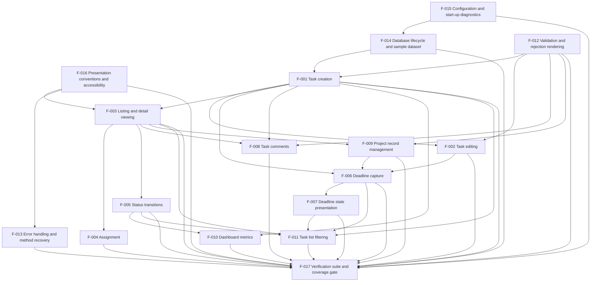

The agreements that carry weight are the shared-definition edges, because each is a single point where two features could drift apart if the definition were duplicated:

| Agreement | One definition | Features bound by it |
|---|---|---|
| The three status values and their labels | `TASK_STATUSES` and `STATUS_LABELS` in `app/models.py:32-39`, published to Jinja as globals | F-005 (badge and flash), F-010 (the three buckets), F-011 (the status filter), F-012 (the closed-set check) |
| The seven-day "imminent" window | `SOON_WINDOW_DAYS = 6` in `app/templating.py:75` and `_WEEK_WINDOW_DAYS = 6` in `app/services/tasks.py:81` | F-007 (the relative word), F-011 (the `week` bucket) |
| The deadline buckets and their wording | `DEADLINE_FILTER_LABELS` in `app/models.py:49-54`, from which `DEADLINE_FILTERS` is derived | F-011 (the control and the parser), F-012 (the accepted set) |
| Field bounds and their sentences | `FIELD_LIMITS` plus the `MSG_*` constants in `app/validation.py:98-147` | F-001, F-002, F-008, F-009 and F-012 |
| Member identity and existence | `members.get_member` reached through `_resolve_member` / `resolve_member_id` | F-004, F-008, F-011 and F-012 |
| One reference day per request | `templating.reference_day()` cached on `flask.g` | F-007 and F-011 |
| The task projection | `_TASK_SELECT` in `app/services/tasks.py:93-100` | F-002, F-003, F-004 and F-005 (every read and every post-write re-read) |


### 2.3.2 Integration Points

| Integration point | Contract | Features that depend on it |
|---|---|---|
| `tasks` blueprint | Nine URL rules over seven views, one method per rule, no `url_prefix`; endpoint names `tasks.list`, `tasks.create`, `tasks.detail`, `tasks.edit`, `tasks.set_status`, `tasks.set_assignee`, `tasks.add_comment` are the template-facing contract (`app/blueprints/tasks.py:307-541`) | F-001 to F-008, F-011, F-012, F-013 |
| `project` blueprint | One rule, `GET`/`POST /project`, endpoint `project.view`; one parser, one service call, one flash (`app/blueprints/project.py:71-103`) | F-009, F-015 (its `start_date` is F-006's lower bound) |
| `dashboard` blueprint | One rule, `GET /`, endpoint `dashboard.index`; two service calls made inside the view so figures are recomputed per request (`app/blueprints/dashboard.py:37-55`) | F-010 |
| Validation boundary | Four form parsers and one filter parser, each returning `(values, errors)`; no Flask import and no SQL (`app/validation.py`) | F-001, F-002, F-008, F-009, F-011, F-012 |
| Domain services | Six modules with no Flask object and no `request`; the only SQLite access below `app/db.py` (`app/services/`) | Every write and every read feature |
| `db.get_db()` | One connection per application context, cached on `flask.g`, torn down by `close_db`; `sqlite3.Row`, `PRAGMA foreign_keys = ON`, WAL, 30-second busy timeout (`app/db.py:105-177`) | Every feature that reads or writes SQLite |
| `app/schema.sql` | The whole DDL plus four read-path indexes; carries its own drops, so re-execution is safe | F-014 (bootstrap, reset, seed), F-004/F-005/F-006/F-009 (constraints) |
| Templates and presentation globals | Five views, five partials, three error pages; four filters and two globals registered by `templating.init_app` | F-003, F-007, F-010, F-013, F-016 |
| Static stylesheet | One hand-written `app/static/css/app.css`, served by Flask's default static route | F-016 |
| Flask CLI | `flask --app app run`, `init-db`, `seed-db`; the two commands are registered once, in `db.init_app` | F-014, F-015 |
| `DATABASE` environment variable | Absolute path used as given, relative resolved against the repository root, default `instance/taskboard.sqlite3` | F-014, F-015 |
| `SECRET_KEY` environment variable | Signs the cookie that carries flash messages only; a visibly fake development fallback ships | F-015, and every feature that flashes a message |
| The SQLite file | Readable by any SQLite tool, ignored by `.gitignore`, rebuilt by `seed-db`; the only durable state the product has | All data features; F-014 rebuilds it |
| Test fixtures | `db_path`, `app`, `client`, `seeded_client` in `tests/conftest.py`, each pointing the application at a `tmp_path` database | F-017 |


### 2.3.3 Shared Components and Common Services

**Shared components.** Nine artifacts are consumed by more than one feature; each exists so its content is written once.

| Shared component | Location | Consumed by |
|---|---|---|
| Page shell: header, navigation with `aria-current`, flash region, content block | `app/templates/base.html` | F-003, F-009, F-010, F-013, F-016 |
| Flash partial rendering one message with `role="status"` | `app/templates/partials/_flash.html` | Every feature that confirms a write: F-001, F-002, F-004, F-005, F-008, F-009 |
| Field-error partial wiring `aria-describedby` and `aria-invalid` | `app/templates/partials/_field_errors.html` | F-001, F-002, F-008, F-009, F-012 |
| Task table partial: rows, per-row status form, Edit links, both empty states | `app/templates/partials/_task_table.html` | F-003, F-004, F-005, F-007, F-011 |
| Filter bar partial: the GET form, its three selects, Apply and Clear | `app/templates/partials/_filter_bar.html` | F-011, and F-003 for the page it sits on |
| Metric card macro | `app/templates/partials/_metric_card.html` | F-010 |
| Error pages 400, 404, 500 | `app/templates/errors/` | F-013 |
| `format_deadline` global and `deadline_state` filter | `app/templating.py:222-301` | F-003, F-007 |
| Frozen dataclasses `Project`, `Member`, `Task`, `Comment` | `app/models.py` | Every service (as return values) and every template that renders a row |
| `db.is_sqlite_integer` | `app/db.py:137-159` | F-003, F-004, F-005, F-008 — the guard that keeps an unrepresentable key from reaching a bind |
| `db.unusable_database_error` | `app/db.py:221-246` | F-015 |

**Common services.** The five domain modules and the two helpers below are the whole reusable behaviour of the product; a view calls exactly one of them per request path.

| Service function | Called by |
|---|---|
| `tasks.list_tasks(filters, today)` | `tasks.task_list` (F-003, F-011) |
| `tasks.get_task(task_id)` | `tasks.task_detail`, `tasks.task_edit`, `tasks.task_set_status`, `tasks.task_set_assignee`, `tasks.task_add_comment`, and the post-write re-read inside every task mutation (F-002 to F-008) |
| `tasks.create_task(values)` | `tasks.task_create` (F-001) |
| `tasks.update_task(task_id, values)` | `tasks.task_edit` (F-002) |
| `tasks.set_status(task_id, status)` / `tasks.set_assignee(task_id, member_id)` | `tasks.task_set_status` / `tasks.task_set_assignee` (F-004, F-005) |
| `comments.list_comments(task_id)` / `comments.add_comment(task_id, values)` | `tasks.task_detail` / `tasks.task_add_comment` (F-008) |
| `members.list_members()` | `tasks.task_list` (filter bar), `tasks.task_detail` (assign and author selects) |
| `members.get_member(member_id)` | `app/validation._resolve_member`, and through it the assignee field, the assignee filter, the comment author and the assign quick action (F-004, F-008, F-011, F-012) |
| `metrics.dashboard_metrics()` | `dashboard.index` (F-010) |
| `metrics.total_task_count()` | `tasks.task_list`, for the result line's denominator (F-003, F-011) |
| `projects.get_project()` | `dashboard.index` (project panel), `project.view`, `tasks.task_create` and `tasks.task_edit` (the deadline rule's lower bound), `tasks.create_task` (the task's `project_id`) (F-001, F-002, F-006, F-009, F-010) |
| `projects.save_project(values)` | `project.view` (F-009) |


## 2.4 Implementation Considerations

Every consideration below is drawn from a constraint the code or its documentation already states. The repository declares no latency, throughput, availability or data-volume target; what it does declare is a set of bounded resources — one SQLite file, one writer at a time, a 30-second lock wait, indexed read paths, and figures derived per request — and the considerations are written against those bounds rather than an invented budget.


### 2.4.1 Constraints per Feature

| Feature | Technical constraints | Performance and scalability | Security and maintenance |
|---|---|---|---|
| F-001 Task Creation | Five fields through one parser; no form framework and no ORM, so the form markup and the `INSERT` are hand-written; `project_id` is read from the current project record, which may be absent | One `INSERT` plus one read-back; the member select is a single ordered query over five rows | Every value bound; rendered escaped; the title and description bounds live in `FIELD_LIMITS`, so a new field means one place to change and one form attribute |
| F-002 Task Editing | An edit overwrites all five fields, because SQLite applies a column default on `INSERT` only; there is no delete path anywhere in `app/` | One `UPDATE … WHERE id = ?` on the primary key plus a read-back; an unchanged edit is still a success | The task is read before the body is parsed, so the 404 cannot depend on the payload; the key is range-checked before binding |
| F-003 Listing and Detail Viewing | Fixed `ORDER BY t.id`, no pagination, no search, no sorting control; every read shares one projection | One indexed task query, one member query, one `COUNT(*)`; the comment count is a correlated subquery costing one index seek per row; rendering grows linearly with the number of tasks | Templates carry no formatting logic, which keeps escaping and formatting in one place; the list never receives a raw row |
| F-004 Assignment | Members are read-only — no administration path exists — and `assignee_id` is nullable, with `unassigned` a filter-only sentinel | `idx_task_assignee` covers the filter; assignment is one `UPDATE` on the primary key | The posted id is resolved against the member table rather than coerced, and `REFERENCES member(id)` is enforced because `PRAGMA foreign_keys = ON` is set explicitly |
| F-005 Status Transitions | No transition table: every pair of the three values is allowed; the schema's `CHECK` is the last line of defence | One `UPDATE`; the dashboard's two aggregate statements are re-run on the next dashboard request rather than updated in place | A status the schema rejects raises `sqlite3.IntegrityError` instead of being swallowed; the flash reads the shared `STATUS_LABELS` mapping |
| F-006 Deadline Capture | Date-only, no clock component and no time-zone handling; the lower bound is the project's `start_date`, which may not exist yet | `idx_task_deadline` supports the three date buckets; parsing is pure string work with one project read per form submission | The ten-character shape check runs before `fromisoformat`, so a form this product does not store cannot reach the column; rule and message live in `app/validation.py` |
| F-007 Deadline Presentation | English month names from a fixed tuple; the seven-day window is declared twice (`SOON_WINDOW_DAYS`, `_WEEK_WINDOW_DAYS`) and the two constants must change together | Pure formatting over already-fetched rows; one clock reading per request through `reference_day()` | An unreadable stored value renders as stored, so the page states what the row holds instead of failing; nothing is marked safe |
| F-008 Task Comments | The author is a required form field because there are no accounts; `ON DELETE CASCADE` is the only referential tidy-up in the schema | One indexed read on `idx_comment_task` per conversation; the list's comment count is the same subquery for every row | Bodies are bound and autoescaped and capped at 1000 characters; the existence check precedes the insert so a missing task is `None`, not an exception |
| F-009 Project Record | Exactly one row, enforced by `CHECK (id = 1)`; `INSERT … ON CONFLICT … DO UPDATE` requires SQLite 3.24 or later | One statement covers first save and every edit, plus one re-read; the re-read is what supplies the stored timestamps | `created_at` is omitted from the update list so the record's origin is preserved; the 120-character name bound is stated once |
| F-010 Dashboard Metrics | No stored counters and no caching: every figure is derived on each request, and all four keys are always present | Two statements (one grouped aggregate, one `COUNT(*)`) inside a single deferred read snapshot; cost is independent of the number of requests served before it | The template performs no arithmetic and holds no literal figure, so a displayed number cannot exist without a statement behind it |
| F-011 Task List Filtering | Three closed sets; filters travel in the query string rather than the session so a filtered list is addressable; the deadline buckets are predicates, not values | Each filter rides its index; one extra `COUNT(*)` per render; an unrecognised bucket raises rather than widening the query to a full-table read | Every value bound; the redirect after a quick action is rebuilt from validated values with `url_for`, and no `next` parameter exists |
| F-012 Validation | One module is the only input boundary; it imports no Flask object and runs no SQL, and the messages a form can show are a closed set of constants | A member resolution is one primary-key read; every other rule is in-memory work on the submitted strings | NUL removal keeps the accepted string equal to the stored one; only ASCII digit runs resolve as ids, and no submitted text is interpolated into a message |
| F-013 Error Handling | Handlers are registered on the application object; the 405 redirect applies only to the three write-only task endpoints | Negligible: one URL-map match on a GET/HEAD of a rejected method | The 500 page carries no exception text, so no internal detail is exposed; every link is built internally and none comes from the request |
| F-014 Database Lifecycle | No migration framework: `app/schema.sql` is re-applied rather than migrated, so a schema change is followed by `seed-db`; the seed is idempotent by dropping the tables first | Batched inserts via `executemany`; one `date.today()` reading per run; the busy timeout is what a seed waits behind when another connection holds the write lock | The loader enables `PRAGMA foreign_keys = ON` for its own connection; `instance/` and `*.sqlite3` are git-ignored, so no database is committed |
| F-015 Configuration | Two environment variables with working defaults; no `.env` file is read; the database path resolves against the repository root rather than Flask's instance path | One `makedirs` and one metadata query at start-up; nothing is retried or polled | The shipped key is deliberately fake; the cookie is `HttpOnly` and `SameSite=Lax`; the diagnostic prints the resolved path, which is acceptable for a loopback-only tool and is the one place a filesystem path is user-visible |
| F-016 Presentation | No JavaScript, no bundler, no CSS framework, one breakpoint at 640 px, English only | One stylesheet request per page and no external font, image or framework fetch; the 1080 px column is a single custom property | Autoescaping is on for every `.html` template and no template applies `\|safe` or `Markup` to form-supplied data; accessibility attributes are structural rather than conditional |
| F-017 Verification | pytest without `pytest-flask`; branch coverage over `app/` with a total-only floor of 85% at two-decimal precision | The whole suite runs in tens of seconds on the documented interpreter, and each test's database is a file under `tmp_path` | No test opens a network socket; message literals are duplicated on purpose so a rewording fails the run rather than passing silently |


### 2.4.2 Cross-Cutting Performance and Scalability

No latency, throughput or data-volume target appears in the repository. What it states instead is a small set of hard bounds, and those are the numbers a change must respect:

| Bound | Value | Source |
|---|---|---|
| Serving processes | One Python process running Flask's development server, bound to `127.0.0.1` | `README.md:145-152` |
| Concurrent writers | One at a time: SQLite serializes writes against the file; readers work from the last committed snapshot because the database is in WAL mode | `app/db.py:117-134` |
| Lock wait before failure | 30.0 seconds per statement that needs a contended lock, replacing `sqlite3`'s five-second default | `app/db.py:57-62` |
| Indexed read paths | Four: status, assignee, deadline, and a task's comment list | `app/schema.sql:84-89` |
| Dashboard cost | Two statements per render (one grouped aggregate, one `COUNT(*)`) inside one deferred read snapshot; nothing cached | `app/services/metrics.py:43-117` |
| Task-list cost | One filtered task query, one ordered member query, one `COUNT(*)`, plus one index seek per row for its comment count | `app/blueprints/tasks.py:330-345`, `app/services/tasks.py:93-100` |
| Clock readings | One per request, cached on `flask.g` | `app/templating.py:152-178` |
| Start-up cost | One `makedirs` plus one `sqlite_master` query when the schema is already present | `app/__init__.py:140-172`, `app/db.py:196-218` |
| Seed cost | One transaction of batched `executemany` inserts after a single schema execution | `seed.py:349-444` |

How the system scales is therefore determined by two dimensions and bounded by one:

- **Task count.** The list renders every matching row — there is no page-size control and no search parameter — so rendering cost grows linearly with the number of tasks, while each read stays indexed. Sorting is a fixed `ORDER BY t.id`; there is no user-selectable order.
- **Comment count.** A task's conversation is one indexed range read; the list's comment count is a correlated subquery, one index seek per rendered row.
- **Concurrency.** Writes are bounded by the single-file model: one writer at a time, with readers unaffected until a writer needs the lock a statement cannot avoid. The delivery report records the consequence of exceeding that bound as an open robustness gap rather than a matter of tuning.

Three caveats are documented rather than latent, each recorded in the delivery report shipped at `blitzy/documentation/`:

| Caveat | Effect | Recorded at |
|---|---|---|
| The task list reads its rows and its result count in two statements | A write landing between the two reads can render a count that disagrees with the table for one request | Project Guide, lines 40 and 201 |
| A write that waits out the 30-second busy timeout ends on the 500 page | Under external write contention a user action becomes an error page rather than a retry message; reads are already protected by WAL and covered by a test | Project Guide, lines 41 and 202 |
| The coverage floor compares the total only | A single module can erode while the run stays green | `pyproject.toml:20-30`; Project Guide, lines 84 and 239 |

Beyond those, the report states production posture — a WSGI server, migrations, monitoring, accounts — as new scope rather than unfinished work, so any horizontal or multi-writer deployment is a different system rather than a configuration of this one.


### 2.4.3 Cross-Cutting Security Posture

The security posture is a small number of controls that hold across every layer, plus two exclusions recorded as decisions rather than left as omissions.

| Control | Where it is implemented | What it prevents |
|---|---|---|
| Every statement is parameterized | All six service modules and `app/db.py`; `app/db.py` is the only module under `app/` that opens a connection (`app/db.py:1-7`) | No submitted text — a task title included — can alter a query; the loader's own connection in `seed.py` is the one deliberate second connection |
| Jinja autoescaping is never bypassed | Every template is `.html`, so autoescaping is on, and no template applies `\|safe` or `Markup` to a value that came from a form (`README.md:476-478`) | A task title, description or comment body renders as text and cannot inject markup |
| The session cookie carries no credential | `SESSION_COOKIE_HTTPONLY = True` and `SESSION_COOKIE_SAMESITE = "Lax"` in the default mapping (`app/config.py:53-59`) | Client-side script cannot read the cookie, and a cross-site form post cannot carry it; the cookie holds flash messages only |
| The application is served on the loopback address | Every documented run command binds `127.0.0.1` (`README.md:145-152`) | Nothing is reachable from the network, which is the precondition for the two exclusions below |
| No route takes a redirect target from the request | The two quick actions rebuild their redirect with `url_for` from validated values; no `next` parameter exists (`app/blueprints/tasks.py:42-55`) | The open-redirect pattern is absent rather than mitigated |
| Keys are range-checked before they are bound | `db.is_sqlite_integer` guards every primary-key read and write (`app/db.py:137-159`) | An id outside SQLite's signed 64-bit range is answered as a missing row instead of raising at the bind |
| Repeated row controls are distinguishable | `aria-label` naming the task on each row's status select (`app/templates/partials/_task_table.html:97`) | A screen-reader user is not given several identical "Status" controls with no way to tell them apart |
| Internal failures render the product's own page | 400/404/500 handlers on the application object (`app/__init__.py:182-195`) | A traceback or a library page is never shown; the 500 page carries no exception text |
| Member identity is validated, never trusted | `_resolve_member` / `resolve_member_id` in `app/validation.py` | A comment's author and a task's assignee must name a stored member, so a forged id cannot attribute work to a non-existent person |

**Deliberate non-controls.** There are no accounts, no sign-in and no authorization layer, and therefore no CSRF tokens, because this is a loopback-only test project that holds no credential to forge and whose session exists only as the signed cookie carrying flash text (`README.md:489-495`). Two parts of the contract follow directly from that decision and are visible in the requirements above: a comment's author and a task's assignee are explicit form fields validated against the member table, and anyone who can reach the port can write. Serving the board to the network would therefore be a security change, not a deployment change.


### 2.4.4 Cross-Cutting Maintenance Requirements

The product's maintainability rests on one property: every rule, vocabulary and message has one home, so a change is a change in one file plus the test that asserts it. The table below is the set of edits that are *not* single-file, and it exists because those are where a change can silently diverge.

| Change | Files that must move together | Guard that catches a miss |
|---|---|---|
| Add or reword a field rule or its message | `app/validation.py` — the `MSG_*` constant and, for a bound, `FIELD_LIMITS` | The suite duplicates each sentence as a literal, so a rewording fails `tests/test_validation.py` and the HTTP modules that assert it |
| Change the status vocabulary | `app/models.py` (`TASK_STATUSES`, `STATUS_LABELS`) and the schema's `CHECK (status IN (...))` | `tests/test_seed.py` and `tests/test_validation.py` assert the three values; templates iterate the published global rather than a literal list |
| Change which deadline buckets exist | `app/models.py` (`DEADLINE_FILTER_LABELS`, from which `DEADLINE_FILTERS` is derived) and the predicates in `app/services/tasks.py` | `list_tasks` raises `ValueError` on an unrecognised bucket, so a missing predicate fails loudly instead of widening the query |
| Change the seven-day "imminent" window | `app/templating.py` (`SOON_WINDOW_DAYS`) and `app/services/tasks.py` (`_WEEK_WINDOW_DAYS`) | `tests/test_filters.py` proves the filter and the rendered word agree, and its `Clock` stub proves the reference day is read once per request |
| Change the schema | `app/schema.sql`, then `flask --app app seed-db` — there is no migration framework, and the seed executes the same DDL file | `tests/test_seed.py` proves the loader is idempotent; `seed.py` reads `app/schema.sql` rather than restating it |
| Change how a date, timestamp, status or deadline renders | `app/templating.py` only | `tests/test_filters.py` drives the four filters directly with absent, blank, unparseable and object-valued inputs no page can produce |
| Add or move a route | The owning blueprint, the template that links to it, and the route table in `README.md` | The suite's HTTP modules address the documented paths; endpoint names are what every `url_for` resolves against |
| Change the task projection | `app/services/tasks.py` (`_TASK_SELECT`) only | Every read and every post-write re-read shares that one projection, so the list and the detail page are covered by the same assertions |
| Change the quality gate | `pyproject.toml` — one table holds `fail_under`, `precision`, `show_missing` and the exclusion pragmas, and `addopts` deliberately carries no duplicate floor flag | The next run applies the new gate to every invocation |

Two further maintenance facts are worth stating plainly. **Module docstrings carry the decisions.** The reasons for the connection settings, the projection's shape, the resolver's spelling rules and the `app_path` fallback are recorded at the top of the module that depends on them, so a change that removes a constraint has to argue with the file it edits. **The delivery report carries the debt.** It records four accepted caveats that need a human decision — control sizes below the 44 px house figure, two form groups without an accessible name, the shell's link builder unverified under a `SCRIPT_NAME` prefix, and some single-line template markup past the 88-column width — together with the two robustness gaps listed in Section 2.4.2 (`blitzy/documentation/`, line 239).


## 2.5 Traceability Matrix

The matrix ties each feature's requirement set to the code that implements it and the module that proves it. Verification is stated at module granularity because that is the granularity the suite supports: the eight test modules hold 225 test functions between them, and each restates the requirement it proves in its own name and docstring. Where a feature has no HTTP-reachable proof — the parsers, the configuration and the loader — the module named is the one that drives the code directly.

| Feature | Requirements | Implementation | Verification |
|---|---|---|---|
| F-001 Task Creation | F-001-RQ-001 … 005 (5) | `app/blueprints/tasks.py:353-385`; `app/validation.py:542-604`; `app/services/tasks.py:264-307`; `app/templates/tasks/form.html` | `tests/test_tasks.py` (create form, accepted write, each rejection, database read-back) |
| F-002 Task Editing | F-002-RQ-001 … 004 (4) | `app/blueprints/tasks.py:411-443`; `app/services/tasks.py:310-345` | `tests/test_tasks.py` (edit form, accepted write, rejected write, 404 on both methods) |
| F-003 Listing and Detail Viewing | F-003-RQ-001 … 005 (5) | `app/blueprints/tasks.py:307-345`, `:388-404`; `app/services/tasks.py:129-261`; `app/templates/tasks/list.html`, `detail.html`, `partials/_task_table.html` | `tests/test_tasks.py`, `tests/test_filters.py` (row set, detail page, both empty states, result line) |
| F-004 Assignment | F-004-RQ-001 … 005 (5) | `app/blueprints/tasks.py:478-513`; `app/services/tasks.py:370-389`; `app/validation.py:356-397`; `app/services/members.py` | `tests/test_tasks.py` (assign, clear, 400 for a non-member, origin handling) |
| F-005 Status Transitions | F-005-RQ-001 … 005 (5) | `app/blueprints/tasks.py:446-475`; `app/services/tasks.py:348-367`; `app/models.py:32-39`; `app/schema.sql:67-68` | `tests/test_tasks.py`, `tests/test_dashboard.py` (transition, closed set, counts follow) |
| F-006 Deadline Capture | F-006-RQ-001 … 005 (5) | `app/validation.py:196-225`, `:421-451`; `app/schema.sql:69`; `app/services/projects.py` | `tests/test_tasks.py`, `tests/test_validation.py` (unparseable forms, project-start rule, blank deadline, absent project) |
| F-007 Deadline State Presentation | F-007-RQ-001 … 005 (5) | `app/templating.py:222-301`; `app/templates/partials/_task_table.html:87`; `app/templates/tasks/detail.html:75` | `tests/test_filters.py` (four filters driven directly, incl. absent, blank, unparseable and object-valued input; reference day read once) |
| F-008 Task Comments | F-008-RQ-001 … 006 (6) | `app/blueprints/tasks.py:516-541`; `app/services/comments.py`; `app/validation.py:454-467`, `:607-636` | `tests/test_comments.py` (seeded conversation, accepted comment, every rejection, 404) |
| F-009 Project Record | F-009-RQ-001 … 006 (6) | `app/blueprints/project.py`; `app/services/projects.py`; `app/validation.py:476-539`; `app/schema.sql:22-36` | `tests/test_project.py` (seeded render, valid update, end-before-start rejection, first save creates the row) |
| F-010 Dashboard Metrics | F-010-RQ-001 … 005 (5) | `app/blueprints/dashboard.py`; `app/services/metrics.py`; `app/templates/dashboard.html`, `partials/_metric_card.html` | `tests/test_dashboard.py` (card values, reconciliation, a write moves exactly the cards it should, zero state) |
| F-011 Task List Filtering | F-011-RQ-001 … 007 (7) | `app/services/tasks.py:129-234`; `app/validation.py:639-691`; `app/templates/partials/_filter_bar.html` | `tests/test_filters.py` (each bucket's exact rows, `AND` combination, completed work never overdue, 400 for an out-of-set value, four Jinja filters) |
| F-012 Submission Validation | F-012-RQ-001 … 007 (7) | `app/validation.py` (whole module); `app/templates/partials/_field_errors.html` | `tests/test_validation.py` (one case per rule, typed values and messages asserted as whole mappings) |
| F-013 Error Handling | F-013-RQ-001 … 005 (5) | `app/__init__.py:182-214`; `app/templates/errors/400.html`, `404.html`, `500.html`; `app/templating.py:304-330` | `tests/test_tasks.py` (404 and 400 pages), `tests/test_config.py` (start-up failure message), `tests/test_filters.py` (400 naming the parameter) |
| F-014 Database Lifecycle | F-014-RQ-001 … 007 (7) | `app/db.py:179-280`; `app/schema.sql`; `seed.py` | `tests/test_seed.py` (idempotent loader, dataset invariants, `init-db` and `seed-db` through Flask's runner, missing-`seed` error) |
| F-015 Configuration | F-015-RQ-001 … 007 (7) | `app/config.py`; `app/__init__.py:90-172`; `app/db.py:221-246` | `tests/test_config.py` (five default keys, environment precedence, path resolution, unusable database as one line, logging levels) |
| F-016 Presentation and Accessibility | F-016-RQ-001 … 007 (7) | `app/templating.py`; `app/templates/` (14 files); `app/static/css/app.css` | `tests/test_filters.py` (four Jinja filters), and the manual checklist at `README.md:379-414` for appearance, focus order and the 375 px layout |
| F-017 Verification and Coverage Gate | F-017-RQ-001 … 006 (6) | `pyproject.toml:7-30`; `tests/conftest.py`; `tests/` (eight modules) | The suite verifying itself: fixtures, the coverage table the run prints, and the gate's pass/fail status |

Two limits of this matrix are worth stating rather than implying. First, **no requirement is traced to an individual test identifier**, because the modules name their tests after behaviour rather than after requirement IDs; the requirement-to-module edge is therefore the finest trace the repository supports, and it is exact at that level. Second, **F-016's visual criteria are verified by a documented manual pass, not by automation** — the repository ships no browser automation by design, and the checklist at `README.md:379-414` is the instrument that covers appearance, focus order and the responsive breakpoint.


## 2.6 Assumptions and Constraints

Every assumption below is one the delivered code already depends on; none is a hope about future behaviour. Each row states the basis, so a reader can check it, and the effect of the assumption changing, so the requirement set can be re-scoped deliberately rather than silently.

| Assumption or constraint | Basis | Effect if it changes |
|---|---|---|
| Exactly one project exists per database | `CHECK (id = 1)` in `app/schema.sql:23`, pinned by `_PROJECT_ID = 1` in `app/services/projects.py:52` | Multi-project tracking is new scope: the schema constraint, the project upsert, the dashboard panel and the task's `project_id` handling all change |
| Members are read-only and arrive only with the sample data | `app/services/members.py` exposes `list_members` and `get_member` and no write; the five rows come from `seed.py:57-83` | Member administration becomes a feature with its own form, parser, blueprint and tests; the schema's 1–80 character bounds would move from the DDL to `app/validation.py` |
| One reviewer at a browser, on the loopback address, with no accounts | `README.md:145-152`, `README.md:489-495`; every documented run command binds `127.0.0.1` | Accounts, authorization and CSRF tokens become prerequisites rather than exclusions; a comment's author and a task's assignee would stop being form fields |
| The session cookie exists only to carry flash messages | `app/config.py:53-59`; no other session use exists in `app/` | A credential in the session changes the cookie's requirements (a real `SECRET_KEY`, `Secure` under TLS) and every requirement that assumes statelessness |
| The interface ships in English only, with fixed month names | `MONTHS` in `app/templating.py:56-69` deliberately avoids `strftime("%b")` | Localisation is new scope and would move the vocabulary out of `app/models.py` and `app/templating.py` |
| Timestamps are UTC wall-clock text displayed as written, with no time-zone conversion | `README.md:326-328`; timestamps written by `datetime('now')` | Per-user time zones would require a conversion layer and a change to every displayed timestamp requirement |
| Deadlines are date-only, with no clock component | `app/schema.sql:69`, `app/validation.py:196-225` | A deadline *time* changes the schema, the ISO shape check, the four deadline buckets and the indicators |
| SQLite 3.24 or later is available, and the runtime is CPython 3.12 on 3.12.3 | `app/services/projects.py:67`; `README.md:42-57`; `pyproject.toml:5` | `INSERT … ON CONFLICT … DO UPDATE` would have to be replaced by an explicit read-then-branch; a lower Python would change the typing style used throughout the package |
| There is no migration framework: the schema is re-applied | `app/schema.sql:1-14`; `app/db.py:179-193` | Any schema change today is followed by `flask --app app seed-db`; introducing migrations would add a component the requirements do not currently assume |
| The database file is disposable and never committed | `.gitignore` (`instance/`, `*.sqlite3` and its WAL sidecars); `README.md:460-466` | Persistent data would need a migration path, backups and a story for the seed command's destructive rebuild |
| The task list is unpaginated, ordered by `id`, with no search or user-chosen sorting | `app/services/tasks.py:228-232`; `README.md` lists no pagination or search parameter | A volume requirement would add pagination to F-003 and F-011 and change the result line's meaning |
| The coverage floor compares the total only, at 85% with two-decimal precision | `pyproject.toml:20-30`; the per-module gap is recorded in the delivery report (`blitzy/documentation/`, lines 84 and 239) | Enforcing a per-module floor would tighten F-017 and reveal module-level erosion the current gate cannot |
| One writer at a time is acceptable, with a 30-second wait before failure | `app/db.py:57-62`, `:117-134`; the exhausted-lock gap is recorded at Project Guide line 41 | Concurrent write expectations would require a retry/lock-error path (an open item in the delivery report) or a different database engine |

**Requirement versioning.** Section 2 is stated as version 1.0 against the delivered implementation. Because the repository carries no changelog for its own requirements, the version is derived from the artifacts the requirements were read out of — `README.md`, `app/`, `seed.py`, `tests/` and `pyproject.toml` at the commit being documented — and any later change to a requirement is recorded here as a new row rather than an edit in place, so the acceptance criteria a change was reviewed against remain visible:

| Version | State | Basis | Change |
|---|---|---|---|
| 1.0 | Baseline, matching the delivered implementation | `README.md` (capability list and route table), `app/` (twelve method-and-path shapes over eleven URL rules), `tests/` (225 test functions), `pyproject.toml` (85% gate) | Initial 97 requirements across F-001 … F-017 |
| 1.1 | Reserved | — | Any requirement added, withdrawn or re-scoped, with the affected `F-XXX-RQ-YYY` identifiers listed |


## 2.7 Related Diagrams and Cross-References

Three diagrams describe the product, and each answers a different question. Rather than duplicating them, this sub-section points at the two already drawn and adds the one the requirement set needs — the decision path every write takes.

| Diagram | Question it answers | Where it is drawn |
|---|---|---|
| Component and data-flow flowchart | How the layers connect: browser → blueprints → validation → services → `app/db.py` → SQLite, with templates and the stylesheet attached at the presentation edge | Section 1.2.2 |
| Feature dependency map | Which feature must exist before another, and which pairs are bound by one shared definition | Section 2.3.1 |
| Write-path outcome flowchart | What a submitted form post produces, in the order the code decides it | Below |
| Capability → feature → route tracing | Which control delivers each stated capability, and what is deliberately outside the contract | Section 2.1.1 tables, and Section 1.3's in-scope and out-of-scope lists |

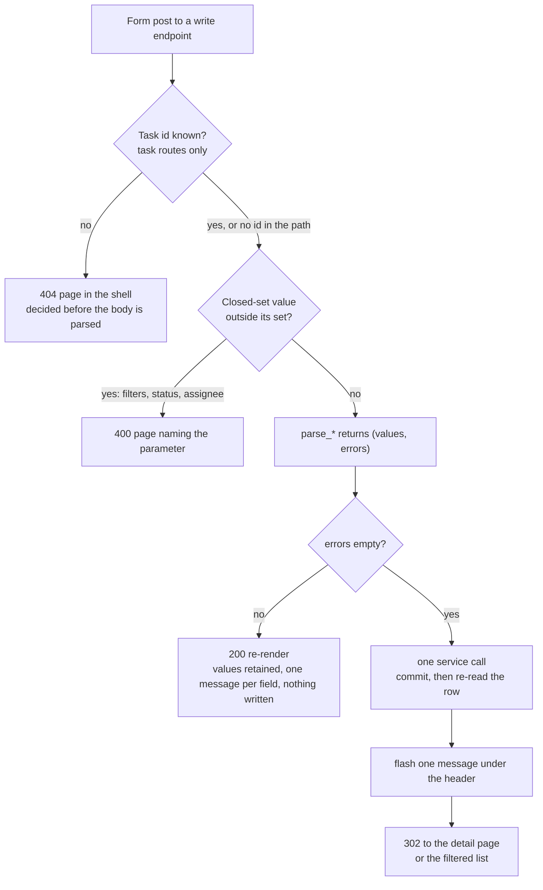

Each branch of that path is a requirement, and each is reachable only through the order the code enforces:

| Branch | Requirement that states it | Where the decision is made |
|---|---|---|
| 404 before the payload | F-003-RQ-002, F-004-RQ-003, F-005-RQ-005, F-008-RQ-005 | The task read precedes every parse in `app/blueprints/tasks.py:446-541` |
| 400 naming the parameter | F-004-RQ-003, F-005-RQ-002, F-011-RQ-005, F-012-RQ-006 | `is_valid_status`, `resolve_member_id` and `parse_task_filters` at the call sites in `app/blueprints/tasks.py` |
| 200 re-render, nothing written | F-001-RQ-005, F-002-RQ-004, F-008-RQ-003, F-009-RQ-005, F-012-RQ-005 | The `if errors:` branch in each write view, before any service call |
| 302 with one flash | F-001-RQ-002, F-002-RQ-002, F-004-RQ-001, F-005-RQ-001, F-008-RQ-001, F-009-RQ-002 | `flash(...)` then `redirect(url_for(...))` in each write view |

Two cross-references complete the picture without restating it: the excluded capabilities and the remaining-work list are in Section 1.3.2, and the eight stated capabilities with their per-capability acceptance rules are in Section 1.3.1. Where this section and those disagree, the files cited here are the evidence, because each requirement above was read out of the implementation rather than out of a plan.


## 2.8 Data Handling and Compliance Notes

The repository states no compliance regime — there is no license file, no data-retention policy, no privacy notice and no audit requirement anywhere in it — so this sub-section records what the delivered implementation holds and what it does with it, rather than asserting an obligation it does not carry.

| Aspect | What the implementation does | Where |
|---|---|---|
| Personal data held | A member's `name`, `role` and `email` in the `member` table; a comment's `body` and its author; a task's `title` and `description`. No credential, postal address, telephone number or payment field exists in the schema | `app/schema.sql:46-52`, `:61-82` |
| Member email exposure | `email` is `UNIQUE` and is read by the member service, but no template renders it: the assignee select, the assignee filter and the comment author select show names only | `app/services/members.py:34`, `:61`; no `email` reference in `app/templates/` |
| Accounts and identity | None: no sign-in, no session identity, no role check, so the board holds no authentication secret and no per-user profile | `README.md:489-495` |
| Deletion and retention | No `DELETE FROM` statement exists anywhere under `app/`; the only destructive SQL in the repository is the loader's four `DROP TABLE IF EXISTS` statements. A mistaken task or comment cannot be removed through the interface | `seed.py:362-365`; `app/services/` (no delete path) |
| Audit trail | Partial by design: each row carries `created_at` and `updated_at`, and a comment records its author as a form field, but no actor is tied to a session, so "who changed this" is not answerable beyond an assignment or a comment | `app/schema.sql:34-35`, `:70-71`, `:81` |
| Data leaving the host | Nothing: one SQLite file on the local disk, no outbound HTTP client, mail transport, broker or telemetry in `requirements.txt` or `app/` | `requirements.txt`; Section 1.2.1 |
| Log content | The INFO start-up and seed records name the event and deliberately carry no filesystem path; the resolved path appears only at DEBUG, which a caller must ask for | `app/__init__.py:41-53`, `app/db.py:96-102` |
| Error output | The 500 page renders the application's own shell and carries no exception text, so an internal detail is not shown to whoever reached the port | `app/templates/errors/500.html` |
| Transport | Served over plain HTTP on the loopback address with no `Secure` cookie flag, which is consistent only because nothing is reachable from the network | `README.md:145-152`; `app/config.py:53-59` |

Any deployment beyond the loopback address would have to settle the retention and deletion question above, add accounts and CSRF protection, and serve over TLS — the delivery report reaches the same conclusion when it records production posture as new scope (`blitzy/documentation/`, line 239).


## 2.9 References

Every file and folder below was read to establish a requirement, a constraint or a relationship stated in this section.

**Repository root**

- `README.md` - the external contract: the eight stated capabilities (lines 16-35), the requirements and dependency pins (40-64), the install, seed and run commands (66-159), the twelve method-and-path shapes with their inputs and responses (203-257), the sample-data claims and their reconciliation (259-317), the interface conventions for dates, statuses, deadlines, filters, empty states and accessibility (319-377), the manual UI checklist (379-414), the security notes and the two deliberate non-controls (468-495)
- `pyproject.toml` - `requires-python = ">=3.12"`, the pytest options (`testpaths`, `pythonpath`, `addopts`), and the coverage gate: `branch = true`, `source = ["app"]`, `fail_under = 85`, `precision = 2`, `show_missing`, `exclude_lines`
- `requirements.txt` - the seven exact runtime pins (Flask 3.1.3, Werkzeug 3.1.9, Jinja2 3.1.6, itsdangerous 2.2.0, MarkupSafe 3.0.4, click 8.5.0, blinker 1.9.0)
- `requirements-dev.txt` - `-r requirements.txt` plus the seven test-time pins (pytest, pytest-cov, coverage, iniconfig, packaging, pluggy, Pygments)
- `seed.py` - `SAMPLE_DATA` (one project with offsets −14/+45, five members keyed by email, twelve tasks, eight comments), the day-offset and timestamp helpers, and `seed_database`'s drop-recreate-insert sequence and summary line
- `.gitignore` - the `instance/`, `*.sqlite3` and WAL-sidecar entries that make the database disposable, plus the bytecode, build, coverage, `.env` and editor exclusions
- `blitzy/documentation/Project Guide - edb81910-6bfc-43b6-9d36-98820f6a276c.md` - the delivery report: the recorded robustness gaps (lines 40-41, 116), the remaining-work list (line 84), the open items and accepted caveats (lines 201-202, 239), and the per-file responsibilities for `app/db.py` (line 399)

**Application package**

- `app/__init__.py` - `create_app`'s wiring order, the five Jinja globals, the folder creation and schema bootstrap, the start-up log records, and the 400/404/500/405 handlers including `_task_id_for_write_action`
- `app/config.py` - `DEV_SECRET_KEY`, `DEFAULT_DATABASE`, the five-key `config_mapping` with `SameSite`/`HttpOnly`, and `resolve_database_path` against the repository root
- `app/db.py` - the per-context connection with `sqlite3.Row`, `PRAGMA foreign_keys = ON`, WAL and `BUSY_TIMEOUT_SECONDS = 30.0`; `is_sqlite_integer`; `ensure_schema`, `init_db`, `unusable_database_error`; the `init-db` and `seed-db` commands and `init_app`
- `app/models.py` - the frozen dataclasses `Project`, `Member`, `Task`, `Comment`; `TASK_STATUSES`, `STATUS_LABELS`, `DEADLINE_FILTER_LABELS`
- `app/schema.sql` - the DDL for `project` (`CHECK (id = 1)`, date `GLOB` checks), `member` (unique email, 1-80 bounds), `task` (status `CHECK`, nullable `assignee_id` and `deadline`), `comment` (`ON DELETE CASCADE`), and the four indexes
- `app/validation.py` - the sixteen `MSG_*` constants, `FIELD_LIMITS`, `DEFAULT_STATUS`, `ASSIGNEE_UNASSIGNED`, `STATUS_FILTERS`, `DEADLINE_FILTERS`, `parse_iso_date`, `is_valid_status`, `resolve_member_id`, and the five parsers
- `app/templating.py` - `MONTHS`, `SOON_WINDOW_DAYS = 6`, `DEADLINE_SEPARATOR`, `reference_day`, `format_date`, `format_datetime`, `status_label`, `deadline_state`, `format_deadline`, `app_path`, `init_app`
- `app/services/tasks.py` - `_TASK_SELECT`, the filter clauses and deadline buckets, `_WEEK_WINDOW_DAYS = 6`, `list_tasks`, `get_task`, `create_task`, `update_task`, `set_status`, `set_assignee`
- `app/services/comments.py` - `_COMMENT_SELECT` with the member join, `ORDER BY c.created_at ASC, c.id ASC`, the task-existence check, and the post-insert re-read
- `app/services/members.py` - the read-only `list_members` (ordered by name, id) and `get_member`
- `app/services/metrics.py` - the grouped status aggregate plus `COUNT(*)`, the four-key result, and the deferred read-transaction handling
- `app/services/projects.py` - `_PROJECT_ID = 1`, the shared select and the `INSERT … ON CONFLICT(id) DO UPDATE` upsert
- `app/blueprints/tasks.py` - the nine task rules, the seven views, the `filter_*` carry-back, `_MSG_INVALID_STATUS`/`_MSG_INVALID_ASSIGNEE`, and every flash message
- `app/blueprints/dashboard.py` - `GET /` calling both services inside the view
- `app/blueprints/project.py` - `GET`/`POST /project`, `_values_from`, and the `Project details saved.` flash
- `app/`, `app/services/`, `app/blueprints/` - the layer boundaries: the composition root, the HTTP-free domain layer and the HTTP layer, as summarized by each folder

**Templates and styling**

- `app/templates/base.html` - the shell: header, navigation with `aria-current`, flash region, content block
- `app/templates/dashboard.html` - the four metric cards with their filter links, the task area's empty state, and the project panel's independent empty state
- `app/templates/project.html` - the four fields, `maxlength` from `FIELD_LIMITS`, and the ARIA wiring of field errors
- `app/templates/tasks/list.html` - the result-line logic, the toolbar rule, and the statement that the partial owns the table and the empty states
- `app/templates/tasks/form.html` - the create and edit form, the Status default, and the deadline field's `aria-describedby` composition
- `app/templates/tasks/detail.html` - the status and assign forms, the deadline indicator, the "No comments yet." state, and the comment form
- `app/templates/partials/_task_table.html` - the rows, the per-row status form with its `aria-label`, "Unassigned", "No deadline", and both table empty states
- `app/templates/partials/_filter_bar.html` - the GET form, the three selects including the "Unassigned" option, Apply and Clear
- `app/templates/partials/_metric_card.html` - the card macro that renders one count and its link
- `app/templates/partials/_flash.html` - the `role="status"` flash rendering and its `success`/`error` categories
- `app/templates/partials/_field_errors.html` - the per-field message markup and its ARIA ids
- `app/templates/errors/400.html`, `app/templates/errors/404.html`, `app/templates/errors/500.html` - the three in-shell failure pages with `error.name`, `error.code`, `error.description` and their `app_path` links
- `app/templates/` - the five views, five partials and three error pages that make up the presentation layer
- `app/static/css/app.css` - the `:root` design tokens, the 1080 px `--container-max` column and the single `@media (max-width: 640px)` block

**Verification suite**

- `tests/conftest.py` - the `db_path`, `app`, `client` and `seeded_client` fixtures, the deterministic test secret, and the `seed_database` call behind the seeded client
- `tests/test_tasks.py` - creation, editing, listing, detail, both quick actions and the comment post, each write read back from the database
- `tests/test_filters.py` - each filter's exact row set, the `AND` combination, the overdue exclusion of completed work, the 400 for an out-of-set value, and the four Jinja filters driven directly
- `tests/test_dashboard.py` - the four card values, the reconciliation of the buckets, the effect of a write on the cards, and the zero state
- `tests/test_comments.py` - the seeded conversation, the accepted comment, every rejection, and the 404
- `tests/test_project.py` - the seeded render, a valid save, the end-before-start rejection, and the first save creating the single row
- `tests/test_validation.py` - one case per parsing rule, with typed values and messages asserted as whole mappings
- `tests/test_seed.py` - the idempotent loader, the dataset invariants, both CLI commands through Flask's runner, and the missing-`seed` error
- `tests/test_config.py` - the five default keys, environment precedence, path resolution, the unusable-database message, and the factory's logging levels
- `tests/` - the suite as a whole: nine files, 225 test functions, one temporary database per test

**Cross-references within this specification**

- Section 1.2 System Overview - the component table, the component and data-flow flowchart, and the success criteria and KPIs this section's requirements are measured against
- Section 1.3 Scope - the in-scope capability and workflow tables, the excluded capabilities, and the remaining-work list referenced by Sections 2.4.2, 2.4.4 and 2.8

No web source was consulted for this section: every statement rests on the repository's own files, and no external fact was needed.


# 3. Technology Stack

## 3.1 Programming Languages

Taskboard is written in four languages across three layers — Python, SQL (the SQLite dialect), HTML5 with Jinja2 template syntax, and CSS — and deliberately in no fifth. There is no JavaScript, no TypeScript, no compiled language and no build-time language anywhere in the tree: a census of the checkout finds 26 `.py`, 1 `.sql`, 14 `.html`, 1 `.css`, 1 `.toml` and 2 `.txt` files, and **zero** `.js`, `.json`, `.yml` or `.yaml` files.

### 3.1.1 Language Inventory by Platform and Component

| Platform or component | Language | Version contract | Evidence |
|---|---|---|---|
| Server process: HTTP layer, domain services, data access, configuration, CLI commands | Python | `requires-python = ">=3.12"`; resolved and measured on CPython 3.12.3 | `pyproject.toml:5`; `README.md:42-43`; 16 modules under `app/` (3,360 lines) plus `seed.py` (450 lines) |
| Persistence: schema and every statement | SQL, SQLite dialect | SQLite 3.45.1 through the standard library's `sqlite3`; statements rely on SQLite 3.24 or later | `app/schema.sql` (89 lines); `app/services/*.py`; `README.md:56-57`; `app/services/projects.py:67` |
| Views: five screens, five partials, three failure pages | HTML5 with Jinja2 template syntax | HTML5 doctype, `lang="en"`; Jinja2 3.1.6 with autoescaping on | `app/templates/` (14 files); `app/templates/base.html:50-51`; `README.md:50` |
| Styling | CSS | One hand-written stylesheet; custom properties on `:root`; one 640 px media query | `app/static/css/app.css` (898 lines, 60 custom-property declarations, `@media` at line 862) |
| Client-side scripting | None | No script element, no inline event handler; navigation state is computed server-side | `app/templates/base.html` (shell comment: "this application ships no JavaScript"); 0 `.js` files |
| Operator interface | POSIX shell, documentation only | Five documented commands, run from the repository root | `README.md:71-77`; no `.sh` file in the tree |

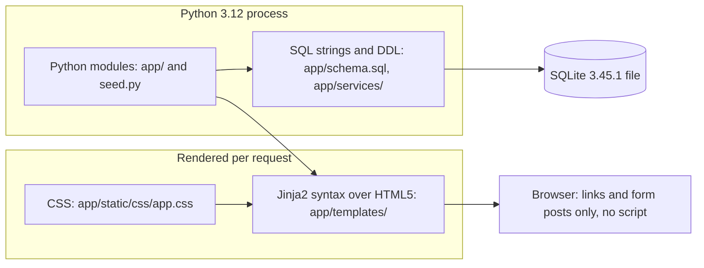

### 3.1.2 Selection Criteria

The repository records no decision log, so the criteria below are the ones the delivered code and the README actually satisfy, each with its evidence:

- **One runtime for the whole product.** `README.md:11-14` states the shape: "One Python process serves the whole product" and "there is no build step". Nothing in the tree compiles, bundles or generates an artifact before the process starts.
- **Storage with no separate install.** The persistent store is reached through the standard library's `sqlite3` (`README.md:56-57`), which is why the complete runtime dependency surface is Flask plus its mandatory closure and nothing else (`requirements.txt`).
- **A thin client.** Every interaction is a link or a form post (`README.md:11-12`), so the browser needs no framework, no transpiler and no pinned toolchain; the one client-side dependency is the browser's own support for the four `type="date"` controls the forms render.
- **A typed, documented Python core.** Value objects are frozen dataclasses (`app/models.py:68`, `:94`, `:116`, `:155`); every module declares an explicit `__all__` (`app/` root modules, the five service modules, the three blueprints and `seed.py`); 13 of the 16 modules under `app/` open with `from __future__ import annotations`, the three exceptions being `app/config.py` (no forward references) and the two package markers `app/blueprints/__init__.py` and `app/services/__init__.py`, which hold only docstrings. PEP 604 unions appear throughout, for example `create_app(test_config: dict[str, object] | None = None)` (`app/__init__.py:90`) and `member_id: int | None = None` (`app/blueprints/tasks.py:502`).
- **Quality gates expressible in the same language.** The suite and the coverage floor are Python packages pinned beside the framework (`requirements-dev.txt`), so one interpreter runs the application and its verification (`pyproject.toml:7-30`).

### 3.1.3 Constraints and Dependencies

| Constraint | Effect | Evidence |
|---|---|---|
| `requires-python = ">=3.12"` | The floor is a declared policy rather than a demonstrated syntax need: a search of the tree for constructs introduced in 3.12 (`datetime.UTC`, `itertools.batched`, `typing.override`, `Path.walk`) finds none, and every module that needs forward references already imports `from __future__ import annotations` | `pyproject.toml:5`; `app/`, `seed.py`, `tests/` |
| The interpreter is named, not inherited | The documented commands spell the interpreter `python3.12` or `./.venv/bin/python`, and every command is run as `python -m ...` so no console script has to be on `PATH` | `README.md:71-109` |
| Version introspeCtion must not use `flask.__version__` | That attribute is deprecated in Flask 3.1 and removed in 3.2, and Werkzeug exposes none, so versions are read through `importlib.metadata.version()` | Project Guide §F and Troubleshooting |
| SQLite 3.24 or later | The single project row is written with `INSERT ... ON CONFLICT(id) DO UPDATE`, which an older library rejects | `app/services/projects.py:67-71` |
| SQLite integers are signed 64-bit | A key outside that range cannot be bound — `sqlite3` raises `OverflowError` rather than matching no row — so `is_sqlite_integer` guards every key before the bind | `app/db.py:73-78`, `:137-159` |
| SQL is data, never interpolation | Values are bound with `?` placeholders in every statement; identifiers are fixed in the source | `README.md:472-475`; `app/services/tasks.py:93-125` |
| Dates and timestamps are text | Dates are ISO-8601 `YYYY-MM-DD`, timestamps are UTC text written by `datetime('now')`; the schema constrains both with `GLOB` patterns and `date()` checks | `app/schema.sql:26-35`, `:69`; `README.md:324-328` |
| The date control is the browser's | Four `type="date"` inputs mean entry and display of the picker follow the browser's locale while the page prints its own fixed format, an asymmetry recorded as an open integration risk | `app/templates/`; `README.md:324-325`; Project Guide §6 |
| One character-encoding convention | `app/schema.sql` is decoded as UTF-8 before `executescript`, and the middle dot joining a deadline to its relative word is written as the escape `\u00b7` | `app/db.py:189`; `app/templating.py:81` |


## 3.2 Frameworks &amp; Libraries

Taskboard's framework surface is one framework and its own runtime closure. `requirements.txt:8` pins Flask 3.1.3 "with the rest of its runtime closure", and the six other pins are exactly that closure — Werkzeug, Jinja2, itsdangerous, MarkupSafe, click and blinker — each with the role the file states on its own line.

### 3.2.1 Core Framework — Flask 3.1.3

Flask is the only framework the application uses, and every one of its features the application relies on has a single home:

| Flask feature | What this system uses it for | Evidence |
|---|---|---|
| Application factory | `create_app(test_config=None)` is the only place the application is assembled; the Flask CLI and every test build one on demand | `app/__init__.py:120-121` |
| Blueprints | Three blueprints (`dashboard`, `tasks`, `project`) registered with no `url_prefix`, each declaring its full paths; 11 URL rules in total | `app/__init__.py:176-178`; `app/blueprints/` |
| Jinja integration | Templates render through `render_template`; four filters and two globals are registered on the application, and five vocabulary values are published to `jinja_env.globals` | `app/templating.py:342-347`; `app/__init__.py:154-160` |
| `flask.g` request cache | The per-request SQLite connection and the request's single reference day are both cached on `g` and dropped at teardown | `app/db.py:69-71`, `:119-134`, `:174-176`; `app/templating.py:87-89` |
| `current_app` | Configuration and package resources are read without importing a module-level application object | `app/db.py:40`, `:123-124`, `:188-190`; `app/templating.py:32` |
| Flash messages | Six `flash()` calls, one per successful write, rendered under the header with `role="status"` | `app/blueprints/tasks.py`, `project.py`; `app/templates/partials/_flash.html` |
| CLI integration | `init-db` and `seed-db` are added to `app.cli` exactly once, both wrapped by `with_appcontext` | `app/db.py:249-292` |
| Error handlers | 400, 404, 500 render the application's own pages; a 405 handler redirects a `GET`/`HEAD` of a write-only task action to that task's page | `app/__init__.py:182-214` |
| Request/Response objects | The 405 handler inspects `request.method`/`request.environ` and returns `Response | HTTPException` | `app/__init__.py:31`, `:197-214` |
| Test client | `app.test_client()` supplies every HTTP-level assertion in the suite; no plugin, no live server, no `tests/__init__.py` | `tests/conftest.py:1-12`, `:82-92` |

The factory's choice of `Flask(__name__, instance_relative_config=True)` (`app/__init__.py:120`) is load-bearing in one respect the code states explicitly: the database path is resolved against `os.path.dirname(app.root_path)` rather than `app.instance_path`, because the instance path follows wherever the package is resolved from, while `DEFAULT_DATABASE`, the `.gitignore` entry and the documented commands are all fixed relative to the repository root (`app/__init__.py:14-19`, `:135-139`; `app/config.py:69-95`).

### 3.2.2 Supporting Libraries

| Library | Pin | Role in this system | Where the application depends on it |
|---|---|---|---|
| Werkzeug | 3.1.9 | WSGI toolkit and the development server the only run mode uses; supplies the exception hierarchy and URL-map matching | `HTTPException` caught in the factory (`app/__init__.py:32`, `:78-83`); `app.url_map.bind_to_environ(request.environ).match(method="POST")` for the 405 recovery (`app/__init__.py:79-81`); `werkzeug.exceptions.BadRequest` and `werkzeug.datastructures.MultiDict` in the suite (`tests/test_filters.py:58`, `tests/test_validation.py:30`) |
| Jinja2 | 3.1.6 | Template engine with autoescaping on for every `.html` template | 14 templates using `extends` (8), `block` (18), `include` (3), `macro` (3), plus `with`, `set`, `if`/`elif`/`else` and `for`; the built-in filters `default`, `length`, `string` and `replace` are used alongside the four application filters; no template applies `|safe` or `Markup` |
| itsdangerous | 2.2.0 | Signs the session cookie that carries flash messages | Not imported by application code: Flask signs the session with it, which is why `SECRET_KEY` is one of the two settings the system reads (`app/config.py:55`) |
| MarkupSafe | 3.0.4 | The escaping machinery behind Jinja autoescaping | Not imported directly; it is the barrier that makes submitted titles, descriptions and comment bodies render as text (`README.md:476-478`) |
| click | 8.5.0 | The CLI framework behind both database commands | `@click.command("init-db")` / `@click.command("seed-db")`, `click.echo("Initialized the database.")` (`app/db.py:249-254`), and `click.ClickException` returned as the single-line diagnostic for an unusable `DATABASE` (`app/db.py:244-246`; raised at `app/__init__.py:140-143`, `:168-172`) |
| blinker | 1.9.0 | Signal support Flask imports at start-up | Not imported directly; it is present because Flask 3.1.3 declares it as a mandatory requirement |

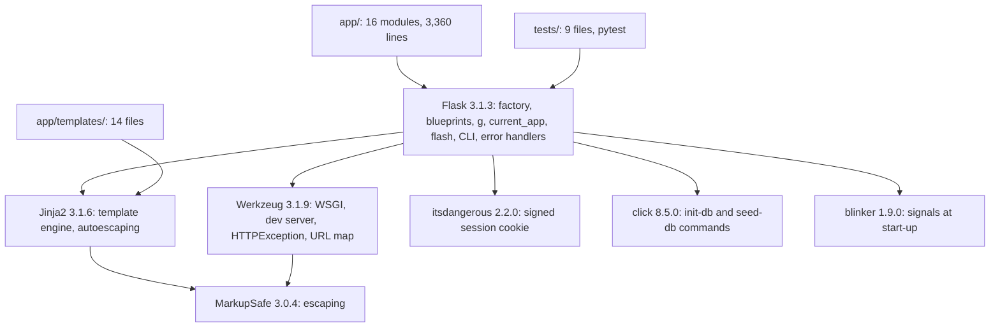

### 3.2.3 Compatibility Requirements

- **Flask's declared floors are all met by the pins.** Flask 3.1.3 requires `blinker>=1.9.0`, `click>=8.1.3`, `itsdangerous>=2.2.0`, `jinja2>=3.1.2`, `markupsafe>=2.1.1` and `werkzeug>=3.1.0` (`importlib-metadata>=3.6.0` applies only below Python 3.10). The pins satisfy each floor at or above the stated minimum: blinker 1.9.0, click 8.5.0, itsdangerous 2.2.0, Jinja2 3.1.6, MarkupSafe 3.0.4, Werkzeug 3.1.9.
- **Flask and Werkzeug move as a pair.** The error handlers and the 405 recovery are typed against `werkzeug.exceptions.HTTPException` and depend on `url_map.bind_to_environ(...).match(method=...)`, both Werkzeug 3.1 interfaces; the two pins are therefore versioned together rather than independently.
- **Flask's optional extras are deliberately absent.** `asgiref` (the `async` extra) and `python-dotenv` (the `dotenv` extra) are not installed, which matches the README's statement that no `.env` file is shipped or needed (`README.md:120-121`) and that nothing in the product is asynchronous.
- **The closure resolves cleanly on CPython 3.12.** `pip install --dry-run -r requirements-dev.txt` resolves all fourteen pins from the default index without conflict (for example `coverage-7.17.0-cp312-...-manylinux...whl`, `pytest-9.1.1-py3-none-any.whl`, `click-8.5.0-py3-none-any.whl`), and `pip check` reports no broken requirements on an interpreter carrying the same versions.
- **No pytest plugin beyond `pytest-cov`.** `tests/conftest.py:1-12` states that `pytest-flask` is deliberately not used and that nothing in the suite needs a plugin, a live server or a `tests/__init__.py`.

### 3.2.4 Frameworks Deliberately Absent

Each absence below is a decision with a stated consequence, in the order the README lists them (`README.md:62-64`): "no ORM, no form framework, no CSS framework, no bundler and nothing to compile for the browser".

| Absent framework | Need it usually covers | What fills the role instead | Consequence |
|---|---|---|---|
| ORM (for example SQLAlchemy) | Row mapping, query building | Hand-written parameterized SQL in the five service modules over stdlib `sqlite3`, with `sqlite3.Row` and frozen dataclasses as the value objects | Every statement is explicit and reviewable, but there is no lazy loading, relationship graph or query builder (`app/services/`, `app/models.py:68-180`) |
| Migration framework (for example Alembic) | Schema versioning | One idempotent DDL file carrying its own `DROP TABLE IF EXISTS` statements, executed by `init-db`, `seed-db` and the start-up probe | A schema change is applied by re-running `seed-db`, which discards data rather than migrating it (`app/schema.sql:4-14`; `README.md:135-140`) |
| Form / validation library (for example WTForms) | Field parsing, error surfacing | `app/validation.py` (691 lines): five parsers returning `(values, errors)`, with every user-visible message as a module constant | Full control of messages and no dependency, at the cost of a large hand-maintained module |
| CSS framework or preprocessor | Layout, components, theming | One 898-line stylesheet declaring 60 custom properties on `:root` and consuming them through `var()`, with one 640 px breakpoint | No build step and no framework class vocabulary; every component rule is local (`README.md:372-377`) |
| Client-side JS framework or bundler | Interactivity | Links and form posts; the current navigation link is computed server-side from `request.endpoint` | No script, no bundle, no hydration; filter changes require the explicit Apply control (`app/templates/base.html`) |
| Authentication / identity library | Sign-in, sessions, authorization | Nothing — by design, recorded rather than omitted | No accounts, no CSRF tokens; acceptable only because every documented command binds `127.0.0.1` (`README.md:489-495`) |
| Production WSGI server (Gunicorn, uWSGI, waitress) | Serving the application | Flask's development server, started by `flask --app app run --host 127.0.0.1 --port 5000` | The only run mode is a single-process development server (`README.md:147-152`) |
| ASGI / async framework (FastAPI, Starlette) | Async request handling | Synchronous WSGI request handling throughout | No concurrency beyond what the WSGI server and SQLite provide; no `async def` in the tree |


## 3.3 Open Source Dependencies

The repository's entire open-source surface is fourteen exact pins in two files, with no lock file, no hash list and no registry configuration. Every pin is spelled `==`, so the requirements files *are* the lock: what pip installs is what the files name, with no range for a resolver to widen.

### 3.3.1 Runtime Closure — Seven Pins

`requirements.txt` lists Flask plus its mandatory closure, one package per line with the reason on the same line. Four of the seven are never imported by application code; they are pinned because pip would otherwise choose their versions:

| Package | Pin | Position in the graph | Where the dependency shows |
|---|---|---|---|
| Flask | 3.1.3 | Direct — the framework itself | Imported by `app/__init__.py:31`, `app/db.py:39-40`, `app/templating.py:32`, the three blueprints and the suite |
| Werkzeug | 3.1.9 | Transitive — Flask requires `werkzeug>=3.1.0` | Imported directly for `HTTPException` (`app/__init__.py:32`) and, in tests, `BadRequest` and `MultiDict` |
| click | 8.5.0 | Transitive — Flask requires `click>=8.1.3` | Imported directly by `app/db.py:38` for the two commands and the CLI error type |
| Jinja2 | 3.1.6 | Transitive — Flask requires `jinja2>=3.1.2` | Never imported: templates are resolved through Flask's Jinja environment |
| itsdangerous | 2.2.0 | Transitive — Flask requires `itsdangerous>=2.2.0` | Never imported: it signs the flash-message cookie through Flask's session |
| MarkupSafe | 3.0.4 | Transitive — Flask requires `markupsafe>=2.1.1` | Never imported: it is the escaping machinery behind autoescaping |
| blinker | 1.9.0 | Transitive — Flask requires `blinker>=1.9.0` | Never imported: Flask imports it at start-up for signals |

Pinning the closure explicitly rather than only naming Flask is the choice that makes the dependency graph closed: a future release of any of the six cannot enter an install without an edit to `requirements.txt`. The repository declares no license for itself — `[project]` in `pyproject.toml` carries no `license` field and no license file ships — and does not assert license compatibility with its dependencies; the distributions matching these pins declare BSD-3-Clause (Flask, Werkzeug, MarkupSafe), BSD (Jinja2, itsdangerous) and MIT (blinker).

### 3.3.2 Test-Time Closure — Seven Pins

`requirements-dev.txt` starts with `-r requirements.txt`, so installing it installs both sets and no command has to name the runtime file on its own (`README.md:71-77`). The seven additional pins are pytest, its runner dependencies and the coverage pair:

| Package | Pin | Role stated in the file | Imported by the suite |
|---|---|---|---|
| pytest | 9.1.1 | The runner: fixtures, parametrization, plain asserts | Yes — `tests/conftest.py:19` and seven further modules |
| pytest-cov | 7.1.0 | Runs the suite under coverage and applies the gate configured in `pyproject.toml` | No — loaded by pytest as a plugin |
| coverage | 7.17.0 | The measurement engine, run with branch measurement over `app/` | No — driven by pytest-cov |
| iniconfig | 2.3.1 | Parses the pytest configuration file | No |
| packaging | 26.3 | Version parsing and comparison performed by pytest | No |
| pluggy | 1.7.0 | Plugin hook machinery used by pytest and pytest-cov | No |
| Pygments | 2.21.0 | Syntax highlighting for assertion output in the terminal | No |

The test closure is complete in the same sense as the runtime one: the four packages pytest itself needs at run time (iniconfig, packaging, pluggy, Pygments) are named rather than left to the resolver. `tests/conftest.py:7-11` records the one deliberate omission — `pytest-flask` — because Flask's own `app.test_client()` covers every HTTP-level assertion.

### 3.3.3 Registry, Resolution and Pinning Policy

| Aspect | What the repository does | Consequence |
|---|---|---|
| Registry | The default PyPI index: no `--index-url`, no `--extra-index-url`, no `pip.conf`, no `.npmrc`, no `[tool.uv]` table anywhere | An install reaches exactly one public index; a private or mirror index would have to be supplied by the operator's environment |
| Resolver | `python -m pip install -r requirements-dev.txt`, run through the virtual environment's interpreter | Resolution happens at install time against exact `==` pins, so the outcome is fixed by the file |
| Lock file / hashes | None: no `*.lock`, no `--require-hashes`, no `pip-tools` or `uv` output | No integrity digest is verified at install; the exact pin is the only guarantee |
| Single source of truth | `requirements-dev.txt` includes the runtime file by reference (`-r requirements.txt`) | The two sets cannot drift; a runtime bump is one edit |
| Reproducibility | Fourteen `==` pins across both files | The same fourteen versions install on any host with CPython 3.12, as verified by a dry-run resolution from the default index and by `pip check` reporting no broken requirements |
| Version inspection | The documented way to read a version is `importlib.metadata.version()`, never `flask.__version__`, which Flask 3.1 deprecates and 3.2 removes | No code in the tree reads `__version__` at all, so no bump is blocked by that removal |
| Upgrade coupling | Flask and Werkzeug are pinned as a pair, and the closure pins move with them | A framework bump is a coordinated edit of up to seven lines, followed by `pip check` and the suite |
| Network exposure | Network access is needed only to install; the running application makes no outbound call | The installed system is fully functional with no network reachability (`README.md:62-64`) |


## 3.4 Third-Party Services

Taskboard integrates with no third-party service of any kind. The absence is a property of the delivered code rather than an unfinished area: no HTTP client is imported anywhere in `app/`, `seed.py` or `tests/`, no socket, mail transport, broker, identity provider, telemetry SDK or cloud SDK appears in the import census, and no template references an external host.

### 3.4.1 Service Inventory

| Service class | Used | Evidence |
|---|---|---|
| External REST/SOAP APIs | None | No `requests`, `httpx`, `urllib.request` or `http.client` import in the tree; `README.md:62-64` states the running application "calls no external service" |
| Authentication / identity provider (SSO, OAuth, OIDC, Auth0) | None | No authentication, sign-in or authorization code exists; recorded as a deliberate non-control (`README.md:489-495`) |
| Monitoring, APM, error tracking, tracing | None | No Sentry, Datadog or OpenTelemetry import; the only observability is `app.logger` (`app/__init__.py:216-217`) |
| Cloud platform services (compute, object storage, queues, managed database) | None | No cloud SDK or infrastructure configuration; the deliverable is one local process over one local file |
| Message broker / background worker | None | No queue client and no worker entry point; all work happens inside the request |
| Email / SMS delivery | None | No `smtplib` or mail library; notifications do not exist as a capability |
| CDN, web fonts, third-party static assets | None | The only stylesheet link is the application's own `static/css/app.css` (`app/templates/base.html:57`); the favicon is a `data:` URI (`base.html:56`) |
| Secrets manager / key service | None | `SECRET_KEY` is read from the environment with a visibly fake fallback (`app/config.py:29-32`, `:55`) |
| Database server | None | SQLite is reached in-process through the standard library (`README.md:56-57`) |
| Cache server (Redis, Memcached) | None | No cache tier; counts are recomputed per request (`app/services/metrics.py:1-6`) |

### 3.4.2 What Stands In for Each Service Class

| Need a service usually fills | In-system substitute | Limitation it leaves |
|---|---|---|
| Identity and authorization | None, by decision; a comment's author and a task's assignee are explicit form fields validated against the `member` table rather than taken from a session | Every write endpoint is open to anyone who can reach the port, and no CSRF token exists (`README.md:489-495`) |
| Observability and alerting | Three log records through `app.logger`: a path-free start-up INFO record and a DEBUG record naming the resolved database path (`app/__init__.py:216-217`), an INFO record when the schema is applied (`app/db.py:193`), and an INFO plus optional DEBUG record for a seed run (`app/db.py:279-280`) | No structured logging layer, no metrics endpoint, no health check, no alerting, no request log beyond Werkzeug's own (`app/__init__.py:44-45`) |
| Session store | A signed cookie carrying flash messages only, `HttpOnly` and `SameSite=Lax`, with no credential inside (`app/config.py:56-57`; `README.md:479-481`) | No server-side session state, no revocation, and no `Secure` flag because the documented run is plain HTTP on loopback |
| Secret management | Two environment variables, both defaulted, read at configuration time; no `.env` loader is installed because Flask's `dotenv` extra is absent | A deployment that omits `SECRET_KEY` runs on the development fallback, and two instances sharing it accept each other's cookies (Project Guide §E) |
| Clock and locale service | The host clock, read once per request by `templating.reference_day`; SQLite writes timestamps with `datetime('now')` | Deadlines and "due" wording follow the host clock, and month names are a fixed English tuple precisely so the process locale cannot change a rendered date (`app/templating.py:53-55`) |
| Member directory | Static sample data loaded by `seed.py`; `app/services/members.py` is read-only | There is no member administration of any kind (`README.md` seed section; `app/services/members.py:1-4`) |
| Static asset delivery | Flask's own `static` endpoint, addressed through the `app_path` global | No edge caching, compression or asset fingerprinting |

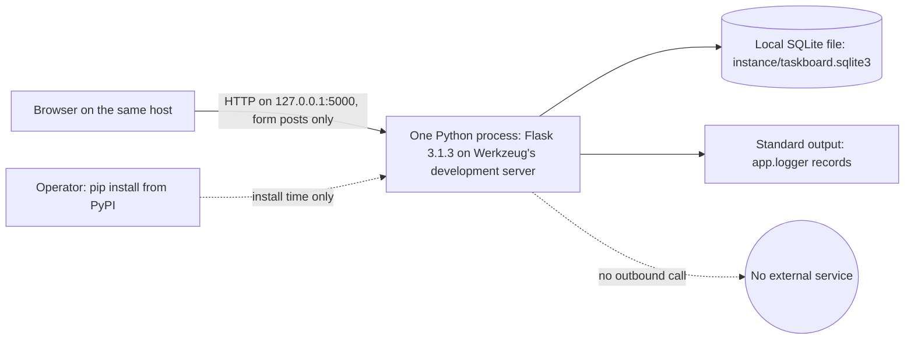

### 3.4.3 Integration and Security Implications

- **The only inbound contract is HTML over loopback.** Twelve method-and-path shapes over eleven URL rules, every request `application/x-www-form-urlencoded`, every response an HTML page (`README.md:203-212`). There is no JSON API, no webhook receiver, no callback endpoint and no `next` or request-supplied redirect target.
- **Nothing leaves the host at run time.** The single network dependency is the install step against PyPI (`requirements.txt`, `requirements-dev.txt`); a running instance needs no egress rule, no proxy configuration and no certificate bundle.
- **Loopback binding is the compensating control for the missing security services.** Because no authentication, authorization, CSRF token or TLS exists, the documented run command binds `127.0.0.1` and the README records that as the condition under which those absences are acceptable (`README.md:147-152`, `:482-495`).
- **The controls that would otherwise be a gateway's job are in the code.** Every statement binds its values (`README.md:472-475`), Jinja autoescaping is never bypassed and no template applies `|safe` (`README.md:476-478`), and the session cookie is `HttpOnly` with `SameSite=Lax` (`app/config.py:56-57`).
- **Adding any service later would touch a narrow, stated set of places.** The configuration surface is two variables with defaults (`app/config.py:53-59`), so a credential or endpoint would need a third; the cookie is signed by `SECRET_KEY`, so a shared deployment needs a real key; and any authenticated capability would have to introduce the account, session and CSRF layers that the current contract deliberately omits.


## 3.5 Databases &amp; Storage

Storage is one SQLite file reached in-process, with no database server, no ORM, no migration engine and no cache tier. `app/db.py` is the only module under `app/` that calls `sqlite3.connect`; `seed.py` opens its own connection to the path it is handed, deliberately, because the `seed-db` command and the test fixtures call it outside an application context (`app/db.py:1-7`; `seed.py:19-22`).

### 3.5.1 Primary Store — SQLite 3.45.1

| Aspect | Configuration | Reason stated in the code |
|---|---|---|
| Engine | SQLite 3.45.1 through the standard library's `sqlite3`; nothing to install and no server process | `README.md:56-57` |
| Location | `DATABASE` setting, default `instance/taskboard.sqlite3`; a relative value is joined onto the repository root, an absolute value used as given | `app/config.py:35`, `:65-95`; `README.md:117` |
| Directory creation | The factory calls `os.makedirs(os.path.dirname(database_path), exist_ok=True)` and translates an `OSError` into one `ClickException` line | `app/__init__.py:140-143` |
| Connection lifetime | One connection per application context, cached on `flask.g` and closed by `teardown_appcontext` | `app/db.py:105-134`, `:162-176`, `:290` |
| Row access | `row_factory = sqlite3.Row`, so services read columns by name and column order never matters | `app/db.py:15-16`, `:126` |
| Referential integrity | `PRAGMA foreign_keys = ON` on every new connection, the only way SQLite enforces the schema's `REFERENCES` and `ON DELETE CASCADE` | `app/db.py:17-19`, `:128` |
| Journal mode | `PRAGMA journal_mode = WAL`, so a reader works from the last committed snapshot while a writer holds the write lock | `app/db.py:20-25`, `:129-132` |
| Lock wait | `sqlite3.connect(..., timeout=30.0)` from `BUSY_TIMEOUT_SECONDS`, with no additional `PRAGMA busy_timeout` so the value has one home | `app/db.py:57-62`, `:123-125` |
| Version floor imposed by SQL | `INSERT ... ON CONFLICT(id) DO UPDATE` requires SQLite 3.24 or later | `app/services/projects.py:63-71` |
| Disposability | `instance/`, `*.sqlite3` and the `-wal`, `-shm`, `-journal` sidecars are ignored by version control; the board is rebuilt by `seed-db` | `.gitignore`; `README.md:460-466` |

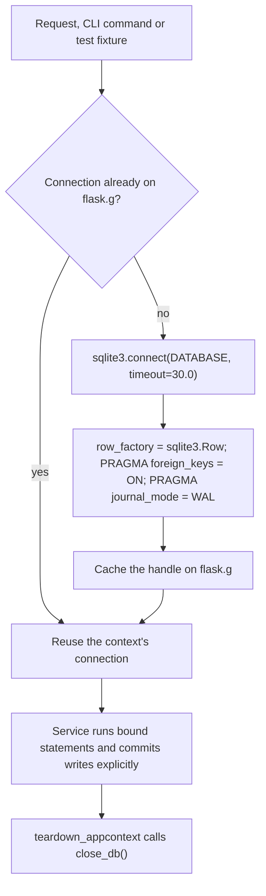

### 3.5.2 Schema and Persistence Strategy

The whole data model is `app/schema.sql` (89 lines): four tables and four indexes, with the rules that belong to the data expressed as constraints.

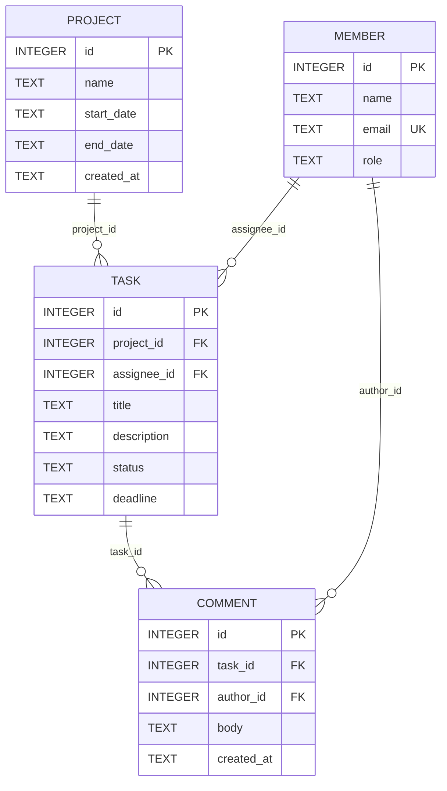

| Table | Rules carried by the schema | Indexes |
|---|---|---|
| `project` | `CHECK (id = 1)` makes "one project" a schema rule; `start_date` and `end_date` constrained to ISO-8601 by `GLOB` and `date()` checks; `created_at`/`updated_at` default to `datetime('now')` | Primary key only (`app/schema.sql:22-36`) |
| `member` | `email` is `UNIQUE`; `name` and `role` bounded to 1–80 characters here rather than in Python, because no form posts them | Primary key only (`app/schema.sql:46-52`) |
| `task` | `status` closed to `pending`, `in_progress`, `completed` by `CHECK`; nullable `project_id`/`assignee_id`; nullable `deadline` with a `GLOB` date shape | `idx_task_status`, `idx_task_assignee`, `idx_task_deadline` (`app/schema.sql:61-72`, `:86-89`) |
| `comment` | `task_id` and `author_id` non-null references; `ON DELETE CASCADE` keeps no comment alive after its task | `idx_comment_task` (`app/schema.sql:76-82`, `:89`) |

| Persistence concern | Strategy | Evidence |
|---|---|---|
| Schema creation | The DDL is idempotent — it carries child-first `DROP TABLE IF EXISTS` statements — so executing the file is a complete build, and executing it twice leaves the same four tables | `app/schema.sql:4-14` |
| First-run bootstrap | `ensure_schema()` probes `sqlite_master` for a `task` table and applies the schema only when it is missing, so a fresh checkout serves pages before anyone seeds | `app/db.py:196-218`; `app/__init__.py:168-172` |
| Reset | `flask --app app init-db` executes the DDL through `current_app.open_resource` (so it resolves from the installed package) and commits, printing "Initialized the database." | `app/db.py:179-193`, `:249-254` |
| Sample data | `flask --app app seed-db` drops and recreates the schema, inserts one project, five members, twelve tasks and eight comments, and prints one summary line | `app/db.py:257-280`; `seed.py` |
| Writes | Services commit explicitly per write and then re-read the row, so the caller receives stored values rather than submitted ones | `app/services/tasks.py:302`, `:344`, `:366`, `:388`; `app/services/comments.py:106-108`; `app/services/projects.py:126` |
| Single-row upsert | The project record is written by one `INSERT ... ON CONFLICT(id) DO UPDATE`, so a save cannot observe an empty table and race another save | `app/services/projects.py:56-71` |
| Read consistency | The dashboard's grouped aggregate and its `COUNT(*)` run inside one explicit deferred transaction and roll back to release the read lock; a caller that already opened a transaction keeps it | `app/services/metrics.py:20-28`, `:96-117` |
| Key validity | Every primary-key read and write is guarded by `is_sqlite_integer`, because `sqlite3` raises `OverflowError` rather than matching nothing for a value outside the signed 64-bit range | `app/db.py:73-78`, `:137-159` |
| Migration | None. A schema change is applied by re-running `seed-db`, which discards the data; there is no incremental path | `README.md:135-140` |
| Tests | Each test builds its own database under pytest's `tmp_path`, so no test touches the application's file | `tests/conftest.py:63-92` |

### 3.5.3 Secondary Storage, Session State and Caching

| Storage concern | Implementation | Evidence |
|---|---|---|
| Session state | A client-side cookie signed with `SECRET_KEY`; it carries flash messages and no credential | `app/config.py:53-59`; `README.md:479-481` |
| Cookie attributes | `SESSION_COOKIE_SAMESITE = "Lax"` and `SESSION_COOKIE_HTTPONLY = True`; no `Secure` flag is set, consistent with plain-HTTP loopback serving | `app/config.py:56-57` |
| Signing key | `SECRET_KEY` from the environment, defaulting to the visibly fake `"dev-only-insecure-secret-key"` | `app/config.py:29-32`, `:55` |
| Per-request memoisation | Two values live on `flask.g` for the life of one context: the SQLite connection and the request's reference day used by the deadline rules | `app/db.py:69-71`; `app/templating.py:87-89`, `:152-179` |
| Cache tier | None. Dashboard figures are derived per request from the task rows, never stored as counters, so no write path can leave a stale number | `app/services/metrics.py:1-18` |
| Log destination | Standard output through `app.logger` at INFO (path-free events) and DEBUG (the resolved database path); no log file, rotation or shipping | `app/__init__.py:41-53`, `:216-217`; `app/db.py:96-102`, `:279-280` |
| Static assets | Files under `app/static/` served by Flask's `static` endpoint; no object storage, no CDN, no asset pipeline | `app/templates/base.html:57`; `README.md:372-377` |
| Backups and retention | None in the system: the database is disposable by design and rebuilt from `seed.py` | `.gitignore`; `README.md:460-466` |

### 3.5.4 Data Types and Concurrency Characteristics

- **Dates** are stored as ISO-8601 `YYYY-MM-DD` text and constrained by `GLOB` plus `date()` in the schema, so a value no calendar can read cannot be stored through the DDL (`app/schema.sql:26-35`, `:69`).
- **Timestamps** are UTC text written by SQLite's `datetime('now')` default, and are rendered as the stored wall-clock value with no time-zone conversion (`README.md:326-328`).
- **Identifiers** are `INTEGER PRIMARY KEY`; the service layer refuses an id outside the signed 64-bit range before binding it (`app/db.py:137-159`).
- **Statuses** are a closed three-value set enforced by `CHECK`, which is what makes the dashboard's counts exhaustive and mutually exclusive (`app/schema.sql:67-68`; `app/services/metrics.py:14-18`).
- **Concurrency** is that of one file: WAL allows readers during a write, one writer holds the lock at a time, and a statement that cannot take the lock waits up to 30 seconds before SQLite reports the database as locked — which surfaces as the 500 page, not as a retry message (`app/db.py:20-25`, `:57-62`).
- **Failure handling** for storage is centralised: an unusable `DATABASE` path, a folder that cannot be created and a schema that cannot be applied all arrive as one `ClickException` naming the setting, the resolved path, the library's reason and the recovery command (`app/__init__.py:140-143`, `:168-172`; `app/db.py:86-94`, `:221-246`).


## 3.6 Development &amp; Deployment

Development is a five-command local workflow over a virtual environment; there is no build step, no container, no pipeline and no deployment target. The toolchain is deliberately as small as the dependency set: a Python interpreter, pip, pytest and coverage.

### 3.6.1 Development Toolchain

| Concern | Tool or configuration | Evidence |
|---|---|---|
| Interpreter | CPython 3.12.3, reached as `python3.12`; `requires-python = ">=3.12"` | `pyproject.toml:5`; `README.md:42-43`; Project Guide §9 |
| Virtual environment | `python3.12 -m venv .venv`, with two documented fallbacks: a `--target` install when `ensurepip` is broken, and `--break-system-packages` on an externally managed interpreter | `README.md:71-110` |
| Dependency installation | `./.venv/bin/python -m pip install -r requirements-dev.txt` | `README.md:73`; `requirements-dev.txt:4` |
| Test runner | pytest, invoked as `./.venv/bin/python -m pytest` from the repository root; `testpaths` and `pythonpath` set so `app`, `seed` and `conftest` import under both `python -m pytest` and bare `pytest` | `pyproject.toml:7-11` |
| Coverage | `addopts = "--cov=app --cov-branch --cov-report=term-missing"` with `fail_under = 85`, `precision = 2`, `show_missing = true` and two `exclude_lines` | `pyproject.toml:12-30` |
| Iteration loop | `pytest tests/test_tasks.py -q --no-cov` for a single module; `--no-cov` is documented as an iteration convenience, not a finishing check | `README.md:196-201`; Project Guide §F |
| Syntax check | `python -m compileall -q app tests seed.py` — the fastest whole-tree check, silent on success | Project Guide §F |
| Environment check | `python -m pip check`; version inspection through `importlib.metadata.version()` | Project Guide §F |
| Linter, formatter, type checker, security scanner | None configured. `pyproject.toml` carries only `[project]`, `[tool.pytest.ini_options]`, `[tool.coverage.run]` and `[tool.coverage.report]`; style is honoured by inspection | `pyproject.toml`; Project Guide §F |
| Editor and OS noise | Ignored rather than configured: `.idea/`, `.vscode/`, `.DS_Store`, `Thumbs.db` | `.gitignore` |
| Version control | Git, with the database, environment, bytecode, coverage output and build output ignored | `.gitignore` |

### 3.6.2 Build System

- **No build configuration is declared.** `pyproject.toml` has no `[build-system]` table, no build requirements, no `dependencies`, no optional dependencies, no scripts or entry points; `[project]` holds only name, version, description and `requires-python` (`pyproject.toml:1-5`). There is no `setup.py`, `setup.cfg` or `MANIFEST.in` anywhere in the tree.
- **The documented workflow never builds a distribution.** Installation is `pip install -r requirements-dev.txt` into a virtual environment, and the application runs from the source tree; nothing produces a wheel or an sdist.
- **Two statements about building conflict and both are recorded here.** `.gitignore` says the `build/`, `dist/` and `*.egg-info/` entries cover "a `pip install .` build of this project, which the `[project]` table in pyproject.toml makes pip run through the setuptools backend", while `pyproject.toml` declares no `[build-system]`, so such a build would depend on pip's legacy setuptools fallback rather than on a pinned backend.
- **A built distribution is not a supported entry point even if it were produced.** `app/db.py`'s `seed-db` command imports the top-level `seed` module and raises a `ClickException` when it cannot be found at the repository root (`app/db.py:268-276`), and the DDL is read as package data through `current_app.open_resource("schema.sql")` (`app/db.py:64-67`, `:188-190`) with no package-data declaration anywhere in the repository. Both facts assume a checkout, which is exactly the documented deployment shape.
- **There is no asset build either.** One hand-written stylesheet is served straight from `app/static/` with no preprocessor, minifier, bundler or cache-busting step (`README.md:11-14`, `:372-377`).

### 3.6.3 Continuous Integration and Delivery

| Capability | Present | Evidence |
|---|---|---|
| CI configuration (GitHub Actions, GitLab CI, Jenkins) | No — the repository contains no `.github/` directory, no workflow file, and not a single `.yml` or `.yaml` file | Checkout inventory: 26 `.py`, 1 `.sql`, 14 `.html`, 1 `.css`, 1 `.toml`, 2 `.txt` |
| Automated gate on a change | No — the 85 % coverage floor is enforced only when someone runs `pytest`, because `addopts` applies it locally | `pyproject.toml:12-30`; Project Guide §6 records "no pipeline" as an accepted operational gap |
| Containerization | No — no `Dockerfile`, no `docker-compose.*`, no image build step | Checkout inventory; Project Guide §9 "no container, database server, broker, queue or VPN is involved" |
| Infrastructure as code | No — no `*.tf`, no cloud templates, no provisioning scripts | Checkout inventory |
| Artifact publishing, release, versioning automation | No — the version is a static `0.1.0` in `[project]`, with no tag or release configuration in the tree | `pyproject.toml:3` |
| Environment parity mechanism | Virtual environment and exact pins only; there is no container image or lock file to reproduce the environment | `requirements.txt`, `requirements-dev.txt` |

### 3.6.4 Run and Deployment Model

| Operational step | Command | What it does |
|---|---|---|
| Seed the board | `./.venv/bin/python -m flask --app app seed-db` | Drops and recreates the schema, inserts the sample dataset, prints `Seeded 1 project, 5 members, 12 tasks, 8 comments.` (`app/db.py:257-280`) |
| Reset to an empty board | `./.venv/bin/python -m flask --app app init-db` | Drops and recreates the schema, prints `Initialized the database.` (`app/db.py:249-254`) |
| Serve the application | `./.venv/bin/python -m flask --app app run --host 127.0.0.1 --port 5000` | Starts Werkzeug's development server on loopback; the schema is applied at start-up when `task` is missing (`app/__init__.py:168-172`) |
| Verify | `./.venv/bin/python -m pytest` | Runs the suite under coverage and enforces the floor (`pyproject.toml:12-30`) |

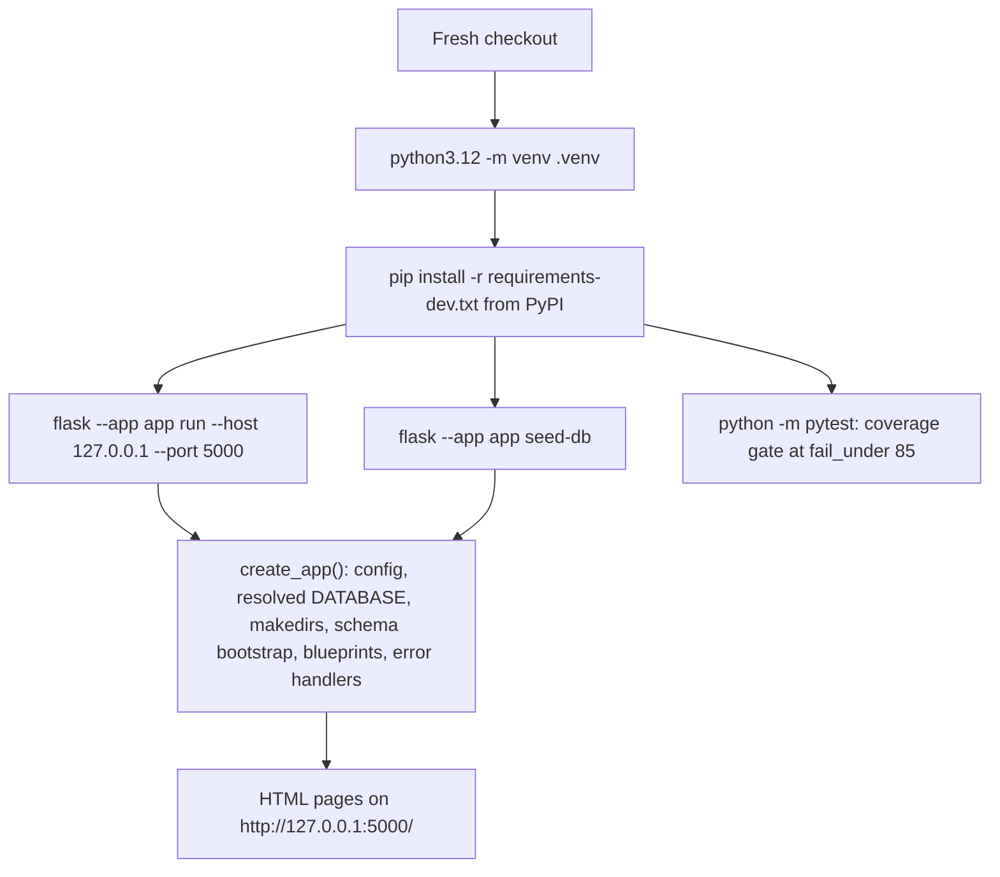

- **The only run mode is a development server.** `flask --app app run` starts Werkzeug's server as a single process; no production WSGI server (Gunicorn, uWSGI, waitress), process manager, reverse proxy or TLS terminator is present in the repository (`README.md:147-152`).
- **The binding is part of the deployment contract.** Every documented command binds `127.0.0.1`, and that binding is what makes the missing authentication, authorization and CSRF layers acceptable (`README.md:482-495`).
- **Configuration is two environment variables, both defaulted.** `DATABASE` (path, resolved against the repository root) and `SECRET_KEY` (cookie signing); no `.env` file is shipped and no other variable is read (`README.md:112-121`; `app/config.py:53-59`).
- **Deployment prerequisites are therefore: CPython 3.12, pip access to PyPI at install time, a writable directory for the SQLite file, and a free loopback port.** Nothing else — no database server, no broker, no credential, no network route at run time — is required.
- **Production posture is a recorded gap, not a hidden one.** The Project Guide lists the absence of a pipeline, a production WSGI server, a migration path, structured logging and monitoring, together with the missing account and CSRF layers, as accepted scope decisions to address before any shared deployment (Project Guide §6 and §8).


## 3.7 References

Every version, path, constraint and absence asserted in this section was read from the checkout below. No web source was consulted; the only external facts are the dependency metadata that the pinned distributions themselves declare (Flask 3.1.3's and Werkzeug 3.1.9's required versions and license fields, read through `importlib.metadata`), plus a dry-run resolution of the two requirements files against the default PyPI index to confirm the pins install on CPython 3.12.

- `pyproject.toml` - PEP 621 metadata (`name`, `version = "0.1.0"`, `requires-python = ">=3.12"`), the absence of any `[build-system]` or `dependencies`, the pytest options and the coverage floor (`fail_under = 85`, `precision = 2`, branch measurement)
- `requirements.txt` - the seven runtime pins (Flask 3.1.3, Werkzeug 3.1.9, Jinja2 3.1.6, itsdangerous 2.2.0, MarkupSafe 3.0.4, click 8.5.0, blinker 1.9.0) with the stated role of each
- `requirements-dev.txt` - `-r requirements.txt` plus the seven test pins (pytest 9.1.1, pytest-cov 7.1.0, coverage 7.17.0, iniconfig 2.3.1, packaging 26.3, pluggy 1.7.0, Pygments 2.21.0)
- `.gitignore` - ignored environment, database and sidecar files, bytecode, build and coverage output, and its setuptools build claim that conflicts with the missing `[build-system]`
- `README.md` - stated requirements (Python 3.12.3, SQLite 3.45.1, the Flask pin table, the dev pins), the install/seed/run/test commands, the two environment variables, the twelve endpoints, the interface conventions (dates, tokens, single breakpoint, no script), and the security notes recording the missing account and CSRF layers
- `seed.py` - the sample dataset and `seed_database`, which opens its own `sqlite3` connection outside any application context
- `app/` - the whole Flask package: 16 modules, 3,360 lines, no import of any third-party package beyond Flask, Werkzeug and click
- `app/__init__.py` - the factory, the Jinja globals, the schema bootstrap in an application context, blueprint registration, the 400/404/405/500 handlers, and the INFO/DEBUG log records
- `app/config.py` - the five-key configuration mapping, `DEV_SECRET_KEY`, `DEFAULT_DATABASE`, and path resolution against the repository root
- `app/db.py` - the only `sqlite3.connect` under `app/`, `BUSY_TIMEOUT_SECONDS = 30.0`, `PRAGMA foreign_keys`, `PRAGMA journal_mode = WAL`, `sqlite3.Row`, the schema probe, the two click commands, the SQLite integer guard and the unusable-database message
- `app/schema.sql` - the four tables, their `CHECK`/`UNIQUE`/`REFERENCES` constraints and the four indexes
- `app/models.py` - the four frozen dataclasses and the status vocabulary
- `app/templating.py` - the four Jinja filters, the two globals, the request-scoped reference day, the fixed English month tuple and the escape-written separator
- `app/validation.py` - the 691-line input boundary that stands in for a form framework
- `app/blueprints/` and its `dashboard.py`, `project.py`, `tasks.py` - the HTTP layer, the `flash()` calls and the route definitions the framework section maps to Flask features
- `app/services/` and its `tasks.py`, `projects.py`, `comments.py`, `metrics.py`, `members.py` - the hand-written parameterized SQL, the explicit commits, the single-row upsert (SQLite 3.24 dependency) and the deferred read transaction that replaces a cache
- `app/templates/` - 14 templates using Jinja `extends`/`block`/`include`/`macro`, with no `|safe`, no script and the single stylesheet link
- `app/templates/base.html` - the HTML5 doctype, `lang="en"`, the one stylesheet link, the `data:` favicon and the statement that the application ships no JavaScript
- `app/static/css/app.css` - the 898-line hand-written stylesheet, its 60 `:root` custom properties and its single 640 px media query
- `tests/` and `tests/conftest.py` - the suite's structure, the per-test temporary SQLite database, the fixed test secret key, and the deliberate absence of `pytest-flask`
- `tests/test_filters.py`, `tests/test_validation.py` - the direct use of `werkzeug.exceptions.BadRequest` and `werkzeug.datastructures.MultiDict` that shows the Werkzeug dependency in tests
- `blitzy/documentation/Project Guide - edb81910-6bfc-43b6-9d36-98820f6a276c.md` - the recorded prerequisites (CPython 3.12.3, SQLite 3.45.1, no container or network), the technology version appendix, the developer tools guide (compileall, `pip check`, `importlib.metadata`), the `flask.__version__` removal notice, and the accepted absence of a pipeline, production WSGI server, migrations and monitoring


# 4. Process Flowchart

## 4.1 System Workflows

Taskboard runs every workflow through one process: a Flask 3.1.3 application started by `create_app` (`app/__init__.py:90-218`), serving twelve endpoints over eleven URL rules, reading and writing one SQLite file through `sqlite3` (`app/db.py`). There is no client-side script, no JSON API, no background worker and no outbound network call, so each workflow is a synchronous HTML round trip and its entire observable state after the response is what has been committed to that file.

The invariant that makes the twelve workflows one shape is the five-stage request pipeline every view follows, described at the top of `app/blueprints/tasks.py:14-25` and enforced by all seven task views, the project view and the dashboard view:

1. **Read** — `request.args` on a read path, `request.form` on a write path.
2. **Parse** — one function in `app/validation.py` returns `(values, errors)`; an empty `errors` mapping is the only success signal (`app/validation.py:1-42`).
3. **Decide** — a non-empty `errors` mapping ends the request before any service call: a data-entry rejection re-renders the view's own template at 200 with the submitted values, a malformed closed-set value becomes the 400 page.
4. **Write or query** — exactly one service function in `app/services/`, which binds parameters and commits at most once.
5. **Answer** — a successful write flashes one message and returns 302 built with `url_for`; a read returns its template at 200.

The workflow inventory below is the set this section documents, and each identifier is used by the diagrams in Section 4.4.

| ID | Workflow | Initiating control | Endpoints | Terminal outcomes |
|---|---|---|---|---|
| W1 | Start-up bootstrap | `flask --app app run` (or any CLI invocation) | none | Application serving; or one `Error:` line and exit status 1 |
| W2 | Database reset | `flask --app app init-db` | none | `Initialized the database.` with an empty schema |
| W3 | Sample-data seeding | `flask --app app seed-db` | none | `Seeded 1 project, 5 members, 12 tasks, 8 comments.` |
| W4 | Dashboard read | Navigation link "Dashboard" | `GET /` | 200 with four counts and the project panel |
| W5 | Task list and filtering | Navigation link "Tasks", filter bar, metric card | `GET /tasks` | 200 with filtered rows and a result line; 400 naming each bad parameter |
| W6 | Task detail read | Task title link in the list | `GET /tasks/<id>` | 200 with the task, its two quick-action forms and its comments; 404 |
| W7 | Task creation | "Create task" / "Create the first task" | `GET /tasks/new`, `POST /tasks` | 200 form; 200 re-render on rejection; 302 to the new task |
| W8 | Task editing | "Edit task" on the detail page, "Edit" in a list row | `GET /tasks/<id>/edit`, `POST /tasks/<id>` | 200 form; 200 re-render; 302 to the detail page; 404 |
| W9 | Status change | Status select plus submit, on the detail page or in a list row | `POST /tasks/<id>/status` | 302 to the task or the filtered list; 400; 404 |
| W10 | Assignment | Assignee select plus submit, on the detail page or in a list row | `POST /tasks/<id>/assign` | 302 to the task or the filtered list; 400; 404 |
| W11 | Comment capture | Add-comment form at the foot of the detail page | `POST /tasks/<id>/comments` | 302 to the detail page; 200 re-render; 404 |
| W12 | Project record save | "Edit project details" / project screen form | `GET /project`, `POST /project` | 200 screen; 200 re-render; 302 to `/project` |
| W13 | Rejection and method recovery (cross-cutting) | Any request that cannot be served as sent | every rule | 400, 404, 405→302, or 500, each inside the shared shell |

### 4.1.1 Core Business Processes

**The reviewer's end-to-end journey.** There is one human actor and it has no identity: no login endpoint, no session beyond the flash cookie, no role or permission check exists anywhere in `app/` (Section 4.2.2 records that absence as a property of the product rather than an omission in this document). A journey therefore starts at a URL rather than at an authentication step, and it may enter at any screen, because every screen is reachable directly — `base.html` links the three top-level endpoints (`dashboard.index`, `tasks.list`, `project.view`), and the task screens link to one another by `url_for`.

The journey that exercises the most of the product, in order:

1. **Bootstrap** (W1) — `create_app` resolves `DATABASE`, creates the folder holding it, then applies `app/schema.sql` if the `task` table is missing (`app/__init__.py:135-172`, `app/db.py:196-218`). A fresh checkout therefore serves an empty board without any command being run (F-014-RQ-001).
2. **Seed** (W3, optional) — `flask --app app seed-db` rebuilds the schema and writes the sample dataset (`app/db.py:257-280`, `seed.py:322-450`), giving the documented board of Total 12 / Completed 3 / Pending 5 / In progress 4.
3. **Orient** (W4) — `GET /` renders four counts computed from the rows on that request and the single project record (`app/blueprints/dashboard.py:37-55`). Each card links into the list already filtered by that status, so the dashboard is an index into W5 rather than a separate reporting path.
4. **Read the board** (W5) — `GET /tasks` parses the three optional filters, answers 400 for a value outside its control's set, then renders rows ordered by `id` plus a result line built from the rendered row count and one unfiltered `COUNT(*)` (`app/blueprints/tasks.py:307-345`).
5. **Inspect** (W6) — the list's title link opens the detail page, which reads the task, its comment thread and the member list (`app/blueprints/tasks.py:388-404`).
6. **Act** — from the detail page or a list row the reviewer may run W9 (status), W10 (assignment) or W11 (comment); from the list toolbar, W7 (create) or W8 (edit). Every one of these writes is followed by a redirect, so a refresh re-reads a page and cannot resubmit.
7. **Record the project** (W12) — `POST /project` inserts row 1 the first time and updates it afterwards through a single upsert (`app/services/projects.py:91-131`). The project start date becomes the lower bound the task deadline rule compares against (`app/validation.py:421-451`), so this workflow changes what the next task save accepts.

**System interactions per journey.** A read path touches only reads: one or two indexed `SELECT` statements plus, for the list and the detail page, the member list that populates the selects. A write path touches the task-existence read (where a task id is in the path), the parser's member lookup (where a member value is submitted), and then exactly one mutating statement followed by a re-read of the row just written. No workflow holds a connection open between requests: `get_db` caches one connection on `flask.g` for the duration of the application context and `close_db` closes it at teardown (`app/db.py:105-134`, `162-176`).

**Decision points.** Six decisions appear in every workflow, and their order is load-bearing because it decides which refusal a malformed request receives:

| Decision | Condition | Outcome | Where |
|---|---|---|---|
| Method branch | `request.method != "POST"` | Render the form's read path; chosen deliberately over testing for GET because Flask adds HEAD to every GET rule | `app/blueprints/tasks.py:376`, `434` |
| Target exists | `get_task(task_id) is None` | 404, decided before the body is parsed | `app/blueprints/tasks.py:428-430`, `463-464`, `498-499`, `531-533` |
| Closed-set value | `is_valid_status` or `resolve_member_id` refuses | 400 naming the parameter, before any write | `app/blueprints/tasks.py:466-468`, `501-506` |
| Carried filters | `origin == "list"` and the `filter_*` fields fail `parse_task_filters` | 400, before the write, so a malformed request about where to return cannot change a row | `app/blueprints/tasks.py:471`, `509`, `150-180` |
| Parser errors | `errors` mapping non-empty | 200 re-render with values retained and nothing written | `app/blueprints/tasks.py:380-381`, `438-439`, `536-537`; `app/blueprints/project.py:92-96` |
| Navigation hint | `origin` from the body, else the query string, else empty | Redirect to the filtered list when it is `list`, otherwise to the task's detail page | `app/blueprints/tasks.py:140-147`, `195-206` |

**Error handling paths.** The write surface has two rejection styles and they are never mixed. A data-entry post — create, edit, comment, project — collects the parser's `{field: message}` map and re-renders its own form at 200, keeping every submitted value in its field so one field is corrected rather than the form retyped (F-012-RQ-005). A quick action or the filter query string carries a single value the interface only ever offers from a closed set, so an out-of-set value means the request itself is malformed and is answered with the 400 page naming the parameter (`app/blueprints/tasks.py:27-40`, `122-137`). An unknown task id is a 404 on every task endpoint, including the three write-only actions, and it precedes payload inspection so a 404 never depends on what was posted. An unexpected failure is answered by the application's own 500 page, which renders no exception text, and a GET or HEAD of a write-only action is redirected to the task page it belongs to instead of receiving Werkzeug's bare 405 (`app/__init__.py:182-214`).

**Where each workflow writes.** Only five statements in the codebase change stored data: `INSERT INTO task`, `UPDATE task` (four fields), `UPDATE task SET status`, `UPDATE task SET assignee_id`, `INSERT INTO comment`, plus the project upsert — all in `app/services/`, all parameterised. The dashboard, the list, the detail page, the filter bar and the metrics module perform no writes at all, which is why W4 to W6 cannot leave the board inconsistent and why their only failure mode is a read that cannot be served.

### 4.1.2 Integration Workflows

Taskboard integrates with nothing external. Verified by inspection of every Python file under `app/` and by the pinned dependency set in `requirements.txt` (Flask, Werkzeug, Jinja2, itsdangerous, MarkupSafe, click, blinker): there is no HTTP client, no message broker, no scheduler, no thread, no queue and no retry loop. The integration surface is therefore entirely local, and consists of the six interfaces below.

| Interface | Direction | Implementation | Data carried |
|---|---|---|---|
| HTML form posts and query strings | Inbound | Flask routing; `application/x-www-form-urlencoded` only; every field arrives as a string and is typed in `app/validation.py` | Task, comment and project fields; three filter values; the `origin` navigation hint |
| HTML responses | Outbound | Jinja2 templates under `app/templates/`, autoescaped, built on one shell (`base.html`) | Rendered pages; 302 with a `Location` built by `url_for`; error pages |
| Signed session cookie | Outbound and inbound | Flask's session, signed with `itsdangerous` using `SECRET_KEY`; `HttpOnly` and `SameSite=Lax`, no `Secure` flag (`app/config.py:53-59`) | Flash text and its category only — no identity, no token |
| SQLite database file | Outbound and inbound | `app/db.py` is the only module that connects during a request; `seed.py` connects on its own when invoked as a command | Four tables and four indexes (`app/schema.sql`); ISO-8601 text dates, UTC text timestamps |
| Process environment | Inbound | `DATABASE` and `SECRET_KEY`, each defaulted so the application starts with neither set (`app/config.py:53-59`) | A database path and a signing key |
| Flask CLI | Inbound | `init-db` and `seed-db` registered by `db.init_app`; the import of `seed` happens inside the command (`app/db.py:249-292`) | Reset and seed instructions; `seed.py` prints the summary line |

**Data flow between the layers.** One request moves its data through a fixed sequence of representations, and no layer reaches around another:

```
form/query MultiDict → Mapping[str, str] → {values, errors} → typed dict
  → service call → parameterised SQL → sqlite3.Row → frozen dataclass
  → Jinja context → autoescaped HTML
```

The `sqlite3.Row` → frozen-dataclass step is `Task.from_row`, `Comment.from_row`, `Project.from_row` and `Member.from_row` (`app/models.py:57-180`), the only place a raw row becomes a value; joined display columns (`assignee_name`, `comment_count`, `author_name`) arrive through `_column` so a query that does not select them still constructs. The frozen dataclass is what templates read, which is why no template indexes a row or resolves an id (F-016-RQ-007).

**API interactions.** There are none in the outbound sense. The application *is* the API: twelve method-and-path shapes over eleven rules, documented as the external contract in `README.md`'s Routes section and decomposed into requirement IDs in Section 2.2. Two interactions are worth calling out as protocol rather than code:

- **Post/Redirect/Get.** Every accepted write answers 302 built with `url_for` from values the view already holds; no redirect target is ever taken from the request, and no `next` parameter exists anywhere in the contract (`app/blueprints/tasks.py:53-55`). The open-redirect pattern is absent rather than mitigated.
- **Filter carry-back.** A quick action posted from a list row carries the three filters as hidden `filter_status`, `filter_assignee` and `filter_deadline` inputs; the status action's own value uses the unprefixed `status` field, so an action value can never become a filter. The carried values are re-validated before the write and the redirect is rebuilt from the validated results — observed as `POST /tasks/1/status` with `origin=list&filter_status=pending&filter_deadline=week` answering `302 /tasks?status=pending&deadline=week`, with an unapplied filter omitted from the query string entirely (`app/blueprints/tasks.py:150-192`).

**Event processing.** The application registers exactly one lifecycle hook: `close_db` on `teardown_appcontext` (`app/db.py:283-292`). There is no `after_request`, no signal receiver, no webhook and no in-process event. State changes become visible by the next read because every screen recomputes from the rows — the dashboard counts are derived per request rather than cached (`app/services/metrics.py:1-32`), and nothing in the codebase maintains a materialised total.

**Batch processing sequences.** Three batch sequences exist, all idempotent, all run outside a request:

| Sequence | Trigger | Steps | Atomicity |
|---|---|---|---|
| Start-up schema probe | Every `create_app` | Resolve path → create folder → `SELECT name FROM sqlite_master WHERE name='task'` → apply `app/schema.sql` only when absent | The probe is one metadata read; a failed `executescript` raises and becomes a `ClickException` |
| `init-db` reset | Operator | `executescript` on `app/schema.sql`, whose own child-first `DROP TABLE IF EXISTS` statements make a complete drop-and-recreate → one `COMMIT` → `Initialized the database.` | Single script execution; doing it twice in a row is safe |
| `seed-db` load | Operator | Drop the four tables → `executescript` the schema → insert the project → `executemany` members → read member ids back → `executemany` tasks → read task ids back → `executemany` comments → `COMMIT` → print the summary | One connection context manager: commit on success, rollback on error, so a half-written dataset is never left behind (`seed.py:346-349`) |

The seed's dangling-reference checks are part of the sequence: a member email the dataset names but the member list does not hold raises `ValueError` naming the email (`seed.py:300-319`), and a task row count that does not match the dataset raises `RuntimeError` (`seed.py:420-427`). Both fail the command rather than writing a partial board.


## 4.2 Flowchart Requirements

Every diagram in Section 4.4 is drawn to the conventions recorded here, so a reader can trace a box in a diagram to the layer, decision and requirement behind it.

### 4.2.1 Actors, Start and End Points, and System Boundaries

The product has two human actors and two machine participants, and no others. Swim lanes in the diagrams of Section 4.4 follow this table exactly.

| Lane | Who or what | Boundary it owns | Evidence |
|---|---|---|---|
| Reviewer | The single human user, unauthenticated and unnamed | Every screen; both halves of every round trip | `app/templates/base.html` shell, all page templates |
| HTTP layer | `app/blueprints/` | Routing, method choice, redirects, flashes, template selection | `dashboard.py`, `tasks.py`, `project.py` |
| Validation | `app/validation.py` | Every submitted string; the closed sets and bounds; the wording of every message | `app/validation.py:98-124`, `142-167` |
| Domain services | `app/services/` | SQL shape, transaction end, dataclass construction; HTTP-free by design | `app/services/__init__.py` |
| Persistence | `app/db.py` and the SQLite file | The connection, its pragmas, schema bootstrap, the CLI commands | `app/db.py:105-218`, `app/schema.sql` |
| Operator | The person at the shell | Start-up, reset and seeding; nothing inside a request | `app/db.py:249-280`, `README.md` Install and Seed |

**Start and end points.** Each workflow below starts at a control the reviewer can reach and ends at a rendered page or a redirect. No workflow is triggered by a timer, a message or another process.

| Workflow | Start point | End point |
|---|---|---|
| W1 Start-up | `flask --app app run` in the repository root | Development server listening; or one `Error:` line and exit status 1 |
| W2 Reset | `flask --app app init-db` | `Initialized the database.`; empty board on the next read |
| W3 Seed | `flask --app app seed-db` | The summary line; the documented board on the next read |
| W4 Dashboard | Navigation link "Dashboard", or `/` typed | 200 dashboard; no error state of its own, because it accepts no input |
| W5 List and filters | Navigation link "Tasks", the filter bar's "Apply filters", or a metric card | 200 filtered list with a result line, or the 400 page |
| W6 Detail | A task title in the list, or a redirect after any task write | 200 detail page, or the 404 page |
| W7 Create | "Create task" (toolbar, dashboard empty state) | 200 create form; 200 re-render; 302 to `/tasks/<new id>` |
| W8 Edit | "Edit task" on the detail page, "Edit" in a row | 200 edit form; 200 re-render; 302 to the detail page; 404 |
| W9 Status change | Status select plus submit on either screen | 302 to the task or the filtered list; 400; 404 |
| W10 Assignment | Assignee select plus submit on either screen | 302 to the task or the filtered list; 400; 404 |
| W11 Comment | Add-comment form on the detail page | 302 to the detail page; 200 re-render; 404 |
| W12 Project record | "Edit project details" or the "Project" navigation link | 200 screen; 200 re-render; 302 to `/project` |
| W13 Rejection | Any request that cannot be served as sent | 400, 404, 405→302 or 500, all inside the shared shell |

**System boundaries.** The application boundary is the WSGI callable returned by `create_app`; nothing crosses it except HTTP requests, the two environment variables and the database file. Inside that boundary the layers are strictly ordered — a blueprint may call `app/validation.py` and `app/services/`, a service may call `app/db.py`, and nothing under `app/services/` imports a web object (`app/services/__init__.py`). The SQLite file is the only durable state, so the boundary that matters operationally is the file: deleting it and re-seeding returns the product to a known state, and no other artefact is written.

**User touchpoints.** Nine screens exist, and each diagram terminates on one of them: the dashboard (`dashboard.html`), the task list (`tasks/list.html`), the create and edit form (`tasks/form.html`, one template serving both), the task detail page (`tasks/detail.html`), the project screen (`project.html`), and the three error pages (`errors/400.html`, `errors/404.html`, `errors/500.html`). The flash region in `base.html` is the only cross-screen feedback element; it renders nothing at all when the queue is empty (`app/templates/partials/_flash.html`).

### 4.2.2 Decision Points, Validation Rules and Authorization Checkpoints

**Decision points.** Every branch a diagram shows is one of the following, and each is reachable only in the stated order.

| # | Decision | Rule | True outcome | False outcome | Requirement |
|---|---|---|---|---|---|
| D1 | Is the method accepted by the matched rule? | Flask routing over eleven rules, one method each | View runs | 405 handler; a GET or HEAD of a write-only action redirects to the task page, anything else keeps Werkzeug's 405 | F-013-RQ-004 |
| D2 | Does the path name an existing task? | `get_task` returns the row or `None`, with ids outside SQLite's 64-bit range answered as missing (`app/services/tasks.py:237-261`) | Continue | `abort(404)` before the body is read | F-003-RQ-002, F-005-RQ-005 |
| D3 | Is the closed-set value in its set? | `is_valid_status` over `("pending", "in_progress", "completed")`; `resolve_member_id` over stored members; `parse_task_filters` over three vocabularies | Continue | `abort(400, description="<parameter>: <sentence>")` | F-005-RQ-002, F-004-RQ-003, F-011-RQ-005 |
| D4 | Are the carried filters valid? | `parse_task_filters` on the `filter_*` fields, before the write | Continue | 400, and the row is not changed | F-011-RQ-006 |
| D5 | Did parsing produce any error? | `errors` non-empty is the only failure signal | 200 re-render, nothing written | One service call | F-012-RQ-001, F-012-RQ-005 |
| D6 | Which navigation does a quick action resume? | `origin == "list"` from the body, else the query string, else empty | Redirect to the rebuilt filtered list | Redirect to `tasks.detail` | F-004-RQ-004 |
| D7 | Is the request a POST? | `request.method != "POST"` selects the read branch, so HEAD takes the GET path | Read branch | Write branch | F-003-RQ-005 |
| D8 | Is the status a completed one, for deadline presentation? | `deadline_state` returns `""` for `completed` | Date alone, no relative word | Overdue / Due today / Due in N days inside the window | F-007-RQ-003 |

**Validation rules at each step.** All bounds and wording live in one module, so a rule and the sentence that describes it cannot drift (`app/validation.py:92-124`). Trimming and NUL removal happen before both the required check and the length check (`app/validation.py:260-276`).

| Field | Rule | Message shown | Requirement |
|---|---|---|---|
| Project `name` | Required after trim; ≤ 120 characters | `Enter a project name.` / `Project names are limited to 120 characters.` | F-009-RQ-004 |
| Project `description` | Optional; ≤ 2000 characters | `Descriptions are limited to 2000 characters.` | F-009-RQ-004 |
| Project `start_date`, `end_date` | Exactly `YYYY-MM-DD`, ASCII digits, hyphens at positions 4 and 7, then `date.fromisoformat`; `end_date` may not precede `start_date` when both parse | `Enter a valid date (YYYY-MM-DD).` / `End date cannot be earlier than the start date.` | F-009-RQ-005 |
| Task `title` | Required after trim; ≤ 200 characters | `Enter a task title.` / `Task titles are limited to 200 characters.` | F-001-RQ-003 |
| Task `description` | Optional; ≤ 2000 characters | `Descriptions are limited to 2000 characters.` | F-001-RQ-002 |
| Task `assignee_id` | Empty means `NULL`; otherwise a run of ASCII digits naming a stored member; leading zeros insignificant; more than 19 significant digits names no row | `Select a team member from the list.` | F-001-RQ-004, F-012-RQ-007 |
| Task `status` | Absent key means `pending`; a present value must be in the closed set, so an empty string is an error rather than a default | `Select a valid status.` | F-002-RQ-003, F-012-RQ-002 |
| Task `deadline` | Optional; ISO date as above; may not precede the stored project `start_date`; later than the project end date is accepted; any valid date while no project row exists | `Enter a valid date (YYYY-MM-DD).` / `Deadline cannot be earlier than the project start date.` | F-006-RQ-001 … F-006-RQ-005 |
| Comment `author_id` | Required and must name a stored member — unlike an assignee, an unattributed comment has no author at all | `Select a comment author.` | F-008-RQ-002 |
| Comment `body` | Required after trim; ≤ 1000 characters | `Enter a comment.` / `Comments are limited to 1000 characters.` | F-008-RQ-003 |
| Filter `status`, `assignee`, `deadline` | Empty is a legitimate "All" and yields no clause; a non-empty value outside its set is a malformed request, and all three are reported independently | `Invalid value for filter 'status'.` / `… 'assignee'.` / `… 'deadline'.` | F-011-RQ-005 |

The database restates two of these as a last line of defence: `status` carries `CHECK (status IN ('pending','in_progress','completed'))`, and both project dates and the task deadline carry a `GLOB '[0-9][0-9][0-9][0-9]-[0-9][0-9]-[0-9][0-9]'` check (`app/schema.sql:22-72`). A row written by another path therefore cannot hold a status or date the application would misread. A violation arriving from the application is not caught — it surfaces as `sqlite3.IntegrityError` and becomes the 500 page (Section 4.3.2).

**Authorization checkpoints: none exist.** This is a property of the product, not a gap in this section. `app/` contains no user table, no login or logout endpoint, no password field, no session identity, no role, no permission check, no ownership column on `task` or `comment`, and no CSRF token (the templates post no hidden token, and `requirements.txt` pins no form-protection library; `author_id` names a member for attribution only). Every endpoint is reachable by anyone who can reach the port. The documented deployment is a developer server bound to the loopback interface (`flask --app app run --host 127.0.0.1 --port 5000` in `README.md`), which is the sole access constraint, and the shipped `SECRET_KEY` default is a visibly fake development key (`app/config.py` `DEV_SECRET_KEY`) so it cannot be mistaken for a real secret. What the code does instead of authorizing is refuse to trust input: every statement binds its values as parameters, every template autoescapes, no redirect target is taken from the request, and every closed set is re-validated at the write. Those are input-integrity controls, not access controls, and any workflow diagram that showed an authentication step would be wrong.

**Regulatory compliance checks: none are implemented.** There is no audit trail (no table or column records who changed a task or when beyond the row's own `updated_at`), no consent capture, no data-subject export or erasure path, no field encryption, no retention policy and no log of access. The database holds user-supplied task titles, descriptions and comment bodies plus five seeded members with a name, role and email; all of it lives unencrypted in one file. Compliance obligations that a deployment may carry are therefore satisfied, if at all, by the surrounding environment and by deleting the file — nothing in the application enforces or evidences them.

### 4.2.3 Error States, Recovery Paths and Timing Constraints

**Error states.** Five responses cover every failure the product can produce, and each is rendered inside the same shell so navigation never disappears.

| State | Trigger | Response | Recovery the interface offers |
|---|---|---|---|
| Field rejection | A data-entry post whose parser returned any error | 200, the view's own form, submitted values retained, one message per offending field, `aria-invalid` and `aria-describedby` wired to it, nothing written | Correct the flagged field and resubmit |
| Malformed request | A closed-set value outside its set on the filter query or a quick action; also a carried filter that fails re-validation | 400 with `errors/400.html`, whose description names the parameter | "Back to the dashboard" link; the malformed value is never echoed |
| Missing target | An unknown task id on any of the five task-specific rules, or a URL that matches no rule | 404 with `errors/404.html`, carrying no id or path from the request | Links to the dashboard and the task list |
| Method mismatch | A method the matched rule does not accept | 302 to the task's detail page for a GET or HEAD of `set_status`, `set_assignee` or `add_comment`; Werkzeug's default 405 otherwise | The redirected page is the one the action belongs to |
| Unexpected failure | Any unhandled exception, including a schema `CHECK` violation | 500 with `errors/500.html`, which renders the code and generic description only — no exception text, traceback, identifier or log excerpt, and no retry control | Header and navigation remain, so the reviewer can leave the failed page |

**Recovery paths.** Recovery is manual and documented rather than automated:

- A rejected form is recovered by correcting one field, because the submitted values and the messages come back together (F-001-RQ-005).
- An unusable `DATABASE` — a directory, or bytes that are not SQLite — is reported as a single `Error:` line naming the setting, the quoted resolved path, the library's reason and the fix, and the process exits with status 1 (`app/db.py:221-246`, `app/__init__.py:140-172`). The documented recovery is to delete the file and re-run `flask --app app seed-db`, which the message itself states.
- A corrupt or unwanted dataset is recovered with `flask --app app init-db` for an empty board or `flask --app app seed-db` for the documented one; both are safe to repeat.
- A missing `seed.py` — the command run from the wrong directory — is reported as `seed.py was not found at the repository root; run this command from there.` rather than a traceback (`app/db.py:268-276`).
- A GET of a write-only action is recovered by the 302, which lands the reviewer on the task page instead of a shell-less 405 (`app/__init__.py:197-214`).

**Timing constraints.** No latency, throughput or availability target is stated anywhere in the repository, and Section 2.2 records that absence rather than inventing one. The timing behaviour the code actually carries is this:

| Constraint | Value | Why it matters to a workflow | Evidence |
|---|---|---|---|
| SQLite busy timeout | 30.0 seconds per statement that needs a lock | Bounds how long a request may wait for a seed run or another tool holding the file, instead of failing the page at sqlite3's 5-second default | `app/db.py:57-62`, `123-125` |
| Journal mode | WAL, set per connection | A reader works from the last committed snapshot while a writer holds the lock, so a dashboard render and a concurrent write do not block each other | `app/db.py:129-132` |
| Reference day | One `date.today()` reading per request, cached on `flask.g` | Every deadline bucket and every rendered indicator on a page is measured from the same day, so a render cannot straddle midnight | `app/templating.py:152-178`, `app/blueprints/tasks.py:334-337` |
| "Due this week" window | Today through today + 6, inclusive, in both the filter and the indicator | The bucket a row is selected by and the word beside its deadline cannot disagree | `app/services/tasks.py:77-81`, `app/templating.py:71-75` |
| Dashboard snapshot | One `BEGIN DEFERRED` read transaction around both statements | Total always equals the sum of the three status counts, even while another connection commits | `app/services/metrics.py:83-117` |
| Seed run | One `date.today()` reading resolves every day offset | A run cannot place the twelve tasks on two different days | `seed.py:341`, `446-449` |
| Server model | One process, Werkzeug development server, loopback only | No worker pool, no timeout policy and no concurrency control beyond the SQLite pragmas above | `README.md` Run section |


## 4.3 Technical Implementation

### 4.3.1 State Management

**State transitions.** A task's only declared state is `status`, a closed set of three values defined once in `app/models.py:31-39` and restated by the schema's `CHECK` (`app/schema.sql:67-68`). There is no transition table in the code or the database: `set_status` stores whatever valid status it is given, so every one of the nine ordered pairs is permitted, including reopening a completed task. Verified directly: a task seeded as `completed` was posted as `pending` and the row read back as `pending`. Two consequences follow and both are requirements rather than accidents:

- **No guarded transitions.** Nothing refuses `completed → pending`, because a board without a workflow engine is the design (F-005-RQ-003). The interface offers the three values in schema order and accepts them in any order.
- **Completion is a presentation and reporting fact, not a lock.** Two rules read the status and both suppress lateness: the overdue filter adds `t.status <> 'completed'` (`app/services/tasks.py:196-201`), and `deadline_state` returns the empty state for a completed task so no relative word is rendered (`app/templating.py:222-256`).

| Entity | Lifecycle | Where |
|---|---|---|
| Project | At most one row, pinned by `CHECK (id = 1)`; created by the first `POST /project` and updated by every later one through a single upsert; `created_at` is excluded from the conflict clause and therefore preserved | `app/schema.sql:22-36`, `app/services/projects.py:68-74`, `91-131` |
| Member | Read-only after seeding; no endpoint creates, edits or deletes a member, so the five sample members are the whole population | `app/services/members.py`, `seed.py:57-83` |
| Task | Created and edited through the two full-field writes, plus two single-column quick actions; never deleted through the interface, so a board only grows unless the operator re-seeds | `app/services/tasks.py:264-389` |
| Comment | Append-only; `created_at` comes from the column default and is never written by Python; `ON DELETE CASCADE` keeps no comment alive after its task is gone, though no code path deletes a task | `app/schema.sql:76-82`, `app/services/comments.py:76-115` |

**Persistence points.** Each mutation is one statement, ended by an explicit `commit()`, followed by a re-read of the row that was written — a mutation's return value is therefore stored state and never a dataclass assembled from the input.

| Mutation | Statement | Commit | Read-back | Evidence |
|---|---|---|---|---|
| Create task | `INSERT INTO task (project_id, title, description, assignee_id, status, deadline)` | Yes, before the read-back | By `lastrowid` through the shared projection | `app/services/tasks.py:290-307` |
| Update task | `UPDATE task SET title, …, updated_at = datetime('now') WHERE id = ?` | Yes | `get_task(task_id)` | `app/services/tasks.py:330-345` |
| Set status | `UPDATE task SET status = ?, updated_at = datetime('now') WHERE id = ?` | Yes | `get_task(task_id)` | `app/services/tasks.py:362-367` |
| Set or clear assignee | `UPDATE task SET assignee_id = ?, updated_at = datetime('now') WHERE id = ?` | Yes | `get_task(task_id)`, through the member join | `app/services/tasks.py:384-389` |
| Add comment | `INSERT INTO comment (task_id, author_id, body)` | Yes, before the read-back | By `lastrowid` through the member join | `app/services/comments.py:105-115` |
| Save project | `INSERT … ON CONFLICT(id) DO UPDATE SET …, updated_at = datetime('now')` | Yes | Row 1 re-read | `app/services/projects.py:118-131` |

`created_at` is never written by application code; both timestamps come from column defaults of `datetime('now')` in UTC, and only `updated_at` moves on a mutation. Confirmed by reading the row before and after a status change: `created_at` was unchanged and `updated_at` advanced by one second.

**Transaction boundaries.** The application uses SQLite's implicit transaction control: the mutating statement opens the transaction and the explicit `commit()` immediately after it ends the transaction, so the write unit is a single statement and no multi-statement business transaction exists anywhere. Three boundaries are worth distinguishing:

- **Write path** — one statement, one commit, then a read outside that transaction. Because the write unit is one statement, a partial write is impossible, and a rejected request never reaches this point at all: parsing and every refusal decision precede the service call (F-012-RQ-005).
- **Dashboard read path** — an explicit `BEGIN DEFERRED` when the connection is not already in a transaction, the grouped aggregate and the `COUNT(*)` run inside that snapshot, and `finally` issues `rollback()` rather than `commit()`, because releasing a read lock needs no write; a caller that already opened a transaction keeps it (`app/services/metrics.py:81-117`).
- **Seed path** — one connection used as a context manager for the whole rebuild, committing on success and rolling back on error, so the drop-recreate-insert sequence is atomic as a unit (`seed.py:346-349`, `449`).

Connections are not pooled and not shared between requests: `close_db` pops the handle at `teardown_appcontext` and closes it (`app/db.py:162-176`), so anything left uncommitted when a request fails is discarded by SQLite when the handle closes.

**Caching requirements.** There is no cache layer, and the three caches that do exist all live inside one application context:

| Cache | Scope | Purpose | Evidence |
|---|---|---|---|
| SQLite connection | One per application context, stored on `flask.g` | A page that reads a task, its comments and the member list uses one handle and one snapshot | `app/db.py:105-134` |
| Reference day | One per request, stored on `flask.g` | Every deadline decision on one render is measured from one day | `app/templating.py:152-178` |
| WAL snapshot | Per connection, in the file's journal mode | Readers do not wait for a writer, and a render sees one consistent snapshot | `app/db.py:129-132` |

Nothing else is cached. The dashboard counts are recomputed on every request (`app/services/metrics.py:1-32`), the task rows are read per request, and no `Cache-Control`, `ETag` or `after_request` hook is configured, so no response carries an application-set caching directive. The schema bootstrap is the one startup-time decision that is not repeated: `ensure_schema` asks `sqlite_master` for the `task` table and applies the DDL only when it is absent (`app/db.py:196-218`).

**Idempotency.** A POST that creates or changes a row is not idempotent by itself; the Post/Redirect/Get shape is what makes a refresh harmless, because the browser re-issues a GET of the target. Two operations are idempotent by construction: `init-db` and `seed-db`, each of which rebuilds from `app/schema.sql`, whose own `DROP TABLE IF EXISTS` statements make a second run leave the same four tables, four indexes and — for the seed — the same twelve tasks and eight comments (verified by running `seed_database` twice). The project upsert is idempotent on its key: repeated saves of the same four values leave one row with an advanced `updated_at`.

### 4.3.2 Error Handling

**Retry mechanisms: none.** No code path retries, sleeps, backs off, or re-issues a failed statement, and no dependency provides a retry policy (`requirements.txt` pins nothing that could). The only waiting the application does is SQLite's busy handler, set to `BUSY_TIMEOUT_SECONDS = 30.0` on the connection (`app/db.py:57-62`, `123-125`), which absorbs a concurrent writer such as a seed run and then reports the database as locked. A lock that outlasts 30 seconds raises `sqlite3.OperationalError`, which is not caught and therefore becomes the 500 page.

**Fallback processes.** The design prefers returning a value to raising, so most failure states are answers rather than exceptions:

- `get_task`, `get_member`, `add_comment`, `update_task`, `set_status` and `set_assignee` return `None` for a missing row, and the route — not the service — decides that this means 404 (`app/services/tasks.py:237-261` is the pattern).
- `get_project` returning `None` is a valid state: the dashboard and project screen render their empty state, and a new task's `project_id` is left `NULL`.
- An id outside SQLite's signed 64-bit range is answered as a missing row by `is_sqlite_integer` before it reaches a bind, so an unrepresentable value cannot raise `OverflowError` (`app/db.py:137-159`).
- A member value that is not a digit run, or is longer than 19 significant digits, is refused without a query being spent on it (`app/validation.py:334-353`).
- `list_tasks` **fails closed**: an unrecognised deadline bucket raises `ValueError` instead of appending no clause, so the query can never widen silently into a full-table read (`app/services/tasks.py:215-224`); the 400 answered by the parser means this is unreachable over HTTP.
- A template filter returns a string for any input, so one unreadable row cannot replace a page with the error view; `format_deadline` states an unreadable value as stored rather than leaving the cell blank (`app/templating.py:19-25`, `259-301`).
- `app_path` builds the shell's links from the application's URL map bound to the literal server name `localhost`, so the three error pages still render for a request whose `Host` header Werkzeug cannot encode — precisely the request that has no URL adapter for `url_for` (`app/templating.py:304-330`).

**Error notification flows.** Three channels exist and they are kept apart by outcome:

| Outcome | Channel | Markup | Evidence |
|---|---|---|---|
| Accepted write | One flash under the header, category `success` | `role="status"` paragraph; the region renders nothing when no message is queued | `app/templates/partials/_flash.html` |
| Rejected submission | Inline messages beside the fields | `role="alert"` summary plus one `<p class="field-error" id="<field>-error">` per field, wired with `aria-invalid` and `aria-describedby` | `app/templates/partials/_field_errors.html` |
| Request-level failure | The application's own error page | `error.name`, `error.code` and the escaped `error.description`; no request value beyond the description | `app/templates/errors/400.html`, `404.html`, `500.html` |

Every flash the codebase emits carries the `success` category — `Task created.`, `Task updated.`, `Status updated to <Label>.`, `Assignee updated.`, `Task unassigned.`, `Comment added.`, `Project details saved.` — so a rejection is never announced the way a success is. The application adds no logging of its own on a failure path; its only records are the start-up INFO line and the DEBUG line carrying the resolved path (`app/__init__.py:41-53`, `216-217`), the schema-applied INFO line (`app/db.py:193`), the seed event's INFO line and its DEBUG path line (`app/db.py:96-102`, `279-280`), and the translated `ClickException` texts, which reach the operator as one `Error:` line with exit status 1.

**Recovery procedures.** The operator-facing runbook, as the code and `README.md` state it:

| Situation | Detection | Procedure |
|---|---|---|
| Fresh checkout, no database | The first request succeeds with an empty board | Nothing — the factory created the folder and applied the schema |
| Unusable `DATABASE` path | One `Error:` line naming the setting, the path, the reason and the fix; exit status 1 | Point `DATABASE` at a writable path, or delete a file that is not SQLite and re-run `flask --app app seed-db` |
| Wrong or stale data | The board shows rows the reviewer did not expect | `flask --app app seed-db` rebuilds schema and sample data; `flask --app app init-db` leaves an empty board |
| Seed run from the wrong directory | `seed.py was not found at the repository root; run this command from there.` | Re-run from the repository root |
| Unexpected 500 | The application's own 500 page, with navigation intact | Re-issue the request; the failed request committed nothing, because the commit follows the single statement and the connection is closed at teardown |
| GET of a write-only action | A 302 to the task's detail page | None needed — the redirect lands the reviewer where the action belongs |


## 4.4 Required Diagrams

The diagrams below are the required set, drawn from the code rather than from a plan: each box names a function, statement or decision the repository actually contains, and each lane is one of the boundaries in Section 4.2.1. Two of them extend diagrams drawn elsewhere and are labelled accordingly — the component and data-flow view is Section 1.2.2 and the write-path decision summary is Section 2.7, which this section expands into per-feature detail, error handling, sequences and state.

### 4.4.1 High-Level System Workflow

One reviewer, one process, one database file, plus the operator's CLI lane. The diagram shows where the pipeline branches: parsing decides between the 200 re-render and the single service call, and a successful write always leaves through a 302 that the browser follows as a new read.

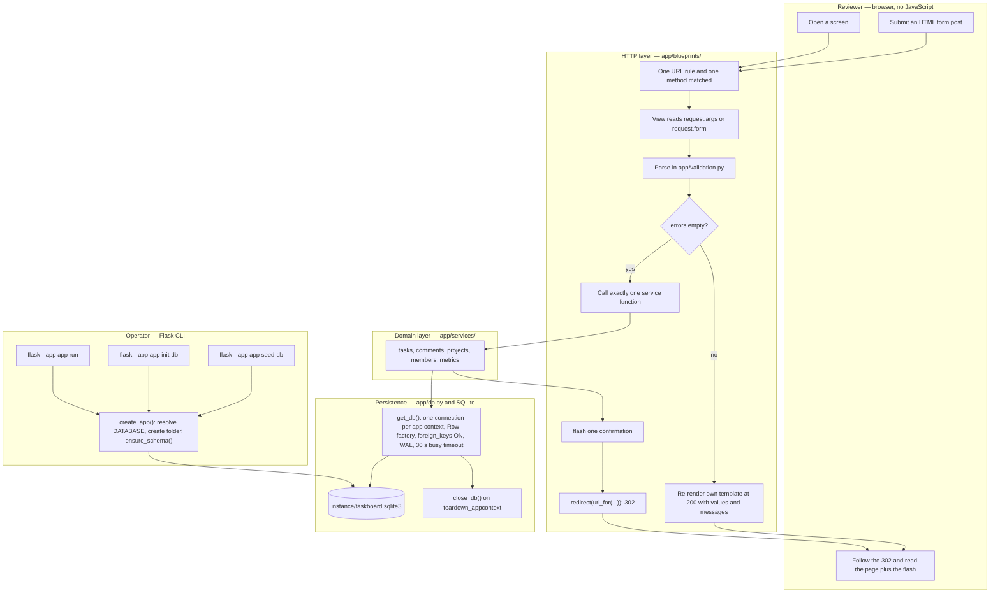

Read it with three facts in mind: the HTTP lane never touches SQL (only the domain lane binds parameters); the persistence lane is entered through one cached connection per request; and the operator lane meets the same `create_app` that a request-serving process does, which is why `init-db` and `seed-db` share the factory's configuration, folder creation and schema bootstrap (F-014, F-015).

### 4.4.2 Detailed Process Flow: Task Creation (W7, F-001)

The two save paths are the only workflows that render a form and accept its post at different rules: `/tasks/new` is a read and `POST /tasks` is the collection write. The diagram also shows why a HEAD probe takes the read branch — the view tests `request.method != "POST"` rather than testing for GET.

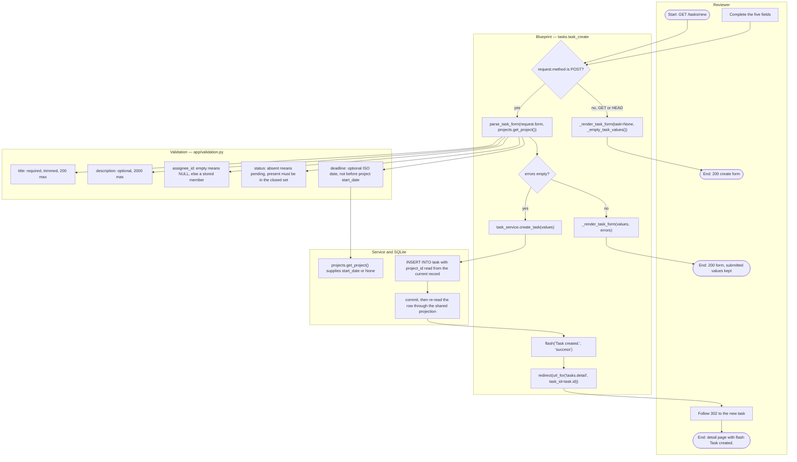

Notes: the initial render's Status select defaults to `pending`, the same value the parser and the schema apply when a submission names none (`app/blueprints/tasks.py:209-217`). `project_id` is never taken from the request — the service reads the current project row and binds `NULL` when none exists (`app/services/tasks.py:285-288`), so a task can be created before the project details are recorded. Five independent field checks all run in one parser call, so a submission with two bad fields returns both messages (F-012-RQ-004).

### 4.4.3 Detailed Process Flow: Task Editing (W8, F-002)

Editing reuses the same parser and the same form template as creation, and adds one decision in front of both: the task is read before the method is inspected, so an unknown id is a 404 whether the reviewer is opening the form or posting a corrected one.

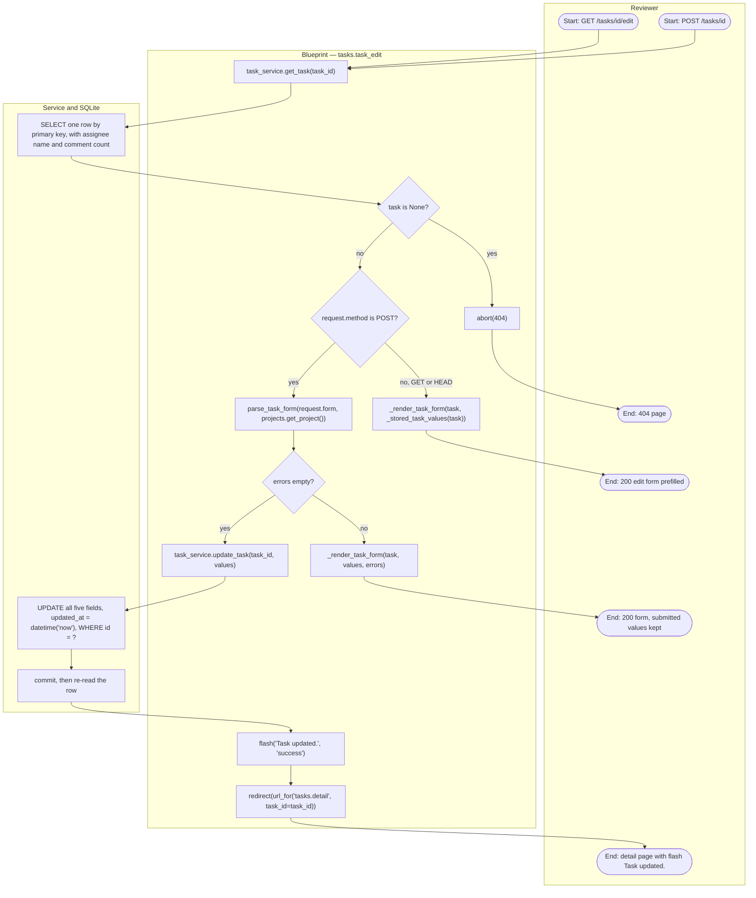

Notes: the update writes all five fields, so an omitted status is stored as `pending` and overwrites the stored value — SQLite applies a column `DEFAULT` on `INSERT` only, which is why the default is bound in Python on both write paths (`app/services/tasks.py:310-345`, F-002-RQ-003). The statement's row count is deliberately not consulted: an edit that changes nothing is still a successful edit.

### 4.4.4 Detailed Process Flow: Board Reads (W4, W5, W6; F-003, F-010, F-011)

Three read entry points share one persistence lane and no write path. The dashboard is the only view that opens an explicit transaction, because its four numbers must describe one snapshot.

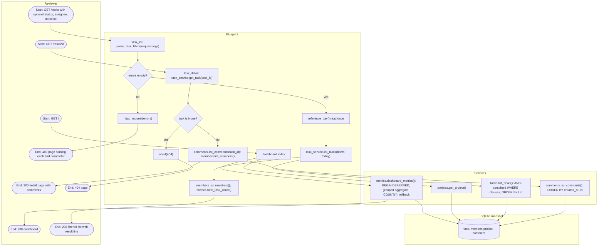

Filter behaviour, as the code applies it in one `WHERE` clause: `status` compares to a bound value; `assignee` is either `t.assignee_id IS NULL` for the `unassigned` sentinel or an equality on a member id; `deadline` becomes one of four predicates — `overdue` is `deadline < today AND status <> 'completed'`, `today` is equality, `week` is `today` through `today + 6`, `none` is `IS NULL` (`app/services/tasks.py:179-231`). Two or three filters combine with `AND`, and an unapplied filter contributes no clause, which is what the "All" option submits.

### 4.4.5 Detailed Process Flow: Task Status Change (W9, F-005)

The quick actions are the workflows where an out-of-set value is a malformed request rather than a mistyped field, and where the three checks are ordered so the cheapest refusal wins.

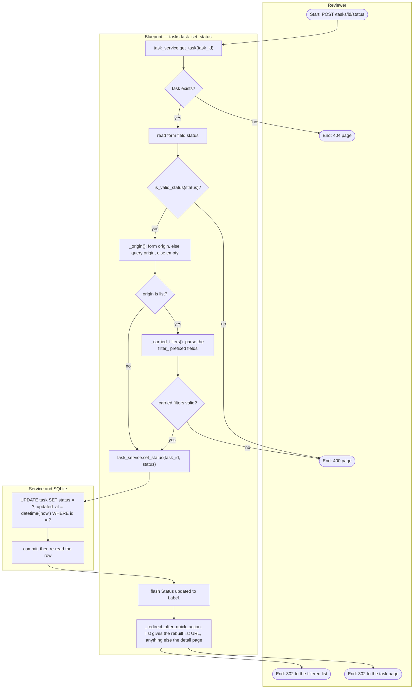

Notes: the 400 description is composed from a fixed constant, `status: Select a valid status.`, so the rejected value is never echoed (`app/blueprints/tasks.py:107-112`). The carried filters are validated *before* the write, which is what makes "a malformed request about where to return cannot change a row" true rather than aspirational. Neither redirect target is taken from the request: `origin` only selects between two targets built with `url_for`.

### 4.4.6 Detailed Process Flow: Task Assignment (W10, F-004)

Assignment differs from the status action in one branch: an empty value is a legitimate instruction to clear the assignment, while any non-empty value must resolve to a stored member through the same function the three form controls use.

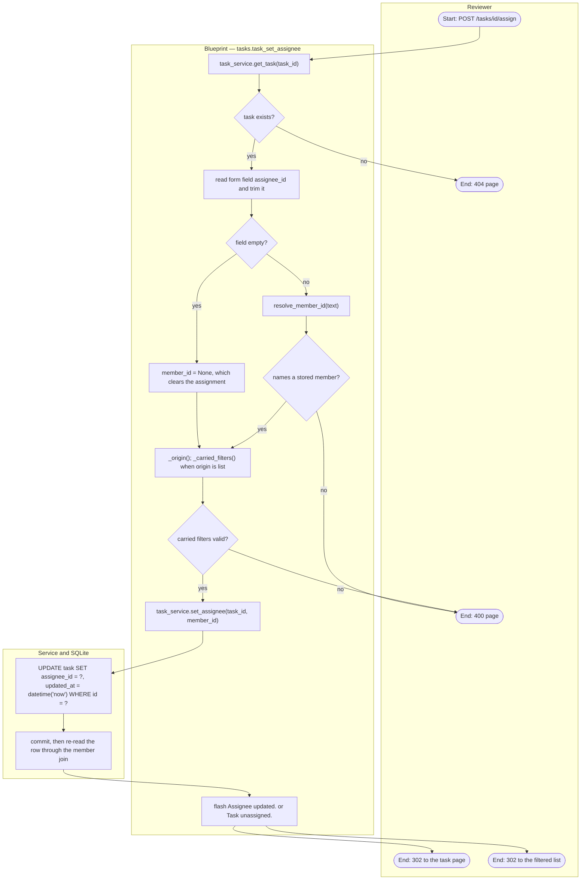

Notes: clearing and assigning share one statement — the value is bound, so `None` clears and a member id assigns (`app/services/tasks.py:370-389`) — and there is no second statement shape that could drift. `resolve_member_id` is the single authority behind the assignee field, the assignee filter, the comment author and this action, so all four accept exactly the same spellings: ASCII digits only, leading zeros insignificant, no more than 19 significant digits, and the id must exist (F-004-RQ-005).

### 4.4.7 Detailed Process Flow: Comment Capture (W11, F-008)

The comment post belongs to the detail page, so its rejection re-renders that page rather than a form of its own, and the typed body survives the round trip.

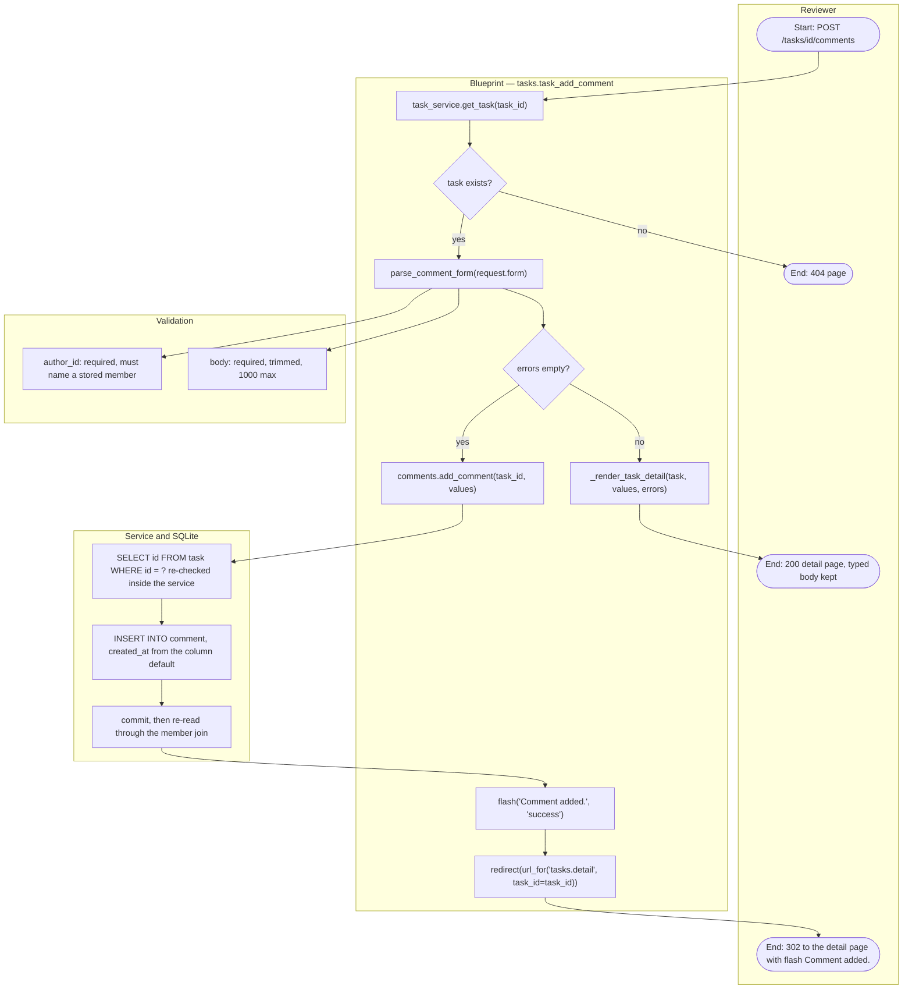

Notes: an author is required, unlike an assignee, because the product has no accounts and a comment with nobody attributed to it would have no author at all (`app/validation.py:454-467`). The service repeats the task-existence check before the insert so an unknown task is `None` rather than a foreign-key exception, even though the view already answered 404 (`app/services/comments.py:99-115`). The conversation reads oldest first with the id as tie-break, and the list's Comments column moves on the next list render because `comment_count` is a correlated subquery in the shared task projection.

### 4.4.8 Detailed Process Flow: Project Record Save (W12, F-009)

One rule serves both the first save and every later edit, and the write is a single upsert, so there is no read-then-branch that two concurrent saves could race.

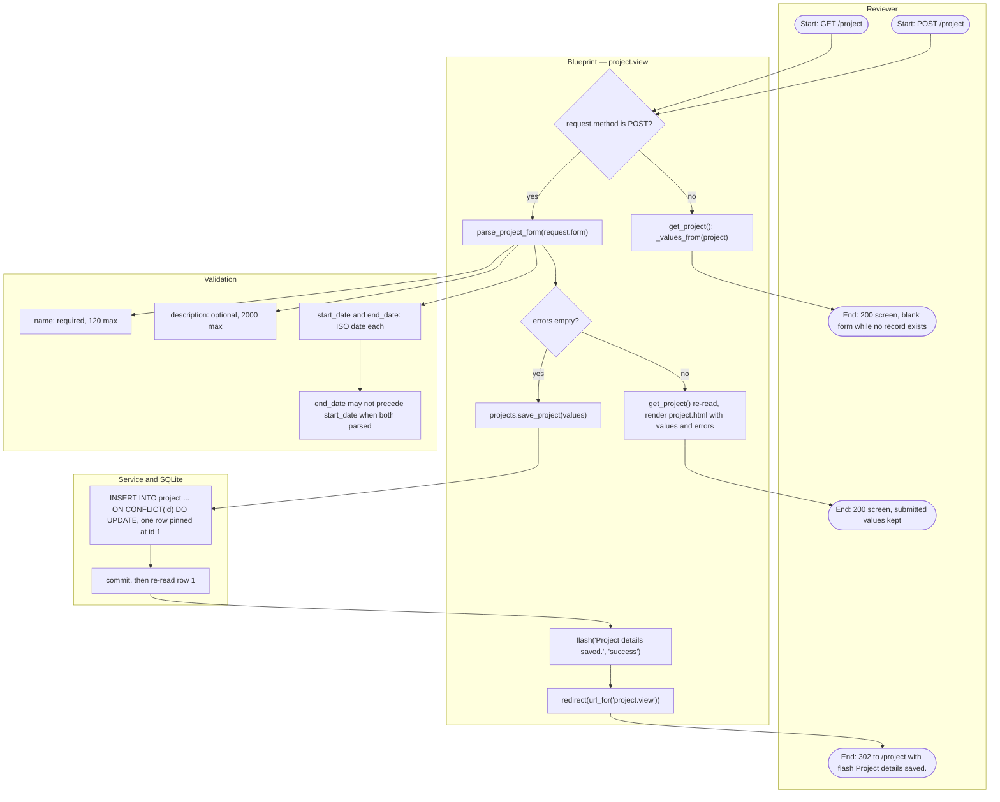

Notes: the ordering rule applies only when both dates parsed, so the reviewer never sees a spurious second problem beside `end_date` while being asked to fix `start_date` (`app/validation.py:518-531`). `created_at` is absent from the `DO UPDATE` list, so it keeps the moment row 1 was first written while `updated_at` moves — verified by saving twice and reading both columns back. An accepted post reads no project row of its own: the redirect's GET does that.

### 4.4.9 Error Handling Flowchart (W13; F-012, F-013)

Every refusal the product can produce, in the order the code decides it. The four numbered outcomes at the bottom are the only ones a request can end in.

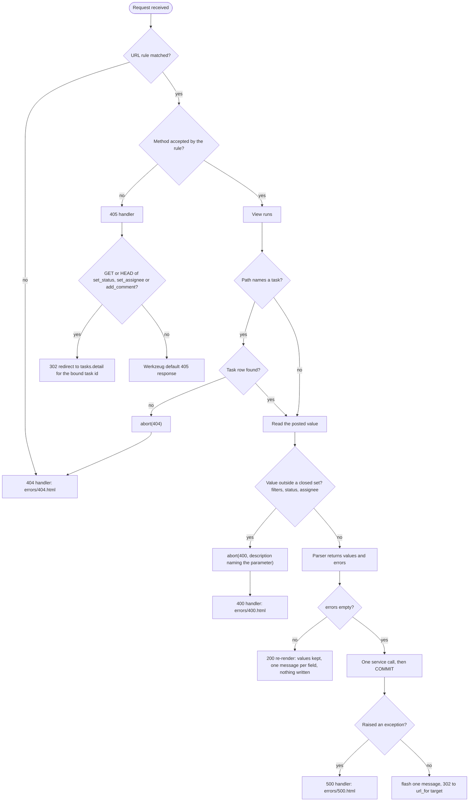

Two boundaries in this chart decide what a failure can leave behind. Everything above the `COMMIT` box is decided before any write, so a 400, a 404 or a 200 re-render changes no row. The `COMMIT` box is the point of no return: a failure **after** it — in the re-read, the flash, or the page the redirect lands on — leaves the committed row in place and surfaces as the 500 page, which is why the operator note in Section 4.3.2 begins by re-issuing the request. The 405 branch is the only place a rejected method produces a redirect: Werkzeug's own 405 page would sit outside the shell, and the route that would have answered the post names the task (`app/__init__.py:63-87`, `197-214`).

### 4.4.10 Start-up and Database Failure Flowchart (W1, W2, W3; F-014, F-015)

The one path that runs before any request, and the two ways it can stop the process with a single readable line instead of a traceback.

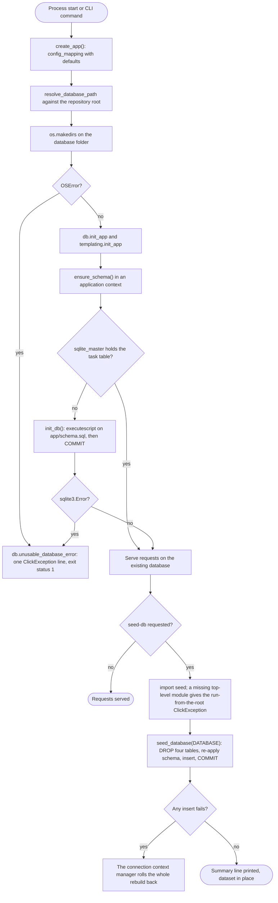

Notes: the folder is the only thing created on the operator's behalf; nothing is repaired, retried or deleted automatically, and a rejected file is left byte-identical (`app/__init__.py:140-172`). The schema probe is one metadata read per process, not per request. `seed-db` imports `seed` inside the command body and translates only a missing *top-level* module, so a genuine error inside `seed.py` keeps its traceback (`app/db.py:268-276`).

### 4.4.11 Integration Sequence Diagram: One HTML Write Request (W9)

The complete round trip for a quick action, including the second request the redirect triggers. This is the sequence that proves the connection is per request rather than per statement, and that the flash is delivered by the page the redirect lands on.

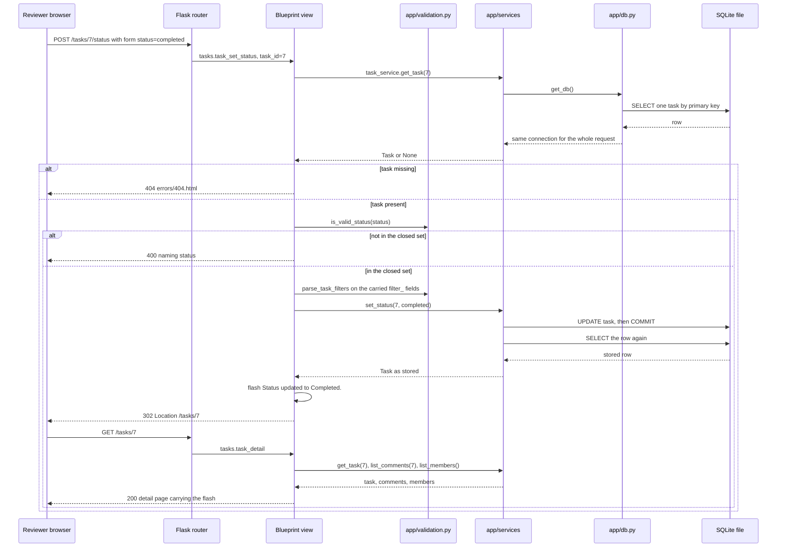

### 4.4.12 Integration Sequence Diagram: Database Lifecycle Commands (W1, W2, W3)

The operator's integration with the system, which is the only place a second connection exists: `seed.py` opens its own handle to the path the command hands it, because it runs outside a request and must stay free of the application context.

```mermaid
sequenceDiagram
    participant O as Operator shell
    participant C as Flask CLI
    participant F as create_app
    participant G as app/config.py
    participant D as app/db.py
    participant Q as SQLite file
    participant Sd as seed.py
    O->>C: flask --app app seed-db
    C->>F: build the application
    F->>G: config_mapping(None)
    G-->>F: DATABASE, SECRET_KEY, cookie flags, TESTING
    F->>G: resolve_database_path(value, repository_root)
    F->>D: db.init_app(app) and templating.init_app(app)
    F->>D: ensure_schema()
    D->>Q: SELECT name FROM sqlite_master WHERE name = task
    alt task table absent
        D->>Q: executescript(app/schema.sql) and COMMIT
    end
    F-->>C: application ready, INFO record logged
    C->>Sd: seed_database(DATABASE)
    Sd->>Q: DROP comment, task, member, project then executescript(schema.sql)
    Sd->>Q: INSERT project, executemany members, SELECT member ids
    Sd->>Q: executemany tasks, SELECT task ids, executemany comments
    Sd->>Q: COMMIT
    Sd-->>O: Seeded 1 project, 5 members, 12 tasks, 8 comments.
    O->>C: flask --app app run
    C->>F: build the application again
    F-->>O: Development server on 127.0.0.1 port 5000
```

Every invocation builds a fresh application, which is why the schema probe appears twice in the sequence and why the factory must not register its CLI commands twice (`app/__init__.py:20-22`, `app/db.py:283-292`). Members are referenced by `email` — the one `UNIQUE` column — and task ids are read back in insertion order because `task.title` is not unique (`seed.py:387-427`).

### 4.4.13 Task State Transition Diagram (F-005, F-007)

The task's declared state machine: three states, nine self-inclusive ordered pairs, no guard on any of them.

```mermaid
stateDiagram-v2
    direction LR
    [*] --> pending: INSERT with status absent or pending
    pending --> in_progress: POST status=in_progress
    pending --> completed: POST status=completed
    in_progress --> pending: POST status=pending
    in_progress --> completed: POST status=completed
    completed --> pending: POST status=pending, reopening allowed
    completed --> in_progress: POST status=in_progress
    pending --> pending: same value posted again
    in_progress --> in_progress: same value posted again
    completed --> completed: same value posted again
    note right of pending
        Every transition refreshes updated_at
        and preserves created_at. No transition
        table exists, so every pair is allowed.
    end note
    note right of completed
        The deadline indicator and the overdue
        filter both suppress the relative word
        and the overdue bucket for this state.
    end note
```

| From | To | Endpoint | Guard | Effect |
|---|---|---|---|---|
| — | `pending` | `POST /tasks`, `POST /tasks/<id>` with no `status` key | None | `_DEFAULT_STATUS` bound in Python, matching the column default |
| `pending` | `in_progress` | `POST /tasks/<id>/status` | Value must be in the closed set | `updated_at` refreshed, row re-read |
| `pending` | `completed` | `POST /tasks/<id>/status` | Same | Same |
| `in_progress` | `pending` | `POST /tasks/<id>/status` | Same | Same |
| `in_progress` | `completed` | `POST /tasks/<id>/status` | Same | Same |
| `completed` | `pending` | `POST /tasks/<id>/status` | Same | Reopening is allowed; no rule refuses it |
| `completed` | `in_progress` | `POST /tasks/<id>/status` | Same | Same |
| any | any value outside the set | `POST /tasks/<id>/status` | `is_valid_status` refuses | 400, no write |

Two derived states sit beside the declared one and are not stored: the deadline state (`overdue`, `today`, `soon`, or none) computed per render from the deadline and the request's reference day, and the assignment state (`Unassigned` when `assignee_id` is `NULL`). Both are pure functions of stored columns, so neither can drift from the row (`app/templating.py:222-301`).

### 4.4.14 Timing and SLA Considerations

No diagram in this section carries a timeout hop, because no workflow waits on another system. The timed elements are the ones a reader of a diagram needs to know about, and they are all inside one process:

| Timed element | Constraint | Where it appears in the diagrams |
|---|---|---|
| Connection establishment | One `sqlite3.connect` with a 30 s busy timeout on first use per request | The `get_db()` hop in 4.4.11; the `get_db()` box in 4.4.1 |
| Statement waiting on a lock | Up to 30 s, then `sqlite3.OperationalError` and the 500 page | Any `UPDATE`/`INSERT` box; the lock contention is expected only against a concurrent seed run or another tool holding the file |
| Read consistency | No wait for a writer: reads use the last committed snapshot under WAL | The dashboard's deferred transaction in 4.4.4; every `SELECT` box |
| Day boundary | One clock reading per request | The `reference_day()` box in 4.4.4, which feeds both the deadline filter and the per-row indicator |
| Seed run | One clock reading for all day offsets; one transaction for the whole rebuild | The `seed_database` lifeline in 4.4.12 |
| Response delivery | Immediate: 200 with the rendered page, or 302 with a `Location` built locally | The final arrow of every per-feature diagram |

What the specification deliberately does not state: there is no request-latency target, no throughput figure, no availability objective and no scheduled job whose interval could be documented. The deployment described by the product is one loopback-only development server with one SQLite file (`README.md` Run section), so the only bounded wait in the whole system is the 30-second busy timeout, and the only thing a client can observe as slow is a page that has to wait behind a writer.


## 4.5 References

Every claim in this section was read out of the following files, plus a set of direct executions against a temporary SQLite file (start-up bootstrap, a seeded board, and the writes described in Sections 4.1 and 4.3).

**Application package**

- `app/__init__.py` — the factory's wiring order, `create_app`, the 400/404/500 handlers, the 405→302 recovery through `_task_id_for_write_action`, the start-up log records and the `ClickException` translation.
- `app/config.py` — the five-key configuration mapping, `DATABASE`/`SECRET_KEY` environment precedence, the development secret key, and `resolve_database_path`.
- `app/db.py` — the only request-time `sqlite3` access point: `get_db` (Row factory, `foreign_keys`, WAL, `BUSY_TIMEOUT_SECONDS = 30.0`), `close_db`, `init_db`, `ensure_schema`, `is_sqlite_integer`, and the `init-db`/`seed-db` commands.
- `app/models.py` — the frozen `Project`/`Member`/`Task`/`Comment` dataclasses, `TASK_STATUSES`, `STATUS_LABELS` and `DEADLINE_FILTER_LABELS`.
- `app/schema.sql` — the four tables, the `CHECK (id = 1)` single-project rule, the status and date checks, the cascade on comments, and the four indexes.
- `app/validation.py` — every parser and the `(values, errors)` contract; all message constants; `FIELD_LIMITS`; the ISO-date shape rule; member resolution; the filter vocabulary and its 400 wording.
- `app/templating.py` — `reference_day` and its `flask.g` cache, `deadline_state`, `format_deadline`, the other presentation filters, and `app_path`.
- `app/blueprints/__init__.py` — the stated per-module contract for the HTTP layer.
- `app/blueprints/dashboard.py` — `GET /` and its two service calls.
- `app/blueprints/tasks.py` — all seven task views and the helpers that carry filters back, choose the redirect, and re-render forms.
- `app/blueprints/project.py` — `GET|POST /project`, the empty-form mapping and the save-then-redirect path.
- `app/services/__init__.py` — the HTTP-free contract of the domain layer.
- `app/services/tasks.py` — the shared task projection, the four filters' predicates, and the four mutations with their commit-and-re-read shape.
- `app/services/comments.py` — the ordered conversation read and the checked insert.
- `app/services/projects.py` — the single-row read and the upsert.
- `app/services/metrics.py` — the dashboard snapshot transaction and the standalone total.
- `app/services/members.py` — the read-only member list and the shared existence check.
- `app/templates/` — the shell and every screen the diagrams terminate on: `base.html`, `dashboard.html`, `project.html`, `tasks/list.html`, `tasks/detail.html`, `tasks/form.html`, `partials/_flash.html`, `partials/_field_errors.html`, `partials/_filter_bar.html`, `partials/_task_table.html`, `errors/400.html`, `errors/404.html`, `errors/500.html`.
- `app/static/css/app.css` — the single stylesheet the shell links; no script or asset pipeline exists beside it.

**Repository root**

- `seed.py` — the sample dataset, the day-offset resolution, the single-transaction rebuild and its summary line.
- `README.md` — the documented contract this section cross-checks against: the twelve-endpoint Route table, the 302/re-render/400/404/500 response rules, the filter carry-back, the loopback run command and the seed summary.
- `requirements.txt` — the seven runtime pins that establish the absence of an ORM, a form-protection library, an HTTP client, a queue or a scheduler.
- `pyproject.toml` — `requires-python`, the pytest `testpaths`/`pythonpath`/`addopts`, and the branch-coverage gate referenced where test-time behaviour matters.

**Tests**

- `tests/` — the nine-module suite that asserts the behaviours this section documents, including the exact message wording and the rule that a rejection writes nothing.
- `tests/conftest.py` — the per-test temporary database fixtures (`db_path`, `app`, `client`, `seeded_client`) that let the flows above be exercised without touching `instance/taskboard.sqlite3`.

No external web source was consulted; every fact here comes from the repository, and the framework behaviours described (Flask adding HEAD to GET rules, SQLite applying a column default on `INSERT` only) are the ones the repository's own comments record and its tests exercise.


# 5. System Architecture

## 5.1 High-Level Architecture

### 5.1.1 System Overview

Taskboard is a **single-process, server-rendered, three-tier monolith** written in Python 3.12 on Flask 3.1.3, persisted in **one SQLite file** and served by one Python process. Every interaction is an HTML link or an HTML form post: no page ships a script, no route answers JSON, and no asset is compiled (`README.md:11-14`). The whole deliverable is the `taskboard` distribution at version `0.1.0` (`pyproject.toml`), built from the root folders `app/` (application package), `seed.py` (sample dataset), `tests/` (pytest suite) and `blitzy/documentation/` (delivery report).

**Architecture style.** A **layered, dependency-ordered architecture** with a **composition root**, inside one deployable unit:

| Layer | Location | Rule it obeys |
|---|---|---|
| Composition root | `app/__init__.py` (`create_app`) | The only place parts are assembled; nothing runs at import time |
| Configuration | `app/config.py` | Imports only `os`; no Flask, no intra-package imports, so it cannot create an import cycle |
| Persistence | `app/db.py`, `app/schema.sql` | The only module under `app/` that calls `sqlite3.connect`; `seed.py` is the deliberate second caller |
| Domain services | `app/services/{projects,members,tasks,comments,metrics}.py` | HTTP-free: no `request`, `flash`, `redirect` or template; each reaches SQLite only through `db.get_db` and returns `app.models` dataclasses |
| Input boundary | `app/validation.py` | Every parser and every user-facing message has exactly one home |
| HTTP layer | `app/blueprints/{dashboard,tasks,project}.py` | Parse the request, call one service, then render, re-render, or flash-and-redirect |
| Presentation | `app/templating.py`, `app/templates/`, `app/static/css/app.css` | Formats and renders; holds no business rule and no SQL |

The ordering is load-bearing, not stylistic: `create_app` wires configuration first, then the resolved database path and its folder, then the data layer and template helpers, then the schema bootstrap, then the blueprints and error handlers (`app/__init__.py:90-218`). `app/config.py` sits at the bottom precisely because it imports nothing else, and `app/services/__init__.py` deliberately imports nothing because the service modules import one another.

**Key architectural principles.**

- **One composition root.** `create_app(test_config=None)` is the only assembly point and the package's only public export (`__all__ = ["create_app"]`). Each test builds its own application on a `tmp_path` database, which a module-level app object would make impossible.
- **One direction of dependency.** Blueprints → validation → services → `db` → SQLite; templates read only what a view hands them. `app/blueprints/dashboard.py:7-10` states the rule for its own module: no `get_db`, no `request`, no `flash`, no `redirect`.
- **Single input boundary.** Every form and query string is parsed in `app/validation.py`, which returns `(values, errors)`. A view never coerces a submitted value itself.
- **Derived data is recomputed, never stored.** Dashboard counts are read from `task` rows on every render, inside one read transaction, so no counter can go stale (`app/services/metrics.py:1-32`, `app/blueprints/dashboard.py:12-16`).
- **Constraints in the schema, wording in Python.** Closed value sets, the single project row and referential integrity are `CHECK`/`UNIQUE`/`REFERENCES` clauses in `app/schema.sql`; character bounds and the rules a reviewer sees are in `app/validation.py`, because that module also owns the message.
- **Failing closed.** A deadline bucket outside the four defined values raises rather than silently widening a query into a full-table read (`app/services/tasks.py:217-224`); a malformed filter is a 400 naming the parameter rather than a silently ignored filter.
- **No request-derived navigation.** Redirect targets are built with `url_for` from values the code already validated; there is no `next` parameter anywhere, so the open-redirect pattern is absent rather than mitigated (`README.md:484-487`).

**System boundaries.** Inside the boundary: the Flask application object, the SQLite file, the templates, the stylesheet, the `init-db` and `seed-db` CLI commands, and the pytest suite. Outside it: there is **no** database server, ORM, migration tool, message broker, queue, scheduler, mail transport, identity provider, object store, CDN, JavaScript bundle or third-party HTTP call — a repository-wide search of `app/` and `seed.py` finds no networking, queueing or caching library, and `requirements.txt` lists exactly seven pins (Flask, Werkzeug, Jinja2, itsdangerous, MarkupSafe, click, blinker) whose roles are all framework-internal.

**Major interfaces.**

| Interface | Shape | Evidence |
|---|---|---|
| Browser ↔ application | HTTP/1.1 over the loopback address; 11 URL rules delivering 12 method-and-path shapes across 9 view functions (1 dashboard, 7 task, 1 project) | `app/blueprints/*.py`, `README.md:203-258` |
| Client ↔ application data | `application/x-www-form-urlencoded` form bodies and query strings only; responses are HTML, redirects and 400/404/405/500 pages | `app/validation.py`, `app/__init__.py:182-214` |
| Application ↔ database | `sqlite3` with bound parameters; connection per request, `sqlite3.Row`, foreign keys on, WAL journal | `app/db.py:105-134` |
| Operator ↔ application | Click commands `init-db` (drop and recreate) and `seed-db` (load sample data); `DATABASE` and `SECRET_KEY` environment variables, both defaulted | `app/db.py:249-280`, `app/config.py:53-62` |
| Application ↔ presentation | Four Jinja filters (`format_date`, `format_datetime`, `status_label`, `deadline_state`), two globals (`format_deadline`, `app_path`) and five vocabulary globals | `app/templating.py:333-347`, `app/__init__.py:154-160` |

### 5.1.2 Core Components

| Component | Primary Responsibility | Key Dependencies and Integration Points | Critical Considerations |
|---|---|---|---|
| Composition root — `app/__init__.py` | Build the application: merge configuration, resolve and create the database folder, initialise data and template layers, bootstrap the schema, mount three blueprints, install four error handlers, restore a read of a write-only action | Depends on `config`, `db`, `templating`, `models`, `validation`, all three blueprints; called by the Flask CLI and by every test fixture | Assembly order is load-bearing; `init-db`/`seed-db` are registered by `db.init_app` and must never be re-registered here; a start-up `OSError` or `sqlite3.Error` becomes one `click.ClickException` line |
| Configuration — `app/config.py` | Own the five default settings and the relative-to-repository-root path rule | Read only by the composition root; reads `DATABASE` and `SECRET_KEY` from the environment | Imports only `os` to stay cycle-free; `instance_path` is deliberately not the resolution base; the default `SECRET_KEY` is a visibly fake development literal |
| Persistence — `app/db.py` + `app/schema.sql` | Open, cache and close the one connection per application context; apply the DDL; expose the two CLI commands; translate an unusable database into a CLI error | Called by all five service modules and by `seed.py` (via its own connection); supplies `sqlite3.Row` rows upward | Foreign keys would be documentation without `PRAGMA foreign_keys = ON`; WAL plus a 30 s busy timeout is the whole contention strategy; a missing `task` table triggers the DDL at start-up |
| Domain services — `app/services/` | Own the business rules and every statement against `project`, `member`, `task` and `comment`; return `app.models` dataclasses | Depend on `app.db.get_db` and `app.models`; call each other (`tasks.create_task` reads the project); called once per request by a view | HTTP-free by contract; writes commit then re-read the row; the dashboard reads both statements of a render inside one deferred transaction; `members` is read-only because no member administration exists |
| Input boundary — `app/validation.py` | Parse every form body and query string; hold every field bound, closed value set and user-facing message | Called by all three blueprints; reads `app.models` vocabularies and the `member` table through `members` to resolve ids | 691 lines, the largest root module; parsers return `(values, errors)` and never raise; the same rule serves the form field, the quick action and the filter |
| HTTP layer — `app/blueprints/` | Turn a request into one service call, then render at 200, re-render a rejected form at 200, or flash and redirect at 302 | Depends on `validation`, `services`, `models`, `templating.reference_day`, Flask request/flash/redirect/render | Three checks in fixed order on quick actions — task exists (404), value in set (400), carried filters valid (400) — all before the write; carried `filter_*` values are re-validated so a malformed return target cannot leave a row changed |
| Presentation — `app/templating.py`, `app/templates/` (14 files), `app/static/css/app.css` | Format dates, datetime stamps, statuses and deadline indicators; render five screens, five partials and three error pages inside one shell; style them from design tokens | Registered by the composition root; reads `models` vocabularies and the five Jinja globals | One reference day per request, cached on `flask.g`, so a bucket and the word beside a deadline cannot describe different days; `app_path` builds shell and error-page links from the URL map so a request with an undecodable `Host` still renders; no `\|safe`, no script, one stylesheet |
| Dataset — `seed.py` | Hold `SAMPLE_DATA` (1 project, 5 members, 12 tasks, 8 comments) and `seed_database(path)`; rebuild the schema, insert, read ids back, print one summary line | Opened by the `seed-db` command and directly by `tests/conftest.py`; opens its own `sqlite3` connection to the path it is handed | Idempotent because it re-executes `app/schema.sql` (drops first); deadlines are day offsets from a single `date.today()` reading; it must stay importable and context-free for the fixtures |
| Verification harness — `tests/` + `pyproject.toml` | Prove the contract: 8 test modules plus `conftest.py`, driving HTTP through Flask's own test client against a per-test temporary database | Builds applications through `create_app`; seeds through `seed.seed_database`; configured by `[tool.pytest.ini_options]` and the `fail_under = 85` coverage gate | No `pytest-flask`, no live server, no network; every write is verified by reading the row back; the gate compares the total, so per-module erosion is not caught |

### 5.1.3 Data Flow Description

**Read: dashboard (`GET /`).** `dashboard.index` calls `metrics.dashboard_metrics()` and `projects.get_project()` inside the view body and hands both results to `dashboard.html` unchanged (`app/blueprints/dashboard.py:51-55`). `dashboard_metrics` opens an explicit `BEGIN DEFERRED` only when the connection is not already in a transaction, returns a grouped aggregate over `task(status)` in one pass, folds the rows into the four keys `total`, `completed`, `pending`, `in_progress` — every key always present, a missing status reading `0` — takes the total from the same `COUNT(*)` the task list uses, and rolls back in a `finally` block so the read lock is released without a write (`app/services/metrics.py:65-118`). Two statements are the whole cost of a render; no stored counter exists.

**Read: filtered task list (`GET /tasks`).** The query string crosses the input boundary first: `parse_task_filters` trims `status`, `assignee` and `deadline`, resolves a member id through the `member` table, and returns `(values, errors)`; any non-empty value outside its control's set produces a 400 whose description names every offending parameter, joined by `"; "` (`app/validation.py:639-691`, `app/blueprints/tasks.py:122-137`). The view then reads **one** reference day through `templating.reference_day()` and passes it to `list_tasks(filters, today)`, so the deadline bucket that selects a row and the word rendered beside its deadline are measured from the same day (`app/blueprints/tasks.py:334-345`). `list_tasks` builds a fixed clause list — `t.assignee_id IS NULL` for the unassigned bucket, a status exclusion for overdue — appends every value as a bound parameter, appends `ORDER BY t.id`, and maps each `sqlite3.Row` through `Task.from_row` into a frozen dataclass carrying the joined `assignee_name` and a correlated `comment_count` (`app/services/tasks.py:129-234`). The "N of M tasks match these filters" line comes from a separate `total_task_count()`.

**Write: create or edit a task.** The form body is parsed by `parse_task_form(request.form, projects.get_project())`; the project start date is passed in so the deadline rule can compare against it. On errors the view re-renders `tasks/form.html` at **status 200** with the submitted values and the parser's field messages, and writes nothing (`app/blueprints/tasks.py:379-381`, `437-439`). On success `create_task`/`update_task` binds parameters, commits, and re-reads the row so the returned dataclass carries the new id, the `datetime('now')` timestamps and the joined assignee name (`app/services/tasks.py:264-345`); the view flashes a fixed sentence and returns a 302 to the task's detail page — post/redirect/get, so a reload cannot repeat the write.

**Write: quick actions on a list row or the detail page.** The three POST-only actions follow one order (`app/blueprints/tasks.py:446-541`): read the task and answer 404 when absent; check the submitted value against its closed set and answer 400 naming `status` or `assignee_id`; re-validate any `filter_*` values a list-origin action carried, answering the same 400 the list would; only then call `set_status` or `set_assignee`. The `origin` hint selects between two targets the application itself names — the rebuilt filtered list URL, or the task's detail page — and an unrecognised or missing hint gets the detail page (`app/blueprints/tasks.py:140-206`).

**Write: comment.** The detail page's comment form is parsed by `parse_comment_form`, which requires an author that exists in the `member` table and a body of 1–1000 characters; a rejection re-renders the detail page at 200 with the conversation, the typed body and the messages intact (`app/blueprints/tasks.py:531-541`). An acceptance inserts one `comment` row and re-reads it joined to its author.

**Write: project.** `GET /project` renders the stored record, or a blank form when none exists. A POST parses four fields, rejects an end date earlier than the start date, then calls `save_project`, which runs a single `INSERT ... ON CONFLICT(id) DO UPDATE` against row 1 — one statement for first save and every later edit, so no read decides between insert and update and two concurrent saves cannot collide on the primary key. `created_at` is absent from the update list, so the record's creation moment survives while `updated_at` advances (`app/services/projects.py:68-131`).

**Write: operator commands.** `flask --app app init-db` executes `app/schema.sql` (child-first drops, then four tables and four indexes) and commits. `seed-db` imports `seed` lazily, calls `seed_database(current_app.config["DATABASE"])` — which re-executes the same DDL, inserts the one project, five members, twelve tasks and eight comments, reads member and task ids back, and prints `Seeded 1 project, 5 members, 12 tasks, 8 comments.` — and logs the event (`app/db.py:249-280`, `seed.py:322-450`).

**Integration patterns and protocols.**

- **HTTP form post + redirect (POST/Redirect/GET).** Every accepted write answers 302 and every rejected one re-renders at 200; no route answers JSON and no route is idempotent by verb alone.
- **Validation-returned tuple, not exceptions.** Parsers answer `(values, errors)`; the view decides between 200 and 400, which keeps the HTTP decision in the HTTP layer.
- **Synchronous in-process calls.** A request makes at most a handful of function calls; there is no asynchronous boundary, retry loop, background task or outbox anywhere.
- **Flash messages through the signed session cookie.** A success sentence is signed with `itsdangerous` into the session cookie, rendered once by `partials/_flash.html`, and popped on read (`app/templates/base.html`, `README.md:479-481`).

**Data transformation points.** Submitted text → trimmed text with NUL characters stripped (`validation._trim`) → validated values (ISO-8601 `YYYY-MM-DD` strings, member ids resolved against `member`, statuses checked against the closed set) → bound SQL parameters → `sqlite3.Row` → frozen dataclass (`Project`, `Member`, `Task`, `Comment` via `from_row`) → Jinja filters (`format_date` renders `26 Oct 2026`, `format_datetime` `26 Oct 2026, 14:03`, `status_label`, `deadline_state`) and the `format_deadline` global (`13 Nov 2026 · Due today`) → escaped HTML. Stored timestamps are always SQLite's `datetime('now')` UTC text; no Python timestamp is ever written.

**Key data stores and caches.**

| Store or cache | Contents | Lifetime and notes |
|---|---|---|
| SQLite file — `DATABASE`, default `instance/taskboard.sqlite3` | Four tables (`project` with `CHECK (id = 1)`, `member` with `UNIQUE email`, `task` with a three-value status `CHECK`, `comment` with `ON DELETE CASCADE`) and four indexes | Created at start-up; disposable and rebuilt by `seed-db`; WAL mode adds `-wal`/`-shm` sidecars, all ignored by `.gitignore` |
| Per-request connection (`flask.g`, key `db`) | One `sqlite3.Connection` with `Row` factory, foreign keys on, WAL | Opened on first use, closed by `close_db` on `teardown_appcontext` — a page that reads a task, its comments and its assignee uses one handle |
| Per-request reference day (`flask.g`) | The single `date` every deadline on the page is measured against | Read once per request; outside a request a fresh reading is returned |
| Signed session cookie | Flash text only — no identity, no role, no data | `HttpOnly`, `SameSite=Lax`, no `Secure` flag; signed with `SECRET_KEY` (`app/config.py:53-58`) |
| Application cache | **None** | There is no `functools` cache, no memoisation and no external cache: dashboard counts and every list are recomputed per request |

### 5.1.4 External Integration Points

The system has **no outbound integration**. It makes no HTTP call, publishes no message, sends no mail, uploads nothing and consults no identity provider; a search of `app/` and `seed.py` for `requests`, `socket`, `smtplib`, `http.client` or `urllib` finds no import, and the templates reference no CDN, remote font or analytics tag. What remains are the local runtime touchpoints every request depends on.

| System / artefact | Integration type | Data exchange pattern and protocol | SLA requirements |
|---|---|---|---|
| Browser (any modern client) | Inbound user interface | HTML forms and links in, HTML pages, 302 redirects and 400/404/405/500 pages out; `application/x-www-form-urlencoded` bodies and query strings, no JSON and no script | None stated; the documented target is one loopback-bound reviewer on `127.0.0.1:5000`, so latency and concurrency budgets are unstated by design |
| SQLite 3.45.1 file (via stdlib `sqlite3`) | Embedded data store — the only one | Synchronous SQL over a local file handle with bound parameters; one connection per request; WAL journal plus a 30 s busy timeout | No SLA documented; a statement that cannot take the write lock within 30 s surfaces as the 500 page — recorded as an open robustness item in `blitzy/documentation` (risk register, line 202) |
| Werkzeug 3.1.9 development server | Process runtime | WSGI call per request inside the single Python process; no worker pool, no reverse proxy, no TLS terminator | Development-grade only: single process, no supervisor, no restart, no health probe endpoint to poll |
| Python 3.12 interpreter and its site-packages | Runtime platform | Import of the `app` package; seven runtime pins resolved from `requirements.txt` | `requires-python = ">=3.12"`; the pinned set was resolved against, and the suite runs on, CPython 3.12.3 (`README.md:42-43`) |
| Click CLI (`flask --app app init-db`, `seed-db`) | Operational interface, out-of-band | Command invocation in the shell; log records and one printed summary line returned | None; both commands are idempotent — `init-db` drops and recreates, `seed-db` rebuilds the schema before inserting |
| Environment variables `DATABASE`, `SECRET_KEY` | Configuration interface | Process environment read once, at `create_app` time | Both optional with working defaults, so the application starts with neither set; no `.env` file is read |

```mermaid
flowchart LR
    Browser["Browser<br/>HTML forms and links"]
    DevServer["Werkzeug dev server<br/>127.0.0.1:5000"]
    subgraph Process["Single Python process: taskboard 0.1.0"]
        App["Flask application<br/>create_app"]
        DBLayer["app/db.py<br/>connection per request"]
        Templates["Jinja2 templates<br/>and app.css"]
    end
    File["SQLite file<br/>instance/taskboard.sqlite3"]
    Env["Environment<br/>DATABASE, SECRET_KEY"]
    Operator["Operator shell<br/>flask init-db / seed-db"]
    Browser -->|"HTTP request"| DevServer
    DevServer -->|"WSGI"| App
    App -->|"get_db"| DBLayer
    DBLayer -->|"parameterised SQL"| File
    App -->|"render_template"| Templates
    Templates -->|"HTML, 302, 4xx/5xx"| DevServer
    Env -->|"read once at start-up"| App
    Operator -->|"Click command"| App
```


## 5.2 Component Details

### 5.2.1 Composition Root and Configuration

**Purpose.** `app/__init__.py` is the one place the application is assembled, and `app/config.py` is the lowest layer it reads. `create_app(test_config=None)` is the package's only public export; nothing runs at import time, so `flask --app app` and every test build an application on demand (`app/__init__.py:1-23,90-218`).

**Responsibilities and ordering.** The factory performs eight steps in an order the rest depends on.

1. `Flask(__name__, instance_relative_config=True)` and `app.config.from_mapping(config.config_mapping(test_config))`.
2. Raise `app.logger` from `NOTSET` to `INFO` when the level is unset, so the factory's own records survive at the documented run command without adding a handler.
3. Resolve `repository_root = os.path.dirname(app.root_path)` and `config.resolve_database_path`, then write the absolute path back into `app.config["DATABASE"]` so every downstream failure message names one value.
4. Create the database folder with `os.makedirs(exist_ok=True)`, translating `OSError` into `db.unusable_database_error`.
5. `db.init_app(app)` (teardown plus the two CLI commands) and `templating.init_app(app)` (four filters, two globals).
6. Publish five template globals — `ASSIGNEE_UNASSIGNED`, `DEADLINE_FILTERS`, `DEADLINE_FILTER_LABELS`, `FIELD_LIMITS`, `TASK_STATUSES` — so a template reads the shared vocabulary instead of restating it.
7. `db.ensure_schema()` inside `with app.app_context()`, translating `sqlite3.Error` into the same CLI error.
8. Register the three blueprints without a `url_prefix`, install the 400/404/500 handlers and the 405 recovery handler, then log one INFO record and one DEBUG record.

**Technologies.** Flask 3.1.3 application factory and config API; `logging`; `os`; `sqlite3` for the single `sqlite3.Error` it catches; `werkzeug.exceptions.HTTPException` for the write-action probe; Click (through `db.unusable_database_error`) for the CLI error type.

**Key interfaces.** `create_app(test_config)` in; a configured `Flask` object out, raising `click.ClickException` when the configured database cannot be created, opened or read as SQLite. The 405 handler's private helper `_task_id_for_write_action(app, request_obj)` binds the URL map to the request environ as a **POST**, matches it, and trusts `arguments["task_id"]` only when it is an `int` — so the endpoint and id are the ones Flask itself binds, not text read back out of the request (`app/__init__.py:63-87,197-214`).

**Configuration surface.** `config_mapping(test_config)` returns a fresh five-key dict each call — `DATABASE` (environment or `instance/taskboard.sqlite3`), `SECRET_KEY` (environment or the visibly fake `dev-only-insecure-secret-key`), `SESSION_COOKIE_SAMESITE = "Lax"`, `SESSION_COOKIE_HTTPONLY = True`, `TESTING = False` — with the caller's mapping layered over it (`app/config.py:53-62`). `resolve_database_path` returns an absolute value unchanged and joins a relative one onto the repository root; it performs no I/O and does not expand `~`. Flask's `instance_path` is deliberately not the base, because it moves to `<prefix>/var/app-instance` for an installed distribution, away from the location `DEFAULT_DATABASE`, the `.gitignore` entry and the documented commands all name.

**Persistence and scaling.** The component persists nothing itself; it creates the folder holding the database and applies the DDL once per application build. Its scaling posture is fixed by design: one application object per process, built on demand, with configuration read once at build time — a second worker would mean a second factory call against the same SQLite file, which the WAL and 30 s busy-timeout settings anticipate but which no documented run command sets up.

### 5.2.2 Persistence Layer

**Purpose.** `app/db.py` plus `app/schema.sql` are the application's entire data-access surface: every connection the product opens and every statement the services run goes through `get_db()`, and no other module under `app/` calls `sqlite3.connect`. `seed.py` opens its own connection to the path it is handed, because the `seed-db` command and the test fixtures both call it outside a request.

**Technologies.** Standard-library `sqlite3` against SQLite 3.45.1 (no server process), `flask.g` for per-context storage, `current_app.open_resource` so the DDL resolves from the installed package rather than the working directory, and `flask.cli.with_appcontext` for the commands.

**Key interfaces.**

| Interface | Contract |
|---|---|
| `get_db() -> sqlite3.Connection` | Cached on `flask.g` under `_DB_KEY = "db"`; `timeout=BUSY_TIMEOUT_SECONDS` (30.0), `row_factory = sqlite3.Row`, `PRAGMA foreign_keys = ON`, `PRAGMA journal_mode = WAL` |
| `close_db(exception=None)` | Pops the handle and closes it; tolerated when no connection was ever opened; registered on `teardown_appcontext` |
| `init_db()` / `ensure_schema() -> bool` | Execute `schema.sql` through `open_resource`; `ensure_schema` probes `sqlite_master` for the `task` table and applies the DDL only when it is missing |
| `is_sqlite_integer(value) -> bool` | The single home of the signed 64-bit bound, checked before binding so an unrepresentable id answers `None` instead of raising `OverflowError` |
| `unusable_database_error(path, reason) -> click.ClickException` | Names the setting, the resolved path, the library's reason and the fix |
| `init-db` / `seed-db` commands | Drop-and-recreate the schema; rebuild the schema and load `seed.py`'s dataset |

**Schema.** `app/schema.sql` opens with child-first `DROP TABLE IF EXISTS` statements, so executing the whole file twice in a row succeeds and leaves the same four tables and four indexes. `project` carries `CHECK (id = 1)`, making "one project" a schema rule rather than a convention, plus GLOB date `CHECK`s; `member` carries `UNIQUE email` and 1–80 character bounds because no form posts a member; `task` carries nullable `project_id` and `assignee_id`, a three-value status `CHECK` and a nullable GLOB-checked deadline; `comment` carries `task_id NOT NULL REFERENCES task(id) ON DELETE CASCADE`. One index serves each read path: `idx_task_status` (status filter and dashboard aggregate), `idx_task_assignee`, `idx_task_deadline`, `idx_comment_task`. Timestamps are `datetime('now')` UTC text; dates are ISO-8601 `YYYY-MM-DD` text.

**Persistence requirements.** The database is a single disposable file, absolute by the time the factory finishes. `instance/` is never committed; `.gitignore` covers the folder, `*.sqlite3` and the WAL sidecars. A statement that cannot take the write lock waits up to 30 seconds — SQLite's own default of five would be outlasted by a seed run or another tool holding the file — and a request that exhausts that wait is currently answered by the 500 page.

**Scaling considerations.** One connection per request, not per call, so a page that reads a task, its comments and its assignee pays for one handle. WAL is what lets a reader work from the last committed snapshot while another connection holds the write lock, which is exactly the dashboard's aggregate read. There is no connection pool, no read replica, no batching and no migration framework: the whole DDL is re-applied from one file, which is why a schema change is a drop of the data by design.

### 5.2.3 Domain Services

**Purpose.** `app/services/` holds the business rules and the SQL, deliberately free of any web object: nothing there imports `request`, `flash`, `redirect` or a template. A view parses the request, calls **one** service function, and renders or redirects. Services reach SQLite only through `app.db.get_db` and return `app.models` dataclasses rather than raw rows, so no template ever indexes a database row.

| Module | Public interface | Persistence behaviour and notable rule |
|---|---|---|
| `services/projects.py` | `get_project()`, `save_project(values)` | Reads/writes row 1 only (`_PROJECT_ID = 1`); the save is one `INSERT ... ON CONFLICT(id) DO UPDATE` so no read decides between insert and update, `created_at` survives and `updated_at` advances; raises `RuntimeError` if the row cannot be re-read (marked `pragma: no cover`) |
| `services/members.py` | `list_members()`, `get_member(member_id)` | Read-only by design — "the request names no member administration"; `get_member` answers `None` without querying for a `None` or out-of-range id; backs the assignee select, the assignee filter and the comment-author select |
| `services/tasks.py` | `list_tasks(filters, today)`, `get_task`, `create_task`, `update_task`, `set_status`, `set_assignee` | The only reader/writer of `task`; every mutation commits then re-reads through the shared `_TASK_SELECT` projection (`LEFT JOIN member` plus a correlated `COUNT(*)` of comments), so a create, a status change and a cleared assignment all return the same row shape; an unknown deadline bucket raises `ValueError` rather than widening the query; `update_task` writes `pending` when status is omitted because a column default applies on `INSERT` only |
| `services/comments.py` | `list_comments(task_id)`, `add_comment(task_id, values)` | Ordered `created_at ASC, id ASC` (oldest first) and joined to the author name; the add path checks the task exists, inserts, commits and re-reads the new row |
| `services/metrics.py` | `dashboard_metrics()`, `total_task_count()` | One grouped aggregate plus one `COUNT(*)`, both inside one `BEGIN DEFERRED` when the caller has no transaction open, rolled back in `finally`; the four keys are always present so the template can read them unconditionally |

**Technologies.** `sqlite3` cursor execution with bound parameters only, frozen dataclasses from `app/models.py`, and `collections.abc.Mapping` for the values the parsers produce. `app/models.py` additionally owns the closed vocabularies `TASK_STATUSES`, `STATUS_LABELS` and `DEADLINE_FILTER_LABELS`, which the parser, the service predicates, the templates and the filter bar all read from one place.

**Key interfaces.** A service takes plain Python values — the parser's mapping, a primary key, a `date` — and returns a dataclass, a list of dataclasses, a count, or `None`. There are no exceptions for user error (an unknown id is `None`; the route decides the 404) and no HTTP-aware types anywhere in the layer.

**Data persistence requirements.** Every write commits explicitly; no service opens a long transaction except the two reads of a dashboard render. Ids are never trusted: `get_task`, `update_task`, `set_status` and `set_assignee` all pass `task_id` through `is_sqlite_integer` first. Assignee and comment-author ids arrive already resolved against the `member` table by the parser, so a foreign key violation from a bad id is unreachable over HTTP.

**Scaling considerations.** The layer is stateless apart from the per-request connection, so it scales exactly as the process does — one process, one file. Query cost is bounded by four indexes and by the fact that no list endpoint paginates: `list_tasks` reads and materialises every matching row, which is comfortable for the documented twelve-task board and is a stated ceiling rather than an accident.

### 5.2.4 Input Boundary

**Purpose.** `app/validation.py` (691 lines) is the single place a submitted value is interpreted and the single place a user-facing message lives. Every parser returns a `(values, errors)` tuple and never raises; the view decides between re-rendering at 200 and aborting with 400.

**Technologies.** Plain Python: string trimming (with NUL characters stripped), exact-shape ISO date parsing, and a `member` lookup through `app.services.members` to resolve assignee and author ids.

**Key interfaces.**

| Parser | Reads | Rules it enforces |
|---|---|---|
| `parse_project_form(form)` | `name`, `description`, `start_date`, `end_date` | Name required and ≤120 characters; description ≤2000; both dates exactly `YYYY-MM-DD` and a real day; end date not earlier than the start date |
| `parse_task_form(form, project)` | `title`, `description`, `assignee_id`, `status`, `deadline` | Title required and ≤200; description ≤2000; assignee empty or a member in the table; status empty (meaning `pending`) or in the closed set; optional deadline valid and not earlier than the project start date |
| `parse_comment_form(form)` | `author_id`, `body` | An author that exists in `member`; body required and 1–1000 characters after trimming |
| `parse_task_filters(args)` | `status`, `assignee`, `deadline` | Each absent or empty value means "not applied"; any non-empty value outside its control's set is an error naming that parameter, and the three are reported independently |
| `resolve_member_id(raw)`, `is_valid_status(value)`, `parse_iso_date(value)` | One field at a time | The same rules the parsers use, shared with the quick actions so the row controls accept exactly the spellings the forms do |

**Persistence requirements.** None — the module writes nothing. `FIELD_LIMITS` (project name 120, title 200, description 2000, comment body 1000) is published to Jinja so a `maxlength` attribute and the rule behind it cannot drift; `DEADLINE_FILTERS` and `STATUS_FILTERS` are derived from the vocabularies in `app/models.py`.

**Scaling considerations.** Pure CPU on short strings, so cost tracks request size, not data size. The one database touch is the member lookup, which rides the same per-request connection and the `member` primary key.

### 5.2.5 HTTP Layer

**Purpose.** `app/blueprints/` is where a request becomes a call. Three modules create their own `Blueprint` and are registered without a `url_prefix`, contributing 11 URL rules and 9 view functions that deliver 12 method-and-path shapes.

| Blueprint | Routes | Shape of the view |
|---|---|---|
| `dashboard.py` | `GET /` → `dashboard.index` | Two service calls, one render; no `request`, no `get_db`, no `flash`, no `redirect` |
| `tasks.py` | `GET /tasks` (`list`), `GET /tasks/new` + `POST /tasks` (`create`), `GET /tasks/<id>` (`detail`), `GET /tasks/<id>/edit` + `POST /tasks/<id>` (`edit`), `POST /tasks/<id>/status`, `POST /tasks/<id>/assign`, `POST /tasks/<id>/comments` | Read rule and write rule share one endpoint per capability, so `url_for(..., _method="POST")` addresses the collection or item path while a plain `url_for` builds the form's own GET |
| `project.py` | `GET`/`POST /project` → `project.view` | Branches on `request.method`; one parser, one service, one flash |

**Technologies.** Flask `Blueprint`, `request`, `flash`, `redirect`, `render_template`, `url_for`, `abort`, plus `werkzeug` exceptions for the error pages. Templates are rendered by name; no view builds HTML.

**Key interfaces and behaviour.**

- **Head returns a rendering, not a write.** The create and edit views branch on `request.method != "POST"`, because Flask adds `HEAD` to every GET rule and a probe must receive the form's bodyless response.
- **Rejected submissions re-render at 200** with the submitted values and the parser's field messages, so the address bar keeps the path that was posted to and nothing is written.
- **Quick actions check in a fixed order:** task exists (404), value in the closed set (400 naming `status` or `assignee_id`), carried `filter_*` values valid (400) — all before the service writes.
- **Filter carry-back.** A list-row action posts the visible filters as hidden `filter_*` inputs; the view re-validates them and rebuilds the list URL from validated values only. The unprefixed `status` name is never read as a filter, which is why the action's own value can never become a filter.
- **Flash sentences are fixed literals:** `Task created.`, `Task updated.`, `Status updated to {label}.`, `Assignee updated.` / `Task unassigned.`, `Comment added.`, `Project details saved.`

**Persistence requirements.** The layer persists nothing directly. It reads through services, and it is the layer that converts a `None` from `get_task` into a 404.

**Scaling considerations.** Views hold no state and no configuration; the only cross-request state is the session cookie a flash message is written into. Because redirects are built with `url_for` from validated values and there is no `next` parameter, no request-borne value can steer a redirect.

### 5.2.6 Presentation Layer

**Purpose.** Turn dataclasses into escaped HTML with one consistent vocabulary: `app/templating.py` (filters and globals), `app/templates/` (14 files, ~1,150 lines) and `app/static/css/app.css` (898 lines, design tokens on `:root`, a single 640 px breakpoint).

**Technologies.** Jinja2 3.1.6 with autoescaping on every `.html` template, MarkupSafe for the escaping machinery, plain hand-written CSS with no framework, preprocessor, bundler, image or font. No template contains a `<script>`, an inline handler, an inline style attribute, a `|safe` filter or a second stylesheet.

**Key interfaces.**

- **Four filters:** `format_date` (`26 Oct 2026`, day not zero-padded), `format_datetime` (`26 Oct 2026, 14:03`, seconds dropped, no time-zone conversion), `status_label` (`Pending`, `In progress`, `Completed`, an unknown value rendering as its own text), `deadline_state` (`overdue` / `today` / `soon` / `""`, with `completed` suppressing every state).
- **Two globals:** `format_deadline` builds the whole indicator (`13 Nov 2026 · Due today`) so the list and the detail page cannot describe one deadline differently; `app_path` builds a path from the application's URL map bound to the literal server name `localhost`, because `url_for` fails for a request whose `Host` header cannot be encoded — the shell and the three error pages still owe that request a page.
- **`reference_day()`** returns the one day a request measures deadlines against, cached on `flask.g` and reused by the list's deadline filter.
- **Template contract:** `base.html` defines exactly two blocks (`title`, `content`), includes `partials/_flash.html` exactly once, and marks the current navigation link with `aria-current`; partials `_metric_card`, `_filter_bar`, `_task_table`, `_flash` and `_field_errors` carry the repeated markup; each page owns one `<h1>` and error controls are wired with `aria-invalid`/`aria-describedby`, with `role="alert"` for errors and `role="status"` for success flashes.

**Data persistence requirements.** None. Presentation state exists only for the duration of a render; the reference day and the flash message are the only values that survive a redirect, and the flash survives only inside the signed session cookie.

**Scaling considerations.** Rendering is proportional to the rows a page shows, and no page paginates; the stylesheet is a single file served by the static endpoint, with no cache-busting hash and no CDN in front of it.

### 5.2.7 Dataset and Verification Harness

**Purpose.** `seed.py` provides the sample board every documented command and test relies on; `tests/` proves the contract.

**Technologies and interfaces.** `seed.py` declares `SAMPLE_DATA` — one project `Website Redesign` (start offset −14 days, end offset +45), five members with name, role and email, twelve tasks spanning all three statuses, assigned and unassigned rows, and eight comments — and exposes `seed_database(path)`, which opens its own connection, re-executes `app/schema.sql`, inserts, reads member and task ids back, and prints `Seeded 1 project, 5 members, 12 tasks, 8 comments.` Deadlines are day offsets resolved against a single `date.today()` reading, so a seeded board is idempotent in shape but relative in date. The suite is `tests/conftest.py` plus eight modules: `db_path`, `app`, `client` and `seeded_client` fixtures point the application at a per-test `tmp_path` database, so nothing touches `instance/taskboard.sqlite3` and no test opens a socket.

**Persistence requirements.** The seed rebuilds rather than patches, so running it twice leaves exactly one project, five members, twelve tasks and eight comments. The harness asserts writes by reading the row back through `app.db.get_db` or a direct `sqlite3` connection, so both "page claims a change nothing stored" and "row changed while the page says nothing did" are caught.

**Scaling considerations.** The suite runs in-process in about 25 seconds (503 cases recorded in `blitzy/documentation`), and `pyproject.toml` enforces `--cov=app --cov-branch` with `fail_under = 85` and `precision = 2`. The floor compares the total, so per-module erosion is not caught — a limitation the delivery report records.

### 5.2.8 Component Interaction Diagram

```mermaid
flowchart TD
    subgraph HTTP["HTTP layer — app/blueprints"]
        DashBP["dashboard.py<br/>GET /"]
        TasksBP["tasks.py<br/>7 views, 9 endpoints"]
        ProjectBP["project.py<br/>GET and POST /project"]
    end
    subgraph Boundary["Input boundary — app/validation.py"]
        Parsers["parse_* parsers<br/>and message constants"]
    end
    subgraph Domain["Domain services — app/services"]
        ProjectSvc["projects.py"]
        MemberSvc["members.py"]
        TaskSvc["tasks.py"]
        CommentSvc["comments.py"]
        MetricSvc["metrics.py"]
    end
    subgraph Data["Persistence — app/db.py + schema.sql"]
        DBLayer["get_db, close_db<br/>ensure_schema, CLI commands"]
        SchemaFile["schema.sql<br/>4 tables, 4 indexes"]
    end
    subgraph Present["Presentation — templating.py, templates/, static/"]
        Filters["4 filters, 2 globals<br/>reference_day"]
        Templates["14 Jinja templates"]
    end
    Models["models.py<br/>frozen dataclasses<br/>and vocabularies"]
    Root["create_app<br/>composition root"]
    SQLiteFile["SQLite file<br/>DATABASE setting"]
    SeedScript["seed.py<br/>SAMPLE_DATA"]

    Root -->|"registers"| HTTP
    Root -->|"init_app"| DBLayer
    Root -->|"init_app"| Filters
    Root -->|"schema bootstrap"| SchemaFile
    DashBP -->|"dashboard_metrics, get_project"| MetricSvc
    DashBP -->|"get_project"| ProjectSvc
    TasksBP -->|"parse form and filters"| Parsers
    TasksBP -->|"list, create, update, set_*"| TaskSvc
    TasksBP -->|"add_comment, list_comments"| CommentSvc
    TasksBP -->|"list_members"| MemberSvc
    TasksBP -->|"dashboard counts"| MetricSvc
    ProjectBP -->|"parse_project_form"| Parsers
    ProjectBP -->|"get_project, save_project"| ProjectSvc
    Parsers -->|"resolve member id"| MemberSvc
    Parsers -->|"vocabularies"| Models
    TaskSvc -->|"get_project for project_id"| ProjectSvc
    TaskSvc -->|"returns Task"| Models
    CommentSvc -->|"returns Comment"| Models
    MetricSvc -->|"TASK_STATUSES"| Models
    ProjectSvc -->|"returns Project"| Models
    ProjectSvc --> DBLayer
    MemberSvc --> DBLayer
    TaskSvc --> DBLayer
    CommentSvc --> DBLayer
    MetricSvc --> DBLayer
    DBLayer -->|"executes"| SchemaFile
    DBLayer -->|"parameterised SQL"| SQLiteFile
    SeedScript -->|"own connection, re-executes DDL"| SQLiteFile
    TasksBP -->|"render_template"| Templates
    DashBP -->|"render_template"| Templates
    ProjectBP -->|"render_template"| Templates
    Templates -->|"format_date, format_deadline"| Filters
    Filters -->|"reference_day"| Filters
```

### 5.2.9 Task Status State Transitions

The closed status set is `pending`, `in_progress`, `completed`, enforced by a `CHECK` constraint in `app/schema.sql:67-68` and by `TASK_STATUSES` in `app/models.py:32`. **Every transition is allowed in both directions** — there is no transition table, no guard and no audit trail — so a completed task can be reopened, which is the capability `README.md:23-25` promises. Two distinct write paths can change the status: the task form (a full-field write that stores `pending` when the status field is empty) and the `POST /tasks/<id>/status` quick action (a targeted `UPDATE` of the status column and `updated_at`).

```mermaid
stateDiagram-v2
    [*] --> pending: "POST /tasks with no status, or the schema default"
    pending --> in_progress: "form edit or quick action"
    in_progress --> pending: "form edit or quick action"
    pending --> completed: "form edit or quick action"
    completed --> pending: "reopen"
    in_progress --> completed: "form edit or quick action"
    completed --> in_progress: "reopen and restart"
    note right of completed
        Completed suppresses every
        deadline state, so finished
        work never reads as late
        (deadline_state, templating.py)
    end note
    note left of pending
        Overdue excludes completed
        rows in the filter predicate
        (services/tasks.py)
    end note
```

### 5.2.10 Sequence Diagrams for Key Flows

**Create a task, with one rejected and one accepted submission.** This flow shows both rejection paths the HTTP layer owns: a parser error re-renders at 200 with nothing written, and the accepted write commits, re-reads the row and answers 302 with a flash.

```mermaid
sequenceDiagram
    autonumber
    actor Reviewer
    participant View as tasks.task_create
    participant Parser as validation.parse_task_form
    participant ProjectSvc as services.projects
    participant TaskSvc as services.tasks
    participant DB as app/db.get_db
    participant Store as SQLite file
    Note over Reviewer,Store: Rejected submission
    Reviewer->>View: POST /tasks (title, status, assignee_id, deadline)
    View->>ProjectSvc: get_project()
    ProjectSvc->>DB: SELECT row id = 1
    DB->>Store: parameterised read
    View->>Parser: parse_task_form(form, project)
    Parser-->>View: values, errors (deadline before project start)
    View-->>Reviewer: 200 tasks/form.html with values and field messages, no write
    Note over Reviewer,Store: Accepted submission
    Reviewer->>View: POST /tasks (corrected form)
    View->>ProjectSvc: get_project()
    View->>Parser: parse_task_form(form, project)
    Parser-->>View: values, no errors
    View->>TaskSvc: create_task(values)
    TaskSvc->>ProjectSvc: get_project() for project_id
    TaskSvc->>DB: INSERT task row, commit
    DB->>Store: parameterised write
    TaskSvc->>DB: get_task(lastrowid) with joined assignee and comment count
    TaskSvc-->>View: Task dataclass as stored
    View-->>Reviewer: 302 /tasks/id with flash "Task created."
```

**Change a status from a filtered list row.** The order of the three checks is the load-bearing part: none of them can leave a row changed, and a malformed return target is rejected before the write rather than after it.

```mermaid
sequenceDiagram
    autonumber
    actor Reviewer
    participant View as tasks.task_set_status
    participant TaskSvc as services.tasks
    participant Parser as validation.parse_task_filters
    participant Templates as templates
    Reviewer->>View: POST /tasks/7/status (status, origin=list, filter_status, filter_deadline)
    View->>TaskSvc: get_task(7)
    alt Task does not exist
        View-->>Reviewer: 404 errors/404.html
    else Task exists
        View->>View: is_valid_status(status)
        alt Status outside the closed set
            View-->>Reviewer: 400 with description "status: Select a valid status."
        else Status accepted
            View->>Parser: parse_task_filters(carried filter_* values)
            alt A carried filter is invalid
                View-->>Reviewer: 400 naming the filter parameter, no write
            else Carried filters valid
                View->>TaskSvc: set_status(7, status)
                TaskSvc->>TaskSvc: UPDATE status and updated_at, commit, re-read
                View-->>Reviewer: 302 /tasks?status=... and flash "Status updated to ..."
            end
        end
    end
    Note over Templates: The redirect target is rebuilt with url_for from validated values only, never from the request
```


## 5.3 Technical Decisions

### 5.3.1 Architecture Style Decision

The system is a **server-rendered monolith with a layered core**, not a service-oriented or client-rendered design. The decision is recorded as a product constraint rather than an emergent choice: the project has one deployable unit, one data file, one language and no build step (`README.md:11-14`, `pyproject.toml`).

| Decision | Alternatives rejected | Rationale observed in the code | Tradeoff accepted |
|---|---|---|---|
| Server-rendered HTML from Flask + Jinja2 | Separate JSON API with a client-side application | Five screens and three error pages need no client state; every interaction is a link or a form post; no page ships a script and there is no bundler, so nothing has to be compiled, versioned or hydrated | No offline use, no rich client behaviour, no third-party consumer of the data; every interaction is a full page load |
| Layer per concern inside one package | Feature-sliced modules, or a single module per route | The dependency order is enforced by imports: blueprints → validation → services → `db` → SQLite, with `config` at the bottom and `templating`/templates at the top (`app/services/__init__.py`, `app/blueprints/dashboard.py:7-10`) | A new capability usually touches four files; the layering pays off because every rule and every message has one home |
| Composition root with an application factory | A module-level `app` object | Tests build an application per temporary database; nothing runs at import time; the CLI builds on demand (`app/__init__.py:1-11`) | Configuration is a function call away from every caller, and the assembly order must be maintained deliberately |
| One SQLite file, no server | Client/server database with a connection pool | The product is a single-project board; the file is created on first run and rebuilt by one command | Concurrency is bounded by one writer; a multi-user deployment is a different architecture |
| Vocabulary owned by the code, not the interface | Free-text statuses, or duplicating labels in templates | `TASK_STATUSES`, `STATUS_LABELS` and `DEADLINE_FILTER_LABELS` live in `app/models.py` and are published to Jinja, so the check constraint, the parser, the service predicates and the filter bar read one set | A new status is a code change plus a schema change, not a data edit |

```mermaid
flowchart TD
    Start["New capability or change requested"]
    Q1{"Needs a new screen<br/>a reviewer interacts with?"}
    Q2{"Needs to change stored data?"}
    Q3{"Needs a form field<br/>a reviewer can submit?"}
    Q4{"Needs a new rule<br/>about stored values?"}
    Render["Add or extend a template<br/>in app/templates"]
    Service["Add a function in app/services<br/>returning app.models dataclasses"]
    Parser["Add a parser rule in<br/>app/validation.py with its message"]
    Schema["Change app/schema.sql<br/>CHECK, UNIQUE or REFERENCES"]
    Route["Add a view in app/blueprints<br/>parse, call one service, render or redirect"]
    Verify["Prove it in tests/<br/>prefer reading the row back"]

    Start --> Q1
    Q1 -->|Yes| Route
    Q1 -->|No| Q4
    Route --> Q3
    Q3 -->|Yes| Parser
    Q3 -->|No| Q2
    Parser --> Q2
    Q2 -->|Yes| Service
    Q2 -->|No| Render
    Service --> Q4
    Q4 -->|Yes| Schema
    Q4 -->|No| Render
    Schema --> Verify
    Render --> Verify
```

### 5.3.2 Communication Pattern Choices

| Pattern | Where it applies | Why it was chosen | What it rules out |
|---|---|---|---|
| POST / redirect / GET for every accepted write | Task create and edit, status, assign, comment, project save | A reload must not repeat a write; the redirect target is built with `url_for` from validated values, so the address bar lands on a page that can be reloaded safely | No idempotent-by-verb writes; a write is never a `GET` |
| Re-render the same form at status 200 for a rejected submission | Task form, project form, comment form | Field messages appear beside the field with the typed values preserved, and the address bar keeps the path that was posted to | No separate error screen, no re-entry of lost input, no `303`-to-a-message flow |
| `(values, errors)` tuples instead of exceptions for user error | Every parser in `app/validation.py` | The HTTP decision (200 versus 400) stays in the HTTP layer while the rule and the wording stay in the parser | Parsers cannot signal a fatal error; a caller that ignores `errors` would silence a rejection |
| Abort with a described status for a malformed request | Task-list filters, the two quick actions, unknown task ids | The 400 page renders the description, so the reader sees which parameter was wrong; the 404 page covers both an unknown id and an unmapped path | No partial rendering of a malformed list, and no silent filter dropping |
| In-process synchronous calls | Every layer boundary | One process, one request at a time per connection; there is nothing to await, retry or serialise | No queue, no scheduler, no background job, no eventual consistency |
| Flash message in the signed session cookie | Every accepted write | Carries one sentence across the redirect without a store; `itsdangerous` signs it and `partials/_flash.html` pops it on render | The cookie is not a session: it holds no identity and no data beyond the flash text |
| Form post only — no JSON, no XML, no headers as input | All 12 method-and-path shapes | A browser form is the only client; `application/x-www-form-urlencoded` is what it sends | No API consumer today, and no content negotiation |

### 5.3.3 Data Storage Rationale

**SQLite through the standard-library `sqlite3` module, with hand-written parameterised SQL, one DDL file and no ORM.**

- **Why a file, not a server.** The product is one project, twenty to a few hundred rows, one reviewer and a single process. A file needs no daemon, no credentials, no port and no install step, which is what lets `flask --app app run` work on a fresh checkout with nothing else configured (`README.md:56-57`).
- **Why no ORM or migration tool.** The entire schema is 89 lines of `app/schema.sql` that carries its own child-first drops, so "apply the schema" and "reset the data" are the same operation and executing it twice is safe. A migration framework would be a second source of truth for four tables.
- **Why raw SQL.** Every statement is visible at its use site with its bind order: the shared `_TASK_SELECT` projection, the `WHERE` fragments `list_tasks` assembles, the `ON CONFLICT(id) DO UPDATE` upsert and the grouped dashboard aggregate. There is no generated SQL to reason about, and no lazy loading to surprise a caller.
- **Where the rules live, and why they are split.** Closed value sets, the single project row, referential integrity and date *shape* are schema constraints (`CHECK (id = 1)`, `status IN (...)`, `UNIQUE email`, `ON DELETE CASCADE`, the GLOB date `CHECK`s). Character bounds and the rules a reviewer sees are in `app/validation.py`, because that module owns the message; the schema comment states this split explicitly (`app/schema.sql:16-21,41-45,54-60`). The overlap is deliberate: the schema stops a row another path wrote, and the parser supplies the sentence.
- **Concurrency posture.** WAL plus a 30 second busy timeout is the whole strategy: a reader works from the last committed snapshot while a writer holds the lock, and a writer that cannot get the lock waits. There is no optimistic locking, no version column and no retry loop — and an exhausted wait is a known gap rather than a handled case (`blitzy/documentation`, risk register line 202).
- **Snapshot consistency for derived numbers.** Because `sqlite3` opens no transaction around a bare `SELECT`, the dashboard's two reads would otherwise observe two snapshots and could render a total one larger than its own three counts. The service therefore wraps both in one explicit `BEGIN DEFERRED` and rolls back (`app/services/metrics.py:20-32,83-118`).

### 5.3.4 Caching Strategy

**There is no application cache, and that is the decision.** No `functools` cache, no memoisation of query results, no external cache and no HTTP cache header is set anywhere in `app/`.

| What could be cached | Decision | Justification |
|---|---|---|
| Dashboard counts | Recomputed on every render | A count is derived data: a create, an assignment or a status change must show on the next load, and no path may leave a stale figure on screen (`app/blueprints/dashboard.py:12-16`). Two statements per render are affordable at this scale |
| Filtered task rows | Read per request | The list is the product's primary working surface; a stale row is a wrong row |
| SQLite connection | Cached per request on `flask.g` | A page that reads a task, its comments and its assignee pays for one handle; the cache is bounded by the request so no connection leaks across requests (`app/db.py:9-13,105-134`) |
| The reference day | Cached per request on `flask.g` | Not a performance cache but a correctness one: one reading of today per request keeps a filter bucket and a rendered deadline word from describing different days (`app/templating.py:152-178`) |
| Static stylesheet | Not versioned, not fingerprinted | One 898-line file with no CDN in front of it; a browser may cache it, and a change is visible on the next reload |
| Prepared statements, indexes | Indexes are the only stored optimisation | Four indexes, one per read path (`app/schema.sql:84-89`); no query plan is pinned and no statement is cached by hand |

### 5.3.5 Security Mechanism Selection

The controls present are those a loopback-only, credential-free test application needs; the controls absent are recorded as decisions, not omissions (`README.md:468-494`, `blitzy/documentation` risk register lines 203-204).

| Concern | Control selected | Evidence | Consequence accepted |
|---|---|---|---|
| SQL injection | Every statement binds its values; no submitted text is ever concatenated into SQL | `app/services/*.py`; the only string assembly in `tasks.py` joins fixed clause fragments with `AND` | A malformed value is a validation error, never a query |
| Cross-site scripting | Jinja autoescaping on every `.html` template; no `\|safe`, no `Markup` on a submitted value, no inline handler, no script | `app/templates/` (14 files), `README.md:476-478` | Task titles, descriptions and comment bodies render as text |
| Session tampering | The session cookie is signed with `SECRET_KEY` by `itsdangerous` and holds only flash text; `HttpOnly` and `SameSite=Lax` set in configuration | `app/config.py:53-58` | `Lax` blocks a cross-site form post from carrying the cookie; the published default key means two instances started without `SECRET_KEY` accept each other's cookies — documented, accepted |
| Network exposure | Every documented command binds `127.0.0.1`, so nothing is reachable from the network | `README.md:148-152,482-483` | A shared deployment is out of scope rather than mis-configured |
| Open redirect | No route reads a redirect target from the request; there is no `next` parameter; both quick-action targets are built with `url_for` from validated values | `app/blueprints/tasks.py:140-206`, `README.md:484-487` | The pattern is absent, not mitigated |
| Oversized or malformed input | Field bounds in `FIELD_LIMITS`, exact-shape date parsing, closed value sets, a signed-64-bit check before any id is bound | `app/validation.py`, `app/db.py:137-159` | A rejected submission never reaches a statement |
| Trusting the client for identity | Assignee and comment author are explicit form fields resolved against the `member` table, never taken on trust | `app/validation.py:334-398,454-475` | There is no identity to forge because there is no identity |
| Authentication, authorization, CSRF | **None present** — no accounts, no sign-in, no roles, no token | Repository-wide search; `README.md:489-494` | Accepted by design at High severity; any deployment beyond a single loopback reviewer is new scope |

### 5.3.6 Architecture Decision Records

| ID | Decision | Status and consequence |
|---|---|---|
| ADR-01 | **Server-rendered Flask monolith with one SQLite file, no JSON API, no client script and no build step** | Accepted. Delivers the whole product from one process and one file; prices out client-side interactivity and any programmatic consumer |
| ADR-02 | **Application factory (`create_app`) as the only assembly point**, with nothing executed at import time | Accepted. Makes a per-test isolated application possible; requires the assembly order to be maintained and forbids re-registering the CLI commands in the factory |
| ADR-03 | **Layered package with an HTTP-free service layer** that owns all SQL and returns dataclasses | Accepted. Every rule has one home and services are testable without a request; a new capability usually touches four files |
| ADR-04 | **Resolve `DATABASE` against the repository root, not Flask's `instance_path`** | Accepted. Keeps `DEFAULT_DATABASE`, `.gitignore` and the documented commands pointing at one file; an installed distribution still serves the documented location |
| ADR-05 | **One DDL file that carries its own drops**, applied by `init-db`, by `seed-db` and at start-up when `task` is missing | Accepted. Applying the schema and resetting the data are one operation and idempotent; a schema change is a data loss by design, so there is no migration path |
| ADR-06 | **Derived dashboard counts recomputed per render inside one deferred read transaction**, never stored | Accepted. No stale figure is possible and the four numbers always describe one snapshot; costs two statements per dashboard render |
| ADR-07 | **Recompute every write's result by re-reading the row** with the shared joined projection | Accepted. The response reflects what the database holds, including timestamps and joined names; each mutation pays one extra read |
| ADR-08 | **Post/redirect/get for accepted writes, 200 re-render for rejected ones** | Accepted. Reloads cannot repeat a write and typed input survives a rejection; the address bar keeps a posted path after a rejection |
| ADR-09 | **Fail closed on an unrecognised deadline bucket** by raising `ValueError` in the service | Accepted. An unvalidated filter can never widen into a full-table read; the HTTP layer answers 400 before the call |
| ADR-10 | **WAL journal plus a 30 second busy timeout** as the entire contention strategy | Accepted. A reader is not blocked by a writer and a writer waits out a seed run; an exhausted wait surfaces as the 500 page — a recorded open item |
| ADR-11 | **`app_path` builds the shell's and error pages' links from the URL map** rather than `url_for` | Accepted. A request with an undecodable `Host` header still receives a rendered error page; the builder is unverified under a URL prefix (recorded caveat) |
| ADR-12 | **No authentication, no authorization, no CSRF tokens; loopback binding in every documented command** | Accepted by design at High severity. The absence shapes two parts of the contract — assignee and comment author are explicit, validated form fields |

**Why the 405 handler exists.** A rejected data-entry post re-renders its own form at 200, so the address bar keeps the posted path. A `GET` of that same path — a bookmark, a hand-typed URL, a reload whose resubmission was cancelled — would otherwise be answered by Werkzeug's own 405 page, outside the application shell. The handler installed in `create_app` matches the path against the URL map as the post it would have answered and redirects to that task's page, leaving every other method mismatch to Werkzeug (`app/__init__.py:55-87,197-214`).


## 5.4 Cross-Cutting Concerns

### 5.4.1 Monitoring and Observability

The application ships **no monitoring surface**: no `/health` or `/metrics` endpoint, no counter, timer or gauge, no tracing exporter, no error tracker and no agent of any kind. A repository-wide search of `app/` and `seed.py` finds no `session`-based telemetry, no `prometheus`, `sentry`, `opentelemetry` or `statsd` reference, and no `functools` instrumentation. Observability is therefore **log-and-page based**: four log records written by the application, Werkzeug's own request log, and the HTTP status and page a request receives.

| Signal | Where it surfaces | What an operator can conclude | Gap |
|---|---|---|---|
| Start-up record | One `INFO` line from `create_app`: "Taskboard ready; database initialised from the configured DATABASE setting" | The application object was built and the schema bootstrap finished | Deliberately path-free, so it does not say which file was served |
| Resolved database path | One `DEBUG` record: "Serving database at <path>", emitted only when the caller sets the logger to `DEBUG` | Which SQLite file this instance serves | Invisible at the documented run command |
| Schema application | `INFO` record from `init_db`: "Applied database schema from <path>" — written by the start-up bootstrap, by `init-db` and by `seed-db` | A missing schema was created, or an operator reset it | Not counted, not timestamped beyond the formatter's own prefix |
| Seed event | `INFO` "Seeded the sample dataset into the database named by the DATABASE setting" plus the loader's printed summary line | A seeded board was rebuilt, and with how many rows | No record of what was replaced |
| Request outcome | Werkzeug's development-server access log plus the status code the client received | Which requests failed and with which class of failure | No latency, no per-route aggregation, no correlation between a log line and a page |
| User-visible state | The five screens themselves — dashboard counts, result counts, empty states, flash messages | The board is consistent with what is stored | No historical record; the state is only what the file holds now |

Because there is no probe, availability can only be judged by requesting a page; because there is no metric, the dashboard counts are the closest thing to a business indicator. The delivery report records the absence of operational scaffolding (pipeline, production WSGI server, migrations, monitoring) as a deliberate exclusion rather than unfinished work (`blitzy/documentation`, line 241).

### 5.4.2 Logging and Tracing

Logging uses the standard-library `logging` module through **Flask's own `app.logger`** — no handler, formatter, file, rotation or third-party sink is configured. `create_app` raises that logger's level from `NOTSET` to `INFO` only when the caller has not set a level, which is enough for the records to survive at the documented run command while leaving the handler and propagation Flask's own (`app/__init__.py:123-130`).

| Record | Level | Site | Content discipline |
|---|---|---|---|
| "Taskboard ready; database initialised from the configured DATABASE setting" | INFO | `app/__init__.py:216` | Names the event and the setting, never the filesystem path |
| "Serving database at %s" | DEBUG | `app/__init__.py:217` | Carries the resolved path; suppressed unless the caller sets DEBUG |
| "Applied database schema from %s" | INFO | `app/db.py:193` | Written whenever the DDL is executed — bootstrap, `init-db` or `seed-db` |
| "Seeded the sample dataset into the database named by the DATABASE setting" | INFO | `app/db.py:279` | Same shape as the start-up record, path-free |
| "Seeded the sample dataset into %s" | DEBUG | `app/db.py:280` | Carries the resolved path |

These five statements are the application's entire logging surface. **There is no tracing**: no correlation id, no request id, no span, no start/end timing and no per-layer instrumentation — the only per-request evidence is Werkzeug's access log. The design intent behind the split is visible in the messages themselves: every INFO record names an *event* and the setting behind it, while the resolved path appears at DEBUG alone, so the default log carries no filesystem detail. Errors are not logged at all: an unhandled exception reaches the 500 handler, which renders the generic page without emitting a record, and no stack trace or exception message is rendered or logged by the application (`app/templates/errors/500.html` documentation comment).

### 5.4.3 Error Handling Patterns

Error handling is **explicit at three levels** — the parser returns, the view aborts, the application renders — and there are no retries, no circuit breakers and no fallback behaviour anywhere.

| Failure | Detection point | Response | Evidence |
|---|---|---|---|
| Field-level submission error | `parse_*` returns a non-empty `errors` mapping | The same form re-rendered at **200** with the submitted values, the messages beside the fields, and nothing written | `app/blueprints/tasks.py:379-381,437-439,535-537`; `app/blueprints/project.py:90-96` |
| Malformed filter or quick-action value | `parse_task_filters`, `is_valid_status`, `resolve_member_id` | `abort(400, description=…)` naming every offending parameter; the description is rendered by `errors/400.html` | `app/blueprints/tasks.py:111-137,466-468,501-506` |
| Unknown task id | A service returns `None` | `abort(404)` → `errors/404.html`, which also covers an unmapped path | `app/blueprints/tasks.py:401-404,428-430,463-464,498-499,531-533` |
| Read of a write-only action (`GET`/`HEAD` of status, assign or comment) | The 405 handler, matching the path against the URL map as a POST | 302 to that task's detail page; any other method mismatch keeps Werkzeug's 405 | `app/__init__.py:197-214` |
| Unhandled exception | Flask | `errors/500.html` at status 500, reading only `name`, `code` and the standard description — no trace, no exception text, no internals | `app/__init__.py:192-195` |
| Unusable database at start-up | `OSError` from `os.makedirs`, or `sqlite3.Error` from `ensure_schema` | One `click.ClickException` line naming the setting, the resolved path, the library's reason and the fix; exit status 1 instead of a traceback | `app/__init__.py:140-143,168-172`; `app/db.py:221-246` |
| Unknown deadline bucket reaching the service | `list_tasks` | `ValueError` raised rather than a silently unfiltered read — fail closed; unreachable over HTTP because the parser answers 400 first | `app/services/tasks.py:196-224` |
| Schema constraint violation on a direct service call | SQLite | `sqlite3.IntegrityError` propagates rather than being swallowed; the service documents that it does not re-validate a status it was handed | `app/services/tasks.py:348-367` |
| Missing `seed` module for the `seed-db` command | `ModuleNotFoundError` whose `name` is exactly `seed` | `click.ClickException` telling the operator to run from the repository root; any other import failure keeps its traceback | `app/db.py:268-276` |
| Empty or absent data | Service returns `None`, `[]` or `0` | Rendered empty states rather than an error: "No tasks yet.", "No tasks match these filters.", "No project details yet.", "No comments yet." | `app/templates/` |
| Write-lock exhaustion beyond the 30 s busy timeout | `sqlite3` | **Not handled** — currently the 500 page; recorded as an open robustness item in the delivery report | `blitzy/documentation` lines 116, 202 |

```mermaid
flowchart TD
    Request["Incoming request"] --> Route{"Route matched?"}
    Route -->|No| NotFound["404 handler renders errors/404.html"]
    Route -->|Method mismatch| Mismatch{"GET or HEAD of a<br/>write-only task action?"}
    Mismatch -->|Yes| RedirectTask["302 to tasks.detail"]
    Mismatch -->|No| Werkzeug405["Werkzeug default 405 response"]
    Route -->|Yes| View["View runs"]
    View --> ReadTask{"Task service returns None?"}
    ReadTask -->|Yes| NotFound
    ReadTask -->|No| Parse{"Parser returns errors?"}
    Parse -->|Field error| Rerender["Re-render the same form at 200<br/>with values and field messages<br/>nothing written"]
    Parse -->|Malformed filter or<br/>quick-action value| BadRequest["abort 400 with a described value<br/>errors/400.html names the parameter"]
    Parse -->|No errors| Write["Service writes: bind, commit, re-read row"]
    Write --> Success{"Write raised?"}
    Success -->|No| Flash["flash a fixed sentence<br/>then 302 to a url_for target"]
    Success -->|Yes| ServerError["500 handler renders errors/500.html<br/>no trace, no exception text"]
    Flash --> Browser["Browser renders the next page"]
    Rerender --> Browser
    BadRequest --> Browser
    NotFound --> Browser
    ServerError --> Browser
    Werkzeug405 --> Browser
```

### 5.4.4 Authentication and Authorization

**There is no authentication and no authorization layer.** No module under `app/` contains a login route, a password field, a user table, a role, a permission check, a session identity or a CSRF token; the `member` table holds the people a task may be assigned to and a comment attributed to, and it is neither a credential store nor an actor. `app/services/members.py` is read-only and states that "the request names no member administration". The framework-level `session` is never written by the application beyond Flask's own flash storage, so the signed cookie carries sentences, not identity.

| Question | Answer in this system | Evidence |
|---|---|---|
| Who may reach the application? | Anyone who can reach the bound port; the controls are the loopback bind address and the operator's own machine | `README.md:148-152,482-483` |
| Who may perform a write? | Any client that can post a form; there is no per-user distinction | No auth code in `app/`; `README.md:489-491` |
| How is a task's assignee decided? | A form field, resolved against the `member` table — a data choice, not an authorization decision | `app/validation.py:379-398` |
| How is a comment's author decided? | The same: a chosen member id, validated against the table | `app/validation.py:454-475` |
| What protects the cookie? | `HttpOnly`, `SameSite=Lax` and an `itsdangerous` signature; no `Secure` flag, because the documented run is plain HTTP on loopback | `app/config.py:53-58` |
| What stops a cross-site write? | `SameSite=Lax` on the cookie only; **no CSRF token exists**, so a form post from another origin is not blocked at the application layer | `README.md:489-491` |

Both absences are recorded as decisions with named consequences: no authentication and no CSRF token is accepted at High severity, with the mitigation "keep the server on `127.0.0.1`" and the note that accounts and tokens are required before any shared or networked deployment (`blitzy/documentation`, risk register line 204; README's "Security notes" section). Consequently, the *authorization model* the architecture does implement is structural rather than user-facing: a request may only reach data through a route, and each route reaches data only through a service function whose arguments the input boundary has already validated — an unknown id cannot be coerced into a read or a write, and an out-of-range id is answered exactly as a missing one (`app/services/tasks.py:254-261`, `app/db.py:137-159`).

### 5.4.5 Performance Requirements and SLAs

No latency, throughput, concurrency or availability target is stated anywhere in the repository — not in `README.md`, not in `pyproject.toml`, and not in the delivery report. The performance posture is instead **structural**, and these are the facts that bound it.

| Dimension | Observed design | Practical implication |
|---|---|---|
| Number of processes | One Python process running Flask's development server on `127.0.0.1:5000` | No worker pool, no concurrency setting, no restart or supervisor; the documented target is one reviewer |
| Statements per page | Dashboard: one grouped aggregate plus one `COUNT(*)` inside one deferred transaction. Task list: one row query plus one `COUNT(*)`. Detail page: task, comments, members. Writes: one statement plus one re-read | Cost tracks the rows on the page, not the size of any auxiliary structure |
| Indexes | Four, one per read path — `task(status)`, `task(assignee_id)`, `task(deadline)`, `comment(task_id)` | Every filter predicate and the dashboard aggregate have an index to ride |
| Connection handling | One connection per request, cached on `flask.g`, closed at teardown | A request pays one `sqlite3.connect`; no pooling, no leaks across requests |
| Concurrency | WAL journal plus a 30 second busy timeout; a reader works from the last committed snapshot | Readers are not blocked by a writer; a writer waits out a seed run, and the wait's upper bound is the only stated timeout in the system |
| Result-set size | No pagination anywhere; `list_tasks` materialises every matching row | Comfortable at the documented twelve-task board; a large dataset is a known ceiling, not a handled case |
| Verification time | The whole suite — 503 cases in the delivery report's run — completes in roughly 25 seconds against per-test temporary databases | Fast enough to run on every change; the coverage gate (`fail_under = 85`, `precision = 2`) fails the run rather than warning |
| Rendering | Server-side Jinja with one 898-line stylesheet, no script, no CDN | One HTML document plus one CSS file per cold load; nothing to hydrate |

The only explicit, machine-enforced performance requirement in the repository is the **coverage floor** (`pyproject.toml`, `[tool.coverage.report] fail_under = 85` with `precision = 2`, so a total between 84.5% and 85% cannot round up to a pass), and the only documented numeric expectations are functional: a seeded board reads Total 12 / Completed 3 / Pending 5 / In progress 4 (`README.md:159`), and the seed prints `Seeded 1 project, 5 members, 12 tasks, 8 comments.` The delivery report records the test suite at 503 cases and 99.62% branch coverage for its own run; pytest-cov is not installed in the environment used to verify this specification, so that figure is reported from the guide rather than re-measured here.

### 5.4.6 Disaster Recovery Procedures

Recovery rests on one property: **the database is disposable**. `instance/` is never committed, `.gitignore` covers the folder, `*.sqlite3` and the WAL sidecars, and `README.md:460-466` calls the file disposable and names the command that rebuilds it.

| Scenario | Recovery procedure | Data consequence | Evidence |
|---|---|---|---|
| No database yet (fresh checkout) | Nothing to do: the factory probes `sqlite_master` for the `task` table and applies `app/schema.sql`, so the dashboard, list and project screens serve empty states with zero counts | Empty board | `app/db.py:196-218`; `README.md:154-157` |
| Corrupt or unusable file | Delete the file and run `flask --app app seed-db`; the CLI error itself names this fix | Sample data restored; any real entries lost | `app/db.py:86-94,221-246` |
| Board needs resetting to empty | `flask --app app init-db` — the DDL drops child-first then recreates four tables and four indexes | All rows lost, schema intact | `app/db.py:179-193,249-254` |
| Board needs the documented sample dataset | `flask --app app seed-db` — re-executes the DDL, inserts one project, five members, twelve tasks and eight comments, and prints the summary | Previous rows replaced, not merged | `seed.py:322-450`; `app/db.py:257-280` |
| Configuration mistake (`DATABASE` pointing at a directory or non-SQLite bytes) | Nothing is created, repaired, retried or deleted on the operator's behalf beyond the database's own folder; the process exits 1 with one line naming the setting, path, reason and fix | Nothing written | `app/__init__.py:111-118,140-143` |
| Application-code regression | `python -m pytest` — the suite builds an application per temporary database and proves the contract without touching the live file | Live data untouched | `tests/conftest.py`; `README.md:161-202` |
| Host loss | Not addressed: no backup, no snapshot, no replication, no archival export and no restore command exists in the repository | All stored data is lost; only the seeded shape is recoverable | Repository-wide absence of backup tooling |

There is no point-in-time recovery, no WAL checkpointing policy beyond SQLite's own, no automated snapshot and no migration path across schema versions — a schema change is a rebuild by definition, because the single DDL file carries its own drops. The compensating control is that the entire state can be regenerated from `seed.py` in one command, which is why the design can treat the file as disposable; it also means the system holds no record worth backing up, and the delivery report's recommendation is the same one the risk register gives for every other operational gap: any deployment beyond a single loopback-bound reviewer is new scope (`blitzy/documentation`, lines 241-243).


## 5.5 References

- `app/__init__.py` — the composition root: `create_app` and its eight-step assembly order, the write-only-endpoint set and `_task_id_for_write_action`, the five template globals, the 400/404/500 handlers, the 405 recovery handler, and the INFO/DEBUG start-up records.
- `app/config.py` — the five default settings (`DATABASE`, `SECRET_KEY`, `SESSION_COOKIE_SAMESITE`, `SESSION_COOKIE_HTTPONLY`, `TESTING`), `DEV_SECRET_KEY`, and `resolve_database_path`'s repository-root rule.
- `app/db.py` — the only module under `app/` that calls `sqlite3.connect`: `get_db` and its three settings, `close_db`, `BUSY_TIMEOUT_SECONDS = 30.0`, `ensure_schema`, `init_db`, `is_sqlite_integer`, `unusable_database_error`, and the `init-db` / `seed-db` commands.
- `app/schema.sql` — the child-first drops, the `project`/`member`/`task`/`comment` DDL with its `CHECK`, `UNIQUE` and `REFERENCES` clauses, and the four indexes.
- `app/models.py` — the frozen dataclasses `Project`, `Member`, `Task` and `Comment`, plus `TASK_STATUSES`, `STATUS_LABELS` and `DEADLINE_FILTER_LABELS`.
- `app/validation.py` — the single input boundary: every parser, `FIELD_LIMITS`, `DEFAULT_STATUS`, `ASSIGNEE_UNASSIGNED`, the filter vocabularies and every user-facing message.
- `app/templating.py` — the four filters, the `format_deadline` and `app_path` globals, `reference_day`, `SOON_WINDOW_DAYS` and `init_app`.
- `app/services/` — the HTTP-free domain layer.
- `app/services/tasks.py` — `_TASK_SELECT` and the mutation statements, `list_tasks` clause assembly and fail-closed `ValueError`, `get_task`, `create_task`, `update_task`, `set_status`, `set_assignee`.
- `app/services/metrics.py` — `total_task_count` and `dashboard_metrics` with its `BEGIN DEFERRED` snapshot and rollback.
- `app/services/projects.py` — `get_project`, `save_project` and the `INSERT ... ON CONFLICT(id) DO UPDATE` upsert.
- `app/services/comments.py` — `list_comments` ordering and `add_comment`'s existence check, commit and re-read.
- `app/services/members.py` — the read-only member service and its statement that the request names no member administration.
- `app/blueprints/` — the HTTP layer package and its stated contract (parse, call one service, render or redirect).
- `app/blueprints/tasks.py` — the nine task routes and the helpers `_bad_request`, `_origin`, `_carried_filters`, `_list_url`, `_redirect_after_quick_action`, `_render_task_form`, `_render_task_detail`.
- `app/blueprints/dashboard.py` — `GET /`, its per-request recomputation rationale and its layer rule.
- `app/blueprints/project.py` — `GET`/`POST /project`, `_values_from` and the flash-and-redirect save path.
- `app/templates/` — the fourteen Jinja templates, `base.html`'s two-block shell, the five partials, the three task screens and the three error pages.
- `app/templates/errors/` — `400.html`, `404.html` and `500.html`, including the 500 page's rule never to render internals.
- `app/static/css/app.css` — the single stylesheet, design tokens on `:root` and the 640 px breakpoint.
- `seed.py` — `SAMPLE_DATA` and `seed_database`, its schema rebuild, id insertion and summary line.
- `tests/` — `conftest.py` and the eight test modules, the temporary-database fixtures and the read-back discipline.
- `pyproject.toml` — project metadata, `requires-python`, pytest options and the `fail_under = 85` coverage gate with `precision = 2`.
- `requirements.txt` — the seven exact runtime pins and their roles.
- `requirements-dev.txt` — the seven test-time pins layered over the runtime set.
- `README.md` — the architecture statement, requirements, install/seed/run/test commands, the route table, the interface conventions, the project layout and the security notes.
- `.gitignore` — the ignored `instance/` folder, `*.sqlite3` and its WAL sidecar patterns, bytecode, build and test output.
- `blitzy/documentation/Project Guide - edb81910-6bfc-43b6-9d36-98820f6a276c.md` — the delivery report: the recorded 503-case / 99.62% coverage run, the uncovered write-lock path, the risk register rows for the write-lock 500, the published `SECRET_KEY` fallback and the absent authentication/CSRF controls, the excluded production posture, and the readiness verdict for a local single-user application.


# 6. SYSTEM COMPONENTS DESIGN

## 6.1 Core Services Architecture

### 6.1.1 Applicability Assessment

**Verdict.** A *distributed* core services architecture is **not applicable** to Taskboard: the repository contains no microservice, no second process, no network hop between components, and none of the distributed mechanisms this outline asks about — service discovery, load balancing, circuit breaking, retries, auto-scaling or failover. The system does, however, contain **distinct service components**. Five HTTP-free domain modules in `app/services/` own disjoint data, depend on each other in one direction only, and reach storage exclusively through one persistence kernel (`app/db.py` + `app/schema.sql`). This section therefore documents that in-process service architecture, records each distributed concern as absent together with the evidence for its absence, and describes the mechanisms the design uses in place of them.

**Why no distributed architecture exists.**

| Reason | Repository evidence |
|---|---|
| One deployable unit, one process | `pyproject.toml` declares a single distribution, `taskboard` 0.1.0; `README.md` ("What this is") states "One Python process serves the whole product"; the only documented run command starts Werkzeug's development server bound to `127.0.0.1:5000` (`README.md`, "Run") |
| No inter-process boundary to divide into services | All twelve endpoint shapes are HTML form posts and query strings over HTTP; the Project Guide's port reference records port 5000 as the only listener and states the application "opens no socket of its own, has no database server, message broker or cache to connect to" |
| No dependency able to host a distributed concern | `requirements.txt` pins exactly seven packages, all framework-internal (Flask, Werkzeug, Jinja2, itsdangerous, MarkupSafe, click, blinker); there is no HTTP client, broker client, registry client, cache client or instrumentation agent |
| No deployment scaffolding to distribute across | The checkout holds no `Dockerfile`, compose file, CI workflow, Kubernetes manifest, reverse-proxy configuration, systemd unit or infrastructure script; the Project Guide records "no pipeline, container, migration path, structured logging or monitoring" as accepted, out-of-scope work |
| Documented target is one loopback-bound reviewer | `README.md` ("Security notes") states the application is served on `127.0.0.1` "so nothing is reachable from the network"; the Project Guide closes with "ready as a local, single-user test application, and not yet ready as a shared service" |

**Disposition of each requested concern.**

| Requested concern | Disposition in this system | What exists instead |
|---|---|---|
| Service boundaries and responsibilities | Present, in-process | Five service modules in `app/services/`, one per entity, over one persistence kernel (§6.1.2) |
| Inter-service communication | Present, in-process | Synchronous Python calls on one request-scoped SQLite connection; no serialization, no IPC (§6.1.2) |
| Service discovery | Not applicable | Static module imports plus Flask's endpoint registry (`url_for` names such as `tasks.detail`) |
| Load balancing | Not applicable | One process, one server, one connection per request; a shared host runs separate checkouts on separate ports and separate databases |
| Circuit breaker | Absent | A fixed 30-second SQLite busy timeout (`BUSY_TIMEOUT_SECONDS`, `app/db.py`) bounds every wait for the write lock |
| Retry and fallback | No retry loop anywhere | Idempotent statements, reject-and-rerender with nothing written, `None`-to-404, post/redirect/get, CLI error translation (§6.1.2) |
| Horizontal scaling, auto-scaling | Not supported | Vertical capacity only, on a single local SQLite file (§6.1.3) |
| Failover, redundancy, degradation | No failover, no redundancy, page-level degradation | Disposable database rebuilt by `init-db`/`seed-db`; empty states and in-shell error pages (§6.1.4) |

**Scope note.** Two adjacent areas are specified elsewhere and are referenced rather than repeated here: the layering, component inventory and request/data flows are in §5.1 High-Level Architecture and §4.1 System Workflows, and the observability, error-handling, authentication, performance-SLA and disaster-recovery tables are in §5.4 Cross-Cutting Concerns (notably §5.4.3 and §5.4.6). The deployment model — development server only, loopback binding, two defaulted environment variables — is in §3.6 Development & Deployment.


### 6.1.2 Service Components

**Service boundaries and responsibilities.** The service layer is `app/services/`, a package whose marker documents its own contract: "the domain layer… Nothing here touches `request`, `flash`, `redirect` or a template" (`app/services/__init__.py`). Each module owns exactly one entity's statements, and no statement against an entity appears outside its module.

| Service component | Data it exclusively owns | Public operations | Collaborators |
|---|---|---|---|
| Persistence kernel — `app/db.py` + `app/schema.sql` | The connection, the DDL (four tables, four indexes) and the two CLI commands | `get_db`, `close_db`, `ensure_schema`, `init_db`, `is_sqlite_integer`, `unusable_database_error`, `init_app` | Called by all five service modules; registers the teardown and `init-db`/`seed-db` on the application |
| `app/services/projects.py` | The single `project` row, pinned by `CHECK (id = 1)` | `get_project`, `save_project` | `get_db`, `models.Project` |
| `app/services/members.py` | The `member` table, read-only — no member administration exists | `list_members`, `get_member` | `get_db`, `models.Member`; also called by `app/validation.py` |
| `app/services/tasks.py` | The `task` table — the only module that reads or writes it | `create_task`, `get_task`, `list_tasks`, `set_assignee`, `set_status`, `update_task` | `get_db`, `models.Task`, `services.projects` |
| `app/services/comments.py` | The `comment` table and its author join | `add_comment`, `list_comments` | `get_db`, `models.Comment`, `is_sqlite_integer` |
| `app/services/metrics.py` | Aggregate reads over `task`; writes nothing | `dashboard_metrics`, `total_task_count` | `get_db`, `models.TASK_STATUSES` |

Six rules hold across the whole layer, and each is enforced in code rather than by convention:

- **No web object.** The package imports no `request`, `session`, `flash`, `redirect` or template. A blueprint decides HTTP semantics — status 200 versus 400 versus 404 — from the value a service returns.
- **One storage door.** Every service obtains its handle from `db.get_db()`; no module under `app/` calls `sqlite3.connect` except `app/db.py`, and `seed.py` at the repository root is the single deliberate exception (`app/db.py` module docstring).
- **Rows never leak.** Services return the frozen dataclasses of `app/models.py` (`Project`, `Member`, `Task`, `Comment`), never a `sqlite3.Row`, so no template resolves a column.
- **`None` means "not there", not an error.** An unknown id is answered with `None` or `[]`; raising is the framework's business, which is why the same value yields a 404 page through one route and an empty select through another.
- **Writes commit, then re-read.** Every mutation commits and returns the row re-read from the database, so a caller shows the stored `id`, `created_at` and `updated_at` rather than values invented at the call site (`app/services/tasks.py`, `projects.py`, `comments.py`).
- **Fail closed.** An unrecognised deadline bucket raises `ValueError` in `list_tasks` instead of silently widening the query into a full-table read; nothing reachable over HTTP arrives there because the parser answers 400 first.

The package initialiser deliberately imports nothing, because sibling modules import one another and eager imports would leave the package partially initialised (`app/services/__init__.py`); callers use `from app.services import tasks`.

**Inter-service communication patterns.** All communication is a synchronous Python function call inside one process on one thread, unaided by serialization, IPC, queues or events.

| Pattern | Concrete instance | Mechanism |
|---|---|---|
| Sibling-to-sibling call | `tasks.create_task` reads `projects.get_project()` to resolve the nullable `task.project_id`, so a task can exist before project details are recorded | `from app.services import projects` at `app/services/tasks.py`; one call at the start of `create_task` |
| Boundary-to-service call | Every assignee and comment-author id is resolved against the `member` table while parsing, before a service is called | `app/validation.py` imports `app.services.members`; `resolve_member_id` answers an unknown member as a field error |
| View-to-service fan-out | One view composes several service reads and one write at most | `render_template(...)` arguments in `app/blueprints/{dashboard,tasks,project}.py` |
| Shared unit of work | All services in one request share the single connection cached on `flask.g`, so a page that reads a task, its comments and its members pays one `sqlite3.connect` | `app/db.py`, key `_DB_KEY = "db"`; `close_db` on `teardown_appcontext` |

Service calls per request are few and fixed, which is the whole cost model of the layer:

| Endpoint | Service functions invoked | Mutations |
|---|---|---|
| `GET /` | `metrics.dashboard_metrics`, `projects.get_project` | none |
| `GET /tasks` | `tasks.list_tasks`, `members.list_members`, `metrics.total_task_count` (plus `members.get_member` inside the parser when an assignee filter is present) | none |
| `GET /tasks/<id>` | `tasks.get_task`, `comments.list_comments`, `members.list_members` | none |
| `POST /tasks`, `POST /tasks/<id>` | `tasks.create_task` or `tasks.update_task` (plus existence read and `projects.get_project` for the deadline rule) | one |
| `POST /tasks/<id>/status`, `/assign`, `/comments` | `tasks.set_status`, `tasks.set_assignee` or `comments.add_comment`, each preceded by an existence read | one |
| `GET /project`, `POST /project` | `projects.get_project`; `projects.save_project` on an accepted post | one on post |

**Service discovery mechanisms.** There are none in the distributed sense — no registry, no DNS lookup, no client-side resolution, no health advertisement. Discovery is static: modules bind to each other at import, and the three blueprints are mounted once in the composition root without a `url_prefix`, so the endpoint names (`dashboard.index`, `tasks.detail`, `project.view`) are the stable addresses every template resolves with `url_for` (`app/__init__.py`, blueprint registration block). One in-process lookup is worth naming because it exists precisely to bypass the request: `app/templating.py` binds the URL map to the literal server name `localhost` in `app_path`, so the shell and the three error pages can build links even for a request whose `Host` header the routing layer rejects. Configuration follows the same static model: `DATABASE` is resolved to an absolute path once, inside `create_app`, and never looked up again.

**Load balancing strategy.** Absent by construction. One process accepts every request, and there is no upstream proxy, worker pool, socket sharing or session affinity to balance, because the application keeps no server-side state beyond the SQLite file and a flash-message cookie. The only documented multi-instance arrangement is horizontal *partitioning by checkout*, not balancing: the Project Guide's port reference assigns "a block of ten per checkout" on a shared host and pairs each port with a distinct `DATABASE`, so instances share no data. Within an instance, SQLite itself serialises writers while WAL lets readers proceed from the last committed snapshot, which is the closest thing to admission control in the system.

**Circuit breaker patterns.** None exists. There is no failure counter, no open/half-open state, no request shedding and no fallback path, and no dependency to break a circuit to, since the only dependency is a local file handle. The single bound in the system is `BUSY_TIMEOUT_SECONDS = 30.0` in `app/db.py`, passed as `sqlite3.connect(timeout=…)`: a statement that cannot take the write lock waits that long and then raises, and the request that waited becomes the 500 page. The Project Guide records that outcome as an open robustness item with the intended remedy "translate the lock error into a page naming the cause and the retry". Reads are not exposed to it: WAL mode lets them proceed against the last committed snapshot, which a test proves by holding a `BEGIN EXCLUSIVE` lock on a second connection and reading the dashboard's four cards through it (`tests/test_dashboard.py`).

**Retry and fallback mechanisms.** The codebase contains no retry loop, no backoff and no idempotency key; a repository-wide search of `app/`, `seed.py` and `tests/` for `retry`, `backoff` and `circuit` returns only the docstring of `errors/500.html`, which explains why the failure page offers no retry control. What the design uses instead are per-outcome fallbacks that never repeat a request:

| Situation | Implemented response | Repeated? |
|---|---|---|
| A submitted form fails validation | The same form re-renders at status 200 with the submitted values, the field messages and the conversation intact; nothing is written | No |
| Unknown task or unmapped path | `errors/404.html` inside the application shell, decided before any posted value is examined | No |
| Read (`GET`/`HEAD`) of a write-only action | 302 to that task's detail page instead of Werkzeug's bare 405 (`app/__init__.py`, 405 handler) | No |
| Malformed filter or quick-action value | 400 naming every offending parameter, rendered by `errors/400.html` | No |
| Accepted write | One statement, a commit, a re-read of the row, then post/redirect/get — so a reload cannot resend the write | No |
| Writer absorbing another connection's lock | The 30-second busy timeout waits once; on exhaustion the request becomes the 500 page | No |
| Unusable or corrupt `DATABASE` | A single `click.ClickException` line naming the setting, the resolved path, the library's reason and the recovery command; exit status 1, with no self-repair attempted | No |
| Unhandled exception | `errors/500.html` at status 500, inside the shell, exposing no trace or exception text | No |

Idempotency stands in for retry safety where it matters most: `projects.save_project` is one `INSERT … ON CONFLICT(id) DO UPDATE`, so a first save and a repeated save take the same path, and `app/schema.sql` carries its own child-first `DROP TABLE IF EXISTS` statements, so `init-db`, the start-up bootstrap and `seed-db` can each execute the whole file again and land on the same four tables and four indexes.


### 6.1.3 Scalability Design

**Horizontal and vertical scaling approach.** Scaling is vertical only, and the repository states no worker, thread, process or pool setting anywhere.

| Direction | Supported | Basis and limit |
|---|---|---|
| Vertical (larger host) | Yes — the only lever | One process serves every request; nothing in the code paths allocates per-connection pools, background workers or in-memory caches, so additional CPU and I/O on one host are absorbed without configuration change |
| Horizontal (more processes) | Not supported by the delivered design | Each process resolves one `DATABASE` path to one local SQLite file (`app/config.py`, `resolve_database_path`); the application keeps no shared session store to coordinate instances, and the documented run mode is Werkzeug's development server on one loopback port |
| Horizontal by partitioning | Documented only as separate checkouts | The Project Guide's port reference gives each checkout on a shared host "a block of ten" ports and requires `DATABASE` to stay distinct per port, so instances are isolated copies rather than replications of one board |
| Read scaling on one file | Possible in principle, undocumented in practice | WAL mode lets any number of connections read the last committed snapshot while one writer holds the lock (`app/db.py`), and each request opens its own connection; no repository document describes serving one database from several application processes |

**Auto-scaling triggers and rules.** None. There is no orchestrator, no process supervisor, no queue-depth or latency signal and no metrics endpoint to trigger on — §5.4.1 records that the system exposes no `/health` or `/metrics` surface at all. The one start-up conditional in the system is unrelated to load: `db.ensure_schema()` probes `sqlite_master` for the `task` table and applies `app/schema.sql` only when it is missing (`app/db.py`), after which the application serves whatever the file holds. The delivery report classifies the absent pipeline, production WSGI server and monitoring as accepted scope decisions, and recommends adding them before any shared deployment.

**Resource allocation strategy.**

| Resource | Allocation rule | Lifetime |
|---|---|---|
| SQLite connection | Created lazily by the first `get_db()` call in an application context, then cached on `flask.g` under the key `db` | Closed by `close_db` on `teardown_appcontext`; a request that never touches the database never opens one |
| Connection settings | `sqlite3.Row` factory, `PRAGMA foreign_keys = ON` per connection, `PRAGMA journal_mode = WAL` stored in the file, `timeout = 30.0` | Applied once, at creation, in `app/db.py` |
| Reference day | One `datetime.date` read on first use and cached on `flask.g` | Per request, so every deadline on a page is measured against one day (`app/templating.py`, `reference_day`) |
| Result memory | Every matching row is materialised (`fetchall`) and mapped into frozen dataclasses | No pagination, no streaming, no server-side paging state exists anywhere |
| Files and sockets | The SQLite file with its `-wal` and `-shm` sidecars, the package's templates and one stylesheet, and a single listening loopback port | Sidecars are ignored by `.gitignore`; assets are served by the same process, with no CDN or static server |
| Worker processes and threads | None configured; the documented command is `flask --app app run --host 127.0.0.1 --port 5000` | One process for the life of the server |

**Performance optimization techniques.** Every technique below is visible in the code; none is inferred.

| Technique | Where | Effect it buys |
|---|---|---|
| One index per read path | `app/schema.sql`: `idx_task_status`, `idx_task_assignee`, `idx_task_deadline`, `idx_comment_task` | Each filter predicate, the dashboard status aggregate and a task's comment list have an index to ride |
| One grouped aggregate for three buckets | `app/services/metrics.py`, `_STATUS_AGGREGATE_SQL` | A single pass fills `pending`, `in_progress` and `completed` instead of one `COUNT` per card |
| One snapshot per dashboard render | `app/services/metrics.py`: `BEGIN DEFERRED` only when the connection is not already in a transaction, then `rollback()` in `finally` | Total and buckets cannot disagree mid-write, and the read lock is released without a write |
| Shared projection with a join and a correlated count | `app/services/tasks.py`, `_TASK_SELECT`: `LEFT JOIN member` plus `(SELECT COUNT(*) … ) AS comment_count` | No per-row query for assignee or comment count; one index seek per row instead of an N+1 pattern, and the same shape for the list, the detail view and every post-write re-read |
| Filtering and ordering in SQL | `app/services/tasks.py`, `list_tasks` builds fixed clauses and appends `ORDER BY t.id` | No full-table fetch followed by a Python filter or sort |
| One connection per request, reused by every service | `app/db.py`, `get_db` | One `sqlite3.connect` per request however many services the view calls |
| WAL journal mode | `app/db.py`, `PRAGMA journal_mode = WAL` | A reader works from the last committed snapshot while a writer holds the write lock, which a test exercises with a second connection holding `BEGIN EXCLUSIVE` |
| Derived values recomputed, never cached | `app/services/metrics.py`, `app/blueprints/dashboard.py` | No counter to maintain, backfill or invalidate; the cost is at most two statements per render |
| One reference day per request | `app/templating.py`, `reference_day` | A page crosses midnight without labelling two rows against different days, and reads the clock once |
| Binding instead of string assembly | All five service modules | Statements are prepared from fixed SQL with bound parameters; no user string reaches SQL text |

**Capacity planning guidelines.** No load test, throughput measurement or latency target exists in the repository (§5.4.5), so these guidelines rest on the seeded dataset, the statement counts above and the documented operating envelope.

| Dimension | Observed basis | Planning guidance |
|---|---|---|
| Board size | Seed holds 1 project, 5 members, 12 tasks, 8 comments (`seed.py`); the task list materialises every matching row with no pagination | Plan for a single project's board; treat a list of thousands of rows as an unhandled ceiling, not a tuned case |
| Page cost | 2–4 statements per rendered page, each indexed | Cost scales with rows displayed, not with board history; no cache layer needs sizing |
| Write concurrency | SQLite admits one writer at a time; each waiting statement is bounded by the 30-second busy timeout | Budget one interactive writer. A seed run, a second checkout or an external tool on the same file is the realistic contention source, and the documented remedy is a database of its own |
| Reader concurrency | Readers work from a WAL snapshot and are not blocked by a writer | Safe to raise reader count on one host; the single host and single file remain the ceiling |
| Footprint per host | One Python process, one loopback port, one writable directory for the database file, no other listener | Sizing is a Python 3.12 host with a writable directory; no database server, broker, cache or shared storage participates |
| Isolation between checkouts | The Project Guide writes to a database block of a checkout from a ten-port block | Give each checkout its own `DATABASE`; never point two checkouts at one file expecting coordination |
| Change cost | The suite is recorded at 503 cases in roughly 25 seconds against per-test temporary databases | Capacity work can be validated per change without a staging environment |


### 6.1.4 Resilience Patterns

**Fault tolerance mechanisms.** Resilience is built from database semantics and explicit handling at each layer boundary rather than from infrastructure. Every mechanism below is exercised by the test suite unless stated otherwise.

| Mechanism | Failure it absorbs | Where it lives |
|---|---|---|
| WAL journal plus a 30-second busy timeout | A reader colliding with a writer, or with an external process holding the file; readers proceed from the last committed snapshot instead of waiting the writer out | `app/db.py`: `PRAGMA journal_mode = WAL`, `sqlite3.connect(timeout=BUSY_TIMEOUT_SECONDS)` |
| One deferred read transaction per dashboard render | Two reads of one page observing different snapshots, which could render a total larger than its own three buckets | `app/services/metrics.py`: `BEGIN DEFERRED` only when the connection is not already in a transaction, `rollback()` in `finally` |
| Start-up schema bootstrap | A fresh checkout with no schema: the dashboard, list and project screens serve empty states with zero counts before anyone runs `init-db` | `db.ensure_schema()` inside an application context in `create_app` |
| Schema-level integrity constraints | A second project row, an out-of-set status, a malformed date, a duplicate member email, orphan comments after a task is deleted | `app/schema.sql` (`CHECK (id = 1)`, status `CHECK`, date `GLOB`, `UNIQUE email`, `ON DELETE CASCADE`) with `PRAGMA foreign_keys = ON` in `app/db.py` |
| Identifier range check | `OverflowError` at the bind for an id no SQLite `INTEGER` can hold, which would turn an unknown id into an exception instead of a 404 | `db.is_sqlite_integer`, used by `get_task`, `update_task`, `set_status`, `set_assignee`, `list_comments`, `add_comment`, `get_member` |
| Fail-closed input boundary | A malformed filter silently widening a query, or a malformed quick action changing a row | `app/validation.py` returns `(values, errors)`; `list_tasks` raises `ValueError` for an unknown deadline bucket; quick actions check the value before writing |
| Four error handlers on the application object | Client errors, unknown paths, method mismatches and unhandled exceptions rendering as tracebacks or blank pages | `create_app`: 400, 404, 405 and 500 handlers, all rendering inside the shell |
| CLI error translation | A misconfigured `DATABASE` (a directory, an unreadable path, non-SQLite bytes) aborting the CLI with a traceback | `db.unusable_database_error` raised from `create_app`; one line naming setting, path, reason and fix, exit status 1 |
| Post/redirect/get on every accepted write | A browser reload resubmitting a create, edit, status change, assignment or comment | Each task and project blueprint view flashes and returns a 302 to a `url_for` target |
| One statement per upsert | Two concurrent project saves colliding on the primary key after both observed an empty table | `projects.save_project`: `INSERT … ON CONFLICT(id) DO UPDATE`, with no read-then-branch |
| Invariant assertions after write | A silently `None` return from a function that promises a row | `RuntimeError("… missing after insert"/"after save")` in the task, comment and project services (marked not covered because unreachable) |

**Disaster recovery procedures.** Recovery rests on one property: the database is disposable and reproducible. `instance/` is never committed, and `.gitignore` excludes the folder, `*.sqlite3` and the `-wal`, `-shm` and `-journal` sidecars.

| Scenario | Procedure | Data outcome |
|---|---|---|
| Fresh checkout, no database | Nothing: the start-up bootstrap applies `app/schema.sql` | Empty board with empty states |
| Corrupt or unusable file | Delete the file and run `flask --app app seed-db`; the CLI error names this fix itself | Sample data restored; previously entered rows lost |
| Board must be reset to empty | `flask --app app init-db` — the DDL drops child-first, then recreates four tables and four indexes | All rows lost, schema intact |
| Board must hold the documented sample dataset | `flask --app app seed-db` — rebuilds the schema, then inserts 1 project, 5 members, 12 tasks and 8 comments and prints the summary line | Previous rows replaced, not merged |
| Live file deleted or corrupted under a running server | Restart or reseed; the running process answers the 500 page until it does | Sample data only |

Not present, and recorded as such in the Project Guide: backups, snapshots, point-in-time recovery, WAL checkpoint policy beyond SQLite's own, archival export, replication, and any migration path across schema versions — a schema change is a rebuild by definition because the single DDL file carries its own drops. The full scenario table, including configuration mistakes and host loss, is in §5.4.6.

**Data redundancy approach.** There is none. The board is one row set in one SQLite file on one host; the repository contains no replica, mirror, read replica, object-store copy, secondary file or backup job. WAL and its `-wal`/`-shm` sidecars provide *crash consistency* — an interrupted commit is rolled back and the file recovers on next open — but they sit on the same disk beside the same file, so they are not redundancy. Integrity is protected instead of duplicated: referential enforcement is switched on per connection, `CHECK` and `UNIQUE` constraints guard the value sets, every statement binds parameters, and `seed.py` is the reproducible source of the sample dataset, which is what makes treating the file as disposable defensible.

**Failover configurations.** None. There is no standby instance, no health probe to poll, no supervisor to restart the process, no load balancer to fail away from, and no shared storage to reattach; the Project Guide records "no self-healing: a database deleted or corrupted under a running server yields the 500 page until a restart or a reseed" as an accepted operational risk. The one recovery-shaped behaviour is per-request and local: because `close_db` releases the connection at teardown and `get_db` creates a fresh one on the next request, the application never carries a broken handle forward, so a transient open failure cannot poison later requests.

**Service degradation policies.** Degradation is page-level and decided in code, and it never exposes internals: the 500 page renders only the exception's `name`, `code` and standard description, with no trace, message or log excerpt (`app/templates/errors/500.html`).

| Condition | Degraded behaviour | Where |
|---|---|---|
| No tasks, no matches, no project record, no comments | Named empty states instead of an error: "No tasks yet.", "No tasks match these filters.", "No project details yet.", "No comments yet." | `app/templates/` |
| Unhandled exception | 500 page inside the shell with a single secondary "Back to the dashboard" link and deliberately no retry control, because a retry would resend the request that just failed | `app/__init__.py`, `templates/errors/500.html` |
| Malformed request | 400 page naming every offending parameter, inside the shell, rather than a bare framework page | `app/__init__.py`, `templates/errors/400.html` |
| Read of a write-only action | 302 to the task's detail page, keeping the reviewer inside the product | `app/__init__.py`, 405 handler |
| Project details not yet recorded | Valid blank form and a `NULL` `task.project_id` rather than a blocked create | `projects.get_project`, `blueprints/project.py` |
| Finished work past its deadline | Excluded from the overdue bucket, so a completed task is never reported late | `app/services/tasks.py`, `_COMPLETED_STATUS` |

What the system does **not** offer: no read-only mode, no partial-capability disable, no write queue or deferred write, no user-visible retry guidance when the busy timeout is exhausted, and no degraded-capability banner. A failure either renders a page inside the shell or, for the exhausted write lock, becomes the generic 500 page — the gap the delivery report tracks as its open High-severity write-path item.


### 6.1.5 Required Diagrams

**Figure 6.1-1 — Service interaction.** One request crosses four layers and reaches SQLite through exactly one door. Blueprint-to-service arrows are one function call each; the only sibling-to-sibling edge is `tasks` reading `projects`.

```mermaid
flowchart TB
    Browser["Browser<br/>HTML link or form post"]
    subgraph HTTPLayer["HTTP layer — app/blueprints"]
        DashView["dashboard.index<br/>GET /"]
        TaskViews["tasks: 7 views<br/>list, new, create, detail, edit, actions, comment"]
        ProjView["project.view<br/>GET and POST /project"]
    end
    subgraph InputBoundary["Input boundary — app/validation.py"]
        Parsers["parse_task_form, parse_task_filters,<br/>parse_comment_form, parse_project_form"]
    end
    subgraph DomainServices["Domain services — app/services"]
        SvcTasks["tasks"]
        SvcComments["comments"]
        SvcProjects["projects"]
        SvcMembers["members"]
        SvcMetrics["metrics"]
    end
    subgraph Persistence["Persistence kernel"]
        DBModule["app/db.py get_db<br/>one connection per request"]
        SchemaDDL["app/schema.sql<br/>4 tables, 4 indexes"]
    end
    Templates["Jinja templates and app.css"]
    Store["SQLite file<br/>instance/taskboard.sqlite3"]

    Browser --> DashView
    Browser --> TaskViews
    Browser --> ProjView
    TaskViews --> Parsers
    ProjView --> Parsers
    Parsers -->|"resolves member ids"| SvcMembers
    DashView -->|"dashboard_metrics"| SvcMetrics
    DashView -->|"get_project"| SvcProjects
    TaskViews -->|"list_tasks, get_task, create_task,<br/>update_task, set_status, set_assignee"| SvcTasks
    TaskViews -->|"list_comments, add_comment"| SvcComments
    TaskViews -->|"list_members"| SvcMembers
    TaskViews -->|"total_task_count"| SvcMetrics
    ProjView -->|"get_project, save_project"| SvcProjects
    SvcTasks -->|"get_project for project_id"| SvcProjects
    SvcTasks --> DBModule
    SvcComments --> DBModule
    SvcProjects --> DBModule
    SvcMembers --> DBModule
    SvcMetrics --> DBModule
    DBModule --> Store
    SchemaDDL --> Store
    DashView --> Templates
    TaskViews --> Templates
    ProjView --> Templates
```

**Figure 6.1-2 — Scalability architecture.** The scaling unit is the whole host, because the state is one local file and the only run mode is one process. Everything a distributed design would add around the process is marked absent.

```mermaid
flowchart LR
    subgraph Host["Single host — the only scaling unit"]
        subgraph Proc["One Python process"]
            Server["Werkzeug development server<br/>127.0.0.1:5000, the only listener"]
            App["Flask application object<br/>create_app()"]
            Conn["Connection per request on flask.g<br/>opened by get_db, closed at teardown"]
        end
        subgraph File["One SQLite file — the single writer"]
            Tables["4 tables and 4 indexes<br/>idx_task_status, idx_task_assignee,<br/>idx_task_deadline, idx_comment_task"]
            Wals["-wal and -shm sidecars<br/>WAL journal mode"]
        end
        Css["app/static/css/app.css<br/>served by the same process"]
    end
    Absent["Absent by design:<br/>second process, reverse proxy,<br/>worker pool, connection pool,<br/>cache tier, read replica,<br/>autoscaler"]
    Server --> App
    App --> Conn
    Conn --> Tables
    Tables --- Wals
    App --> Css
    Absent -.->|"nothing holds this role"| Conn
```

**Figure 6.1-3 — Resilience pattern implementations.** Every failure path renders inside the application shell, and the data-level guarantees hold independently of the response the client receives.

```mermaid
flowchart TD
    Request["Incoming request"] --> Route{"Route and method matched?"}
    Route -->|"No"| Page404["errors/404.html inside the shell"]
    Route -->|"GET or HEAD of a write-only action"| Redirect["302 to the task detail page"]
    Route -->|"Yes"| Parse{"Parser returns errors?"}
    Parse -->|"Field error"| Rerender["Re-render the same form at 200<br/>values kept, nothing written"]
    Parse -->|"Malformed parameter"| Page400["errors/400.html naming the parameter"]
    Parse -->|"Accepted values"| Write{"Service write commits?"}
    Write -->|"No: lock exhausted after 30 s"| Page500["errors/500.html inside the shell<br/>no trace, no retry control"]
    Write -->|"Yes"| Flash["Flash a fixed sentence, then 302"]
    subgraph DataSafety["Data-level guarantees held for every outcome"]
        Wal["WAL journal: readers use the<br/>last committed snapshot"]
        Snapshot["BEGIN DEFERRED: one snapshot<br/>per dashboard render"]
        Checks["CHECK, UNIQUE and foreign keys<br/>with ON DELETE CASCADE"]
        Boot["ensure_schema rebuilds a<br/>missing schema at start-up"]
    end
    Write --- Wal
    Wal --- Snapshot
    Snapshot --- Checks
    Checks --- Boot
```

| Figure | Subject | Section it supports |
|---|---|---|
| 6.1-1 | Service interaction: layers, fan-out, single storage door | §6.1.2 Service Components |
| 6.1-2 | Scalability architecture: single host, single process, single file | §6.1.3 Scalability Design |
| 6.1-3 | Resilience implementations: rejection, failure and data-safety paths | §6.1.4 Resilience Patterns |

All three diagrams describe the same deployment truth: no arrow crosses a process or network boundary except the browser-to-server hop, which is why none of them contains a registry, balancer or replica node.


### 6.1.6 References

- `app/__init__.py` — the composition root: blueprint registration without `url_prefix`, the 400/404/405/500 handlers, the start-up schema bootstrap inside an application context, and the start-up log records.
- `app/config.py` — the five-key configuration mapping, the two defaulted environment variables, and `resolve_database_path`, which fixes the single absolute database path at start-up.
- `app/db.py` — the only `sqlite3.connect` call under `app/`: per-request connection cached on `flask.g`, `PRAGMA foreign_keys = ON`, `PRAGMA journal_mode = WAL`, `BUSY_TIMEOUT_SECONDS = 30.0`, `is_sqlite_integer`, `ensure_schema`, `init_db`, `unusable_database_error`, and the `init-db`/`seed-db` commands.
- `app/schema.sql` — the four tables and four indexes, the child-first `DROP TABLE IF EXISTS` statements, `CHECK (id = 1)`, the status and date checks, `UNIQUE email` and `ON DELETE CASCADE`.
- `app/models.py` — the frozen `Project`, `Member`, `Task` and `Comment` dataclasses and the `TASK_STATUSES` vocabulary the services return.
- `app/validation.py` — the single input boundary; its import of `app.services.members` is the boundary-to-service call path.
- `app/templating.py` — `reference_day` (the per-request cached day) and `app_path` (the literal-server-name link builder used by the shell and error pages).
- `app/services/__init__.py` — the package contract: HTTP-free modules, `get_db` as the only storage door, dataclass returns, and no eager imports.
- `app/services/tasks.py` — the six task operations, the shared `_TASK_SELECT` projection with `LEFT JOIN` and correlated comment count, the fail-closed deadline buckets, and the `projects.get_project()` sibling call in `create_task`.
- `app/services/projects.py` — the single project row and the single-statement `INSERT … ON CONFLICT(id) DO UPDATE` upsert.
- `app/services/comments.py` — comment reads and writes with the author join and the pre-insert existence check.
- `app/services/members.py` — the read-only member service and its no-query answers for a `None` or out-of-range id.
- `app/services/metrics.py` — the grouped status aggregate, the shared `COUNT(*)`, and the deferred read transaction that holds a dashboard render on one snapshot.
- `app/blueprints/dashboard.py`, `app/blueprints/tasks.py`, `app/blueprints/project.py` — the HTTP layer's parse-call-render/redirect shape, the per-endpoint service fan-out, the two rejection paths and the post/redirect/get writes.
- `app/templates/errors/500.html` — the unhandled-failure page, including its documented decision to offer no retry control and to render nothing from the exception.
- `app/static/css/app.css` — the single stylesheet served by the same process, with no CDN, bundler or second asset.
- `seed.py` — `SAMPLE_DATA` (1 project, 5 members, 12 tasks, 8 comments), `seed_database` with its own connection, and the idempotent drop-and-reload behaviour.
- `tests/conftest.py` — one application per temporary database, the isolation basis for the suite.
- `tests/test_dashboard.py` — the test that reads the dashboard through a `BEGIN EXCLUSIVE` lock held on a second connection, proving the WAL snapshot behaviour.
- `pyproject.toml` — the `taskboard` 0.1.0 distribution declaration, `requires-python = ">=3.12"`, and the pytest/coverage configuration including the `fail_under = 85` gate.
- `requirements.txt`, `requirements-dev.txt` — the seven runtime pins and seven test-time pins that establish the absence of any client for a broker, cache, registry or telemetry service.
- `README.md` — the single-process architecture statement, the loopback run command, the endpoint table, the project layout and the security notes.
- `.gitignore` — the exclusion of `instance/`, `*.sqlite3` and the `-wal`/`-shm`/`-journal` sidecars that makes the database disposable.
- `blitzy/documentation/Project Guide - edb81910-6bfc-43b6-9d36-98820f6a276c.md` — the delivery report: the port and environment references, the risk register (write-lock exhaustion as the 500 page, no self-healing, no pipeline or production WSGI server), the divergence record and the "local single-user application, not a shared service" verdict.
- `app/` — the package boundary inside which every component documented here lives.
- `app/services/` — the domain service layer whose five modules define the service boundaries.
- `app/blueprints/` — the HTTP layer that calls those services.
- `app/templates/` — the presentation layer that renders every degraded and error state.
- `tests/` — the suite that exercises the resilience paths described in §6.1.4.
- `blitzy/documentation/` — the delivered operator and delivery documentation cited for operational constraints.

No web sources were consulted; every statement in this section is grounded in the repository files listed above.


## 6.2 Database Design

### 6.2.1 Applicability and Storage Model

**Verdict.** Database design **is applicable**. Taskboard has a direct, first-class persistent store: one SQLite file holding four tables and four indexes, defined entirely by `app/schema.sql` (90 lines) and reached exclusively through `app/db.py`. Every capability of the product — task create/edit/status/assign, comments, the project record, the dashboard counts — reads or writes those tables, and writes are committed explicitly (`app/services/tasks.py:302`, `:344`, `:366`, `:388`; `app/services/projects.py:126`; `app/services/comments.py:108`). This section documents the schema, its indexes and constraints, how the store is created, migrated at the level the design supports, and how it behaves under concurrency.

**What kind of store it is.** There is no database server to design against: SQLite 3.45.1 is linked through Python's standard library `sqlite3` module, and the file's default location is `instance/taskboard.sqlite3` resolved against the repository root (`app/config.py:35`, `:65-95`; `README.md:56-57`). Consequently the design surface is narrower and more concrete than a client/server database: constraints, indexes, journal mode, lock timeout and connection scope are the whole of it, and features a server would provide (logins, roles, replication, scheduled backup jobs) are absent rather than configured.

| Design aspect | Implementation | Where it is defined |
|---|---|---|
| Engine and version | SQLite 3.45.1 through stdlib `sqlite3`; no server process, nothing to install | `requirements.txt`; `README.md:56-57` |
| Physical store | One database file, plus the `-wal` and `-shm` sidecars a live WAL database keeps | `app/config.py:35`; `.gitignore` |
| Schema authority | The complete DDL, including its own child-first `DROP TABLE IF EXISTS` statements | `app/schema.sql:1-90` |
| Sole access point | `app/db.py` is the only module under `app/` that calls `sqlite3.connect`; `seed.py` at the repository root is the deliberate exception | `app/db.py:1-7`, `:123-125`; `seed.py:349` |
| Connection scope | One connection per application context, cached on `flask.g` and closed at `teardown_appcontext` | `app/db.py:105-134`, `:162-176`, `:290` |
| Referential integrity | `PRAGMA foreign_keys = ON` on every new connection — the only way the schema's `REFERENCES` and `ON DELETE CASCADE` are enforced | `app/db.py:17-19`, `:128` |
| Concurrency posture | `PRAGMA journal_mode = WAL` plus `sqlite3.connect(timeout=30.0)`; many readers, one writer | `app/db.py:20-25`, `:57-62`, `:132` |
| Object model | No ORM: statements are hand-written SQL constants in the five service modules, mapped to frozen dataclasses in `app/models.py` | `app/services/*.py`; `app/models.py:68-180` |

**Design drivers.** Four properties of the product explain the shape of the schema more than any generic database convention does.

| Driver | Consequence in the design |
|---|---|
| Exactly one project exists (`CHECK (id = 1)`) | The "single project" rule is a schema constraint, not a query convention; the project row is written by one upsert rather than a create/edit branch (`app/schema.sql:23`; `app/services/projects.py:68-74`) |
| Statuses form a closed three-value set | A `CHECK` constraint makes the dashboard's buckets exhaustive and mutually exclusive, so `total` always equals the sum of the three (`app/schema.sql:67-68`; `app/services/metrics.py:14-18`) |
| The board is disposable and reproducible | The DDL carries its own drops and `seed.py` rebuilds the sample dataset, so a schema change is a rebuild rather than an incremental migration (`app/schema.sql:4-14`; `README.md:135-140`) |
| Dates are deadline arithmetic, not instants | Dates are `TEXT` in ISO-8601 `YYYY-MM-DD` form so lexical comparison is chronological; timestamps are UTC `TEXT` written by `datetime('now')` | 

**Scope note.** Engine-level configuration, the `DATABASE` setting and the session-cookie store are specified in §3.5 Databases & Storage; the persistence kernel's role inside the service architecture is specified in §6.1 Core Services Architecture. This section covers the data model itself: entities and relationships, indexes and constraints, migration and archival posture, compliance properties, and the query and concurrency techniques that make the store perform.


### 6.2.2 Schema Design

**Entity relationships.** The model is four entities in a star around `task`: one project, the team members, the tasks themselves and the comments on them. Every relationship is one-to-many from the "one" side, and precisely one of the four foreign keys cascades.

| Relationship | Cardinality | Nullability of the foreign key | Enforced by |
|---|---|---|---|
| `project` → `task` | One project to zero or more tasks | `task.project_id` nullable, so a task can exist before project details are recorded | `REFERENCES project(id)`, no cascade (`app/schema.sql:63`) |
| `member` → `task` (assignee) | One member to zero or more tasks | `task.assignee_id` nullable; unassigned is `NULL`, never a placeholder member | `REFERENCES member(id)`, no cascade (`app/schema.sql:66`) |
| `member` → `comment` (author) | One member to zero or more comments | `comment.author_id` NOT NULL | `REFERENCES member(id)`, no cascade (`app/schema.sql:79`) |
| `task` → `comment` | One task to zero or more comments | `comment.task_id` NOT NULL | `REFERENCES task(id) ON DELETE CASCADE` (`app/schema.sql:78`) |

**Figure 6.2-1 — Entity-relationship diagram.** Keys and nullability are as the DDL declares them; `member.email` carries the only `UNIQUE` constraint, which is why `seed.py` names members by email rather than by name or insert position (`seed.py:15-17`, `:390-393`).

```mermaid
erDiagram
    PROJECT |o--o{ TASK : "project_id"
    MEMBER |o--o{ TASK : "assignee_id"
    MEMBER ||--o{ COMMENT : "author_id"
    TASK ||--o{ COMMENT : "task_id"
    PROJECT {
        INTEGER id PK "CHECK id = 1"
        TEXT name
        TEXT description "DEFAULT empty"
        TEXT start_date "ISO-8601, GLOB+date CHECK"
        TEXT end_date "ISO-8601, GLOB+date CHECK"
        TEXT created_at "DEFAULT datetime now"
        TEXT updated_at "DEFAULT datetime now"
    }
    MEMBER {
        INTEGER id PK
        TEXT name "CHECK length 1-80"
        TEXT role "CHECK length 1-80"
        TEXT email UK
        TEXT created_at "DEFAULT datetime now"
    }
    TASK {
        INTEGER id PK
        INTEGER project_id FK "nullable"
        TEXT title
        TEXT description "DEFAULT empty"
        INTEGER assignee_id FK "nullable"
        TEXT status "CHECK pending in_progress completed"
        TEXT deadline "nullable, GLOB date CHECK"
        TEXT created_at "DEFAULT datetime now"
        TEXT updated_at "DEFAULT datetime now"
    }
    COMMENT {
        INTEGER id PK
        INTEGER task_id FK "ON DELETE CASCADE"
        INTEGER author_id FK
        TEXT body
        TEXT created_at "DEFAULT datetime now"
    }
```

**Table: `project` — the single project record.** Nine columns, one row. `CHECK (id = 1)` makes the single-project rule structural: a second insert is rejected by SQLite with `CHECK constraint failed: id = 1`, which was verified by executing the DDL in a scratch database (`app/schema.sql:16-23`).

| Column | Type and nullability | Default | Constraint |
|---|---|---|---|
| `id` | `INTEGER PRIMARY KEY` | — (rowid alias) | `CHECK (id = 1)` |
| `name` | `TEXT NOT NULL` | — | none in schema (length bounded in `app/validation.py`) |
| `description` | `TEXT NOT NULL` | `''` | none |
| `start_date` | `TEXT NOT NULL` | — | `GLOB` `YYYY-MM-DD`, `>= '0001-01-01'`, `IS date(start_date)` |
| `end_date` | `TEXT NOT NULL` | — | same three date checks as `start_date` |
| `created_at` | `TEXT NOT NULL` | `datetime('now')` | none |
| `updated_at` | `TEXT NOT NULL` | `datetime('now')` | refreshed to `datetime('now')` by the save upsert |

The schema deliberately omits the `start_date <= end_date` rule and its message: that check lives in `app/validation.py`, which owns the wording the reviewer sees, so the two layers cannot disagree (`app/schema.sql:19-21`; `app/validation.py` parses the pair through `parse_project_form`).

**Table: `member` — team members.** Five columns, read-only in the application: no member administration route exists, so the five rows arrive with the sample dataset and are only read (`app/services/members.py:1-11`). `name` and `role` are bounded to 1–80 characters *in the schema* precisely because no form posts them, so no parser owns the rule (`app/schema.sql:41-45`).

| Column | Type and nullability | Default | Constraint |
|---|---|---|---|
| `id` | `INTEGER PRIMARY KEY` | — | implicitly unique |
| `name` | `TEXT NOT NULL` | — | `CHECK (length(name) BETWEEN 1 AND 80)` |
| `role` | `TEXT NOT NULL` | — | `CHECK (length(role) BETWEEN 1 AND 80)` |
| `email` | `TEXT NOT NULL` | — | `UNIQUE` (creates `sqlite_autoindex_member_1`) |
| `created_at` | `TEXT NOT NULL` | `datetime('now')` | none |

**Table: `task` — the work itself.** Nine columns and the state every capability mutates. `status` is the closed set `pending`, `in_progress`, `completed`; `deadline` is a nullable ISO-8601 date whose shape the schema checks with `GLOB` only (character bounds and the "deadline cannot precede the project start" rule live in `app/validation.py` so the message has one home, `app/schema.sql:58-60`).

| Column | Type and nullability | Default | Constraint |
|---|---|---|---|
| `id` | `INTEGER PRIMARY KEY` | — | — |
| `project_id` | `INTEGER` nullable | `NULL` | `REFERENCES project(id)` |
| `title` | `TEXT NOT NULL` | — | none in schema (≤200 in `app/validation.py`) |
| `description` | `TEXT NOT NULL` | `''` | none (≤2000 in `app/validation.py`) |
| `assignee_id` | `INTEGER` nullable | `NULL` | `REFERENCES member(id)` |
| `status` | `TEXT NOT NULL` | `'pending'` | `CHECK (status IN ('pending','in_progress','completed'))` |
| `deadline` | `TEXT` nullable | `NULL` | `CHECK (deadline IS NULL OR GLOB 'YYYY-MM-DD')` |
| `created_at` | `TEXT NOT NULL` | `datetime('now')` | — |
| `updated_at` | `TEXT NOT NULL` | `datetime('now')` | set to `datetime('now')` by every update statement |

**Table: `comment` — the conversation on a task.** Five columns. Comments are append-only in the product: there is no edit or delete route, so the table's only mutations are the inserts made by `add_comment` and the cascade performed when a task is deleted (`app/services/comments.py:76-115`; `app/schema.sql:74-82`).

| Column | Type and nullability | Default | Constraint |
|---|---|---|---|
| `id` | `INTEGER PRIMARY KEY` | — | — |
| `task_id` | `INTEGER NOT NULL` | — | `REFERENCES task(id) ON DELETE CASCADE` |
| `author_id` | `INTEGER NOT NULL` | — | `REFERENCES member(id)` |
| `body` | `TEXT NOT NULL` | — | none in schema (≤1000 in `app/validation.py`) |
| `created_at` | `TEXT NOT NULL` | `datetime('now')` | — |

**Referential actions.** Only `comment.task_id` cascades; the other three foreign keys declare no action, which SQLite treats as `NO ACTION` (deletion of a referenced row is refused while dependants exist). Because deletes are not reachable over HTTP — the contract has no delete endpoint for any entity — the cascade is exercised only by direct SQL and by the test suite; it was verified by deleting a task row from a scratch database and observing its comments disappear (`app/schema.sql:78`).

**Where each rule is enforced.** The design splits validation between the schema (rules about data no form posts, or rules whose violation must hold even if another path writes) and `app/validation.py` (rules whose message the reviewer reads). The table records the split as the code states it.

| Rule | Enforced in schema | Enforced in `app/validation.py` |
|---|---|---|
| One project only | `CHECK (id = 1)` | — |
| Date shape and real calendar day | `GLOB` + `IS date(...)` on both project dates and on `deadline` | `parse_iso_date` for submitted values |
| `end_date` not before `start_date` | no | yes, with the message shown on the form |
| Deadline not before project start | no | yes, with the message shown on the form |
| Status closed set | `CHECK` | parser accepts only `TASK_STATUSES` |
| Member name/role 1–80 characters | `CHECK` | no member form exists |
| Member email uniqueness | `UNIQUE` | — |
| Project name ≤120, title ≤200, description ≤2000, comment body ≤1000 | no | `FIELD_LIMITS` (`app/validation.py:132-147`) |
| Foreign keys and cascade | declared in DDL | enforced only with `PRAGMA foreign_keys = ON` (`app/db.py:128`) |

**Data type conventions.** All four tables use SQLite's dynamic typing with four deliberate conventions, and each has a functional reason rather than a stylistic one.

| Convention | Representation | Why the design chose it |
|---|---|---|
| Dates | `TEXT` `YYYY-MM-DD` | Lexical order equals chronological order, so the deadline buckets and `deadline < ?` comparisons need no conversion; `app/templating.py` reformats for display (`README.md:326-328`) |
| Timestamps | `TEXT` `YYYY-MM-DD HH:MM:SS` UTC from `datetime('now')` | Written by SQLite itself, so seeded values (`seed.py:40`, `:282-297`) and application values sort and render identically; no Python timestamp is written (`app/services/tasks.py:105-106`) |
| Identifiers | `INTEGER PRIMARY KEY` (rowid alias) | Auto-assigned on insert, and every id read from a request is range-checked by `db.is_sqlite_integer` before binding (`app/db.py:137-159`) |
| Absence | `NULL` for `assignee_id`, `project_id`, `deadline`; `''` for optional text | An unassigned task stays in the list with `assignee_name` `None` (the `LEFT JOIN` in `_TASK_SELECT`), and `deadline IS NULL` is the "No deadline" bucket (`app/services/tasks.py:93-100`, `:215-216`) |


### 6.2.3 Indexes and Constraints

**Indexing strategy.** The DDL states its own rule: "One index per read path: the status filter and the dashboard aggregate, the assignee filter, the deadline buckets, and a task's comment list" (`app/schema.sql:84-89`). Four single-column indexes exist for exactly four predicates, plus the implicit indexes SQLite creates for the primary keys and the one `UNIQUE` constraint.

| Index | Definition | Read path it serves | Plan SQLite 3.45.1 chooses |
|---|---|---|---|
| `idx_task_status` | `task (status)` | Status filter on the task list; the dashboard's `GROUP BY status` | `SEARCH t USING COVERING INDEX idx_task_status (status=?)`; `SCAN task USING COVERING INDEX idx_task_status` for the aggregate |
| `idx_task_assignee` | `task (assignee_id)` | Assignee filter, including the `IS NULL` "Unassigned" bucket | `SEARCH t USING COVERING INDEX idx_task_assignee (assignee_id=?)` |
| `idx_task_deadline` | `task (deadline)` | The four deadline buckets (`overdue`, `today`, `week`, `none`) | `SEARCH t USING INDEX idx_task_deadline (deadline>? AND deadline<?)` for a range; `(deadline=?)` for due today |
| `idx_comment_task` | `comment (task_id)` | A task's comment list; the correlated `comment_count` in the shared task projection | `SEARCH c USING COVERING INDEX idx_comment_task (task_id=?)` |
| `sqlite_autoindex_member_1` | `member (email)` implicit from `UNIQUE` | Member lookup by email in `seed.py`; duplicate-email rejection | implicit key lookup |
| Primary keys | Rowid aliases on all four tables | `WHERE id = ?` on every entity read and every write | `SEARCH t USING INTEGER PRIMARY KEY (rowid=?)` |

The plans above were read with `EXPLAIN QUERY PLAN` against a database built from `app/schema.sql`; they are what the engine actually does, not what the index names imply. Three consequences are worth stating because they are design decisions rather than accidents:

- **Filtering and joining never fall back to a full table scan on a filtered read.** With a filter applied, the planner reaches the index; with no filter, the list is `SCAN t` in rowid order, which happens to match the required `ORDER BY t.id` with no sort step.
- **Sorting is sometimes performed outside the index.** An index on one column does not order rows by `t.id`, so a status- or deadline-filtered list, and a task's comment list ordered by `(created_at, id)`, receive a `USE TEMP B-TREE FOR ORDER BY` step. This is the accepted cost of keeping one index per predicate instead of adding composite indexes for a table the seeded board fills with twelve rows.
- **The correlated comment count is an index-only lookup.** `(SELECT COUNT(*) FROM comment c WHERE c.task_id = t.id)` resolves through `idx_comment_task` as a covering index, which is why the shared projection can carry it on every task read — including the single-row reads that display it nowhere — at the cost the module documents as "one index seek on `comment(task_id)`" (`app/services/tasks.py:86-100`).
- **`COUNT(*)` uses whichever index is narrowest.** For the unfiltered total the planner scans `idx_task_assignee` as a covering index rather than the table, so the count never touches row payloads.

**Indexes deliberately absent.** Each omission follows from the data model rather than from neglect.

| Absent index | Why it is unnecessary |
|---|---|
| `task (project_id)` | The schema permits one project, so every task shares the same value; an index on it could never narrow a read |
| `comment (author_id)` | No read path filters or orders comments by author; the author is reached through `idx_comment_task` and joined to `member` by primary key |
| `member (name)` | The member list reads five rows and sorts them (`SCAN member` + temp B-tree), which is cheaper than maintaining an index for a read-only table |
| Composite `task (status, deadline)` or `(status, assignee_id)` | The filter bar combines predicates with `AND` but the board is small; one index per predicate lets the planner pick the most selective and check the rest on the row |
| Partial index for pending tasks with deadlines | The product's volume does not justify index maintenance on every status change |

**Constraint catalogue.** The schema declares four primary keys, one `UNIQUE`, seven `CHECK` constraints, four foreign keys, nineteen `NOT NULL` columns and nine column defaults; nothing is enforced by a trigger, and no view exists.

| Constraint | Declaration | Effect on a violating write |
|---|---|---|
| Primary keys (4) | `id INTEGER PRIMARY KEY` on `project`, `member`, `task`, `comment` | Auto-assignment on insert; `WHERE id = ?` resolves through the rowid |
| `UNIQUE` (1) | `member.email TEXT NOT NULL UNIQUE` | `sqlite3.IntegrityError`; duplicate members cannot be inserted |
| Single project (1) | `project.id` `CHECK (id = 1)` | `CHECK constraint failed: id = 1`; a second project row is impossible |
| Date shape (3) | `GLOB '[0-9][0-9][0-9][0-9]-[0-9][0-9]-[0-9][0-9]'` on `project.start_date`, `project.end_date`, `task.deadline`, the project dates adding `>= '0001-01-01'` and `IS date(...)` | `CHECK constraint failed`; a value no calendar can read is rejected at the storage boundary |
| Length bounds (2) | `member.name` and `member.role`, `length(...) BETWEEN 1 AND 80` | `CHECK constraint failed` |
| Closed status set (1) | `task.status IN ('pending','in_progress','completed')` | `CHECK constraint failed`; `app/services/tasks.py:348-356` documents that this surfaces as `IntegrityError` rather than being swallowed |
| Foreign keys (4) | `task.project_id`, `task.assignee_id`, `comment.task_id`, `comment.author_id` | `FOREIGN KEY constraint failed` — **only when `PRAGMA foreign_keys = ON`**, which `app/db.py:128` and `seed.py:353` set per connection; SQLite's default is off |
| `ON DELETE CASCADE` (1) | `comment.task_id` | Deleting a task removes its comments (verified: 1 comment before the delete, 0 after) |
| `NOT NULL` (19) | See the four table definitions in §6.2.2 | `NOT NULL constraint failed` |
| Defaults (9) | Six timestamp defaults of `datetime('now')`, two `''` descriptions, one `'pending'` status | Applied on `INSERT` only — never on `UPDATE`, which is why both task write paths bind the status explicitly (`app/services/tasks.py:63-67`, `:316-322`) |

Because the foreign-key pragma is per connection and off by default, it is a design property of this application that referential integrity depends on every connection opener enabling it. Both openers do: `app/db.py:128` for every request and CLI command, `seed.py:353` for the loader's own connection. A tool that opened the file without the pragma could insert an orphan comment, which is why `app/services/comments.py:49-52` additionally checks task existence before inserting rather than relying on the foreign key alone.


### 6.2.4 Data Management

**Schema provisioning.** The DDL is applied by three distinct callers, all of which execute the same file, because the file carries its own drops (`app/schema.sql:4-14`).

| Caller | Trigger | Guarantee it provides |
|---|---|---|
| `db.ensure_schema()` | Every `create_app()`, inside an application context | Probes `sqlite_master` for a `task` table and applies the schema only when it is absent, so a fresh checkout serves empty pages before anyone seeds (`app/db.py:196-218`; `app/__init__.py:168-172`) |
| `flask --app app init-db` | Operator command | Drops all four tables and recreates the schema, printing `Initialized the database.` — a reset to an empty, valid board (`app/db.py:179-193`, `:249-254`) |
| `flask --app app seed-db` | Operator command (and the test fixtures) | Rebuilds the schema and inserts the sample dataset, printing `Seeded 1 project, 5 members, 12 tasks, 8 comments.` (`app/db.py:257-280`; `seed.py:322-449`) |

The schema is read through `current_app.open_resource("schema.sql")`, so it resolves from the installed package rather than from the process's working directory (`app/db.py:64-67`, `:188-190`). Executing the file twice in a row succeeds and leaves the same four tables and four indexes; that was verified directly, and the DDL documents it as a requirement of its own callers (`app/schema.sql:4-8`).

**Migration procedures.** There is no incremental migration path, and the design states this explicitly: "There is no separate step for a schema change, so a change to `app/schema.sql` is followed by this command" — `seed-db`, which discards existing rows (`README.md:135-140`). The procedure a schema change follows is therefore:

1. Edit `app/schema.sql` — the single home of the DDL; no Python module restates a table (`app/db.py:179-186`; `seed.py:34-36`).
2. Run `flask --app app seed-db`, which drops child-first, re-applies the edited DDL and rewrites the sample dataset.
3. Data migrated by hand, if any, is re-entered; nothing carries old rows forward.

This is a deliberate consequence of the product's scope — a single-project board whose database is documented as disposable (`README.md:460-466`) — not an unfinished mechanism. The consequence for any future schema change is that existing boards lose their contents, which is why §6.2.5 records retention as absent.

**Versioning strategy.** No schema-version table, migration ledger or `user_version` pragma check exists anywhere in the repository; `sqlite_master` holds four tables, four explicit indexes and one implicit unique index, and nothing else (verified by executing the DDL and inspecting the catalogue). Version identity is carried at three other levels instead.

| Version signal | Value | Where it is recorded |
|---|---|---|
| Distribution version | `taskboard` 0.1.0 | `pyproject.toml:3` |
| Engine version required by the SQL | SQLite 3.24 or later, because the project save is `INSERT ... ON CONFLICT(id) DO UPDATE`; 3.45.1 is what the product runs on | `app/services/projects.py:63-71`; `README.md:56-57` |
| Dataset version | Implicit in `SAMPLE_DATA`: 1 project, 5 members, 12 tasks, 8 comments, re-derived on each seed run | `seed.py:48-263`; `README.md:133-137` |

**Sample data lifecycle.** `seed.py` is both the literal dataset and the loader, and it is the only batch writer in the system. Four properties make it safe to run at any time.

| Property | Implementation |
|---|---|
| Idempotent rebuild | Drops the four tables child-first itself, then executes `app/schema.sql`, so the dataset never duplicates even if the schema file changes (`seed.py:359-366`; `tests/test_seed.py:244`, `:621`) |
| Date-independent | Deadlines are day *offsets* from one `date.today()` reading, so the overdue, due-today and due-this-week buckets always hold matching rows (`seed.py:9-14`, `:266-279`, `:341`) |
| Unambiguous references | A task names its assignee and a comment its author by `member.email` — the one `UNIQUE` column — and ids are read back with one `SELECT` rather than assumed (`seed.py:15-17`, `:390-393`, `:415-427`) |
| Atomic | `contextlib.closing(sqlite3.connect(path))` combined with the connection as a context manager commits on success and rolls back on error, so a half-written dataset is never left behind (`seed.py:346-349`) |

**Storage and retrieval mechanisms.** Reads and writes are hand-written SQL constants; there is no query builder and no ORM mapping layer.

| Mechanism | Implementation | Evidence |
|---|---|---|
| Write path | One statement, an explicit `commit()`, then a re-read of the row through the same projection the list uses, so callers show stored values | `app/services/tasks.py:290-307`, `:332-345`, `:364-367`, `:386-389`; `app/services/comments.py:101-115`; `app/services/projects.py:118-131` |
| Single-statement upsert | The project record is written by `INSERT ... ON CONFLICT(id) DO UPDATE`, so a first save and a repeat save take one path and no read-then-branch can race | `app/services/projects.py:56-74` |
| Read path | Shared projection constants (`_TASK_SELECT`, `_COMMENT_SELECT`, `_SELECT_PROJECT_SQL`) so the list, the detail page and every post-write re-read return the same row shape | `app/services/tasks.py:93-103`; `app/services/comments.py:33-47`; `app/services/projects.py:56-59` |
| Filtering and ordering | Built from fixed clause fragments with every value bound; ordering expressed in SQL (`ORDER BY t.id`, `ORDER BY c.created_at ASC, c.id ASC`, `ORDER BY name, id`) | `app/services/tasks.py:226-233`; `app/services/comments.py:39-43`; `app/services/members.py:31-34` |
| Row mapping | `sqlite3.Row` plus frozen dataclass `from_row` classmethods; joined columns read through a `_column` helper so a projection without them still constructs | `app/models.py:57-180` |
| Transaction handling | Writes commit per statement; the dashboard's two reads share one `BEGIN DEFERRED` and roll back rather than commit, releasing the read lock without a write | `app/services/metrics.py:81-117` |
| Identifier safety | Every id from a request passes `is_sqlite_integer` before it can reach a bind, because `sqlite3` raises `OverflowError` for a value outside the signed 64-bit range instead of matching nothing | `app/db.py:137-159`; `app/services/tasks.py:256`, `:330`, `:362`, `:384` |
| Test isolation | Each test builds its own database under pytest's `tmp_path`; no test touches `instance/taskboard.sqlite3` | `tests/conftest.py:63-92` |

**Archival policies.** None. There is no archival table, no soft-delete flag, no `deleted_at` column, no export routine and no purge job. Rows leave the database only in two ways: a `comment` row disappears when its task is deleted, through `ON DELETE CASCADE`, and every row disappears when `init-db` or `seed-db` rebuilds the schema. Because no delete route exists for tasks, comments, members or the project, the cascade is reachable only from direct SQL.

**Caching policies.** No cache tier, no materialised view, no stored counters and no HTTP caching headers are configured. Three caches exist, all bounded by a request or an application context.

| Cache | Scope | Invalidation |
|---|---|---|
| SQLite connection on `flask.g` under `_DB_KEY = "db"` | One application context (one request or one CLI command) | Closed by `close_db` at `teardown_appcontext`; a request that never queries never opens one (`app/db.py:69-71`, `:105-134`, `:162-176`) |
| Reference day for deadline rules | One request | Read once on first use and discarded with the request, so every deadline on a page is measured against one day (`app/templating.py:87-89`, `:152-179`) |
| Dashboard counts | Not cached at all — recomputed per render | n/a; the blueprint documents that the service calls sit in the view body "rather than at module level or behind a cache", so no counter can go stale (`app/blueprints/dashboard.py:12-17`; `app/services/metrics.py:1-18`) |

The absence of a cache is the caching policy: every displayed figure is derived from the current rows by at most two indexed statements, so a create, an assignment or a status change is visible on the next page load with no invalidation path to maintain.


### 6.2.5 Compliance Considerations

**Data inventory and sensitivity.** All four tables hold project- and people-related data, and the schema stores it unencrypted in a plain SQLite file. The classification below follows the columns, since the store has no field-level protection of any kind.

| Data held | Columns | Sensitivity | Protection present |
|---|---|---|---|
| Team member identity | `member.name`, `member.role`, `member.email` | Personal data (name, role, work email address) | None beyond filesystem permissions and the loopback-only binding; the five shipped rows use `example.com` addresses (`seed.py:57-83`) |
| Project description | `project.name`, `project.description`, `project.start_date`, `project.end_date` | Business content | None |
| Task content | `task.title`, `task.description`, `task.status`, `task.deadline` | Business content, free text up to 2000 characters | None |
| Discussion content | `comment.body` | Free text up to 1000 characters, attributed to a member | None |
| Attribution | `task.assignee_id`, `comment.author_id` | Links content to an identifiable person | None; there is no pseudonymisation |
| Timing | `created_at`, `updated_at` on all four tables | Behavioural metadata | None |

**Data retention rules.** No retention rule is implemented. No row carries an expiry, no purge routine exists, and nothing deletes data on a schedule. Retention is therefore a property of operating the system, and three facts bound it.

| Retention aspect | Actual behaviour |
|---|---|
| Row lifetime | Indefinite: rows persist until `init-db`/`seed-db` rebuilds the schema or an operator deletes them by hand |
| Deletion paths available | `ON DELETE CASCADE` for a deleted task's comments; otherwise no delete route exists for any entity, so removal is direct SQL or a rebuild |
| Version-control exposure | The database is never committed: `instance/`, `*.sqlite3` and the `-wal`, `-shm`, `-journal` sidecars are ignored (`.gitignore`), so board content does not enter the repository history |

**Backup and fault tolerance policies.** The design has no backup architecture: no snapshot job, no scheduled dump, no second copy, no replication and no point-in-time recovery. Fault tolerance rests on the file engine and on reproducibility rather than on redundancy.

| Control | What it provides | Where it is defined |
|---|---|---|
| Disposable, reproducible database | The data set can be rebuilt from `seed.py` and the schema at any moment, which is why the absence of a backup is an accepted design position | `README.md:460-466`; `seed.py:322-449` |
| Recovery procedure | Delete an unusable file and run `flask --app app seed-db`; the CLI error names that fix itself | `app/db.py:86-94`, `:221-246` |
| Crash consistency | WAL journal mode: an interrupted commit rolls back and the file recovers on the next open; the `-wal`/`-shm` sidecars sit beside the database and are not redundancy | `app/db.py:20-25`, `:129-132` |
| Writer contention bound | A statement waiting for the write lock gives up after `BUSY_TIMEOUT_SECONDS = 30.0`, so a request cannot wait indefinitely | `app/db.py:57-62`, `:123-125` |
| Reader availability during a write | Readers work from the last committed snapshot instead of blocking; proven by a test that holds `BEGIN EXCLUSIVE` on a second connection while the dashboard renders | `tests/test_dashboard.py:712-749` |
| Integrity instead of duplication | `CHECK`, `UNIQUE` and foreign-key enforcement keep the single copy well-formed | `app/schema.sql:22-82`; `app/db.py:128` |

The Project Guide records no self-healing as an accepted operational risk: a database deleted or corrupted under a running server yields the 500 page until a restart or reseed. It also records, as open, that a write which outlasts the 30-second busy timeout surfaces as the 500 page rather than as a retry message.

**Privacy controls.** The product holds no credentials and implements no user accounts, sign-in or authorisation layer, and the README records this as a deliberate decision rather than an omission — there is "no credential to forge", so a session exists only as a signed cookie carrying flash messages (`README.md:483-490`). The residual privacy controls are architectural.

| Control | Implementation |
|---|---|
| Exposure surface | The documented run command binds `127.0.0.1:5000`, so no request reaches the application from the network (`README.md:150-153`) |
| Session cookie | `HttpOnly=True`, `SameSite=Lax`, signed with `SECRET_KEY`, carrying flash messages only — no identity, no data (`app/config.py:53-59`) |
| Injection exposure | Every statement binds values as parameters, and no user string reaches SQL text; the one string assembly in the services is fixed clause fragments joined with `AND` (`app/services/tasks.py:226-231`) |
| Display of stored text | Jinja autoescaping is on for every `.html` template and no template applies `|safe` to a submitted value (`README.md:472-478`) |
| Third-party exposure | No analytics, telemetry, external API or asset CDN is referenced; the stylesheet is served by the same process |
| Encryption at rest | None: the database file is plain SQLite. Confidentiality depends on the host's filesystem permissions and on the fact that the file is not committed to the repository |

**Audit mechanisms.** There is no audit trail. The store records *when* something was written but never *who* wrote it, because no request carries an authenticated actor.

| Audit capability | Present? | What exists instead |
|---|---|---|
| Row creation time | Yes | `created_at TEXT NOT NULL DEFAULT (datetime('now'))` on all four tables, written by SQLite in UTC |
| Row modification time | Partly | `updated_at` is refreshed by every task and project update statement (`updated_at = datetime('now')`), so the latest change is visible; earlier values are overwritten |
| Actor identity | No | No accounts exist; `task.assignee_id` and `comment.author_id` are chosen explicitly in the form and validated against `member`, which records assignment and authorship, not who submitted the change (`README.md:483-490`) |
| History of changes | No | No history table, no trigger-based journal, no previous-value column and no soft-delete marker |
| Deletion record | No | A cascaded comment delete leaves nothing behind; a rebuild leaves nothing behind at all |
| Application log | Partly | `app.logger` writes path-free INFO records for start-up, schema application and seeding, and one DEBUG record naming the resolved database path; there is no log file, rotation or shipping (`app/__init__.py:41-53`; `app/db.py:96-102`, `:193`, `:279-280`) |

**Access controls.** Authorization is enforced by the operating system and by nothing inside the application. SQLite has no users, roles, `GRANT` statements, row-level security or column masking, and the schema declares none of the ownership constructs a server engine would.

| Access layer | Control present |
|---|---|
| Database engine | None: any process that can open the file has full read/write authority over all rows |
| Filesystem | The only real boundary: the resolved `DATABASE` path and its directory permissions decide who can read or write the board; `create_app` creates the directory when missing (`app/__init__.py:140-143`) |
| Application routes | No authentication or authorisation; every endpoint is reachable by any client that can reach the port, which the loopback binding limits to the local host (`README.md:483-490`) |
| Network | The documented run command binds the loopback address only |
| Field-level validation | Not a security control but the only gate on stored values: length bounds, closed status set, member existence checks and date formats are enforced in `app/validation.py` before a statement runs |


### 6.2.6 Performance Optimization

**Query optimization patterns.** Six techniques are visible in the code and account for the whole performance design; nothing is tuned by configuration, because SQLite has almost nothing to tune here beyond journal mode and lock timeout.

| Pattern | Implementation | Effect |
|---|---|---|
| One index per filter path | Four single-column indexes in the DDL, one per predicate (§6.2.3) | Every filtered read reaches an index instead of scanning; the unfiltered list is a rowid-order scan that needs no sort |
| One shared projection with a join and a correlated count | `_TASK_SELECT` (`LEFT JOIN member`, `(SELECT COUNT(*) …) AS comment_count`) used by the list, the detail read and every post-write re-read | No per-row query for the assignee or the comment count; identical row shape everywhere, so the same task cannot read two ways (`app/services/tasks.py:83-103`) |
| One grouped aggregate for three buckets | `SELECT status, COUNT(*) AS count FROM task GROUP BY status` plus one `COUNT(*)` for the total | Two statements fill four dashboard numbers, and the aggregate is served by a covering index rather than a table scan (`app/services/metrics.py:41-44`) |
| Predicate pushdown into SQL | Three filters become `WHERE` fragments joined with `AND`; ordering is `ORDER BY t.id`, never a Python sort over fetched rows | The database returns only matching rows (`app/services/tasks.py:179-233`) |
| Bound parameters only | Every value is bound; only fixed clause fragments are concatenated | Statements are prepared once per execution with no text parsing of user input, and no plan is invalidated by interpolation |
| Fail-closed filter construction | An unrecognised deadline bucket raises `ValueError` instead of appending no clause | Prevents a mistaken filter from silently degrading into an unfiltered full-table read (`app/services/tasks.py:217-224`) |

**Statement cost per request.** Each page is a fixed, small number of statements on one connection.

| Endpoint | Statements executed | Notes |
|---|---|---|
| `GET /` | `BEGIN DEFERRED`, grouped aggregate, `COUNT(*)`, `SELECT` of the project row, `ROLLBACK` | The two counts share one snapshot (`app/services/metrics.py:88-117`; `app/services/projects.py:85`) |
| `GET /tasks` | `list_tasks` (1), `list_members` (1), `total_task_count` (1), plus `get_member` (1) when the assignee filter is present | Filter joins and the comment count are inside the single list statement (`app/blueprints/tasks.py:335-345`) |
| `GET /tasks/<id>` | `get_task` (1), `list_comments` (1), `list_members` (1) | Three indexed reads, no N+1 loop |
| Any accepted write | Existence check where applicable, one `INSERT`/`UPDATE`, `COMMIT`, then a re-read of the row through the shared projection | The re-read is the price of returning stored values rather than submitted ones (`app/services/tasks.py:290-307`) |
| `POST /project` | One upsert statement, `COMMIT`, one re-read | The upsert removes a read-then-branch entirely (`app/services/projects.py:118-131`) |

**Caching strategy.** None beyond the two request-scoped memoisations described in §6.2.4 — the connection on `flask.g` and the reference day. There is no query cache, no object cache, no materialised aggregate and no ETag or cache-control header. The trade is deliberate and documented in the metrics module: a stored counter "would have to be maintained on every status change and backfilled whenever the data changed", whereas recomputing costs at most two indexed statements per render (`app/services/metrics.py:8-18`; `app/blueprints/dashboard.py:12-17`).

**Connection pooling.** There is no pool. Each application context opens one `sqlite3.Connection` on first use and closes it at teardown (`app/db.py:105-134`, `:162-176`, `:290`). Three consequences follow, and each is consistent with the deployment model of one process on loopback.

| Aspect | Behaviour |
|---|---|
| Acquisition cost | One `sqlite3.connect` per request or CLI command; for a local file this is a file open, not a network handshake |
| Pool exhaustion | Not possible: there is no pool, no maximum size and no wait queue; concurrency is bounded by SQLite's single-writer rule and the 30-second busy timeout instead |
| Cross-request state | None: a broken handle cannot be carried forward, because the next request opens a fresh connection — the local equivalent of per-request isolation |
| CLI and tests | The same mechanism serves `init-db`, `seed-db` and the app-context reads the suite performs, since `get_db` uses `current_app` rather than request globals (`app/db.py:27-31`) |

**Read/write splitting.** Not implemented, and not applicable at this layer: one file, one writer. The design gets the closest available substitute from WAL, which lets any number of readers work from the last committed snapshot while a writer holds the lock (`app/db.py:20-25`). Two behaviours are worth recording because they are load-bearing rather than incidental.

- A reader is not blocked by a writer, which a test proves by holding `BEGIN EXCLUSIVE` on a second connection and reading the dashboard's four cards through it (`tests/test_dashboard.py:712-749`).
- A writer that cannot take the lock waits up to 30 seconds and then fails the request as the 500 page; the Project Guide records this as an open robustness item with the intended remedy of a page naming the cause and the retry.

**Snapshot consistency.** The dashboard's two counts run inside one explicit `BEGIN DEFERRED` and roll back in `finally`, so `total` always equals the sum of the three buckets even while another connection commits (`app/services/metrics.py:88-117`); the test suite proves that a caller's already-open transaction is joined rather than replaced (`tests/test_dashboard.py:678-703`). The task list does *not* use that construct: `list_tasks` and `total_task_count` are two separate statements, so a write landing between them can render a result count that disagrees with the rows for one request. The Project Guide records this as an open Low/Medium risk with the remedy "read both from one statement or one read transaction".

**Batch processing.** The only batching in the system is the seed loader; the request path writes exactly one row per request.

| Path | Batching approach |
|---|---|
| `seed.py` | Three `executemany` calls — members, tasks, comments — inside one connection-level transaction that commits at the end and rolls back on error (`seed.py:380-386`, `:395-414`, `:429-443`) |
| Request writes | One `INSERT` or `UPDATE` per request, then `commit()`; no bulk endpoint, queue or background worker exists |
| Reads | Every matching row is materialised with `fetchall` and mapped to dataclasses; there is no pagination, cursor paging or streaming, which is why the documented operating envelope is a single project's board (`app/services/tasks.py:233`) |
| Schema application | The whole DDL runs as one `executescript` (`app/db.py:191`), which is the only other multi-statement batch |

**Capacity envelope implied by the design.** The seeded board — 1 project, 5 members, 12 tasks, 8 comments — costs two to four statements per page, each index-served. Growth in tasks is absorbed by indexed filters and a grouped aggregate; growth that would matter is unbounded result materialisation (the list has no paging), Taskboard's meaning of "one project" being fixed by `CHECK (id = 1)`, and write contention, since SQLite admits one writer at a time behind the 30-second busy timeout.


### 6.2.7 Required Diagrams

Three diagrams are required for this section. The entity-relationship diagram is Figure 6.2-1 in §6.2.2, because the relationships and key constraints are part of the data model itself; the three below cover the physical schema and its read paths, the flow of data through the persistence boundary, and the replication topology (or its absence).

**Figure 6.2-2 — Physical schema map.** Every table, its key constraints, and the read path each index exists for. Constraints are annotated on the table they belong to; the index-to-read-path edges are the plan relationships recorded in §6.2.3.

```mermaid
flowchart TB
    subgraph Store["Physical store: one SQLite file (DATABASE, default instance/taskboard.sqlite3)"]
        subgraph Tables["Four tables"]
            TProject["project<br/>9 columns<br/>CHECK id = 1, date GLOB checks"]
            TMember["member<br/>5 columns<br/>email UNIQUE, name/role 1-80"]
            TTask["task<br/>9 columns<br/>status CHECK, deadline GLOB"]
            TComment["comment<br/>5 columns<br/>task_id NOT NULL"]
        end
        subgraph IndexSet["Four explicit indexes plus one implicit"]
            IStatus["idx_task_status on task(status)"]
            IAssignee["idx_task_assignee on task(assignee_id)"]
            IDeadline["idx_task_deadline on task(deadline)"]
            IComment["idx_comment_task on comment(task_id)"]
            IEmail["sqlite_autoindex_member_1 on member(email)"]
        end
    end
    subgraph ReadPaths["Read paths that use them"]
        PDashboard["Dashboard: GROUP BY status + COUNT(*)"]
        PListFilters["Task list: status, assignee, deadline buckets"]
        PCommentList["Task detail: comment list and comment_count"]
        PMemberList["Assignee and author selects: ORDER BY name, id"]
        PById["Detail, quick actions, re-read after write: WHERE id = ?"]
    end
    TProject --- TTask
    TMember --- TTask
    TTask --- TComment
    TMember --- TComment
    IStatus --- TTask
    IAssignee --- TTask
    IDeadline --- TTask
    IComment --- TComment
    IEmail --- TMember
    IStatus --> PDashboard
    IStatus --> PListFilters
    IAssignee --> PListFilters
    IDeadline --> PListFilters
    IComment --> PCommentList
    IEmail --> PMemberList
    TProject --> PById
    TTask --> PById
    TComment --> PById
```

**Figure 6.2-3 — Data flow through the persistence boundary.** One accepted write and one page render. Every value crosses each boundary as a bound parameter, and a write always ends with a re-read so the page that follows shows stored values (`app/services/tasks.py:290-307`; `app/services/projects.py:118-131`).

```mermaid
flowchart TB
    subgraph WritePath["Accepted write: form post to stored row"]
        W1["Browser posts application/x-www-form-urlencoded"]
        W2["app/validation.py parses and bounds the values<br/>member ids resolved against member table"]
        W3["service call: create_task, update_task, set_status,<br/>set_assignee, add_comment or save_project"]
        W4["one INSERT or UPDATE with bound parameters"]
        W5["connection.commit()"]
        W6["re-read the row through the shared projection"]
        W7["302 redirect to a page that reads the database again"]
    end
    subgraph ReadPath["Page render: rows to HTML"]
        R1["view calls its services on the request's connection"]
        R2["parameterized SELECT with filter clauses<br/>and ORDER BY in SQL"]
        R3["sqlite3.Row to frozen dataclass (Task, Comment, Project, Member)"]
        R4["Jinja renders autoescaped values; no template reads a row"]
    end
    subgraph StoreLayer["Store"]
        Connection["app/db.py get_db: one connection per context<br/>sqlite3.Row, foreign_keys ON, WAL, timeout 30s"]
        File["SQLite file plus -wal and -shm sidecars"]
    end
    W1 --> W2 --> W3 --> W4 --> W5 --> W6 --> W7
    W4 --> Connection
    W6 --> Connection
    R1 --> R2 --> R3 --> R4
    R2 --> Connection
    Connection --> File
    R4 -->|"only escaped text crosses back"| W1
```

**Figure 6.2-4 — Replication and backup architecture.** There is no replica, no backup job, no mirror and no standby: the single file is the only copy, and durability comes from the WAL journal beside it plus the reproducible dataset in `seed.py`. Local connections are the only writers, and a failed or contested write is answered by the 500 page once the 30-second busy timeout is spent.

```mermaid
flowchart TB
    subgraph LocalWriters["Local connections — the only writers"]
        AppConn["app/db.py: one connection per request or CLI command"]
        SeedConn["seed.py: its own connection, drops and rebuilds"]
        TestConn["tests: a temporary database per test under tmp_path"]
        ToolConn["outside tool or a second checkout on the same host"]
    end
    subgraph Primary["Single primary copy — the only copy"]
        FileNode["instance/taskboard.sqlite3"]
        WalNode["-wal and -shm sidecars (WAL journal)"]
    end
    subgraph AbsentTier["Replication, backup and failover tier — absent"]
        Replica["read replica or secondary database: none"]
        Backup["backup, snapshot or dump job: none"]
        Mirror["offsite mirror or object-store copy: none"]
        Standby["standby instance or failover target: none"]
    end
    Recovery["Recovery path: delete the file and run<br/>flask --app app seed-db"]
    AppConn --> FileNode
    SeedConn --> FileNode
    ToolConn --> FileNode
    TestConn -.->|"separate temporary file, never this one"| FileNode
    WalNode --- FileNode
    Replica -.->|"no such component exists"| FileNode
    Backup -.->|"no such component exists"| FileNode
    Mirror -.->|"no such component exists"| FileNode
    Standby -.->|"no such component exists"| FileNode
    Recovery --> FileNode
    FileNode -->|"rebuilt from app/schema.sql and SAMPLE_DATA"| SeedConn
```

| Figure | Subject | Section it supports |
|---|---|---|
| 6.2-1 | Entity-relationship model with keys, nullability and cascade | §6.2.2 Schema Design |
| 6.2-2 | Physical schema map: tables, constraints, indexes and read paths | §6.2.2, §6.2.3 |
| 6.2-3 | Data flow across the validation, service and storage boundaries | §6.2.4, §6.2.6 |
| 6.2-4 | Replication and backup topology, with the absent tier marked | §6.2.4, §6.2.5 |

The four diagrams describe one store: a single file that every arrow reaches in-process, with no arrow crossing a network boundary. That is why the replication figure has nothing to draw on the right-hand side, and why the backup posture is a rebuild procedure rather than a copy.


### 6.2.8 References

- `app/schema.sql` — the complete DDL: four tables, four indexes, the child-first `DROP TABLE IF EXISTS` statements, `CHECK (id = 1)`, the date `GLOB`/`date()` checks, `member.email UNIQUE`, the closed status `CHECK`, `ON DELETE CASCADE` on `comment.task_id`, and the `datetime('now')` defaults.
- `app/db.py` — the sole connection opener under `app/`: `BUSY_TIMEOUT_SECONDS = 30.0`, `PRAGMA foreign_keys = ON`, `PRAGMA journal_mode = WAL`, `sqlite3.Row`, `get_db`/`close_db` on `flask.g` and `teardown_appcontext`, `init_db`, `ensure_schema`, `is_sqlite_integer`, `unusable_database_error`, and the `init-db`/`seed-db` commands.
- `app/__init__.py` — the application factory: database path resolution, the `instance/` directory creation with its `ClickException` translation, the start-up `ensure_schema()` bootstrap, and the INFO/DEBUG log records that never carry the path at INFO.
- `app/config.py` — `DEFAULT_DATABASE = "instance/taskboard.sqlite3"` and `resolve_database_path`, which fixes relative paths against the repository root.
- `app/models.py` — the frozen `Project`, `Member`, `Task` and `Comment` dataclasses, their `from_row` mappings, the `_column` joined-value helper, `TASK_STATUSES` and `DEADLINE_FILTER_LABELS`.
- `app/services/tasks.py` — `_TASK_SELECT` with its `LEFT JOIN` and correlated comment count, the fail-closed filter clauses and their deadline predicates, and the four write functions that commit and re-read.
- `app/services/projects.py` — the single-row read and the `INSERT ... ON CONFLICT(id) DO UPDATE` upsert, including its SQLite 3.24+ requirement.
- `app/services/comments.py` — the comment projection with its author join, oldest-first ordering with an id tie-break, and the pre-insert task existence check.
- `app/services/members.py` — the read-only member queries (`ORDER BY name, id`) and the no-query answers for absent or out-of-range ids.
- `app/services/metrics.py` — the `GROUP BY status` aggregate, the shared `COUNT(*)`, and the `BEGIN DEFERRED`/`rollback` snapshot transaction.
- `app/blueprints/tasks.py` — the list view's service fan-out, including the separate `list_tasks` and `total_task_count` reads.
- `app/blueprints/dashboard.py` — the statement that the counts sit in the view body "rather than at module level or behind a cache".
- `app/validation.py` — the `FIELD_LIMITS` bounds (project name 120, title 200, description 2000, comment body 1000) and the rules kept out of the schema so their messages have one home.
- `app/templating.py` — the per-request reference day cached on `flask.g`.
- `seed.py` — `SAMPLE_DATA`, the day-offset date resolution, email-keyed member ids, the child-first drops, the three `executemany` batches, and the connection-level transaction of `seed_database`.
- `tests/conftest.py` — the per-test temporary database fixtures (`db_path`, `app`, `client`, `seeded_client`).
- `tests/test_dashboard.py` — the dashboard-through-a-write-lock test proving WAL read behaviour, and the test that a caller's open transaction is joined rather than replaced.
- `tests/test_seed.py` — the idempotency tests for `seed_database`, `init-db` and `seed-db`, and the tests that assert the schema's member length bounds and project date format.
- `tests/test_project.py` — the single-row upsert assertions against `CHECK (id = 1)`.
- `pyproject.toml` — the `taskboard` 0.1.0 distribution version and the pytest/coverage configuration.
- `README.md` — the SQLite 3.45.1 requirement, the `DATABASE` setting and its default, the seed idempotency statement, "there is no separate step for a schema change", the disposable-`instance/` paragraph, the storage conventions for dates and timestamps, and the security notes recording the absence of accounts and authorization.
- `.gitignore` — `instance/`, `*.sqlite3` and the `-wal`/`-shm`/`-journal` sidecar exclusions that make the database disposable and keep its contents out of version control.
- `blitzy/documentation/Project Guide - edb81910-6bfc-43b6-9d36-98820f6a276c.md` — the risk register entries cited in §6.2.4 and §6.2.6: the list's rows-versus-count two-statement read (open, Low/Medium), the busy-timeout 500 page (open), and no self-healing after deletion or corruption (accepted).
- `app/services/` — the five-module domain layer in which every statement on the four tables lives.
- `tests/` — the suite that exercises the schema, seed, constraint and concurrency behaviours described here.

Schema execution, catalogue inspection (`sqlite_master`), constraint-violation and cascade behaviour, and the `EXPLAIN QUERY PLAN` outputs quoted in §6.2.3 were verified by running `app/schema.sql` against a scratch SQLite 3.45.1 database during this review. No web sources were consulted; every statement is grounded in the repository files listed above.


### 6.2.9 Partitioning Approach

**Partitioning approach.** No partitioning, sharding or multi-database topology exists, because SQLite offers no native table or range partitioning and the design never needed one. A repository-wide search for `ATTACH`, `CREATE TEMP` and `PRAGMA user_version` returns nothing; the schema declares no tenant, workspace or partition-key column; and every statement in the five service modules targets the single attached database. Four properties play the role partitioning would play in a larger system.

| Partitioning concern | Disposition in this design | Evidence |
|---|---|---|
| Logical data boundary | The single-project invariant acts as the boundary: `CHECK (id = 1)` bounds the board to one project row, and every task references it | `app/schema.sql:23`, `:63` |
| Horizontal data separation | Achieved by giving each checkout its own database file, not by partitioning one database: the operator guide pairs each port with a distinct `DATABASE` value | `blitzy/documentation/Project Guide - edb81910-6bfc-43b6-9d36-98820f6a276c.md:294-296` |
| Test and tooling separation | Each test builds its own temporary database under `tmp_path`, so the suite partitions itself per test rather than per schema | `tests/conftest.py:63-92` |
| Storage-level artefacts | The `-wal` and `-shm` sidecars sit beside the file as journal state, not as data partitions, and are ignored by version control | `app/db.py:129-132`; `.gitignore` |

Three consequences follow, and they explain why the schema can stay as small as it is. No query needs a partition key, so the four single-column indexes cover every read path (§6.2.3). Cross-entity consistency is free — a comment, its task and its author always live in one file, so `ON DELETE CASCADE` and foreign-key enforcement work without a distributed transaction. And the scaling unit is the whole host: a second partition means a second database file served by a second checkout, never a second server holding part of the same board (§6.1 Scalability Design).

Replication and backup remain absent by design and are documented in §6.2.5 and Figure 6.2-4: the file is the only copy, and recovery is a rebuild from `app/schema.sql` plus `seed.py`.


## 6.3 Integration Architecture

### 6.3.1 Applicability and Integration Surfaces

**Verdict on external integration: Integration Architecture is not applicable for this system.** Taskboard calls no service, holds no client for one, and publishes no endpoint intended for a machine consumer. The delivery report states the position plainly: "The application has no external integrations — no third-party API, message broker or network service — so the list below is its complete runtime surface" (`blitzy/documentation/Project Guide - edb81910-6bfc-43b6-9d36-98820f6a276c.md`, line 125). The absence is a property of the delivered design, not an unfinished area: there is nothing for a gateway, a contract registry, a queue or a retry policy to attach to.

| Why no external integration exists | Repository evidence |
|---|---|
| One deployable unit, one process | `pyproject.toml` declares the single distribution `taskboard` 0.1.0; the only documented run command starts Werkzeug's development server on `127.0.0.1:5000` (`README.md:145-152`) |
| No client library in the dependency set | `requirements.txt` pins exactly seven packages, all framework-internal (Flask, Werkzeug, Jinja2, itsdangerous, MarkupSafe, click, blinker); no HTTP, broker, mail, cloud or telemetry client |
| No outbound call in the code | A search of `app/`, `seed.py` and `tests/` for `requests`, `urllib.request`, `http.client`, `socket`, `smtplib`, `ssl` and `ftplib` returns only `werkzeug.exceptions` (`app/__init__.py:32`) and `urllib.parse` in one test |
| No configuration for a peer system | The configuration surface is two environment variables with working defaults — `DATABASE` and `SECRET_KEY` (`app/config.py:54-55`) — so there is no endpoint, credential, certificate or retry setting to point at a service |
| No deployment scaffolding to sit between peers | No `Dockerfile`, compose file, YAML manifest, reverse-proxy configuration, `wsgi.py`, systemd unit or CI workflow exists in the checkout |

The section is nevertheless load-bearing, because the system does implement **integration contracts**, and they are the reason a browser, an operator shell and the persistence layer fit together without adapters. Each is documented below at the depth its role deserves.

| Integration surface | Peer | Contract artifact | Direction |
|---|---|---|---|
| HTML form / link contract | A human-driven browser on the same host | The twelve-endpoint table and response rules in `README.md:203-257`; views in `app/blueprints/` | Inbound request, HTML response |
| Layer boundary inside the process | `app/blueprints/` → `app/validation.py` → `app/services/` → `app/db.py` | Module docstrings, the `(values, errors)` parser tuple, frozen dataclasses from `app/models.py` | In-process call |
| WSGI application factory | Any WSGI server, including Werkzeug's | `create_app(test_config=None) -> Flask`, the package's only export (`app/__init__.py:90-218`, `__all__`) | Inbound call |
| Operator command surface | A shell invoking `flask --app app …` | `init-db` and `seed-db`, registered once in `app/db.py:283-292` | Inbound command |
| One SQLite file and its schema | The process itself; any external SQLite client that opens the file | `app/schema.sql` — four tables, four indexes, the checks that pin the single project row | Outbound file I/O |
| Template and static delivery | The same process | `app_path` in `app/templating.py:304-330` and the `/static/<path:filename>` rule | In-process |

**Scope note.** The third-party service inventory and its substitutes are in §3.4; service boundaries, scalability and resilience in §6.1; the schema, indexing and data management in §6.2; the run model and configuration in §3.6. This section covers what those sections do not: the wire contract as an API, the message mechanism the application actually uses, the absence of any gateway or external contract, the flows that cross a boundary, and the diagrams that place all of it on one page.


### 6.3.2 API Design

**Protocol specifications.** The contract is HTTP/1.1 delivered through a WSGI application object, in one media type each way: requests are `application/x-www-form-urlencoded` form posts or query strings, and responses are complete HTML documents. `README.md:205-208` states it as the system's own rule — "There is no JSON API. The application's whole external contract is twelve endpoints that accept HTML form posts and return HTML pages… Every field arrives as a string and is parsed and typed in `app/validation.py`." A seeded instance measured on this checkout confirms the wire facts: every rendered page answers `Content-Type: text/html; charset=utf-8` with a `Content-Length`, a page that reads the session carries `Vary: Cookie`, redirects carry `Location`, and a method mismatch carries `Allow: GET, POST, OPTIONS, HEAD`.

| Protocol property | Value | Source |
|---|---|---|
| Transport and server | HTTP/1.1 over PEP 3333 WSGI; Werkzeug 3.1.9 development server bound to `127.0.0.1:5000` by every documented command | `requirements.txt`; `README.md:145-152` |
| Request encoding | `application/x-www-form-urlencoded` only; no JSON, multipart, file upload or array-valued field | `README.md:205-208`; the parsers read named single values |
| Response encoding | `text/html; charset=utf-8`, fully rendered with a `Content-Length`; no stream, chunked response or partial template | Measured on a seeded instance |
| Content negotiation | None. No `Accept` handling, no `Vary: Accept`, no alternative representation | No negotiation code in `app/`; measured headers |
| Path parameters | One `<int:task_id>` converter per task route, so a non-integer id never routes and answers 404 | Live URL map from `create_app` |
| Identifiers in the body | Plain text member ids, dates as `YYYY-MM-DD`, statuses as the three closed-set spellings | `app/validation.py` parsers |

| Method and path | Request payload | Accepted response | Rejected response |
|---|---|---|---|
| `GET /` | none | 200 dashboard: four counts, create control, project panel | — |
| `GET /tasks` | query `status`, `assignee`, `deadline`, each optional | 200 list with a result line | 400 naming every out-of-set filter value |
| `GET /tasks/new` | none | 200 create form, Status preset to Pending | — |
| `POST /tasks` | `title`, `description`, `assignee_id`, `status`, `deadline` | 302 to the new task, flash "Task created." | 200 re-render with field messages, nothing written |
| `GET /tasks/<id>` | none | 200 detail with status and assignment controls and the conversation | 404 for an unknown id |
| `GET /tasks/<id>/edit` | none | 200 form prefilled from the row | 404 for an unknown id |
| `POST /tasks/<id>` | the same five fields as create | 302 to the detail page, flash "Task updated." | 200 re-render; 404 for an unknown id |
| `POST /tasks/<id>/status` | `status`, `origin`, plus `filter_status`/`filter_assignee`/`filter_deadline` when `origin=list` | 302 to the task, or to the filtered list, with a flash naming the new status | 400 for an out-of-set status or malformed carried filter; 404 |
| `POST /tasks/<id>/assign` | `assignee_id` (empty clears), `origin`, carried filters | 302 with "Assignee updated." or "Task unassigned." | 400 for an id that names no member or a malformed filter; 404 |
| `POST /tasks/<id>/comments` | `author_id`, `body` | 302 to the detail page, flash "Comment added." | 200 re-render with field messages; 404 |
| `GET /project` | none | 200 stored details with the edit form, or the empty state | — |
| `POST /project` | `name`, `description`, `start_date`, `end_date` | 302 to `/project`, flash "Project details saved." | 200 re-render, including an end date before the start date |

The four handlers in `create_app` turn each failure class into a page inside the application shell rather than a framework default, and the 405 handler recovers a read aimed at a write-only action:

| Status | Meaning in this contract | Rendered by |
|---|---|---|
| 200 | The page asked for, or a rejected form re-rendered with its values and messages | The view, or its `_render_*` helper |
| 302 | Every accepted write; the redisplay is a fresh `GET`, so a reload cannot resend the write | `url_for` targets built in the view |
| 400 | A value outside a closed set — a filter, a quick action, or a carried filter — described as `parameter: message` | `_bad_request` (`app/blueprints/tasks.py:122-137`) via `errors/400.html` |
| 404 | An id no row holds, decided before the posted body is inspected | `abort(404)` via `errors/404.html` |
| 405 | A method the rule does not accept; a `GET`/`HEAD` of the three task actions is redirected to that task's page instead | `app/__init__.py:197-214` |
| 500 | An unexpected failure, rendered with no trace or exception text | `app/__init__.py:192-195` via `errors/500.html` |

Two bounds apply to any request body and are inherited rather than configured: `MAX_CONTENT_LENGTH` is unset (no size cap), `MAX_FORM_MEMORY_SIZE` is 500,000 bytes and `MAX_FORM_PARTS` is 1,000. No field is read outside the names listed above, so an unrecognised body field is discarded by the parsers rather than rejected.

**Authentication methods.** None exist. There is no sign-in, no account, no password, no API key, no bearer token, no OAuth or OIDC flow, no mTLS and no client certificate — a search of `app/`, `seed.py` and `tests/` for authentication, credential and token handling returns no code path. The only cookie in the system is Flask's session, which this application uses solely as the carrier for flash messages: it holds no credential, is signed with `SECRET_KEY` (`app/config.py:55`, defaulting to the deliberately fake `dev-only-insecure-secret-key` at `app/config.py:32`), and is set `HttpOnly` with `SameSite=Lax` and no `Secure` flag (`app/config.py:56-57`). Forged identity is prevented not by a token but by omission of identity altogether: a comment's author and a task's assignee are explicit form fields validated against the `member` table. `README.md:489-494` records the absence as a decision, paired with the loopback-only binding that makes it acceptable.

**Authorization framework.** None exists either; there are no roles, no permissions, no ownership check and no policy layer. What the code does enforce are value-level constraints, and they are the closest the system comes to an access decision:

| Decision | Mechanism | Outcome |
|---|---|---|
| Who may be named as assignee or comment author | `resolve_member_id` looks the submitted id up in the `member` table; an empty assignee is the one non-id value accepted | 400 naming the field when no member matches (`app/validation.py`) |
| Which status a task may hold | Closed set `pending`/`in_progress`/`completed`, checked by `is_valid_status` before any write | 400 for any other spelling (`app/blueprints/tasks.py:466-468`) |
| How many project records may exist | `CHECK (id = 1)` in `app/schema.sql` plus `_PROJECT_ID = 1` in `app/services/projects.py` | A second row is rejected by the database itself |
| Which ids are addressable at all | `db.is_sqlite_integer` bounds every id to a signed 64-bit value | An out-of-range id is a 404, not an `OverflowError` |

**Rate limiting strategy.** None. No throttle, quota, token bucket, back-pressure header or concurrent-request cap exists anywhere in the code, and no proxy in front of the process would supply one. The only limits are incidental:

| Bound | Value | Effect it leaves |
|---|---|---|
| SQLite write lock | One writer at a time, each statement waiting up to `BUSY_TIMEOUT_SECONDS = 30.0` (`app/db.py:62`) | A writer that cannot take the lock becomes the 500 page; nothing sheds load or returns 429 |
| Form parsing | `MAX_FORM_MEMORY_SIZE` 500,000 bytes; `MAX_FORM_PARTS` 1,000 | An oversized body is rejected by Werkzeug before a view runs |
| Reads under load | WAL journal mode, so readers use the last committed snapshot | Readers never queue behind a writer, and nothing limits how many arrive |
| Result size | No pagination or `LIMIT` on the task list | The cost of a request grows with the rows it matches; the seed's 12 tasks are the only measured scale |

**Versioning approach.** None is expressed on the wire. There is no `/v1` segment, no `Accept`-based media-type version, no version header and no deprecation mechanism; the eleven URL rules carry no version marker (`app/blueprints/`). What the system does version is the package: `pyproject.toml` declares `version = "0.1.0"`, which is an install-time fact visible to `pip` and to nothing a client sends or receives. The database has no schema-version table, and `app/schema.sql` carries its own child-first `DROP TABLE IF EXISTS` statements, so a schema change is a rebuild rather than a migration (`app/db.py:179-193`; `README.md` install section). Compatibility is therefore maintained by three substitutes rather than by a version negotiation: the request parsers read only named fields, so adding a field is additive for any client; every closed vocabulary is declared once in `app/validation.py` and `app/models.py` and published to the templates as Jinja globals (`app/__init__.py:154-160`), so interface and parser cannot drift; and the suite pins the behaviour in place.

**Documentation standards.** The contract of record is the README, and it is written as a specification rather than an overview: the twelve-endpoint table (`README.md:214-227`) sits beside a numbered list of how the responses behave (`README.md:229-257`) — 302 for every accepted write, 200 for a rejected data-entry post, 400 naming the parameter, 404 decided before the body, 500 inside the shell — and beside the security notes that state the deliberate non-controls (`README.md:468-495`). Three further standards hold across the code:

- **Every module carries its contract in its docstring.** `app/services/__init__.py` states the layer rule that nothing there touches `request`, `flash`, `redirect` or a template; `app/validation.py:1-17` states that a parser returns `(values, errors)` and that empty `errors` is the only signal of success; `app/templating.py:304-315` states why `app_path` exists instead of `url_for`.
- **The vocabularies are single-sourced.** Statuses, deadline buckets, the unassigned sentinel, field limits and the messages themselves are declared once and imported, so a template's options and a parser's accepted set cannot disagree.
- **The suite is the executable contract.** The recorded run is 503 passing cases (`README.md:184-194` tabulates what each module proves), covering every endpoint shape, the rejection of every rule, and the direct calls no request can reach.
- **There is no machine-readable description.** No OpenAPI, Swagger, JSON Schema, RAML or generated reference exists, and none is needed: there is no JSON payload to describe.


### 6.3.3 Message Processing

**Event processing patterns.** There are none. No domain event, event bus, dispatcher or subscriber exists: a search of `app/` and `seed.py` finds no `blinker.Signal` defined or connected, so the `blinker` pin in `requirements.txt` is Flask's own start-up requirement and nothing more. Nothing is emitted, published or handled asynchronously, and a service call returns a value the caller must act on inside the same request — `app/services/__init__.py` states that the layer holds no web object, so the blueprint alone decides what the returned value means for the response.

**Message queue architecture.** No broker, no worker queue and no task queue exists. The application does have exactly one message mechanism, and it is worth naming precisely because it stands in for the queue a larger system would have: the **flash store**, a signed-cookie list of pending notifications consumed by the next rendered page.

| Role | Implementation | Evidence |
|---|---|---|
| Producer | `flash(message, "success")` at six call sites — every accepted write, and only those | `app/blueprints/tasks.py:384`, `:442`, `:474`, `:512`, `:540`; `app/blueprints/project.py:98` |
| Transport | Flask's session dict serialised into the `session` cookie, signed with `SECRET_KEY` through itsdangerous | Measured `Set-Cookie: session=…; HttpOnly; Path=/; SameSite=Lax` on the 302 |
| Consumer | `get_flashed_messages(with_categories=true)`, called exactly once per render in the flash partial | `app/templates/partials/_flash.html:26` |
| Presentation | Category `error` renders `role="alert"`; every other category, including the `success` all current call sites pass, renders `role="status"` | `app/templates/partials/_flash.html:29-35` |
| Expiry | The messages are popped on read, so the next response clears the cookie; a render with nothing pending emits `session=; Max-Age=0` | Measured on a rejected post; `_flash.html` comment |

```mermaid
sequenceDiagram
    autonumber
    participant B as Browser
    participant V as Blueprint view
    participant S as Signed session cookie
    participant F as partials/_flash.html
    B->>V: POST /tasks/4/status with status and origin
    V->>V: get_task, 404 when unknown
    V->>V: is_valid_status, 400 when outside the closed set
    V->>V: services.tasks.set_status then commit
    V->>S: flash "Status updated to In progress." with category success
    V-->>B: 302 Location /tasks/4 plus Set-Cookie session
    B->>V: GET /tasks/4
    V->>F: render base.html which includes the flash partial
    F->>S: get_flashed_messages with categories, which pops the messages
    F-->>B: 200 with a flash paragraph carrying role status
    Note over S,B: a later response with nothing pending clears the cookie with Max-Age zero
```

Two properties of this mechanism matter for integration. It is **one-request latency by design**: the message is written on the `POST` and read on the redirect's `GET`, so the post/redirect/get shape is what makes delivery deterministic. And it is **bounded by the cookie**: a message lives in the client's cookie rather than on a server, so there is no queue depth, no dead-letter store and no delivery guarantee beyond the next response the browser makes.

**Stream processing design.** None. No view returns a generator, calls `stream_with_context`, opens a server-sent-event channel or upgrades to a WebSocket; templates render to completion and every measured response carried a `Content-Length` (1,913 bytes for the dashboard, 3,812 for a re-rendered form). The one ordered read that resembles a stream is the comment list, and it is a plain `SELECT … ORDER BY created_at ASC, id ASC` fetched in full (`app/services/comments.py:57-73`).

**Batch processing flows.** Three batch paths exist, and all of them run either at start-up or from the operator's shell rather than during a request.

| Flow | Entry point | Work performed | Output |
|---|---|---|---|
| Schema bootstrap | Every `create_app()` call, inside an application context | Probe `sqlite_master` for the `task` table; when absent, execute the whole `app/schema.sql` and commit | INFO record "Applied database schema from …"; the app then serves empty states |
| `init-db` | `flask --app app init-db` | Execute `app/schema.sql`, whose own child-first `DROP TABLE IF EXISTS` statements make the file a complete drop-and-recreate | stdout "Initialized the database." |
| `seed-db` | `flask --app app seed-db` | Lazy-import `seed.seed_database` and run it against the configured `DATABASE` | stdout "Seeded 1 project, 5 members, 12 tasks, 8 comments." plus INFO/DEBUG records |

The seed path is the only true batch load, and `seed.py:322-450` performs it in one transaction on one connection: `PRAGMA foreign_keys = ON`, `row_factory = sqlite3.Row`, the four tables dropped child-first, `app/schema.sql` re-applied, one `INSERT` for the project, `executemany` for the five members, a single read-back of the member ids keyed on the unique email, `executemany` for the twelve tasks, a read-back of the task ids, `executemany` for the eight comments, then the summary line. The connection is held in `contextlib.closing(...)` and used as its own context manager, so a failure rolls the whole load back rather than leaving a half-written dataset (`seed.py:346-349`).

**Error handling strategy.** The strategy is *fail in-band on the response that caused the failure*, never by retrying and never by deferring to a later message. That is the integration-relevant difference from a queue-based design: there is no poison message, no dead-letter path and no redelivery, because no message outlives its request except the flash.

| Failure class | Handling | Where | Retried |
|---|---|---|---|
| A submitted field breaks a rule | The same form re-renders at 200 with the typed values and a message beside each field; nothing is written | `parse_task_form`, `parse_project_form`, `parse_comment_form` re-render paths | No |
| A closed-set value is wrong | 400 whose description is `parameter: message` for every offending parameter, then `errors/400.html` | `_bad_request` (`app/blueprints/tasks.py:122-137`) | No |
| A task id names no row | 404 raised before the body is parsed, so the payload cannot change the answer | Each task view's opening `get_task` check | No |
| An unexpected exception | 500 inside the shell, rendering only the exception's name, code and description | `app/__init__.py:192-195`, `errors/500.html` | No retry control offered, by decision |
| A writer cannot take the SQLite lock | The statement waits up to 30 seconds, then the request becomes the 500 page | `BUSY_TIMEOUT_SECONDS`, `app/db.py:62` | No |
| A misconfigured or corrupt database | `click.ClickException` naming the setting, the resolved path, the library's reason and the recovery command; exit status 1 | `db.unusable_database_error` (`app/db.py:221-246`) | No self-repair attempted |
| An unknown service-level value | `ValueError` raised fail-closed rather than a widened query | `list_tasks` deadline bucket (`app/services/tasks.py:217-224`) | No |


### 6.3.4 External Systems

**Third-party integration patterns.** There are none at run time, and the absence is absolute rather than partial: no HTTP client is imported, no webhook or callback endpoint exists to receive a push, no signature verification code exists because there is nothing to verify, and no scheduled export or import runs. The single third-party interaction in the project's whole life is the install step against PyPI, resolving the seven exact runtime pins and the seven test pins — after which a running instance needs no egress rule, proxy setting, certificate bundle or credential. The Project Guide states the runtime posture in the same terms: "It reads no credential, calls no third-party service and has no deployment target; both environment variables have working defaults" (line 52), and its port reference records disk and network dependencies as "none" because "No container, database server, broker, queue or VPN is involved" (line 254).

**Legacy system interfaces.** None. No adapter, bridge, translation layer, fixed-width file, EDI document, SOAP envelope, FTP drop or database link exists anywhere in the tree. The nearest artifact to a legacy interface is the SQLite file itself, and its contract is worth stating because an external tool opening that file is the only integration a third party could perform without changing the code:

| Contract term | Value | Where declared |
|---|---|---|
| Container | One SQLite database file, default `instance/taskboard.sqlite3`, path resolved to an absolute from `DATABASE` | `app/config.py`, `app/config.py:54` |
| Structure | Four tables — `project`, `member`, `task`, `comment` — and four explicit indexes, plus the implicit unique index on `member.email` | `app/schema.sql` |
| Enforced invariants | `CHECK (id = 1)` on `project`, status `CHECK` over three values, `GLOB` date checks, `UNIQUE email`, `comment.task_id … ON DELETE CASCADE` | `app/schema.sql` |
| Behaviour an external client must reproduce | `PRAGMA foreign_keys = ON` per connection, because SQLite defaults it off; WAL journal mode leaves `-wal` and `-shm` sidecars; timestamps are `datetime('now')` UTC text | `app/db.py:105-134`; `seed.py:353` |
| Change management | No version table and no migration path; `app/schema.sql` carries its own drops, so a schema change is a rebuild | `app/db.py:179-193`; `README.md` install section |

The application also assumes it owns the file: `ensure_schema` applies the schema only when the `task` table is absent, so an externally created or altered schema is served as found rather than repaired.

**API gateway configuration.** None exists — there is no reverse proxy, load balancer, ingress, WAF, TLS terminator, auth filter or CORS layer in the repository, and no configuration file of any of those kinds (no `nginx.conf`, no YAML manifest, no compose file, no `Dockerfile`, no `wsgi.py`, no process manager unit). The service listens on loopback under every documented command, so no hop exists on which a gateway could sit. Measured responses confirm the app emits no gateway-shaped headers of its own: no `Access-Control-*`, no `X-Forwarded-*` handling, no `Strict-Transport-Security`, no caching policy beyond Flask's defaults.

| Role a gateway would fill | Present | What fills it now, or what its absence leaves |
|---|---|---|
| TLS termination | No | The documented run is plain HTTP on `127.0.0.1`; the session cookie is therefore set without `Secure` (`app/config.py:56-57`) |
| Authentication and authorization | No | Every write endpoint is open to anyone who can reach the port; accepted as a design decision (`README.md:489-494`) |
| Rate limiting and request shaping | No | Only the SQLite write lock and Werkzeug's form limits bound a request |
| Path-prefix routing under `SCRIPT_NAME` | No, and unverified | `app_path` binds the URL map to the literal server name `localhost` in relative form (`app/templating.py:304-330`); the Project Guide's Integration-category risk row records that the shell's link builder is untested under a prefix mount and recommends exercising one before deploying behind it |
| Request logging and metrics | No | Werkzeug's own access log to standard output; no `/health`, no `/metrics`, no request-id header |

**External service contracts.** The system publishes no contract to an external service, because it calls none. What it does publish are four contracts to its own consumers, and each is stable in a different way:

| Published contract | Consumer | Defined in | Stability |
|---|---|---|---|
| `create_app(test_config=None) -> Flask` | Any WSGI host; the Flask CLI; the test fixtures | `app/__init__.py:90-218`, the package's only export | The only supported entry point; nothing runs at import time |
| `init-db` and `seed-db` | An operator's shell, scripts and CI | `app/db.py:249-280`, registered once in `init_app` | Command names, the single stdout summary line and exit status 1 on failure are relied on by `tests/test_seed.py` |
| The HTTP contract of §6.3.2 | A browser, and any client willing to speak forms | `app/blueprints/`, `README.md:203-257` | Fixed by the README table and the suite; unversioned on the wire |
| The SQLite schema above | The process, `seed.py`, and any external SQLite client | `app/schema.sql` | Rebuilt rather than migrated |

No service-level objective, retry agreement, timeout budget or idempotency key accompanies any of them, because nothing in the system waits on a peer: the only wait in the whole design is SQLite's 30-second busy timeout on the local file.


### 6.3.5 Integration Flows and Sequence Diagrams

Three flows cross a boundary in this system, and every one of them is request-scoped: a form post that writes a row, a quick action that writes and then reconstructs the page it came from, and an operator command that rebuilds the dataset. Nothing else crosses a process boundary — every other path is a Python call inside one request.

**Flow 1 — task creation, accepted and rejected.** The write path's order is fixed: the form is parsed and typed first, the assignee resolved against the `member` table during parsing, and only an error-free submission reaches `create_task`, which commits and re-reads the row before the flash and the redirect (`app/blueprints/tasks.py:353-385`; `app/services/tasks.py:264-307`).

```mermaid
sequenceDiagram
    autonumber
    participant B as Browser
    participant R as tasks.create view
    participant P as parse_task_form
    participant M as services.members
    participant T as services.tasks
    participant D as SQLite
    B->>R: POST /tasks with title, description, assignee_id, status, deadline
    R->>P: parse the form against the project row
    P->>M: get_member for a named assignee
    M->>D: SELECT member
    alt a field breaks a rule
        P-->>R: values plus errors
        R-->>B: 200 re-rendered form with inline messages, nothing written
    else accepted
        P-->>R: typed values, empty errors
        R->>T: create_task values
        T->>T: projects.get_project for the nullable project_id
        T->>D: INSERT task, then commit
        T->>D: SELECT the row back
        R->>R: flash Task created.
        R-->>B: 302 to the new task
        B->>R: GET the new task page
        R-->>B: 200 detail with the flash rendered
    end
```

**Flow 2 — quick action with a navigation hint.** A status change from the task list must both write and return the reviewer to the same filtered page. The view checks the task (404), then the closed set (400), then re-validates the three carried filters (400) — all before the write — and rebuilds the redirect from validated values with `url_for`, never from a request-supplied URL (`app/blueprints/tasks.py:446-475`; helpers `_origin` `:140-147`, `_carried_filters` `:150-180`, `_list_url` `:183-192`, `_redirect_after_quick_action` `:195-206`).

```mermaid
sequenceDiagram
    autonumber
    participant B as Browser
    participant V as tasks.set_status view
    participant P as parse_task_filters
    participant T as services.tasks
    participant D as SQLite
    B->>V: POST /tasks/4/status with status, origin list and three filter fields
    V->>T: get_task 4
    T->>D: SELECT task
    alt the task id names no row
        V-->>B: 404 page, decided before the body is read
    else the status is outside the closed set
        V-->>B: 400 naming status
    else a carried filter is malformed
        V->>P: re-validate the three carried values
        P-->>V: errors
        V-->>B: 400 naming the filter, nothing written
    else accepted
        V->>T: set_status 4 with the new status
        T->>D: UPDATE, commit, SELECT the row back
        V->>V: flash the human label of the new status
        V-->>B: 302 to the list URL rebuilt from the validated filters
        B->>V: GET that list URL
        V-->>B: 200 with the same filters applied and the flash shown
    end
```

**Flow 3 — the operator batch load.** The only flow that writes many rows at once, and the only one whose peer is a shell rather than a browser. It runs in one transaction, so a failure anywhere leaves the database as it was (`app/db.py:257-280`; `seed.py:322-450`).

```mermaid
sequenceDiagram
    autonumber
    participant O as Operator shell
    participant C as seed_db_command
    participant S as seed_database
    participant D as SQLite file
    O->>C: flask --app app seed-db
    C->>S: lazily import, then call with the configured DATABASE path
    S->>D: connect and set PRAGMA foreign_keys ON
    S->>D: DROP comment, task, member, project, child first
    S->>D: executescript app/schema.sql
    S->>D: INSERT the single project row
    S->>D: executemany five members
    S->>D: SELECT ids keyed on the unique email
    S->>D: executemany twelve tasks
    S->>D: SELECT the task ids back
    S->>D: executemany eight comments
    S->>D: commit, or roll the whole load back on error
    S-->>O: Seeded 1 project, 5 members, 12 tasks, 8 comments.
    C->>C: write the INFO event record and the DEBUG path record
```

A fourth interaction is worth one line because it is the only one that recovers rather than refuses: a `GET` or `HEAD` aimed at `/tasks/<id>/status`, `/assign` or `/comments` is matched against the URL map as the post it would answer, and the caller is redirected to that task's detail page instead of receiving Werkzeug's bare 405 (`app/__init__.py:58-87`, `:197-214`). Measured: `302` with `Location: /tasks/1`.


### 6.3.6 Required Diagrams

**Figure 6.3-1 — Integration flow.** Every arrow but the first is a function call inside one process; the only boundary crossing is the browser's HTTP request, and the operator's shell reaches the same file the application does.

```mermaid
flowchart TB
    subgraph BrowserSide["Browser on the same host"]
        FormNode["HTML form posts and links<br/>application/x-www-form-urlencoded"]
    end
    subgraph Proc["One Python process"]
        ServerNode["Werkzeug development server<br/>127.0.0.1:5000, the only listener"]
        FactoryNode["create_app composition root<br/>configuration, blueprints, error handlers"]
        ViewNode["Blueprints<br/>dashboard, tasks, project"]
        ParserNode["validation parsers<br/>field names, dates, closed sets"]
        ServiceNode["Domain services<br/>tasks, comments, projects, members, metrics"]
        KernelNode["db.get_db<br/>one connection per request"]
        RenderNode["Jinja templates and app.css"]
    end
    subgraph LocalStore["Local storage"]
        FileNode[("SQLite file<br/>instance/taskboard.sqlite3")]
        SidecarNode["-wal and -shm sidecars"]
    end
    subgraph ShellSide["Operator shell"]
        CliNode["flask --app app init-db or seed-db"]
        SeederNode["seed.seed_database batch loader"]
    end
    AbsentNode(("No external service:<br/>no HTTP client, no broker,<br/>no gateway, no identity provider"))
    FormNode -->|"HTTP request"| ServerNode
    ServerNode --> FactoryNode
    FactoryNode --> ViewNode
    ViewNode --> ParserNode
    ParserNode --> ServiceNode
    ViewNode --> ServiceNode
    ServiceNode --> KernelNode
    KernelNode --> FileNode
    FileNode --- SidecarNode
    ViewNode --> RenderNode
    RenderNode -->|"HTML response in the shell"| FormNode
    CliNode --> SeederNode
    SeederNode --> FileNode
    ServiceNode -.->|"no outbound call exists"| AbsentNode
```

**Figure 6.3-2 — API architecture.** One URL map routes twelve method-and-path shapes into three blueprints; every request passes the single input boundary before a service is called, and four application-level handlers answer everything the views do not.

```mermaid
flowchart LR
    ClientNode["Browser<br/>links, GET forms, POST forms"]
    subgraph Routing["Routing"]
        RuleNode["app.url_map<br/>11 rules, 12 method and path shapes"]
        ConvNode["int converter on task_id<br/>non-integer ids never route"]
    end
    subgraph ViewLayer["HTTP layer app/blueprints"]
        DashViewNode["dashboard.index<br/>GET /"]
        TaskViewNode["tasks<br/>list, create, detail, edit,<br/>set_status, set_assignee, add_comment"]
        ProjViewNode["project.view<br/>GET and POST /project"]
    end
    subgraph Handlers["Application-level handlers"]
        HandlerNode["400, 404, 500 pages<br/>405 redirect to the task page"]
    end
    subgraph BoundaryLayer["Input boundary app/validation.py"]
        ParseNode["parse_task_form, parse_task_filters,<br/>parse_comment_form, parse_project_form"]
    end
    DomainNode["app/services<br/>HTTP-free operations"]
    KernelNode["app/db.py<br/>get_db, commit, re-read"]
    DataNode[("SQLite<br/>4 tables, 4 indexes")]
    HtmlNode["HTML response or 302<br/>text/html, charset=utf-8"]

    ClientNode --> RuleNode
    RuleNode --> ConvNode
    ConvNode --> DashViewNode
    ConvNode --> TaskViewNode
    ConvNode --> ProjViewNode
    TaskViewNode --> ParseNode
    ProjViewNode --> ParseNode
    ParseNode --> DomainNode
    DashViewNode --> DomainNode
    TaskViewNode --> DomainNode
    ProjViewNode --> DomainNode
    DomainNode --> KernelNode
    KernelNode --> DataNode
    TaskViewNode --> HandlerNode
    ProjViewNode --> HandlerNode
    DashViewNode --> HandlerNode
    TaskViewNode --> HtmlNode
    ProjViewNode --> HtmlNode
    DashViewNode --> HtmlNode
    HtmlNode --> ClientNode
```

**Figure 6.3-3 — Message flow.** The only message the system carries is the flash, and its whole life is two requests: written on the write's response, popped on the redirect's render.

```mermaid
flowchart TD
    WriteNode["Request N: an accepted POST"] --> CommitNode["Service writes one row and commits"]
    CommitNode --> FlashNode["flash message with category success"]
    FlashNode --> CookieNode["Set-Cookie session, signed and HttpOnly, SameSite Lax"]
    CookieNode --> RedirectNode["302 with Location, no rendered message"]
    RedirectNode --> NextNode["Request N+1: GET the redirect target"]
    NextNode --> BackNode["Browser returns the session cookie"]
    BackNode --> PopNode["get_flashed_messages pops the list"]
    PopNode --> ShownNode["200 page with a role status paragraph"]
    ShownNode --> EmptyNode["Next response clears the cookie when nothing is pending"]
    EmptyNode --> DoneNode["No pending message remains anywhere"]
```

| Figure | Subject | Section it supports |
|---|---|---|
| 6.3-1 | Integration flow: the one inbound boundary, the local file, the operator batch path, and the absent external node | §6.3.1, §6.3.4 |
| 6.3-2 | API architecture: routing, views, input boundary, services, storage, handlers | §6.3.2 |
| 6.3-3 | Message flow: the flash lifecycle across two requests | §6.3.3 |
| 6.3.5 sequence diagrams | Task creation, quick action with a navigation hint, operator batch load | §6.3.5 |

Read together, the diagrams make the same claim the delivery report does: no arrow crosses a process or network boundary except the browser's own request, and every node that a distributed deployment would add — gateway, broker, worker, registry, external API — is drawn as absent rather than omitted.


### 6.3.7 External Dependency Inventory

The dependency set is complete and small enough to state in full. Both files pin exact versions, with the role of each pin recorded as an inline comment, and there is no lock file, constraints file, vendor directory or private index configured — so an audit for third-party integration surfaces is answered by these fourteen rows.

**Runtime dependencies — `requirements.txt` (seven pins, loaded by every request path).**

| Dependency | Pinned version | Role at an integration boundary | Loaded at run time |
|---|---|---|---|
| Flask | 3.1.3 | The application factory, blueprints, `flask.g`, error handlers and CLI; it is the object a WSGI server calls | Yes |
| Werkzeug | 3.1.9 | WSGI toolkit and the development server that serves the documented run; supplies `HTTPException` and the `BadRequest` the parsers raise through `abort` | Yes |
| Jinja2 | 3.1.6 | Renders every response body with autoescaping on, so no form value reaches the document as markup | Yes |
| itsdangerous | 2.2.0 | Signs the session cookie — the sole transport for the one message the system carries | Yes |
| MarkupSafe | 3.0.4 | The escaping machinery behind Jinja autoescaping | Yes |
| click | 8.5.0 | Backs `flask --app app init-db` and `seed-db`, and turns a misconfigured `DATABASE` into one `ClickException` line | Yes |
| blinker | 1.9.0 | Signal support Flask imports at start-up; no custom signal is defined or connected anywhere | Yes |

**Test-time dependencies — `requirements-dev.txt` (`-r requirements.txt` plus seven pins, never imported by `app/`).**

| Dependency | Pinned version | Role | Reaches production code |
|---|---|---|---|
| pytest | 9.1.1 | Runs the 503-case suite through the application's own HTTP client | No |
| pytest-cov | 7.1.0 | Supplies `--cov=app --cov-branch` from `addopts` | No |
| coverage | 7.17.0 | Measures branch coverage against the `fail_under = 85` floor | No |
| iniconfig | 2.3.1 | Reads the pytest configuration table | No |
| packaging | 26.3 | Version handling inside the test toolchain | No |
| pluggy | 1.7.0 | pytest's plugin host | No |
| Pygments | 2.21.0 | Terminal colouring for test output | No |

Three facts complete the inventory. **Nothing is fetched at run time**: the only network dependency in the project's life is `pip` resolving these pins from the default PyPI index, so a running instance needs no egress rule, proxy, certificate bundle or credential. **The standard library carries the rest**: `sqlite3` for storage, `datetime` for dates and timestamps, `os` and `pathlib` for paths, `logging` for the records, `dataclasses` and `typing` for the value objects, `contextlib` for the seed connection, and `urllib.parse` in one test only. **No dependency has an integration obligation**: none of the seven runtime packages opens a socket, dials a registry, emits telemetry or requires a credential, which is why the external-service inventory in §3.4 could be written as a table of absences rather than of clients.


### 6.3.8 References

- `README.md` - the external contract of record: the twelve endpoint shapes and how each response behaves (`:203-257`), the run command and loopback binding (`:145-159`), the per-module proof table for the suite (`:184-194`), and the security notes recording the absence of accounts, authorization and CSRF tokens as decisions (`:468-495`).
- `app/__init__.py` - the WSGI composition root: `create_app` (`:90-218`), blueprint registration without a `url_prefix` (`:176-178`), the 400/404/500 handlers (`:182-195`), the 405 recovery that matches a read against the write route (`:58-87`, `:197-214`), the five Jinja globals that publish the shared vocabularies (`:154-160`), and the start-up log records (`:216-217`).
- `app/config.py` - the two environment variables and their defaults, `DEV_SECRET_KEY`, the session-cookie flags (`:53-59`), and `resolve_database_path`.
- `app/db.py` - the only `sqlite3.connect` under `app/`, `BUSY_TIMEOUT_SECONDS = 30.0` (`:62`), `get_db` and its pragmas (`:105-134`), `init_db` and `ensure_schema` (`:179-218`), `unusable_database_error` (`:221-246`), and the `init-db`/`seed-db` commands registered once in `init_app` (`:249-292`).
- `app/schema.sql` - the four tables, four indexes, `CHECK (id = 1)`, the status and date checks, `UNIQUE email` and `ON DELETE CASCADE` that together form the file-level contract for any external SQLite client.
- `app/validation.py` - the single input boundary: every parser, the `(values, errors)` contract, the closed sets, `FIELD_LIMITS` and the message constants that the 400 descriptions and inline field messages quote.
- `app/models.py` - the frozen `Project`, `Member`, `Task` and `Comment` dataclasses and the `TASK_STATUSES` vocabulary the services return instead of rows.
- `app/templating.py` - `app_path` (`:304-330`), which binds the URL map to a literal server name so the shell and error pages build links without the request `Host`; the filter and global registration (`:333-347`).
- `app/blueprints/tasks.py` - the eight task route shapes (`:307-541`), `_bad_request` (`:122-137`), and the quick-action navigation helpers `_origin`, `_carried_filters`, `_list_url`, `_redirect_after_quick_action` (`:140-206`), which are what keep the redirect inside the application's own URLs.
- `app/blueprints/project.py` - the `GET`/`POST` project view and its flash-then-redirect write path (`:71-103`).
- `app/blueprints/dashboard.py` - the single read-only view behind `GET /` (`:37-55`).
- `app/services/__init__.py` - the layer contract that no module here touches `request`, `flash`, `redirect` or a template.
- `app/services/tasks.py` - the task operations, the shared projection, the fail-closed deadline buckets (`:217-224`), and the commit-then-re-read write shape (`:264-307`).
- `app/services/projects.py` - the single project row and the one-statement `INSERT … ON CONFLICT(id) DO UPDATE` upsert.
- `app/services/comments.py` - the ordered comment read (`:57-73`) and the existence-checked insert (`:76-115`).
- `app/services/members.py` - the read-only member lookups that the input boundary uses to resolve every submitted assignee and comment author.
- `app/services/metrics.py` - the grouped status aggregate and the deferred read transaction that holds a dashboard render on one snapshot (`:65-117`).
- `app/templates/partials/_flash.html` - the consumer of the flash store: one `get_flashed_messages(with_categories=true)` call per render (`:26`) and the `role="status"`/`role="alert"` presentations (`:29-35`).
- `app/templates/partials/_task_table.html` - the hidden `origin` and `filter_*` inputs (`:92-95`) that carry the navigation hint from the list into a quick action.
- `app/templates/tasks/detail.html` - the hidden `origin` values on the status and assignment forms (`:85`, `:88`).
- `app/templates/errors/400.html`, `app/templates/errors/404.html`, `app/templates/errors/500.html` - the pages each handler renders, inside the shell and free of exception text.
- `app/static/css/app.css` - the only stylesheet, served by the same process through `app_path`, with no CDN, font or external asset.
- `seed.py` - `SAMPLE_DATA` and `seed_database` (`:322-450`): one connection, child-first drops, schema re-application and three `executemany` batches inside one transaction.
- `pyproject.toml` - the `taskboard` 0.1.0 distribution declaration, `requires-python = ">=3.12"`, and the pytest and coverage configuration.
- `requirements.txt` - the seven exact runtime pins with their roles, establishing that no client for an HTTP, broker, mail, cloud or telemetry service is present.
- `requirements-dev.txt` - the seven test-time pins, none of which reaches production code.
- `tests/conftest.py`, `tests/test_config.py`, `tests/test_seed.py`, `tests/test_dashboard.py` - the fixtures that build one application per temporary database, the factory and environment-variable behaviour, the CLI command records and summary line, and the read through a lock held on a second connection.
- `blitzy/documentation/Project Guide - edb81910-6bfc-43b6-9d36-98820f6a276c.md` - the delivery report: the statement that the application has no external integrations (line 125), the no-credential and no-third-party-service finding (line 52), the absent disk and network dependencies (line 254), and the Integration-category risk row on a `SCRIPT_NAME` prefix mount (line 207).
- `app/` - the package that holds every component named in the diagrams; `app/blueprints/`, `app/services/`, `app/templates/` and `tests/` are the layers and the suite those diagrams and tables reference.

No web sources were consulted; every statement in this section is grounded in the repository files listed above.


## 6.4 Security Architecture

### 6.4.1 Security Posture and Applicability

**Verdict.** A *detailed authentication and authorization architecture is not applicable for this system*. Taskboard has no user accounts, no login route, no credential store and no permission model; every one of its eleven URL rules is open to any client that can reach the bound port, and that openness is a recorded design decision rather than an omission (`README.md:489-494`; `blitzy/documentation/Project Guide - edb81910-6bfc-43b6-9d36-98820f6a276c.md`, risk register line 204). What the system *does* require — and what this section documents — is the security architecture of a single-operator, loopback-bound web application: input validation, output encoding, parameterized persistence, secret handling, transport and storage posture, error hygiene, and the compliance position those produce.

In place of the framework controls a multi-user product would carry, Taskboard follows a fixed set of standard practices, each stated in `README.md:470-487` and each verified in the code:

| Standard practice | Implementation | Evidence |
|---|---|---|
| Parameterized data access | Every statement binds values through `sqlite3`; clause text is assembled only from fixed fragments | `app/services/*.py`; `app/services/tasks.py:226-233` |
| Contextual output encoding | Jinja autoescaping on every `.html` template, no `\|safe`, no `Markup` on submitted text | `app/templates/**`; `tests/test_comments.py:772-796` |
| Least exposure of the listener | Documented run binds the loopback address, so no client is reachable from a network | `README.md:148-152,482-483` |
| Hardened session cookie | `HttpOnly` and `SameSite=Lax` set in configuration; no credential stored in the cookie | `app/config.py:56-57`; live `Set-Cookie` |
| No request-supplied redirect target | Both quick actions rebuild their redirect with `url_for`; no `next` parameter exists anywhere | `app/blueprints/tasks.py:195-206` |
| Exception hygiene | The 500 page renders only the failure's name, code and generic description | `app/templates/errors/500.html:4-19` |

**Perimeter and trust model.** The deployment perimeter is one host, one process and one operator. `create_app` builds a single Flask application (`app/__init__.py:90-218`); the only documented run command starts Werkzeug's development server on `127.0.0.1:5000` over plain HTTP (`README.md:148-152`); the state is one plaintext SQLite file whose path comes from the `DATABASE` setting, defaulting to `instance/taskboard.sqlite3` (`app/config.py:35,54`). The application opens no outbound connection — the runtime closure is seven framework packages with no HTTP client, broker client or SDK (`requirements.txt`), and no module under `app/` imports `requests`, `socket`, `smtplib` or `urllib`. Because the tool models one project (`CHECK (id = 1)` in `app/schema.sql:23`) for one team, there is no tenant boundary to enforce and no cross-customer isolation to design.

**Capability disposition.** Every requested security area resolves to either an implemented control or a decision with a named consequence.

| Capability | Disposition in Taskboard | Basis |
|---|---|---|
| Identity management, MFA, passwords | Not applicable — no account of any kind exists | §6.4.2 |
| RBAC, permission management, audit trail | Not applicable — no actor to hold a role, no actor to record | §6.4.3 |
| Input validation and closed-set enforcement | Implemented at one boundary | §6.4.3.4, `app/validation.py` |
| Transport encryption and security headers | Absent; loopback plain HTTP is the operating envelope | §6.4.4.1, §6.4.4.4 |
| Encryption at rest, key management | Absent for stored data; one signing secret with a published fallback | §6.4.4.1, §6.4.4.2 |
| Output encoding and SQL binding | Implemented and suite-verified | §6.4.5 |
| Compliance certification | None claimed or applicable | §6.4.6 |

**Accepted risks, as the delivery report records them.** Both are decisions with a stated mitigation, not gaps awaiting repair.

| Risk | Recorded severity | Compensating control |
|---|---|---|
| No authentication and no CSRF token: every write endpoint is open to anyone who can reach the port | High likelihood consequence accepted; rated Low probability behind loopback | Keep the server on `127.0.0.1`; add accounts and tokens before any shared or networked deployment (guide line 204) |
| The development `SECRET_KEY` fallback is a published literal, so two instances started without `SECRET_KEY` accept each other's session cookies | Medium / Medium, "Accepted — documented" | Set `SECRET_KEY` explicitly; the cookie carries flash text only (guide line 203) |
| Excluded production posture: accounts, CSRF tokens, pipeline, production WSGI server, migrations, monitoring | Stated as new scope, not unfinished work | Guide lines 241-243: "ready as a local, single-user test application, and not yet ready as a shared service" |

The authentication and authorization facts summarised here are introduced in §5.4.4 Cross-Cutting Concerns; this section owns their mechanism-level detail, the control matrix and the diagram set.


### 6.4.2 Authentication Framework

Taskboard ships **no authentication framework**: there is no login view, no logout view, no credential input, no user or principal object and no request-scoped identity. A repository-wide search of `app/`, `seed.py` and `tests/` for `login`, `logout`, `password`, `authenticat`, `current_user`, `login_required`, `oauth`, `jwt`, `bearer`, `csrf`, `hashlib`, `hmac`, `bcrypt`, `argon` and `pbkdf2` over Python, template, SQL and CSS files returns **zero matches**. The five areas below therefore document an absence and the one framework mechanism the application does use, the flash-message cookie.

#### 6.4.2.1 Identity Management

No identity is established for any request. The schema holds four tables — `project`, `member`, `task`, `comment` (`app/schema.sql:22-82`) — and none of them is a principal: there is no `user`, `account`, `session`, `credential` or `token` table, and no `password`, `password_hash` or `credential` column anywhere in the DDL.

| Identity concept | Status in Taskboard | Evidence |
|---|---|---|
| Authenticated principal | Absent; a request carries no identity into the application | No auth code in `app/`; no `session` write anywhere |
| Account store | Absent | `app/schema.sql` has four tables, none of them a principal |
| Team member record | Present, but a data entity rather than an actor | `member` table: `name`, `role`, `email`, `created_at` (`app/schema.sql:46-52`) |
| Member administration | Absent; the member service is read-only | `app/services/members.py:1-4` — "The request names no member administration" |

The `member` table is the closest thing to an identity store, and it is deliberately not one. `email` is `UNIQUE` because the sample data names an assignee or author by that column (`app/schema.sql:41-45`), not because it is a login identifier: no route accepts an email address, and no template renders one. `name` appears only as the label of an assignee option and of a comment author (`app/templates/tasks/detail.html:105,124`); `role` is never rendered at all. A member is *named by* a form field and resolved against the table, which makes the assignment a recorded data choice rather than an authenticated claim (`app/validation.py:334-376`).

#### 6.4.2.2 Multi-Factor Authentication

Multi-factor authentication is **not applicable**: there is no first factor to strengthen. No view collects a secret, no dependency in the seven-package runtime closure provides TOTP, WebAuthn, SMS or push (`requirements.txt`), no mail or messaging client exists for a second channel, and no recovery-code, device-trust or step-up mechanism appears in any module. Adding a second factor would require an account model that does not exist, which the delivery report records as new scope rather than unfinished work (guide line 241).

#### 6.4.2.3 Session Management

Session state is Flask's **client-side signed cookie**, used for one purpose: carrying a flash message from the request that wrote to the page that renders next. The application never reads or writes `session` directly; the only writers are the six `flash(...)` calls in the blueprints (`app/blueprints/tasks.py:384,442,474,512,540`; `app/blueprints/project.py:98`) and the only reader is `get_flashed_messages` in the flash partial (`app/templates/partials/_flash.html:26`).

| Session attribute | Value in this system | Evidence |
|---|---|---|
| Cookie name and flags | `session`; `HttpOnly`; `SameSite=Lax`; no `Secure` | `app/config.py:56-57`; live `Set-Cookie` |
| Lifetime and persistence | Browser-session cookie: no `Expires`, no `Max-Age`, because the session is never marked permanent | Live `Set-Cookie`; `PERMANENT_SESSION_LIFETIME` default (31 days) never applied |
| Cookie scope | `Path=/`, no `Domain`, not `Partitioned`, no server-side store | Verified against a live application instance |
| Payload | Only `_flashes` entries, e.g. `{"_flashes": [["success", "Task created."]]}` | Decoded from a live `Set-Cookie` value |
| Protection | Integrity only: an `itsdangerous` signature over the serialized value, keyed by `SECRET_KEY`; the payload is **signed, not encrypted** and is readable by the client | `requirements.txt` pin comment; decoded cookie |
| Issuance | Written only when a flash is queued — a plain `GET /` returns no `Set-Cookie` | Live responses |

Three consequences follow, and each is why the design holds. First, the cookie carries no credential, so reading it yields only sentences the application itself composed. Second, `HttpOnly` keeps page script from reading it and `SameSite=Lax` keeps a cross-site `POST` from carrying it — the latter is a real mitigation for *cookie-borne* state, but since no write path consults the cookie, writes are not protected by it (§6.4.3.3). Third, forgery requires `SECRET_KEY`: with the published fallback (`app/config.py:32`) any second instance started without a real key would accept this instance's cookies, which is exactly why the report records that fallback as a Medium risk with the instruction to set a real key (guide line 203). There is no session fixation defence, no idle timeout and no absolute timeout, because there is no authenticated session to expire; the cookie is discarded when the flash is consumed or the browser closes.

#### 6.4.2.4 Token Handling

No token of any kind is issued, accepted or stored. There is no bearer credential, no JWT, no API key, no personal access token, no refresh token, no signed URL and no token table or column in `app/schema.sql`. The application's whole external contract is twelve HTML form-post and query-string shapes, and none of them carries an authorization artefact (`README.md:203-257`).

| Token-adjacent artefact | Present? | Detail |
|---|---|---|
| Session cookie signature | Yes | `itsdangerous` 2.2.0 signs the flash cookie; verification is Flask's own, keyed by `SECRET_KEY` |
| CSRF token | No | No anti-forgery field in any of the eight forms; `app/templates/project.html:46` states the page "carries no anti-forgery token: the application holds no credential to forge" |
| Redirect token / `next` parameter | No | Targets are rebuilt with `url_for` from validated values (`app/blueprints/tasks.py:195-206`) |
| API credential, key or secret | No | Two environment variables exist in total, `DATABASE` and `SECRET_KEY` (`app/config.py:53-59`) |

Because no state-changing request depends on a cookie, a cross-origin form post is **not blocked at the application layer**: a live probe posting to `POST /tasks` with `Origin: https://evil.example` is accepted with `302 /tasks/13`. This is the accepted High-severity decision recorded at guide line 204, whose mitigation is the loopback bind. The compensating practices that do exist are the post/redirect/get cycle (a reload cannot resubmit a write), closed-set validation of every submitted value, and the absence of any credential worth stealing.

#### 6.4.2.5 Password Policies

Password policy is **not applicable**: the system holds no password, no password hash and no secret question. There is no `password` column in `app/schema.sql`, no password input in any of the fourteen templates, and no hashing, salting or key-derivation library in the dependency set — the seven runtime pins are Flask, Werkzeug, Jinja2, itsdangerous, MarkupSafe, click and blinker (`requirements.txt`), none of which is a credential library. Consequently there is no minimum length, complexity rule, rotation interval, lockout threshold, reset flow or breach-list check to document.

The one secret the system does hold is `SECRET_KEY`, an application-level signing key rather than a user credential; its sourcing, default and rotation position are documented in §6.4.4.2. Should accounts ever be added, the reuse this design already offers is the single input boundary and the fixed message vocabulary in `app/validation.py`, which would give credential fields the same parse-and-reject treatment as every other control.


### 6.4.3 Authorization System

Taskboard implements **no authorization layer**: no route, view, service or template asks who is calling, and no code path can return "forbidden". There is no `403` response anywhere in the application, no `abort(403)`, no role check, no ownership predicate and no policy object. What the system does enforce is a set of *data and request* rules — closed value sets, member existence, field bounds, identifier ranges and referential constraints — which are authorization-shaped controls applied uniformly to every client rather than differentially to a caller. The distinction matters: those rules decide whether a *value* is acceptable, never whether a *caller* may act.

#### 6.4.3.1 Role-Based Access Control

Role-based access control is **not applicable**. The `member` table carries a `role` column (`app/schema.sql:49`, bounded 1-80 characters), but it is a descriptive job title, never an authority:

| Recorded role (sample data) | Authority it grants | Evidence |
|---|---|---|
| Product Owner, Frontend Engineer | None | `seed.py:60-80` |
| Backend Engineer, Designer, QA Engineer | None | `seed.py:60-80` |

No code path reads `role` to decide anything. The column appears only in the member projection (`app/services/members.py:34,61`) and in the `Member` dataclass (`app/models.py:100,110`); it is never rendered by a template, never compared against a constant and never consulted by a view. There is no role enumeration, no hierarchy, no scope, no inheritance and no default-role assignment, so an operator cannot grant or withhold a capability by changing this column: the capability set is the same for every member and for every anonymous client.

#### 6.4.3.2 Permission Management

Permission management is absent: there is no grant, assignment, policy or scope table, no administration screen, and no write path to the `member` table at all. The member service exposes `list_members` and `get_member` and nothing else, and states plainly that "the request names no member administration" (`app/services/members.py:1-4`). The eleven URL rules are therefore the entire permission surface, and they are fixed at import time by the three blueprints:

| Surface | What any client may do |
|---|---|
| `GET /`, `GET /tasks`, `GET /tasks/<id>`, `GET /tasks/<id>/edit`, `GET /project` | Read every row of every table the page renders |
| `POST /tasks`, `POST /tasks/<id>`, `POST /project` | Create or overwrite a task or the single project record |
| `POST /tasks/<id>/status`, `POST /tasks/<id>/assign`, `POST /tasks/<id>/comments` | Change a task's status, change its assignee, append a comment |

Changing the capability set is a code change — adding or removing a route — not a configuration change, because no configuration key anywhere expresses a permission. The only method-level restriction is the per-route allow-list (`methods=["GET"]`, `methods=["POST"]`, `methods=["GET", "POST"]` on `app/blueprints/*.py`), enforced by Werkzeug with a 405 response that the application redirects into the shell for the three write-only task actions (`app/__init__.py:197-214`).

#### 6.4.3.3 Resource Authorization

Resource-level authorization is absent by construction, and there is nothing in the data model to authorize against. No table holds an owner, creator or tenant column: `task` has `project_id`, `assignee_id`, `status`, `deadline` and timestamps (`app/schema.sql:61-72`); `comment` has `task_id`, `author_id` and `body` (`app/schema.sql:76-82`); `project` is pinned to one row by `CHECK (id = 1)`. A comment's `author_id` records who is *credited*, not who may act, and the blueprint accepts an `author_id` chosen on the form rather than derived from a session (`app/blueprints/tasks.py:516-541`).

The only per-object gate is **existence**, and it is applied identically for every caller:

| Gate | Rule | Result |
|---|---|---|
| Task lookup before any read or write | `tasks.get_task` returns `None` for an unknown id | `abort(404)`, decided before the posted body is parsed (`app/blueprints/tasks.py:463-464,498-499,531-533`) |
| Identifier range | An integer outside the signed 64-bit range SQLite stores names no row, and is treated as missing rather than raising | `db.is_sqlite_integer` (`app/db.py:137-159`) |
| Single project | A second project row is rejected by `CHECK (id = 1)`; `save_project` upserts row 1 | `app/schema.sql:23`; `app/services/projects.py:68-74` |
| Referenced member | An assignee or author must name a stored member, or the request is refused | `app/validation.py:334-376`, `MSG_SELECT_TEAM_MEMBER`, `MSG_SELECT_COMMENT_AUTHOR` |

The consequence is stated plainly in the delivery report: any client able to reach the port may read and write every row, and the boundary that stands in for a permission check is the loopback bind (guide line 204). The structural property that remains is that a request cannot reach data except through a route and a service whose arguments the input boundary has already validated — an unknown or out-of-range id cannot be coerced into a read or a write.

#### 6.4.3.4 Policy Enforcement Points

The enforcement points that exist are value-level and integrity-level, and each fails closed. They are the concrete answer to "where would a policy be enforced" in this codebase.

| Enforcement point | Rule enforced | Location |
|---|---|---|
| Closed-set status | A status must be one of `pending`, `in_progress`, `completed` | `app/validation.py:155,228`; `app/blueprints/tasks.py:466-468` |
| Closed-set filters | `status`, `assignee` and `deadline` must each be in their control's set, or the request is a 400 naming the parameter | `app/validation.py:639-691` |
| Member existence | Assignee, assignee filter and comment author resolve to a stored member id | `app/validation.py:334-376`; `app/blueprints/tasks.py:501-506` |
| Field bounds | 120 / 200 / 2000 / 1000 characters for project name, title, description, comment body | `app/validation.py:132-147` |
| Date rules | ISO-shaped, real dates; deadline not before project start; end not before start | `app/validation.py:196-226,421-453,476-541` |
| NUL removal | Submitted text is stored as the string the parser measured | `app/validation.py:169-174` |
| Write ordering | Existence, then value validity, then carried-filter validity — all before the write | `app/blueprints/tasks.py:446-475,478-513` |
| Fail-closed filter assembly | An unknown deadline bucket raises rather than widening the query | `app/services/tasks.py:217-224` |
| Schema constraints | Status `CHECK`, date `GLOB`, `CHECK (id = 1)`, `UNIQUE email`, foreign keys with `ON DELETE CASCADE` | `app/schema.sql`; `PRAGMA foreign_keys = ON` at `app/db.py:128` |

Two properties make this set stronger than its scope suggests. First, a rejected request that carries a bad *navigation* value cannot leave a row changed, because the carried `filter_*` values are re-validated before the write (`app/blueprints/tasks.py:150-180,471,509`). Second, no submitted string ever reaches SQL text: the only assembly in the persistence layer is fixed clause fragments joined with `AND`, with every value bound as a parameter (`app/services/tasks.py:226-233`).

#### 6.4.3.5 Audit Logging

Audit logging is **absent**. The application writes five log statements in total, and none of them records an actor, a request, a changed row or an outcome:

| Record | Level | What it establishes |
|---|---|---|
| "Taskboard ready; database initialised from the configured DATABASE setting" | INFO | The process built an application object (`app/__init__.py:216`) |
| "Serving database at %s" | DEBUG | The resolved database path (`app/__init__.py:217`) |
| "Applied database schema from %s" | INFO | The DDL was executed by bootstrap, `init-db` or `seed-db` (`app/db.py:193`) |
| "Seeded the sample dataset …" plus its DEBUG path variant | INFO / DEBUG | A seed run happened (`app/db.py:279-280`) |

There is no request log of the application's own, no correlation id, no log file, no rotation and no retention setting; the only per-request record is Werkzeug's development-server access line. An unhandled failure emits no record at all — the 500 handler renders a page and logs nothing (`app/templates/errors/500.html:13-19`).

Attribution is structurally impossible even at the data layer: because no table holds a creator or editor column, the stored `created_at` and `updated_at` values (SQLite `datetime('now')` defaults, UTC) record *when* a row appeared or changed, never *who* changed it, and a status change, assignment or comment leaves no before-and-after trace. Any reconstruction of past state depends on an external copy of the database file — and the file is treated as disposable and rebuildable from `seed.py` (`README.md:460-466`), so no such history is retained. Restoring a real audit trail would require an actor concept (an account model) plus an append-only record, both of which the delivery report classifies as new scope for any shared deployment (guide lines 241-243).


### 6.4.4 Data Protection

Data protection in Taskboard is **file-permission based and nothing more**: one plaintext SQLite file on the operator's own disk, served over plain HTTP on the loopback interface, with no encryption layer at either end. What the application does control is the shape of the data it accepts, the way it leaves the process, and the amount of internals any failure reveals.

**Data classification.** The system holds operational project data and a small amount of personal data (the sample team), all in one file.

| Data element | Where it lives | Protection in place |
|---|---|---|
| Project name, description, start and end dates | `project` table, plaintext | File permissions on `instance/taskboard.sqlite3`; `.gitignore` keeps the file out of version control |
| Task title, description, status, deadline, assignee | `task` table, plaintext | Same; assignee stored as a member id, not a free-text name |
| Comment body, author, timestamp | `comment` table, plaintext | Same; author stored as a member id |
| Member name, role, email | `member` table, plaintext | Email `UNIQUE`; neither `email` nor `role` is rendered by any template |
| Flash message text | Signed cookie in the browser | `HttpOnly`, `SameSite=Lax`, `itsdangerous` signature; payload readable, never confidential |
| `SECRET_KEY`, `DATABASE` | Process environment (or defaults) | No `.env` file shipped; `.gitignore` excludes `.env*`; the default key is a published literal |

#### 6.4.4.1 Encryption Standards

No encryption standard is applied anywhere in the system, by design:

| Channel or store | Encryption | Basis |
|---|---|---|
| Browser ↔ application | None — plain HTTP on the loopback interface | The only documented run command is `flask --app app run --host 127.0.0.1 --port 5000` (`README.md:148-152`) |
| Database at rest | None — the file is a standard SQLite database readable by any process with filesystem access | `app/db.py:105-134` opens the file directly; no SQLCipher or field-level encryption appears in the code or the dependency set |
| Cookie contents | None — signed for integrity, not encrypted for confidentiality | `itsdangerous` signature over a JSON payload that decodes in the clear |
| Fields within a row | None — no column is encrypted, hashed or tokenized | `app/schema.sql` declares plain `TEXT` columns throughout |

Nothing in the repository imports `ssl`, `hashlib`, `hmac`, `cryptography` or any cipher library, and the seven runtime pins contain none (`requirements.txt`). The compensating facts are that no credential is stored or transmitted (so there is no secret whose interception matters), the listener is bound to loopback, and the data is a single project's task board, disposable and rebuildable from `seed.py`. Any exposure beyond `127.0.0.1` would put every screen and every form post in cleartext, which is why the report ties shared deployment to new scope rather than to configuration (guide lines 241-243).

#### 6.4.4.2 Key Management

Exactly one piece of key material exists.

| Key material | Source and default | Protection | Rotation |
|---|---|---|---|
| `SECRET_KEY` (session-cookie signing) | `os.environ.get("SECRET_KEY")` or `DEV_SECRET_KEY = "dev-only-insecure-secret-key"` (`app/config.py:32,55`) | Environment variable; no real key is committed; an empty value falls back to the default (`tests/test_config.py:147-157`) | None — a new value signs and invalidates outstanding cookies, and there is nothing else to rotate |
| Database path (`DATABASE`) | `os.environ.get("DATABASE")` or `instance/taskboard.sqlite3` (`app/config.py:35,54`) | Not secret; resolved to an absolute path once at start-up (`app/config.py:65-95`) | Not applicable |

There is no key-management service, no key file, no key versioning, no envelope encryption and no key-derivation step, because there is no encrypted data to key. The fallback literal is *deliberately* visible — the code comment says it "must never be mistaken for a real secret, and no real key is ever committed" (`app/config.py:29-32`) — and its one security consequence is recorded as an accepted Medium risk: two instances started without `SECRET_KEY` accept each other's session cookies (guide line 203). Tests inject a distinct value so no suite run depends on the fallback (`tests/conftest.py:34,75`).

#### 6.4.4.3 Data Masking Rules

No field in the application is masked, redacted, tokenized or truncated on display: a task title, description and comment body render in full, because displaying them is the product. The masking-adjacent behaviours that do exist are **suppression** rules, and each is enforced deliberately:

| Rule | Effect | Evidence |
|---|---|---|
| Failure pages expose no internals | The 500 page renders only `error.name`, `error.code` and the generic description — no exception message, repr, args or stack trace | `app/templates/errors/500.html:4-19,28-37` |
| A 400 names the parameter, never the submitted value | Descriptions are built from fixed messages such as "status: Select a valid status." | `app/blueprints/tasks.py:110-137`; `app/validation.py:116-124` |
| Log records avoid filesystem detail | The resolved database path appears only in DEBUG records; every INFO record names the setting instead | `app/__init__.py:41-53,216-217`; `app/db.py:96-102,279-280` |
| Personal fields are not rendered | `member.email` and `member.role` are projected and never displayed; only `name` appears in selects and comment attribution | `app/templates/tasks/detail.html:105,124` |

Submitted text is *restored* into a rejected form rather than masked, and it is escaped on the way out: a title or body containing `<script>alert(1)</script>` is stored as typed and rendered as `&lt;script&gt;alert(1)&lt;/script&gt;`, a behaviour the suite asserts (`tests/test_comments.py:772-796`). Output encoding is contextual escaping, not masking — the stored value is complete, and any consumer reading the database sees it in full.

#### 6.4.4.4 Secure Communication

All communication in this system is one hop: a browser on the same host talking plain HTTP to Werkzeug's development server on `127.0.0.1:5000`. There is no TLS termination, no reverse proxy, no `X-Forwarded-*` handling, no HSTS, and no `Secure` cookie flag — `SESSION_COOKIE_SECURE` is left at Flask's default of `False`, matching a plain-HTTP run.

The application also produces **no outbound traffic at all**: the runtime closure contains no HTTP client, no SDK and no broker client, no module under `app/` imports a networking module, and the only web asset fetched by a page is the single local stylesheet (`app/static/css/app.css`), with a `data:` favicon and no CDN, font or script host (`app/templates/base.html`). No third-party data flow exists to protect, and no telemetry is sent anywhere. The absence of security response headers is correspondingly complete: a live `GET /` returns only `Content-Type`, `Content-Length` and `Vary: Cookie` — no `Content-Security-Policy`, `X-Frame-Options`, `X-Content-Type-Options`, `Referrer-Policy` or `Strict-Transport-Security`, and no `after_request` hook exists to add them.

One header-related defence *is* implemented, in the request direction: `app_path` binds the URL map to the literal server name `localhost` rather than reading the request's `Host`, so the shell and the three error pages still build their links and stylesheet for a request whose `Host` header routing rejects, and no URL the application renders derives from a header it was sent (`app/templating.py:91-95,304-330`).

#### 6.4.4.5 Compliance Controls

The controls a compliance programme looks for in a data-handling layer are, in this system, either absent or satisfied only by the fact that the store is disposable:

| Control expectation | Status | Basis |
|---|---|---|
| Retention schedule | None; the database is disposable and rebuilt by `flask --app app seed-db` | `README.md:460-466` |
| Erasure / deletion path | No delete route or service exists; rows are removed only by re-seeding or `init-db`, which drop and recreate the tables | `app/db.py:179-193`; no delete endpoint in `app/blueprints/` |
| Access and portability / export | None; no export, download or reporting endpoint exists | No such route in the URL map |
| Data minimisation | Partially satisfied: member `email` and `role` are stored but never rendered; no free-text field captures personal data beyond what a reviewer types | `app/templates/tasks/detail.html:105,124` |
| Integrity | Satisfied by constraints: `CHECK` on status and dates, `CHECK (id = 1)`, `UNIQUE email`, foreign keys on with `ON DELETE CASCADE`, and a single NUL-stripping rule that keeps the stored value identical to the accepted one | `app/schema.sql`; `app/db.py:128`; `app/validation.py:169-174` |
| Accountability | Absent: no actor is recorded for any change | §6.4.3.5 |

No compliance artefact ships with the repository: `README.md` contains no mention of compliance, privacy, retention, GDPR, PCI, HIPAA or audit, and no retention or deletion policy is documented anywhere. The applicable regimes are assessed in §6.4.6.


### 6.4.5 Security Control Matrix

The matrix below is the consolidated view of every security control that exists in Taskboard, the control that is deliberately absent, and the residual risk each leaves. "Implemented" means the behaviour is in the code and exercised by the suite; "Absent — accepted" means the delivery report records the gap as a decision with a named compensating control.

| Control area | Implementation | Evidence | Residual risk |
|---|---|---|---|
| Authentication | Absent | No auth code anywhere in `app/` | Any client reaching the port acts with full operator authority |
| Function-level authorization | Absent; no `403` path exists | `app/blueprints/*.py` | No per-user separation of read and write |
| Object-level authorization | Absent; existence check only | `app/blueprints/tasks.py:463-464,498-499,531-533` | Any id may be read or modified by anyone |
| CSRF protection | Absent; `SameSite=Lax` only, and writes need no cookie | `app/config.py:56-57`; live cross-origin `POST` → 302 | Cross-site write accepted (High, accepted behind loopback) |
| Input validation | Single boundary, closed sets, field bounds, date rules | `app/validation.py` | None within the documented interface |
| SQL injection | Every value bound; only fixed fragments concatenated | `app/services/tasks.py:226-233`; all `app/services/*.py` | None identified |
| Cross-site scripting | Jinja autoescaping on all templates; no `\|safe`, no `Markup` | `tests/test_comments.py:772-796` | None identified; no CSP as a second layer |
| Open redirect | Pattern absent: redirects built by `url_for` from validated values, no `next` parameter | `app/blueprints/tasks.py:195-206` | None identified |
| Host-header handling | `app_path` binds the URL map to literal `localhost` and never reads `Host` | `app/templating.py:91-95,304-330` | None for application-built links |
| Identifier abuse | Out-of-range integer ids treated as missing, never raising | `app/db.py:137-159` | `OverflowError` avoided |
| Session cookie | `HttpOnly`, `SameSite=Lax`, `itsdangerous` signature; no `Secure` | `app/config.py:56-57`; live `Set-Cookie` | Signed, not encrypted; readable flash text |
| Secret management | `SECRET_KEY` from environment, published dev fallback | `app/config.py:32,55` | Two default-key instances trust each other (Medium, accepted) |
| Transport encryption | Absent; loopback plain HTTP dev server | `README.md:148-152` | Cleartext if ever bound beyond loopback |
| Encryption at rest | Absent; plaintext SQLite file | `app/db.py:105-134` | Any local filesystem reader sees all rows |
| Security response headers | Absent; no `after_request` hook | Live `GET /` headers | No CSP, frame or sniffing protection as a second layer |
| Error and exception disclosure | 500 page renders name, code and generic description only; `DEBUG` off | `app/templates/errors/500.html:4-19`; live config probe | Tracebacks never reach the client |
| Log hygiene | Filesystem path only in DEBUG records; no submitted value logged | `app/__init__.py:41-53,216-217` | No request-level record at all |
| Audit logging | Absent; no actor column, no change record | §6.4.3.5 | No attribution, no history |
| Rate limiting / abuse control | Absent | No counter, limit or throttle in `app/` | One request source can saturate the single process |
| Request size limits | Flask defaults only: `MAX_FORM_MEMORY_SIZE` 500000, `MAX_FORM_PARTS` 1000, `MAX_CONTENT_LENGTH` unset | Live config probe | Unbounded request body accepted at the framework layer |
| Method enforcement | Per-route allow-lists; write-only action reads redirected into the shell | `app/__init__.py:197-214` | None identified |
| Dependency management | Seven exact runtime pins, seven dev pins; no lock file, no scanner | `requirements.txt`, `requirements-dev.txt`; guide line 438 | No automated advisory or vulnerability scan |

**Security verification.** Controls are proven by the suite rather than by a scanner: `tests/test_comments.py:772-796` asserts stored markup is rendered escaped, `tests/test_config.py:121-157` pins the configuration defaults and the two environment variables, `tests/test_validation.py` drives every parser directly with no client, and the write-ordering rules are covered through the HTTP surface in `tests/test_tasks.py` and `tests/test_filters.py`. The delivery report records the suite at 503 passing cases and 99.62% branch coverage against an 85% floor, and records separately that the project configures "no linter, formatter or security scanner" by design (guide line 438).


### 6.4.6 Compliance Requirements

**No compliance regime is claimed, and none applies to the delivered scope.** The repository contains no compliance artefact of any kind: `README.md` never mentions compliance, privacy, retention, GDPR, PCI, HIPAA, SOC 2 or ISO 27001, and the delivery report classifies accounts, CSRF tokens, a pipeline, a production WSGI server, migrations and monitoring as out of scope for a "local, single-user test application" (guide lines 241-243).

| Regime or requirement area | Applicability | Basis |
|---|---|---|
| PCI DSS | Not applicable | No payment flow, no cardholder field, no third-party payment integration |
| HIPAA / PHI handling | Not applicable | No health data, no external system, no business-associate surface |
| GDPR / UK GDPR personal data | Not claimed; a minimal footprint exists | Member `name`, `role` and `email` are stored in plaintext on one local host, with `example.com` sample addresses (`seed.py:60-81`); no lawful-basis, subject-access, erasure or retention mechanism is implemented |
| SOX / financial-record controls | Not applicable | No financial records and no audit trail to attest |
| SOC 2 / ISO 27001 | Not applicable | No control environment, monitoring, change pipeline or access review exists to certify |
| OWASP ASVS / Top 10 | Not formally claimed; individual mitigations present | Assessed below from the implemented controls |

**Assessment against OWASP Top 10 (2021) categories.** This is an assessment of the delivered controls, not a certification claim.

| Category | Assessment | Basis |
|---|---|---|
| A01 Broken access control | **Open by design** | No authentication or authorization layer; every write endpoint reachable by any client (§6.4.3) |
| A02 Cryptographic failures | **No cryptography to fail, and no confidentiality layer** | Plain HTTP on loopback, plaintext SQLite, signed-not-encrypted cookie (§6.4.4.1) |
| A03 Injection | **Mitigated** | Bound parameters in every statement; Jinja autoescaping; closed-set validation at one boundary |
| A04 Insecure design | **Accepted trade-off** | Deliberate non-controls, recorded with severity and mitigation (guide lines 203-204) |
| A05 Security misconfiguration | **Partially mitigated** | `DEBUG` off, generic 500 page, no default credentials; but a published `SECRET_KEY` fallback and no security headers |
| A06 Vulnerable and outdated components | **Pinned, not scanned** | Seven exact runtime pins and seven dev pins; no dependency scanner configured (guide line 438) |
| A07 Identification and authentication failures | **Not applicable / absent** | No identity, no credential, no session identity (§6.4.2) |
| A08 Software and data integrity failures | **Mitigated at the data layer** | Schema `CHECK`/`UNIQUE`/foreign-key constraints, single DDL file applied deliberately, no third-party asset fetch |
| A09 Logging and monitoring failures | **Absent** | Five log statements, no request record, no audit trail, no alerting (§6.4.3.5, §5.4.1) |
| A10 Server-side request forgery | **Not applicable** | The application makes no outbound request and has no HTTP client (§6.4.4.4) |

**Conditions attached to any wider use.** Because the security architecture is complete only for the documented envelope, the following are preconditions rather than recommendations, each drawn from the recorded risk positions:

- Keep the server bound to `127.0.0.1`; the loopback interface is the control that substitutes for authentication (guide line 204).
- Set `SECRET_KEY` explicitly for any run more than local, so session cookies are not signed with a published literal (guide line 203).
- Add an account model, function- and object-level authorization, an audit record and CSRF tokens before the application is shared or networked; the delivery report treats all four as new scope (guide lines 241-243).
- Add a production WSGI server, TLS termination and security response headers before any non-loopback exposure, since none of the three exists today (§6.4.4.4).


### 6.4.7 Security Diagrams

The three diagrams below show the security architecture as it actually is: a request path with no identity check, a request path with no permission branch, and a single-zone deployment whose only boundary is the loopback interface.

#### 6.4.7.1 Authentication and Session Flow

The flow has no authentication step. The session cookie is not an identity artefact: it is created only when a write queues a flash sentence, it is signed for integrity, and it is dropped once the next page renders it.

```mermaid
flowchart TD
    Browser["Browser on the local host"]
    Server["Werkzeug development server<br/>127.0.0.1:5000, plain HTTP"]
    NoIdentity["No identity check exists:<br/>no login view, no credential,<br/>no principal object"]
    Route["Route matched by URL rule<br/>and method allow-list"]
    View["View runs with no caller identity"]
    Write["Service writes one statement<br/>using a validated member id"]
    Flash["flash queues a fixed sentence<br/>in the session"]
    Cookie["Set-Cookie: session=...<br/>HttpOnly; SameSite=Lax; no Secure"]
    Rendered["Next page renders the sentence<br/>through get_flashed_messages"]
    Consumed["Cookie holds no credential:<br/>nothing to expire, rotate or revoke"]

    Browser --> Server
    Server --> NoIdentity
    NoIdentity --> Route
    Route --> View
    View --> Write
    Write --> Flash
    Flash --> Cookie
    Cookie --> Browser
    Browser --> Rendered
    Rendered --> Consumed
```

#### 6.4.7.2 Authorization Flow

Every step decides something about the *value*, never about the *caller*. The absence of a permission branch is the substantive fact of the diagram: no arrow depends on who is asking.

```mermaid
flowchart TD
    Request["HTML form post or filter query"]
    Method{"Path and method<br/>in the URL map?"}
    Exists{"Task id names a stored row?"}
    Values{"Parser accepts every value?"}
    Carried{"Carried filter_ values valid?"}
    Write["Service writes, commits, re-reads"]
    Redirect["302 built with url_for"]
    M405["405; a GET or HEAD of a write-only<br/>action redirects to the task page"]
    P404["404 errors/404.html<br/>decided before the body is read"]
    Rerender["Form re-rendered at 200<br/>nothing written"]
    P400["400 errors/400.html<br/>naming the parameter"]
    NoPermission["No permission branch exists:<br/>caller identity is never consulted"]

    Request --> Method
    Method -->|"No"| M405
    Method -->|"Yes"| Exists
    Exists -->|"No"| P404
    Exists -->|"Yes"| Values
    Values -->|"Field error"| Rerender
    Values -->|"Out-of-set value"| P400
    Values -->|"Accepted"| Carried
    Carried -->|"No"| P400
    Carried -->|"Yes"| Write
    Write --> Redirect
    NoPermission -.->|"no such edge in the code"| Values
```

#### 6.4.7.3 Security Zones

There is one zone, not several: the browser, the Python process and the SQLite file all live on the same host, and the perimeter is the loopback interface rather than a network boundary. No egress zone exists because the application never calls outward.

```mermaid
flowchart LR
    subgraph Host["Local host — the entire perimeter"]
        subgraph BrowserProc["Browser process"]
            UI["Server-rendered HTML, one local<br/>stylesheet, no script, no CDN"]
            CookieStore["Cookie store:<br/>signed flash text only"]
        end
        subgraph AppProc["Application process with no identity"]
            WS["Werkzeug development server<br/>127.0.0.1:5000, plain HTTP"]
            Boundary["Input boundary<br/>app/validation.py"]
            Services["Domain services<br/>parameterized SQL"]
        end
        subgraph Files["Filesystem"]
            DBFile["SQLite file, plaintext<br/>instance/taskboard.sqlite3"]
            Secrets["SECRET_KEY and DATABASE<br/>environment variables"]
        end
    end
    subgraph Egress["Outbound network — absent"]
        NoOut["No HTTP client, SDK, broker<br/>or telemetry channel"]
    end

    UI --> WS
    CookieStore -.-> WS
    WS --> Boundary
    Boundary --> Services
    Services --> DBFile
    Secrets --> WS
    Services -.-> NoOut
```

The trust boundaries the design does rely on are three, and none of them is enforced by the application:

| Boundary | What it separates | Enforcement |
|---|---|---|
| Loopback interface | This application from any network client | Operating system bind address only (`README.md:148-152`) |
| Process and filesystem | The SQLite file from other local users | OS file permissions on `instance/`; no application-level control |
| Browser and cookie store | Flash text from page script | `HttpOnly` and `SameSite=Lax` cookie flags (`app/config.py:56-57`) |


### 6.4.8 References

- `app/config.py` — the five-key configuration mapping, `DEV_SECRET_KEY = "dev-only-insecure-secret-key"`, the `DATABASE` default, and the `SESSION_COOKIE_SAMESITE` / `SESSION_COOKIE_HTTPONLY` settings that are the system's only cookie controls.
- `app/__init__.py` — the composition root: configuration load, schema bootstrap, blueprint registration without `url_prefix`, the 400/404/500 handlers, the 405 recovery for write-only task actions, and the two start-up log records.
- `app/db.py` — the only `sqlite3.connect` call under `app/`, per-request connection on `flask.g`, `PRAGMA foreign_keys = ON`, `PRAGMA journal_mode = WAL`, `is_sqlite_integer`, `ensure_schema`, `init_db`, and the seed log records.
- `app/schema.sql` — the four tables and their constraints: `CHECK (id = 1)` on `project`, the status `CHECK` closed set, date `GLOB` checks, `UNIQUE email` and the 1-80 bounds on member `name`/`role`, and `comment.task_id … ON DELETE CASCADE`.
- `app/validation.py` — the single input boundary: closed sets, `FIELD_LIMITS`, date parsing, `_resolve_member`/`resolve_member_id`, NUL stripping, and every message a rejected request receives.
- `app/templating.py` — `app_path`, the `localhost`-bound link builder that never reads the request `Host`, used by the shell and the error pages.
- `app/models.py` — the frozen `Member` dataclass whose `role` field is descriptive only, and the `TASK_STATUSES` closed set.
- `app/services/tasks.py` — bound-parameter statements, the fixed-fragment `WHERE` assembly, and the fail-closed deadline bucket that raises `ValueError`.
- `app/services/members.py` — the read-only member service and its statement that "the request names no member administration".
- `app/services/projects.py` — the single-row upsert (`INSERT … ON CONFLICT(id) DO UPDATE`) that keeps the project at id 1.
- `app/services/comments.py`, `app/services/metrics.py`, `app/services/__init__.py` — the remaining domain layer: comment attribution, the aggregate reads, and the package contract that keeps services HTTP-free.
- `app/blueprints/tasks.py` — the write ordering (404 → value check → carried-filter check → write), `_bad_request`, `_origin`, `_carried_filters`, `_redirect_after_quick_action`, and the six flash messages.
- `app/blueprints/project.py`, `app/blueprints/dashboard.py` — the project form path and its flash, and the read-only dashboard.
- `app/templates/partials/_flash.html` — `get_flashed_messages(with_categories=true)` rendering with `role="status"` / `role="alert"`, autoescaped.
- `app/templates/errors/500.html` — the documented decision to render only `error.name`, `error.code` and the generic description, with no trace, exception text or retry control.
- `app/templates/errors/400.html`, `app/templates/errors/404.html` — the client-error pages that render inside the shell.
- `app/templates/project.html` — the comment recording that the form "carries no anti-forgery token: the application holds no credential to forge".
- `app/templates/tasks/detail.html` — the assignee and comment-author selects that render `member.name` only.
- `app/templates/base.html`, `app/static/css/app.css` — the shell with one local stylesheet, a `data:` favicon and no script or third-party asset.
- `seed.py` — the sample dataset: one project, five members with `example.com` emails and job-title `role` values, twelve tasks, eight comments.
- `tests/test_config.py` — the assertions that pin the five configuration defaults, both environment variables, and the empty-variable fallback.
- `tests/test_comments.py` — `test_a_comment_body_is_escaped_when_rendered`, which proves stored markup renders as text.
- `tests/test_validation.py`, `tests/test_tasks.py`, `tests/test_filters.py`, `tests/conftest.py` — the parser-level and HTTP-level coverage of the value rules, the injected test `SECRET_KEY`, and per-test temporary databases.
- `requirements.txt`, `requirements-dev.txt` — the seven exact runtime pins (including `itsdangerous` for the cookie signature) and seven dev pins, establishing the absence of any credential, crypto, client or scanner library.
- `pyproject.toml` — `taskboard` 0.1.0, `requires-python = ">=3.12"`, and the coverage gate (`fail_under = 85`, `precision = 2`).
- `README.md` — the "Security notes" section (lines 468-495) with the five implemented controls and the two deliberate non-controls, the loopback run command, the two environment variables, and the endpoint contract.
- `.gitignore` — the exclusion of `instance/`, `*.sqlite3` with its `-wal`/`-shm`/`-journal` sidecars, and `.env*`.
- `blitzy/documentation/Project Guide - edb81910-6bfc-43b6-9d36-98820f6a276c.md` — the security risk register rows (lines 203-204), the excluded-production-posture statement (line 241), the readiness verdict (line 243) and the no-scanner statement (line 438).
- `app/` — the package containing every module cited above; `app/services/` and `app/blueprints/` the domain and HTTP layers; `app/templates/` the escaping output path; `tests/` the verification of the documented controls; `blitzy/documentation/` the delivery record quoted for accepted risks.

No web sources were consulted; every statement in this section is grounded in the repository files listed above or in a command run against this checkout.


## 6.5 Monitoring and Observability

### 6.5.1 Applicability Determination and Monitoring Posture

**Detailed Monitoring Architecture is not applicable for this system.**

Taskboard is a single-process, loopback-bound Flask application backed by one SQLite file, built as a local task board for one project and one reviewer (`README.md:1-14`, `pyproject.toml` description). It ships no metrics endpoint, no trace exporter, no error tracker, no alerting rule, no log sink and no operational dashboard. A repository-wide search over `app/`, `seed.py`, `tests/`, `pyproject.toml`, `requirements*.txt`, `app/schema.sql` and every template for `health`, `readiness`, `liveness`, `/metrics`, `prometheus`, `opentelemetry`, `sentry`, `datadog`, `grafana`, `statsd`, `alert`, `tracing`, `telemetry` and `sla` returns no implementation of any of them. The repository also contains no container, pipeline, orchestrator or infrastructure manifest — no `Dockerfile`, no workflow file, no `*.yml`, no `Makefile` — so nothing exists that could scrape, ship, aggregate or page.

The absence is a recorded decision, not unfinished work. The delivery report lists "No pipeline, container, migration path, structured logging or monitoring; the only run mode is the Flask development server" as an accepted operational risk and states that monitoring, like the production WSGI server and the migration path, is deliberately excluded from scope (`blitzy/documentation/Project Guide - edb81910-6bfc-43b6-9d36-98820f6a276c.md:206` and line 241). The application's own 500-page comment reaches the same conclusion from the code side: there is "no error id and no log excerpt … the rest is monitoring this tool does not have" (`app/templates/errors/500.html:17-19`).

What the system does provide, and what this section therefore documents in place of a monitoring architecture, are five basic practices that are implemented in the delivered code:

| Basic practice | How it is delivered | Primary evidence |
|---|---|---|
| Event logging at start-up and on data-reset commands | Five records on Flask's `app.logger`, path-free at `INFO` and path-bearing at `DEBUG` | `app/__init__.py:216-217`; `app/db.py:193,279-280` |
| Per-request access logging | Werkzeug's development-server log line for every request and its status | Werkzeug 3.1.9 `serving.py:444-471`, used by the documented `flask --app app run` command (`README.md:145-152`) |
| Structured failure responses | 400, 404 and 500 pages rendered inside the application shell; 405 recovery redirect for write-only actions | `app/__init__.py:182-214`; `app/templates/errors/` |
| Operator-readable command failures | One `Error: …` line naming the setting, resolved path, library reason and fix, exit status 1 | `app/db.py:82-94,221-246,268-276`; `tests/test_config.py:277-290` |
| Verification gate | The pytest suite plus an 85% branch-coverage floor that fails the run | `pyproject.toml` `[tool.coverage.report]`; `README.md:161-202` |

Three consequences follow, and each is treated in the sub-sections below rather than assumed away:

- **Detection is human.** Nothing watches the process. An operator learns of a failure from the terminal the server was started in, from a page the browser refused to render, or from a non-zero exit status of a CLI command.
- **The signals are qualitative.** Each signal is a line of text or an HTTP status, never a counter, a gauge, a histogram or a span, so there is no series to chart, threshold or trend.
- **The only quantitative surface is the product's own dashboard.** The four counts at `/` are recomputed from the `task` table on every request (`app/services/metrics.py:65-117`), which makes them the system's business metric and its only numeric health indicator; they are not exported anywhere.

Readers requiring the surrounding context are directed to §5.4.1 and §5.4.2 for the cross-cutting inventory of signals and log records, §5.4.5 for the performance posture, §5.4.6 for recovery procedures, §3.6 for the development and deployment toolchain, and §6.4 for the security controls that bound who can reach the port. The remainder of this section applies the monitoring lens to those same facts: the infrastructure that exists, the observability patterns the code supports, the exact signal definitions with operator thresholds, the service-level commitments that are and are not made, and the incident-response practice the documented commands imply.


### 6.5.2 Monitoring Infrastructure

The monitoring infrastructure is **the Python standard library's logging module plus the framework's own output**, and nothing else. There is no agent, sidecar, exporter, collector, aggregator, dashboard server or alerting service in the repository or in its dependency closure: `requirements.txt` pins seven packages — Flask, Werkzeug, Jinja2, itsdangerous, MarkupSafe, click, blinker — and `requirements-dev.txt` adds only the test toolchain (pytest, pytest-cov, coverage, iniconfig, packaging, pluggy, Pygments). Nothing in either file transports, stores or visualises a signal.

#### Metrics Collection

No metric is collected, instrumented or exported. There is no counter, timer, gauge or histogram; no `functools` wrapper timing a request; no `/metrics` route among the eleven URL rules that `create_app` registers (`app/__init__.py:176-178`, `app/blueprints/`); and no statsd, Prometheus or OpenTelemetry client in the import census of `app/`, `seed.py` or `tests/`.

| Signal category | Collected? | Mechanism that exists instead | Consequence |
|---|---|---|---|
| Request count and status | Implicitly | One Werkzeug access line per request on the `werkzeug` logger | Countable only by reading or grepping the terminal scrollback |
| Request latency | No | None — no timing call exists anywhere in `app/` | Latency can only be inferred from page load by a human |
| Error rate | No | Error pages and the framework's own `ERROR` record | No rate, no window, no series |
| Database health | No | `BUSY_TIMEOUT_SECONDS = 30.0` (`app/db.py:62`) fails a stuck statement rather than recording it | A lock timeout surfaces as a 500 page, not a metric |
| Business counts | Recomputed per request | `dashboard_metrics()` and `total_task_count()` (`app/services/metrics.py:47-117`) | Current value only; no history, no export |

The nearest thing to an instrumented measurement is the dashboard's own arithmetic: one grouped aggregate over `task(status)` and one `COUNT(*)`, both executed inside a single `BEGIN DEFERRED` transaction so the four numbers describe one snapshot (`app/services/metrics.py:81-117`). That transaction exists to keep the total equal to the sum of its three status buckets, not to measure anything.

#### Log Aggregation

There is no aggregation layer: no handler, formatter, file destination, rotation policy, JSON encoding or remote sink is configured anywhere in the repository. `create_app` raises `app.logger` from `NOTSET` to `INFO` only when the caller has not chosen a level, and deliberately leaves the handler and propagation to Flask (`app/__init__.py:123-130`, with the comment "this project runs no structured logging layer beyond those" at lines 41-45). Flask 3.1.3 supplies the default `StreamHandler` to `wsgi.errors` — `sys.stderr` outside a request — with the format `[%(asctime)s] %(levelname)s in %(module)s: %(message)s` (`flask/logging.py`, `create_logger`). Werkzeug's development server supplies its own `ColorStreamHandler` on the `werkzeug` logger at `INFO` (`werkzeug/_internal.py:78-96`).

The application's entire logging surface is five statements, and their shape is a deliberate two-level discipline: `INFO` names the event, `DEBUG` carries the filesystem path.

| Record | Level | Emission site | Retention |
|---|---|---|---|
| `Taskboard ready; database initialised from the configured DATABASE setting` | INFO | `app/__init__.py:216` | Terminal scrollback only |
| `Serving database at %s` | DEBUG | `app/__init__.py:217` | Only when the caller sets the logger to `DEBUG` |
| `Applied database schema from %s` | INFO | `app/db.py:193` | Terminal scrollback; written by start-up bootstrap, `init-db` and `seed-db` |
| `Seeded the sample dataset into the database named by the DATABASE setting` | INFO | `app/db.py:279` | Terminal scrollback only |
| `Seeded the sample dataset into %s` | DEBUG | `app/db.py:280` | Only when the caller sets the logger to `DEBUG` |

Two framework behaviours complete the picture. Werkzeug writes one access line per request to `stderr` and prints its startup banner including the bind address (`werkzeug/serving.py:869,1113`). Flask writes one `ERROR` record, `Exception on <path> [<method>]` with the traceback attached, whenever an unhandled exception escapes a view — before the application's 500 handler renders the generic page (`flask/app.py:811-877`, invoked only when neither `TESTING` nor `DEBUG` sets `PROPAGATE_EXCEPTIONS`). The application code itself emits no record for a failure, which is what §5.4.2 records; the framework record described here is the one that actually reaches `stderr`, and it is the only stack trace an operator will ever see.

#### Distributed Tracing

There is no tracing: no correlation identifier, request identifier, span, parent-child relationship, timing pair or context propagation. A single Python process serves every request, the only downstream dependency is a local SQLite file opened through `app/db.py`, and no layer — blueprint, service, data access — is instrumented. Correlation between an access line and a failure is therefore positional: the operator reads adjacent lines in one terminal.

The one structured aid is the deliberate path-free `INFO` design. Because no `INFO` record names the resolved database path, log lines can be shared without leaking the operator's filesystem layout; the path is available only when the operator sets `DEBUG` (`tests/test_config.py:225-274`, `tests/test_seed.py:597-615`).

#### Alert Management

No alert is defined, evaluated, deduplicated, routed or acknowledged, because nothing exists to evaluate a rule against. There is no webhook, mail, pager or chat integration in the codebase or its dependencies, and the application calls no external service at all (`README.md:64`). The threshold matrix in §6.5.4 is therefore written as **operator practice against existing signals**, explicitly not as implemented automation: each row names a signal the system actually emits and the action the documented commands support.

#### Dashboard Design

Two dashboards must be distinguished. The **operational dashboard does not exist** — there is no Grafana-style surface, no chart, no time series and no panel beyond the browser page. The **product dashboard does exist** at `GET /`, and it is the only view in the system that aggregates state rather than listing it.

Its layout is fixed by two files. `app/templates/dashboard.html` renders one `<h1>Dashboard</h1>` followed by a `.grid` holding four cards, a `Tasks` section, and a `Project` section; each card is one call to the `metric_card` macro from `app/templates/partials/_metric_card.html`, passed a label, the count and a `url_for` target:

```jinja
{{ metric_card('Total tasks', metrics.total, url_for('tasks.list')) }}
{{ metric_card('Completed', metrics.completed, url_for('tasks.list', status='completed')) }}
```

The macro emits a single anchor — `<a class="metric" href="…"><strong>{{ value }}</strong><span>{{ label }}</span></a>` — so the accessible name reads "12 Total tasks" and no value is derived in the template (`app/templates/partials/_metric_card.html:38-40`). Styling comes from `.grid` with `--grid-columns: repeat(4, minmax(0, 1fr))` and one breakpoint, `@media (max-width: 640px)`, which switches to `--grid-columns-narrow: minmax(0, 1fr)` so the four cards stack (`app/static/css/app.css:119-120,428-432,862-876`).

| Region | Content | Empty-state behaviour | Source |
|---|---|---|---|
| Metric grid | Total tasks, Completed, Pending, In progress — each a link into the filtered list | Every card reads `0`; no card is omitted or blank | `app/templates/dashboard.html:59-64`; `app/services/metrics.py:99-106` |
| Tasks section | `Create task` button when tasks exist | `No tasks yet.` plus `Create the first task`, and the `seed-db` hint | `app/templates/dashboard.html:65-78` |
| Project section | Stored project name, description and dates | `No project details yet.` plus the edit form | `app/templates/dashboard.html:79-…` |

The dashboard reports only the present state. It holds no history, no delta, no trend and no timestamp, and it recomputes both its metric mapping and its project panel on every request precisely so that no stale figure can be shown (`app/blueprints/dashboard.py:12-16`). §6.5.7 draws this layout, the monitoring architecture and the alert path.


### 6.5.3 Observability Patterns

The patterns below describe what the delivered code supports. None of them is automated: each is a procedure an operator performs by running a documented command or loading a page, and each is stated with the evidence that bounds it.

#### Health Checks

**No health, readiness or liveness endpoint exists.** The eleven URL rules registered by `create_app` are the twelve product method-and-path shapes of `README.md:203-258`; none answers a probe, and the application exposes no JSON surface at all.

Two substitutes exist in code. The first is a start-up schema probe: `ensure_schema()` queries `sqlite_master` for the `task` table and applies `app/schema.sql` when it is absent, inside an application context, before the first request (`app/db.py:196-218`; called from `app/__init__.py:168-172`). The second is the dashboard itself: `GET /` is the deepest self-check the product has, because answering it touches configuration, an open SQLite connection, two service functions and a template render.

| Check | How to run it | Expected result | What it proves |
|---|---|---|---|
| Schema bootstrap | Start the process, or run `flask --app app init-db` | `INFO` record `Applied database schema from …`, exit 0 | The DDL applied and the connection can write |
| Application liveness | `GET /` (browser or `curl`) | `200` with four numeric cards | Config resolved, database reachable, services and templates functioning |
| Data-path read | `GET /tasks` | `200` with the result line, e.g. `3 of 12 tasks match these filters` | Query, filtering and count paths agree |
| Seed reproducibility | `flask --app app seed-db` | Exit 0 and exactly `Seeded 1 project, 5 members, 12 tasks, 8 comments.` | The full write path and schema rebuild work |
| Code health | `python -m pytest` from the repository root | Suite passes and the coverage floor is met | No regression in the contract the tests pin |

There is no probe for a degraded state short of a page request, and no distinction between liveness and readiness — both are answered by the same request path, and both fail together.

#### Performance Metrics

No latency, throughput, concurrency or resource metric is recorded. The performance posture is **structural**, and these are the bounds the code fixes:

| Dimension | Observed bound | Where |
|---|---|---|
| Processes and concurrency | One Python process on the Flask development server bound to `127.0.0.1:5000`; no worker pool, supervisor or reloader configuration | `README.md:145-152`; no process configuration in the repository |
| Statement cost per page | Dashboard: one grouped aggregate plus one `COUNT(*)` in one deferred transaction. Task list: one row query plus one `COUNT(*)` | `app/services/metrics.py:43-44,88-111`; `app/blueprints/tasks.py:344` |
| Indexes available | Four — `idx_task_status`, `idx_task_assignee`, `idx_task_deadline`, `idx_comment_task` | `app/schema.sql:86-89` |
| Connection handling | One connection per request, cached on `flask.g`, closed on teardown; no pool | `app/db.py:105-134,162-176` |
| Contention tolerance | WAL journal for readers plus a 30-second busy timeout — the only timeout stated anywhere in the system | `app/db.py:20-25,62,123-133` |
| Result-set size | No pagination; `list_tasks` materialises every matching row | `app/services/tasks.py:129-235` |

The single exception worth naming is that a write unable to take the SQLite write lock within the 30-second timeout is answered by the application's 500 page rather than by a page naming the cause; the delivery report records it as an open robustness item (`blitzy/documentation/Project Guide - edb81910-6bfc-43b6-9d36-98820f6a276c.md:202`).

#### Business Metrics

Four counts and one derived line are the system's business metrics. All are computed from the `task` table on demand, never stored, and therefore never stale.

| Metric | Definition | Invariant | Source |
|---|---|---|---|
| Total tasks | `SELECT COUNT(*) FROM task` | Equals the sum of the three status buckets, because the schema closes the status set | `app/services/metrics.py:44,110` |
| Completed / Pending / In progress | Grouped `SELECT status, COUNT(*) FROM task GROUP BY status`, indexed by `idx_task_status` | Exhaustive and mutually exclusive; a status with no rows reports `0` | `app/services/metrics.py:43,96-106` |
| Filtered result count | Row count of `list_tasks` for the applied filters, paired with the unfiltered total in one line | Rendered as `N of M tasks match these filters` | `app/templates/tasks/list.html:54-69` |
| Project record presence | One `project` row enforced by `CHECK (id = 1)` | Zero or one row, never two | `app/schema.sql:22-23` |

The total-equals-sum identity is not merely asserted in documentation: it is pinned by a test that recomputes the buckets from the sample dataset and compares them with the rendered cards (`tests/test_dashboard.py:429-439`). Any future monitoring layer would do well to treat that identity as its primary invariant, because a divergence would mean the rendered dashboard contradicts itself.

Each metric is observable only by rendering the page that shows it. There is no export, so a value cannot be sampled, charted or alerted on without an HTML scrape.

#### SLA Monitoring

No service-level objective is monitored, because none is committed — §6.5.5 sets out the complete list of stated expectations and rejects the rest. The one threshold the repository enforces mechanically is the coverage floor: `[tool.coverage.report] fail_under = 85` with `precision = 2`, applied by `addopts = "--cov=app --cov-branch --cov-report=term-missing"` in `pyproject.toml`, so a run below the floor exits non-zero rather than warning.

That gate runs only where a person runs `python -m pytest`: the repository contains no pipeline, no workflow file and no scheduled job, so nothing evaluates it on a commit, a schedule or a deploy.

#### Capacity Tracking

No capacity metric, headroom calculation or growth projection is recorded. The constraints that bound capacity are architectural:

- **Single writer.** SQLite permits one writer at a time; WAL lets readers proceed from the last committed snapshot while a write is in flight (`app/db.py:20-25`).
- **One process, no workers.** The documented run command starts the framework's development server, which the delivery report records as the only run mode (`blitzy/documentation/Project Guide - edb81910-6bfc-43b6-9d36-98820f6a276c.md:206`).
- **Unbounded result sets.** No pagination exists, so the task list and the detail page cost grows with the rows in the file; twelve tasks is the documented dataset (`README.md:259`).
- **No retention or archival.** The SQLite file grows with use; `.gitignore` treats `instance/`, `*.sqlite3` and the `-wal`, `-shm`, `-journal` sidecars as disposable (` .gitignore:5-12`), and `seed-db` rebuilds the file from the sample dataset.

Capacity is therefore managed by *resetting* rather than by measuring: the file is disposable, and `flask --app app seed-db` restores the documented board in one command (`README.md:123-143`).


### 6.5.4 Metric Definitions and Alert Thresholds

Because nothing measures, every threshold below is an **operator convention applied to a signal the system already emits**. The counts are per terminal session or per browser session, since no component aggregates occurrences. Each row names a signal that exists in the code, the smallest condition an operator should react to, and the documented action that resolves it.

#### Signal Inventory

| Signal | Type | Emitted by | Sampling |
|---|---|---|---|
| Start-up event | Text record, `INFO` | `app.logger` in `create_app` (`app/__init__.py:216`) | Once per process build |
| Resolved database path | Text record, `DEBUG` | `app.logger` (`app/__init__.py:217`) | Only when the logger is set to `DEBUG` |
| Schema application | Text record, `INFO` | `app/db.py:193` | Once per DDL execution |
| Seed event and row summary | Text record, `INFO` plus one printed line | `app/db.py:279`; `seed.py:446-449` | Once per `seed-db` run |
| Unhandled exception | Text record, `ERROR`, with traceback | Flask `handle_exception` → `log_exception` (`flask/app.py:864-877`) | Once per failed request |
| Request access line | Text line, `INFO` | Werkzeug development server (`werkzeug/serving.py:444-471`) | Once per request |
| Command failure | Single `Error: …` line and exit status | click, via `ClickException` (`app/db.py:82-94,221-246,268-276`) | Once per failed command |
| Rendered status and page | HTML plus HTTP status | The 400, 404, 405 and 500 handlers (`app/__init__.py:182-214`) | Once per affected request |

#### HTTP Outcome Definitions

Every response carries a meaning an operator can act on, and the meanings are fixed by the route table in `README.md:203-258` plus the handlers registered in `app/__init__.py`.

| Outcome | Page or effect | Cause | Operator reading |
|---|---|---|---|
| `200` on a page | Product screen | Normal read, or a rejected form re-rendered in place | Successful render; a rejected post writes nothing |
| `302` | Redirect to `url_for` target with a flash sentence | Successful write | The write committed |
| `400` | `errors/400.html`, naming the parameter | Filter, status or assignee value outside its closed set | A malformed link or hand-edited query string, not data loss |
| `404` | `errors/404.html` | Unknown task id, or an unmapped path | Stale bookmark or deleted row |
| `405` | Werkzeug default, except `GET`/`HEAD` of the three write-only task actions, which `302` to the task page | Method mismatch | A reloaded POST or a bookmarked action URL |
| `500` | `errors/500.html`, generic by design | Unhandled exception, including a write that exceeded the 30-second lock timeout | The only failure class requiring intervention; no stack trace appears on the page |
| Exit `1` | `Error: …` on stderr | Unusable `DATABASE`, or `seed.py` missing | Start-up or command misconfiguration |

#### Alert Threshold Matrix

| Signal | Threshold (operator convention) | Severity | Action |
|---|---|---|---|
| `500` page or `Exception on …` record | 1 occurrence | Critical | Capture the `ERROR` record and traceback from stderr, then follow the ladder in §6.5.6 |
| `Error: DATABASE …` with exit 1 | 1 occurrence | Critical | Correct `DATABASE`, or delete the file and re-run `flask --app app seed-db` |
| Dashboard total ≠ sum of its three cards | 1 occurrence | Critical | Data-integrity breach: run `pytest tests/test_dashboard.py`, then re-seed |
| `pytest` exit non-zero or coverage below `85` | Any run | Critical | Treat as a release gate failure; do not deploy the change |
| No access line for a request just made | 1 request | Critical | The process is not serving; restart it and re-check the start-up record |
| `Applied database schema from …` on a restart | Unexpected occurrence | Warning | The database file was missing or replaced; confirm which file `DATABASE` resolves to |
| `Seeded …` line differing from `Seeded 1 project, 5 members, 12 tasks, 8 comments.` | 1 occurrence | Warning | Confirm the dataset was not edited; the documented board is the reference |
| `400` naming the same parameter repeatedly | 2 or more in a session | Warning | A broken link or saved query string; correct the caller, not the server |
| `404` for a path that should exist | 2 or more in a session | Warning | Stale bookmark, or a task removed by `init-db`/`seed-db` |
| `405` on a task action URL | Any occurrence | Info | Normal recovery path; the redirect already handles it |
| `seed.py was not found at the repository root` | 1 occurrence | Info | Run the command from the repository root |

No row is evaluated by software. There is no rule engine, no notification channel and no acknowledgement state; the matrix documents the judgement a single operator applies while watching the terminal the server was started in.


### 6.5.5 SLA Requirements

**No service-level agreement is stated anywhere in the repository** — not in `README.md`, not in `pyproject.toml`, not in the delivery report. The only commitments that exist are the guarantees the code and the test suite enforce, and one enforced numeric threshold: the coverage floor. The table below is the complete inventory, with the enforcement mechanism for each.

| Commitment | Stated target | Enforced by | Evidence |
|---|---|---|---|
| Availability | None committed; the documented target is one loopback-bound reviewer | Nothing — no probe, no restart policy, no supervisor | `README.md:145-152`; no process configuration in the repository |
| Response time / latency | None committed | Nothing; only the structural bounds in §6.5.3 | No timing instrumentation anywhere in `app/` |
| Throughput / concurrency | None committed | SQLite's single-writer model plus WAL readers | `app/db.py:20-25,123-133` |
| Data durability | None — the database is explicitly disposable and never committed | `.gitignore` (`instance/`, `*.sqlite3`, WAL sidecars) plus the rebuild command | `.gitignore:5-12`; `README.md:458-466` |
| Data correctness | Every write validated before it reaches SQLite; a rejected post writes nothing | `app/validation.py` plus the schema's `CHECK` constraints | `app/schema.sql:56-72`; `app/blueprints/tasks.py:379-381,437-439` |
| Dashboard arithmetic | Total always equals the sum of the three status buckets | Closed status set in the schema and a dedicated test | `app/schema.sql:67-68`; `tests/test_dashboard.py:429-439` |
| Start-up readiness | A fresh checkout serves every screen with empty states and no configuration | `ensure_schema()` at start-up | `app/db.py:196-218`; `README.md:154-157` |
| Seed reproducibility | `seed-db` is idempotent and prints exactly `Seeded 1 project, 5 members, 12 tasks, 8 comments.` | `seed.py` plus CLI tests | `seed.py:446-449`; `tests/test_seed.py` |
| Test coverage | ≥ 85% branch coverage over `app/`, compared at two decimals | `fail_under = 85`, `precision = 2` in `pyproject.toml` | `pyproject.toml` `[tool.coverage.report]` |
| Recovery objective (RTO / RPO) | None stated; recovery is a restart or a re-seed | Documented commands only | `README.md:123-157`; §5.4.6 |
| Log retention | None — records are written to `stderr` and live only in the terminal scrollback | No handler, file or rotation is configured | `app/__init__.py:123-130` |
| Incident response time | None stated | Nothing | No alerting or on-call mechanism exists |

Three consequences follow directly, and they should be read as the operative SLA position of the system:

1. **The coverage floor is the only numerically enforced service level.** It governs the release gate, not runtime behaviour, and it is evaluated only where a person runs `python -m pytest` — the repository contains no pipeline that would run it automatically.
2. **Detection and repair are the same actor.** With no alert routing and no availability probe, the interval between failure and detection equals the interval until someone loads a page or reads the terminal; the repair path is documented in §6.5.6.
3. **Durability is deliberately traded for reproducibility.** Because no backup, snapshot or export exists, the recovery point is "the seeded dataset", and any hand-entered task or comment not in `seed.py` is lost on recovery (`README.md:458-466`).

Committing a real SLA would first require the four capabilities this system does not have: an availability probe, a metric export, an aggregation and retention layer, and an alerting path with an owner. The delivery report records the same conclusion, listing monitoring among the exclusions that make any deployment beyond a single loopback-bound reviewer new scope (`blitzy/documentation/Project Guide - edb81910-6bfc-43b6-9d36-98820f6a276c.md:206,241-243`).


### 6.5.6 Incident Response

Incident response in this system is a **single-operator, terminal-first procedure built from documented commands**. Nothing routes, escalates or records automatically, and no on-call rotation, paging service, ticket integration or incident record exists. The practice below is derived from the signals in §6.5.4, the CLI remedies in `app/db.py`, and the recovery procedures in §5.4.6.

#### Alert Routing

There is no router. Each signal has one fixed destination, and the operator is the only recipient.

| Signal origin | Destination | Time to notice | Handler |
|---|---|---|---|
| Application `ERROR` record with traceback | `stderr` of the process that started the server | Until the terminal is read | The operator who owns the shell |
| Werkzeug access line for a `5xx` | `stderr`, same terminal | Until the terminal is read | Same |
| `errors/500.html` | The browser of whoever made the request | Immediately, to the user | The user reports it; no id or trace on the page |
| `Error: …` on a CLI command | The invoker's shell, with exit status 1 | Immediately | The operator running the command |
| Dashboard count that contradicts the list | The page itself | When the page is read | The operator, who then runs the dashboard tests |

The 500 page deliberately carries no error identifier, no request id and no log excerpt (`app/templates/errors/500.html:13-19`), so a report from a user can only be matched to a terminal record by time and path. In practice the terminal, not the user, is the detection channel.

#### Escalation Procedures

There are no escalation tiers, no severity hand-offs and no secondary responder. What exists is a fixed ladder of remedies, ordered from least to most destructive, each of which is a documented command:

| Situation | First action | Command | Consequence |
|---|---|---|---|
| No access line for a request just made | Restart the server and read the start-up record | `python -m flask --app app run --host 127.0.0.1 --port 5000` | None; the file is untouched |
| Start-up fails with `Error: DATABASE …` | Correct the `DATABASE` value, or delete a file that is not SQLite | Set `DATABASE`, then `flask --app app seed-db` | Sample data restored |
| `500` on a write, traceback naming a lock timeout | Wait out the competing writer, then retry the write | Re-run the operation | None; recovery is a retry |
| Board content is wrong or corrupted | Rebuild the schema and the sample dataset | `flask --app app seed-db` | All hand-entered rows replaced |
| Board must start empty | Drop and recreate the tables | `flask --app app init-db` | All rows lost, schema intact |
| A code defect is suspected | Reproduce under the suite before changing anything | `python -m pytest` | Contract verified against temporary databases |
| No documented remedy applies | Treat as new scope: monitoring, a production WSGI server and a migration path are recorded exclusions | — | Escalation stops at the repository's stated boundary |

The last row is the honest limit of the procedure: beyond a restart, a re-seed or a code fix, no operational lever exists (`blitzy/documentation/Project Guide - edb81910-6bfc-43b6-9d36-98820f6a276c.md:241-243`).

#### Runbooks

The repository's runbook is the `README.md` itself, supplemented by error messages that state the remedy inline. That inline style is a deliberate design choice: `_UNUSABLE_DATABASE_MESSAGE` names the setting, the resolved path, the library's reason and the recovery command, and `_MISSING_SEED_MESSAGE` names the fix rather than the failure, "because the cause is always the same one" (`app/db.py:80-94,221-246`).

| Runbook | Trigger | Where the steps live |
|---|---|---|
| Start and stop the application | Any session start; a restart after failure | `README.md:145-152` |
| Rebuild the sample dataset | Wrong or corrupted content; a schema change | `README.md:123-143` |
| Reset the board to empty | A clean demonstration or test of empty states | `README.md:154-157`; `app/db.py:179-193,249-254` |
| Verify the running application | After any change or recovery | `README.md:379-415` — the thirteen-step manual UI checklist |
| Verify the code | Before treating a fix as complete | `README.md:161-202` — the suite and the coverage floor |
| Rebuild the environment | A broken virtual environment or interpreter | `README.md:66-122` — three documented install paths |

The manual checklist is the practical regression runbook for a recovery: it names the expected figures on a seeded board (Total 12, Completed 3, Pending 5, In progress 4), the action that moves each card, and the `400` and `404` pages to confirm (`README.md:145-160,379-415`).

#### Post-Mortem Processes

No post-mortem template, review meeting or incident record exists. Two artefacts carry the function instead:

- **The delivery report's risk register** (`blitzy/documentation/Project Guide - edb81910-6bfc-43b6-9d36-98820f6a276c.md:196-208`) records each known failure mode with severity, probability, mitigation and a status of `Open` or `Accepted`, and the divergences section (`:157-192`) pairs each finding with a "human action" statement.
- **The test suite** is the durable record of a fixed defect: a repair is only complete when a test in `tests/` pins the behaviour, which is why the write-rejection, error-page and log-record behaviours are all asserted (`tests/test_tasks.py`, `tests/test_dashboard.py:429-439`, `tests/test_config.py:225-290`).

For a live failure, the reconstructable evidence is the terminal history of the failed process: the `ERROR` record with its traceback, the surrounding access lines, and the `INFO` records written at start-up. Nothing else survives the session, so the reconstruction must happen before the terminal is closed.

#### Improvement Tracking

Improvements are tracked in the delivery report's risk register and, for behaviour, in the tests. The items currently open are all operational or robustness concerns rather than monitoring features:

| Item | Recorded in | Status |
|---|---|---|
| A write exceeding the 30-second lock timeout is answered by the 500 page | Risk register, `:202` | Open |
| The task list reads rows and its result count in two statements, so a concurrent write can render a count that disagrees | Risk register, `:196-208` | Open |
| The coverage floor is compared only as a total, so one module can erode while the run stays green | Risk register, `:196-208` | Open |
| No pipeline, container, migration path, structured logging or monitoring; the development server is the only run mode | Risk register, `:206` | Accepted — outside scope |
| No self-healing: a database deleted under a running server yields the 500 page until restart or reseed | Risk register, `:196-208` | Accepted |

The improvement loop that does exist is the coverage gate plus the suite: every change is expected to keep `app/` at or above 85% branch coverage and to keep all existing assertions green, which is the only quality signal the project enforces mechanically.


### 6.5.7 Required Diagrams

The three diagrams below show the monitoring architecture as it actually is: a single process writing text to one terminal, an operator as the only router, and a dashboard that reports current state rather than history. Nodes that carry no implementation in this repository are drawn inside the dashed groups labelled "not present", so the gap between the applied architecture and a conventional monitoring stack stays visible.

#### Monitoring Architecture

```mermaid
flowchart TD
    Operator["Operator terminal<br/>the only consumer of every signal"]

    subgraph Process["Single Python process — flask --app app run on 127.0.0.1:5000"]
        Factory["create_app()<br/>config, DATABASE resolution,<br/>schema bootstrap"]
        Blueprints["Blueprints<br/>dashboard · tasks · project"]
        Services["Services<br/>metrics · tasks · projects ·<br/>comments · members"]
        DataLayer["app/db.py<br/>one connection per request,<br/>WAL, 30 s busy timeout"]
        ErrorHandlers["Error handlers<br/>400 · 404 · 500 · 405"]
        AppLog["app.logger — INFO and DEBUG<br/>five records"]
        WzLog["werkzeug logger — INFO<br/>one access line per request"]
        FlaskErr["Flask ERROR record<br/>Exception on path and traceback"]
    end

    subgraph Storage["Local resources"]
        DbFile[("instance/taskboard.sqlite3<br/>4 tables, 4 indexes")]
        Stderr["stderr of the shell that started the server"]
    end

    subgraph Absent["Not present in this repository"]
        Probe["Health or readiness probe"]
        Export["Metrics export at /metrics"]
        Tracer["Tracing exporter or correlation id"]
        Aggregator["Log aggregation, rotation, retention"]
        Pager["Alert rules and paging"]
        OpsDash["Operational dashboard"]
    end

    Factory --> DataLayer
    Factory --> AppLog
    Blueprints --> Services
    Services --> DataLayer
    DataLayer --> DbFile
    DataLayer --> AppLog
    Blueprints --> ErrorHandlers
    ErrorHandlers --> FlaskErr
    AppLog --> Stderr
    WzLog --> Stderr
    FlaskErr --> Stderr
    Stderr --> Operator
    ErrorHandlers --> Operator
    Export --> Probe
    Pager --> Aggregator
    Tracer --> Export
    OpsDash --> Aggregator
```

Reading the diagram: every application record originates at `create_app` or in `app/db.py`; no blueprint, service or template raises a log record of its own, so the request path contributes exactly one access line from Werkzeug and, on failure, one `ERROR` record from Flask. The paths between the four absent nodes indicate how a conventional stack would compose them; none of those edges exists in the delivered system.

#### Alert Flow

```mermaid
flowchart TD
    subgraph Signals["Signals the system emits"]
        Access5xx["Access line with a 5xx status"]
        ErrRecord["Flask ERROR record with traceback"]
        CliError["CLI Error line with exit status 1"]
        Page500["errors/500.html in the browser"]
        CountMismatch["Dashboard total differs from its three cards"]
        NoLine["No access line for a request just made"]
    end

    Operator["Operator reads the terminal or the page"]
    Triage{"Which class of failure?"}
    StartUp["Start-up or configuration"]
    Serving["Serving-path exception"]
    Integrity["Data-integrity breach"]
    Down["Process not serving"]
    Gate["Release gate red"]

    FixConfig["Correct DATABASE, delete a non-SQLite file,<br/>then flask --app app seed-db"]
    RetryWrite["Wait for the competing writer, then retry the write"]
    Reseed["flask --app app seed-db"]
    Restart["Restart the server and read the start-up record"]
    RunTests["python -m pytest, fix, add a test that pins it"]

    Restored["Board restored to the documented state"]
    Escalate["No documented remedy:<br/>new scope (monitoring, WSGI server, migrations)"]

    Access5xx --> Operator
    ErrRecord --> Operator
    Page500 --> Operator
    CountMismatch --> Operator
    NoLine --> Operator
    CliError --> Operator
    Operator --> Triage
    Triage --> StartUp
    Triage --> Serving
    Triage --> Integrity
    Triage --> Down
    Triage --> Gate
    StartUp --> FixConfig
    Serving --> RetryWrite
    Integrity --> Reseed
    Down --> Restart
    Gate --> RunTests
    FixConfig --> Restored
    RetryWrite --> Restored
    Reseed --> Restored
    Restart --> Restored
    RunTests --> Restored
    FixConfig --> Escalate
    RetryWrite --> Escalate
```

The flow has one actor and no automated hop: detection and triage are the same step, and the remedies are the documented commands of §6.5.6. The escalation edge is reached only when no documented remedy applies, which is the boundary the delivery report draws around the project's scope.

#### Dashboard Layout

```mermaid
flowchart TD
    Page["GET / — Dashboard<br/>app/templates/dashboard.html"]
    Shell["Shell from base.html<br/>header, navigation, flash region with role=status, footer"]
    Heading["h1: Dashboard"]
    Grid["Metric grid .grid<br/>repeat(4, minmax(0, 1fr)) above 640 px<br/>one column at 640 px and below"]
    Card1["Total tasks<br/>metrics.total to /tasks"]
    Card2["Completed<br/>metrics.completed to /tasks?status=completed"]
    Card3["Pending<br/>metrics.pending to /tasks?status=pending"]
    Card4["In progress<br/>metrics.in_progress to /tasks?status=in_progress"]
    TaskArea["Section: Tasks<br/>Create task, or No tasks yet. with Create the first task"]
    ProjectArea["Section: Project<br/>stored name, description and dates, or No project details yet."]

    Page --> Shell
    Page --> Heading
    Page --> Grid
    Grid --> Card1
    Grid --> Card2
    Grid --> Card3
    Grid --> Card4
    Page --> TaskArea
    Page --> ProjectArea
```

Each card is a single anchor whose accessible name is the number followed by the label, and every card links to the rows behind its figure, which is the dashboard's substitute for drill-down in a monitoring tool (`app/templates/partials/_metric_card.html:1-40`, `app/templates/dashboard.html:55-64`). The layout carries no time axis, series, sparkline, filter or refresh control: the numbers are recomputed on each load and only the current state is ever shown. The responsive rule is one breakpoint in `app/static/css/app.css:862-876`, which stacks the four cards below 640 px.


### 6.5.8 References

- `README.md` — the documented run, seed, test and recovery commands; the twelve-endpoint contract with its status codes; the seeded dashboard figures; the thirteen-step manual UI checklist; the disposable-database statement; the absence of external service calls.
- `pyproject.toml` — the coverage gate (`fail_under = 85`, `precision = 2`) and the `addopts` that apply branch coverage over `app/`.
- `requirements.txt` — the seven-package runtime closure, establishing that no metrics, tracing, alerting or logging transport library is present.
- `requirements-dev.txt` — the test toolchain (pytest, pytest-cov, coverage), establishing that the gate is the only automated quality signal.
- `.gitignore` — the `instance/`, `*.sqlite3` and WAL-sidecar rules that make the database disposable.
- `app/__init__.py` — the composition root: logger level raised from `NOTSET` to `INFO`, the two start-up records, the 400/404/500 handlers and the 405 recovery redirect.
- `app/db.py` — the five-record logging surface, the 30-second `BUSY_TIMEOUT_SECONDS`, WAL and foreign-key pragmas, per-request connection lifecycle, `ensure_schema`, `init-db` and `seed-db`, and the `ClickException` messages that name the remedy.
- `app/schema.sql` — four tables, the closed `status` CHECK that makes the dashboard buckets exhaustive, `CHECK (id = 1)` on the single project row, and the four read-path indexes.
- `app/services/metrics.py` — the grouped aggregate plus `COUNT(*)` inside one deferred transaction, and the `dashboard_metrics` / `total_task_count` definitions.
- `app/services/tasks.py` — `list_tasks` with no pagination, bounding result-set cost.
- `app/blueprints/dashboard.py` — recomputation of both panels on every request and the layer discipline the view keeps.
- `app/blueprints/tasks.py` — the list result line's unfiltered count and the in-place rejection paths.
- `app/templates/dashboard.html` — the dashboard's three regions, the four `metric_card` calls and the empty states.
- `app/templates/partials/_metric_card.html` — the `metric_card` macro and the accessible name of each card.
- `app/templates/tasks/list.html` — the `N of M tasks match these filters` result line.
- `app/templates/errors/500.html` — the generic failure page and its explicit statement that no error id, log excerpt or monitoring exists.
- `app/templates/errors/` — the 400, 404 and 500 pages rendered inside the shell.
- `app/static/css/app.css` — the `.grid` four-column metric layout and the single `@media (max-width: 640px)` breakpoint that stacks it.
- `seed.py` — `SAMPLE_DATA`, the idempotent loader and the printed summary line that makes a seed run verifiable.
- `tests/conftest.py` — the per-test temporary-database fixtures that keep verification off the live file.
- `tests/test_config.py` — the assertions on the start-up record, the `DEBUG`-only path record and the single-line unusable-database error.
- `tests/test_seed.py` — the assertions on the seed event record, the exact summary line and loader idempotency.
- `tests/test_dashboard.py` — the test pinning total-equals-sum and card movement on write.
- `tests/` — the eight test modules that constitute the verification gate.
- `blitzy/documentation/Project Guide - edb81910-6bfc-43b6-9d36-98820f6a276c.md` — the risk register (lines 196-208, including the write-lock 500 at line 202 and the monitoring exclusion at line 206), the deliberate-exclusion statement (lines 241-243), the coverage floor (line 306) and the divergence log.
- Flask 3.1.3 installed source, `flask/logging.py` and `flask/app.py` (outside this checkout) — `create_logger`'s default `StreamHandler` to `wsgi_errors_stream` and its format, and `handle_exception` / `log_exception`'s `ERROR` record on an unhandled exception.
- Werkzeug 3.1.9 installed source, `werkzeug/serving.py` and `werkzeug/_internal.py` (outside this checkout) — the `werkzeug` logger at `INFO`, its `ColorStreamHandler`, the per-request access line and the startup banner.


## 6.6 Testing Strategy

### 6.6.1 Testing Strategy Overview and Applicability

**The detailed testing strategy is applicable to this system and is delivered as one pytest suite plus one documented manual procedure.** Taskboard is not a trivial library: it is a server-rendered Flask 3.1 application with eleven URL rules (twelve method-and-path shapes), five service modules, five screens, three form parsers, a single SQLite database and four rendered failure modes. The repository therefore carries a real, executable suite — `tests/` holds eight test modules and one fixture module totalling 8,260 lines, 225 test functions expanded by `pytest.mark.parametrize` into **503 collected cases**, all passing — and the run is gated on branch coverage of `app/`.

#### Verification Snapshot

Every figure below was reproduced on this checkout with the repository's own configuration: `python -m pytest` from the repository root, with `pytest-cov` and `coverage` installed from `requirements-dev.txt`.

| Metric | Value | Source |
|---|---|---|
| Collected cases | 503 passed, 0 failed, 0 skipped, 0 xfailed | suite run; `tests/` |
| Test functions and lines | 225 functions in 8 modules plus `tests/conftest.py`; 8,260 lines | `tests/` |
| Branch coverage of `app/` | 99.62% total (832 statements, 228 branches, 2 missed, 2 partial) | `pyproject.toml` `addopts` |
| Coverage floor | `fail_under = 85`, compared at `precision = 2` | `pyproject.toml` |
| Wall-clock for the gate | 24.0 s without instrumentation, 31.4 s under coverage | suite run |
| Slowest single case | 0.09 s (`test_seed.py::test_seed_database_is_idempotent`) | pytest `--durations` |
| Exit status | 0, with `Required test coverage of 85.0% reached.` | suite run |

#### The Three Invariants the Strategy Rests On

1. **One runner, one client, in process.** `pyproject.toml` sets `testpaths = ["tests"]` and `pythonpath = ["."]`, so `app`, `seed` and `conftest` import as top-level modules under both `python -m pytest` and a bare `pytest`. Every HTTP test drives the application through `flask.testing.FlaskClient` — `tests/conftest.py:1-12` records that `pytest-flask` is deliberately not used, so no plugin, live server, socket or `tests/__init__.py` is involved.
2. **One environment, rebuilt per test.** `db_path` returns a path inside pytest's `tmp_path`; `app` calls `create_app({"TESTING": True, "SECRET_KEY": TEST_SECRET_KEY, "DATABASE": db_path})`; `seeded_client` first runs `seed.seed_database(db_path)` (`tests/conftest.py:63-92`). No test reads or writes `instance/taskboard.sqlite3`, and the suite opens no network connection.
3. **One gate.** `addopts = "--cov=app --cov-branch --cov-report=term-missing"` applies branch measurement over the `app` package to *every* invocation, and `[tool.coverage.report] fail_under = 85` turns a shortfall into a non-zero exit rather than a warning. `README.md:178-182` states the intent: a change that drops the package under the floor fails the run instead of being reported afterwards.

#### What the Strategy Covers and What It Deliberately Does Not

| Area | Automated proof | Complement or gap |
|---|---|---|
| Domain rules, configuration, dataset, CLI | Direct unit tests (`test_validation.py`, `test_config.py`, `test_seed.py`) | None needed — these layers are pure or self-contained |
| HTTP surface, persistence, rendering | Flask test client plus database read-back (five modules, 308 cases) | None — every route and rejection path is asserted |
| Appearance, layout, touch targets | None | `README.md:379-415`, a 13-step manual UI checklist |
| Browser automation, CI pipeline, load tests | None | Recorded as excluded scope in `blitzy/documentation/` |

**Browser automation, pipeline-gated runs, performance testing and cross-browser testing are not applicable as delivered**, and each is treated in the sub-section that owns it (§6.6.5.2, §6.6.5.4, §6.6.5.5, §6.6.6.1). The reasons are structural, not omissions: the application ships no client-side JavaScript and one hand-written stylesheet (`app/static/css/app.css`, the only file under `app/static/`), the repository contains no pipeline definition of any kind, and the only run mode is the Flask development server.

The remainder of this section documents each test level as it exists in the code (§6.6.3 unit, §6.6.4 integration, §6.6.5 end-to-end and manual), then the automation posture (§6.6.6), the security-specific assertions (§6.6.7), the metrics and gates the project enforces (§6.6.8) and the required diagrams (§6.6.9).


### 6.6.2 Test Levels and Strategy Matrix

The suite is layered bottom-up so that each layer is proven where it can be proven cheapest, and the HTTP layer is proven only for what a request can reach. `tests/conftest.py` is the shared contract; the eight modules divide by subject, not by size.

#### Test Levels and Their Cases

| Level | Modules and cases | Execution surface |
|---|---|---|
| Unit — pure rules, no request | `test_validation.py` (141), `test_config.py` (16) | Functions called with plain mappings and `monkeypatch`-set environment; no client, no template |
| Unit — dataset and CLI | `test_seed.py` (38) | `seed.seed_database` against a `tmp_path` file; `init-db` and `seed-db` through Flask's own CLI runner |
| Integration — full HTTP stack | `test_dashboard.py` (25), `test_tasks.py` (130), `test_filters.py` (107), `test_comments.py` (18), `test_project.py` (28) | `FlaskClient` in process: blueprint → parser → service → `sqlite3` → Jinja → assertions on status, markup and stored rows |
| Manual end-to-end | `README.md:379-415` — 13 numbered steps | A human on a seeded board at `127.0.0.1:5000` |

Four modules also carry deliberate direct unit cases beside their HTTP cases, because a request cannot reach the branch: the four Jinja filters of `app/templating.py` (`test_filters.py`), the comment service's missing-parent path (`test_comments.py:705-731`), the metric service inside an application context (`test_dashboard.py`), and `app/config.py`'s resolution rules (`test_config.py`). `README.md:167-176` states the same division from the operator's side.

#### Component-to-Test Traceability

Coverage below is measured, not asserted: it is the per-module report produced by running the repository's own `addopts` over this checkout.

| Component under test | Proving module(s) | Cases touching it | Branch coverage |
|---|---|---|---|
| `app/validation.py` | `test_validation.py` | 141 | 100% |
| `app/config.py` and the factory's configuration/bootstrap | `test_config.py` | 16 | 100% |
| `app/__init__.py` (error handlers, logging, CLI wiring) | `test_config.py`, `test_dashboard.py`, `test_seed.py` | 79 | 100% |
| `app/db.py` (connection lifecycle, schema, commands) | `test_seed.py`, all HTTP modules | 38 + all | 97.40% |
| `app/models.py` (vocabularies, value objects) | every module | all | 100% |
| `app/services/tasks.py` | `test_tasks.py`, `test_filters.py`, `test_dashboard.py` | 262 | 100% |
| `app/services/comments.py` | `test_comments.py` | 18 | 100% |
| `app/services/projects.py` | `test_project.py`, `test_dashboard.py` | 53 | 100% |
| `app/services/members.py` | `test_validation.py`, `test_filters.py`, `test_comments.py` | 266 | 90.91% |
| `app/services/metrics.py` | `test_dashboard.py` | 25 | 100% |
| `app/blueprints/` (all three) | the five HTTP modules | 308 | 100% |
| `app/templating.py` (four filters, one global) | `test_filters.py`, `test_tasks.py` | 136 | 100% |
| `app/templates/` (14 templates) | the five HTTP modules | 308 | n/a (markup) |
| `seed.py` | `test_seed.py`, and the `seeded_client` fixture used by 258 cases | 38 + fixture | n/a (script) |

The two uncovered lines are the whole of the gap and both are named in the report: `app/db.py:216` (`ensure_schema` returning `False` for a table set that already exists) and `app/services/members.py:57` (`get_member` returning `None` for an id outside SQLite's integer range, a path the request layer never takes because `app/validation.py` resolves members first).

#### Strategy Matrix: Behaviour Class to Test Response

| Behaviour class | Test response | Where |
|---|---|---|
| Input rule accepted or rejected with a named message | One case per rule; both `values` and `errors` asserted as whole mappings and exact strings | `test_validation.py` |
| Write succeeds | Post via HTTP, assert the 302 target, the flash sentence *and* the stored row read back independently | `test_tasks.py`, `test_comments.py`, `test_project.py` |
| Write rejected | Assert the 200 re-render, the message beside the field, the preserved input, and that nothing was written | same three modules |
| Malformed request value | Assert the 400 page names the parameter, and that no list was rendered anyway | `test_filters.py` |
| Derived figure correct | Assert the rendered card, then re-derive the same figure from the dataset | `test_dashboard.py` |
| Failure contained | Force a service raise with `monkeypatch` and assert the 500 page inside the shell with nothing of the exception in it | `test_dashboard.py:758-806` |
| Contention tolerated | Hold an `EXCLUSIVE` transaction on a second connection and assert the dashboard still reports its four cards | `test_dashboard.py:712-749` |
| Boundary of a stored integer | Assert an id beyond `2**63 - 1` answers 404 rather than raising `OverflowError` | `test_comments.py:681-703` |
| Markup contract (escaping, accessible naming, required fields) | Assert escaped entities, `aria-*` attributes, label bindings and `required`/`maxlength` markers in the returned HTML | `test_tasks.py`, `test_project.py`, `test_comments.py` |

#### Required Test Types — Delivered Position

| Test type | Status | Basis |
|---|---|---|
| Unit | Delivered | 195 cases over three modules, plus direct cases inside four others |
| Integration (API, database) | Delivered | 308 cases through the test client against a real SQLite file |
| End-to-end (browser) | Not applicable — no browser automation exists; a manual checklist substitutes | `README.md:379-415` |
| Performance / load | Not applicable — no threshold is asserted anywhere; the timing bounds are structural | `app/db.py:62`; §6.6.5.4 |
| Security | Partially delivered — every containment and escaping behaviour is asserted; no scanner, fuzzer or dependency audit is configured | §6.6.7 |
| Cross-browser / responsive | Not applicable — no JavaScript, one stylesheet, manual checks at 375 px | §6.6.5.5 |


### 6.6.3 Unit Testing

Unit testing carries the two layers that can be proven without a request — the submission rules in `app/validation.py`, the configuration in `app/config.py` and the sample dataset in `seed.py` — plus a small number of direct cases inside the HTTP modules for branches no request can reach.

#### 6.6.3.1 Frameworks and Tools

The toolchain is deliberately minimal: one runner, one coverage plugin, and the framework's own test client. Nothing else is installed.

| Tool | Pin (`requirements-dev.txt`) | Role in this suite |
|---|---|---|
| pytest | `pytest==9.1.1` | The runner: fixtures, `parametrize`, plain `assert` statements, no assertion-rewriting plugin beyond pytest's own |
| pytest-cov | `pytest-cov==7.1.0` | Applies the coverage `addopts` on every invocation and enforces `fail_under` |
| coverage | `coverage==7.17.0` | The measurement engine, run with branch measurement over `app/` |
| iniconfig / packaging / pluggy / Pygments | `2.3.1` / `26.3` / `1.7.0` / `2.21.0` | Configuration parsing, version comparison, plugin hooks and assertion-output highlighting |
| Flask / Werkzeug | `3.1.3` / `3.1.9` | `create_app`, `Flask.test_client`, `flask.testing.FlaskClient`, and the `werkzeug.datastructures.MultiDict` the parsers receive |
| click | `8.5.0` | Behind the in-process CLI runner used for `init-db` and `seed-db` |
| Python standard library | CPython 3.12 (`requires-python = ">=3.12"`) | `sqlite3`, `pathlib`, `logging`, `builtins`, `sys.modules` for the dataset, connection and import-failure tests |

Deliberately absent from the toolchain, each verifiable by the pins above: `unittest`/`TestCase` (zero classes in `tests/`), any mocking library (`unittest.mock`, `MagicMock`, `patch()` appear nowhere), `pytest-flask`, `pytest-xdist`, `hypothesis`, `tox`, `nox`, and every linter, formatter, type checker and security scanner. `blitzy/documentation/…/Project Guide` Appendix F records that omission as a design decision.

Two usage patterns recur throughout the unit layer. A parser is handed the mapping a view would hand it, and both halves of its answer are asserted as whole values:

```python
values, errors = validation.parse_task_form(MultiDict({"title": "  "}))
assert errors == {"title": MSG_ENTER_TASK_TITLE} and values == {"title": ""}
```

A rule with several bounds is parameterized over its boundary cases (`tests/test_seed.py:457`):

```python
@pytest.mark.parametrize(("length", "accepted"), [(80, True), (81, False), (0, False)])
```

#### 6.6.3.2 Test Organization Structure

The suite mirrors the application's layer order rather than its file count, so a failure names its layer before its symptom.

| Structural rule | How it is applied |
|---|---|
| One flat package | `tests/` has nine files and no sub-folders, no `__init__.py`; `pythonpath = ["."]` makes `app`, `seed` and `conftest` importable as top-level modules |
| One subject per module | `test_config`, `test_validation`, `test_seed`, `test_dashboard`, `test_tasks`, `test_filters`, `test_comments`, `test_project` — the module name is the subject, never a layer or a sprint |
| All shared state in one fixture module | Only `tests/conftest.py` defines fixtures (`db_path`, `app`, `client`, `seeded_client`); no module defines its own fixture and no fixture is session-scoped |
| Helpers are private module functions | Each module declares its read-back and parsing helpers (`query_one`, `row_markup`, `metric_cards`, `task_id_for`, `read_dashboard`) at the top of the file, below the constants and above the first test |
| Visual grouping by banner | Behaviour groups are separated by `# ---` banners: 22 in `test_dashboard.py`, 20 in `test_project.py`, 18 in `test_comments.py`, 16 in `test_tasks.py`, 16 in `test_validation.py`, 14 in `test_filters.py`, 2 in `test_seed.py` |
| No class-based grouping | Zero module-level classes exist; the only two classes in the suite are `SteppingDate` and `Clock`, both nested inside the single test that installs them |

#### 6.6.3.3 Unit Test Scope

| Module | Cases | What is proven directly, with no request |
|---|---|---|
| `test_validation.py` | 141 (57 functions) | Every rule in the parser table: required fields, the four length limits (`FIELD_LIMITS` in `app/validation.py:142`), date format, end-before-start, deadline-before-project-start, member resolution, the closed status set and the three filter vocabularies. Both halves of every answer are asserted as whole mappings with exact message strings |
| `test_config.py` | 16 (13 functions) | The five-key default mapping, `DATABASE`/`SECRET_KEY` precedence, an empty variable counting as unset, caller overrides outranking the environment, path resolution independent of the working directory, and three factory behaviours (INFO record without the path, DEBUG record with it, unusable `DATABASE` as one `ClickException` line leaving the file byte-identical) |
| `test_seed.py` | 38 (19 functions) | `seed_database` idempotency, dataset coverage of all three statuses plus the unassigned and no-deadline cases, per-table row counts derived from `SAMPLE_DATA`, and the `init-db` / `seed-db` commands driven through Flask's CLI runner including the missing-`seed.py` error |
| Direct cases inside HTTP modules | included in the 308 | The four Jinja filters of `app/templating.py` against absent, blank, unparseable and object-valued inputs (`test_filters.py`); the comment service's missing-parent `None` (`test_comments.py:705`); `dashboard_metrics` inside an application context; the single deadline reference-day read per request (`test_tasks.py:1570`) |

Three properties make these unit tests evidence rather than tautology. Expectations are **derived** — member ids come from `list_members()`, dates from `date.today()` or the dataset's own offsets, counts from `SAMPLE_DATA` — so a stale literal cannot pass. Messages are **duplicated as literals** on purpose: `test_validation.py:35-56` and its peers spell out every user-facing sentence instead of importing it from `app/validation.py`, so a reworded message fails the suite and is reviewed. And nothing is asserted as a substring where a whole value is available, so a second contradictory sentence on the same field cannot slip through.

#### 6.6.3.4 Mocking and Test Double Strategy

**No mocking library is used anywhere in the suite.** The strategy is to substitute the smallest real thing — a temporary file, an environment variable, one module attribute — and to let everything else run for real, so a test never proves an interaction it invented.

| Technique | Used in | What it replaces |
|---|---|---|
| Real temporary resource (`tmp_path` SQLite file) | `tests/conftest.py:63-92` | A database server or an in-memory fake; the application opens a genuine SQLite file with the real schema |
| Configuration override at the factory | `create_app({"TESTING": True, "SECRET_KEY": …, "DATABASE": …})` | Environment-variable plumbing; `TESTING` also makes exceptions propagate unless a test flips it back |
| `monkeypatch` on the environment and the working directory | `test_config.py` (12 references, autouse `clean_environment` deleting both variables per test) | Process-global state, removed again on teardown |
| `monkeypatch` on one module attribute | `test_dashboard.py:779` (service raises), `test_filters.py:732,736` and `test_tasks.py:1597` (time), `test_seed.py:547-548` (`builtins.__import__` refuses `seed`) | Fault injection, clock control and an import failure that cannot otherwise occur |
| Nested hand-written stub classes | `SteppingDate` (a `date` subclass that counts and steps `today()`) and `Clock` (stub installed as `templating.datetime`) | A third-party time-freezing library; seven lines instead of a dependency |
| In-process CLI runner instead of a subprocess | `test_seed.py` | A shell, a port and a second interpreter |
| Deliberate `PROPAGATE_EXCEPTIONS = False` | `test_dashboard.py:783` | The `TESTING` default, so the 500 handler is exercised as a served application would exercise it |

One rule governs every patch site, and `test_dashboard.py:776-779` states it: patch the binding the caller imported (`app.blueprints.dashboard.dashboard_metrics`), because patching the defining module would leave the view pointed at the working function. Because no test creates a mock, no test asserts a call count, an argument list or an invocation order — every assertion is about a status code, a rendered fragment or a stored row.

#### 6.6.3.5 Code Coverage Requirements

Coverage is measured over the shipped package only, in branch mode, with the gate declared in one place:

| Setting | Value | Why it is set that way |
|---|---|---|
| `addopts` | `--cov=app --cov-branch --cov-report=term-missing` | Every invocation measures, including a single-module run, so the gate cannot be forgotten |
| `[tool.coverage.run]` | `branch = true`, `source = ["app"]` | `seed.py`, `tests/` and templates stay out of the denominator; an untaken branch counts as uncovered |
| `[tool.coverage.report]` | `fail_under = 85`, `precision = 2`, `show_missing = true` | Two decimals so a total between 84.5% and 85% cannot round up to a pass (`pyproject.toml:22-25`) |
| `exclude_lines` | `pragma: no cover`, `if __name__ == .__main__.:` | The five `pragma: no cover` sites in `app/` are each justified inline — three "the insert above just created the row" read-backs, two `TYPE_CHECKING` imports |
| Iteration escape | `--no-cov` on a single module | `README.md:196-201` offers it for speed and the delivery report forbids it as the finishing check |

Measured on this checkout with those settings, every module except two is fully covered:

| Module | Statements | Branches | Coverage |
|---|---|---|---|
| `app/validation.py` | 190 | 76 | 100.00% |
| `app/templating.py` | 108 | 46 | 100.00% |
| `app/db.py` | 69 | 8 | 97.40% |
| `app/services/members.py` | 16 | 6 | 90.91% |
| `app/__init__.py`, all blueprints, `config`, `models`, `services/{tasks,comments,projects,metrics}` | 442 | 130 | 100.00% |
| **Total** | **832** | **228** | **99.62%** |

The remaining gap is two lines, both named by the report: `app/db.py:216` (`ensure_schema` returning `False` when the `task` table already exists) and `app/services/members.py:57` (`get_member` returning `None` for an id outside SQLite's signed 64-bit range, a case the request layer resolves before it reaches the service). The floor compares the **total**, not each module, which is the open risk the delivery report records: the shipped span runs from 90.91% to 100%, so one module could erode while every run stays green.

#### 6.6.3.6 Test Naming Conventions

Names are behavioural sentences rather than identifiers, so a failure reads as a broken promise instead of a coordinate.

| Convention | Example | Source |
|---|---|---|
| Module = subject under test | `test_validation.py`, `test_seed.py` | `tests/` |
| Function = subject + expected behaviour, in prose | `test_a_rejected_comment_writes_nothing`; `test_the_deadline_reference_day_is_read_once_per_request`; `test_resolve_database_path_ignores_the_working_directory` | `test_comments.py:615`, `test_tasks.py:1570`, `test_config.py:199` |
| Case tables as named module constants | `REJECTION_CASES`, `CARD_CONTRACT`, `DEADLINE_BUCKETS`, `UNUSABLE_DATABASE_CASES`, `TASK_FORM_CONTROLS` | `test_comments.py:563`, `test_dashboard.py:70`, `test_filters.py` |
| Parameter names spelled out in the decorator | `@pytest.mark.parametrize(("case", "message", "keeps_body"), REJECTION_CASES)` | `test_comments.py:614` |
| Docstring on every test, stating the contract | 225 of 225 test functions carry one, and each explains why the behaviour matters, not what the code does | `tests/` |
| No class grouping | Grouping is by banner comment and by module; no `class Test…` exists | `tests/` |

95 `pytest.mark.parametrize` decorators expand the 225 functions into the 503 cases; no other marker is used anywhere — there is no `skip`, `xfail`, `flaky`, `slow` or custom marker in the suite.

#### 6.6.3.7 Test Data Management

Test data is **generated from the shipped dataset, never copied from it**. `seed.SAMPLE_DATA` (`seed.py:48-260`) is the single source: one project (`Website Redesign`, offsets -14/+45 days), five members keyed by `email`, twelve tasks each carrying its own `comments` list with `age_days` and `time_of_day`. Because the loader converts every offset against `date.today()` at run time, a test that derives its expectation the same way stays correct on any day the suite runs.

| Data concern | Mechanism | Effect |
|---|---|---|
| Isolation | One SQLite file per test inside `tmp_path`, created by the factory's `ensure_schema` | No shared state, no ordering dependency, no touching of `instance/taskboard.sqlite3` |
| Seeded versus empty | `seeded_client` seeds first; `client` stays empty so the four empty states can be asserted | Both the populated and the zero-state render are covered |
| Fixture demand | `seeded_client` is requested directly by 219 collected cases, `app` by 168, `client` by 14, `db_path` by 12, `monkeypatch` by 10 | The seeded board is the default subject; the unseeded client exists for empty-state and zero-count cases |
| Derived identity | Ids are looked up by title or read from `SELECT id … ORDER BY id`; member ids come from `list_members()` | A dataset change moves the tests with it instead of failing them |
| Calendar and locale | Every expected date is computed from `date.today()` plus an offset and rendered through `MONTH_ABBREVIATIONS` (`tests/conftest.py:47-60`), never through locale-dependent `strftime("%b")` | The suite passes on a host whose `LC_TIME` names months differently |
| Allowed literals | Only user-facing sentences — flash messages, field messages, empty-state headings, command output lines | A reworded sentence is a reviewed change, not a silent one |
| Teardown | pytest removes `tmp_path`; `close_db` pops the connection on application-context teardown; `monkeypatch` restores every patched attribute | Nothing survives a test — no rows, no open handle, no altered global |


### 6.6.4 Integration Testing

Integration testing is where most of this suite lives: 308 of the 503 cases drive the application through Flask's test client and check the result twice — once in the response, once in the database. The level under test is the whole stack in one process, from the URL rule to the rendered page.

#### 6.6.4.1 Service Integration Test Approach

Each case builds a fresh application through `create_app`, so integration is not simulated: routing, blueprint registration, the three service layers, the single SQLite connection, the four Jinja template globals and the 400/404/500/405 handlers are all the delivered code. There is no live server, no socket, no subprocess and no browser — `flask.testing.FlaskClient` calls the WSGI application directly, and `tests/conftest.py:1-12` records that as a decision rather than a gap.

| Layer hop the test crosses | What the case proves it crossed correctly |
|---|---|
| URL rule → blueprint view | The request reaches the endpoint `url_for` names; an unknown path is the 404 page, a GET of a write-only action is the 405 redirect |
| View → `app.validation` | A rejected field returns the parser's exact sentence in the re-rendered form, with the typed value still present |
| View → `app.services` | The service is called with the typed values the parser produced; the row it writes is read back independently |
| Service → `app.db.get_db` → SQLite | Foreign keys, the closed status set and `CHECK (id = 1)` are enforced by the real DDL, not by a stub |
| View → Jinja → response | The rendered page carries the derived figure, the escaped text, the flash sentence and the accessible attributes the contract fixes |
| Any layer → error handler | A raise from a service becomes the 500 page inside the shell, with none of the exception in the body |

#### 6.6.4.2 API Testing Strategy

**There is no JSON API.** Every endpoint consumes `application/x-www-form-urlencoded` and answers with HTML plus a status code (`README.md:203-258`), so the "API" being tested is twelve method-and-path shapes over eleven URL rules. Each is asserted on four things: status code, redirect target, rendered content, and the stored row.

| Endpoint family | Method-and-path shapes | Proving module | Assertion focus |
|---|---|---|---|
| Dashboard `GET /` | 1 | `test_dashboard.py` (25) | Four card values and hrefs; total equals the sum of its three buckets; both empty states |
| Task reads `GET /tasks`, `GET /tasks/new`, `GET /tasks/<id>`, `GET /tasks/<id>/edit` | 4 | `test_tasks.py`, `test_filters.py` | Rows behind the link set, the `N of M tasks match these filters` line, form field values, 404 for an unknown id |
| Task writes `POST /tasks`, `POST /tasks/<id>`, `POST /tasks/<id>/status`, `POST /tasks/<id>/assign` | 4 | `test_tasks.py` (130) | 302 target, flash sentence, row read back; a rejection re-renders at 200 and writes nothing; an out-of-set value is 400 naming the parameter |
| Comment write `POST /tasks/<id>/comments` | 1 | `test_comments.py` (18) | Oldest-first ordering, author name and stored timestamp, escaping, three rejections, 404 before parsing |
| Project `GET|POST /project` | 2 | `test_project.py` (28) | Seeded render, upsert of the single row, rejection with nothing written, values preserved |

Three conventions keep the HTTP assertions honest. Every expected value is derived from the dataset or from the page under test, never from a hand-written constant. A redirect is followed by reading the page the reviewer lands on, so a flash message is asserted where it is actually seen. And a rejection is always paired with a row count, because a rejection that silently wrote a row is invisible from the response alone.

```python
response = seeded_client.post(f"/tasks/{task_id}/comments", data={"body": "hi"})
assert response.status_code == 200  # re-rendered detail page, message beside the field
```

#### 6.6.4.3 Database Integration Testing

The database under test is a real SQLite file with the real schema — `app/schema.sql`, applied by the factory's `ensure_schema` on every `create_app` — and every assertion reads it back through `app.db.get_db`, the same connection the application uses, or through a second raw `sqlite3` connection opened by the test.

| Database behaviour | Case that pins it | Assertion |
|---|---|---|
| Schema bootstrap on a fresh file | every case (the `app` fixture) | The four tables exist and every screen answers without anyone running `init-db` |
| Write-then-read agreement | `test_tasks.py`, `test_project.py`, `test_comments.py` | The page reports the change and the row holds it; a rejection leaves the row byte-identical |
| Single-row upsert | `test_project.py` (row count read after two posts) | `CHECK (id = 1)` holds — the second save updates row 1 instead of inserting a second |
| Integer-range boundary | `test_comments.py:681-703`, `test_tasks.py` | An id above `2**63 - 1` answers 404 rather than raising `OverflowError` from the bind |
| Reader against a held write lock | `test_dashboard.py:712-749` | A second connection's `BEGIN EXCLUSIVE` does not turn the dashboard into a 500; the four cards still report the committed rows |
| Transaction joining | `test_dashboard.py` (`dashboard_metrics_joins_a_transaction_that_is_already_open`) | The metric service joins a caller's open transaction instead of nesting one, and rolls back only what it started |
| Idempotent seeding | `test_seed.py` | Running the loader twice leaves the documented 1/5/12/8 rows rather than duplicates |

The lock case is the one place where the suite deliberately declines an assertion: it checks the status, the cards and the absence of the failure page, and asserts nothing about elapsed time, because with `PRAGMA journal_mode = WAL` and `BUSY_TIMEOUT_SECONDS = 30.0` (`app/db.py:62,123-133`) a passing read says nothing about the host's clock.

#### 6.6.4.4 External Service Mocking

**No external service is mocked, because none exists.** The runtime closure in `requirements.txt` is seven packages — Flask, Werkzeug, Jinja2, itsdangerous, MarkupSafe, click, blinker — and the application calls no HTTP client, message broker, mail sender, cache or identity provider; the only I/O is one local SQLite file. There is consequently no fixture, stub or recorded cassette for a third party anywhere in `tests/`.

| Capability that usually needs a double | Present in Taskboard | What the suite does instead |
|---|---|---|
| Outbound HTTP calls | None | Nothing to intercept; no network access occurs in any test |
| Message queue or job runner | None | Writes are synchronous inside the request |
| External identity provider | None (no authentication at all) | Author identity is a member row chosen from a seeded select |
| Managed database | None | A temporary SQLite file per test |

#### 6.6.4.5 Test Environment Management

The environment is one virtual environment on one interpreter, with no service to start and no variable to set.

| Dimension | Requirement | Evidence |
|---|---|---|
| Interpreter | CPython 3.12 or newer (`requires-python = ">=3.12"`); the recorded run is 3.12.3 | `pyproject.toml:5`; suite run |
| Installation | `pip install -r requirements-dev.txt` — fourteen exact pins, runtime closure included via `-r requirements.txt` | `requirements-dev.txt:1-26` |
| Configuration | None: fixtures pass `TESTING`, `SECRET_KEY` and `DATABASE` straight to `create_app`, so the process environment, an `.env` file or the default `instance/taskboard.sqlite3` never participates | `tests/conftest.py:70-78`; `test_config.py`'s autouse `clean_environment` |
| External processes and ports | None — no dev server, no database server, no container | `tests/conftest.py`; no `subprocess` or `threading` in `tests/` |
| Disk per test | One SQLite file holding 12 tasks, 8 comments, 5 members and 1 project, under `tmp_path` | `seed.SAMPLE_DATA`; `.gitignore` excludes `*.sqlite3` and its WAL sidecars |
| Wall-clock | 24.0 s for the gate bare, 31.4 s under coverage; slowest single case 0.09 s | suite run, `--durations=5` |
| Known pitfall | A `pytest` inherited from another interpreter without `pytest-cov` fails immediately with `unrecognized arguments: --cov=app…`; the documented command is `./.venv/bin/python -m pytest` | reproduced on this checkout; `README.md:163-165` |


### 6.6.5 End-to-End Testing

End-to-end verification of this system is **a documented manual procedure, not an automated browser suite**. What a browser would exercise — the rendered page in a real engine, at a real window size, with a real date picker — is covered by `README.md:379-415`, a 13-step checklist run against a seeded board. The HTTP-level cases in §6.6.4 stop one layer short of that: they assert the returned markup, not the painted page.

#### 6.6.5.1 End-to-End Scenarios

The manual procedure is a scripted scenario set with expected observations, so it can be executed identically by any reviewer. Each scenario below is a step range of that checklist, and each was also driven against a live server during delivery validation (`blitzy/documentation/`, Section 4).

| Scenario | Steps | Expected observation |
|---|---|---|
| Seeded board and card drill-down | 1-2 | Cards read Total 12, Completed 3, Pending 5, In progress 4; clicking Completed lists `3 of 12 tasks match these filters` with exactly the three completed rows |
| Assign and re-status a task | 3-4 | `Assignee updated.` under the header with the assignee line changed; `Status updated to Completed.` with the badge changed |
| Deadline buckets, overdue exclusion and the relative word | 5-7 | Overdue lists only unfinished late work; a saved tomorrow deadline renders `Due in 1 days`; a filtered list with no match offers `No tasks match these filters.` and a working Clear filters link |
| Counts follow the writes | 8 | Total stays 12, Completed 4, Pending 4 |
| Comment workflow | 9 | The new comment appears last with author name and timestamp, and the list's comment count for that row rises by one |
| Project save reaches the dashboard | 10 | `Project details saved.` then the dashboard panel shows the new text |
| In-place rejections | 11 | Empty task title and missing comment author each re-render with the message beside the field, other values preserved, and nothing written |
| Failure pages | 12 | `/tasks/9999` renders the 404 page; `/tasks?status=unexpected` renders the 400 page naming `status` |
| Responsive layout | 13 | At 375 px the four cards stack, the three filter selects take a line each, the table scrolls sideways inside its wrapper and the page does not |

#### 6.6.5.2 UI Automation Approach

**Browser-based UI automation is not applicable for this system.** The application ships no client-side JavaScript and no build step — `app/static/` contains exactly one hand-written stylesheet under `app/static/css/` and nothing else — and 14 Jinja templates render every screen on the server. No Playwright, Selenium, Cypress or headless-browser dependency appears in either requirements file, and no test starts a server or a driver.

What replaces it is a deliberately narrow *markup contract*, asserted inside the HTTP cases against the returned HTML:

| UI concern | Automated assertion | Manual assertion |
|---|---|---|
| Escaped user text | A comment body containing markup renders as escaped entities (`test_comments.py:772`) | — |
| Accessible naming and state | `aria-*` attributes, label bindings, `required`/`maxlength` markers, `role="status"` on the flash region: 15 assertions in `test_tasks.py`, 10 in `test_project.py` | Focus rings and control sizes at 375 px |
| Structure the reviewer navigates | Single `<h1>` read from the page with the expected text; the shell's Tasks link present on every page, including the 400 and 500 pages | — |
| Card composition and drill-down | Each card's count and `href` parsed out of the rendered anchor | — |
| Layout, colour and breakpoints | None | Checklist steps 12-13 |
| Native `<input type="date">` presentation | Only the values it round-trips | The browser's own picker |

The boundary is stated in the modules themselves: `test_dashboard.py:20-27` says heading depth, the absence of a task table and other template judgement are deliberately not asserted, and only the contract the dashboard's docstring fixes is pinned. That keeps the suite from failing on a cosmetic template change while still failing on a broken contract.

#### 6.6.5.3 Test Data Setup and Teardown

Setup and teardown are per test and total: no scenario shares state with another, and no fixture is session-scoped.

| Phase | Automated suite | Manual checklist |
|---|---|---|
| Setup | `tmp_path` file → `create_app` applies the schema → `seeded_client` runs `seed.seed_database` (drop, recreate, insert 1/5/12/8) | `flask --app app seed-db` on a fresh checkout, which prints `Seeded 1 project, 5 members, 12 tasks, 8 comments.` |
| Mutation | Cases act only through HTTP, then read back through `get_db` or a raw connection | The reviewer acts through the browser |
| Teardown | pytest deletes `tmp_path`; the connection is popped on application-context teardown; `monkeypatch` restores every patched attribute and environment variable | `flask --app app seed-db` again, or `flask --app app init-db` for an empty board |
| Residue | None — `.gitignore` excludes `*.sqlite3` and its `-wal`/`-shm`/`-journal` sidecars, so even an interrupted run leaves nothing to commit | `instance/` is likewise ignored |

Because setup runs the loader rather than a hand-built fixture, the dataset itself is under test: a change to `seed.py` that broke a deadline bucket or dropped the unassigned case would fail setup-driven cases rather than pass silently.

#### 6.6.5.4 Performance Testing Requirements

**No performance or load test exists, and no latency, throughput or concurrency threshold is asserted anywhere.** The timing posture is structural and is documented in §6.5.3: one Python process, no worker pool, one connection per request, no pagination, WAL readers against a single writer, and a 30-second busy timeout (`app/db.py:62`).

| Performance dimension | Automated requirement | Actual position |
|---|---|---|
| Response-time threshold | None | No timing instrumentation exists in `app/`; no test measures elapsed time — `test_dashboard.py:725-730` explicitly refuses to, because the clock describes the host, not the product |
| Throughput / load profile | None | No load generator, no benchmark, no concurrency harness; the one concurrency case is a correctness case, not a capacity one |
| Regression guard on suite duration | None enforced | The gate takes 24.0 s bare and 31.4 s under coverage; a duration regression would be noticed, not failed |
| Resource envelope | One core, one temporary SQLite file per test, no network | Suite runs unattended in a single process |

Two performance-adjacent behaviours are known *not* covered and are recorded as open items in the delivery report: a write that cannot take the SQLite lock within 30 seconds surfaces as the 500 page, and the task list reads its rows and its count in two statements, so a concurrent write can render a count that disagrees with the rows beside it.

#### 6.6.5.5 Cross-Browser Testing Strategy

**Cross-browser testing is not applicable in the delivered scope**, and the reason is structural: there is no JavaScript to behave differently between engines, one stylesheet with a single `@media (max-width: 640px)` breakpoint, and server-rendered markup that every engine parses identically. Nothing in the repository names a browser, a version or a device matrix, and no automation drives one.

| Concern | How it is bounded instead |
|---|---|
| Breakpoint behaviour | Manual check at 375 px (checklist step 13); the four-column `.grid` collapses to one column below 640 px in `app/static/css/app.css` |
| Script-dependent behaviour | Nothing to test — the application ships no `<script>` element and no JavaScript file |
| Native control differences | Out of scope; only the values a date field round-trips are asserted, not how it is drawn |
| Rendering fidelity | Out of scope; the manual checklist covers appearance, focus rings and touch-target sizes, and the delivery report records touch-target sizing as an accepted caveat |


### 6.6.6 Test Automation

Automation in this repository means **one command that runs everything and fails loudly**. There is no pipeline to trigger it, no parallelism to tune and no reporting service to feed; the automation surface is the pytest configuration itself plus the two adjunct checks the delivery report documents.

#### 6.6.6.1 CI/CD Integration

**The repository contains no CI/CD integration of any kind.** A filesystem search of the whole tree — excluding `.git` — finds no `.github/` directory, no `*.yml` or `*.yaml` file, no `Makefile`, `tox.ini`, `noxfile.py`, `pytest.ini`, `setup.cfg`, `Dockerfile` or workflow definition. `pyproject.toml` carries only `[project]`, `[tool.pytest.ini_options]` and the two `[tool.coverage.*]` tables, with no `[build-system]` table and no task runner.

| Automation capability | Present | Consequence |
|---|---|---|
| Pipeline that runs the suite on a commit, schedule or deploy | No | The 85% gate and the 503 cases are evaluated only where a person runs the command |
| Container or environment image for repeatable runs | No | Reproduction depends on the pinned requirements files and the documented interpreter |
| Published coverage artifact (XML, HTML, JUnit) | No | Results are read from the terminal; `.gitignore` excludes `coverage.xml` and `htmlcov/` but nothing produces them by default |
| Pre-commit hook, lint or type gate | No | Style is honoured by inspection; `blitzy/documentation/` Appendix F records the omission as intentional |
| Manual gate definition that a pipeline could adopt | Yes | `./.venv/bin/python -m pytest` from the repository root — the command `README.md:163-165` documents and the delivery report calls the finishing check |

Because every dependency is pinned exactly across fourteen packages, the gate is reproducible on any host that has CPython 3.12; a pipeline would need only the interpreter, `pip install -r requirements-dev.txt` and the one command. The missing ingredient is a runner, not a definition.

#### 6.6.6.2 Automated Test Triggers

Triggers are explicit commands, all run from the repository root; nothing watches files and nothing runs on save.

| Command | What it triggers | Expected outcome |
|---|---|---|
| `./.venv/bin/python -m pytest` | Discovery via `testpaths = ["tests"]`, then all 503 cases under branch coverage | `503 passed`, `Required test coverage of 85.0% reached.`, exit 0 |
| `./.venv/bin/python -m pytest tests/test_tasks.py -q --no-cov` | One module, gate skipped for the iteration loop (`README.md:196-201`) | Module cases pass; no coverage report |
| `./.venv/bin/python -m compileall -q app tests seed.py` | Byte-compilation of the whole tree | Silence on success (`blitzy/documentation/`, Appendix F) |
| `./.venv/bin/python -m pip check` | Dependency-closure consistency after a pin change | `No broken requirements found.` |
| `flask --app app init-db` / `flask --app app seed-db` | The two CLI entry points, which the suite also drives in process | `Initialized the database.` / `Seeded 1 project, 5 members, 12 tasks, 8 comments.` |

Discovery is pure pytest convention: `pythonpath = ["."]` puts the repository root on `sys.path`, so `app`, `seed` and `conftest` import as top-level modules under both `python -m pytest` and a bare `pytest`, and any new `test_*.py` under `tests/` is collected without registration.

#### 6.6.6.3 Parallel Test Execution

Execution is serial in a single process. No parallel plugin is pinned — `requirements-dev.txt` lists pytest, pytest-cov, coverage, iniconfig, packaging, pluggy and Pygments, and nothing else — and `addopts` carries no `-n` or distribution flag.

The fixture design would not obstruct parallelism if it were added: each test receives its own `tmp_path` database filename and its own application built by `create_app`, so no two cases share a file, a connection or a module-level mutable. Serial execution is a choice of scale, not a constraint: 503 cases complete in 24.0 s bare and 31.4 s under coverage, with the slowest single case at 0.09 s.

#### 6.6.6.4 Test Reporting Requirements

Reporting is the terminal, and the format is fixed by configuration rather than by flags.

| Report element | Content | Configured by |
|---|---|---|
| Per-module coverage table | `Name`, `Stmts`, `Miss`, `Branch`, `BrPart`, `Cover`, `Missing` for all 16 modules under `app/` | `--cov-report=term-missing` |
| Missing-line detail | Exact line numbers, e.g. `97.40%   216` for `app/db.py` | `show_missing = true` |
| Totals and gate verdict | `TOTAL … 99.62%` followed by `Required test coverage of 85.0% reached.` | `fail_under = 85`, `precision = 2` |
| Failure detail | pytest's assertion output with value diffs, syntax-highlighted via Pygments | Pygments pin |
| Machine-readable artifact | None produced, none configured; exit status is the machine-readable signal | — |

`precision = 2` is a reporting requirement in its own right: `pyproject.toml:22-25` records that at the default precision of zero a total between 84.5% and 85% would be printed as 85 while the gate decided otherwise, so the printed figure and the verdict could disagree.

#### 6.6.6.5 Failed Test Handling

A failure is not retried, quarantined, skipped or marked expected — there is no mechanism for any of those, and no `skip`, `xfail`, `flaky` or custom marker appears in the suite. The handling is therefore uniform and observable:

- The run continues past a failure (no `-x`), so one invocation reports every broken promise rather than the first.
- Exit status is non-zero, which is the only signal a caller consumes; the same is true when every case passes but coverage lands under the floor, because `fail_under` is applied by pytest-cov inside the run.
- Each failure identifies a behaviour in prose — `test_a_rejected_comment_writes_nothing` — and its docstring states the contract that broke, so triage starts from the behaviour, not from a line number.
- Nothing is written to a triage system, because no integration exists; the report exists only in the terminal transcript of the run.

#### 6.6.6.6 Flaky Test Management

The suite has no retry mechanism because it has no known flake, and the design removes the usual sources rather than masking them.

| Flake vector | How the suite removes it |
|---|---|
| Shared mutable state between cases | Per-test application and per-test SQLite file under `tmp_path`; no session-scoped fixture; `monkeypatch` restores every attribute and variable it touches |
| Timing and scheduling | No `time.sleep`, no thread, no subprocess, no async case anywhere in `tests/`; the one concurrency case asserts correctness under a held lock, never a duration |
| Network or third-party availability | No network client in the application or the suite |
| Locale-dependent formatting | Expected months come from `MONTH_ABBREVIATIONS` (`tests/conftest.py:47-60`) instead of `strftime("%b")`, so a host whose `LC_TIME` differs cannot fail a correct render |
| Non-deterministic secrets | `TEST_SECRET_KEY = "test-secret-key"` makes the flash cookie deterministic |
| Data drift | Expectations are derived from `seed.SAMPLE_DATA` and from `date.today()` at run time, so a dataset edit moves the tests rather than breaking them |
| Test ordering | No test depends on another's side effects; collection order is irrelevant by construction |

The one residual exposure is the calendar day itself: a case derives its expected dates from `date.today()` while the application reads its reference day per request (`app/templating.py:152-186`), so a case that spanned local midnight could compare one day's derivation with another day's render. Nothing in the suite guards that boundary, and no mechanism masks it.


### 6.6.7 Security Testing Requirements

Security testing here is **containment testing, not access-control testing**. Taskboard ships no authentication, no authorization, no CSRF token and no session state beyond the flash cookie — a decision the delivery report lists as an accepted High-severity risk for a single loopback-bound operator — so the security requirements that can be asserted are the ones about what a malicious or malformed input can make the application *do*, and what a failure page is allowed to *say*.

#### Asserted Containment Properties

| Property | How the suite proves it | Evidence |
|---|---|---|
| User text is escaped on the way out | A comment body containing markup is posted and the rendered page is asserted to hold escaped entities | `test_comments.py:772`; templates carry no `|safe`, no `Markup(` and no autoescape override |
| Malformed values are refused before persistence | 400 pages naming the rejected parameter, with the messages of the accepted parameters absent and no list rendered | `test_filters.py` (three invalid-filter families, over-range assignee ids) |
| Ids cannot crash a statement | An id above SQLite's signed 64-bit maximum answers 404 instead of raising `OverflowError` at the bind | `test_comments.py:681-703`; `app/db.py:137-159` |
| Failures disclose nothing | The 500 page's single `<h1>` is asserted, the way back to the dashboard is asserted, and the body is asserted to contain neither the exception message nor `RuntimeError`, `.py` or `Traceback` | `test_dashboard.py:758-806` |
| A refused request still renders inside the shell | A `Host` label beyond the DNS limit answers 400 with the application's own page and no `AttributeError`/`.py` text | `test_dashboard.py:809-852` |
| Misconfiguration does not leak a traceback | An unusable `DATABASE` arrives as one `ClickException` line naming the setting, the resolved path and the recovery command, with the rejected file left byte-identical | `test_config.py:277-308` |
| No filesystem path in normal logs | The `INFO` start-up record names the event and never the resolved path; the path appears only in a `DEBUG` record a caller must ask for | `test_config.py:225-276` |
| SQL is never built by concatenation | Every service and the seed loader bind parameters (`?`) through `sqlite3`; no f-string, `%` or `+` interpolation reaches a statement | `app/services/*.py`, `app/db.py`, `seed.py` |

A deliberate gap sits beside that last row: the immunity to injection is a property of the code shape (all sixteen URLs and the loader use bound parameters), not of a test that posts an injection payload. No such payload exists in the suite, so a regression that interpolated a value into SQL would be caught by review, not by the gate.

#### Security Testing Not Present

| Capability | Status | Consequence |
|---|---|---|
| Static analysis (SAST) | None configured | Nothing fails a change for introducing `|safe`, string-built SQL or a bare `except` |
| Dependency vulnerability scanning | None; `pip check` verifies closure consistency, not advisories | A vulnerable pin would be found by audit, not by the run |
| Secret scanning | None | `DEV_SECRET_KEY` is a published development fallback by design |
| Dynamic scanning or fuzzing | None | Parser robustness rests on the 141 boundary cases in `test_validation.py` |
| CSRF protection test | Not applicable — no token exists in any form | The accepted risk for a local single-user tool |
| Transport security test | Not applicable — the documented run binds `127.0.0.1` only, and session cookies are `SameSite=Lax`, `HttpOnly`, without `Secure` | Reachability is the control |

#### Requirements Any Change Must Preserve

Because no scanner enforces these, they are review obligations that the suite only partly covers: keep every template autoescaped and introduce no `|safe`; keep every statement parameterized; keep every route's 200/302/400/404 contract so the error pages stay the only failure surface; keep exception text out of responses, asserted at `test_dashboard.py:805-806`; and keep the credentials-bearing `DEBUG` record opt-in, asserted at `test_config.py:253-276`.


### 6.6.8 Quality Metrics and Quality Gates

#### Quality Metrics and Gate Values

| Metric | Requirement | Actual on this checkout | Enforced by |
|---|---|---|---|
| Branch coverage of `app/` | ≥ 85.00% | 99.62% (832 statements, 228 branches, 2 missed, 2 partial) | `fail_under = 85`, `precision = 2`, applied on every run |
| Case success rate | 100% — no tolerance | 503 passed, 0 failed, 0 skipped, 0 xfailed | Non-zero exit status |
| Case inventory | Every delivered behaviour proved | 225 functions / 503 cases across 8 modules plus the fixture module | pytest collection; `README.md:184-194` |
| Test documentation | Every test states its contract | 225 of 225 test functions carry a docstring | Review; no automated check |
| Suite duration | No threshold; observed for regressions | 24.0 s bare, 31.4 s under coverage; slowest case 0.09 s | None |
| Per-test duration | No threshold | All cases under 0.1 s; the four slowest are `test_seed.py` loader and CLI cases | None |
| Per-module coverage floor | Not enforced (recorded open item) | Modules span 90.91% – 100.00% | — |

#### Quality Gates a Change Must Pass

| Gate | Criterion | Mechanism | Current status |
|---|---|---|---|
| Suite green | All 503 cases pass | `python -m pytest` exit status | Met |
| Coverage floor | Total ≥ 85% over `app/` | `fail_under` inside the run, so the gate fires even when every case passes | Met at 99.62% |
| No suppressed tests | No `skip`, `xfail`, `flaky` or retry annotation exists in `tests/` | Absence of the markers and of any retry plugin | Met |
| Behavioural contract documented | Every test carries a docstring; `README.md` names what each module proves; the delivery report records the run and the gaps | Review | Met |
| Syntax across the tree | `compileall -q app tests seed.py` silent | Manual adjunct command | Met |
| Dependency closure | `pip check` clean after a pin change | Manual adjunct command | Met |
| Style | PEP 8 by inspection; the 88-column house width is not enforced | None | Open (recorded as a remaining item) |
| Accessibility and appearance | Manual checklist steps 12-13; touch-target sizing is an accepted caveat | Human | Met with caveat |
| Security posture | Containment assertions green; no scanner exists | Suite plus review | Partially met (see §6.6.7) |

#### Figure Reconciliation

Three secondary figures published earlier in this section were transcription errors, not measurements. They are corrected here so the tables elsewhere can be relied on:

| Figure | Stated in | Correct value | Basis |
|---|---|---|---|
| `seeded_client` usage | §6.6.2 (parenthetical) said 258 cases | 219 collected cases | Direct-fixture count over `--collect-only` node ids |
| Cases exercising `app/templating.py` | §6.6.2 said 136 | 308 — all five HTTP modules render through it | Module attribution |
| Statements / branches of the 100%-covered module group | §6.6.3.5's aggregated row said 442 / 130 | 449 statements / 92 branches | Sum of the per-module report lines; the suite total of 832 / 228 is unaffected |

#### Documentation Requirements

Four documentary obligations belong to the test strategy and are met in the repository rather than in a process document:

- **In the tests.** Every test function carries a docstring stating the behaviour and why it matters; every module opens with a long docstring fixing its contract, its derivation rules and what it deliberately does not assert (`tests/conftest.py:1-12`, `test_filters.py:1-44`, `test_dashboard.py:1-40`).
- **In the README.** `README.md:161-202` documents the single command, the coverage floor, the `--no-cov` iteration escape, and a nine-row table mapping each of the eight modules to what it proves.
- **In the delivery report.** `blitzy/documentation/…/Project Guide` Section 3 records the full run, per-module case counts and coverage, and the six-item "Not Covered" list that §6.6.5 and §6.6.7 draw on.
- **In the manifest.** `pyproject.toml` carries the comments that explain each choice — why the floor is configured once, why precision is two decimals, and why `pythonpath` is set — so the reasoning survives without this document.


### 6.6.9 Required Diagrams

Three diagrams describe the strategy as delivered: how a run executes, what the environment contains, and where the test data comes from and how it is checked.

#### Test Execution Flow

```mermaid
flowchart TD
    Dev["Developer runs ./.venv/bin/python -m pytest"]
    Ini["pyproject.toml<br/>testpaths, pythonpath,<br/>addopts with --cov=app --cov-branch"]
    Collect["pytest collects tests/<br/>225 functions expand to 503 cases"]
    Fixture["conftest fixture chain<br/>db_path to app to client or seeded_client"]
    Case["One case: arrange, act through FlaskClient, assert twice"]
    Verdict{"Every case passed?"}
    Fail["Exit non-zero<br/>case failure or coverage shortfall"]
    Cov["coverage measures app/ in branch mode<br/>term-missing report"]
    Gate{"Total branch coverage at or above 85%?"}
    Pass["Exit 0<br/>Required test coverage of 85.0% reached"]

    Dev --> Ini
    Ini --> Collect
    Collect --> Fixture
    Fixture --> Case
    Case --> Verdict
    Verdict -->|no| Fail
    Verdict -->|yes| Cov
    Cov --> Gate
    Gate -->|yes| Pass
    Gate -->|no| Fail
```

Reading it: there is a single entry point and a single process. The `addopts` in `pyproject.toml` turn coverage on before the first case runs, so no run can skip the measurement, and both outcomes — a failed case and an unmet floor — leave through the same non-zero exit. Nothing in the diagram waits on a service, a port or a browser.

#### Test Environment Architecture

```mermaid
flowchart TD
    subgraph HostEnv["Host: CPython 3.12 and a virtual environment from requirements-dev.txt"]
        Pins["14 exact pins<br/>pytest 9.1.1, pytest-cov 7.1.0,<br/>coverage 7.17.0"]
        Settings["pyproject.toml<br/>testpaths, pythonpath,<br/>addopts, coverage run and report tables"]
    end

    subgraph PytestProcess["One pytest process"]
        Collector["Collection of tests/*.py"]
        Conftest["tests/conftest.py fixtures"]
        Factory["create_app with TESTING, SECRET_KEY, DATABASE"]
        Client["FlaskClient in process<br/>no socket, no server, no browser"]
        Measure["coverage engine over the app package"]
    end

    subgraph Sandbox["Per-test sandbox inside tmp_path"]
        DbFile[("taskboard.sqlite3<br/>schema applied by the factory")]
        Dataset["1 project, 5 members,<br/>12 tasks, 8 comments when seeded"]
    end

    subgraph AbsentEnv["Not present in this repository"]
        Pipeline["CI pipeline or workflow file"]
        Driver["Browser driver or headless engine"]
        LiveServer["Live development server on a port"]
        ThirdParty["External service or network call"]
    end

    Pins --> Collector
    Settings --> Collector
    Collector --> Conftest
    Conftest --> Factory
    Factory --> Client
    Client --> DbFile
    DbFile -.seeded on demand.-> Dataset
    Client --> Measure
```

Reading it: everything inside the process boundary is real product code — the factory, the blueprints, the services and SQLite — while the substitutions sit at the edges: a temporary file instead of a shared database, a test client instead of a socket, a configuration dictionary instead of the environment. The dashed group names the four capabilities a conventional stack would add, none of which exists here.

#### Test Data Flow

```mermaid
flowchart LR
    Sample["seed.SAMPLE_DATA<br/>project, members, tasks, comments"]
    Today["date.today() at run time"]
    Loader["seed_database<br/>drop tables, re-apply schema, insert rows"]
    File[("tmp_path/taskboard.sqlite3")]
    Derive["Case derives its own expectation<br/>ids by title, counts, offset dates"]
    Client["FlaskClient request against the seeded application"]
    Observe["Rendered HTML plus the stored rows"]
    Assert["Assertions: status code, markup, read-back row"]

    Sample --> Loader
    Today --> Loader
    Loader --> File
    Sample --> Derive
    Today --> Derive
    File --> Client
    Client --> Observe
    Derive --> Assert
    Observe --> Assert
    File --> Assert
```

Reading it: the dataset and the run date feed *two* independent paths — the loader that writes the database and the case that computes what it expects — and the assertions sit where those paths meet, plus a third direct read of the file. That structure is what makes a failure mean "the application and the dataset disagree" rather than "a literal went stale".


### 6.6.10 References

- `tests/conftest.py` — the four fixtures (`db_path`, `app`, `client`, `seeded_client`), the per-test `tmp_path` database contract, `TEST_SECRET_KEY`, `MONTH_ABBREVIATIONS` and the recorded decision not to use `pytest-flask`.
- `tests/test_validation.py` — 141 direct parser cases, the duplicated message literals, and the both-halves assertion pattern.
- `tests/test_config.py` — 16 cases over `app/config.py` and three factory behaviours, `monkeypatch` environment handling, and the single-line unusable-`DATABASE` error.
- `tests/test_seed.py` — 38 cases over the loader and the `init-db`/`seed-db` commands, including the CLI runner and the `builtins.__import__` refusal.
- `tests/test_dashboard.py` — 25 cases: card contract, total-equals-sum, empty states, the `EXCLUSIVE`-lock read, the forced-500 page and the `Host`-label 400.
- `tests/test_tasks.py` — 130 cases over the list, both forms, the detail page and the two quick actions, plus the reference-day read-once case with `SteppingDate`/`Clock`.
- `tests/test_filters.py` — 107 cases over the three filters, the 400 rejections, and the direct cases for the four Jinja filters.
- `tests/test_comments.py` — 18 cases over ordering, author and timestamp, the three rejections, the out-of-range id 404, escaping and the one direct service call.
- `tests/test_project.py` — 28 cases over the seeded render, the single-row upsert, the rejection that writes nothing and the start-date rule.
- `tests/` — the folder itself: nine files, 8,260 lines, no sub-packages, no `__init__.py`, no class-based grouping.
- `pyproject.toml` — `testpaths`, `pythonpath`, `addopts`, `[tool.coverage.run]` (`branch`, `source`) and `[tool.coverage.report]` (`fail_under = 85`, `precision = 2`, `show_missing`, `exclude_lines`).
- `requirements-dev.txt` — the seven test-time pins and the `-r requirements.txt` line that pulls in the runtime closure.
- `requirements.txt` — the seven exact runtime pins, establishing that no test-only or external-service dependency reaches the application.
- `README.md` — the Test section (`README.md:161-202`: command, coverage floor, module-by-module proof table, `--no-cov` iteration), the Routes table (`:203-258`) for the twelve method-and-path shapes, and the 13-step Manual UI checklist (`:379-415`).
- `app/__init__.py` — the factory, blueprint registration, the 400/404/405/500 handlers and the INFO/DEBUG start-up records that the suite asserts.
- `app/config.py` — `DEFAULT_DATABASE`, `DEV_SECRET_KEY`, `config_mapping`, `resolve_database_path`.
- `app/db.py` — the per-request connection on `flask.g`, `sqlite3.Row`, `PRAGMA foreign_keys`, WAL, `BUSY_TIMEOUT_SECONDS = 30.0`, `is_sqlite_integer`, `ensure_schema`, `init_db` and `unusable_database_error`.
- `app/validation.py` — the `(values, errors)` contract, `FIELD_LIMITS`, the message constants and the member-resolution boundary.
- `app/templating.py` — the four Jinja filters, `app_path`, and `reference_day`'s single reading per request.
- `app/models.py` — `TASK_STATUSES`, `STATUS_LABELS` and the value objects the tests import as vocabularies.
- `app/schema.sql` — the four-table DDL, the closed status set and `CHECK (id = 1)` that the database cases depend on.
- `app/services/` — `tasks.py`, `comments.py`, `members.py`, `metrics.py`, `projects.py`: the bound-parameter SQL, the upsert and the transaction discipline the integration cases read back.
- `app/blueprints/` — `dashboard.py`, `tasks.py`, `project.py`: the HTTP surface the 308 integration cases drive.
- `app/templates/` — 14 templates in six children, the autoescaping and `aria-*` contracts the markup assertions read.
- `app/static/` (and `app/static/css/app.css`) — the single hand-written stylesheet and the total absence of JavaScript, which is why browser automation does not apply.
- `seed.py` — `SAMPLE_DATA` (1 project, 5 members, 12 tasks, 8 comments), the offset-based dates, the drop-and-recreate loader, its read-back invariant and the printed summary line.
- `.gitignore` — the `instance/`, `*.sqlite3` and `-wal`/`-shm`/`-journal` rules plus the `.coverage`, `coverage.xml`, `htmlcov/` and `.pytest_cache/` exclusions that keep test output out of version control.
- `blitzy/documentation/Project Guide - edb81910-6bfc-43b6-9d36-98820f6a276c.md` — Section 3 (the recorded run: 503 passed, 99.62% branch coverage, the per-module matrix and the six-item "Not Covered" list), Section 4 (runtime validation against a live server) and Appendix F (the adjunct commands and the deliberate absence of linters and scanners).
- Cross-references within this specification: §6.5 for the monitoring and observability posture the coverage gate belongs to, and §6.5.3 for the structural performance bounds referenced in §6.6.5.4.

**Correction carried forward.** The phrase "all sixteen URLs" in §6.6.7 should read "every URL rule"; the application registers eleven URL rules forming twelve method-and-path shapes. The three transcription errors from earlier in this section are listed with their correct values in §6.6.8.


# 7. User Interface Design

## 7.1 Core UI Technologies

Taskboard does define a user interface, and it is a server-rendered HTML interface: every screen is a complete HTML document produced by a Jinja2 template, styled by one hand-written stylesheet, with no client-side application of any kind. The interface layer consists of exactly three pieces — `app/templating.py` (the formatting and vocabulary the templates read), `app/templates/` (14 templates) and `app/static/css/app.css` (898 lines) — behind the Flask HTTP layer in `app/blueprints/`.

### 7.1.1 Technology Stack of the Interface

| Layer | Technology and version | Role in the interface | Evidence |
|---|---|---|---|
| Document generation | Jinja2 3.1.6 via Flask's `render_template` | One autoescaped `.html` template per screen, rendered on the server for every request; no fragment endpoints and no client-side rendering | `requirements.txt`; `app/blueprints/tasks.py:339`, `app/blueprints/dashboard.py:51`, `app/blueprints/project.py:94-101` |
| Web framework | Flask 3.1.3 | Routing, `url_for`, blueprint endpoints, the request object the shell reads, `flash` and `redirect` | `app/__init__.py:176-178`; `app/blueprints/*.py` |
| WSGI toolkit | Werkzeug 3.1.9 | `HTTPException` objects that the 400/404/405/500 handlers hand to the error templates, and the routing behind `app_path` | `app/__init__.py:182-214`; `app/templating.py:329-330` |
| Autoescaping | MarkupSafe 3.0.4 | Escapes every value interpolated into a template; no template applies `|safe` or `Markup` | `requirements.txt`; `app/templates/` (no escaping bypass anywhere) |
| Flash transport | itsdangerous 2.2.0 | Signs the session cookie that carries a flashed message from the redirecting POST to the next rendered page | `requirements.txt`; `app/templates/partials/_flash.html:26-38` |
| CLI referenced by the UI | click 8.5.0 | Backs the commands the interface quotes to the user, such as `flask --app app seed-db` in the dashboard's empty state | `app/templates/dashboard.html:74` |
| Styling | Hand-written plain CSS, no library | A single stylesheet declaring every visual value as a custom property on `:root` | `app/static/css/app.css:29-135` |
| Client-side scripting | None | No `<script>` element, no event-handler attribute and no inline `style` attribute exists in any template | `app/templates/`; `app/templates/base.html:15-47` |
| Static assets | None beyond the stylesheet | No image, font, icon or vendor bundle ships; the head declares `<link rel="icon" href="data:,">` so the browser stops requesting a `/favicon.ico` the application does not serve | `app/templates/base.html:56-57`; `app/static/` (only `css/app.css`) |
| Build step | None | The stylesheet is served as written; there is no preprocessor, bundler or compiled output | `app/static/css/app.css:4-9` |

The stack is deliberately minimal, and the absence is part of the design: with no JavaScript, the navigation's current-page mark is computed server-side from `request.endpoint` (`app/templates/base.html:15-27`, lines 64-66), every state change is a form submission, and the filter bar submits only when its Apply button is pressed (`app/templates/partials/_filter_bar.html:20-23`).

### 7.1.2 Template Architecture

`app/templates/base.html` (78 lines) is the single shell. It fixes an HTML5 document with `lang="en"`, a responsive viewport meta tag, the `<title>` block defaulting to the product name, the stylesheet link, a `header.header` carrying the product name as a plain `<span>` and a `nav.nav` with `aria-label="Main"` and three links (Dashboard, Tasks, Project), the flash region, `<main class="container">`, and a `footer.footer` with a fixed sentence. It defines exactly two blocks, `title` and `content`; all eight other page templates extend it and override only those two, so no page declares its own `<html>`, `<head>`, header, navigation or footer. The page's single `<h1>` belongs to the view's `content` block, which is why the header's product name is text rather than a heading.

Composition uses two mechanisms, and the split is intentional:

| Mechanism | Partial | Callers | Emits |
|---|---|---|---|
| Macro library | `partials/_field_errors.html` (`error_summary(errors)`, `field_error(errors, field)`) | `project.html`, `tasks/form.html`, `tasks/detail.html` | The alert box above a form and the single message beside one field |
| Macro library | `partials/_metric_card.html` (`metric_card(label, value, href)`) | `dashboard.html` | One dashboard metric card as a link |
| Include | `partials/_flash.html` | `base.html` | The flashed-message region, rendered once per page |
| Include | `partials/_filter_bar.html` | `tasks/list.html` | The three-select GET filter form and its Apply/Clear controls |
| Include | `partials/_task_table.html` | `tasks/list.html` | The task table, its per-row status form and Edit link, and both empty states |

Every template opens with a `{# … #}` documentation comment (33–54 lines) that states its context-variable contract, its caller obligations and its invariants; that comment layer is the interface's executable specification, and it is what the test suite asserts against.

### 7.1.3 Presentation Vocabulary Registered with Jinja

Templates carry no formatting logic and no vocabulary of their own. `app/templating.py::init_app` (`app/templating.py:333-348`) registers four filters and two globals, and `app/__init__.py:154-160` publishes five shared vocabularies, so a template reads a stored value or a published constant instead of restating it:

| Name | Kind | Renders / supplies | Example output |
|---|---|---|---|
| `format_date` | filter | A stored ISO date as a human date, day not zero-padded | `26 Oct 2026`, `5 Jan 2026` (`app/templating.py:181-191`) |
| `format_datetime` | filter | A stored timestamp as date and 24-hour clock, seconds dropped, no time-zone conversion | `26 Oct 2026, 14:03` (`app/templating.py:194-206`) |
| `status_label` | filter | The display word for a stored status; an unknown value renders as its own text | `Pending`, `In progress`, `Completed` (`app/templating.py:209-219`) |
| `deadline_state` | filter | The modifier name `overdue` / `today` / `soon` / empty, suppressed for completed tasks | class `deadline--overdue` (`app/templating.py:222-256`) |
| `format_deadline` | global | The whole deadline phrase: absolute date, separator, relative word | `16 Nov 2026 · Due in 3 days` (`app/templating.py:259-301`) |
| `app_path` | global | A path built from the URL map alone, without the request's URL adapter | `/`, `/tasks`, `/project`, `/static/css/app.css` (`app/templating.py:304-330`) |
| `TASK_STATUSES` | global | The closed status set in schema order | `pending`, `in_progress`, `completed` (`app/models.py:32`) |
| `DEADLINE_FILTER_LABELS` | global | Deadline buckets and the wording each shows | `overdue`→`Overdue`, `today`→`Due today`, `week`→`Due this week`, `none`→`No deadline` (`app/models.py:49-54`) |
| `DEADLINE_FILTERS` | global | The buckets the filter parser accepts | derived from the mapping above (`app/validation.py:163`) |
| `ASSIGNEE_UNASSIGNED` | global | The sentinel the assignee filter submits for "nobody" | `unassigned` (`app/validation.py:167`) |
| `FIELD_LIMITS` | global | The input bounds the controls advertise | `project_name` 120, `title` 200, `description` 2000, `comment_body` 1000 (`app/validation.py:142-147`) |

Two composition rules follow from this vocabulary. First, a filter iterating `TASK_STATUSES` or `DEADLINE_FILTER_LABELS` cannot offer a value the corresponding parser rejects, so the controls and the rules move together. Second, one deadline is rendered identically on the task list and the task detail page because both call `format_deadline` — neither writes a date, a separator or a day count of its own (`app/templates/partials/_task_table.html:26-37`, `app/templates/tasks/detail.html:41-49`).

```jinja
<span class="badge badge--{{ task.status|replace('_', '-') }}">{{ task.status|status_label }}
<span class="deadline deadline--{{ state }}">{{ format_deadline(task.deadline, task.status) or 'No deadline' }}</span>
```

### 7.1.4 Link Construction Boundary

Templates build URLs two ways, and the split is a deliberate compatibility rule rather than a style choice. The five views use `url_for`. The shell and the three error pages use `app_path`, because `url_for` builds through the request's URL adapter and a request whose `Host` header cannot be encoded — a label longer than 63 characters — never gets one; the shell must still render for the very error page that answers that request (`app/templates/base.html:32-46`, `app/templating.py:304-330`). No template ever writes a literal path.


## 7.2 UI Use Cases

The interface serves a single unauthenticated reviewer working on one project — the application ships no accounts, no sign-in and no member administration (`app/services/members.py:1-4`), and the project record is pinned to a single row by the schema. Every use case below is therefore performed by that one actor through links and forms only.

### 7.2.1 Use Case Inventory

| ID | Reviewer goal | Screen | Control that starts it | Endpoint(s) | Outcome |
|---|---|---|---|---|---|
| UC-1 | Judge where the project stands | Dashboard `/` (`app/templates/dashboard.html`) | Open `/`, or the Dashboard navigation link | `GET /` | Four derived counts (Total, Completed, Pending, In progress) plus the project panel |
| UC-2 | Reach the rows behind a number | Dashboard | Click one of the four metric cards | `GET /tasks`, `GET /tasks?status=…` | Task list, unfiltered for Total and filtered to that status for the other three (`dashboard.html:60-63`) |
| UC-3 | Look at one slice of the board | Task list `/tasks` | Status, Assignee and Deadline selects, then "Apply filters" | `GET /tasks?status=&assignee=&deadline=` | Filtered rows plus the result line "2 of 12 tasks match these filters" (`partials/_filter_bar.html`, `app/templates/tasks/list.html:69`) |
| UC-4 | Return to the whole board | Task list | "Clear filters" in the filter bar or in the no-match empty state | `GET /tasks` | Unfiltered list (`_filter_bar.html:75`, `_task_table.html:57`) |
| UC-5 | Capture new work | Task list or Dashboard | "Create task" / "Create the first task" | `GET /tasks/new`, then `POST /tasks` | New task's detail page with the flash "Task created." (`app/blueprints/tasks.py:353-385`) |
| UC-6 | Correct a task's details | Task list row or task detail | "Edit" / "Edit task" | `GET /tasks/<id>/edit`, then `POST /tasks/<id>` | Detail page with "Task updated." (`tasks.py:411-443`) |
| UC-7 | Move a task's status without leaving the list | Task list row | That row's status select, then "Update" | `POST /tasks/<id>/status` | The same filtered list, with "Status updated to <Label>." (`_task_table.html:91-103`, `tasks.py:446-475`) |
| UC-8 | Change status or assignee from the task page | Task detail `/tasks/<id>` | "Update status" or "Assign" in the quick actions | `POST /tasks/<id>/status`, `POST /tasks/<id>/assign` | The detail page again, with "Status updated to …" or "Assignee updated." / "Task unassigned." (`tasks/detail.html:83-112`) |
| UC-9 | Discuss a task | Task detail | Author select, comment body, "Add comment" | `POST /tasks/<id>/comments` | The detail page with the new comment last, and "Comment added." (`tasks.py:516-541`) |
| UC-10 | Record or amend the project record | Dashboard or `/project` | "Edit project details" | `GET|POST /project` | The saved record in the definition list, with "Project details saved." (`app/blueprints/project.py:94-104`) |
| UC-11 | Start from an empty board | Dashboard or `/tasks` on a fresh checkout | "Create the first task" or "Create task" | `GET /tasks/new` | The empty create form; the dashboard also names `flask --app app seed-db` as the sample-data route (`dashboard.html:72-76`, `_task_table.html:59-65`) |
| UC-12 | Recover from a rejected or malformed request | 400 / 404 / 500 pages; a redirected 405 | "Back to the dashboard", "Back to tasks" | Any | A rendered page inside the same shell, never a bare framework error (`app/__init__.py:180-214`) |

### 7.2.2 Screen Navigation

```mermaid
flowchart TD
    Dashboard["Dashboard / — counts, task area, project panel"]
    TaskList["Task list /tasks — filters, result line, table"]
    TaskNew["New task /tasks/new — create form"]
    TaskDetail["Task detail /tasks/id — fields, quick actions, comments"]
    TaskEdit["Edit task /tasks/id/edit — same form template"]
    Project["Project /project — record and form"]
    Err400["400 page — malformed request"]
    Err404["404 page — unknown page or task"]
    Err500["500 page — unexpected failure"]
    Dashboard -->|"nav Tasks, or a metric card"| TaskList
    Dashboard -->|"Edit project details"| Project
    Dashboard -->|"Create task"| TaskNew
    TaskList -->|"row title, or nav Tasks"| TaskDetail
    TaskList -->|"Create task"| TaskNew
    TaskList -->|"row Edit"| TaskEdit
    TaskNew -->|"Save task accepted"| TaskDetail
    TaskEdit -->|"Save task accepted"| TaskDetail
    TaskDetail -->|"Edit task"| TaskEdit
    TaskDetail -->|"Back to tasks"| TaskList
    TaskList -->|"unknown filter value"| Err400
    TaskDetail -->|"unknown task id"| Err404
    TaskDetail -->|"unexpected failure"| Err500
    Project -->|"Back to the dashboard"| Dashboard
    Err400 -->|"Back to the dashboard"| Dashboard
    Err404 -->|"Back to the dashboard or tasks"| Dashboard
    Err404 -->|"Back to tasks"| TaskList
    Err500 -->|"Back to the dashboard"| Dashboard
```

### 7.2.3 What the Interface Never Asks the Reviewer to Do

| Not present | Consequence for the use cases | Evidence |
|---|---|---|
| Sign in, or hold a credential | Every use case is available to anyone who can reach the loopback port, which is why the forms carry no anti-forgery token | `app/templates/project.html:45-48`; README's security notes |
| Create or edit team members | Assignee and author selects list the five stored members and nothing offers to add one | `app/services/members.py` (`list_members`, `get_member` only) |
| Choose a project | One project row exists by schema constraint, so no project picker appears on any screen | `app/schema.sql` (`CHECK (id = 1)`); `app/services/projects.py` |
| Delete a task, comment or project | No delete control and no delete route exist; the destructive operations are the CLI's `init-db` and `seed-db` | `app/blueprints/` (no delete endpoint) |
| Upload a file, drag a row or reorder a list | Every control is a text field, select, textarea, button or link | `app/templates/` |
| Retry a failed server request from the page | The 500 page offers no retry control, only a link back to the dashboard | `app/templates/errors/500.html:30-37` |


## 7.3 UI/Backend Interaction Boundaries

The boundary between the interface and the backend is the HTTP request itself. There is no JSON API, no XHR or fetch call and no partial-page endpoint: every interaction sends one document request, and the backend answers with either a rendered HTML document or a 302 to a URL it names itself. `README.md` states the rule directly ("no JSON API"; every request is `application/x-www-form-urlencoded`), and the route table it documents matches the decorators in `app/blueprints/`.

### 7.3.1 Ownership Across the Boundary

| Layer | Owns | Must not do | Evidence |
|---|---|---|---|
| Templates (`app/templates/`) | Structure, headings, control markup, aria wiring, and printing the strings it is given | Format a date or status, sort or filter rows, build a URL from request data, hold a validation rule, emit script or inline style | `app/templates/tasks/list.html:39-42`, `tasks/form.html:22-33`, `project.html:30-38` |
| Presentation vocabulary (`app/templating.py`) | The words and formats the screens show: four filters, `format_deadline`, `app_path`, and the request's one reference day | Touch the database or the request body | `app/templating.py:1-25` |
| Templates' context (`app/blueprints/`) | Reading the request, calling one service per action, choosing render vs redirect, flashing the outcome, and the two redirect targets | Write SQL, decide a validation rule, restate a message | `app/blueprints/__init__.py` docstring; `app/blueprints/tasks.py:1-56` |
| Input boundary (`app/validation.py`) | Every rule a form can violate and every sentence the user sees for it | Render or route | `app/validation.py:92-124` (message constants), `476-691` (parsers) |
| Domain services (`app/services/`) | Persistence and business rules, returning dataclasses rather than rows | Import a Flask object or a template | `app/services/__init__.py` docstring |

The practical consequence is that a template can only render what the view hands it. `dashboard.html` receives exactly `metrics` and `project`; `tasks/list.html` receives `tasks`, `members`, `filters` and `total_count`; `tasks/detail.html` receives `task`, `comments`, `members`, `values` and `errors`; `project.html` and `tasks/form.html` receive `values` and `errors` (`app/blueprints/dashboard.py:51`, `app/blueprints/tasks.py:339`, `261`, `290`, `app/blueprints/project.py:94-101`).

### 7.3.2 Request/Response Contract of the Interface

| Method and path | Request data | Success | Rejection |
|---|---|---|---|
| `GET /` | none | 200 dashboard | — |
| `GET /tasks` | query `status`, `assignee`, `deadline` (each optional) | 200 list + result line | 400 page naming each rejected parameter |
| `GET /tasks/new` | none | 200 empty create form, Status preselected `Pending` | — |
| `POST /tasks` | form `title`, `description`, `assignee_id`, `status`, `deadline` | 302 to `/tasks/<id>` + "Task created." | 200 re-render of the same form with the submitted values and per-field messages |
| `GET /tasks/<id>` | none | 200 detail page | 404 page for an unknown id |
| `GET /tasks/<id>/edit` | none | 200 form prefilled from the stored task | 404 page |
| `POST /tasks/<id>` | same five form fields | 302 to `/tasks/<id>` + "Task updated." | 200 re-render; 404 for an unknown id |
| `POST /tasks/<id>/status` | form `status`, `origin`, plus `filter_status`/`filter_assignee`/`filter_deadline` when acted from the list | 302 to the detail page, or back to the filtered list, + "Status updated to <Label>." | 404 before the body is read; 400 naming `status`, or naming a carried filter |
| `POST /tasks/<id>/assign` | form `assignee_id` (empty clears), `origin`, plus the carried filters | 302 + "Assignee updated." or "Task unassigned." | 404; 400 naming `assignee_id` or a carried filter |
| `POST /tasks/<id>/comments` | form `author_id`, `body` | 302 to the detail page + "Comment added." | 200 re-render of the detail page with the typed body, the conversation and the messages; 404 |
| `GET /project` | none | 200 project screen, form blank while no record exists | — |
| `POST /project` | form `name`, `description`, `start_date`, `end_date` | 302 to `/project` + "Project details saved." | 200 re-render with the submitted values and per-field messages |

Two behaviours define the boundary more sharply than the table does. A **rejected submission never redirects**: the form is re-rendered at 200 on the URL that was posted to, so the address bar keeps the path the reviewer posted to and the browser's own history does not grow an entry for each correction (`app/blueprints/tasks.py:361-362`, `379-381`). An **accepted write always redirects** with one flash message, which is what makes a refresh re-read a page instead of resubmitting the write.

### 7.3.3 Write-Then-Read Sequence

```mermaid
sequenceDiagram
    participant R as Reviewer in the browser
    participant V as Blueprint view
    participant P as app/validation.py
    participant S as app/services
    participant T as Jinja template
    R->>V: POST /tasks with form-encoded fields
    V->>P: parse_task_form(request.form, project)
    P-->>V: (values, errors)
    alt submission rejected
        V->>T: render tasks/form.html at status 200
        T-->>R: same form, submitted values, summary and field messages
    else submission accepted
        V->>S: tasks.create_task(values)
        S-->>V: the stored Task
        V-->>R: 302 to /tasks/id with the flash "Task created."
        R->>V: GET /tasks/id
        V->>S: get_task, list_comments, list_members
        V->>T: render tasks/detail.html at status 200
        T-->>R: detail page with the success message above the content
    end
```

### 7.3.4 Flash Messages Across the Redirect

The success message is the only value that crosses the redirect. `flash(message, "success")` writes it into the session, the session cookie is signed by itsdangerous, and `partials/_flash.html` reads the queue once per render with `get_flashed_messages(with_categories=true)` — a call that pops what it returns, which is why the partial is included exactly once, by the shell (`app/templates/partials/_flash.html:22-26`). A message is announced with `role="status"` unless its category is `error`, which renders `flash--error` with `role="alert"`; any other category takes the success presentation, so a message is never dropped for having an unstyled category.

The seven fixed messages the interface can print are: `Task created.`, `Task updated.`, `Status updated to Completed.` (word supplied by `STATUS_LABELS`), `Assignee updated.`, `Task unassigned.`, `Comment added.` and `Project details saved.` (`app/blueprints/tasks.py:384`, `442`, `474`, `512`, `540`; `app/blueprints/project.py`).

### 7.3.5 Rejection Surfaces and Their Boundaries

| Surface | Trigger | What the page shows | Redirect name carried by the interface |
|---|---|---|---|
| In-place re-render (200) | A field rule fails on the task, project or comment form | `error_summary` alert box above the form plus the message beside each offending control, with the submitted values repopulated | none |
| 400 page | A filter value outside its control's allowed set, or a status/assignee value the closed sets do not contain | `error.name`, `error.code` and `error.description` — the description names the parameter, e.g. "Invalid value for filter 'deadline'." | none |
| 404 page | A task id that names no row, or a URL that matches no route | The status pair plus "The task or page you asked for does not exist." and two links | none |
| 500 page | Any unhandled failure | The status pair and the generic description only — never a traceback, exception message or log excerpt | none |
| 302 from the 405 handler | A `GET`/`HEAD` of one of the three write-only task actions (a bookmark, a typed URL, a cancelled reload) | The task detail page the action belonged to | none |

No redirect target is request-supplied. Views redirect only to endpoints they name in code (`tasks.detail`, `tasks.list`, `project.view`), and no form carries a `next` or `redirect` input. The task detail page's quick actions do carry a hidden `origin` value, but it is a two-way navigation hint — `detail` or `list` — that selects between two targets the view names itself, and the carried `filter_*` values are validated by `parse_task_filters` before the write, so a malformed navigation hint answers 400 without leaving a row changed (`app/blueprints/tasks.py:446-475`, `478-513`).

### 7.3.6 What Does Not Cross the Boundary

| Not sent to the browser | Why | Evidence |
|---|---|---|
| Stored rows or a JSON payload | Services return dataclasses to the view; the view passes them to a template | `app/services/` docstrings; `app/models.py` |
| Any request-supplied URL, path or id in a hidden field | No `next` parameter and no posted URL; the only posted identifiers are member ids and the task id in the path | `app/templates/`; `app/blueprints/tasks.py:1-56` |
| Database path, SQL, stack traces, exception details | The 500 page renders only `code`, `name` and the generic description | `app/templates/errors/500.html:1-25` |
| A form's own validation verdict as a client-side rule set | `novalidate` on every data-entry form keeps the parser's sentences authoritative; `required`/`maxlength` remain advisory attributes read from `FIELD_LIMITS` | `app/templates/tasks/form.html:44-49`; `app/templates/project.html:30-38` |


## 7.4 UI Schemas

A UI schema here is the field-level and data-level contract each screen renders against: what a control is called, whether it is required, what bounds and vocabularies it offers, which parser message appears beside it when it is rejected, and which context variables feed the page. All of it is declared in `app/templates/` and enforced in `app/validation.py`; no screen invents a rule and no parser renders a sentence.

### 7.4.1 Project Form Schema

Rendered by `app/templates/project.html`; parsed by `parse_project_form` (`app/validation.py:476-539`); posted to `POST /project`.

| Field (`name`) | Control | Required | Bound or vocabulary | Message when violated | Accessibility wiring |
|---|---|---|---|---|---|
| `name` | `<input type="text">` | yes | `FIELD_LIMITS.project_name` = 120, with `autocomplete="off"` so the field is not offered a person's name | "Enter a project name." / "Project names are limited to 120 characters." | `id="name"`, `aria-invalid="true"` + `aria-describedby="name-error"` when flagged |
| `description` | `<textarea rows="4">` | no | `FIELD_LIMITS.description` = 2000 | "Descriptions are limited to 2000 characters." | `aria-describedby="description-error"` when flagged |
| `start_date` | `<input type="date">` | yes | ISO-8601 `YYYY-MM-DD` only | "Enter a valid date (YYYY-MM-DD)." | Permanent hint `start_date-hint`; echo `start_date-submitted` when the submitted text cannot be shown by a date control |
| `end_date` | `<input type="date">` | yes | ISO-8601, and not earlier than `start_date` when both parse | "Enter a valid date (YYYY-MM-DD)." / "End date cannot be earlier than the start date." | Same hint-and-echo pair as `start_date` |

The form itself carries `novalidate` and `aria-label="Project details"`; the submit control reads "Save project details" and is the screen's only primary button (`project.html:84-135`).

### 7.4.2 Task Form Schema (Create and Edit)

Rendered by `app/templates/tasks/form.html` for both `GET /tasks/new` and `GET /tasks/<id>/edit`; parsed by `parse_task_form` (`app/validation.py:542-604`); posted to `POST /tasks` or `POST /tasks/<id>`.

| Field (`name`) | Control | Required | Bound or vocabulary | Message when violated | Notes |
|---|---|---|---|---|---|
| `title` | `<input type="text">` | yes | `FIELD_LIMITS.title` = 200 | "Enter a task title." / "Task titles are limited to 200 characters." | The task detail page uses this text as its `<h1>`, and the table cell wraps it |
| `description` | `<textarea rows="4">` | no | `FIELD_LIMITS.description` = 2000 | "Descriptions are limited to 2000 characters." | Absent text renders as "No description." on the detail page |
| `assignee_id` | `<select>` | no | Empty value "Unassigned", then one option per stored member | "Select a team member from the list." | The empty value is how an assignment is cleared |
| `status` | `<select>` over `TASK_STATUSES` | yes | `pending`, `in_progress`, `completed`, labelled through `status_label` | "Select a valid status." | Preselected `Pending` on the create form |
| `deadline` | `<input type="date">` | no | ISO-8601, and not earlier than the project's start date once that record exists | "Enter a valid date (YYYY-MM-DD)." / "Deadline cannot be earlier than the project start date." | Permanent hint `deadline-hint` beginning "Optional."; the exact same hint-and-echo pattern as the project dates |

The screen's name is one expression — `'Edit task' if task else 'New task'` — and drives the tab title, the `<h1>` and the form's accessible name at once (`tasks/form.html:61-72`). The form's `action` is `url_for(..., _method='POST')`, so the collection path and the item path stay owned by the routes rather than being spelled in the template.

### 7.4.3 Comment Form Schema

Rendered by `app/templates/tasks/detail.html`; parsed by `parse_comment_form` (`app/validation.py:607-636`); posted to `POST /tasks/<id>/comments`.

| Field (`name`) | Control | Required | Bound or vocabulary | Message when violated | Notes |
|---|---|---|---|---|---|
| `author_id` | `<select>` | yes | A placeholder "Select an author", then one option per member | "Select a comment author." | An author is mandatory because the application has no accounts, so a comment with nobody attached would have none |
| `body` | `<textarea rows="4">` | yes | `FIELD_LIMITS.comment_body` = 1000 | "Enter a comment." / "Comments are limited to 1000 characters." | Repopulated from `values.body` after a rejection |

### 7.4.4 Quick-Action Schemas

The task detail page's two quick actions and the task list row's status control post single-purpose forms and are validated against closed sets rather than re-rendered with field messages: an out-of-set value is a malformed request answered by the 400 page, not a field to correct.

| Surface | Fields posted | Vocabulary | Failure |
|---|---|---|---|
| Status quick action (`tasks/detail.html:84-98`) | `status`, hidden `origin=detail` | `TASK_STATUSES`, current status preselected | 400 "Invalid value for status." |
| Assign quick action (`tasks/detail.html:87-108`) | `assignee_id`, hidden `origin=detail` | Empty value "Unassigned" plus one option per member | 400 when the value names no member |
| List-row status form (`partials/_task_table.html:91-103`) | `status`, hidden `origin=list`, hidden `filter_status`, `filter_assignee`, `filter_deadline` | `TASK_STATUSES`, current status preselected, filters echoed from the query string | 400 naming the status or the carried filter |

### 7.4.5 Filter Bar Schema

A single GET form (`partials/_filter_bar.html:34-77`) with three selects and two controls; parsed by `parse_task_filters` (`app/validation.py:639-691`).

| Query parameter | Options | Meaning of the empty value | Allowed values |
|---|---|---|---|
| `status` | "All", then `TASK_STATUSES` | Not applied (`None`) | `pending`, `in_progress`, `completed` |
| `assignee` | "All", "Unassigned", then one option per member by name | Not applied | `unassigned`, or an existing member id |
| `deadline` | "All", then the four buckets of `DEADLINE_FILTER_LABELS` | Not applied | `overdue`, `today`, `week`, `none` |

A non-empty value outside its set produces the 400 page naming the parameter, so the form is the only source of a valid query string and cannot offer a value the parser rejects. **Apply filters** is the list screen's only primary action; **Clear filters** is a secondary link to the bare list endpoint.

### 7.4.6 Display Formatting Schema

Every stored value reaches the page through one of these conversions, so the same value reads the same way on every screen.

| Stored value | Converter | Rendered form | Fallback |
|---|---|---|---|
| Date, ISO `YYYY-MM-DD` | `format_date` | `26 Oct 2026` (day not zero-padded) | Empty string when no date can be read |
| Timestamp, UTC text | `format_datetime` | `26 Oct 2026, 14:03` (24-hour, seconds dropped, no time-zone conversion) | Empty string |
| Status enum | `status_label` | `Pending`, `In progress`, `Completed` | The stored text itself if the value is unknown |
| Deadline plus status | `format_deadline` + `deadline_state` | `16 Nov 2026 · Due in 3 days`, `13 Nov 2026 · Due today`, `11 Nov 2026 · Overdue`; the relative word is omitted for a completed task | The stored text when no date parses; the template prints "No deadline" when the value is absent |
| Assignee | Template expression `default('Unassigned', true)` | The member's name, or "Unassigned" | "Unassigned" |
| Metric count | Printed directly | `12` — no thousands separator, unit or percentage | `0` (every bucket is always present) |
| Comment count | Printed directly | `2` | `0` |

### 7.4.7 Template Context Schema

| Screen | Context variables | Source |
|---|---|---|
| Dashboard `/` | `metrics` (`total`, `completed`, `pending`, `in_progress`), `project` (a `Project` or `None`) | `services/metrics.dashboard_metrics`, `services/projects.get_project` |
| Task list `/tasks` | `tasks` (filtered, already in display order), `members`, `filters` (`status`, `assignee`, `deadline`, each `None` when unapplied), `total_count` (unfiltered) | `services/tasks.list_tasks`, `services/members.list_members`, `parse_task_filters`, `services/metrics.total_task_count` |
| Task form `/tasks/new`, `/tasks/<id>/edit` | `task` (`None` when creating), `values` (five keys), `errors` (empty on a first render), `members` | `_render_task_form` in `app/blueprints/tasks.py:236-268` |
| Task detail `/tasks/<id>` | `task`, `comments` (oldest first, each with `author_name`), `members`, `values` (`author_id`, `body`), `errors` | `_render_task_detail` in `app/blueprints/tasks.py:270-298` |
| Project `/project` | `project` (or `None`), `values` (four keys), `errors` | `app/blueprints/project.py` |
| Error pages | `error` — the Werkzeug exception; the templates read only `name`, `code` and `description` | `app/__init__.py:182-195` |

### 7.4.8 Shared Control Conventions

| Convention | Rule | Evidence |
|---|---|---|
| `required` + `novalidate` | Every mandatory control declares `required` so the requirement is programmatic, while `novalidate` on the form keeps the browser from replacing the parser's sentence with its own bubble | `app/templates/tasks/detail.html:31-39`, `tasks/form.html:44-49` |
| Bounds read, never restated | `maxlength` reads `FIELD_LIMITS`, so the attribute and the parser's limit cannot disagree | `project.html:36-38` |
| Error id contract | Each field's message carries `id="<field>-error"`, and the control points at it with `aria-describedby` and sets `aria-invalid="true"` when flagged | `partials/_field_errors.html:16-25`, `46-50` |
| Unshowable date echo | A submitted date the `<input type="date">` cannot display is withheld from `value` and stated back in a `<p>` the control also describes, so a rejected entry is never lost | `project.html:99-113`, `tasks/form.html:108-123` |
| No auto-submit | No select submits on change; the Apply button is the only path | `partials/_filter_bar.html:20-23` |


## 7.5 Screens Required

The interface renders eight screens from eight templates: five product screens and three failure pages. Every one of them extends `app/templates/base.html`, so all eight share the same header, three-link navigation, flash region, 1080 px content column and footer; the shell itself is not a screen and contributes no heading.

### 7.5.1 Screen Inventory

| # | Screen | Path | Template | Handler | Page `<h1>` | Tab title |
|---|---|---|---|---|---|---|
| 1 | Dashboard | `GET /` | `dashboard.html` (104 lines) | `dashboard.index` | Dashboard | `Dashboard · Taskboard` |
| 2 | Task list | `GET /tasks` | `tasks/list.html` (72) + `_filter_bar`, `_task_table` | `tasks.list` | Tasks | `Tasks · Taskboard` |
| 3 | New task | `GET /tasks/new` | `tasks/form.html` (131) | `tasks.create` | New task | `New task · Taskboard` |
| 4 | Edit task | `GET /tasks/<id>/edit` | `tasks/form.html` (same file) | `tasks.edit` | Edit task | `Edit task · Taskboard` |
| 5 | Task detail | `GET /tasks/<id>` | `tasks/detail.html` (157) | `tasks.detail` | The task's own title | `<title> · Taskboard` |
| 6 | Project | `GET|POST /project` | `project.html` (140) | `project.view` | Project | `Project · Taskboard` |
| 7 | Bad request | any 400 | `errors/400.html` (46) | `bad_request` handler | `Bad Request (400)` | `Bad Request (400) · Taskboard` |
| 8 | Not found | any 404 | `errors/404.html` (50) | `not_found` handler | `Not Found (404)` | `Not Found (404) · Taskboard` |
| 9 | Server error | any 500 | `errors/500.html` (38) | `server_error` handler | `Internal Server Error (500)` | `Internal Server Error (500) · Taskboard` |

A `GET` or `HEAD` of one of the three write-only task actions is not a screen: the 405 handler redirects it to that task's detail page, so a bookmark or a cancelled reload lands inside the shell rather than on Werkzeug's own error page (`app/__init__.py:197-214`).

### 7.5.2 Screen 1 — Dashboard (`GET /`)

Three stacked areas beneath the `<h1>Dashboard`, separated by the `main > * + *` rhythm (`app/templates/dashboard.html:55-103`):

| Area | Content | Empty state |
|---|---|---|
| Metric grid | Four `metric_card` links in a four-track `.grid`: "Total tasks" → `/tasks`, "Completed" → `/tasks?status=completed`, "Pending" → `/tasks?status=pending`, "In progress" → `/tasks?status=in_progress` | None — every card always renders a number, `0` included |
| Tasks (`<h2>Tasks</h2>`) | One primary "Create task" button | `<h3>No tasks yet.</h3>`, a sentence naming `flask --app app seed-db`, and a primary "Create the first task" button |
| Project (`<h2>Project</h2>`) | A `<dl>` of Name, Description, Start date, End date (both dates through `format_date`), then a secondary "Edit project details" button | `<h3>No project details yet.</h3>` plus the same secondary button |

The two empty states are independent, so an empty board shows both, and exactly one create control exists at any time — the task area's own button when tasks exist, the empty state's button when none do, never both (`dashboard.html:25-29`). The dashboard computes no figure: the four numbers come from `services/metrics.dashboard_metrics`, which returns all four keys on every request.

### 7.5.3 Screen 2 — Task List (`GET /tasks`)

The screen is the heading, the toolbar and the result line; the table and the filter form belong to their partials (`app/templates/tasks/list.html:48-72`).

- **Toolbar** — a `.row` holding the filter bar and, only while the board holds at least one task, a secondary "Create task" link. When the board is empty the table partial supplies the single create control instead, so the screen never shows two and never shows none.
- **Result line** — one sentence computed without a second query: `12 tasks`, `1 task`, `0 tasks`, or `2 of 12 tasks match these filters` (singular verb for one match). The noun counts the board from `total_count`; the verb counts the matches from `tasks|length`.
- **Table** — `.table-wrap` around a `table.table` with `caption` "Task list" and six columns: Title, Assignee, Status, Deadline, Comments, Actions. Each row's title links to the detail page; the status is a `badge--<status>` pill carrying its own word; the deadline is a `.deadline` span whose text comes from `format_deadline`; the Comments column prints the joined count. The Actions cell stacks a per-row status form (select labelled "Status", `aria-label="Status for <title>"`, "Update" button) above an "Edit" link, and that form carries the three active filters as hidden fields so the reviewer returns to the same filtered list.

### 7.5.4 Screens 3 and 4 — New Task and Edit Task (`tasks/form.html`)

One template serves both screens; `task` decides only the screen's single name expression, which the tab title, the `<h1>` and the form's accessible name all read. Layout, top to bottom: heading, error summary, then a `form.stack` with `novalidate` containing Title (text), Description (4-row textarea), Assignee (select), Status (select), Deadline (date input with a permanent hint), and a closing `.row` with a primary "Save task" submit and a secondary "Cancel" link back to the list. The action is the write rule — `POST /tasks` when creating, `POST /tasks/<id>` when editing — while `/tasks/new` and `/tasks/<id>/edit` are the reads the form was rendered from (`tasks/form.html:14-20`).

### 7.5.5 Screen 5 — Task Detail (`GET /tasks/<id>`)

Top to bottom (`app/templates/tasks/detail.html:62-156`):

1. `<h1>` = the task's own title (the only screen whose page heading is user text; it carries `overflow-wrap: anywhere` so a 200-character title wraps rather than widening the page).
2. A `<dl>` of six read-only pairs: Description (or "No description."), Assignee (or "Unassigned"), Status as a badge, Deadline as a `.deadline` span (or "No deadline"), Created and Updated through `format_datetime`.
3. `.quick-actions` — the status and assignee selects with an "Update status" button and an "Assign" button, all secondary. The two forms render no box (`display: contents`) and their controls name them with `form="…"`, keeping document order as reading and tab order.
4. A `.row` with secondary "Edit task" and "Back to tasks" links.
5. `<h2>Comments</h2>` and an ordered list of the conversation, oldest first, each entry printing the author's name in bold, a `<time datetime="…">` with the formatted timestamp, and the body — or an empty-state panel reading "No comments yet."
6. `<h2>Add a comment</h2>`, the error summary, and the comment form (author select, 4-row body, primary "Add comment").

The page is also what a rejected comment post re-renders at 200, which is why the comment form reads `values` and `errors` rather than the stored comment.

### 7.5.6 Screen 6 — Project (`GET|POST /project`)

Beneath `<h1>Project`: the stored record as a `<dl>` (Name, Description, Start date, End date through `format_date`) or, while no record exists, an `.empty-state` with `<h2>No project details yet.</h2>` — a section heading rather than a page heading, so the outline stays h1 → h2. Then the error summary and a single `novalidate` form (`aria-label="Project details"`) with Name, Description, Start date and End date, closing with a primary "Save project details" button. `None` is the empty state, never an error: the form renders either way and saving it is what creates the row (`project.html:9-18`). The screen has no Cancel control and no secondary action — saving is its only write.

### 7.5.7 Screens 7-9 — Failure Pages

Each failure page is an `.empty-state` panel inside the normal shell, so the header, navigation and footer remain usable: `<h1>{{ error.name }} ({{ error.code }})`, a paragraph with `{{ error.description }}`, and a `.row` of secondary links.

| Page | Body beyond the status pair | Links |
|---|---|---|
| `errors/400.html` | Nothing — the description names the offending parameter | One: "Back to the dashboard" |
| `errors/404.html` | The fixed sentence "The task or page you asked for does not exist. The task list shows every task that does." — the page serves both an unknown task id and an unmatched URL, so it names no path or id | Two: "Back to the dashboard" and "Back to tasks" |
| `errors/500.html` | Nothing; the exception, its repr and any stack trace are deliberately not rendered | One: "Back to the dashboard" |

All three build their links with `app_path` rather than `url_for`, so they render even for a request whose `Host` header prevented a URL adapter from being bound (`app/templates/errors/400.html:1-33`).

### 7.5.8 Empty States Across Screens

| Screen | Condition | Wording | Control offered |
|---|---|---|---|
| Dashboard, task area | `metrics.total == 0` | `<h3>No tasks yet.</h3>` with the `seed-db` hint | Primary "Create the first task" |
| Dashboard, project panel | no project record | `<h3>No project details yet.</h3>` | Secondary "Edit project details" |
| Task list | no task on the board at all (whatever the query string carries) | `<h2>No tasks yet.</h2>` + "Create the first task to start tracking work on this project." | Secondary "Create task" |
| Task list | tasks exist but none match the filters | `<h2>No tasks match these filters.</h2>` + "The filters applied to this list exclude every task on the board." | Secondary "Clear filters" |
| Task detail, comments | task has no comments | "No comments yet." | None — the add-comment form sits directly below |
| Project | no project record | `<h2>No project details yet.</h2>` + a sentence pointing at the form below | The form itself |

The two task-list states are distinguished by the board's own total, never by the presence of a filter, which is why a filtered list that matched nothing never suggests creating a task (`partials/_task_table.html:17-24`, `52-65`).


## 7.6 User Interactions

Every interaction in Taskboard is a link click or a form submission. There is no script on any page (`app/templates/base.html:15-47`), so nothing moves without a request: no auto-submitting select, no in-place validation, no optimistic row update, no dialog and no dismissible banner. The one exception to "a request per click" is that a message clears on the next request, which the post/redirect/get flow already guarantees.

### 7.6.1 Interaction Inventory

| Control | Where | Interaction | Request | On-screen feedback |
|---|---|---|---|---|
| Dashboard / Tasks / Project | Every page header | Click a link | `GET /`, `GET /tasks`, `GET /project` | The target screen, with `aria-current="page"` on the matching link |
| One metric card | Dashboard | Click the card | `GET /tasks` or `GET /tasks?status=…` | Task list limited to the rows behind that number |
| Status / Assignee / Deadline selects | Task list filter bar | Choose a value | none yet — deliberately inert | Nothing changes until Apply is pressed |
| Apply filters | Task list | Submit | `GET /tasks?status=&assignee=&deadline=` | Filtered rows plus the result line; the 400 page if a value is outside its set |
| Clear filters | Filter bar, and the no-match empty state | Click the link | `GET /tasks` | Unfiltered list |
| Create task / Create the first task | Dashboard, task list toolbar, task-list empty state | Click the link | `GET /tasks/new` | Empty create form with Status preselected Pending |
| Save task | Task form (create) | Submit | `POST /tasks` | 302 to the new task's detail page + "Task created."; rejection re-renders the form at 200 |
| Save task | Task form (edit) | Submit | `POST /tasks/<id>` | 302 to the detail page + "Task updated."; rejection re-renders at 200 |
| Cancel | Task form | Click the link | `GET /tasks` | Back to the list, nothing written |
| Task title / Edit / Edit task / Back to tasks | List rows, detail page | Click a link | `GET /tasks/<id>`, `GET /tasks/<id>/edit`, `GET /tasks` | Detail page, edit form, list |
| Row status select + Update | Task list row | Submit | `POST /tasks/<id>/status` with `origin=list` and the three carried filters | 302 back to the same filtered list + "Status updated to <Label>." |
| Update status | Task detail quick actions | Submit | `POST /tasks/<id>/status` with `origin=detail` | 302 to the detail page + "Status updated to <Label>." |
| Assign | Task detail quick actions | Submit | `POST /tasks/<id>/assign` | 302 to the detail page + "Assignee updated." (or "Task unassigned." for the empty option) |
| Add comment | Task detail | Submit | `POST /tasks/<id>/comments` | 302 to the detail page + "Comment added."; rejection re-renders the page at 200 with the typed body |
| Edit project details / Save project details | Dashboard, project screen | Click, then submit | `GET /project`, `POST /project` | 302 to `/project` + "Project details saved."; rejection re-renders at 200 |
| Back to the dashboard / Back to tasks | 400, 404, 500 pages | Click a link | `GET /`, `GET /tasks` | The shell's normal screens again |
| Refresh a page after a write | Browser | Reload | the redirected `GET` | The page re-reads; no write is repeated |
| Revisit a filtered list | Address bar or bookmark | Open the URL | `GET /tasks?…` | The same filters, because they live in the query string |
| Open or reload a write-only action URL | Address bar | `GET`/`HEAD` of `/tasks/<id>/status`, `/assign`, `/comments` | redirect | The task detail page, not a bare 405 |

### 7.6.2 Status Transitions Offered

The status control offers the full closed set on every screen that shows it — the create form, the edit form, the list row and the detail page — and every transition is allowed in both directions, so completed work can be reopened without a separate affordance (`app/models.py:32`; `README.md:329-333`). The control is a three-option select, never a set of filtered buttons, which is why no screen needs a "reopen" action.

### 7.6.3 Feedback for a Rejected Submission

A rejection is shown in two places at once, and the two are wired to each other (`partials/_field_errors.html`):

1. **A summary above the form** — `error_summary(errors)` renders, only when there are errors, `<div class="field-error__summary" role="alert">` with the fixed lead-in "There is a problem with this form. Please correct the fields below." and one list item per message, so every problem is visible in one pass rather than one submission at a time.
2. **One message beside each offending control** — `field_error(errors, field)` renders `<p class="field-error" id="<field>-error">` and the control carries `aria-invalid="true"` plus an `aria-describedby` that names that id, alone or before the field's permanent hint id.

The submitted values come back with the form because every control reads `values`, not the stored record, so only the offending field is flagged and nothing typed is lost. A date the `<input type="date">` cannot display is the one case where the value cannot be echoed into the control; the template withholds it from `value` and states it back in a paragraph the control also describes ("You entered "…". This field shows a calendar date only, so the date must be entered again."). `novalidate` on the form is what keeps the browser from intercepting the submission first: `required` and `maxlength` state the rules for assistive technology and convenience, while the parser's sentences remain the ones a reviewer sees.

### 7.6.4 Keyboard, Pointer and Focus Behaviour

| Behaviour | Rule | Evidence |
|---|---|---|
| One tab order with no traps | No script ships, so no focus management, modal or key handler exists; document order is tab order, including on the task detail page where the two quick-action forms generate no box (`display: contents`) and their controls name them with `form="…"` | `app/static/css/app.css:434-449`; `app/templates/tasks/detail.html:83-112` |
| Visible focus everywhere | One `:focus-visible` ring (brand colour, 2 px wide, 2 px offset) covers links, buttons, `.button`, inputs, selects and textareas; the outline is never removed in the stylesheet; a companion rule draws the same ring when a date field's inner calendar button holds focus | `app/static/css/app.css:62-65`, base-elements section |
| Real controls only | Every submit is a `<button type="submit">` and every navigation is an `<a>`; a select keeps its native arrow so the platform affordance that says "this opens a list" survives | `app/static/css/app.css:664-666` |
| Touch targets | Single-line controls share a 44 px minimum block size, so text, date and select fields compute one height | `app/static/css/app.css:128-130`, `683-686` |
| No accidental submission | No select or field submits on change; the filter bar applies only through "Apply filters" | `app/templates/partials/_filter_bar.html:20-23` |
| Hover and press feedback | Cards swap to the strong border and raised shadow on hover and drop the shadow when pressed; primary and secondary buttons step through their own hover and active colours; links darken one step on press | `app/static/css/app.css:484-494`, `611-650` |

### 7.6.5 Announcement Protocol for Assistive Technology

| Signal | Where it is set | Purpose |
|---|---|---|
| `aria-current="page"` | The one navigation link matching the current endpoint, computed server-side | Says which of the three screens (or task sub-screens) the visitor is on; an unrouted request marks none |
| `role="status"` | Success flash messages | Announces the outcome of a write politely |
| `role="alert"` | Error flash messages, and the form error summary | Announces a problem assertively, once per render |
| `aria-invalid` + `aria-describedby` | Every flagged control, pointing at its `<field>-error` id and any hint id | Binds the message to the control that caused it |
| `required` | Title, project name, both project dates, comment author, comment body | States which fields are mandatory before submission |
| `aria-label` | The header navigation ("Main"), the project form ("Project details"), the task form (its heading), and the three forms on the task detail page ("Update status", "Assign task", "Add comment") | Distinguishes the three action groups on one page when navigating by form |
| `aria-label` on a row control | Each list row's status select is labelled "Status for <task title>" | Prevents a page of rows from presenting one identical accessible name per control |
| `<caption>` and `th scope="col"` | The task table | Gives the table an accessible name and each column a header |
| Heading outline | Every page has exactly one `<h1>`; the shell contributes no heading; sections use `<h2>` and empty states nest `<h3>` (or `<h2>` where the panel is a section, as on the project screen) | No screen skips a level or carries two page titles |
| `<time datetime="…">` | Each comment's timestamp | Machine-readable timestamp alongside the human wording |

### 7.6.6 Interactions the Interface Deliberately Omits

| Omitted | Consequence |
|---|---|
| Client-side validation before the request | The parser's sentence is always the feedback a reviewer sees; the browser cannot replace it with its own bubble |
| Live or incremental filtering | The result line and the rows always describe one submitted query, so the two can never disagree mid-edit |
| Confirm-before-delete dialogs | Nothing on the interface deletes; destructive resets are CLI commands |
| Auto-dismissing or dismissible messages | A flash clears on the next request, which keeps the region's markup free of controls and script |
| Retry controls on a failure page | The 500 page offers only a link back to the dashboard, so a failing write is never imperceptibly replayed |


## 7.7 Visual Design Considerations

The visual system lives entirely in `app/static/css/app.css` (898 lines, five sections: design tokens, base elements, layout primitives, components, one breakpoint). There is no framework, no preprocessor and no second file; every colour, space, type size, radius, shadow and layout dimension is a custom property declared once on `:root` (lines 29-135) and consumed only through `var()`. Each rule styles a class the template tree actually emits, so the class names are a contract between `app/static/css/app.css` and `app/templates/`.

### 7.7.1 Token Set

| Token group | Values | Used for |
|---|---|---|
| Surfaces | `--color-bg` `#f6f7f9`, `--color-surface` `#ffffff`, `--color-surface-active` `#e5e9ef` | Page background, cards and panels, pressed fill of a secondary control |
| Separators | `--color-border` `#cbd2da` (decorative hairline), `--color-border-strong` `#6b7280` (control boundaries) | Row and panel edges vs. form-control and secondary-button outlines |
| Text | `--color-text` `#1b1f24`, `--color-text-muted` `#5a6472` | Body and heading text; hints, labels of secondary weight, timestamps, table headers |
| Brand ramp | `--color-primary` `#1d4ed8`, `-hover` `#1743b3`, `-active` `#133a8f` | Primary buttons, links, focus ring |
| Status pairs | pending `#374151` on `#eef1f5`; in progress `#17409e` on `#e7effd`; completed `#146c43` on `#e6f4ec` | The three badge fills and their text |
| Attention | `--color-danger-text` `#b42318`, `--color-danger-bg` `#fdecea`, `--color-danger` `#b42318` | Overdue deadlines, rejected fields, the summary panel, the error flash |
| Focus | `--color-focus` (brand), `--focus-ring-width` 2 px, `--focus-ring-offset` 2 px | The one `:focus-visible` ring |
| Spacing | `--space-1` 0.25 rem through `--space-7` 3 rem (7 steps) | Every padding, margin and gap in the file |
| Typography | sans stack (system UI) and mono stack; `--text-xs` 0.75 rem to `--text-2xl` 2 rem (6 steps); weights 400/500/700; leading 1.25 and 1.5 | Headings, body, table cells, badges, hints, inline code |
| Radius | `--radius-1` 4 px, `--radius-2` 8 px, `--radius-pill` 999 px | Controls, cards and panels, status pills |
| Elevation | `--shadow-1` `0 1px 2px rgb(16 24 40 / 0.06)`, `--shadow-2` `0 4px 12px rgb(16 24 40 / 0.10)` | Resting cards; a hovered card and a flash message |
| Layout | `--container-max` 1080 px, `--border-width` 1 px, `--control-min` 12 rem, `--control-min-block` 2.75 rem | Page column, hairlines, smallest labelled control width, 44 px single-line control height |
| Track lists | `--grid-columns` 4 tracks, `--quick-action-columns` 2 `max-content` tracks, and their narrow single-track counterparts | Dashboard metrics, task-detail quick actions |

### 7.7.2 Colour and Contrast

Two palette invariants are load-bearing and are recorded in the stylesheet's own header comment (`app/static/css/app.css:15-22`):

- **Two border weights with different jobs.** `--color-border` (#cbd2da at 1.53:1) is a decorative hairline for separators and card or panel edges only. Every boundary that outlines a control — inputs, selects, textareas, secondary buttons, even a disabled button — uses `--color-border-strong` (#6b7280, 4.83:1 on a surface and 4.51:1 on the page background), which clears the 3:1 non-text-contrast floor.
- **Colour never carries meaning alone.** The status badge prints the status word, the deadline indicator prints its date and relative word, the flash prints its sentence, and every field error prints its message; the rules only reinforce text that the templates supply. No pseudo-element adds or replaces text (`app/static/css/app.css:749-750`).

Text colours clear 4.5:1 on both the page and surface backgrounds, each status pair's text clears 4.5:1 on its own fill, and the darkest brand step used for a pressed button stays above 4.5:1 on white. A submitted value never determines a colour: the badge modifier comes from the stored status through `deadline_state`/`status_label`-style vocabulary, not from user text.

### 7.7.3 Typography and Reading Rhythm

| Element | Treatment |
|---|---|
| Body | Page font stack, `--text-base` (1 rem), `--leading-normal` (1.5) |
| `<h1>` | `--text-2xl` (2 rem), bold, `--leading-tight`, with `overflow-wrap: anywhere` so a 200-character task title wraps instead of widening the page |
| `<h2>` / `<h3>` | `--text-lg` (1.25 rem) / `--text-base` (1 rem), bold — a complete outline with no skipped level |
| Labels | `--text-sm`, medium weight, block above their control, with the `.stack > label` rule cancelling one spacing step so a label always sits nearer its own control than the field above |
| Muted text | Hints, timestamps, table headers, empty-state sentences, metric labels: `--color-text-muted` at `--text-sm` |
| Inline `<code>` | Mono stack; used by the dashboard empty state to quote `flask --app app seed-db` |
| Section rhythm | `main > * + *` applies one spacing step between page sections, so no screen needs a wrapper element to separate its areas |

### 7.7.4 Component Visual Language

| Component | Visual treatment | Screens |
|---|---|---|
| Metric card (`.metric`) | Surface fill, hairline border, 8 px radius, resting shadow; the count renders as a bold 2 rem first child and the label as a muted small last child; hover swaps to the strong border and the raised shadow, active drops the shadow instead of changing colour | Dashboard |
| Filter panel (`.filters`) | A wrapped flex panel of label-over-control divisions floored at 12 rem, with the Apply/Clear pair as its last child | Task list |
| Table (`.table-wrap` / `.table`) | Surface panel with hairline border and shadow; a sideways-scrolling wrapper; hairline row separators removed on the last row; muted, non-wrapping header cells; the title column floored at 12 rem and allowed to break anywhere | Task list |
| Button (`.button`) | One class for `<button>` and `<a>`, 4 px radius, medium weight, inline-flex centred. `--primary` is the brand fill with hover and a darker active step; `--secondary` is a surface fill with a strong boundary, a page-background hover and a surface-active press; `:disabled` keeps the strong edge and goes muted | All screens |
| Badge (`.badge--*`) | A pill (`--radius-pill`) at `--text-xs`, medium weight, one background/text pair per status, no wrapping | Task list rows, task detail |
| Deadline (`.deadline--*`) | Muted small text, `nowrap` so the date and its word stay one reading unit; `overdue` takes the danger colour and medium weight, `today` the progress colour, `soon` the muted colour with medium weight | Task list rows, task detail |
| Flash (`.flash--*`) | A raised panel (`--shadow-2`) at medium weight: success on the success pair, error on the danger pair | Every screen, below the header |
| Empty state (`.empty-state`) | Centred panel on the surface fill with a **dashed** strong border — visually a stand-in rather than content — and deliberately no heading size of its own, so a heading inside it keeps its own level's step | Dashboard, task list, task detail comments, project, all three error pages |
| Field error (`.field-error`, `.field-error__summary`) | Small danger-coloured text beside a control; the summary is a danger-filled panel with a medium-weight lead-in and a list of every message | Task, project and comment forms |

Primary/secondary hierarchy is deliberate on each screen: the dashboard's primary action is its create control, the task list's is "Apply filters", the task form's is "Save task", the task detail page's is "Add comment", and the project screen's is "Save project details". Everything else — "Edit project details", "Create task" in a list toolbar, row "Update", "Update status", "Assign", "Edit task", "Back to tasks", "Cancel", "Clear filters" and every error-page link — is secondary. A failure page has no primary action at all.

### 7.7.5 Responsive Behaviour

There is exactly one breakpoint, `@media (max-width: 640px)` (`app/static/css/app.css:862-897`), and the media query condition cannot read a token, so 640 px is the one literal dimension in the file. Below it:

- The container's inline padding shrinks one step and `<h1>` drops from `--text-2xl` to `--text-xl`.
- The four metric cards collapse from four tracks to one.
- The task-detail quick actions collapse from two content-width tracks to one full-width track.
- A wrapped `.row` child takes a line of its own **except** a `.button` (which keeps its own width, so it stays the same component at every width) and the navigation (which keeps its edge alignment).
- The filter panel takes a full line and each of its divisions takes a line of its own.
- The task table does **not** reflow into cards: it keeps six columns and scrolls sideways inside `.table-wrap`, so the document itself never scrolls sideways.

Above the breakpoint the layout is a single 1080 px column: a hairline-separated header bar holding the product name and the navigation, the content column, and a hairline-separated footer bar.

### 7.7.6 Layout Rules Driven by Content Limits

| Rule | Reason |
|---|---|
| `overflow-wrap: anywhere` on `<h1>`, `<dd>`, `li p` and the table's first column | User text can reach 200 (title), 2000 (description) and 1000 (comment) characters with no break opportunity; without this, one unbroken run would widen the column, the table and then the page |
| `white-space: nowrap` on `.deadline` | The date and its relative word are one reading unit, so "Due today" never splits; a column too narrow widens and the table scrolls in its wrapper instead |
| `min-inline-size: var(--control-min)` on the title cell and on filter divisions | Keeps a readable measure at narrow widths instead of collapsing a column to single characters |
| Content-width selects inside table cells | A row's status select keeps its own width so the title column keeps the remaining space |
| Date-field focus ring via `:focus-within:not(:focus)` | The inner calendar button of a native date input is not reachable as a separate element, so the field draws the ring while that button holds focus |

### 7.7.7 Accessibility as a Visual Requirement

The visual rules that exist for accessibility rather than appearance are: the strong-border rule for control boundaries; the never-removed focus ring on `:focus-visible`; the 44 px minimum control height; the `aria-current="page"` mark that adds weight **and** a brand underline so the current link survives greyscale as well as colour blindness; the danger outline on `[aria-invalid="true"]` that pairs with, rather than replaces, the printed message; the visible table `<caption>`; and the dashed rather than solid border on empty states, which distinguishes "there is nothing here" from "here is content". The stylesheet states the intent directly: colour reinforces meaning that the templates always spell out in words.


## 7.8 References

- `app/templates/base.html` — the single page shell: `<title>` and `content` blocks, HTML5 head with the `data:` favicon and the one stylesheet link, header with the product name as text, `nav.nav` with three links and server-computed `aria-current`, the flash include, the 1080 px `<main class="container">` and the footer; documents the "no JavaScript" and `app_path` rules.
- `app/templates/dashboard.html` — the `GET /` screen: four `metric_card` links into the filtered list, the independent task and project areas, both empty states and the single-create-control rule.
- `app/templates/tasks/list.html` — the `GET /tasks` screen: heading, toolbar, the four-variable context contract and the computed result line.
- `app/templates/tasks/detail.html` — the `GET /tasks/<id>` screen: the six-pair definition list, the two box-less quick-action forms with `form="…"` wiring, the comment thread and the add-comment form with its `required`/`novalidate` rationale.
- `app/templates/tasks/form.html` — the shared create/edit form: the single `heading` expression, the endpoint-plus-method `action`, the five controls and the unshowable-date echo.
- `app/templates/project.html` — the `GET|POST /project` screen: record list, empty state, four-field form, `autocomplete="off"` rationale, hint-and-echo pattern.
- `app/templates/partials/_field_errors.html` — the `error_summary` and `field_error` macros and the `<field>-error` id / `aria-describedby` contract.
- `app/templates/partials/_filter_bar.html` — the three-select GET filter form, its "All" semantics and the Apply-only submission rule.
- `app/templates/partials/_flash.html` — the flash region, `get_flashed_messages` pop-once behaviour and the `role="status"` / `role="alert"` split.
- `app/templates/partials/_metric_card.html` — the one-macro metric card and its accessible name.
- `app/templates/partials/_task_table.html` — the six-column table, per-row status form with carried filters, and the two distinguished empty states.
- `app/templates/errors/400.html`, `app/templates/errors/404.html`, `app/templates/errors/500.html` — the three failure pages, the fields each reads from the exception, the secondary-only links and the `app_path` link rule.
- `app/templates/` — the complete view layer: 14 templates, 8 extending the shell, 5 partials (2 macro libraries, 3 includes).
- `app/static/css/app.css` — the whole visual system: the `:root` token set, base elements, layout primitives, component classes, the single 640 px breakpoint, and the contrast and colour-independence invariants.
- `app/static/` — confirms the stylesheet is the only static asset (no script, image, font or vendor file).
- `app/templating.py` — the four filters (`format_date`, `format_datetime`, `status_label`, `deadline_state`), the `format_deadline` and `app_path` globals, `reference_day`, and `init_app` registration.
- `app/validation.py` — `FIELD_LIMITS`, `TASK_STATUSES`-derived `STATUS_FILTERS`, `DEADLINE_FILTERS`, `ASSIGNEE_UNASSIGNED`, the message constants, and the four parsers that decide every rule a form can violate.
- `app/models.py` — `Task`, `Project`, `Member`, `Comment`, `TASK_STATUSES`, `STATUS_LABELS` and `DEADLINE_FILTER_LABELS`, the vocabularies the interface renders.
- `app/__init__.py` — the five Jinja globals published to the templates, blueprint registration, and the 400/404/500/405 handlers that keep every failure inside the shell.
- `app/blueprints/tasks.py` — the nine task endpoint shapes, their render/redirect/flash branches, the rejected-POST re-renders, and the `origin` / `filter_*` carry-back validation.
- `app/blueprints/dashboard.py` — `GET /` rendering `dashboard.html` with `metrics` and `project`, computed per request.
- `app/blueprints/project.py` — `GET|POST /project`, `_values_from`, and the save-then-redirect branch that produces "Project details saved.".
- `app/blueprints/__init__.py` — the package contract that each blueprint parses a request, calls one service and then either flashes-and-redirects or re-renders with errors.
- `app/services/members.py` — the read-only member service behind the assignee, filter and comment-author selects.
- `app/schema.sql` — the single-row project constraint and the closed status `CHECK` that make the interface's vocabularies exhaustive.
- `README.md` — the stated routes table, the interface conventions (date, timestamp, status, deadline and filter wording), the screen list and the no-JSON-API rule.
- `requirements.txt` — the exact versions of Flask, Werkzeug, Jinja2, MarkupSafe, itsdangerous and click that the interface runs on.
- `tests/` — the nine test modules that assert the interface's wording and rendered markup, as referenced by the templates' own contract comments.


### 7.5.9 Template-to-Screen Totals

The inventory lists nine screens against eight page templates, because one template serves two screens and the shell and partials are composition rather than screens.

| View template | Screens it renders | Count |
|---|---|---|
| `dashboard.html` | Dashboard (`GET /`) | 1 |
| `tasks/list.html` | Task list (`GET /tasks`) | 1 |
| `tasks/form.html` | New task (`GET /tasks/new`) and Edit task (`GET /tasks/<id>/edit`) | 2 |
| `tasks/detail.html` | Task detail (`GET /tasks/<id>`) | 1 |
| `project.html` | Project (`GET|POST /project`) | 1 |
| `errors/400.html`, `errors/404.html`, `errors/500.html` | One failure screen each | 3 |

That is **nine screens** (six product screens and three failure pages) from **eight page templates** (five view templates and three error templates), plus `base.html` as the shell every one of them extends and the five partials that compose the list screen and the shared flash and error blocks. No template in `app/templates/` is unreachable, and no screen is rendered by a template outside this set.


# 8. Infrastructure

## 8.1 Infrastructure Applicability Statement

**Detailed Infrastructure Architecture is not applicable for this system.** Taskboard is a single-process, server-rendered Flask 3.1 application: one Python process answers every page on `127.0.0.1:5000`, its only persistent state is one SQLite file, and every interaction is a link or an HTML form post with no JSON API, no client-side script and no build step (`README.md:9-14`, `README.md:145-157`). There is no fleet to provision, no database server to operate, no broker or cache to run, no network route at run time and no deployment target named anywhere in the repository.

The determination rests on a complete inventory of the checkout, not on inference. Excluding `.git`, the tree holds 26 `.py` files, one `.sql`, 14 `.html`, one `.css`, one `.toml`, two `.txt` files and `README.md`; it contains no file matching `Dockerfile*`, `docker-compose*`, `*.tf`, `*.yml`, `*.yaml`, `*.ini`, `*.cfg`, `*.lock`, `Makefile`, `wsgi.py`, `*.service`, `*.conf`, `nginx*`, `Procfile`, `Jenkinsfile`, `.env*`, `setup.py`, `setup.cfg` or `MANIFEST.in`, and no `.github/` directory. The seven runtime pins in `requirements.txt` — Flask, Werkzeug, Jinja2, itsdangerous, MarkupSafe, click, blinker — are all pure-Python web-framework packages; none is a cloud SDK, a metrics client, a transport library or a database driver.

The absence is a recorded decision rather than unfinished scaffolding. The delivery report lists "No pipeline, container, migration path, structured logging or monitoring; the only run mode is the Flask development server" as an accepted operational risk (`blitzy/documentation/Project Guide - edb81910-6bfc-43b6-9d36-98820f6a276c.md:206`), states that production posture — accounts, CSRF tokens, a pipeline, a production WSGI server, migrations and monitoring — was deliberately excluded from scope (`:241`), and closes with the verdict "ready as a local, single-user test application, and not yet ready as a shared service" (`:243`).

| Infrastructure domain | Present here | What stands in its place | Evidence |
|---|---|---|---|
| Cloud provider resources | No | The host filesystem and a loopback socket | `app/config.py:34-35`; `README.md:145-152` |
| Container platform and images | No | A virtual environment plus a source checkout | `README.md:66-121`; full-tree census |
| Orchestration, scheduling, auto-scaling | No | One process started by `flask --app app run` | `README.md:145-152`; Project Guide:206 |
| Infrastructure as code | No | Four documented CLI commands and two environment variables | `README.md:123-157`; `app/db.py:249-280` |
| Configuration management service | No | `os.environ.get` for `DATABASE` and `SECRET_KEY` with defaults | `app/config.py:53-59` |
| CI server and artifact registry | No | `python -m pytest` run by a person, with the coverage floor | `pyproject.toml:7-30`; `README.md:161-182` |
| Production WSGI server, reverse proxy, TLS | No | Werkzeug's development server, loopback only | `README.md:148-152`; Project Guide:241 |
| Monitoring, alerting, log aggregation | No | Five `app.logger` records plus Werkzeug access lines | `app/__init__.py:216-217`; `app/db.py:193,279-280`; §6.5 |
| Secrets manager or key store | No | `SECRET_KEY` environment variable with a published dev fallback | `app/config.py:29-32,55` |

What this section therefore documents is the infrastructure that a documented run genuinely requires and the minimum needed to build and distribute the software:

- **§8.2** — the single-host target environment, its measured resource envelope, its configuration surface, and the backup and disaster-recovery practice implied by a disposable database.
- **§8.3 to §8.5** — why cloud services, containerization and orchestration are absent, each with the evidence that establishes the absence.
- **§8.6** — build and distribution requirements: the manifest, the two dependency files, and why a source checkout is the only distribution form that works.
- **§8.7** — the manual procedure that substitutes for a CI/CD pipeline, including its one mechanical quality gate.
- **§8.8** — the monitoring, cost and maintenance position, with measured baselines and order-of-magnitude cost estimates.
- **§8.9** — the four diagrams, drawn to show the applied architecture and the missing infrastructure explicitly.

Readers needing the surrounding context are directed to §3.6 for the development toolchain, §5.1 for the component architecture, §5.4 for cross-cutting concerns, §6.2 for the persistence design, §6.4 for the security posture that bounds who can reach the port, and §6.5 for monitoring and observability in depth.


## 8.2 Deployment Environment

The deployment environment is one host running one Python process over one SQLite file. Every attribute of that environment is fixed by the documented commands in `README.md:66-157`: a CPython 3.12 interpreter, a virtual environment holding the seven pinned runtime packages, a writable directory holding the database, and a free loopback port. Nothing in the repository describes a second host, a second tier or a second environment.

### 8.2.1 Target Environment Assessment

**Environment type.** On-premises and single-host, in the weakest sense of both terms: the documented run command binds Werkzeug's development server to `127.0.0.1` (`README.md:148-152`), so the deployment consists of an interactive shell, an interpreter and a local file. There is no cloud tenancy, no hybrid boundary, no multi-cloud topology, no container runtime and no managed service of any kind.

| Attribute | Observed state | Evidence |
|---|---|---|
| Host model | One machine; one OS user; one process | `README.md:145-152`; measured: a single `python3` process, 1 thread, 4 open file descriptors |
| Listener | `127.0.0.1:5000`, plain HTTP, Werkzeug 3.1.9 development server | `README.md:148-152`; startup banner `Running on http://127.0.0.1:5000` |
| State | One SQLite file at the `DATABASE` setting, default `instance/taskboard.sqlite3` | `app/config.py:34-35,53-59` |
| Process supervision | None — the process runs in the foreground of the shell that started it | `README.md:79-81`; no supervisor or unit file in the tree |
| Multi-tenancy | None; one project row enforced by `CHECK (id = 1)` | `app/schema.sql:22-36` |
| OS coupling | None asserted beyond a POSIX Python; measured on Linux (CPython 3.12.3, sqlite 3.45.1) | `README.md:42-57`; Project Guide:249-254 |

**Geographic distribution requirements.** None. The service is reachable only from the machine it runs on, so there is no region, availability zone, latency budget, DNS name, TLS certificate, CDN or replication requirement. Static assets are served by the same process on Flask's `/static/<path:filename>` rule, so even browser stylesheet fetches stay on loopback.

**Resource requirements.** Measured on this checkout by seeding a temporary database and running the documented serve command, then sampling the process and timing requests.

| Resource | Measured requirement | Basis |
|---|---|---|
| CPU | One core, one thread; requests are served serially | Single process with 1 thread; warm `GET /` median 2.0 ms over 20 runs, max 2.2 ms |
| Memory | 35,392 KB resident (≈ 34.6 MiB) after seeding and serving | `ps` RSS sampling while serving the seeded board |
| Disk — source | ≈ 1.9 MB (`app/` 540 KB, `tests/` 1.2 MB, `seed.py` 20 KB, `README.md` 36 KB) | `du` over the checkout |
| Disk — dependencies | ≈ 5.3 MB of installed packages for the seven runtime pins | `du` over the installed Flask 3.1.3 closure |
| Disk — database | 40,960 bytes for the seeded dataset, plus `-wal`/`-shm` sidecars under WAL | `ls` of the seeded file; `app/db.py:129-132` |
| Network | Loopback only; PyPI access needed at install time | `README.md:73`; no outbound client anywhere in `app/` |
| Ports | One: `5000` (the documented choice, overridable with `--port`) | `README.md:148` |

**Resource sizing guidelines.** The figures above set a floor far below any current compute offering; the guideline below is the smallest host that leaves the documented workload comfortable rather than the smallest that fits.

| Deployment shape | Suggested sizing | Headroom rationale |
|---|---|---|
| Single reviewer on a laptop or desktop | Any CPython 3.12 host; no resource reservation | Measured envelope is 35 MiB RSS and one core at a few milliseconds per page |
| Dedicated host for the documented single-user use | 1 vCPU, 512 MiB RAM, 1 GB disk, one loopback port | ≈ 14× memory headroom over the measured RSS; disk holds source, site-packages and a database that is kilobytes in size |
| Shared or networked multi-user use | Not supported by this codebase | Requires accounts, CSRF tokens, a production WSGI server, migrations and monitoring — all recorded as excluded scope (Project Guide:241-243) |

**Compliance and regulatory requirements.** The repository states none, and the code supports that position: no credential is stored (`app/schema.sql` has no password or token column), no request leaves the host, no telemetry is emitted, and the only personal data in the tree is the five sample team members in `seed.py`, whose addresses are `example.com` placeholders (`README.md:265-268`). There is no retention policy, no audit trail and no encryption at rest or in transit — absences recorded in §6.4 and in the Project Guide risk register (`:203-204`). This is a statement of what the code does, not a compliance certification: any deployment carrying real personal data or operating under a regulatory regime would need controls this system does not have.


### 8.2.2 Environment Management

**Infrastructure as Code approach.** None. The repository contains no `*.tf`, no CloudFormation or ARM template, no Ansible playbook, Chef recipe, Puppet manifest or provisioning shell script, and no `Makefile`. Provisioning is the short, documented, re-runnable procedure below, and its reproducibility comes from exact version pins rather than from a declarative description of a host.

| Step | Command | Effect | Re-runnable |
|---|---|---|---|
| Create the environment | `python3.12 -m venv .venv` | `.venv/` with an interpreter and pip; two documented fallbacks for a broken `ensurepip` or an externally managed interpreter | Yes |
| Install dependencies | `./.venv/bin/python -m pip install -r requirements-dev.txt` | Seven runtime pins plus seven test pins from PyPI | Yes |
| Load the sample data | `./.venv/bin/python -m flask --app app seed-db` | Drops the four tables, re-applies `app/schema.sql`, inserts the dataset, prints one summary line | Yes — idempotent by construction |
| Serve the application | `./.venv/bin/python -m flask --app app run --host 127.0.0.1 --port 5000` | Werkzeug development server on loopback; applies the schema at start-up if the `task` table is missing | Yes |

The only external provisioning dependency is PyPI, reached once at install time (`README.md:73`). Nothing is fetched at run time: the import census over `app/`, `seed.py` and `tests/` contains no `requests`, `urllib.request`, `http.client`, `socket` or `smtplib` usage.

**Configuration management strategy.** Configuration is five Flask keys, two of which are read from the environment; the other three are fixed literals. There is no `.env` file, no YAML or TOML configuration file, no per-environment profile and no secret manager.

| Key | Default | Source and effect |
|---|---|---|
| `DATABASE` | `instance/taskboard.sqlite3` | `os.environ.get("DATABASE")` or the default; a relative value is joined to the repository root, an absolute value is used as given (`app/config.py:34-35,53-95`) |
| `SECRET_KEY` | `dev-only-insecure-secret-key` | `os.environ.get("SECRET_KEY")` or the published development literal; signs the flash-message session cookie (`app/config.py:29-32,55`) |
| `SESSION_COOKIE_SAMESITE` | `Lax` | Fixed literal (`app/config.py:56`) |
| `SESSION_COOKIE_HTTPONLY` | `True` | Fixed literal (`app/config.py:57`) |
| `TESTING` | `False` | Fixed literal, overridden only by a caller of `create_app` (`app/config.py:58`) |

Three behaviours make the strategy explicit rather than implicit. The database folder is created at start-up through `os.makedirs(..., exist_ok=True)` (`app/__init__.py:140-143`). A path the process cannot use is reported as a single `Error: …` line naming the setting, the resolved path, the library reason and the recovery command, with exit status 1 and no traceback (`app/db.py:82-94,221-246`). And because the fallback `SECRET_KEY` is a published literal, two instances started without `SECRET_KEY` will accept each other's session cookies — the reason the risk register requires an explicit value for anything beyond a local run (`blitzy/documentation/Project Guide - edb81910-6bfc-43b6-9d36-98820f6a276c.md:203`).

**Environment promotion strategy.** There is one environment tier, and no artifact is promoted between tiers. The two realizations of a test environment both rebuild the application in-process rather than deploying it.

| Stage | How it is realized | Gate before the next stage |
|---|---|---|
| Development | The documented run against `instance/taskboard.sqlite3`, seeded with `seed-db` | Manual UI checklist of thirteen steps (`README.md:379-415`) |
| Test | `python -m pytest`; every test builds its own application on a database inside pytest's `tmp_path` (`tests/conftest.py:63-92`) | Coverage floor `fail_under = 85` over `app/`, enforced by the run's exit status (`pyproject.toml:12-30`) |
| Staging | Does not exist — no separate configuration, host or dataset is described anywhere | — |
| Production | Does not exist as a supported tier; a second host is reached by repeating the four provisioning steps and setting `SECRET_KEY` and `DATABASE` | — |

**Backup and disaster recovery.** The database is treated as disposable, and that is the whole strategy. `.gitignore` excludes `instance/`, `*.sqlite3` and the `-wal`, `-shm` and `-journal` sidecars, with the comment that the database "is created at start-up and rebuilt by `flask --app app seed-db`, so it is never committed" (`.gitignore:6-15`). No backup job, snapshot schedule, dump command, replication, export or restore utility exists in the repository, and no RPO or RTO is stated.

| Failure | Recovery action | Data consequence |
|---|---|---|
| Corrupt, wrongly shaped or deleted database file | `flask --app app seed-db` rebuilds the schema and reloads the dataset | Every hand-entered task, comment and project edit is lost; the documented twelve-task board returns |
| Schema change under development | Edit `app/schema.sql`, then run `seed-db` — the README states there is no separate migration step (`README.md:135-140`) | All rows replaced; there is no migration framework or schema-version table |
| File removed under a running server | The next request answers the 500 page until the process is restarted or the file is reseeded | Accepted risk `:205` in the Project Guide risk register |
| Host lost entirely | Re-clone the repository, create the virtual environment, install the pins, seed, serve | The deliverable is reproducible from the checkout plus PyPI |
| Live database copied by hand | Copy the `.sqlite3` file together with its `-wal` and `-shm` sidecars; WAL mode stores recent commits outside the main file (`app/db.py:129-132`) | Copying the main file alone can omit committed rows |

In practice the recovery point objective is "the seeded dataset" and the recovery time objective is the seconds a single `seed-db` command takes. Durability of hand-entered content is deliberately traded away for that reproducibility (`blitzy/documentation/Project Guide - edb81910-6bfc-43b6-9d36-98820f6a276c.md:243`).

**Maintenance procedures.** Every routine maintenance task is a documented command rather than an operational process.

| Routine | Trigger | Procedure |
|---|---|---|
| Dependency upgrade | A pin needs to move | Edit the exact pin in `requirements.txt` or `requirements-dev.txt`, reinstall, then run the suite and the coverage gate (`README.md:161-202`) |
| Schema change | A DDL change in `app/schema.sql` | Re-run `seed-db`, which drops and re-creates all four tables (`README.md:135-140`) |
| Reset to an empty board | A clean demonstration or an emptied dataset | `flask --app app init-db` drops the tables and re-creates the schema, then prints `Initialized the database.` (`app/db.py:249-254`) |
| Rebuild a broken environment | A damaged virtual environment or interpreter | Repeat the create/install steps; three install paths are documented (`README.md:66-121`) |
| Log housekeeping | Not required | No log file, rotation policy or retention setting exists; records go to the terminal that started the server (§6.5.2) |


## 8.3 Cloud Services

**Cloud Services are not applicable for this system.** No cloud provider is selected, configured or contacted, because the application has no resource that a cloud could supply: it computes in-process, stores state in one local SQLite file, serves its own static assets and calls no external service. The evidence is direct rather than circumstantial — the import census over `app/`, `seed.py` and `tests/` contains no `requests`, `urllib.request`, `http.client`, `socket`, `boto3`, `redis`, `smtplib`, `sentry` or OAuth client, and `requirements.txt` pins only Flask, Werkzeug, Jinja2, itsdangerous, MarkupSafe, click and blinker. `app/config.py` reads exactly two variables, `DATABASE` and `SECRET_KEY`; there is no region, endpoint, account id, IAM role or credential of any kind. The delivery report states the position plainly: the application "has no external integrations — no third-party API, message broker or network service", and involves "no container, database server, broker, queue or VPN" (Project Guide:125, 254).

| Cloud capability | Present | What the system uses instead |
|---|---|---|
| Managed compute or container service | No | One Python process started from a shell (`README.md:145-152`) |
| Managed database | No | A local SQLite file through the standard library (`app/db.py:105-134`) |
| Object or block storage service | No | The host filesystem; `instance/` is created at start-up (`app/__init__.py:140-143`) |
| Queue, event bus or scheduler | No | Synchronous request handling; no background work exists (§6.3) |
| Identity provider or secret service | No | A `SECRET_KEY` environment variable with a published dev fallback (`app/config.py:29-32,55`) |
| Monitoring, logging or tracing SaaS | No | Five `app.logger` records and Werkzeug access lines to `stderr` (§6.5.2) |
| CDN, DNS, TLS termination | No | Loopback HTTP; one local stylesheet served by Flask's static route |

Two consequences follow. First, nothing in the code is provider-bound: the same checkout runs unchanged on a laptop, a virtual machine of any vendor or a bare-metal host, because the only inputs are the interpreter, the pins and two environment variables. Second, the single cloud dependency the project does have is PyPI at install time (`README.md:73`); it is never contacted at run time. Cost estimates for hosting this system on a rented virtual machine, which is the closest supported shape to a cloud deployment, appear in §8.8.3.


## 8.4 Containerization

**Containerization is not applicable for this system.** The repository contains no `Dockerfile`, no `docker-compose.yml`, no `.dockerignore`, no image reference and no registry configuration, and no command in `README.md:66-157` produces or consumes an image. The application is run from a source checkout inside a virtual environment.

Beyond the absence of files, three properties of the current codebase mean a container build would not work as it stands:

- **No installable distribution.** `pyproject.toml` declares no `[build-system]` table, and a metadata build fails outright. Executed on a copy of this checkout with setuptools 84.2.1 and setuptools' auto-discovery:
  ```text
  error: Multiple top-level packages discovered in a flat-layout: ['app', 'blitzy'].
  ```
  pip reports `metadata-generation-failed`, so a `RUN pip install .` layer cannot succeed today.
- **The runtime assumes a checkout, not an installed package.** The DDL is read through `current_app.open_resource("schema.sql")` from inside the package with no package-data declaration (`app/db.py:64-67,188-190`), and `seed-db` imports `seed` as a top-level module, failing with `seed.py was not found at the repository root; run this command from there.` when it is absent (`app/db.py:80-84,268-276`). An image would therefore have to copy the repository root, not just an installed wheel.
- **The listener and the state live on the host.** The documented command binds `127.0.0.1` (`README.md:148-152`), which inside a container is reachable only from that container, and the database is a file under `instance/` that must survive restarts.

| Container concern | Status here | Evidence |
|---|---|---|
| Dockerfile or compose file | Absent | Full-tree census: no `Dockerfile*`, `docker-compose*` |
| Install step inside an image | Fails | `pip wheel --no-deps --no-build-isolation .` → `metadata-generation-failed` |
| Package data in the image | Undeclared | `app/schema.sql` read via `open_resource`; no `[tool.setuptools]` package-data |
| Seed module in the image | Required at the image root | `app/db.py:268-276` imports the top-level `seed` module |
| Persistent volume for the database | Required | `app/config.py:34-35`; `instance/` is disposable and gitignored |
| Base-image choice, tagging, scanning | Not addressed anywhere | No registry, no CI, no scanner in `requirements-dev.txt` |

Containerizing the application would therefore require, at minimum: a declared build backend so `pip install .` can produce a distribution; a package-data declaration for `app/schema.sql`, the templates and the stylesheet; a decision on how `seed.py` reaches the image; a writable, mounted path for `DATABASE`; and a loopback-to-container port mapping plus the authentication layer the project deliberately excludes before the port is exposed beyond the host. Each of those is new scope, not a missing configuration file.


## 8.5 Orchestration

**Orchestration is not applicable for this system.** Nothing is scheduled, clustered, replicated or load-balanced. The complete runtime is one process in the foreground of the shell that started it, listening on loopback, with the application's entire state in a file on the same host (`README.md:145-157`). There is no Kubernetes, Nomad, ECS, Swarm or systemd unit in the tree, no deployment manifest, no replica count, no service definition and no ingress resource.

Three properties of the design rule orchestration out rather than merely omitting it:

- **State is a single local file with one writer.** SQLite permits one writer at a time; WAL mode lets readers proceed from the last committed snapshot while a write is in flight (`app/db.py:20-25,123-133`). Two replicas sharing one file over a network filesystem is not a supported SQLite deployment, and per-replica copies would diverge immediately.
- **There is nothing for a scheduler to probe.** No health, readiness or liveness endpoint exists among the twelve contract endpoints; the nearest substitute is `GET /`, which renders the dashboard (`README.md:203-258`, §6.5.3). A scheduler would mark the only instance unhealthy during any transient failure.
- **There are no scaling signals and no scale-out unit.** Nothing records latency, throughput or queue depth; there is no background worker, job queue or asynchronous request to distribute; and the server is bound to loopback (`README.md:148-152`).

| Orchestration capability | Status here | Evidence |
|---|---|---|
| Cluster or scheduler manifest | Absent | No `*.yml`/`*.yaml`, no manifest of any kind in the tree |
| Replica count, rolling update, self-healing | Not defined | One foreground process; restart is a manual shell command |
| Health or readiness probe endpoint | Absent | Twelve endpoints, all product pages (`README.md:203-258`) |
| Service discovery, ingress, load balancer | Absent | Loopback-only binding on `127.0.0.1:5000` |
| Auto-scaling rules and metrics | Absent | No metrics collection anywhere (§6.5.2) |
| Resource allocation policy (CPU/memory limits, requests) | Not set | No limits, requests or cgroup configuration exist; the process runs with OS defaults (measured RSS ≈ 35 MiB) |

Orchestrating this system would require changes inside the application, not only around it: a shared, multi-writer database; probe endpoints distinct from the product pages; a stateless process with configuration injected per instance, including an explicit `SECRET_KEY` per deployment; and metric export to drive any autoscaling rule. All four are recorded as excluded scope in the delivery report (`blitzy/documentation/Project Guide - edb81910-6bfc-43b6-9d36-98820f6a276c.md:206,241-243`).


## 8.6 Build and Distribution Requirements

Because there is no infrastructure to provision, the build and distribution requirements are correspondingly small: install seven pinned packages into a CPython 3.12 environment, run the application from the repository root, and keep the two dependency files as the only version authority. Nothing is compiled, bundled or packaged.

| Build file | Role | Notable content |
|---|---|---|
| `pyproject.toml` | PEP 621 project metadata plus pytest and coverage configuration | `name = "taskboard"`, `version = "0.1.0"`, `requires-python = ">=3.12"`; four TOML tables; deliberately no `[build-system]` |
| `requirements.txt` | Runtime pins | Seven exact `==` pins, one per line with an inline role comment |
| `requirements-dev.txt` | Test-time pins | `-r requirements.txt` by reference plus seven exact pins |
| `.gitignore` | Exclusion of build and runtime output | Virtual environments, the database and its WAL sidecars, bytecode, `build/`, `dist/`, `*.egg-info/`, coverage output, `.env*` |

| Build concern | Status in this repository |
|---|---|
| Build backend (`[build-system]` table) | Not declared; `build-system.requires` and `build-backend` are absent |
| Package discovery or package-data declaration | Absent; no `[tool.setuptools]` table appears anywhere |
| Console scripts or entry points | Absent — every documented command is spelled `python -m …` |
| Lock file (freeze, `uv.lock`, `poetry.lock`, `pylock.toml`) | Absent; pins are exact but the transitive closure is not frozen |
| Hash pinning (`--require-hashes`) | Absent |
| Asset build (bundler, minifier, CSS preprocessor) | Absent; one hand-written stylesheet is served directly from `app/static/` |
| Version authority | A single static string, `0.1.0`, in `pyproject.toml:3`; no tags, changelog or release file in the tree |

**Build environment requirements.**

| Requirement | Value | Note |
|---|---|---|
| Interpreter | CPython 3.12.3 (measured); `requires-python = ">=3.12"` | Reached as `python3.12` or `python3` when the default is 3.12 |
| Package manager and index | pip with PyPI reachable at install time | The only external dependency in the whole build |
| C toolchain and headers | Not required when wheels resolve | MarkupSafe 3.0.4 carries a compiled `_speedups` extension with a pure-Python fallback (`_native.py`), so a source build would need a compiler but the package still imports without one |
| Operating system | POSIX; measured on Linux | Nothing in `app/` is OS-specific beyond path handling (`app/config.py:65-95`) |
| Disk | ≈ 1.9 MB source tree plus ≈ 5.3 MB installed runtime closure | Measured with `du`; see §8.2.1 |
| Services | None | No database server, broker, compiler daemon or container runtime |

**Dependency management.** Two files, one direction: `requirements-dev.txt` repeats the runtime set with `-r requirements.txt` and adds the test toolchain, so a single `pip install -r requirements-dev.txt` gives a complete working environment (`requirements-dev.txt:1-4`). Every pin is exact, and `pyproject.toml` deliberately declares no `dependencies`, so the two files are the only version authority in the project. There is no lock file, no hash verification and no vulnerability scanner; the compensating control is the test suite plus the coverage floor, which are run after any pin moves. The third-party import surface is small enough to audit by hand: an import census over `app/`, `seed.py` and `tests/` finds only `flask`, `werkzeug`, `click` and `pytest`, with everything else drawn from the standard library.

**Artifact generation and storage.** No artifact is produced. There is no registry, no wheel, no sdist, no tarball and no image; the distributable is the repository itself at a commit. A packaging build does not merely lack configuration — it fails today, with setuptools 84.2.1 reporting `Multiple top-level packages discovered in a flat-layout: ['app', 'blitzy']` and pip reporting `metadata-generation-failed` (see §8.4 for the full message). The only artifacts that ever appear are by-products of running the documented commands locally, and every one of them is excluded from version control: `instance/taskboard.sqlite3` with its `-wal`/`-shm` sidecars, `.coverage`, `.pytest_cache/`, `__pycache__/`, and `htmlcov/` when coverage output is asked for as HTML.

| Distributable | Form | Consumer |
|---|---|---|
| The application | A source checkout at a commit | `flask --app app` run from the repository root |
| Runtime dependencies | `requirements.txt` — seven exact pins | pip, at install time |
| Test dependencies | `requirements-dev.txt` — the runtime set plus seven pins | pip, at install time |
| The sample dataset | `seed.py` at the repository root | The `seed-db` command and the test fixtures |
| Operator instructions | `README.md` — install, seed, run, test, and the interface contract | A human operator |

**Minimal build and distribution procedure.**

| Step | Command | Result |
|---|---|---|
| Create the environment | `python3.12 -m venv .venv` | An isolated interpreter with pip |
| Install | `./.venv/bin/python -m pip install -r requirements-dev.txt` | Seven runtime and seven test pins, no compilation on a wheel-supporting platform |
| Initialize state (optional) | `./.venv/bin/python -m flask --app app seed-db` | Schema applied and sample rows inserted; the application would otherwise create an empty schema at first request |
| Run | `./.venv/bin/python -m flask --app app run --host 127.0.0.1 --port 5000` | Serving on loopback; verify with the thirteen-step checklist (`README.md:379-415`) |

Producing an actual package for distribution would require four changes that do not exist: a `[build-system]` table naming a pinned backend, explicit package discovery (the flat layout has both `app/` and `blitzy/` at the root), a package-data declaration covering `app/schema.sql`, `app/templates/` and `app/static/`, and a decision on where the top-level `seed` module lives, since `seed-db` imports it from the repository root (`app/db.py:268-276`).


## 8.7 CI/CD Pipeline

No CI/CD system exists in this repository. There is no `.github/` directory, no workflow file, no pipeline-as-code definition, no build agent configuration and no deployment automation; a full-tree census finds no `*.yml` or `*.yaml` file at all. What stands in its place is a manual procedure whose only mechanical gate is the pytest run with its coverage floor. This sub-section documents that procedure stage by stage, so the gap between it and a conventional pipeline is visible rather than implied.

| Pipeline stage | Automation | Where the procedure lives |
|---|---|---|
| Trigger | None — a person decides when to run the checks | — |
| Build | `python3.12 -m venv` plus `pip install -r requirements-dev.txt` | `README.md:66-121` |
| Test and quality gate | `python -m pytest`, exiting non-zero below 85 % branch coverage of `app/` | `pyproject.toml:7-30` |
| Artifact | None produced or stored | §8.6 |
| Deploy | Manual, in place: start the server on the target host | `README.md:145-157` |
| Post-deploy validation | The thirteen-step manual UI checklist | `README.md:379-415` |

### 8.7.1 Build Pipeline

**Source control triggers.** None. Git is used for version control only: no committed hook script, no branch protection, no scheduled job, no tag-triggered workflow and no pull-request check exists. A change is verified when its author runs the suite, and at no other moment.

**Build environment requirements.** A build is an install plus a test run, so its requirements are the development requirements of §8.6: CPython 3.12, pip with PyPI access, roughly 7 MB of disk and no services. There is no build matrix, no dependency cache, no artifact cache and no parallel executor, because there is no build agent.

**Dependency management.** `requirements.txt` pins the seven runtime packages exactly and `requirements-dev.txt` composes the runtime set with `-r requirements.txt` plus seven test pins, so one command installs everything. There is no lock file and no hash pinning; the compensating control is that the suite and the coverage floor run immediately after any pin changes. PyPI is contacted only at install time.

**Artifact generation and storage.** None. Nothing is built, packaged, tagged or published, and no registry exists (see §8.6 for the packaging failure that makes an artifact unreachable today). The output of the "build" is a working virtual environment and a green test run.

**Quality gates.** One gate is enforced mechanically, one is a documented practice, and the rest do not exist.

| Gate | Threshold | Enforced by |
|---|---|---|
| Test suite | All 503 collected cases from 225 test functions in eight modules must pass | `pytest` exit status; `README.md:184-194` tabulates what each module proves |
| Branch coverage of `app/` | ≥ 85 %, compared at two decimals so a total between 84.5 % and 85 % cannot round up to a pass | `[tool.coverage.report] fail_under = 85, precision = 2` plus `addopts = "--cov=app --cov-branch --cov-report=term-missing"` (`pyproject.toml:12-30`) |
| Per-module coverage floor | Not enforced; the total is what is compared — an open risk in the register (Project Guide:200) | Nothing |
| Linter, formatter, type checker, security scanner | Not configured; style is honoured by inspection (Project Guide:438) | Nothing |
| Documented build note | `--no-cov` is described as a single-module iteration convenience, not a finishing check (`README.md:196-201`) | Convention only |

The gate is real but local: it is evaluated wherever a person runs `python -m pytest`, and the exit status fails the run below the floor. At the time of delivery the suite stood at 503 passing cases and 99.62 % branch coverage over `app/`, measured with coverage 7.17.0 and pytest-cov 7.1.0 (Project Guide:235); running the suite from this checkout reproduces the 503 passing cases.

```bash
./.venv/bin/python -m pytest                       # full gate: suite plus coverage floor
./.venv/bin/python -m pytest tests/test_tasks.py -q --no-cov   # iteration only
```

### 8.7.2 Deployment Pipeline

**Deployment strategy.** None. There is no blue-green, canary or rolling deployment, because there is nothing to route traffic between: one process serves loopback and the state is a single file that the running process holds open. A deployment is a restart in place, and the previous process is simply stopped.

| Stage | Action | Gate |
|---|---|---|
| Develop | Edit the checkout; run `pytest` locally | Suite and coverage floor green |
| Validate the interface | Seed a fresh database and walk the thirteen-step checklist | Seeded figures read Total 12, Completed 3, Pending 5, In progress 4 (`README.md:384`) |
| Release | Hand over or check out the commit on the target host | Same suite green on that host |
| Deploy | Install the pins, then start the server | Startup `INFO` record and a `200` on `GET /` |
| Operate | Watch the terminal; restart on failure | Nothing automated |

**Deployment procedure.**

| Order | Step | Command |
|---|---|---|
| 1 | Put the source on the host | `git clone` of the repository at the chosen commit |
| 2 | Create the environment | `python3.12 -m venv .venv` |
| 3 | Install the pins | `./.venv/bin/python -m pip install -r requirements-dev.txt` |
| 4 | Set configuration | Export `SECRET_KEY` (required beyond a local run) and optionally `DATABASE` |
| 5 | Prepare state | `flask --app app seed-db`, or let start-up create an empty schema |
| 6 | Start | `flask --app app run --host 127.0.0.1 --port 5000` |
| 7 | Validate | Walk the manual checklist and confirm the seeded counts |

**Environment promotion workflow.** One tier, one host: no artifact is promoted, so the workflow is a repetition of the seven steps above on another machine rather than a promotion between configured environments. §8.2.2 tabulates the tiers and the absent staging and production stages; §8.9.3 draws the flow.

**Rollback procedures.** Rollback is manual and split between code, configuration and data, with different guarantees for each.

| What changed | Rollback action | Limit |
|---|---|---|
| Code | Check out the previous commit and restart the server | No artifact or image is retained, so the previous state must exist in Git |
| Configuration | Unset or correct `DATABASE` / `SECRET_KEY` and restart | Both variables are read once at start-up (`app/config.py:53-59`) |
| Data | `flask --app app seed-db` restores the documented dataset; `init-db` restores an empty board | Hand-entered rows are unrecoverable — no backup, dump or snapshot exists |
| Corrupt database file | Delete the file and re-run `seed-db` | The startup error message names this exact remedy (`app/db.py:89-94`) |

**Post-deployment validation.** Validation is the manual checklist (`README.md:379-415`): the four dashboard figures on a seeded board, the filtered list's `N of 12 tasks match these filters` result line, one assign, one status change, one comment, one project edit, then the rejection paths — an empty title, a comment with no author, `/tasks/9999` for the 404 page and `/tasks?status=unexpected` for the 400 page. A `pytest` run cannot serve as post-deployment validation because it builds its own applications on temporary databases and no endpoint exposes an API to exercise a live instance.

**Release management.** There is no release process. The version is a static `0.1.0` in `pyproject.toml:3`, is not displayed by the application, and there are no Git tags, release notes, changelog or published builds in the repository. `README.md` serves as the release record: it states the behaviour of the twelve endpoints, the pinned dependencies, the seeded dataset and the verification steps, and it is the document a reviewer reads to know what version they are looking at.


## 8.8 Infrastructure Monitoring

Infrastructure monitoring is limited to what a person can see from the host: the terminal that started the server, the process table, and the application's own pages. There is no agent, exporter, collector or alerting service, and no metric is recorded as a series — §6.5 establishes that position in full, including the five log records and the framework's access lines. This sub-section adds the infrastructure lens to those facts: the resource envelope worth watching, measured performance baselines, the cost of running the system, and the security and compliance signals that do not exist.

**Resource monitoring approach.** Nothing monitors the process. An operator can inspect it with host tools, and the measured envelope from §8.2.1 is the reference against which a host would be judged: ≈ 35 MiB resident memory, one thread, four open file descriptors, one listening socket on `127.0.0.1:5000`, and a database file measured in kilobytes. Two resource behaviours are worth knowing because they are the only ones that can degrade:

- **Write-lock contention.** A statement that cannot take the SQLite write lock within `BUSY_TIMEOUT_SECONDS = 30.0` fails, and the failure surfaces as the application's 500 page rather than as a diagnostic (`app/db.py:57-62`; risk register `:202`).
- **Unbounded result sets.** `list_tasks` materialises every matching row, so page cost grows with the row count; there is no pagination and no retention policy (`app/services/tasks.py:129-234`).

**Performance metrics collection.** No latency, throughput or error-rate metric is collected; there is no timing call anywhere in `app/`. The baselines below were measured on this checkout while serving the seeded dataset, and they are offered as the expectation an operator can compare against rather than as instrumentation.

| Request | First call | Warm |
|---|---|---|
| `GET /` (dashboard) | 15.8 ms | 1.9–2.2 ms over 20 runs, median 2.0 ms |
| `GET /tasks` (list) | 21.9 ms | — |
| `GET /project` | 13.9 ms | — |
| `GET /tasks/1` (detail) | 13.2 ms | — |

The first call per route includes Jinja template compilation, which is why it is roughly seven times the warm figure; the process serves requests serially on one thread, so concurrency is bounded by request duration rather than by a worker count.

**Cost monitoring and optimization.** There is no cost surface to monitor: no metered API is called, no managed service is consumed and no log, metric or trace volume is shipped anywhere. The only recurring cost a deployment can incur is the host it runs on, and the measured envelope is far below the smallest rentable instance.

| Deployment shape | Smallest adequate instance | Indicative monthly list price | Basis |
|---|---|---|---|
| Documented local run | None — a developer's own machine | $0 marginal | 35 MiB RSS, 40 KB database |
| DigitalOcean Droplet | 512 MiB / 1 vCPU / 10 GiB | ≈ $4 | Published list price, 2026 |
| AWS Lightsail | Nano, 512 MB / 20 GB SSD | ≈ $5 (≈ $3.50 IPv6-only) | Published list price, 2026 |
| Azure | `Standard_B1ls`, 1 vCPU / 0.5 GiB | ≈ $3.80 | $0.0052/hour × 730 hours, East US, 2026 |
| Google Cloud | `e2-micro`, 1 GB | ≈ $6.11, or $0 in the always-free regions | Published hourly rate and always-free scope, 2026 |

Two caveats belong beside those figures. They are order-of-magnitude list prices for a rented virtual machine, read in November 2026 and exclusive of taxes, disks billed separately and egress; any real figure must be confirmed against the provider's current price list. And none of the shapes above is a supported deployment beyond a single loopback-bound reviewer — a public instance would first need the authentication and CSRF layers the project excludes (Project Guide:241-243), so the cheapest correct answer remains running it locally.

Cost optimization follows from the same measurements: right-size to the smallest instance (the measured footprint uses about a fourteenth of a 512 MiB instance), pay for no extra vCPU because the process serves on one thread, provision no separate disk or managed database because the state is one small local file, buy no CI minutes because there is no pipeline, and rely on the disposable-database model so storage never needs to be provisioned for growth.

**Security monitoring.** There is no security monitoring because there is no security telemetry: no authentication exists, so no sign-in event can be logged; no authorization decision is made, so no denial can be recorded; no audit table exists in `app/schema.sql`; and no IDS, WAF or rate limiter is present. The five log records are operational (`app/__init__.py:216-217`; `app/db.py:193,279-280`), and the only structural control that can be observed from outside is the loopback binding, which every documented command uses (`README.md:148-152,482-483`). The risk register accepts both consequences explicitly: the published `SECRET_KEY` fallback (Security, Medium/Medium) and the absence of authentication and CSRF tokens by design, mitigated only by keeping the server on `127.0.0.1` (`:203-204`). §6.4 carries the full control analysis.

**Compliance auditing.** No audit trail exists. A write leaves no record of who made it, when, or from where: the only trace of a change is the row's own `updated_at` timestamp written by SQLite (`app/schema.sql:61-72`), and no actor column is populated because no actor identity exists. Access lines are printed to `stderr` by the development server and survive only in the terminal scrollback; there is no log file, rotation or retention setting, so an auditor would find no evidence store to examine. Any compliance regime requiring access records, change history or retention would need instrumentation this system does not have.

**Operational maintenance.** The routine procedures are the ones tabulated in §8.2.2 — restart after a failure, reseed after a data or schema problem, rebuild the environment after an interpreter problem. Two habits complete them: watch the terminal the server was started in, because that is the only channel any signal reaches, and re-run the suite plus the coverage floor after any change to the pins, the schema or the code (`README.md:161-202`).


## 8.9 Required Diagrams

The four diagrams below show the infrastructure as it actually is — one host, one process, one file, one operator — and mark the layers that do not exist as explicitly absent groups, so the distance between this system and a conventional deployment stays visible rather than being glossed over.

### 8.9.1 Infrastructure Architecture Diagram

```mermaid
flowchart TB
    Reviewer["Reviewer's browser<br/>http://127.0.0.1:5000"]

    subgraph Host["Single host — measured 35 MiB RSS, 1 thread, 4 open files"]
        Shell["Operator shell<br/>the documented commands"]
        Venv["Virtual environment<br/>CPython 3.12 + 7 pinned packages"]
        Process["python3 -m flask --app app run<br/>Werkzeug 3.1.9 development server"]
        App["create_app(): configuration, DATABASE resolution,<br/>schema bootstrap, 3 blueprints, error handlers"]
        DbFile[("instance/taskboard.sqlite3<br/>4 tables, 4 indexes, WAL")]
        Stylesheet["app/static/css/app.css<br/>served by Flask's static route"]
        Stderr["stderr<br/>2 INFO records, DEBUG path, access lines"]
    end

    subgraph InstallTime["Install time only"]
        PyPI["PyPI package index"]
    end

    subgraph Absent["Not present in this repository"]
        Proxy["Reverse proxy or TLS terminator"]
        ProdWsgi["Production WSGI server or worker pool"]
        Registry["Artifact registry or container image"]
        CloudSvc["Cloud services and orchestration"]
        MonStack["Metrics, tracing, alerting, log aggregation"]
    end

    PyPI --> Venv
    Shell --> Venv
    Venv --> Process
    Process --> App
    App --> DbFile
    App --> Stylesheet
    Process --> Stderr
    Reviewer --> Process
    Proxy --> Process
    ProdWsgi --> Process
    Registry --> Venv
    CloudSvc --> DbFile
    MonStack --> Stderr
```

Every node in the `Single host` group is realized by files in this checkout; the three edges leaving the absent group show where a conventional stack would attach a proxy, a worker pool, an image source and a monitoring agent, and none of those edges exists in the delivered system. The only dependency outside the host is PyPI, and only while installing.

### 8.9.2 Deployment Workflow Diagram

```mermaid
flowchart TD
    Clone["Clone the repository at a commit"] --> Venv["python3.12 -m venv .venv"]
    Venv --> Install["pip install -r requirements-dev.txt<br/>7 runtime + 7 test pins from PyPI"]
    Install --> Gate{"pytest green and branch<br/>coverage of app/ at or above 85%?"}
    Gate -- "failing or below floor" --> Fix["Correct the change, then rerun the suite"]
    Fix --> Gate
    Gate -- "green" --> Config["Export SECRET_KEY; optionally DATABASE"]
    Config --> Seed["flask --app app seed-db<br/>or let start-up apply an empty schema"]
    Seed --> Run["flask --app app run --host 127.0.0.1 --port 5000"]
    Run --> Validate["Thirteen-step manual checklist<br/>Total 12, Completed 3, Pending 5, In progress 4"]
    Validate -- "figures or pages mismatch" --> Recover["Stop the process, restore the previous commit<br/>or reseed, then restart"]
    Validate -- "as documented" --> Serving["Serving on loopback"]
    Recover --> Run
```

The workflow has two decision points and no automation between them: the coverage gate, which is the only mechanical check, and the manual checklist, which is the only runtime check. A failure at either returns to the same two remedies the project supports — change the code, or rebuild the database.

### 8.9.3 Environment Promotion Flow

```mermaid
flowchart LR
    subgraph Dev["Development — documented local run"]
        Edit["Edit the source checkout"]
        LocalSuite["pytest on the checkout"]
        LocalDb[("instance/taskboard.sqlite3<br/>seeded board")]
    end

    subgraph TestTier["Test — in process, one database per test"]
        Suite["pytest: 225 test functions, 503 cases"]
        TempDb[("tmp_path/taskboard.sqlite3<br/>fresh per test")]
        Gate["Coverage floor: 85% branch over app/,<br/>compared at two decimals"]
    end

    subgraph AbsentTiers["Staging and production — not present"]
        Stage["Staging tier"]
        Approval["Artifact promotion or approval gate"]
        Prod["Production tier"]
    end

    Edit --> LocalSuite
    LocalSuite --> LocalDb
    Edit --> Suite
    Suite --> TempDb
    Suite --> Gate
    Gate -- "green" --> Handover["Hand over the commit"]
    Handover --> Stage
    Stage --> Approval
    Approval --> Prod
```

There are two real tiers, and both run on the same machine: the development run against `instance/taskboard.sqlite3`, and the test run against a temporary database per test. Nothing is promoted between them — the test tier rebuilds the application in process — and the staging and production tiers exist only as the paths a future pipeline would take.

### 8.9.4 Network Architecture

```mermaid
flowchart LR
    Browser["Browser on the same host"]

    subgraph Loopback["Loopback interface 127.0.0.1 — nothing reachable from the network"]
        Listen["TCP port 5000 — plain HTTP, no TLS"]
        FlaskApp["Flask 3.1.3: 11 URL rules<br/>HTML GET responses and form POSTs"]
        Assets["GET /static/... → app/static/css/app.css"]
        Connection["sqlite3.connect(DATABASE)<br/>timeout 30 s, WAL, foreign_keys ON"]
    end

    Storage[("instance/taskboard.sqlite3<br/>plus -wal and -shm sidecars")]

    subgraph InstallOnly["Install time only"]
        PyPI["PyPI package index"]
        SitePackages["site-packages<br/>7 runtime packages"]
    end

    subgraph NoPath["No configured path exists"]
        Inbound["Inbound LAN or internet traffic"]
        TlsTerm["TLS certificate or reverse proxy"]
        Outbound["Outbound API, mail or telemetry call"]
    end

    Browser --> Listen
    Listen --> FlaskApp
    FlaskApp --> Assets
    FlaskApp --> Connection
    Connection --> Storage
    PyPI --> SitePackages
    SitePackages --> FlaskApp
    Inbound --> TlsTerm
    TlsTerm --> Listen
    Outbound --> FlaskApp
```

The network surface is one listening socket on the loopback interface answering plain HTTP, with the stylesheet served from the same process and the database opened from the same filesystem. There is no DNS name, no certificate, no proxy, no inbound route from a network interface and no outbound call at run time; the only external endpoint the project ever contacts is PyPI, during installation.


## 8.10 References

- `README.md` — the external contract and operating manual: the single-process description (lines 9-14), the runtime and test dependency tables (40-64), the five-command install workflow and its two fallbacks (66-121), the two environment variables and the absence of a `.env` file (112-121), `seed-db` idempotency and its summary line (123-143), the loopback-only run command and automatic schema bootstrap (145-159), the coverage floor and per-module test table (161-202), the twelve-endpoint contract (203-258), the seeded dataset (259-317), interface conventions (319-377), the thirteen-step manual checklist (379-415), the project layout (416-466), and the security notes including the loopback binding (468-495).
- `pyproject.toml` — the project metadata (`name`, `version = "0.1.0"`, `requires-python = ">=3.12"`, lines 1-5) that establishes the absent `[build-system]` table, plus the pytest options and the coverage gate (`fail_under = 85`, `precision = 2`, `addopts` with `--cov=app --cov-branch`, lines 7-30).
- `requirements.txt` — the seven exact runtime pins with inline role comments, establishing that no cloud SDK, metrics client or network transport is installed.
- `requirements-dev.txt` — the `-r requirements.txt` composition plus seven exact test pins (pytest 9.1.1, pytest-cov 7.1.0, coverage 7.17.0, iniconfig 2.3.1, packaging 26.3, pluggy 1.7.0, Pygments 2.21.0).
- `.gitignore` — the exclusion of `.venv/`, `instance/`, `*.sqlite3` and its `-wal`/`-shm`/`-journal` sidecars (lines 6-15), bytecode, `build/`, `dist/`, `*.egg-info/`, coverage output and `.env*`, which is the whole backup and retention position for the database.
- `app/config.py` — the two environment variables and their defaults (`DATABASE` at lines 34-35, the published `DEV_SECRET_KEY` at 29-32), the five-key mapping (53-62) and the relative-path resolution rule against the repository root (65-95).
- `app/__init__.py` — `create_app` as the composition root: config load (120-121), logger level raised from `NOTSET` to `INFO` (129-130), database path resolution and folder creation (135-143), the start-up `INFO` and `DEBUG` records (216-217), the schema bootstrap inside an application context (168-172) and the four error handlers (182-214).
- `app/db.py` — `BUSY_TIMEOUT_SECONDS = 30.0` (62), the per-request connection with WAL and foreign keys (105-134), `init_db` and `ensure_schema` (179-218), the single-line `ClickException` for an unusable database (82-94, 221-246), the `init-db` and `seed-db` commands (249-280) and the missing-`seed.py` message (80-84).
- `app/schema.sql` — the four tables and four indexes, `CHECK (id = 1)` on the single project row (22-36) and the closed status set (61-72), which together define the entire persistent state.
- `app/services/tasks.py` — `list_tasks` with no pagination (129-234), establishing the unbounded result-set bound on page cost.
- `seed.py` — `seed_database` (322-450): the drop-and-recreate sequence, the sample dataset and the printed summary line that makes a seed run verifiable.
- `app/` (folder) — 11 first-order children and about 3,450 lines of Python and SQL that constitute the entire runtime; the target of the import census and the coverage gate.
- `tests/` (folder) — `conftest.py` plus eight modules and 503 collected cases, the only automated quality signal in the project.
- `tests/conftest.py` — the `db_path`, `app`, `client` and `seeded_client` fixtures (63-92) that give every test its own SQLite file inside `tmp_path`, which is why the test tier needs no infrastructure.
- `blitzy/documentation/Project Guide - edb81910-6bfc-43b6-9d36-98820f6a276c.md` — the delivery report: the accepted operational risk for the missing pipeline, container, migration path and monitoring (line 206), the `SECRET_KEY` and no-authentication risk rows (203-204), the no-self-healing risk (205), the deliberate production-posture exclusions (241), the readiness verdict (243), the system prerequisites table (249-254) and the recorded suite result at 99.62 % branch coverage (235).
- [web] DigitalOcean Droplet pricing (digitalocean.com/pricing/droplets) — the $4.00/month 512 MiB / 1 vCPU entry droplet used in the cost table.
- [web] Amazon Lightsail 2026 pricing reports (cloudburn.io, cloudzero.com) — the $5.00/month Nano bundle and $3.50 IPv6-only variant.
- [web] Azure Retail Prices API for `Standard_B1ls` and `Standard_B1s` (prices.azure.com) — the $0.0052/hour and $0.0104/hour Linux rates converted to monthly figures.
- [web] Google Cloud `e2-micro` pricing trackers (economize.cloud, gcloud-compute.com) and the Compute Engine always-free scope — the ≈ $6.11/month rate and the free-tier regions.
- [web] Hetzner Cloud regular-performance pricing and primary-IP documentation (hetzner.com, docs.hetzner.com) — the CPX02 1 GB plan at €6.49/month plus a separately billed IPv4, cited for completeness of the comparison.


# 9. Appendices

## 9.1 Additional Technical Information

This appendix holds reference material that supports the narrative sections rather than replacing them: the operating commands, the single home of each definition, the file inventory, every user-visible string, the validation and rejection rules, the sample dataset, the recovery procedures and the behaviours the suite does not prove. Every table names the file it restates, so a change can be traced from the appendix back to its source of truth. Narrative treatment of the same facts lives in §3 (technology), §5 (architecture), §6 (services, data and security) and §8 (operations).

### 9.1.1 Operating Quick Reference

**Commands.** The workflow is five commands; two further commands reset or inspect the board. All are spelled `python -m …` so they run the environment's interpreter directly and need no console script on `PATH` (`README.md:88-96`).

| Command | Purpose | Expected result |
|---|---|---|
| `python3.12 -m venv .venv` | Create the local environment | `.venv/` (git-ignored) |
| `./.venv/bin/python -m pip install -r requirements-dev.txt` | Install both pin sets (7 runtime + 7 test-time) | 14 exact pins installed |
| `./.venv/bin/python -m flask --app app seed-db` | Rebuild `app/schema.sql` and load `seed.SAMPLE_DATA` | `Seeded 1 project, 5 members, 12 tasks, 8 comments.` |
| `./.venv/bin/python -m flask --app app run --host 127.0.0.1 --port 5000` | Serve the application on the loopback interface | Application at `http://127.0.0.1:5000/` |
| `./.venv/bin/python -m pytest` | Run the suite under branch coverage and the 85% gate | `503 passed`; gate enforced by `pyproject.toml` |
| `./.venv/bin/python -m flask --app app init-db` | Drop the four tables and recreate an empty schema | `Initialized the database.` |
| `./.venv/bin/python -m pytest tests/test_tasks.py -q --no-cov` | Iterate on one module without the coverage gate | Module result only (`README.md:200`) |

**Settings.** Only two environment variables are read, both through `app/config.py`, and both defaulted, so the application starts with neither set.

| Setting | Default | Source of the default | Effect when changed |
|---|---|---|---|
| `DATABASE` | `instance/taskboard.sqlite3` | `config.DEFAULT_DATABASE`; relative values joined to the repository root by `resolve_database_path` | Names the SQLite file every request and CLI command opens |
| `SECRET_KEY` | `dev-only-insecure-secret-key` | `config.DEV_SECRET_KEY`, visibly fake on purpose | Signs the session cookie that carries flash messages only |
| `SESSION_COOKIE_SAMESITE` | `Lax` | `config.config_mapping` | Sets the cookie's `SameSite` attribute; not read from the environment |
| `SESSION_COOKIE_HTTPONLY` | `True` | `config.config_mapping` | Keeps the cookie out of reach of scripts; not read from the environment |
| `TESTING` | `False` | `config.config_mapping` | Flask testing mode; set only by the test fixtures and callers of `create_app` |

**HTTP surface.** Twelve method-and-path shapes over eleven URL rules, all form-encoded, with the service call and the success response each one produces. A thirteenth rule, `GET /static/<path:filename>`, is Flask's built-in static endpoint serving `app/static/css/app.css` and is not part of the application contract.

| Method and path | Endpoint | Service calls | Success response |
|---|---|---|---|
| `GET /` | `dashboard.index` | `metrics.dashboard_metrics()`, `projects.get_project()` | 200 dashboard; zero counts and empty states on an unseeded board |
| `GET /tasks` | `tasks.list` | `tasks.list_tasks(filters, today)`, `members.list_members()`, `metrics.total_task_count()` | 200 list plus result line; 400 for a filter value outside its set |
| `GET /tasks/new` | `tasks.create` | `members.list_members()` (form options) | 200 empty form, Status defaulting to Pending |
| `POST /tasks` | `tasks.create` | `projects.get_project()`, `tasks.create_task()` | 302 to the detail page with "Task created."; invalid input re-renders at 200 and writes nothing |
| `GET /tasks/<id>` | `tasks.detail` | `tasks.get_task()`, `comments.list_comments()`, `members.list_members()` | 200 detail with status, assign and comment controls; 404 for an unknown id |
| `GET /tasks/<id>/edit` | `tasks.edit` | `tasks.get_task()`, `members.list_members()` | 200 prefilled form; 404 for an unknown id |
| `POST /tasks/<id>` | `tasks.edit` | `projects.get_project()`, `tasks.update_task()` | 302 to the detail page with "Task updated."; invalid input re-renders at 200; 404 |
| `POST /tasks/<id>/status` | `tasks.set_status` | `is_valid_status()`, `tasks.set_status()` | 302 to the detail page, or to the filtered list for `origin=list`, with "Status updated to …"; 400 or 404 |
| `POST /tasks/<id>/assign` | `tasks.set_assignee` | `resolve_member_id()`, `tasks.set_assignee()` | 302 with "Assignee updated." or "Task unassigned."; 400 or 404 |
| `POST /tasks/<id>/comments` | `tasks.add_comment` | `comments.add_comment()` | 302 to the detail page with "Comment added."; invalid input re-renders at 200; 404 |
| `GET /project` | `project.view` | `projects.get_project()` | 200 stored details plus the edit form, or an empty form while no project row exists |
| `POST /project` | `project.view` | `projects.save_project()` | 302 to `/project` with "Project details saved."; invalid input re-renders at 200 and writes nothing |

Verified against the live URL map (`GET /tasks/new` and `POST /tasks` share `tasks.create`; `GET /tasks/<id>/edit` and `POST /tasks/<id>` share `tasks.edit`) and against the view bodies in `app/blueprints/tasks.py:307-541` and `app/blueprints/project.py:71-103`.

### 9.1.2 Source-of-Truth Index

Each definition in this system has one home, and every consumer reads it from there. The table is the quickest way to find the file a change belongs in.

| Definition or rule | Single home | Consumers |
|---|---|---|
| Closed status set and its display labels | `app/models.py` (`TASK_STATUSES`, `STATUS_LABELS`) | Schema `CHECK`, parsers, filter bar, badges, dashboard keys, flash text |
| Deadline buckets and the wording each shows | `app/models.py` (`DEADLINE_FILTER_LABELS`) | `validation.DEADLINE_FILTERS`, filter bar options, `services.tasks` predicates |
| Field length bounds | `app/validation.py` (`FIELD_LIMITS`) | Parsers, template `maxlength` attributes via the `FIELD_LIMITS` global |
| Every user-visible validation message | `app/validation.py` (`MSG_*` constants) | Form re-renders, 400 page descriptions |
| Date, timestamp, status and deadline rendering | `app/templating.py` | All 14 templates; no template formats a value itself |
| Reference day for deadline arithmetic | `app/templating.py` (`reference_day`, cached on `flask.g`) | `templating.deadline_state`, `services.tasks.list_tasks` |
| Template vocabulary published to Jinja | `app/__init__.py:154-160` | `base.html`, `_filter_bar.html`, `tasks/form.html` |
| DDL, `CHECK` constraints, indexes, cascade | `app/schema.sql` | `db.init_db`, `db.ensure_schema`, `seed.seed_database` |
| Connection settings (row factory, foreign keys, WAL, timeout) | `app/db.py` (`get_db`) | All five service modules |
| Configuration defaults and path resolution | `app/config.py` | `create_app` |
| Route table and endpoint names | `app/blueprints/*.py` | Every `url_for`/`app_path` call in the templates |
| Failure-page markup and link building | `errors/*.html` plus `templating.app_path` | 400/404/500 handlers; the shell under an unusable `Host` header |
| Sample dataset | `seed.py` (`SAMPLE_DATA`) | `seed-db` command, `tests/conftest.py` fixtures |
| Coverage floor and pytest options | `pyproject.toml` | Every suite run |

```mermaid
flowchart LR
    subgraph Owners["Single home of each definition"]
        Models["app/models.py<br/>status set, labels, deadline buckets"]
        Validation["app/validation.py<br/>bounds, parsers, messages"]
        Templating["app/templating.py<br/>date and deadline rendering"]
        Schema["app/schema.sql<br/>DDL, CHECK constraints, indexes"]
        Config["app/config.py<br/>defaults and path resolution"]
    end
    subgraph Readers["Consumers that read those definitions"]
        Blueprints["app/blueprints/<br/>views, 400 and 404 decisions"]
        Services["app/services/<br/>SQL predicates and writes"]
        Templates["app/templates/<br/>filters, globals, unchanged text"]
        DBLayer["app/db.py<br/>connection settings"]
        Factory["app/__init__.py<br/>Jinja globals, error handlers"]
    end
    Models --> Blueprints
    Models --> Services
    Models --> Templates
    Validation --> Blueprints
    Validation --> Templates
    Templating --> Templates
    Schema --> DBLayer
    Config --> Factory
    Factory --> Templates
```

### 9.1.3 File and Line Inventory

Sizes are measured on the delivered checkout (`wc -l`). The delivery report is included because it is the repository's operator manual and the source of the risk and gap records cited in §9.1.8.

| Path | Lines | Responsibility |
|---|---|---|
| `app/__init__.py` | 218 | Composition root: configuration, resolved database path, schema bootstrap, Jinja globals, three blueprints, 400/404/500/405 handlers |
| `app/config.py` | 95 | Five-key default mapping, `DEFAULT_DATABASE`, `DEV_SECRET_KEY`, `resolve_database_path` |
| `app/db.py` | 292 | Sole connection opener; `get_db`/`close_db`/`init_db`/`ensure_schema`; `init-db` and `seed-db` commands |
| `app/models.py` | 180 | Frozen `Project`, `Member`, `Task`, `Comment` dataclasses and the shared vocabularies |
| `app/schema.sql` | 89 | DDL for four tables and four indexes, with child-first drops |
| `app/templating.py` | 347 | Four filters, two globals, `reference_day`, `MONTHS`, `SOON_WINDOW_DAYS` |
| `app/validation.py` | 691 | Five parsers, `FIELD_LIMITS`, 16 `MSG_*` messages, shared member resolution |
| `app/blueprints/__init__.py` | 6 | Package docstring only; no re-exports |
| `app/blueprints/dashboard.py` | 55 | `GET /` |
| `app/blueprints/tasks.py` | 542 | Nine endpoints over seven views: list, create, detail, edit, status, assign, comment |
| `app/blueprints/project.py` | 103 | `GET`/`POST /project` |
| `app/services/__init__.py` | 13 | Package docstring only; imports nothing to avoid cycles |
| `app/services/tasks.py` | 389 | Task persistence: `list_tasks`, `get_task`, `create_task`, `update_task`, `set_status`, `set_assignee` |
| `app/services/projects.py` | 131 | Single-project read and upsert (`INSERT … ON CONFLICT(id) DO UPDATE`) |
| `app/services/metrics.py` | 117 | `dashboard_metrics`, `total_task_count` |
| `app/services/comments.py` | 115 | `list_comments`, `add_comment` |
| `app/services/members.py` | 66 | Read-only `list_members`, `get_member` |
| `app/templates/base.html` | 78 | Shell: head, header, navigation, flash region, content block, footer |
| `app/templates/dashboard.html` | 104 | Four metric cards and the project panel |
| `app/templates/project.html` | 140 | Stored details plus the edit form |
| `app/templates/tasks/` | 360 | `list.html` 72, `form.html` 131, `detail.html` 157 |
| `app/templates/partials/` | 317 | `_metric_card` 40, `_filter_bar` 77, `_task_table` 112, `_flash` 38, `_field_errors` 50 |
| `app/templates/errors/` | 134 | `400.html` 46, `404.html` 50, `500.html` 38 |
| `app/static/css/app.css` | 898 | 60 custom properties on `:root`, one `@media (max-width: 640px)` block |
| `seed.py` | 450 | `SAMPLE_DATA` and `seed_database`, shared by the command and the fixtures |
| `tests/` | 8,260 | `conftest.py` 92 plus eight modules (largest `test_tasks.py` 2,388) |
| `pyproject.toml` | 31 | PEP 621 metadata, pytest options, coverage gate |
| `requirements.txt` / `requirements-dev.txt` | 14 / 26 | Seven runtime pins; the same plus seven test-time pins |
| `README.md` | 494 | External contract and operating manual |
| `blitzy/documentation/` | 462 | Delivery report: requirement coverage, risks, remaining items, appendices A–G |

Totals: `app/` holds 16 Python modules (3,360 lines), 14 templates (1,133 lines) and one stylesheet (898 lines); with `seed.py` and the suite the repository is about 14,600 lines.

### 9.1.4 Message and Wording Catalogue

Every sentence the interface shows is either a module constant in `app/validation.py`, a literal in a view or a template, or built by `app/templating.py`. No message is composed at render time from more than one source.

**Success flashes.** Six `flash()` calls produce seven distinct sentences, all under the `success` category, rendered once per page by `partials/_flash.html` with `role="status"`.

| Sentence | Trigger | Source |
|---|---|---|
| "Task created." | Accepted `POST /tasks` | `app/blueprints/tasks.py:384` |
| "Task updated." | Accepted `POST /tasks/<id>` | `app/blueprints/tasks.py:442` |
| "Status updated to Pending." / "… In progress." / "… Completed." | Accepted `POST /tasks/<id>/status`; the label comes from `STATUS_LABELS` | `app/blueprints/tasks.py:474` |
| "Assignee updated." | Accepted `POST /tasks/<id>/assign` with a member id | `app/blueprints/tasks.py:512` |
| "Task unassigned." | The same route with an empty `assignee_id` | `app/blueprints/tasks.py:512` |
| "Comment added." | Accepted `POST /tasks/<id>/comments` | `app/blueprints/tasks.py:540` |
| "Project details saved." | Accepted `POST /project` | `app/blueprints/project.py:98` |

**Empty states and fixed cell text.**

| Text | Where it is shown | Source |
|---|---|---|
| "No tasks yet." | Dashboard task area when `metrics.total` is 0; task table when no filter is applied | `dashboard.html:73`, `_task_table.html:61` |
| "No tasks match these filters." | Task table when a filter is applied and nothing matches | `_task_table.html:55` |
| "No project details yet." | Dashboard project panel and the project screen while no row exists | `dashboard.html:97`, `project.html:79` |
| "No comments yet." | Task detail when the task has no comments | `tasks/detail.html:131` |
| "No deadline" / "Unassigned" | Deadline cell and assignee cell/value when the column is `NULL`, and the assignee select's empty option | `_task_table.html:85-87`, `tasks/detail.html:69-103`, `tasks/form.html:88` |

**Result line above the task table.** One sentence, with the noun counting the board and the verb counting the matches (`app/templates/tasks/list.html:65`).

| Condition | Rendered text |
|---|---|
| No filter applied, one task on the board | `1 task` |
| No filter applied, any other total | `12 tasks` / `0 tasks` |
| Filter applied, at least one match | `2 of 12 tasks match these filters` |
| Filter applied, exactly one match | `1 of 12 tasks matches these filters` |
| Filter applied, nothing matched | `0 tasks` (the table then shows "No tasks match these filters.") |

**Deadline wording.** `format_deadline` renders the absolute date and, where it applies, one relative word, joined by `DEADLINE_SEPARATOR` (U+00B7, the middle dot): `26 Oct 2026 · Due today`.

| State | Word rendered | Condition (`app/templating.py:222-300`) |
|---|---|---|
| `overdue` | `Overdue` | Deadline earlier than the reference day and the task is not `completed` |
| `today` | `Due today` | Deadline equal to the reference day |
| `soon` | `Due in N days` | Deadline 1 to 6 days ahead (`SOON_WINDOW_DAYS = 6`, the same window as the Due this week filter) |
| None | Absolute date only | Completed task, or a deadline further ahead than the window |
| Unreadable | The stored text, verbatim | A value no date can be read from — reachable only by editing the database by hand |

**Failure pages.** All three extend the shell and render `<h1>{{ error.name }} ({{ error.code }})</h1>` followed by Werkzeug's `error.description`; the 404 page adds one sentence, "The task or page you asked for does not exist. The task list shows every task that does.", and offers links back to the dashboard and the task list (`errors/400.html:37-44`, `errors/404.html:39-47`, `errors/500.html:31-36`).

### 9.1.5 Validation and Rejection Reference

**Field rules.** Each rule's wording is a constant in `app/validation.py`, so the sentence and the bound change together.

| Field | Rule | Message |
|---|---|---|
| Task title | Required; at most 200 characters | "Enter a task title." / "Task titles are limited to 200 characters." |
| Task description | Optional; at most 2000 characters | "Descriptions are limited to 2000 characters." |
| Task deadline | Optional; ISO `YYYY-MM-DD`; not earlier than the project start date | "Enter a valid date (YYYY-MM-DD)." / "Deadline cannot be earlier than the project start date." |
| Task status | One of `pending`, `in_progress`, `completed` | "Select a valid status." |
| Task assignee | Empty clears the assignment; any other value must name a member | "Select a team member from the list." |
| Comment body | Required; at most 1000 characters | "Enter a comment." / "Comments are limited to 1000 characters." |
| Comment author | Must name a member | "Select a comment author." |
| Project name | Required; at most 120 characters | "Enter a project name." / "Project names are limited to 120 characters." |
| Project description | Optional; at most 2000 characters | "Descriptions are limited to 2000 characters." |
| Project end date | ISO `YYYY-MM-DD`; not earlier than the start date | "Enter a valid date (YYYY-MM-DD)." / "End date cannot be earlier than the start date." |

**Malformed-request parameters.** A value outside a closed set is answered by the 400 page, whose description names the parameter and reuses the field wording. When several parameters fail, the descriptions are joined with `"; "` (`app/blueprints/tasks.py:126-137`).

| Parameter | Accepted values | 400 description |
|---|---|---|
| `status` (query filter) | Empty (All) or one of the three statuses | `status: Invalid value for filter 'status'.` |
| `assignee` (query filter) | Empty (All), `unassigned`, or a member id | `assignee: Invalid value for filter 'assignee'.` |
| `deadline` (query filter) | Empty (All), `overdue`, `today`, `week`, `none` | `deadline: Invalid value for filter 'deadline'.` |
| `status` (quick action form) | One of the three statuses | `status: Select a valid status.` |
| `assignee_id` (quick action form) | Empty, or a member id | `assignee_id: Select a team member from the list.` |

**Rejection precedence.** Order matters on the three task actions: the task is read first, so a malformed body cannot mask an unknown id, and a carried filter set is validated before the write, so a bad return target cannot leave a row changed (`app/blueprints/tasks.py:446-513`).

| Condition | Response | Write performed? |
|---|---|---|
| Unknown task id | 404 page | No — the task is read before the body is inspected |
| Out-of-set status or unresolvable assignee on a quick action | 400 page naming the parameter | No |
| Malformed carried filter on a list-origin quick action | 400 page naming the parameter | No — validated before the service call |
| Invalid form field on a create, edit, comment or project save | 200 re-render of the same page with per-field messages and the submitted text retained | No |
| `GET`/`HEAD` of a write-only task action | 302 to that task's detail page (405 handler) | No |
| Any other method mismatch, or an unrouted path | Werkzeug's own response inside the shell | No |

### 9.1.6 Sample Dataset Reference

`seed.py` is both the literal dataset and its loader (`seed.py:48-263`, `:322-449`). Dates are day offsets from a single `date.today()` reading, so the deadline buckets are populated on whatever day the command runs.

| Project field | Value |
|---|---|
| Name | `Website Redesign` |
| Description | `Marketing site refresh with a new design system and CMS migration.` |
| Start date | 14 days before the run |
| End date | 45 days after the run |

| Member | Role | Email |
|---|---|---|
| Amina Haddad | Product Owner | `amina.haddad@example.com` |
| Daniel Rivera | Frontend Engineer | `daniel.rivera@example.com` |
| Priya Nair | Backend Engineer | `priya.nair@example.com` |
| Marcus Bell | Designer | `marcus.bell@example.com` |
| Sofia Lindqvist | QA Engineer | `sofia.lindqvist@example.com` |

| Task | Status | Assignee | Deadline offset |
|---|---|---|---|
| Draft homepage wireframes | completed | Marcus Bell | −9 days |
| Set up CI for the site build | completed | Priya Nair | −5 days |
| Audit the current content inventory | completed | Amina Haddad | none |
| Implement the new hero component | in progress | Daniel Rivera | today |
| Migrate blog posts to the new CMS | in progress | Priya Nair | +3 days |
| Review accessibility of the navigation | in progress | Sofia Lindqvist | +6 days |
| Write the deployment runbook | in progress | Priya Nair | none |
| Collect stakeholder feedback on the copy | pending | Amina Haddad | −2 days |
| Build the pricing page | pending | Daniel Rivera | −1 day |
| Define the redirect map | pending | Priya Nair | +4 days |
| Prepare the launch checklist | pending | Sofia Lindqvist | none |
| Optimise the hero images | pending | unassigned | +10 days |

Reconciliation the dataset is designed to produce: 12 tasks = 3 completed + 4 in progress + 5 pending; 8 comments across 6 of the tasks; one unassigned task and three with no deadline; and, measured from the run day, 2 overdue (the two pending tasks with past dates — completed work is excluded), 1 due today, 4 due this week and 3 with no deadline. The dashboard therefore reads Total 12 / Completed 3 / Pending 5 / In progress 4, and `?deadline=week` reads "4 of 12 tasks match these filters".

### 9.1.7 Troubleshooting and Recovery Reference

| Symptom | Cause | Remedy |
|---|---|---|
| `Error: DATABASE '…' cannot be used: …` on any command | The path cannot be created, or the file is not a SQLite database | Delete the file and run `flask --app app seed-db`; the message names that fix itself (`app/db.py:86-94`) |
| `Error: seed.py was not found at the repository root; run this command from there.` | `seed-db` run from another directory, so the top-level `seed` module is missing | Run the command from the repository root (`app/db.py:80-84`) |
| The board renders with zero counts and empty states | The schema was bootstrapped on a fresh checkout but no dataset was loaded | Run `flask --app app seed-db` |
| The board holds the wrong rows, or a schema change was made | There is no incremental migration: `init-db` and `seed-db` rebuild the schema | `seed-db` restores the sample data; `init-db` leaves the board empty |
| A request waits, then returns the 500 page | Another connection held the write lock past `BUSY_TIMEOUT_SECONDS = 30.0` | Stop the competing writer (a seed run or external tool) and retry; there is no retry path in the code (`app/db.py:57-62`) |
| `Command already registered` when starting the CLI | `init-db`/`seed-db` added a second time outside `db.init_app` | Register them only through `db.init_app(app)` (`app/db.py:283-292`) |
| A flash message does not appear after a redirect | The message lives in the signed session cookie, which a changed `SECRET_KEY` invalidates | Keep `SECRET_KEY` stable across the POST and the following GET |
| Suite fails on the coverage gate | Total branch coverage below `fail_under = 85` | Read the `term-missing` report; iterate on one module with `pytest tests/<module>.py -q --no-cov` |
| A page looks unstyled | `app/static/css/app.css` is not being served (static route or prefix misconfiguration) | Confirm `GET /static/css/app.css` returns the file; the shell links it through `app_path` |

Log records for these paths are deliberately path-free at INFO: start-up writes "Taskboard ready; database initialised from the configured DATABASE setting", a schema application writes "Applied database schema from <path>", and seeding writes "Seeded the sample dataset into the database named by the DATABASE setting"; the resolved database path appears only in DEBUG records (`app/__init__.py:41-53`, `app/db.py:96-102`).

### 9.1.8 Coverage Gaps and Unverified Behaviours

These are the areas the delivered evidence does not cover. Each is recorded in the delivery report rather than being an inference from the code.

| Area | Status | Basis |
|---|---|---|
| Exhausted write lock (busy timeout spent) | Not exercised; the intended behaviour is a 500 page, with a named-cause page recorded as an open item | `blitzy/documentation/`, risk register |
| Task list result count vs. rows | Two statements, so a concurrent write can make the count disagree with the table for one request; recorded as an open Low/Medium risk | `app/blueprints/tasks.py:335-345`; delivery report |
| Mounting under a `SCRIPT_NAME` prefix | Untested; the shell builds links through `app_path`, which is exercised at the URL root only | `app/templating.py:304-330`; delivery report "Not Covered" |
| Rendered appearance and touch targets | Screens reviewed manually at six widths; no automated visual or accessibility check | `README.md:379-414` |
| Native date-control locale | Not asserted; the browser's own control renders the picker | delivery report "Not Covered" |
| Development server behaviour | Out of scope for the suite, which uses Flask's test client throughout | `tests/conftest.py:1-12` |
| Self-healing after deletion or corruption | Absent by design: the server keeps answering 500 until a restart or reseed | delivery report, risk register |
| Coverage floor granularity | Enforced on the total only, so one module can erode while every run stays green | `pyproject.toml:20-30` |
| Authentication, authorization and CSRF | Deliberately absent, accepted at High severity because every documented command binds `127.0.0.1` | `README.md:468-495`; delivery report |
| Performance, capacity and availability targets | None stated anywhere in the repository; the only time bound is the 30-second busy timeout | `app/db.py:57-62` |

The behaviours that *are* proven are enumerated in §6.6 and in the nine-row test map in `README.md:184-194`; the suite on this checkout reports 503 passed cases.


## 9.2 Glossary

Terms are defined as the code defines them; the last column names where the definition is materialised, so a reader can check it. Acronyms are expanded separately in §9.3.

| Term | Meaning in this specification | Established by |
|---|---|---|
| Board | The single project's dataset — the project row, its tasks, the members and their comments — as rendered by the three screens | `app/schema.sql`; `README.md:9-35` |
| Blueprint | A Flask route collection registered without a `url_prefix`; this system has three (`dashboard`, `tasks`, `project`) | `app/blueprints/` |
| Carried filter (filter carry-back) | The three filter values a list-origin quick action posts back, so its redirect returns to the same filtered list | `app/blueprints/tasks.py:88-96` |
| Closed status set | The three values `pending`, `in_progress`, `completed`, enforced by a schema `CHECK` and accepted by every parser | `app/models.py:32`; `app/schema.sql:67-68` |
| Deadline bucket | One of the four filter predicates `overdue`, `today`, `week`, `none`; a rule over the `deadline` and `status` columns, not a stored value | `app/models.py:49-54`; `app/services/tasks.py` |
| Deadline state | The classification `overdue`, `today`, `soon` or none that selects a deadline indicator's modifier class | `app/templating.py` (`deadline_state`) |
| Design token | A CSS custom property declared once on `:root` and consumed through `var()`; 60 exist in the single stylesheet | `app/static/css/app.css:25-135` |
| Empty state | The in-page block a screen shows instead of data, such as "No tasks yet." | `app/templates/` |
| Endpoint | The Flask route name a template builds a URL from, for example `tasks.detail` | `app/blueprints/*.py` |
| Flash message | A one-sentence success announcement stored in the signed session cookie and rendered once after a redirect | `app/blueprints/*.py`; `partials/_flash.html` |
| Idempotent seed | The property that running `seed-db` twice leaves the same four tables and the same rows, because the DDL drops them first | `app/schema.sql:4-8`; `seed.py` |
| Member | A team member tasks are assigned to and comments are attributed to; read-only, arriving with the sample data | `app/schema.sql:46-52`; `app/services/members.py` |
| Partial | A Jinja template included by others (`_metric_card`, `_filter_bar`, `_task_table`, `_flash`, `_field_errors`) | `app/templates/partials/` |
| Post/redirect/get | The write pattern used everywhere: an accepted POST answers 302, and the following GET re-reads the database | `app/blueprints/*.py` |
| Quick action | The status-change and assign forms on the task list and the task detail page | `app/blueprints/tasks.py` |
| Reference day | The single `date.today()` reading a request uses for every deadline rule, cached on `flask.g` | `app/templating.py` (`reference_day`) |
| Requirement identifier | `F-0NN` for a feature and `F-XXX-RQ-YYY` for one of its requirements, as used in §2 | §2 of this specification |
| Schema bootstrap | The start-up probe that applies `app/schema.sql` only when the `task` table is absent | `app/db.py` (`ensure_schema`) |
| Sentinel value | `unassigned`, submitted by the assignee filter to select tasks with no assignee; a word, so it cannot be mistaken for an id | `app/validation.py` (`ASSIGNEE_UNASSIGNED`) |
| Service | An HTTP-free module in `app/services/` that owns the persistence and business rules for one entity | `app/services/` |
| Shell | `base.html`: head, header, navigation, flash region, content block and footer, extended by every page | `app/templates/base.html` |
| Source of truth (single home) | The one module a rule or vocabulary is defined in, which every consumer reads instead of restating | §9.1.2 |
| Task | The unit of work: title, optional description, optional assignee, one status, optional date-only deadline | `app/schema.sql:61-72`; `app/models.py:116-152` |
| Upsert | The single `INSERT … ON CONFLICT(id) DO UPDATE` that writes the project row for both the first save and later edits | `app/services/projects.py` |
| Value object | A frozen dataclass (`Project`, `Member`, `Task`, `Comment`) built from a row, so no template indexes raw data | `app/models.py` |
| WAL | Write-ahead logging: readers use the last committed snapshot while one writer holds the lock | `app/db.py:20-25`, `:129-132` |
| Write-only action | An endpoint that answers a form post and no read request; a `GET` of one is redirected to the task page it belongs to | `app/__init__.py:55-60`, `:197-214` |


## 9.3 Acronyms

Each row expands the acronym as this document and the repository use it, and says what it names here. Rows marked *absent* record a technology the system deliberately does not use; they belong in the list because earlier sections cite the absence.

| Acronym | Expansion | Use in this specification |
|---|---|---|
| API | Application Programming Interface | *Absent by design*: the product answers HTML pages only, with no JSON API |
| ARIA | Accessible Rich Internet Applications | The `aria-current`, `aria-describedby`, `aria-invalid` and `aria-label` attributes the templates apply |
| ASGI | Asynchronous Server Gateway Interface | *Absent*: named only as the asynchronous alternative to the WSGI stack this system uses |
| CI | Continuous Integration | *Absent*: no pipeline file exists; the phrase appears only in the sample task "Set up CI for the site build" |
| CLI | Command-Line Interface | The Flask CLI behind `init-db`, `seed-db` and `run`, plus click's error output |
| CSS | Cascading Style Sheets | The single hand-written stylesheet with 60 design tokens and one 640 px breakpoint |
| CSRF | Cross-Site Request Forgery | *Absent by design*: every write endpoint is token-free, accepted because the server binds the loopback address |
| DDL | Data Definition Language | `app/schema.sql` — the only statement of the four tables and four indexes |
| FR | Functional Requirement | The requirement family in §2 (`F-001` … `F-017`); the delivery report numbers the same deliverables `FR-1` … `FR-9` |
| HTML | HyperText Markup Language | The only response format the application produces |
| HTTP | Hypertext Transfer Protocol | Every interaction: links, form posts, 302 redirects, and the 400/404/405/500 pages |
| ISO | International Organization for Standardization | ISO-8601, the stored form of every date (`YYYY-MM-DD`) and timestamp |
| JSON | JavaScript Object Notation | *Absent*: no endpoint emits it and no request body carries it |
| KPI | Key Performance Indicator | The figures reported in §1.2.3: 503 passing cases, branch coverage against the 85% floor, and the 12 = 5 + 4 + 3 reconciliation |
| ORM | Object-Relational Mapper | *Absent*: hand-written SQL in `app/services/` maps rows to frozen dataclasses |
| PEP | Python Enhancement Proposal | PEP 621 project metadata in `pyproject.toml`; PEP 604 union syntax throughout the type hints |
| QA | Quality Assurance | The "QA Engineer" member role in the sample dataset |
| SQL | Structured Query Language | Every read and write — bound-parameter statements held as constants in `app/services/` |
| TOML | Tom's Obvious Minimal Language | The format of `pyproject.toml`, holding the pytest options and the coverage gate |
| UI | User Interface | The five views, five partials, three failure pages and one stylesheet |
| URL | Uniform Resource Locator | The eleven routing rules, and every `url_for` / `app_path` call that builds a link |
| UTC | Coordinated Universal Time | The clock behind every `datetime('now')` timestamp, stored and displayed as written with no conversion |
| WAL | Write-Ahead Logging | The journal mode that lets readers work from the last committed snapshot during a write |
| WSGI | Web Server Gateway Interface | The synchronous interface Flask, Werkzeug and the development server implement |
| XSS | Cross-Site Scripting | The injection class Jinja autoescaping prevents; asserted in the task tests |


## 9.4 References

Every statement in this section is grounded in the files below; no web source was consulted.

**Repository root**

- `README.md` — the external contract and operating manual: the five-command workflow and interpreter fallbacks (`:66-121`), the two environment variables, the seed summary line, the seeded dashboard figures, the twelve-row route table, the sample-data table, the interface conventions (date, timestamp, status, deadline and filter wording), the project layout and the security notes.
- `pyproject.toml` — `taskboard` 0.1.0, `requires-python = ">=3.12"`, the pytest options and the `fail_under = 85`, `precision = 2` coverage gate.
- `requirements.txt` — the seven runtime pins with their one-line role comments.
- `requirements-dev.txt` — the same set plus the seven test-time pins.
- `seed.py` — `SAMPLE_DATA` and `seed_database`: the single project, five members, twelve tasks, eight comments, day-offset dates, the summary line format, and the loader's connection and transaction handling.
- `.gitignore` — the `instance/`, `*.sqlite3` and WAL sidecar exclusions, and the test, coverage and build output rules.

**Application package**

- `app/` — the package boundary: 16 Python modules (3,360 lines), 14 templates and one stylesheet.
- `app/__init__.py` — `create_app` in wiring order, the five Jinja globals, the three blueprints, the 400/404/405/500 handlers, the write-only endpoint set and the INFO/DEBUG log records.
- `app/config.py` — `DEFAULT_DATABASE`, `DEV_SECRET_KEY`, the five-key `config_mapping` and `resolve_database_path`.
- `app/db.py` — `BUSY_TIMEOUT_SECONDS = 30.0`, `SCHEMA_FILENAME`, `get_db`/`close_db` (`sqlite3.Row`, `PRAGMA foreign_keys = ON`, `PRAGMA journal_mode = WAL`), `init_db`, `ensure_schema`, `is_sqlite_integer`, `unusable_database_error`, and the `init-db`/`seed-db` commands with their messages.
- `app/models.py` — the four frozen dataclasses, `TASK_STATUSES`, `STATUS_LABELS`, `DEADLINE_FILTER_LABELS` and the `_column` joined-value helper.
- `app/schema.sql` — the DDL for `project`, `member`, `task` and `comment`, the child-first drops, the `CHECK (id = 1)` single-project rule, the date `GLOB`/`date()` checks, the closed status `CHECK`, `member.email UNIQUE` and the four indexes.
- `app/templating.py` — `MONTHS`, `SOON_WINDOW_DAYS = 6`, `DEADLINE_SEPARATOR`, `reference_day`, `format_date`, `format_datetime`, `status_label`, `deadline_state`, `format_deadline`, `app_path` and `init_app`.
- `app/validation.py` — `FIELD_LIMITS`, `DEFAULT_STATUS`, `STATUS_FILTERS`, `DEADLINE_FILTERS`, `ASSIGNEE_UNASSIGNED`, the sixteen `MSG_*` message constants and the five parsers.
- `app/blueprints/` — the HTTP layer: one blueprint per module, no package-level re-exports.
- `app/blueprints/dashboard.py` — `GET /` and its two service calls.
- `app/blueprints/tasks.py` — the seven views over nine endpoints, `_FILTER_KEYS`, `_ORIGIN_LIST`, `_MSG_INVALID_STATUS`, `_MSG_INVALID_ASSIGNEE`, `_bad_request` and the three quick actions with their flash messages.
- `app/blueprints/project.py` — `GET`/`POST /project`, `_values_from` and the "Project details saved." flash.
- `app/services/` — the HTTP-free domain layer and the six modules that own every statement on the four tables.
- `app/services/tasks.py` — `list_tasks(filters=None, today=None)` with the deadline predicates, the fail-closed `ValueError`, and the four write functions.
- `app/services/projects.py`, `app/services/metrics.py`, `app/services/comments.py`, `app/services/members.py` — the project upsert, the dashboard aggregate with its `BEGIN DEFERRED` snapshot, the comment service and the read-only member service.
- `app/templates/` — 14 templates (1,133 lines): the shell, three top-level pages, `tasks/`, `partials/` and `errors/`.
- `app/templates/base.html` — the shell: navigation with `aria-current`, the single `_flash.html` include, the `content` block and the footer sentence.
- `app/templates/tasks/list.html`, `app/templates/partials/_task_table.html`, `app/templates/partials/_filter_bar.html` — the result-line grammar, the filter controls and their option vocabularies, and the deadline and assignee cell fallbacks.
- `app/templates/tasks/detail.html`, `app/templates/tasks/form.html`, `app/templates/dashboard.html`, `app/templates/project.html` — the quick actions, the form controls, the metric cards and the project panel with their empty states.
- `app/templates/partials/_flash.html`, `app/templates/partials/_metric_card.html`, `app/templates/partials/_field_errors.html` — the `role="status"`/`role="alert"` announcement rules and the inline error wiring.
- `app/templates/errors/400.html`, `app/templates/errors/404.html`, `app/templates/errors/500.html` — the failure pages' heading, description and in-shell links.
- `app/static/css/app.css` — the 60 custom properties on `:root` and the single `@media (max-width: 640px)` block.

**Verification suite and delivery report**

- `tests/` — the nine-file suite (8,260 lines) that establishes the proven behaviours the gap table in §9.1.8 is measured against.
- `tests/conftest.py` — the `db_path`, `app`, `client` and `seeded_client` fixtures, `TEST_SECRET_KEY`, and the statement that no pytest plugin is used.
- `blitzy/documentation/` — the delivery report and operator manual (462 lines) whose risk register and "Not Covered" list supply the §9.1.8 gap records and the accepted absence of authentication and CSRF tokens.

**Measured during this review**

- The live URL map of `create_app`, listed through `app.url_map.iter_rules()` and `app.cli.commands`, confirmed the eleven rules, twelve method-and-path shapes and exactly two CLI commands quoted in §9.1.1.
- `python3 -m pytest -q -o addopts=""` on this checkout reported 503 passed cases in 23.94 s (the coverage plugin is not installed in the review environment, so the gate itself was read from `pyproject.toml` rather than re-run).
- `wc -l` over `app/`, `app/templates/`, `app/static/css/app.css`, `seed.py`, `tests/`, `README.md`, `pyproject.toml`, `requirements*.txt` and `blitzy/documentation/` produced every size in §9.1.3.
- A read of `seed.SAMPLE_DATA` produced the member list, the twelve task rows with their statuses and deadline offsets, and the reconciliation figures in §9.1.6.


